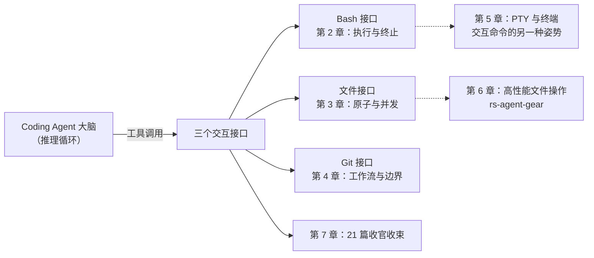
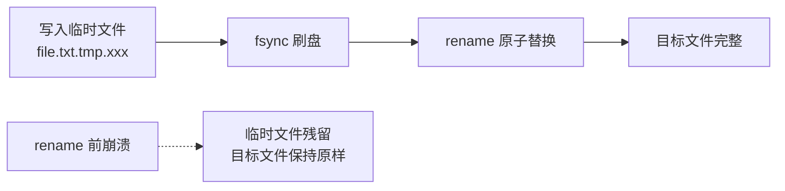
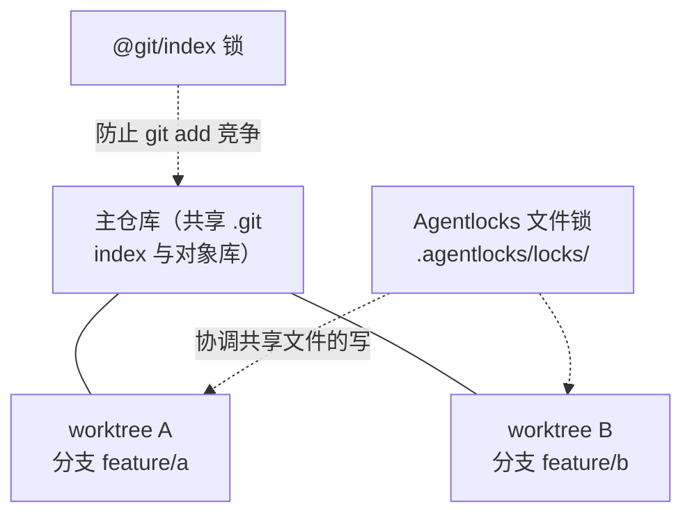
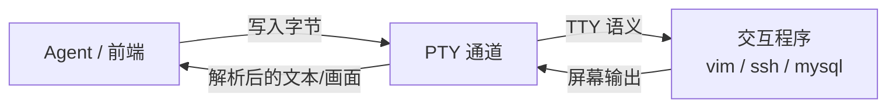
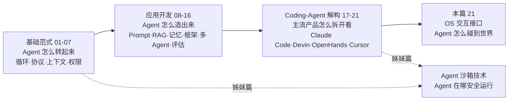

# 21 Agent 与操作系统的交互接口——Bash、文件与 Git 的工程化

> [!abstract] 摘要
> Coding Agent 与普通 LLM 应用的分野，不在推理而在行动——它需要一双能真正碰到操作系统的「手」。本文是 [[LLM/Agent技术/00 专栏导览|Agent 技术专栏]] 的收官篇，讨论这双手的三个指节：Bash 执行、文件读写与 Git 操作。前 20 篇建立的是 Agent 的「脑」与「身」——范式、协议、上下文、权限，以及应用开发的方法论，本文回答的是「手」的问题——当 Agent 执行一条 shell 命令、改写一个文件、提交一次 commit 时，背后有哪些论文不写、却决定系统能否上线的工程决策。全文沿三条线展开：Bash 接口的 shell wrapping、双重超时（inactivity timeout 与 wall-clock backstop）、head+tail 输出截断、两阶段终止（SIGTERM→grace→SIGKILL）、stdin 立即关闭与结构化错误，并对比 Claude Code 的每命令独立进程与 OpenHands 的持久 pexpect 会话两种模型；文件接口的 temp-fsync-rename 原子写入、str_replace/apply_patch 结构化编辑、大文件分页、二进制处理与 Agentlocks 建议性文件锁；Git 接口的 commit/branch/PR/worktree 工作流与安全边界。最后一章补上终端与 PTY 技术，并以二十一篇文章的完整主线作结。这些机制的共性是：把「命令可能失控、文件可能写坏、并发可能踩踏」当作默认前提来设计，而非当作例外来处理。核心认知：Agent 的可靠性不取决于模型多聪明，而取决于这些「无聊的工程细节」是否被认真对待。

---

## 第 1 章 从「会思考」到「会做事」

### 1.1 论文研究大脑，产品需要手

2025 年上半年，Claude Code 以研究预览身份落地终端，Codex CLI 随之开源，OpenHands 从 OpenDevin 更名后主打开源沙箱化 Agent——这半年里，行业对 Coding Agent 的讨论重心悄然从「模型能推理到什么程度」转移到「Agent 能不能在真实代码库里把活干完」。

这种转移并非偶然。ReAct 范式、Tool Use 与 Function Calling、MCP 协议，这些 [[LLM/Agent技术/基础范式/01 Agent 运行范式全景——从 ReAct 到 Production Agent 的演进|第 1 篇]]到 [[LLM/Agent技术/基础范式/04 MCP 协议深度解析——Agent 与工具的标准化连接|第 4 篇]]讨论的东西，解决的是 Agent 的「脑」：如何循环、如何调用工具、工具之间如何约定协议。但一个只在纸面上会调用工具的 Agent，距离「帮人把代码写好」还差着一整套操作系统层面的工程问题——命令执行到一半卡住怎么办，写入文件写到一半崩溃怎么办，两个 Agent 同时改一个文件怎么办。

笔者习惯把这种差距概括为一句话：**论文研究的是大脑，产品需要的是手**。ReAct 论文可以假设工具调用「一次返回结果」，产品却必须回答「结果不返回时做什么」；协议文档可以定义「写入文件」的语义，产品却必须回答「写一半断电时文件是什么状态」。前者是知识问题，后者是工程问题，而 2025 年以来主流 Coding Agent 在能力上的差距，恰恰大量集中在后者。

可以把 Coding Agent 想象成一位只有大脑、没有四肢的工程师，它必须通过几根「义肢」接触世界。义肢的接口做得好不好，直接决定这位工程师是能干活还是永远停在想象里。与沙箱技术做分工（见 [[LLM/Agent沙箱技术/00 专栏导览|Agent 沙箱技术]] 姊妹篇）：沙箱回答的是「这双手在哪碰世界」——用 namespace、cgroups、MicroVM 画出一条隔离边界；本篇回答的是「这双手怎么碰世界」——边界之内，Bash、文件、Git 三个接口各自的工程化细节。前者管安全，后者管可靠，两者叠加才是一个能上线的 Coding Agent 的执行底座。

### 1.2 三个接口的分工

Coding Agent 与操作系统的交互可以收敛到三个接口，它们覆盖了 Agent「做事」的全部动作：

| 接口 | 覆盖动作 | 主要风险 | 典型失败形态 |
| :--- | :--- | :--- | :--- |
| **Bash** | 任意命令：安装依赖、跑测试、构建、启动服务 | 命令不收敛、交互卡死、进程树失控 | 超时后子进程残留、cat 永久挂起 |
| **文件** | 读写、编辑、持久化、搜索 | 写入不完整、并发覆盖、上下文毒化 | 半写入的代码文件、两个 Agent 互相覆盖 |
| **Git** | 版本状态、分支、提交、协作 | 工作流混乱、历史被覆盖、并发竞争 | 直接提交 main、force push 覆盖历史 |

三条接口的风险形态完全不同，工程化手段也因此各异。Bash 是三个接口里权限最大也最危险的一个——通过它 Agent 可以执行任意命令，于是工程化的重点是「让命令安全可控地执行」；文件接口是持久化的主通道，于是重点是「原子性、结构化与并发控制」；Git 接口管理的是 Agent 工作的「状态与历史」，于是重点是「工作流纪律与安全边界」。

需要先说明一点：这三个接口并非彼此独立。Agent 常常先通过 Bash 跑 `git status`，再通过文件接口编辑，最后又回到 Bash 提交——一个典型任务会在三者之间反复穿梭。正因如此，任何一个接口的工程化缺失，都会在真实任务里以链条方式放大。譬如 Bash 超时后没清干净进程树，紧接着的文件写入就可能拿到被占用的构建产物；Git 提交前没做锁检查，两个 Agent 的并行工作就可能静默丢失。笔者在本篇结尾会把这三条线重新收到一起，但先从最核心的 Bash 说起。

### 1.3 从裸 shell 到专用工具

三个接口的工程化演进有一个共同的起点：早期的 Coding Agent 几乎全靠一条 Bash 工具走天下——读文件用 `cat`，搜索用 `grep`，编辑用 `sed`，提交用 `git commit`。今天的局面完全不同，主流产品都演化出了一套「专用工具优先」的纪律。

Claude Code 的系统提示明确要求搜索一律用 Grep 工具而非 `grep` 命令；Codex 的提示指南写得同样直接——「如果一个动作存在专用工具，就优先用工具而不是 shell 命令，譬如用 `read_file` 而不是 `cat`」；Kimi Code CLI 的 Bash 工具文档甚至把这种翻译规则逐条列出：`cat`/`head`/`tail` 换成 Read，`sed`/`awk` 换成 Edit，`echo > file` 换成 Write，`find` 换成 Glob，`grep` 换成 Grep。

为什么专用工具能取代裸 shell？三层理由。其一，token 效率——Edit 只要生成被修改的那一小段，而 `sed` 整条命令和整个输出都要进上下文；其二，权限粒度——可以对 `Read(/secrets/**)` 设 deny 规则，却很难对 `cat /secrets/*` 写等价规则；其三，输出结构化——工具返回的是字段明确的 JSON 而非掺杂转义序列的终端文本。但 shell 永远不可能被完全替代：管道、环境变量、进程控制、包管理器、构建工具这类「真正交互式或多步骤」的操作，只能由 Bash 承担，这层边界在本章展开。

### 1.4 本章地图

行文至此，先给一个全局地图，后文各章按图索骥。



需要说明的是，本文刻意没有把 PTY 单列为第四个接口——它更多是 Bash 接口在「交互命令」场景下的延伸，因此放在第 5 章作为补充维度讨论。

---

## 第 2 章 Bash 执行的工程化——从「执行命令」到「安全可控」

### 2.1 为什么 Bash 工具不简单

表面上看，Bash 工具就是「执行一条 shell 命令并返回输出」，用 `child_process.spawn` 或类似 API 即可实现。但生产环境的 Bash 工具需要处理一连串边界情况，每一个都可能让 Agent 卡死、崩溃或产生不可预期行为：命令不退出怎么办，输出超长怎么办，命令等待输入怎么办，进程衍生出子进程又怎么办，跨平台怎么适配，超时怎么终止，失败怎么表达。

如果把 Bash 工具比作厨房里的一台代客烹饪的机器，那么「会开火」只是第一步，真正决定体验的是它如何处理「菜烧糊了」「锅烧干了」「客人催单了」这些异常——这些恰恰是最难的部分。下面按「适配→超时→终止→截断→输入→错误→模型」的顺序逐一拆解。

### 2.2 Shell wrapping 与跨平台适配

Coding Agent 需要在不同操作系统上工作——Linux/macOS 用 POSIX bash，Windows 用 PowerShell 或 Git Bash。Bash 工具不应直接调用底层进程 API，而应通过一个 shell 执行抽象层（譬如 spec-kimi-code 中的 `Kaos`），由抽象层根据注入的 `Environment` 检测结果选择正确的 shell。

**环境检测**：
- `shellName`：当前系统的 shell 名称（bash/zsh/PowerShell）
- `shellPath`：shell 可执行文件的路径
- 跨平台映射：POSIX bash（Linux/Mac）→ Git Bash（Windows）

跨平台适配不只是「选对 shell」这么简单，还牵扯到启动环境的差异。Claude Code 的做法是：会话启动时 source 用户的 `~/.zshrc`、`~/.bashrc` 或 `~/.profile`，把其中定义的别名、函数与 shell 选项捕获下来，套用到之后的每一条命令上——这样用户在 shell 里配好的 `ll`、`gs` 之类习惯在 Agent 里依然可用。Windows 上则单独提供 PowerShell 工具，并配独立于 Bash 的权限规则格式。适配层解决的是「命令在谁的语境里执行」，这是后面所有机制的地基，地基不稳，超时和截断做得再好也白搭。

### 2.3 超时控制——双重边界

生产 Bash 工具需要两种超时机制，缺一不可。

**Inactivity Timeout（不活动超时）**：命令在 N 秒内没有新输出了就超时。这捕获「命令 hang 住了」的情况——如 `git clone` 卡在网络等待、`npm install` 卡在依赖解析。

**Wall-clock Backstop（总时间上限）**：不管有没有输出，命令执行超过 M 秒就超时。这捕获「命令一直在输出但不收敛」的情况——如 `tail -f` 无限跟随、一个死循环脚本不断打印。

```typescript
// 典型的 Bash 工具超时配置
{
  command: string,           // 要执行的命令
  timeout: number,           // 超时秒数，默认 60s
  // 内部实现：
  // - inactivity timeout: N 秒无新输出 → 超时
  // - wall-clock backstop: 总执行时间 > timeout → 超时
}
```

两种超时像是厨房里的双层保险：一个定时器盯着「这道菜是不是还在出菜」（inactivity），另一个盯着「整桌菜最多不能超过多少分钟」（wall-clock）。只设前者，一条持续吐垃圾输出的死循环就能无限续命；只设后者，一条其实还在正常推进的慢命令会被误杀。两层各司其职，才覆盖了「不输出」与「不收敛」两类完全不同的失控。

超时的具体取值在主流产品里差异很大，这本身就是个值得对比的工程话题。Claude Code 的 Bash 工具默认 2 分钟超时，模型可以通过 `timeout` 参数申请最长 10 分钟，两个边界都能用 `BASH_DEFAULT_TIMEOUT_MS` 与 `BASH_MAX_TIMEOUT_MS` 覆盖；Codex CLI 的 shell 工具则要求模型显式传 `timeout_ms`，代码里 `DEFAULT_EXEC_COMMAND_TIMEOUT_MS` 的兜底值只有 10 秒，社区对「默认太短」的抱怨持续了很久，直到 2026 年初仍未开放用户可配置的默认超时；Kimi Code CLI 的取值介于两者之间——前台命令默认 60 秒、上限 5 分钟，后台任务默认 10 分钟。

| 产品 | 默认超时 | 模型可请求上限 | 用户可覆盖 |
| :--- | :--- | :--- | :--- |
| **Claude Code** | 2 分钟 | 10 分钟 | 是（BASH_DEFAULT/MAX_TIMEOUT_MS） |
| **Codex CLI** | 兜底 10 秒 | 模型自传 timeout_ms | 否（长期被社区诟病） |
| **Kimi Code CLI** | 前台 60 秒 | 前台 5 分钟 | 是（配置项） |

超时取值没有标准答案，但有一条共同规律：**默认值宁可短一点，让长任务显式声明**。原因很实际——模型对「这条命令要跑多久」的估计远比用户不可靠，把默认设得太长，一次误判就拖住整个会话。

### 2.4 两阶段终止——SIGTERM → grace → SIGKILL

当命令超时或被取消时，不能直接 `SIGKILL`——这会导致子进程没有机会清理资源（如临时文件、数据库连接、子进程）。但也不能只发 `SIGTERM` 然后无限等待——有些进程会忽略 `SIGTERM`。

**两阶段终止**：
1. 发送 `SIGTERM`——请求子进程「请优雅退出」
2. 等待 grace period（通常 5-10 秒）
3. 如果 grace period 后进程仍存活，发送 `SIGKILL`——强制终止

```typescript
// 两阶段终止伪代码
function killProcessTree(pid: number) {
    process.kill(pid, 'SIGTERM');  // 第一阶段：优雅终止
    setTimeout(() => {
        try {
            process.kill(pid, 'SIGKILL');  // 第二阶段：强制终止
        } catch (e) { /* 进程已退出 */ }
    }, 5000);  // grace period 5 秒
}
```

**killProcessTree 而非 killProcess**：Bash 命令可能 spawn 子进程（如 `npm run build` spawn 编译器进程）。只 kill 直接子进程会留下「孤儿进程」继续运行。`killProcessTree` 递归终止整个进程树——先 kill 所有后代，再 kill 根进程。

这个「进程树」问题在真实产品里踩出的坑比想象中深。Codex CLI 的 Issue #4337 记录了一个典型事故：命令经 `bash -lc` 包装后，超时逻辑只杀掉了 wrapper 进程，它衍生出的孙进程却存活下来，一直握着 stdout/stderr 管道不松手，Codex 的读取任务永远等不到 EOF，整个会话卡死在「Working」状态——复现它的命令只是 `mkfifo` 加一个后台循环写管道再加一个 `cat`。修复方案（PR #5258，2025 年 11 月合并）是：用 `setsid()` 让每个 shell 工具进程自成进程组，超时或 Ctrl-C 时直接对整组发信号，从根上保证「命令的所有后代一起死」。**这印证了本文的母题：终止一个进程是容易的，终止一个进程树才是工程。**

> [!warning] 生产避坑：BackgroundManager 的进程生命周期管理
> 后台命令的生命周期比前台命令更复杂——它可能在当前工具调用返回后仍在运行。需要一个 `BackgroundManager` 来管理后台进程的生命周期：记录所有后台任务、提供 `task_poll` 查看增量输出、`task_stop` 中止任务、在会话关闭时 SIGTERM 所有遗留进程。如果会话关闭时不清理后台进程，这些进程会变成「僵尸进程」持续消耗资源。Claude Code 的做法更进一步：交互模式下按 Ctrl-C 并不会杀死正在运行的命令，而是把它转入后台继续执行（除非命令以 `sleep` 开头），会话结束后再统一回收。

### 2.5 输出截断——head + tail 策略

[[LLM/Agent技术/基础范式/02 ReAct 架构深度解析——Thought-Action-Observation 循环的本质|第 2 篇]]已经讨论了 Observation 毒化问题。Bash 工具的输出截断是 Observation 治理的前线。

**Head + Tail 策略**：当输出超过 `max_lines` 限制时，保留开头 N 行和结尾 M 行，中间用 `... [truncated X lines] ...` 替代。

为什么是 head + tail 而非只保留 head？因为很多命令的重要信息在末尾——错误信息通常在输出的最后几行，测试结果摘要也在末尾。只保留 head 会丢失这些关键信息。

**截断时的文件外化**：当截断实际发生时，完整输出被写入一个临时文件（如 `tmpdir()/zaly-bash/spawn-xxx.log`），截断的 Observation 中包含 `fullOutputPath` 字段——Agent 可以通过 `read_file` 工具查看完整输出。不截断的小输出不写磁盘——避免不必要的 I/O。

```typescript
// Zaly 框架的输出截断实现
interface BashResult {
    output: string;        // 截断后的输出（head + tail）
    truncated: boolean;     // 是否发生了截断
    totalLines: number;     // 原始总行数
    totalBytes: number;     // 原始总字节数
    fullOutputPath?: string; // 完整输出的文件路径（仅截断时有）
}
```

Claude Code 给这套策略定了一个具体的量级：输出默认上限 30,000 字符，超限时把完整输出存进会话目录的文件，回给模型的是一条「文件路径 + 开头一段短预览」，模型需要更多时再去读那个文件，上限可用 `BASH_MAX_OUTPUT_LENGTH` 调高。注意这里与 head+tail 的一个微妙差别——Claude Code 给的是「开头预览 + 全量文件」，Zaly 给的是「开头结尾 + 全量文件」，两者殊途同归：**上下文里只放一个摘要，完整的真相留在磁盘上，按需取用**。这正是 [[LLM/Agent技术/基础范式/06 Prompt 上下文管理——Context Engineering 的艺术|第 6 篇]]的 Just-in-Time Context 在工具输出层的落地。

### 2.6 stdin 立即关闭——防止交互命令 hang

Bash 工具必须**立即关闭 stdin**——否则交互命令会 hang 住等待输入。

```typescript
const child = spawn(shell, [...args, command], {
    cwd,
    stdio: ['ignore', 'pipe', 'pipe'],  // stdin 设为 'ignore' 而非 'pipe'
});
```

`stdio: ['ignore', ...]` 让子进程的 stdin 立即收到 EOF——`cat`、`read`、`python -c 'input()'` 等交互命令会收到 EOF 而非 hang 等待输入。

如果不关闭 stdin，Agent 执行 `cat`（无参数的 cat 会从 stdin 读取）会永久 hang——因为没有任何输入会到达，但 cat 也不会自行退出。这会导致整个 Agent 会话卡死。

关闭 stdin 的代价是 Agent 失去了给交互命令喂输入的通道，于是出现了一组替代方案：需要密码的 `mysql -u root -p` 可以用命令行参数或环境变量传密码（有泄露风险）、用 `expect` 脚本自动化交互、或者干脆把这类命令标记为「不适合 Agent 执行」交给结构化错误处理。产品实践里还有一种折中：Claude Code 的 Bash 工具参数里带 `run_in_background`，对确实需要长交互的命令改走后台任务通道，前台不被拖死。

### 2.7 结构化错误——让 LLM 做差异化决策

Bash 工具的错误返回不应该是简单的异常字符串——而应该是结构化的，让 LLM 能区分不同失败类型并采取不同策略：

```typescript
type BashError = 
    | { kind: "timeout", reason: "inactivity_timeout" | "wall_clock_backstop", partialOutput: string }
    | { kind: "nonzero_exit", exitCode: number, output: string }
    | { kind: "denied", reason: string }  // 权限拒绝
    | { kind: "killed", reason: string }  // 外部信号终止
    | { kind: "io_error", reason: string }
    | { kind: "outside_workspace" }
    | { kind: "interactive_detected" };    // 检测到交互命令
```

**为什么重要**：
- `timeout` → Agent 可以选择重试或换一种方法
- `nonzero_exit` → Agent 可以分析 stderr 输出诊断错误
- `denied` → Agent 知道这个操作不被允许，不应重试
- `interactive_detected` → Agent 知道这个命令需要交互输入，不适合在 Agent 中使用

如果不区分这些类型，所有错误都返回一个字符串，LLM 无法做出差异化决策——可能对「永久不可能成功」的权限拒绝反复重试，浪费资源。

结构化错误的价值在 Codex 的实现里看得格外清楚：超时事件在 TUI 历史里以退出码 124 呈现，同时在返回给模型的工具输出前部插入一段带前缀的 timeout 说明（`build_content_with_timeout`），让模型能明确区分「命令自己失败」和「被工具强制终止」，从而做出不同反应。**错误的结构化程度，决定了 Agent 的恢复策略能精细到什么程度**——这是本章八节机制里离「脑」最近的一环。

> [!info] 核心概念：Bash 工具是 Coding Agent 的「系统接口」
> Bash 工具是 Coding Agent 与操作系统交互的最核心接口——通过它，Agent 可以执行任意命令、安装依赖、运行测试、操作 Git。但「任意命令」意味着「任意风险」——`rm -rf` 可以删除文件、`curl` 可以泄露数据、`git push --force` 可以覆盖历史。Bash 工具的工程化不是「让命令能执行」，而是「让命令安全可控地执行」——超时防止 hang、截断防止毒化、两阶段终止防止僵尸进程、结构化错误防止无效重试。这些工程细节决定了 Agent 在生产环境中是「可靠的助手」还是「危险的负担」。

### 2.8 会话态与无状态——两种 Bash 模型

行文至此，值得把主流产品背后的两种 Bash 设计模型摆到一起对比。它们的差异，本质上是「每次命令从零开始」与「一个持续存在的 shell 会话」的取舍。

Claude Code 走的是无状态路线：每条命令在独立进程里执行。工作目录（cwd）会在项目目录范围内跨命令保留，但环境变量不保留——一条命令里的 `export` 对下一条不可见；别名与函数倒是会从启动文件里持久带入。OpenHands 走的则是有状态路线：沙箱内的 runtime client 用 `pexpect` 维护一个与 `/bin/bash` 的常驻交互会话，命令在同一个 shell 里依次执行，输出按 PS1 提示符标记切分——这保证了 `cd`、环境变量、venv 激活这类状态天然跨命令延续。

| 维度 | Claude Code（无状态） | OpenHands（有状态 pexpect 会话） |
| :--- | :--- | :--- |
| **命令载体** | 每条命令独立进程 | 常驻 bash 会话内顺序执行 |
| **cwd/env 延续** | cwd 部分延续，env 不延续 | 全部延续 |
| **交互命令** | 依赖 stdin 关闭与后台化 | 可以原地喂输入 |
| **输出解析** | 直接收管道 | 按 PS1 标记切分屏幕内容 |
| **隔离性** | 强（命令互不污染） | 弱（一条命令可能污染会话状态） |

两种模型各有代价。无状态模型的代价是 Agent 每次都要重新声明环境（激活 venv、设置变量），但换来的是命令间互不污染、超时和终止都极其干净；有状态模型的代价是会话状态可能被一条坏命令弄脏（譬如把 PS1 改了、把环境搞乱了），且输出解析依赖对提示符的假设。OpenHands 团队很清楚这个风险，`bash.py` 里对「上一条命令未结束」「提示符匹配失败」都有专门的兜底逻辑。这是本章最重要的一组取舍，也是后文文件锁、worktree 讨论的前提：**接口越是无状态，越省心；越是有状态，越要防污染**。

---

## 第 3 章 文件读写的工程化——原子性、结构化编辑与并发控制

### 3.1 原子写入——temp-fsync-rename 模式

当 Agent 写入文件时，如果在写入过程中崩溃（进程被 kill、机器断电），部分写入的文件会处于「损坏」状态——既不是原始内容，也不是完整的新内容。这对于代码文件是灾难性的——一个半写入的 Python 文件无法被解释器加载，导致整个项目不可用。

**原子写入模式**：
1. 写入到一个临时文件（如 `file.txt.tmp.xxx`）
2. 对临时文件执行 `fsync()`——确保数据从 OS 缓冲区刷到磁盘
3. 用 `rename()` 将临时文件重命名为目标文件——rename 在同一文件系统上是原子的

```typescript
async function atomicWriteFile(path: string, content: string) {
    const tmpPath = `${path}.tmp.${Date.now()}`;
    await fs.writeFile(tmpPath, content);
    await fs.fsync(fs.openSync(tmpPath, 'r+'));  // 确保刷盘
    await fs.rename(tmpPath, path);  // 原子重命名
}
```

**为什么 rename 是原子的**：在 POSIX 文件系统上，`rename` 是一个原子操作——要么成功（目标文件被替换），要么失败（目标文件不变）。不存在「rename 到一半」的中间状态。因此，即使进程在 rename 之前崩溃，原始文件仍然完好；rename 之后崩溃，新文件已经完整。

原子写入像「先在新纸上把全文誊写完毕，再一把换掉旧纸」，而不是「一边擦一边写」。技术限定是：这个「换」的动作必须发生在同一文件系统内，如果临时文件在 `/tmp`、目标文件在 `/home`，跨文件系统的 `rename` 退化为「复制+删除」，原子性随之消失——所以实现上临时文件必须放在目标文件的同目录（`${target_dir}/.${filename}.tmp.${random}`），而不是系统临时目录。



**Fast Write 模式**：某些场景下可以跳过 fsync（不保证刷盘）换取约 30 倍的写入速度——适用于「丢失了可以重新生成」的临时文件或缓存，但不适用于代码文件。这是一组典型的「一致性换性能」权衡：代码是用户的资产，丢不起；构建缓存丢了重来就行。

### 3.2 结构化编辑——str_replace 与 apply_patch

原子写入解决了「写完整」，却没有解决「写对地方」。现代 Coding Agent 普遍抛弃「整文件覆盖」式的编辑，改用结构化编辑，这背后是两条主线。

Claude Code 的 Edit 工具是精确字符串替换：模型给出 `old_string` 与 `new_string`，工具要求在文件中**唯一匹配**，匹配失败就报错让模型重来。这条约束迫使模型精确指出「改哪一段、改成什么」，而非「重新生成整个文件」。收益有二：token 只花在变更本身；不会因为重新生成而把文件其他地方悄悄改坏。Write 工具则要求覆盖前必须先 Read 过该文件，确保模型「知道自己在覆盖什么」。

Codex 的 `apply_patch` 走了另一条路——一种裁剪过的、面向 diff 的补丁语言：`*** Begin Patch` 开头，`*** Update File: 路径` 声明文件，`@@` 引入上下文行，`-`/`+` 表达增删，`*** End Patch` 收尾。它用 LARK 语法解析补丁，支持一次补丁跨多个文件，整体以事务语义应用——任一 hunk 不匹配则整批失败，不留半成品。Codex 之所以选补丁语言而非单一字符串替换，是因为一次自主任务常常要同时改十几个文件，事务化的多文件补丁让「要么全成、要么全败」成为可能。

| 维度 | Claude Code Edit | Codex apply_patch |
| :--- | :--- | :--- |
| **编辑原语** | old_string/new_string 精确替换 | 上下文 + 增删行的补丁 |
| **作用域** | 单文件单点 | 多文件多 hunk 事务化 |
| **匹配失败处理** | 报错重来 | 整批失败，无半成品 |
| **适用场景** | 交互式逐处修改 | 自主长任务批量修改 |

两条主线并不互斥，反而互为镜像：str_replace 胜在简单可靠，补丁胜在批量与事务。共同点是它们都避免了「整文件重写」这一最粗暴也最危险的编辑方式——**编辑的粒度越细，非预期改动的空间就越小**。

### 3.3 大文件分页读取

[[LLM/Agent技术/基础范式/02 ReAct 架构深度解析——Thought-Action-Observation 循环的本质|第 2 篇]]讨论的 Observation 治理策略在文件读取上的具体实现——分页读取：

```python
# 先读前 100 行看文件结构
read_file("large_file.py", limit=100)

# 如果需要看更多，从第 100 行继续
read_file("large_file.py", offset=100, limit=100)

# 或者用 Grep 搜索特定内容，只读匹配部分
grep("def authenticate", "large_file.py")
```

SWE-agent 的 ACI 设计原则之一就是「专用文件查看器每轮只显示 100 行」——这与 Claude Code 的 `read_file` 工具的 `offset`/`limit` 参数设计一致。分页读取的本质是「先看结构、再按需深入」，配合 Grep 做定向检索，让上下文里永远只放「当前用得着的那一页」。这与第 2 章的输出截断是同一个原则的两副面孔：**进上下文的东西要少而精，完整的真相留在文件系统里**。

### 3.4 二进制文件与多模态处理

Agent 可能需要读取图片、PDF、二进制数据文件。文本工具无法直接处理二进制内容——需要特殊处理。

**Base64 编码**：将二进制数据编码为 Base64 文本。代价是体积增加约 33%。限制：`MAX_BINARY_READ_SIZE_BYTES = 10MB`——保持 inline multimodal payload 在 LLM provider 的限制内。

**写入**：二进制文件通过专门的 `upload_file` 工具写入，而非普通的 `write_file`——因为 write_file 期望文本内容。

二进制处理在 2025 年后变得更常见：多模态模型可以直接看图、读 PDF，于是读工具普遍支持图片与 PDF 的 inline 展示。但「二进制」与「文本」的边界依然是工程问题——误把二进制当文本读，会产生不可见的控制字符污染上下文；误把文本当二进制传，又会无谓膨胀 payload。实践上的通用守则是：能按文本处理的一律按文本走，只有文本无意义的才编码，且永远设置体积上限。

### 3.5 Agentlocks——多 Agent 文件锁

当多个 Agent（或一个 Agent 的多个 Subagent）在同一个 Git worktree 中工作时，会产生三个冲突点：

**冲突一：两个 Worker 编辑同一文件**。Worker A 和 Worker B 同时编辑 `auth.ts`——后写入的会覆盖先写入的工作。

**冲突二：过时的「我在处理这个」标记**。Worker A 声明「我在处理 auth.ts」，但 A 崩溃了或转去做了别的——标记一直挂着，其他 Worker 看到「auth.ts 有人在做」就不去碰它，导致任务卡住。

**冲突三：Git index 竞争**。两个 Worker 同时 `git add`——index 文件竞争，可能产生损坏或 inconsistent 状态。

**Agentlocks 的解决方案**：

**Advisory File Locks（建议性文件锁）**：Agent 在编辑文件前先 `acquire` 锁，编辑完成后 `release` 锁。锁信息存储在 `.agentlocks/locks/` 目录下的文件中——「No daemon, no database, no hosted service. Just files.」（不需要守护进程，不需要数据库，不需要托管服务，只有文件）。

**TTL Leases + Liveness Classification**：锁有 TTL（生存时间）——如果锁的持有者在 TTL 内没有 `refresh`，锁自动过期。`prune` 命令清理过期的锁。这解决了「过时标记」问题——崩溃的 Agent 持有的锁会在 TTL 后自动释放。

**@git/index 锁**：`git begin` 获取合成的 `@git/index` 锁，`git end` 释放——防止两个 Worker 同时操作 Git index。

**Agent-Native 设计**：
- 身份来自 harness（不需要手动管理 Agent ID）
- 状态报告命令输出 JSON（LLM 友好）
- 错误信息指出确切的修复方法
- 契约告诉 Agent 下一步该做什么

> [!warning] 生产避坑：Agentlocks 是建议性的，不是强制的
> Agentlocks 的文档明确指出：「It is advisory: it coordinates agents that check the lock before writing. It makes overlaps visible and scriptable, but it does not stop a process that ignores the protocol.」——Agentlocks 只协调「检查锁再写入」的 Agent，不阻止「忽略协议直接写入」的进程。如果你的 Agent 因为 bug 或 prompt injection 绕过了锁检查，Agentlocks 无法阻止它。真正的文件并发控制仍然需要操作系统级的文件锁（flock）或分布式锁服务。Agentlocks 的价值是「让冲突可见且可编程」，而非「强制防止冲突」。

文件锁这类方案在 2025-2026 年逐渐形成一个小的生态位，但还远未标准化。除了 simke9445 的 agentlocks，社区还出现了 agent-locks 这类 MCP 变体——它把锁文件存放在仓库共享的 `.git` 目录（通过 `git rev-parse --git-common-dir` 定位），理由是每个 worktree 都共享同一个真实 `.git` 目录，锁视图因此天然跨 worktree 可见，且 git 永远不会把这些文件提交进历史。对比之下，agentlocks 把锁放在工作区内的 `.agentlocks/`，简单直接，但要靠 `.gitignore` 防止误提交。两类方案都停留在「少数开源项目」的量级，尚未有巨头站队，这本身说明多 Agent 共享工作区的冲突治理仍是一个开放问题。

从更抽象的层面看，Agentlocks 把「并发控制」从操作系统进程内搬到了 Agent 协议层：它不强求内核级强制，而是假设参与者都讲道理，用「让冲突可见、可脚本化」换取「零守护进程、零特权、零基础设施」。这是一次典型的「复杂性转移」——把强制的复杂性换成了协作的复杂性，代价是放弃了强制力。**它适合的是「同一组织内的 Agent 协作」，不适合对抗性场景**。

---

## 第 4 章 Git 操作的工程化——从 commit 到 worktree

### 4.1 Agent 的 Git 工作流

Coding Agent 的 Git 操作通常通过 Bash 工具执行 `git` 命令，而非独立的 Git 工具。但 Agent 的系统提示包含 Git 操作的最佳实践指导，[[LLM/Agent技术/Coding-Agent解构/17 Claude Code 架构解构——Anthropic 的 CLI Agent 设计哲学|第 17 篇]]已经概述了这套指导，本章从工程化的角度拆开它的每个环节。

Git 之于 Agent，相当于「工作台账」之于人类工程师：它不仅记录历史，更是 Agent 判断「我改了什么、该提交什么、怎么回滚」的坐标系。正因为 Git 是状态之源，它的工程化重点落在两处——**让提交符合纪律**（消息格式、暂存范围、敏感信息）与**让并发不互相踩踏**（分支、worktree、锁）。

### 4.2 Commit 工作流

**Conventional Commits 格式**：Agent 的 commit message 遵循 Conventional Commits 规范——`type(scope): description`，如 `feat(auth): add OAuth2 support`、`fix(api): handle null response`。

**Auto-stage**：`git add -A` 自动暂存所有修改——Agent 不需要手动选择要暂存的文件。

**Secret Check**：提交前检查无敏感文件——`.env`、`.pem`、`.key`、`.p12`、`id_rsa` 等。如果检测到敏感文件被暂存，拒绝提交并警告。

**Type 自动推断**：根据修改内容自动推断 commit 类型——新功能=`feat`、bug 修复=`fix`、文档=`docs`、重构=`refactor`、测试=`test` 等。

auto-stage 与 secret check 是一对必须同时存在的机制：`git add -A` 的方便之处是「不用挑文件」，危险之处恰恰也是「不挑文件」——一旦工作区里躺着个 `.env`，它就会被无差别暂存。所以 secret check 本质上是给 auto-stage 上的安全阀。这提示了一条规律：**凡是「自动化替你决定」的步骤，都要配一个「替你把关」的反向检查**。

另一个工程化方向是用 hooks 把纪律固化成强制。Claude Code 的实践很有代表性：所有 Git 操作都经由 Bash 工具，因此可以在 PreToolUse 钩子里拦截 `git commit`——检查当前分支是不是 main、消息是否符合格式，不合规就返回错误阻断并告知 Agent 如何修正。社区方案（如 claude-code-flow 的 checkpoint hooks）更进一步，用 PreToolUse:Edit / PostToolUse:Edit 在每个编辑前后自动创建 git checkpoint，让任何一步都可回滚。这里的取舍是：检查放在「提示语」层（靠 Agent 自觉）还是「钩子」层（强制拦截），前者灵活但会漏，后者可靠但需要维护。

### 4.3 Branch 与同步

**命名规范**：`username/type/slug`，如 `alice/feat/oauth2-support`、`bob/fix/null-response`。

**保持同步**：定期 `git fetch origin` + `rebase origin/main`——确保分支与主干同步，减少 merge conflict。

分支命名规范的价值常被低估：对 Agent 而言，分支名是它「认领工作」的标签，命名里带上类型与任务 slug，让多个并行会话看一眼分支名就知道各自在干什么，也为后续自动化的分支清理提供了依据。rebase 而非 merge 的选择则直接关系到冲突概率——rebase 把本地提交「重放到」主干最新状态上，冲突在本地解决，避免留下大量 merge commit 噪音。

### 4.4 PR 工作流

**Pre-PR Checklist**：
1. 测试通过——`npm test` 或等效命令
2. 分支与 main 同步——`git fetch origin && git rebase origin/main`
3. Review diff——`git diff origin/main...HEAD` 检查所有修改

**使用 gh CLI**：
```bash
gh pr create --title "feat: add OAuth2 support" --body "..." --base main
gh pr create --draft  # 创建 Draft PR
gh pr merge --squash --delete-branch  # Squash merge 并删除分支
```

PR 工作流对 Agent 的意义不止于「把改动发出去」。Draft PR 让 Agent 可以在工作未完时先立一个「工作区」，用 CI 的反馈闭环验证自己的改动；squash merge 则保证了主干历史的干净——对自动化工作流尤其重要，因为后续的冲突解决、回滚、bisect 都依赖一个可读的历史。**Agent 越自主，它留下的历史就越需要被人与后续 Agent 理解**，这是 Git 纪律对自主编码的第一条要求。

### 4.5 Git Worktree——并行开发隔离

当多个 Agent 会话并行工作时，如果它们在同一个仓库的同一个分支上工作，会产生文件冲突。Git worktree 解决了这个问题：

```bash
# 为 Agent A 创建独立 worktree
git worktree add ../project-agent-a feature/agent-a-task

# 为 Agent B 创建独立 worktree
git worktree add ../project-agent-b feature/agent-b-task
```

每个 worktree 有独立的工作目录和独立的分支——Agent A 在 `../project-agent-a` 中工作，Agent B 在 `../project-agent-b` 中工作，互不干扰。

**与 Agentlocks 的配合**：如果多个 Agent 必须在同一个 worktree 中工作（如共享同一个分支），Agentlocks 的文件锁和 `@git/index` 锁提供了并发控制。

> [!info] 核心概念：Worktree 是 Agent 并行开发的「廉价隔离」
> Git worktree 相比 Docker 容器或 VM 是一种「轻量级隔离」——它不隔离进程或文件系统，只隔离工作目录和分支。Agent A 和 Agent B 的进程仍然在同一台机器上运行，可以访问彼此的 worktree 目录。但对于「不主动干扰对方」的 Agent，worktree 提供了足够的隔离——每个 Agent 在自己的目录中工作，修改自己的文件，提交到自己的分支，不需要担心覆盖对方的工作。Claude Code 的 Agent View 自动为每个后台会话创建独立的 worktree——这是「并行开发不需要 Docker」的实践。

Worktree 隔离正在从「开发者手动的技巧」变成「Agent 产品的原生能力」。Claude Code 提供了原生的 `EnterWorktree` 工具：进入一个创建在 `.claude/worktrees/` 目录下的隔离 worktree 会话，任务完成后 `ExitWorktree` 回到原目录——worktree 的生命周期被工具化，Agent 自己就能管理。Codex 也在 2025 年 9 月以实验姿态提交过 `enable_git_worktree` 配置，为每个 Agent 自动创建 detached worktree（PR #3768，最终未合并），意图是为多 Agent 并行与 Best-of-N 采样铺路，其负责人坦言「复会时 worktree 被删掉会很麻烦」——这个坦白恰好点出了 worktree 工程化的另一面：**隔离带来并行，也带来生命周期管理的负担**，被删、被挪、被合并都是要处理的边界。



### 4.6 安全边界与防线

Git 接口的工程化还有一个容易被忽略的维度：安全边界。它的风险清单与 Bash 接口不同——Bash 的危险是即时的（命令当场执行），Git 的危险是滞后的（历史一旦污染，代价会持续到之后每一次 rebase、回滚、bisect）。主要防线有四层。

第一层是**提交前校验**：secret check 拦截敏感文件，commit hooks 强制消息格式与分支纪律。第二层是**push 防线**：`git push --force` 可以覆盖远端历史，多数团队对 Agent 默认禁止 force push，改用 `--force-with-lease`（只在远端确实是你上次看到的状态时才强制推送）作为折中。第三层是**并发防线**：Agentlocks 的 `git verify` 在 commit 前检查「staged paths 是否被锁覆盖」——即使某个 Agent 写入时绕过了锁，提交时的 verify 也能发现「这个文件被改了却没有锁」，把协议违例拦在污染历史之前。第四层是**审查防线**：PR 的 review diff 是人工或代码审查介入的窗口，也是 Agent 输出质量的最后一道闸。

这一章从 commit 到 worktree 再到防线，全部建立在同一个前提上：**Git 是 Agent 唯一的「撤销按钮」**。原子写入只保护单文件，Bash 超时只保护单命令，而 Git 保护的是整个工作区的可回滚性——因此它值得配最强的工作流纪律。

---

## 第 5 章 终端与 PTY——Agent 的「眼睛」

### 5.1 为什么 Agent 需要 PTY

到目前为止，我们讨论的 Bash 工具都假设命令在管道模式下执行：stdout/stderr 被捕获、返回字符串。但有一类命令在这种模式下活不下去——需要真实终端（TTY）的交互程序。

`ssh`、`vim`、`htop`、`mysql` 这类程序启动时会检查自己是否连接了 TTY：有 TTY 就启用交互模式、颜色、光标控制；没有 TTY 要么直接拒绝运行（`vim: not a terminal`），要么降级为无交互的批处理模式。一个只有管道、没有终端的 Agent，本质上是个「被蒙住眼睛的盲操作者」——它能看到输出字节流，却看不到屏幕的二维状态。

**伪终端（PTY）**就是给进程一张「假屏幕」：内核在程序与终端模拟器之间垫了一层双向通道，程序以为自己在真实终端里，实际在跟一个模拟的屏幕对话。PTY 之于 Agent，像给那个盲操作者装了一副能「看懂屏幕」的眼睛：程序输出的光标移动、颜色、进度条都被如实呈现，Agent（或其前端）可以据此判断「这个命令现在进行到哪一步」。



### 5.2 PTY 的技术栈

PTY 的工程实现已经有一条成熟的技术链。底层是各类 PTY 库：Node 生态用 `node-pty`（微软维护，也有 `@lydell/node-pty` 等 fork，Bun 生态用 `bun-pty`），Rust 生态用 `portable-pty`（wezterm 团队维护），它们封装了各平台创建伪终端的系统调用。上层是终端模拟器：前端普遍用 `xterm.js` 渲染「屏幕」，服务端则维护一份终端状态，把屏幕内容按需喂给模型或推给浏览器。

OpenCode 的实现是这套技术栈的典型样本：内置终端面板用 `bun-pty` 起 PTY 进程，WebSocket 把输出实时推给 `xterm.js` 前端，终端用 2MB 环形缓冲做回放，`TERM=xterm-256color` 保证颜色语义；同一个仓库里，Agent 的 bash 工具却仍是「每次 spawn 新 shell」的管道模式——社区为此提了专门的 feature request，想把 PTY 面板暴露成 Agent 的工具，让交互命令、会话状态、实时可见三件事一次解决。这个「两条腿走路」的现状很能说明问题：**产品愿意为「人看的终端」花 PTY 的成本，却还没为「Agent 用的终端」花同样的成本**。

OpenHands 的路线稍不同：沙箱内的 runtime client 用 `pexpect` 持有一个真实 bash 会话（第 2.8 节已述），UI 的 Terminal 标签页则通过 SSE 端点流式接收命令输出（PR #8384），后来又有流式执行模式 `CmdRunStreamAction` 的探索——它的 PTY 化程度介于「纯管道」与「真 PTY」之间，靠 pexpect 在管道上模拟了交互。姊妹篇 [[LLM/Agent沙箱技术/00 专栏导览|Agent 沙箱技术]] 中的 OpenSandbox execd 则把 PTY 作为盒内命令执行的正式通道之一，与 SSE 事件流并列提供。

### 5.3 流式输出与中断处理

PTY 与管道之争在「流式」维度上会合。无论哪种模式，长命令的输出都不该等到结束才一次性返回——模型需要尽早看到输出以决定下一步。Claude Code 的 TUI 在命令运行期间就把 stdout/stderr 流进正在运行的 Bash 工具卡片；OpenHands 用 SSE 把命令输出增量推给前端；Codex 的 TUI 同样实时渲染工具输出。流式的工程含义是：**Observation 不是「命令结束后的快照」，而是「命令进行中的连续流」**，这让 Agent 可以对长时间运行的测试、构建做中途干预。

中断处理则是流式的反面。用户按 Ctrl-C 时，终止信号要顺着「用户 → 前端 → PTY/进程组 → 命令」的链路正确传递——Codex 的进程组方案（第 2.4 节）在这里同样适用，对整组发信号而不是对单个 wrapper。Claude Code 的交互模式则选择「把命令转入后台」而非杀死：除非命令以 `sleep` 开头（那是用户明确想停的），Ctrl-C 只是让 Agent 不再等待，命令继续在后台跑，稍后可通过任务输出读取。这一反一正两种默认，反映的是对「中断」的两种理解：**中断是终止（杀死）还是降级（后台化）**，取决于产品想让用户多容易放弃一条正在进行的命令。

### 5.4 PTY 的代价与取舍

PTY 不是免费的。它的三个代价值得摆到台面上。

其一，**输出解析复杂**。PTY 输出是掺杂 ANSI 转义序列的屏幕字节流，颜色、光标移动、清除行都混在其中。管道模式拿到的是「干净」的文本，PTY 模式必须先解析转义序列、重构「屏幕状态」，才能得到可读的 Observation——pexpect 靠 PS1 提示符正则切分输出，就是在用「假设提示符长什么样」换取解析的可行性，一旦命令输出里恰好包含 PS1 样式的字符串，切分就会出错。

其二，**语义信息丢失**。屏幕是给眼睛看的，不是给程序读的——一个覆盖式进度条在屏幕上「看起来很好」，在文本流里却是一堆 `\r` 和残行。管道模式拿不到进度条，但能拿到完整 stdout；PTY 模式看到「画面」，却未必拿得到程序内部的结构化数据。

其三，**状态污染风险**。有状态会话里一条命令可以把终端状态搞乱（改了 PS1、开了 alternate screen 没退），后续命令的输出解析全部失灵。

于是形成了目前行业的一个务实共识：**工具内执行走管道捕获，交互观察走 PTY**。Agent 的「手」用管道——干净、可解析、可截断；Agent 的「眼睛」用 PTY——只为那些真的需要屏幕的交互程序服务。两种姿势各有适用边界，不存在谁取代谁。

---

## 第 6 章 高性能文件操作——rs-agent-gear

### 6.1 为什么需要专用文件操作库

标准的文件操作 API（如 Node.js 的 `fs` 或 Python 的 `os`）是为通用场景设计的。但 Coding Agent 的文件操作有特殊需求——大量并行读写、频繁的 glob 模式匹配、大文件处理、原子写入保证。

**rs-agent-gear** 是一个 Rust 实现的高性能文件操作库，专为 AI Agent 设计：

**Stateful Indexing（有状态索引）**：LRU 缓存的 glob 模式匹配结果——如果 Agent 多次用相同的 glob 模式查找文件，第二次直接从缓存返回，无需重新扫描文件系统。

**Batch I/O（批量 I/O）**：并行读写多个文件——当 Agent 需要同时读取 5 个文件时，并行执行而非串行。

**Atomic Writes（原子写入）**：内置 temp-fsync-rename 原子写入——不需要开发者自己实现。

**Large File Support（大文件支持）**：优化的分页读取和 mmap 支持——处理大文件时不需要全部加载到内存。

### 6.2 为什么用 Rust

文件操作是 I/O 密集型任务，Rust 的零成本抽象和系统级控制使其在 I/O 密集场景下比 JavaScript/Python 快数倍。同时，Rust 的内存安全保证了文件操作不会因为内存错误导致数据损坏。

rs-agent-gear 通常作为 Node.js/Python Agent 的原生扩展（NAPI/PyO3）使用——Agent 的核心逻辑用 JS/Python，文件操作下放到 Rust 实现，通过 FFI 调用。

这就像把高频的搬砖活从「通用工」手里交给「专门的搬运工」：Agent 的业务逻辑仍然用脚本语言写，但最热的路径——glob、批量读写、原子写——由 Rust 用更贴近系统的姿势完成。技术限定是：FFI 边界本身有成本，数据要在两种语言之间来回拷贝，所以下放的必须是「单次调用数据量大、调用次数多」的操作，而不是频繁小调用——否则搬运工在门口接货的时间比搬货还长。

### 6.3 边界与反例

专用文件库并非越大越好，它的适用边界值得单独说清。其一，**有状态索引的失效**：LRU 缓存的 glob 结果在文件系统被外部改动（Agent 自己的 Bash 命令、其他进程、git 操作）后会变陈旧，缓存失效策略必须跟着文件系统变更走，否则 Agent 会对着旧索引反复找不存在的文件。其二，**mmap 的坑**：映射大文件省内存，但写入时会遇到信号（SIGBUS）与脏页刷盘问题，且映射文件被截断会让进程崩溃——对大文件以只读为主时 mmap 才划算。其三，**规模前提**：中小项目、单 Agent 会话里，`fs` 的同步 API 完全够用，引入 Rust 原生扩展反而增加构建与部署复杂度——专用库的收益在「大量并行读写 + 频繁 glob」的场景才兑现，这正是多 Agent 并行或长时自主任务的特征。这也回应了全文的方法论：**没有放之四海皆准的方案，规模与并发度决定该不该上重武器**。

---

## 第 7 章 收官——三根手指与整只手掌

### 7.1 本篇机制主线

至此，三个接口的工程化机制已全部展开，值得把它们串成一条因果链：

1. **Bash 接口**的地基是「安全可控」：shell wrapping 解决「在谁的语境里跑」，双重超时解决「跑多久」，两阶段终止解决「怎么死干净」，head+tail 截断解决「观察多长」，stdin 关闭解决「等不等输入」，结构化错误解决「失败后怎么办」——每一步都在回答「命令失控时系统如何体面退场」。
2. **文件接口**的地基是「原子与精准」：temp-fsync-rename 保证「写不坏」，str_replace/apply_patch 保证「改不错」，分页读取保证「看不毒」，Agentlocks 保证「抢不烂」。
3. **Git 接口**的地基是「纪律与可回滚」：Conventional Commits 与 secret check 保证「历史可读且无泄漏」，worktree 与锁保证「并行不踩踏」，push 防线保证「远端不被污染」。
4. **PTY 与终端**是前三个接口的补充维度：管道解决「程序读」，PTY 解决「屏幕看」，流式把「结果快照」升级为「过程连续体」。

这条链的每一环都不是孤立的：超时不清进程树，截断就可能在等一个永不 EOF 的管道；编辑不原子，Git 提交的就会是半个文件；并发不加锁，worktree 的分支隔离就保护不了共享文件。**可靠性是乘出来的，不是加出来的**——任何一环归零，整条链归零。

### 7.2 二十一篇的一条主线

作为收官篇，不妨把 [[LLM/Agent技术/00 专栏导览|Agent 技术专栏]] 的二十一篇放到一张图上回望。



前 7 篇建立「脑」——Agent 的运行循环、工具协议、上下文管理与权限模型，回答的是「Agent 怎么想」；中间 9 篇建立「身」——Prompt、RAG、记忆、框架、多 Agent 与评估，回答的是「Agent 怎么造」；最后 5 篇解构「手」——Claude Code、Devin、OpenHands/Aider、Cursor 四个产品形态，加上本篇把它们共同依赖的执行接口收拢成一套工程框架，回答的是「Agent 怎么干活」。[[LLM/Agent技术/基础范式/07 Agent 权限与审批模型——人在环路的工程实践|第 7 篇]]的权限审批模型在最后 5 篇里反复以产品形态出现（Claude Code 的六种权限模式、Devin 的交互式规划），它实际上是「脑」与「手」之间的一道闸门：**脑决定想做什么，手决定能做什么，闸门决定做什么之前要问过谁**。

贯穿二十一篇的，始终是同一个方法论：不是「发明」Agent，而是「演进」Agent——从 ReAct 论文到 MCP 协议到终端里的 Bash 工具，每一步都是在前一步暴露的边界问题上叠加一层工程。范式的边界暴露了上下文管理的需求，上下文的边界暴露了权限模型的需求，权限的边界暴露了执行接口的需求。**架构不是发明出来的，是演进出来的**；Coding Agent 尤其如此，因为它的「身体」每长出一寸，都要重新回答一遍「这寸身体怎么安全可控地动」。

### 7.3 落于权衡

把视角收回到本篇的题目上——Bash、文件、Git 三个接口的工程化，本质上是一连串取舍，笔者把它们归纳为四条。

其一，**无状态与有状态**。Claude Code 的每命令独立进程换来干净与可终止，OpenHands 的常驻会话换来状态延续，代价是污染风险。取舍的标准不是「哪个先进」，而是「你的 Agent 任务里跨命令状态多不多、出问题时可不可接受」。

其二，**专用工具与裸 shell**。专用工具赢得 token 效率、权限粒度与结构化输出，shell 赢得完整表达力。取舍的落点是「能用工具就用工具，shell 留给工具表达不了的事」——这不是二选一，而是分界线的管理。

其三，**强制与建议**。Agentlocks 用「建议性」换来零基础设施，用「不强制」付出安全性上限；操作系统级 flock 反之。取舍取决于参与者是否可信、冲突代价是否可承受。

其四，**管道与 PTY**。管道干净可解析但看不见屏幕，PTY 看见屏幕但要吞下解析复杂度。取舍的落点是「程序读用管道，屏幕看用 PTY」，中间地带（流式、后台化、交互命令）按产品形态各取所需。

这四条取舍背后是同一个判断：**Agent 与操作系统的接口没有标准答案，只有与任务形态匹配的答案**。一个小团队的单 Agent 会话不需要 Agentlocks，也不需要 Rust 文件库；一个跑几十个并行 Agent 的平台，则可能四条都要上最重的版本。把「接口工程化」理解为「把可靠性摊到每一层，再按场景选层」，比寻找一个放之四海皆准的模板更重要。

回望整条主线，从「Agent 怎么想」到「Agent 怎么造」再到「Agent 怎么干活」，一个越来越清晰的图景是：Coding Agent 的下一个瓶颈不在模型智能，而在执行底座——谁把 Bash、文件、Git 与沙箱这条「手」的链路磨得越稳，谁就越接近「让 Agent 长时间、多 Agent、高并发地真正把活干完」。至于这条链最终会收敛成什么形态，目前仍然言之尚早，但工程化的方向已经明确：**把不可靠留给系统去兜底，把可靠留给接口去承诺**。

> [!info] 专栏导航
> 本文是 [[LLM/Agent技术/00 专栏导览|Agent 技术专栏]] 的第 21 篇，也是全专栏的收官篇。上一篇 [[LLM/Agent技术/Coding-Agent解构/20 Cursor 与 IDE 类 Agent——从补全到自主编码的跨越|第 20 篇]] 完成 IDE 类 Agent 的解构，本文则收拢到所有 Coding Agent 共用的执行底座，并在此完成「基础范式 → 应用开发 → Coding-Agent 解构」三条主线的收束。执行接口的「在哪安全运行」问题，由姊妹篇 [[LLM/Agent沙箱技术/00 专栏导览|Agent 沙箱技术]] 承接。

---

## 参考文献

1. spec-kimi-code BashTool 实现. https://github.com/xy200303/spec-kimi-code/blob/main/packages/agent-core/src/tools/builtin/shell/bash.ts
2. Zaly Bash 工具实现. https://github.com/folke/zaly/blob/main/packages/agent/src/tools/bash.ts
3. Bash 工具设计文档. https://github.com/avifenesh/tools/blob/main/agent-knowledge/design/bash.md
4. Agentlocks. https://github.com/simke9445/agentlocks
5. Agentlocks CHANGELOG. https://github.com/simke9445/agentlocks/blob/main/CHANGELOG.md
6. agent-coord. https://github.com/Calaweh/agent-coord
7. rs-agent-gear. https://github.com/TokenRollAI/rs-agent-gear
8. pi Bash 执行器. https://cdn.jsdelivr.net/npm/@oh-my-pi/pi-coding-agent@17.1.8/src/exec/bash-executor.ts
9. Anthropic. "Tools reference——Bash tool behavior." https://code.claude.com/docs/en/tools
10. Anthropic. "Interactive mode." https://code.claude.com/docs/en/interactive-mode
11. Anthropic. "Automate actions with hooks." https://code.claude.com/docs/en/hooks-guide
12. Anthropic. "Claude Code SDK tools.d.ts（BashInput 字段定义）." https://cdn.jsdelivr.net/npm/@anthropic-ai/claude-code@2.0.76/sdk-tools.d.ts
13. OpenAI Codex. "Kill shell tool process groups on timeout（PR #5258）." https://github.com/openai/codex/pull/5258
14. OpenAI Codex. "Commands hang indefinitely when timeout occurs（Issue #4337）." https://github.com/openai/codex/issues/4337
15. OpenAI Codex. codex-rs/core/src/exec.rs（DEFAULT_EXEC_COMMAND_TIMEOUT_MS）. https://github.com/openai/codex/blob/main/codex-rs/core/src/exec.rs
16. OpenAI Codex. "Implement a default timeout and provide feedback for shell commands（Issue #4775）." https://github.com/openai/codex/issues/4775
17. OpenAI. "Codex Prompting Guide." https://developers.openai.com/cookbook/examples/gpt-5/codex_prompting_guide
18. OpenAI Codex. apply_patch 工具实现（tool_apply_patch.lark）. https://github.com/openai/codex/blob/main/codex-rs/tools/src/apply_patch_tool.rs
19. OpenAI Codex. "Experimental: Introduce git worktrees（PR #3768）." https://github.com/openai/codex/pull/3768
20. OpenHands. openhands/runtime/utils/bash.py（pexpect bash 会话）. https://github.com/All-Hands-AI/OpenHands/blob/main/openhands/runtime/utils/bash.py
21. OpenHands. "feat: streaming bash command output（PR #8384）." https://github.com/All-Hands-AI/OpenHands/pull/8384
22. OpenCode. src/pty（bun-pty + WebSocket）. https://github.com/anomalyco/opencode/blob/main/packages/opencode/src/pty/
23. Microsoft. node-pty. https://github.com/microsoft/node-pty
24. xterm.js. https://github.com/xtermjs/xterm.js
25. agent-locks（MCP 变体，git-common-dir 方案）. https://github.com/luohoa97/agent-locks

---

## 思考题

1. **Bash 工具的 stdin 立即关闭策略会防止 `cat` hang，但也意味着 Agent 无法向交互命令输入数据。如果 Agent 需要执行一个需要交互输入的命令（如 `mysql -u root -p` 需要输入密码），应该如何处理？** 提示：考虑替代方案——用 `mysql -u root -pPASSWORD` 在命令行直接传密码（安全风险）、用 `expect` 脚本自动化交互、或用环境变量传密码。

2. **Agentlocks 是「建议性」的——不阻止忽略协议的进程。但如果一个 Agent 因为 bug 绕过了锁检查，直接写入了他人在编辑的文件，Agentlocks 能检测到这个冲突吗？** 提示：考虑 `agentlocks git verify`——它在 commit 前检查「staged paths 是否被锁覆盖」。即使写入时绕过了锁，commit 时的 verify 检查也能发现「这个文件被修改了但没有锁」。

3. **原子写入的 temp-fsync-rename 模式在同一文件系统上是原子的。但如果临时文件和目标文件在不同文件系统上（如临时文件在 /tmp，目标文件在 /home），rename 不再是原子的。如何确保跨文件系统的原子写入？** 提示：确保临时文件与目标文件在同一目录（因此同一文件系统）——临时文件路径为 `${target_dir}/.${filename}.tmp.${random}` 而非 `/tmp/${filename}.tmp`。

4. **Claude Code 的超时命令在交互模式下会转入后台继续运行，而 Codex 的超时会 SIGKILL 整个进程组。这两种「超时后的处理」分别适用于什么场景？** 提示：考虑命令是否可恢复——构建、测试这类「停了就白跑」的命令适合后台化，而交互命令或危险命令适合直接杀死；还要考虑会话关闭时的回收责任。

5. **OpenHands 的 pexpect 会话靠 PS1 提示符标记切分命令输出。如果命令的输出恰好包含一段形似 PS1 的字符串，会发生什么？** 提示：输出可能被误切成多个「命令输出」，导致 Observation 错乱——如何缓解？（换用不常见的提示符、匹配时加锚定、或在命令末尾输出哨兵行）

6. **Git worktree 只隔离目录与分支，不隔离进程与文件系统。如果两个 Agent 的 worktree 共享同一个构建输出目录（如 dist/），会有什么后果？** 提示：一个 Agent 的构建产物会覆盖另一个的，且两边都可能误提交对方的产物——哪些场景下 worktree 隔离不足，需要回到容器或沙箱级隔离？

7. **专用工具与裸 shell 的分界线在 Codex 的提示指南里是「能用工具就用工具」。但如果一个 Agent 滥用工具、频繁调用低效的专用工具，反而比一条组合 shell 命令更慢、更费 token。这条分界线如何动态把握？** 提示：考虑让模型在「工具调用成本」与「shell 表达力」之间做判断——是否值得为专用工具的结构化输出付出多次调用的代价。