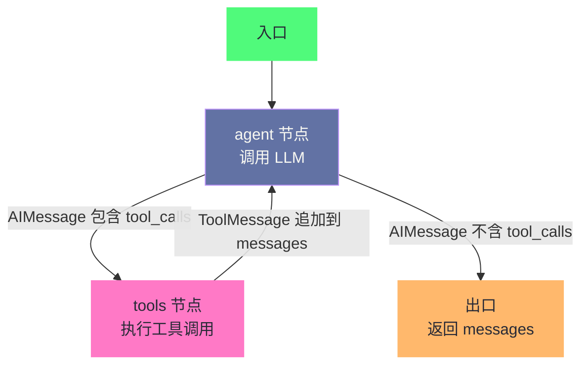
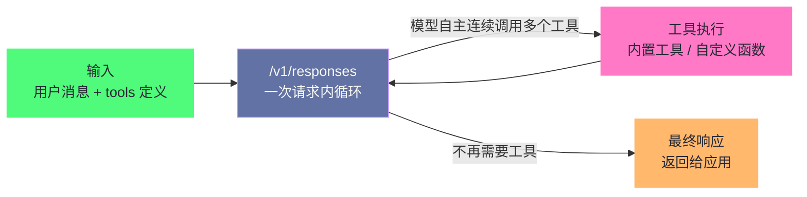

# 02 ReAct 架构深度解析——Thought-Action-Observation 循环的本质

> [!abstract] 摘要
> 上一篇 [[LLM/Agent技术/基础范式/01 Agent 运行范式全景——从 ReAct 到 Production Agent 的演进]] 建立了 Agent 范式的全景地图，本文则放大焦距，深入 ReAct 循环的内部机制。ReAct 的"Thought → Action → Observation"三步循环看似简单，但在生产环境中隐藏着大量工程细节：prompt 模板如何设计才能让 LLM 稳定输出正确格式？循环何时终止——靠 stop_reason、靠迭代上限、还是靠预算护栏？Action 从"自由文本解析"演变为"Function Calling JSON Schema"后，ReAct 的可靠性提升了多少？Observation 太长如何毒化上下文导致推理漂移？无限循环、参数幻觉、推理漂移三大失败模式的根因是什么、如何用拦截器与错误分类防治？本文从 ReAct 原始论文的 prompt 设计出发，逐一拆解这些工程细节，再落到 2025-2026 年的生产实现：Anthropic Claude API 的 tool use agentic loop、OpenAI Responses API 的内置循环、LangGraph 1.0 从 `create_react_agent` 到 `create_agent` 的迁移。最后回答一个绕不开的新问题——o3、Claude extended thinking 这类推理模型把 Thought 内化到模型内部之后，ReAct 循环是否还是 Agent 的地基？以及 Reflexion、Plan-and-Execute 在 2026 年的工程化形态与循环终止、错误恢复的生产清单。核心认知：ReAct 的价值不在循环本身，而在"推理与行动交织"这一范式与支撑它的整套系统工程——后者正从应用层下沉到平台层，但循环的终止、治理与恢复仍需开发者亲手设计。

---

## 第 1 章 ReAct 的 Prompt 工程——让 LLM 学会"想一步做一步"

### 1.1 原始论文的 Prompt 模板

2022 年 10 月，当 Yao 等人把 ReAct 论文挂上 arXiv 时，GPT-3 时代的模型还远没有今天这样"听话"——instruction following 尚未经过大规模的后训练打磨，学界验证过最可靠的手段是 few-shot in-context learning：在 prompt 里放几条手工示范轨迹，让模型照着学。ReAct 论文（Yao et al., ICLR 2023）使用的正是这种 few-shot 格式——在 prompt 中提供几个手写的"Thought-Action-Observation"轨迹示例，让 LLM 通过 in-context learning 学会这种交替格式。

以 HotpotQA 任务为例，ReAct 的 prompt 结构如下：

```
Solve a question answering task with interleaving Thought, Action, Observation steps.
Thought can reason about the current situation, and Action can be three types:
(1) Search[entity], which searches the exact entity on Wikipedia and returns
    the first paragraph if it exists.
(2) Lookup[string], which finds the next sentence containing string.
(3) Finish[answer], which finishes the task with answer.

Question: What is the elevation range for the area that the eastern sector
of the Colorado orogeny extends into?
Thought 1: I need to search Colorado orogeny, find the area that the eastern
sector of the Colorado orogeny extends into, then find the elevation range
of the area.
Action 1: Search[Colorado orogeny]
Observation 1: The Colorado orogeny was an episode of mountain building in
Colorado and surrounding areas.
Thought 2: It does not mention the eastern sector. So I need to look up
eastern sector.
Action 2: Lookup[eastern sector]
Observation 2: The eastern sector extends into the High Plains and is called
the Central Plains orogeny.
Thought 3: The eastern sector of Colorado orogeny extends into the High Plains.
So I need to search High Plains and find its elevation range.
Action 3: Search[High Plains]
Observation 3: High Plains refers to one of two distinct land regions...
Thought 4: High Plains rise from around 1800 to 7000 feet. So the answer is
approximately 1800 to 7000 feet.
Action 4: Finish[approximately 1800 to 7000 feet]
```

这个 prompt 有几个关键设计决策值得逐一分析。

首先，示范轨迹是**人工手写的**。这条轨迹蕴含了论文作者对"理想推理循环"的全部预设：先拆解问题、再按信息缺口逐个搜索、观察结果后修正方向、信息齐了立刻收束。这类示范在当时的工程语境里承担了双重角色——它既是给模型的"行为规范"，也是给外部解析器的"格式约定"，因为 `Thought 1 / Action 1 / Observation 1` 的步数编号本身就是一种坐标轴，让解析器能精确切分每一轮的内容，也让模型在后续回合里能引用"第三步的 Observation"来定位信息。这种"编号即地址"的设计，后来被 ReWOO 的占位符机制（`#E1`、`#E2`）进一步发扬光大，我们在上一篇中已经讨论过。

其次，示范的数量与覆盖面有讲究。笔者可以打一个比方：few-shot 轨迹之于模型，就像乐谱之于爵士乐手——谱子只写了开头几个小节，后面的演奏要靠即兴，但即兴必须遵守和声规则，否则整支曲子就会散架。在 ReAct 里，**"格式纪律"就是和声规则**：Thought 必须先行、Action 必须命中预定义工具、Observation 永远来自外部执行器。示范轨迹不必多，但必须覆盖所有会遇到的认知情形，这就是下一节要展开的六种 Thought 功能。

### 1.2 Thought 的六种功能

ReAct 论文中，few-shot 示例的 Thought 不是随意的"自言自语"，而是有意识地展示六种不同的推理功能：

| Thought 功能 | 示例 | 解决什么问题 |
| :--- | :--- | :--- |
| **问题分解** | "I need to search X, find Y, then find Z" | 将复杂问题拆成可执行的子步骤 |
| **信息提取** | "X was started in 1844" | 从 Observation 中提取关键事实 |
| **常识推理** | "X is not Y, so Z must instead be..." | 基于 Observation 做推断 |
| **算术推理** | "1844 < 1989" | 执行数值比较/计算 |
| **搜索重定向** | "Maybe I can search/look up X instead" | 发现当前方向走不通时转向 |
| **答案综合** | "...so the answer is X" | 汇总所有信息得出最终答案 |

这六种功能覆盖了一个完整推理循环所需的所有认知操作。在设计 ReAct 的 few-shot 示例时，**确保示例覆盖所有六种 Thought 功能**是 prompt 质量的关键——如果示例只展示了"问题分解"和"搜索"两种 Thought，LLM 在实际运行中可能不知道如何在 Observation 不符合预期时做"搜索重定向"，导致在死胡同里反复尝试同一搜索词。

> [!info] 核心概念：Thought 不是"解释"，是"推理"
> 很多开发者误解了 Thought 的作用——以为 Thought 是给人类看的"解释说明"。实际上，Thought 是 LLM 给自己的推理脚手架：它通过显式地写出推理过程，帮助自己在下一步做出更准确的决策。这和 Chain-of-Thought 的原理一致——显式推理比隐式推理更准确，因为 LLM 的自回归生成机制意味着每一步的输出都会影响下一步的生成。Thought 的存在让"推理"成为上下文的一部分，引导 LLM 生成更合理的 Action。如果去掉 Thought 直接让 LLM 输出 Action，准确率会显著下降——ReAct 论文的消融实验证实了这一点。

不过这里有一个容易被忽视的边界：Thought 的"推理脚手架"作用与"审计线索"作用，在传统 ReAct 里是绑在一起的，因为 Thought 就是上下文里的一段可见文本。一旦 Thought 的内容被外部观察者（用户、日志、下游系统）读到，它就不再只是"模型对自己的喃喃自语"——它就成了可调试、可评估、也可能被 prompt injection 投毒的公开记录。这个"推理公开化"的代价，第 6 章讨论推理模型时还会出现——推理模型恰恰把 Thought 藏回了模型内部。

### 1.3 Action 的格式——从文本解析到 Function Calling

ReAct 论文发表时（2022 年 10 月），OpenAI 的 Function Calling 还不存在。Action 的格式是**自由文本**——LLM 生成 `Search[Colorado orogeny]` 这样的文本，外部代码用正则表达式或字符串解析提取工具名和参数。

```python
# ReAct 原始论文的 Action 解析方式（伪代码）
import re

def parse_action(text):
    """从 LLM 输出中解析 Action"""
    match = re.match(r'(\w+)\[(.+)\]', text)
    if match:
        tool_name = match.group(1)  # "Search"
        tool_arg = match.group(2)   # "Colorado orogeny"
        return tool_name, tool_arg
    return None, None
```

这种文本解析方式有三个问题：

**问题一：格式不稳定**。LLM 可能生成 `Search("Colorado orogeny")`（用引号而非方括号）、`search[Colorado orogeny]`（大小写不同）、甚至 `Action: Search Colorado orogeny`（格式完全偏离）。每一种偏差都需要写正则来兜底，解析逻辑越来越脆弱。

**问题二：参数幻觉**。LLM 可能生成 `Search[Mathematical definition of orogeny]`——工具名正确，但参数是一个 LLM 编造的、Wikipedia 中不存在的词条。这种"参数幻觉"比"工具名幻觉"更难检测，因为工具名可以对照预定义列表验证，参数却需要实际执行后才知道是否有效。

**问题三：多参数工具难以表达**。`Search[entity]` 只有一个参数，文本格式勉强够用。但如果一个工具需要三个参数（如 `create_event[title, start, end]`），用方括号文本格式表达就极其笨拙且容易出错。

2023 年 6 月 OpenAI 发布 Function Calling 后，这些问题被结构化的 JSON Schema 方案系统性解决。LLM 不再生成自由文本的 Action，而是生成一个结构化的 JSON 对象：

```json
{
  "tool_calls": [
    {
      "id": "call_abc123",
      "type": "function",
      "function": {
        "name": "search",
        "arguments": "{\"entity\": \"Colorado orogeny\"}"
      }
    }
  ]
}
```

这个 JSON 由 LLM 的训练保证格式正确（不需要正则解析），参数名和类型由 JSON Schema 约束（减少参数幻觉），多参数工具天然支持。Anthropic 的 tool_use 采用了类似的 content block 方案。

> [!warning] 生产避坑：Function Calling 不等于 ReAct
> 一个常见误解是"用了 Function Calling 就等于实现了 ReAct"。Function Calling 只解决了 Action 的格式化问题——它让 LLM 能可靠地输出结构化的工具调用请求。但 ReAct 的核心是"Thought → Action → Observation"的循环，Function Calling 只覆盖了"Action"这一环。你仍然需要：实现循环控制（何时继续、何时终止）、管理上下文（把 Observation 追加到历史中）、处理失败（工具调用失败后如何反馈给 LLM）。Function Calling 是 ReAct 的基础设施，不是 ReAct 的全部。

补充一点：JSON Schema 解决的是"语法层"的可靠性，而不是"语义层"的可靠性。Schema 可以约束参数类型、必填字段、枚举取值，却无法表达"entity 参数必须是 Wikipedia 中真实存在的词条"这类语义约束。第 4 章会看到，参数幻觉在 Function Calling 时代并未消失，只是从"格式层"上移到了"语义层"。

### 1.4 Stop Sequence——防止 LLM 自己编造 Observation

ReAct 原始实现中有一个精妙的工程细节：**stop sequence**。

当 LLM 生成到 `Action 1: Search[Colorado orogeny]` 时，如果不加干预，LLM 会继续生成 `Observation 1: ...`——它会自己编造一个假的 Observation。因为在 few-shot 示例中，Action 后面总是跟着 Observation，LLM 的自回归生成机制会"惯性地"继续这个模式。

解决方案是在 API 调用中设置 `stop=["\nObservation"]`——当 LLM 的输出中出现 "Observation" 这个词时，立即停止生成。这样 LLM 只会生成 Thought 和 Action，不会编造 Observation。真正的 Observation 由外部工具执行后注入。

```python
# ReAct 原始实现的 stop sequence
response = openai.Completion.create(
    model="text-davinci-003",
    prompt=prompt,
    stop=["\nObservation"],  # 关键：在 Observation 前停止
    temperature=0,
    max_tokens=100
)
```

LangChain 的经典 `create_react_agent` 至今仍保留了 `stop_sequence` 参数，默认值为 `True`（添加 `"Observation:"` 作为 stop token）。这个设计看似简单，但它揭示了一个 ReAct 实现中的根本张力：**LLM 生成的内容和外部执行的内容必须严格分离**，否则 LLM 会"幻觉"出从未真正执行过的工具结果。

> [!note] 设计哲学：Stop Sequence 是"格式纪律"的工程化
> Stop Sequence 的本质是一种"格式纪律"——强制 LLM 只生成它该生成的部分（Thought + Action），把 Observation 的生成权交给外部执行器。这种"职责分离"在 Function Calling 时代被 `stop_reason: "tool_use"` 机制更优雅地实现了——当 Claude 决定调用工具时，API 返回的 `stop_reason` 字段值为 `"tool_use"`，表示"Claude 想要调用工具，请执行后返回结果"。LLM 不会也无法在同一个响应中编造工具结果，因为 API 层面就切断了这个可能性。从 stop sequence 到 stop_reason，是从"字符串级截断"到"语义级控制"的演进。

Stop sequence 还有一个文本级方案特有的边界情况值得记录：如果工具执行的真实结果里恰好包含 `Observation` 字样（譬如一次日志查询的返回内容里有一行以 "Observation" 开头），字符串匹配的截断策略就可能误伤——要么把合法内容截掉，要么在下一轮里让模型把工具输出误当成自己的推理续写。这种"内容与格式的碰撞"是文本方案的先天缺陷，也是为什么现代框架宁愿把整个循环交给 API 的语义级机制（stop_reason、tool_calls）来处理。笔者见过不少从 2023 年迁移过来的老代码，第一件事就是删掉那行 `stop=["\nObservation"]`。

---

## 第 2 章 循环控制——何时继续、何时终止

### 2.1 ReAct 循环的状态机模型

ReAct 的运行循环可以用一个状态机来精确描述：

```mermaid
%%{init: {'theme': 'dracula', 'themeVariables': {'primaryColor': '#6272a4', 'primaryTextColor': '#f8f8f2', 'primaryBorderColor': '#bd93f9', 'lineColor': '#ff79c6', 'secondaryColor': '#44475a', 'tertiaryColor': '#282a36'}}%%
graph TD
    S["START<br/>用户输入任务"] --> LLM["LLM 推理<br/>生成 Thought + Action"]
    LLM -->|"Action = Finish"| END["END<br/>输出最终答案"]
    LLM -->|"Action = Tool Call"| EXEC["执行工具<br/>获取 Observation"]
    EXEC --> APP["将 Observation 追加到上下文"]
    APP --> LLM
    LLM -->|"超过迭代上限"| ABORT["ABORT<br/>强制终止"]
    EXEC -->|"工具执行失败"| ERR["错误处理<br/>将错误信息作为 Observation"]
    ERR --> APP

    classDef start fill:#50fa7b,stroke:#50fa7b,color:#282a36
    classDef llm fill:#6272a4,stroke:#bd93f9,color:#f8f8f2
    classDef exec fill:#ff79c6,stroke:#ff79c6,color:#282a36
    classDef end fill:#ffb86c,stroke:#ffb86c,color:#282a36
    classDef error fill:#ff5555,stroke:#ff5555,color:#282a36

    class S start
    class LLM llm
    class EXEC,APP exec
    class END,ABORT end
    class ERR error
```

这个状态机有三个出口：
1. **正常终止**：LLM 输出 `Finish[answer]`（或 `stop_reason: "end_turn"`），任务完成
2. **强制终止**：迭代次数超过上限，防止无限循环
3. **错误恢复**：工具执行失败，错误信息作为 Observation 反馈给 LLM，继续循环

值得强调的是，这张图几乎是所有 Agent 框架的"通用底图"——Anthropic 文档里的 agentic loop、OpenAI 的 Responses API、LangGraph 的 create_agent、甚至 Claude Code 与 Devin 的内部循环，都能在这个状态机上找到自己的投影。**循环的骨架十年没变，变的只是每一环的承载者**：Thought 从可见文本变成模型内部思考，Action 从正则解析变成结构化 tool_calls，Observation 从纯文本追加变成带类型的内容块。

不妨把循环控制比作电梯的三重制动——传感器判断是否到达楼层（语义终止）、超载保护强制停运（迭代上限）、急停开关兜底（循环检测与预算护栏），少任何一道都没人敢乘梯；不过比喻到此为止，Agent 缺一道终止防线不会出安全事故，只会把预算和上下文耗尽。

### 2.2 终止条件的三层防线

生产环境的 ReAct 循环需要三层终止防线：

**第一层：语义终止（LLM 自主判断）**

LLM 在 Thought 阶段判断任务已完成，输出 Finish 而非 Action。在 Function Calling 时代，这对应 `stop_reason: "end_turn"`——LLM 不再请求调用任何工具，而是直接输出最终文本响应。

Anthropic Claude API 的 stop_reason 机制：

| stop_reason 值 | 含义 | ReAct 循环动作 |
| :--- | :--- | :--- |
| `end_turn` | LLM 自然结束响应 | **终止循环**，返回最终答案 |
| `tool_use` | LLM 请求调用工具 | 执行工具，将结果作为 Observation 返回，继续循环 |
| `max_tokens` | 达到 token 上限 | 需要特殊处理（继续生成或截断） |
| `stop_sequence` | 命中自定义停止序列 | 按业务逻辑处理 |
| `pause_turn` | 服务端工具循环达到限制 | 发送 assistant content 继续 |
| `refusal` | LLM 拒绝回答 | 读取 `stop_details`，在回退模型上重试 |
| `model_context_window_exceeded` | 响应填满了上下文窗口 | 视作截断处理 |

其中后两行是 2025 年后文档里新增的状态。`refusal` 表示模型层面的策略拒绝——开发者应当把它当成需要人类介入或换模型重试的信号，而不是吞掉后继续循环。`model_context_window_exceeded` 则是一个残酷的提醒：当上下文被逐步累积的 Thought 与 Observation 塞满时，循环不是因为"任务完成了"而停止，而是因为"装不下了"而被迫停止——这正是第 3 章 Observation 治理要解决的问题。

**第二层：迭代上限（硬性兜底）**

LLM 可能陷入无限循环——反复调用同一个工具、在两个工具之间来回切换（A-B-A-B 模式）、或持续"探索"而不收敛到答案。设置最大迭代次数是最后的兜底。

```python
# 生产环境 ReAct 循环的迭代上限
MAX_ITERATIONS = 25  # 经验值：超过 25 步通常意味着任务失控

for i in range(MAX_ITERATIONS):
    response = llm_call(messages)
    if response.stop_reason == "end_turn":
        return response.content  # 正常终止
    if response.stop_reason == "tool_use":
        tool_result = execute_tool(response.tool_calls)
        messages.append({"role": "assistant", "content": response.content})
        messages.append({"role": "user", "content": tool_result})
    else:
        handle_special_stop_reason(response)

# 超过迭代上限，强制终止
return "Agent reached maximum iterations without completing the task."
```

> [!info] 核心概念：为什么上限通常是 10-25 步？
> 生产实践中，ReAct 的有效步数上限通常在 10-25 步之间。这不是任意设定的——它反映了两个约束的交汇点：一是 LLM 的上下文窗口限制（每步的 Thought+Action+Observation 都消耗 token，25 步可能消耗数万 token），二是推理漂移的累积效应（步数越多，早期指令在上下文中的"注意力权重"越低，LLM 越容易偏离原始目标）。NVIDIA NeMo Agent Toolkit 默认设置 `tool_call_max_retries=1`（工具调用最多重试 1 次），Solon AI 的 ReActAgent 默认 `maxTurns=10`。如果你的 Agent 经常需要超过 25 步才能完成任务，大概率是任务分解不够或工具设计有问题，而不是迭代上限太低。

不过迭代上限是一把"地板砖"级别的兜底——它只保证循环会停，不保证停止得有意义。AWS Well-Architected 框架的 Agentic AI Lens 在 2025 年的指南里明确把"迭代上限（iteration cap）"与"提前终止（early termination）"区分成互补的两类控制：迭代上限防止病态失控（a model that keeps calling tools without converging），提前终止则在不必要的迭代发生之前就结束循环（当 critique 步骤返回"无需进一步修改"的结构化信号、当 Agent 自身置信度超过阈值、当确定性验证器——schema 检查、grounding 检查、策略检查——确认输出已合格时）。前者兜最坏情况，后者消灭常见浪费。还有一个务实的提醒：上限应该按任务类别分别设定——一个适合多步研究任务的上限，对一次简单查询来说就是浪费。

**第三层：循环检测（模式匹配）**

即使迭代次数没超上限，Agent 也可能陷入"无效循环"——反复调用同一组工具而不取得进展。这需要循环检测拦截器。

Solon AI 框架的 `StopLoopInterceptor` 是一个典型实现：

```java
// Solon AI 的循环检测拦截器
// 在最近 windowSize 个 action 中，同一 action 最多出现 maxRepeatCount 次
new StopLoopInterceptor(2, 6)  // 6 步窗口内，同一 action 最多出现 2 次
```

这个拦截器维护一个滑动窗口，记录最近的 Action 序列。如果在窗口内同一 Action（相同工具名+相同参数）出现次数超过阈值，拦截器会中断循环并返回错误——而不是等 LLM 自己"想通"停下来。

2025 年之后，循环检测又多了一种工程化程度更高的做法：**对工具调用做哈希去重**。JetBrains 在 2025 年的一篇架构文章里建议，把每次工具调用的输入序列化后取哈希，一旦同一哈希在一次任务运行里出现超过两次，就把它当作循环信号。哈希方案的优点是与工具类型无关、无需为每种工具写业务规则；代价是它只能识别"完全相同的调用"——参数每次略变的语义级重复（譬如搜索词从"orogeny"换成"Colorado orogeny"再换成"Colorado"）哈希检测就看不出来了。实践中两类检测常配合使用，并注意豁免合法重复：轮询类工具天然会重复，应当用时间窗口而非简单计数判定，或直接对轮询工具白名单放行。

### 2.3 Anthropic 的 Agentic Loop 实现

Anthropic 在 Claude API 文档中展示的 agentic loop 是 ReAct 在 Function Calling 时代的标准实现：

```python
# Anthropic 官方推荐的 agentic loop（简化版）
import anthropic

client = anthropic.Anthropic()

def run_agent(user_message, tools, tool_functions):
    messages = [{"role": "user", "content": user_message}]
    
    while True:
        response = client.messages.create(
            model="claude-sonnet-4-5",
            max_tokens=16000,
            tools=tools,
            messages=messages
        )
        
        # 关键：检查 stop_reason 决定是否继续
        if response.stop_reason == "end_turn":
            # LLM 不再请求工具，任务完成
            return response.content[-1].text
        
        if response.stop_reason == "tool_use":
            # LLM 请求调用工具，执行后将结果返回
            messages.append({"role": "assistant", "content": response.content})
            
            tool_results = []
            for content_block in response.content:
                if content_block.type == "tool_use":
                    # 执行工具
                    result = tool_functions[content_block.name](**content_block.input)
                    tool_results.append({
                        "type": "tool_result",
                        "tool_use_id": content_block.id,
                        "content": result
                    })
            
            messages.append({"role": "user", "content": tool_results})
        else:
            # 其他 stop_reason（max_tokens, pause_turn 等）需要特殊处理
            break
```

这个实现的精妙之处在于：**循环控制完全由 `stop_reason` 驱动**。不需要 stop sequence 的字符串截断，不需要解析 LLM 输出中的 "Finish" 关键词——API 层面就告诉你"LLM 是想调工具还是已经完成了"。这是 Function Calling 相比原始 ReAct 文本解析的根本性进步。

2025-2026 年，这套循环又多了一层新维度——**extended thinking**。当开启思考模式后，Claude 的响应内容里会先出现一个或多个 `thinking` content block（带加密签名 signature），然后才是文本与工具调用块；文档明确要求，在多轮与工具循环里，thinking block 必须原封不动地回传，否则 API 会报 400 错误。这带来两个工程后果：其一，循环里的"Thought"环节从开发者手写的 prompt 文本，变成了模型自产自销的内部思考，开发者能看到的只是思考摘要而不是原始思维链；其二，manual 模式下 `tool_choice` 只允许 `auto` 或 `none`，强制工具调用与手动思考模式互斥——也就是说，**想要"深度思考 + 强制走某条工具路径"，在思考模型上是个需要重新设计的组合**，而不是简单叠参数。这些约束第 6 章会展开。

Anthropic 还提供了 SDK 层面的 Tool Runner，进一步封装了这个循环：

```python
# 使用 Anthropic SDK 的 Tool Runner（自动处理 agentic loop）
runner = client.beta.messages.tool_runner(
    model="claude-sonnet-4-5",
    max_tokens=16000,
    tools=[get_weather, search_web],
    messages=[{"role": "user", "content": "What's the weather in Paris?"}],
)

for message in runner:
    print(message)  # 每次迭代 yield 一个 assistant message
# 循环自动终止当 Claude 不再调用工具
```

Tool Runner 不是黑箱——它在每次迭代中 yield assistant message，允许开发者在工具执行前/后介入（human-in-the-loop 审批、错误拦截、结果修改），同时自动处理"调用 API → 检测 tool_use → 执行工具 → 返回 tool_result → 继续调用"的循环逻辑。

### 2.4 LangGraph 的 create_react_agent 与 create_agent 迁移

LangGraph 的 `create_react_agent` 用图模型实现了同样的循环，但提供了更细粒度的控制：



图结构极其简洁——只有两个节点：
- **agent 节点**：调用 LLM，生成 AIMessage
- **tools 节点**：执行 AIMessage 中的 tool_calls，生成 ToolMessage

边定义了转移逻辑：
- 如果 AIMessage 包含 `tool_calls` → 转移到 tools 节点
- 如果 AIMessage 不包含 `tool_calls` → 转移到出口（等价于 `stop_reason: "end_turn"`）
- tools 节点执行完毕后 → 回到 agent 节点

LangGraph 的图模型相比 Anthropic 的 while 循环，多了一个关键能力：**在图的任意位置插入检查点（checkpoint）**。这意味着 ReAct 循环的每一步都可以持久化——如果服务器在第三步和第四步之间重启，Agent 可以从第三步的检查点恢复，而不是从头开始。这是 LangGraph 1.0 "Durable State" 特性的基础。

需要更新的一个时效性事实是：2025 年 10 月 22 日 LangGraph 1.0 与 LangChain 1.0 正式发布后，`langgraph.prebuilt.create_react_agent` 已被官方弃用，迁移路径是 `langchain.agents.create_agent`——新的 `create_agent` 同样跑在 LangGraph 运行时上，但引入了**中间件（middleware）**机制：`before_model`、`after_model`、`wrap_tool_call` 这些钩子取代了早期"循环里手动插拦截器"的写法，工具错误处理也收敛进 middleware。从架构史的角度看，这一步意味深长：Solon AI 的 StopLoopInterceptor 这类"侵入式拦截器"曾经是循环检测的标准答案，LangChain 1.0 干脆把它变成了一等公民——**循环的"横向关注点"（错误处理、人工审批、日志、循环检测）不再需要改循环代码，而是以 middleware 的形式插在循环上**。这与 2.2 节"迭代上限 + 提前终止"的二分法互为印证：框架层正在把终止与恢复的控制权，从"写进每个应用的循环代码"收编为"框架的标准能力"。

> [!note] 设计哲学：从 while 循环到图模型
> Anthropic 的 agentic loop 是一个 `while True` 循环——简单直接，但在中间插入"人工审批"或"条件分支"需要侵入式修改循环逻辑。LangGraph 的图模型把循环拆成节点和边——"在 tools 节点前插入审批节点"只需添加一个节点和两条边，不需要修改现有逻辑。这种"可插拔性"是生产 Agent 系统的关键需求——你不可能在开发时就预见所有需要插入人工干预或额外检查的位置。图模型让这些插入点成为拓扑结构的一部分，而非代码中的 if-else 补丁。

### 2.5 OpenAI Responses API 的循环实现

2025 年 3 月 11 日，OpenAI 发布了 Responses API，官方博客的措辞很直接：**"/v1/responses is an agentic loop"**——Responses 不再像 Chat Completions 那样只做"一轮问答"，而是内置了一个"推理与行动"的结构化循环：模型可以在**一次 API 请求内**连续调用多个工具（web search、file search、code interpreter、computer use、远程 MCP 以及开发者自定义函数），并在不再需要工具时输出最终答案。对开发者来说，Chat Completions 时代的"手动 while 循环 + 自己拼接消息"被收编进了 API 内部，上下文可用 `previous_response_id` 或 `conversation_id` 交给服务端续接。



如果开发者不想自己写循环，OpenAI 的 Agents SDK / Agents API 还提供托管运行时，其 runner 循环是：调用模型 → 检查输出 → 若有工具调用则执行并继续 → 若交给了另一个 specialist agent 则切换 Agent → 若产出最终答案则返回。这几乎就是第 2.1 节状态机的产品化。更进一步，2025 年晚些时候推出的 **Programmatic Tool Calling** 允许模型在托管运行时里**编写并执行 JavaScript 程序**来协调多个工具调用——循环、条件分支、中间结果都写在一个程序里，官方建议"控制流可预测的阶段用 Programmatic，每次结果都需要模型重新判断的步骤用直接工具调用"。某种意义上，这是把"代码确定性路由"（4.2 节会看到它对参数幻觉的结构性修复）从防御手段升级成了平台能力。

三家的循环实现放到一起对比，能看出一个清晰的分工：

| 维度 | Claude API tool use loop | OpenAI Responses API | LangGraph create_agent |
| :--- | :--- | :--- | :--- |
| **循环归属** | 开发者驱动的 `while` 循环 | 请求内置（一次请求内可连续多工具） | 图运行时（StateGraph） |
| **终止信号** | `stop_reason` 字段 | 模型不再调用工具时结束响应 | AIMessage 无 tool_calls → 出口 |
| **中间状态** | 开发者自管 messages | `previous_response_id` / 服务端状态 | checkpoint 持久化（Durable State） |
| **拦截点** | Tool Runner yield / 手动循环 | Agents API runner + 应用层执行函数 | middleware（before/after_model、wrap_tool_call） |
| **思考支持** | thinking block（需原样回传） | reasoning summaries 保留推理上下文 | 透传各家模型能力 |

这张表值得展开的是"思考支持"一行：Anthropic 把思考块作为 API 显式内容暴露给开发者（带签名、必须回传），OpenAI 则提供 reasoning summaries 保留先前推理用于更聪明的工具调用。两家的共同点是：**循环的"Thought"环节正在从"开发者提供的文本"变成"模型自带的内部状态"，而 Action-Observation 骨架则由平台托管**——这是理解第 6 章"推理模型时代"的关键伏笔。

---

## 第 3 章 Observation 的工程化——工具结果的反馈与治理

### 3.1 Observation 毒化上下文问题

ReAct 循环的每一步都会把 Observation（工具执行结果）追加到上下文中。随着步数增加，上下文中积累的 Observation 越来越多。如果单个 Observation 特别大（如一个文件的内容、一个 API 返回的大型 JSON），它会"毒化"上下文——占据大量 token，挤压 LLM 对原始任务指令和早期推理的注意力。

这个问题在生产环境中极为常见。一个 Coding Agent 执行 `cat large_file.log`，可能返回 50KB 的日志文本——这 50KB 会被原封不动地追加到上下文中，在后续每一步的 LLM 调用中都被重新发送。

> [!warning] 生产避坑：Observation 毒化是 ReAct 最隐蔽的故障源
> Observation 毒化的危害不是"浪费 token"——而是"降低推理质量"。当上下文中 80% 的 token 都是一个巨大的 Observation 时，LLM 的注意力机制会不自觉地聚焦在这个大块文本上，而忽略原始任务指令和早期 Thought 中的关键决策。表现症状包括：Agent 突然"忘记"自己在做什么、开始围绕 Observation 中的无关细节做推理、或者直接输出与任务无关的内容。这种退化是渐进的、不易察觉的——Agent 不会突然崩溃，而是逐步"走偏"。

笔者习惯用一个生活化的比喻来向团队解释这件事：上下文窗口就像一杯浓缩咖啡，Observation 就是不断往里面兑的水。第一勺水下去，咖啡味还在；兑到第三勺，你还能喝出是咖啡；兑到第十勺，你喝到的就只是带一点颜色的水了。问题的关键不在于"水本身有毒"，而在于**稀释是渐进的、无痛的**——每次只兑一点点，你不会在哪一步突然醒悟"这杯咖啡已经不能喝了"。Agent 的推理漂移同理，它从来不会给你一个清晰的崩溃信号。

### 3.2 Observation 治理的三种策略

**策略一：输出截断（Output Truncation）**

最直接的方案——限制单个 Observation 的最大长度。超出部分截断，并附加一个提示信息。

```python
MAX_OBSERVATION_LENGTH = 2000  # 字符数

def truncate_observation(result):
    if len(result) > MAX_OBSERVATION_LENGTH:
        return result[:MAX_OBSERVATION_LENGTH] + \
               f"\n... [truncated, total {len(result)} chars]"
    return result
```

Solon AI 框架的 `ToolSanitizerInterceptor` 就是这种策略的实现——在 Observation 进入上下文前，截断到指定长度。NVIDIA NeMo Agent Toolkit 也有类似的 `ToolSanitizerInterceptor`。

**策略二：结构化摘要（Structured Summary）**

不是简单截断，而是让 LLM（或一个独立的 LLM 调用）对 Observation 做摘要。譬如，一个返回 1000 行 JSON 的 API 调用，可以先提取关键字段（status、error_code、data.summary），丢弃详细数据。

这种方式更智能但成本更高——每次 Observation 都需要一次额外的 LLM 调用来做摘要。在生产中，通常对"已知会返回大结果的工具"（如文件读取、数据库查询）做结构化摘要，对"结果天然较短的工具"（如时间查询、状态检查）直接使用原始结果。

这里有一个容易被忽略的附加风险：**摘要过程本身可能泄漏敏感信息**。当 Observation 来自用户文件、数据库记录或第三方 API 时，把全文塞给摘要模型，等于把敏感数据复制进了一条额外推理路径。2026 年一些生产框架在 Reflexion 类配置里专门给出了 `include_tool_output` 开关（是否把完整工具输出纳入反思 prompt），并明确提示要警惕 PII——这个谨慎同样适用于 Observation 摘要：要么在摘要前做字段级脱敏，要么对敏感工具直接关闭"摘要增强"。

**策略三：外部存储 + 按需加载（External Storage + Just-in-Time Loading）**

Anthropic 在 Claude Code 中采用的策略——Observation 不全部保留在上下文中，而是写入外部存储（文件系统），上下文中只保留一个轻量级的引用（文件路径）。当后续步骤需要引用这个 Observation 时，通过工具调用重新加载需要的部分。

这是 Context Engineering 的核心思想——本专栏第 6 篇将深入讨论。它的本质是：**不要把所有信息都塞进上下文窗口，而是维护一个"外部记忆"，只在需要时加载**。

三种策略并不互斥，实际系统通常是组合拳：大结果先截断（防止单次注入过大），截断后按需做结构化摘要（保留语义），关键工具的结果落外部存储（支持后续按需取回）。另外要补一条边界：截断策略对"必须看到全文才能判断"的任务会失效——譬如代码审查类工具，截断到 2000 字符很可能把关键的报错堆栈腰斩。这类场景应直接走外部存储 + 按需加载。在 Claude 的 content block 协议下，Observation 还可以是结构化的：`tool_result` 里可以携带 text 与 image 等多种 content block，截图类观察应当作为 image block 返回，而非把 base64 当文本塞进上下文——这既是 token 效率问题，也是理解质量问题。

### 3.3 错误作为 Observation

ReAct 循环中，工具执行失败不是终点——错误信息本身也是一种 Observation，反馈给 LLM 让它调整策略。

```python
def execute_tool_safely(tool_name, tool_args):
    try:
        result = tools[tool_name](**tool_args)
        return {"status": "success", "content": result}
    except Exception as e:
        # 错误信息作为 Observation 返回给 LLM
        return {"status": "error", "content": f"Tool '{tool_name}' failed: {str(e)}"}
```

关键设计决策：**错误信息应该多详细？**

- **过于简略**：`"Tool failed"` —— LLM 不知道失败原因，可能重复尝试同样的调用
- **过于详细**：完整的 Python traceback —— 占用大量 token，且大部分信息对 LLM 决策无用
- **恰到好处**：`"Tool 'search' failed with TimeoutError. The Wikipedia API did not respond within 30 seconds. Consider retrying with a simpler query or trying a different search term."` —— 告诉 LLM 失败类型 + 建议的替代方案

NVIDIA NeMo Agent Toolkit 的 `pass_tool_call_errors_to_agent` 参数（默认 `True`）控制是否将错误信息传回 Agent。设置为 `False` 时，工具错误会直接抛出异常终止循环——这在某些场景下是合理的（如安全敏感操作失败后不应让 Agent 继续尝试）。

> [!info] 核心概念：错误反馈是 ReAct 的自我修复机制
> ReAct 相比静态工具链的一个核心优势是"错误恢复"——如果第三步的工具调用失败了，LLM 可以在第四步的 Thought 中分析失败原因并选择替代方案。但这依赖于错误信息被正确地反馈为 Observation。如果你的工具实现吞掉了错误（返回空字符串而非错误信息），LLM 会认为调用成功了，基于空结果继续推理——这比明确的失败更危险，因为它导致了"沉默的错误传播"。

2025-2026 年的生产实践里，"错误作为 Observation"进一步细化成了"错误分类 + 差异化的反馈策略"，第 8 章专门展开。这里先给出两条原则：其一，**错误信息要足以支撑恢复，但要剥离密钥与内部堆栈细节**——把认证令牌、内网路径、数据库连接串写进 Observation，等于把它们送进了会被日志系统记录的模型上下文；其二，**瞬时错误与终止错误的处理方式截然不同**——超时、限流这类瞬时错误应当由执行器层做有界重试（幂等键保证不重复副作用），而"权限被拒""参数无效"这类终止错误则不应该重试，直接作为 Observation 反馈给模型调整策略。把这两类错误混在一起"一律重试"，是生产系统里最常见的浪费来源之一。

---

## 第 4 章 ReAct 的三大失败模式

### 4.1 失败模式一：无限循环

**症状**：Agent 反复调用同一组工具，不收敛到答案。常见模式：
- **自我循环**：连续 N 次调用完全相同的工具+参数
- **乒乓循环**：在两个工具之间来回切换（A → B → A → B → ...）
- **探索循环**：不断调用不同工具但不评估结果、不推进任务

**根因分析**：

根因一：**LLM 没有"收敛意识"**。如果 prompt 中没有明确指示"当任务完成后输出 Finish"，LLM 可能会认为"还有更多可以探索的"，持续调用工具而不终止。

根因二：**Observation 没有提供"终止信号"**。工具的返回结果应该包含足够的信息让 LLM 判断"任务已完成"或"需要继续"。如果一个搜索工具无论查询什么都返回"找到 5 条结果"，LLM 无法判断是否已经找到了所需信息。

根因三：**上下文丢失导致"忘记已经做过什么"**。随着步数增加，早期的 Thought 和 Observation 在上下文中的注意力权重降低，LLM 可能"忘记"自己已经搜索过同一个关键词，于是重复搜索。

**防治手段**：

| 拦截器 | 作用 | 实现示例 |
| :--- | :--- | :--- |
| StopLoopInterceptor | 滑动窗口内同一 Action 最多出现 N 次 | Solon AI: `(maxRepeatCount=2, windowSize=6)` |
| maxTurns | 硬性迭代上限 | Solon AI: `maxTurns=10`，LangGraph: `recursion_limit` |
| Action 日志 | 记录所有 Action 供 LLM 参考 | 在 prompt 中附加"已执行的操作列表" |
| 收敛提示 | 在 prompt 中强调终止条件 | "When you have enough information, call Finish immediately" |
| 哈希去重检测 | 同一工具调用哈希在单次任务中出现超阈值即判循环 | JetBrains 建议：同一哈希 > 2 次；轮询类工具用时间窗口豁免 |

表里最后一行是 2025 年后的新做法。它把"无限循环"的检测从"业务相关"（要知道工具语义才能判断 A-B-A-B 是否有意义）变成了"业务无关"（只看调用指纹），配合"无进展检测"（连续多轮空 diff、任务清单无变化）与"成本增速监控"（调用量在涨而完成度不动），构成一套可以在运行时自动报警的观测面。这组信号与第 8 章的生产清单是同一套体系。

### 4.2 失败模式二：参数幻觉

**症状**：LLM 调用了正确的工具，但传入了编造的参数。譬如调用 `search[" Mathematical definition of orogeny"]`（Wikipedia 中不存在的词条），或调用 `create_event(title="Team Meeting", start="2025-13-45T25:00:00")`（无效的日期格式）。

**根因分析**：

根因一：**工具描述不够精确**。如果工具描述只说"search for an entity on Wikipedia"，LLM 可能会尝试搜索概念性描述而非具体实体名。好的工具描述应该是"契约"——明确说明输入应该是什么格式、什么范围、什么约束。

根因二：**上下文中缺乏参数来源**。LLM 生成参数时，理想情况是从 Observation 中提取信息（如"从搜索结果中看到了 Colorado orogeny，所以搜索这个词"）。但如果上下文太长或信息分散，LLM 可能"编造"一个看起来合理但实际不存在的参数。

根因三：**Schema 约束不够严格**。JSON Schema 可以定义参数类型和格式（如 `"format": "date-time"`），但不能定义语义约束（如"entity 必须是 Wikipedia 中存在的词条"）。Schema 层面的约束无法防止语义层面的幻觉。

**防治手段**：

- **工具描述写成契约**：不只说"做什么"，还要说"输入应该是什么、成功返回什么、失败返回什么、什么情况下不该调用"
- **参数验证 + 错误反馈**：工具执行前验证参数格式，格式不对时返回明确的错误 Observation（而非直接失败）
- **per-tool circuit breaker**：每个工具设置最大调用次数上限，超过后拒绝执行
- **结构化路由**：不让 LLM 在运行时选择工具名，而是在规划阶段确定工具调用计划，运行时只填充参数

> [!warning] 生产避坑：90% 的重试浪费来自参数幻觉
> Towards Data Science 的一篇分析报告指出，在一个生产 ReAct Agent 中，90.8% 的重试浪费在"永远不可能成功"的错误上——根因是让 LLM 在运行时选择工具名（`TOOLS.get(tool_name)`），幻觉一个不存在的工具名后，无论重试多少次都不可能成功。解决方案是将工具路由从"LLM 运行时选择"改为"代码确定性路由"——在规划阶段确定要调用哪个工具，运行时只让 LLM 填充参数。这种结构性修复将重试浪费从 90.8% 降到 0%，步数方差降低 3 倍。

### 4.3 失败模式三：推理漂移

**症状**：Agent 在前几步表现正常，但随着步数增加，推理质量逐渐下降——开始关注无关细节、偏离原始任务目标、或重复已经做过的推理。

**根因分析**：

根因一：**上下文退化（Context Degradation）**。随着上下文增长，原始任务指令在上下文中的"注意力权重"被稀释。Anthropic 的内部评估显示，在 100 轮对话后，Agent 对原始指令的遵循度显著下降。这不是 LLM "变笨了"，而是注意力机制的自然结果——上下文越大，每个 token 获得的注意力越分散。

根因二：**错误传播**。如果第三步的推理有误（如基于不完整的 Observation 做了错误假设），后续所有步骤都建立在这个错误假设之上。这种"错误传播"在长链推理中尤其严重——一个早期的小错误会在后续步骤中被放大。

根因三：**Observation 干扰**。大的 Observation 不仅占用 token，还可能引入与任务无关的信息，诱导 LLM 偏离正轨。譬如，一个包含详细堆栈跟踪的错误日志，可能让 LLM 开始分析堆栈中的无关方法，而非解决原始问题。

**防治手段**：

- **定期重申任务**：在每 N 步后，在上下文中重新插入原始任务描述（"Reminder: your task is to..."）
- **上下文编辑**：使用 Anthropic 的 Context Editing 机制（`clear_tool_uses`、`clear_thinking`）定期清理旧的 Observation 和 Thought，只保留最近的几步
- **外部记忆**：将已完成的推理和中间结论写入外部存储，上下文中只保留摘要
- **限制步数**：硬性限制最大步数在 10-25 步内，超出后强制终止或让用户介入

### 4.4 失败模式对比

| 失败模式 | 检测难度 | 根因层级 | 防治手段 | 影响范围 |
| :--- | :---: | :--- | :--- | :--- |
| 无限循环 | 易（模式匹配） | 循环控制层 | 拦截器 + 迭代上限 | 延迟和成本失控 |
| 参数幻觉 | 中（需执行后发现） | 工具接口层 | 契约式描述 + 参数验证 | 静默错误传播 |
| 推理漂移 | 难（渐进退化） | 认知/上下文层 | 上下文编辑 + 外部记忆 | 任务质量退化 |

三类失败不妨想成三只蚂蚁在迷宫里转：一只反复经过同一岔路（无限循环），一只记错路牌冲进死路（参数幻觉），一只越走越偏找不到回程（推理漂移）。区别是蚂蚁靠本能，Agent 靠机制——拦截器、工具契约、上下文管理就是人替它画的导航线，而导航线要在设计阶段画好，等走丢了再画就晚了。

> [!note] 设计哲学：失败模式从"可检测"到"不可检测"的递进
> 三种失败模式的检测难度递增——无限循环可以通过 Action 序列的模式匹配轻松检测；参数幻觉需要在工具执行后才能发现（甚至可能永远不被发现）；推理漂移则是最隐蔽的——Agent 不会"出错"，只是"表现变差"，需要对比早期和晚期行为才能发现。这种递进意味着：越难检测的失败模式，越需要在设计阶段预防，而非在运行时检测。好的 ReAct 系统不是"能检测到失败"，而是"让失败难以发生"——通过工具描述契约、上下文管理策略、迭代上限设置，在架构层面消除大部分失败的可能性。

三大失败模式还攻击了循环的三个不同部位——**无限循环攻击"终止控制"，参数幻觉攻击"工具接口"，推理漂移攻击"上下文状态"**。第 8 章的生产清单正是围绕这三个部位系统化防御的尝试；而第 6 章将看到，推理模型又给每个部位带来了新的变量。

---

## 第 5 章 从原始 ReAct 到生产 ReAct——六个关键演进

### 5.1 演进对比

将原始 ReAct 论文（2022）与 2025-2026 年生产环境中的 ReAct 实现对比，可以识别出六个关键演进：

| 维度 | 原始 ReAct（2022） | 生产 ReAct（2025-2026） | 演进动机 |
| :--- | :--- | :--- | :--- |
| **Action 格式** | 自由文本 `Search[entity]` | JSON Schema / Function Calling | 格式不稳定、解析脆弱 |
| **循环控制** | stop sequence 字符串截断 | `stop_reason` 语义级控制 | 从字符串级到语义级 |
| **终止条件** | LLM 输出 `Finish[answer]` | `stop_reason: "end_turn"` + 迭代上限 + 预算护栏 | 防止无限循环与成本失控 |
| **错误处理** | 工具失败 = 循环终止 | 错误作为 Observation 反馈，transient/terminal 分类恢复 | 自我修复能力 |
| **Observation 治理** | 原始结果直接入上下文 | 截断 / 摘要 / 外部存储 + content block 结构化 | 防止上下文毒化 |
| **循环检测** | 无 | StopLoopInterceptor、哈希去重、无进展检测 | 防止无效循环 |
| **Thought 形态** | prompt 中的可见文本 | 显式 Thought 文本 / 推理模型的内部 thinking block | 思考内化（见第 6 章） |

### 5.2 演进的本质：从"Prompt 工程"到"系统工程"

原始 ReAct 的核心创新在 Prompt 层面——通过 few-shot 示例教 LLM "Thought-Action-Observation" 的交替格式。这个创新是必要的，但不足以支撑生产系统。

生产 ReAct 的核心挑战在系统层面——如何可靠地解析 Action、如何控制循环、如何处理失败、如何管理上下文、如何防止退化。这些挑战不是通过"写更好的 prompt"解决的，而是通过系统架构（Function Calling、stop_reason、拦截器、上下文编辑）解决的。

> [!info] 核心概念：ReAct 的"冰山模型"
> ReAct 的 Prompt 设计是冰山尖角——它定义了 Agent 的行为范式，是可见的、可理解的。但支撑这个范式的系统基础设施是冰山水下部分——Action 解析、循环控制、错误处理、Observation 治理、上下文管理、循环检测——这些不写在论文里、不展示在 demo 中，但决定了系统能否在生产环境中稳定运行。理解 ReAct 不仅是理解"Thought-Action-Observation 循环"，更是理解支撑这个循环的整套系统工程。这也是为什么 Claude Code、Devin 等 Coding Agent 的代码量远超一个简单的 while 循环——大部分代码都在处理"循环之外"的工程问题。

而到了 2025-2026 年，"冰山"的形状又变了：水下部分里属于"开发者自己写"的那一块，正在被平台逐步收编——Responses API 收编了循环、LangGraph 收编了持久化与中间件、推理模型收编了 Thought。这是第 2 章三家对比表的延伸：**系统工程的能力正在从应用层下沉到平台层**，应用层剩下的核心决策，是在哪个抽象层次构建自己的 Agent、保留哪些控制点。

---

## 第 6 章 推理模型时代：Thought 内化之后，ReAct 还在吗

### 6.1 推理模型把思考收进了内部

2024 年底 OpenAI 发布 o1，第一次把"推理"做成了显式计费的产品特性——模型在给出答案前会消耗一批不可见的 reasoning tokens，这是 RL 训练出的内部思维链。2025 年 4 月 16 日，o3 与 o4-mini 发布，官方博客的措辞是"我们的推理模型第一次可以 agentically 使用并组合 ChatGPT 里的每一个工具"——推理与工具调用不再是两个阶段，而是同一个生成过程。Anthropic 一侧，Claude 的 extended thinking 把推理放进显式的 `thinking` content block（带加密签名，多轮里必须原样回传），DeepSeek-R1 则证明大规模 RL 训练长思维链可以复现。到 2026 年，**"思考模式"已是主流模型的标配**，推理模型（Reasoning Model）成为 Agent 的默认骨干。

这个转变对 ReAct 最根本的影响在于：**Thought 不再是 prompt 里的可见文本，而是模型内部的生成状态**。传统 ReAct 里，分解任务、选择策略、发现错误后自我纠正全部显式写在上下文里，由外部 runtime 组织成循环；推理模型则把"分解 → 策略选择 → 自我纠正"用 RL 训练进了模型内部，在**一次生成**里完成。一本 2025 年的技术书把它概括为：agent loop 变成了"提供上下文与工具，让模型思考，执行它给出的动作"——循环还在，但循环里的"思考环节"对开发者变成了半黑箱。

### 6.2 循环形态的演化：从"文本循环"到"思考 + 工具循环"

两种形态并排比较，演化方向很清楚：

| 维度 | 传统显式 ReAct（2022-2024） | 推理模型循环（2025-2026） |
| :--- | :--- | :--- |
| **Thought 载体** | prompt 中的可见文本 | 模型内部 hidden reasoning / thinking block |
| **循环驱动者** | 外部 runtime 解析文本、拼接消息 | 模型单次生成内完成分解与自我纠正 |
| **工具循环** | Thought → Action → Observation 全显式 | 思考内化 + 显式 tool_use → tool_result |
| **可审计性** | Thought 链可直接阅读 | thinking block 是思考摘要（Anthropic 明言"不是原始思维链"） |
| **成本结构** | 每步一次调用，token 随步数近似平方增长 | 推理 token 显式计费，思考时间以秒计 |
| **适用场景** | 小模型、私有部署、强可解释性要求 | 复杂规划、需要长时深思的任务 |

这张表最值得注意的一行是"工具循环"。无论 Thought 内化与否，**Action 与 Observation 的骨架都没有消失**——推理模型依然要输出 tool_use 块、等待 tool_result、再继续生成；第 2.3 节 Claude 的 thinking + tool use 循环就是明证：thinking block 照旧每轮回传，工具循环照旧由 stop_reason 驱动。被改变的只是"思考环节的载体"，不是"行动与观察的循环结构"。

用一个比方概括这个演化：传统 ReAct 像一个每一步都要向主管汇报的实习生——"我现在要搜索 X，因为……"，主管（外部 runtime）听得一清二楚，但效率与成本都不占优；推理模型像一个拿到授权的资深员工，自己关起门来把方案想清楚，再出来汇报结论和动手结果。**流程还是那个流程，变的只是"中间过程要不要给你看"**。这个比方有两个限定要立刻补上：其一，资深员工更贵——推理 token 的计费远高于普通 token；其二，资深员工可能想太久——过度思考（overthinking）是推理模型在生产中真实存在的问题。

### 6.3 为什么 ReAct 没有消失

推理模型的兴起让不少人断言"ReAct 该退休了"，但 2025 年的实证研究给出的答案要谨慎得多。华中科技大学等机构 2025 年发表的 LaRMA 框架（arXiv:2503.11074）在九个任务上对比了传统 LLM 与大型推理模型（LRM）在 Agent 场景下的表现，结论有三条：其一，**在规划设计类任务上 LRM 显著更强**，靠的是迭代式反思；其二，**在执行驱动类任务（工具使用）上普通 LLM 反而更优**，因为它们更快、更省；其三，**把 LRM 当反思者、LLM 当执行者的混合配置，综合表现最好**。由此可以推断，推理能力不是免费的——它带来更长的处理时间、更高的计算成本，以及过度思考、忽视事实这类行为问题。

叠加工程侧的事实，ReAct 在 2026 年依然活跃的理由有三条：

**理由一：执行型任务不需要深思。** 一次天气查询、一次数据库读取，工具循环本身不复杂，用推理模型等于给自行车装火箭发动机。执行类子任务继续用普通 LLM + 显式 ReAct 循环，是成本与延迟的正确选择。

**理由二：可审计性与可解释性仍是硬需求。** Claude 官方文档明确说明，thinking block 里显示的是模型推理的"摘要"（a summary of Claude's reasoning），**永远不会是原始思维链**；OpenAI 的 reasoning summaries 同理。对需要合规审计、故障回溯的领域，显式 Thought 文本依然是唯一能拿给监管看的决策记录。

**理由三：小模型与私有部署没有推理能力可依赖，且思考并不免费。** 4B-14B 的本地模型、完全离线的场景没有 o3 可调用，显式 CoT + ReAct 循环是唯一可行路径；即便用得起推理模型，"一次生成"内部的几千个 reasoning token 也是显式成本，而 ReAct 的每步调用可以用短 prompt 精确控制开销。对 token 预算敏感的生产系统，显式循环提供了更细的成本控制面。

### 6.4 混合架构：LLM 执行 + LRM 思考

由此，2025-2026 年生产系统的主流形态并不是"用推理模型替换 ReAct"，而是**把两者组合起来**：LLM 担任 actor（执行型工具调用，快、便宜、可控），LRM 担任 planner / reflector（任务分解、反思、验收）。LaRMA 的结论在工程侧的对应物遍地都是：Claude Code 的 subagent 可以用 `CLAUDE_CODE_SUBAGENT_MODEL` 把机械性步骤路由到更便宜的模型、把高难度判断路由到最强模型；Claude Agent SDK 的 dynamic workflows 允许编排脚本按阶段切换模型。第 7 章要展开的"组合模式"与这里的"混合架构"是同一条思路的两面：**让每种模型做它最擅长的事，让循环结构做它最擅长的事**。

行文至此可以给出本章的结论了：推理模型没有杀死 ReAct，它改变的是 ReAct 中 Thought 环节的实现方式——从"prompt 工程"变成"模型能力 + thinking 预算管理"。工程侧的重心相应地转移了：过去我们操心"怎么让模型把推理写出来"，现在我们要操心"怎么让模型安全地、受控地思考"——thinking budget 设多大、tool_choice 约束怎么与思考模式兼容、过度思考怎么提前终止。

---

## 第 7 章 变体的 2026 工程化：Reflexion、Plan-and-Execute 与组合模式

第 1 篇全景里已经梳理了 Reflexion、Plan-and-Execute 等变体各自的论文思想，本章不再重复它们"是什么"，而是聚焦一个更实际的问题：这些变体在 2026 年以什么参数形态和组合方式在运行。

### 7.1 Reflexion 的生产参数

Reflexion 的论文形态很优雅——失败后让模型用自然语言反思，把反思存入情景记忆缓冲区，下一轮注入 prompt。但生产化之后，每一个环节都需要显式的控制参数。2026 年的一份企业 Agent 平台工程实践指南给出了这样一套推荐配置：`reflect_on` 默认只触发于 `tool_error` 与 `empty_result` 两类事件（"always" 慎用）；`max_reflection_rounds` 建议为 2——反思本身是额外 LLM 调用，不限轮数就会变成递归式的"反思的反思"；`include_tool_output` 默认带上完整工具输出但必须警惕 PII。这套配置的本质：**反思是一种有成本的资源，必须在"触发条件、次数上限、输入范围"三个维度上做预算**。

同一个来源还纠正了一个常见误解：**Reflexion 不等于人类评审 Agent**。Reflexion 始终是同一个 Agent 的自我批评，没有独立的审批链——合规场景里必须的拒绝流程（waiting_human）不能靠"让 Agent 反思一下"绕过。这个提醒在 2026 年尤其重要：很多团队在"多 Agent 反思"的包装下，实际只是让同一个模型换了个 prompt 自我表扬。

### 7.2 Plan-and-Execute 的生产形态

Plan-and-Execute 在 2026 年的工程讨论里，重点不再是"比 ReAct 省多少 token"，而是三个已知失败模式如何被工程化缓解：

| 失败模式 | 机制 | 缓解手段 |
| :--- | :--- | :--- |
| **计划漂移（Plan Drift）** | 执行器遇到意外结果，仍按旧计划推进 | 执行器对关键步骤设置预期检查点，结果偏离预期即触发重规划 |
| **规划器单点故障** | Planner 输出被 prompt injection 污染，后续全部步骤跟着错 | Planner 与 Executor 隔离部署，把爆炸半径限制在规划器输出上 |
| **缺乏自适应重规划** | 中间结果实质性改变后续步骤时无法调整 | 引入 replanner 环节（Plan-and-Act 论文的形式化方案） |

Plan-and-Execute 把推理集中在 Planner 一次完成，这是它 token 高效的来源，也是它最脆弱的点——**规划是一次性计算，错误也会一次性放大**。ReAct 的优势恰恰在于每一步都能用 Observation 纠偏，Plan-and-Execute 则把纠偏推迟到 replanner。OpenLegion 的建议是把 Planner 与 Executor 放进隔离容器，让规划器输出作为独立的、可审计的工件（plan-as-artifact）——在第一个工具调用之前，人可以审查这份计划。这实际上是拿可逆性换效率：计划错了比执行错了容易改。

### 7.3 组合模式：P&E 骨架 + 关键节点反思 + 子任务内 ReAct

2026 年生产 Agent 最主流的形态，既不是纯 ReAct，也不是纯 Plan-and-Execute，而是**三者组合**：Plan-and-Execute 做骨架（token 高效、路径可审计），Reflexion 做关键节点的验收（测试运行、schema 校验、有明确 pass/fail 信号的步骤上反思），ReAct 做每个子任务内部的执行循环（子任务执行途中仍需根据 Observation 动态调整）。2025 年的基准测试与工程文章指向同一结论：在代码调试类任务上，纯 ReAct 最快最便宜但在需要验证的任务上封顶；纯 Reflection 在 HumanEval 这类有明确信号的基准上准确率最高但 token 烧 3-5 倍；而组合形态在成本与准确率之间取得平衡——LangChain 的 deepagents 架构默认就是这种形态。

这种组合有一个可操作的选择启发式。OpenLegion 给出的决策轴是三个：**任务时长**（短任务 ≤5 步工具调用 → 纯 ReAct；6-20 步且计划可预先完整写出 → Plan-and-Execute；≥20 步或跨多次运行有可学习结构 → Reflexion / Supervisor-Worker）、**可逆性**（存在不可逆动作——删文件、发邮件、写库、转账——无论基础模式是什么，都要在这些动作前加 Critic-Actor 门控）、**自治级别**（人工逐动作审批 → ReAct / P&E；人批目标、Agent 自主执行 → Reflexion / Supervisor-Worker；完全自主 → 不在未加固安全设施的生产环境中部署）。

用施工打比方：Plan-and-Execute 像总包先出图纸，Reflexion 像监理在关键节点验收，ReAct 像工人到了现场还要边干边调——图纸定方向、监理保质量、现场调整保可行；生产 Agent 缺哪一块，都会在某类任务上露馅。

### 7.4 产品化：编排平台把循环收编

变体工程化的最后一块是产品形态。Anthropic 的 Claude Agent SDK 在 2025 年底引入了 **dynamic workflows（动态工作流）**：当任务需要协调数十到数百个 agent 时，Claude 生成一段 JavaScript 编排脚本交给 `Workflow` 工具，由运行时在会话上下文之外执行脚本——脚本负责分阶段并行 spawn subagents、在变量里暂存结果、用普通代码做过滤与循环与验证。每个 subagent 是完整独立的上下文窗口，运行时默认保持最多 16 个 agent 并发、单次运行上限 1000 个 agent。这本质上是第 7.3 节组合模式的平台化：**编排逻辑从模型上下文搬进了代码，ReAct 退回到"每个子任务内部的最小执行循环"**。OpenAI 一侧的 Agents API / SDK runner 循环，以及 2.5 节提到的 Programmatic Tool Calling，走的也是同一条路——到 2026 年，连"编排"这个环节都开始从 prompt 迁移到代码与运行时了。

---

## 第 8 章 循环终止与错误恢复的生产清单

前三章讲了循环怎么转、怎么停、怎么治理 Observation，本章收敛成一份生产清单。第 2.2 节说过，**"Continue until done"（做到做完为止）不是一个可运营的停止条件**——它没有预算、没有截止时间、没有失败时的出口。可运营的循环，停止条件必须同时覆盖以下维度。

### 8.1 停止条件清单

2025 年一篇 Open LLM Engineering 文章把生产循环的停止条件列成清单，笔者逐项核对过，几乎每条都对应过真实故障：

| 停止条件 | 含义 | 对应第 2/4 章的概念 |
| :--- | :--- | :--- |
| 最大模型轮数 | 循环最多调用 LLM 多少次 | 迭代上限（第二层防线） |
| 最大工具调用数 | 循环最多执行工具多少次 | 迭代上限的细化 |
| token / 费用预算 | 单任务允许消耗的上限 | 预算护栏（2.2 节扩展） |
| 墙钟截止时间 | 任务必须在什么时间前结束 | 预算护栏 |
| 重复动作 / 无进展检测 | 调用重复或状态无变化即停 | 循环检测（第三层防线） |
| 显式成功谓词 | 判定"任务已完成"的确定性条件 | 语义终止（第一层防线）的补充 |
| 不可恢复错误状态 | 遇到无法继续的失败即停 | 错误恢复（第 3.3 节） |
| 用户取消 | 人在环路的中止入口 | 权限与审批模型（第 7 篇） |
| 策略拒绝 | 命中安全策略即停 | refusal 等 stop_reason |

注意"显式成功谓词"一行——它是对第一层防线的关键补充：语义终止依赖 LLM 自己说"完成了"，但 LLM 可能过于自信。生产系统应在循环外配一个确定性验收器（schema/grounding/策略检查），验收通过即提前终止；LLM 声称完成而验收判定不合格时，把"不合格"作为 Observation 反馈回去让 LLM 继续。这正好呼应 AWS Well-Architected 的"迭代上限 + 提前终止互补"框架：上限兜最坏情况，验收器消灭"该停不停"的常见浪费。

### 8.2 错误分类与恢复

错误恢复的第一原则是**先分类，再决定重试还是反馈**——这个错误会不会因为重试而消失？

| 错误类别 | 典型例子 | 处理方式 |
| :--- | :--- | :--- |
| **瞬时错误（Transient）** | 超时、HTTP 429 / 503、连接重置 | 执行器层有界重试 + 退避；重试必须带同一幂等键（Idempotency Key），防止重复副作用 |
| **终止错误（Terminal）** | "权限被拒"、"参数无效"、"找不到该记录" | 不重试；作为 Observation 反馈给模型，让它调整策略或改用其他工具 |
| **边界错误（Boundary）** | "缺少用户偏好" | 询问用户（人在环路入口） |
| **策略错误（Policy）** | "策略拒绝此操作" | 不做措辞改写来绕过策略；按策略流程处理 |

这套分类与第 3.3 节的"错误作为 Observation"互补：第 3 章回答"错误要不要反馈给模型"，本章回答"什么错误值得反馈、什么错误应该在执行器层就消化掉"。实践中两个最常见的偏差，一是瞬时错误无限重试（没有退避、没有次数上限，把限流重试成了风暴），二是把终止错误反馈成 Observation 后模型继续用同样的参数重试（需要工具描述里写明"该错误不可重试"）。错误信息卫生同理：反馈给模型的错误信息要足以支撑决策，但必须剥离密钥与内部堆栈细节——写进 Observation 等于送进日志与审计系统。

### 8.3 预算护栏与检测信号

预算护栏（Budget Guardrails）是终止体系的最后一道物理兜底。LangSight 的实践建议给出了三个硬参数：`max_cost_usd`（单任务费用上限）、`max_steps`（工具调用步数上限）、`max_wall_time_s`（墙钟时间上限），外加软告警阈值（如预算的 80%）。它的定位是"循环检测管已知失败模式，预算护栏兜一切未知失败模式"——哪怕循环检测漏过了某种新形态的失控，预算也会在费用或时间维度上把任务掐停。结合 4.1 节的哈希去重，一套完整的运行时观测面是：**调用指纹去重（检测重复）、状态差分（检测空转）、成本增速（检测失控）**。

### 8.4 一份可直接照抄的生产配置

把上述内容合并成配置单，作为 ReAct 生产循环的起点（按任务类别调整）：

| 配置项 | 推荐默认 | 说明 |
| :--- | :--- | :--- |
| 最大迭代轮数 | 10-25（按任务类别细分） | 兜底：超过即强制终止 |
| 单工具重试 | 1 次（NeMo 默认），带幂等键与退避 | 只对瞬时错误生效 |
| 循环检测 | 窗口 6 步内同一 action ≤ 2 次 | Solon StopLoopInterceptor 默认；哈希去重阈值 > 2 |
| 费用预算 | 按任务类设定，80% 软告警 | 硬停 + 软告警双阈值 |
| 墙钟时限 | 按任务类设定 | 长任务分段续跑（checkpoint） |
| Observation 上限 | 单条 2000 字符（截断 + 摘要 + 外部存储） | 按工具区分策略 |
| 成功谓词 | 确定性验收器（schema / grounding / policy） | 验收通过即提前终止 |
| 错误反馈 | transient 重试、terminal 反馈、错误信息脱敏 | 第 8.2 节分类执行 |
| 提前终止信号 | critique "无需修改"、置信度阈值 | 消灭"该停不停" |

这整套配置好比汽车的制动体系：刹车（语义终止）、限速器（迭代上限）、安全带（循环检测）、安全气囊（预算护栏）——单看哪一样都不够，合起来才敢把这辆车开上生产的路。不过这张表没有放之四海皆准的"正确数字"——上限、预算、窗口大小本质上是任务类的函数，适合多步研究的上限对简单查询就是浪费。清单的价值在于把"停止"从 LLM 的自觉变成系统的强制：**终止与恢复不该是循环的补丁，而应是循环的第一公民**。

---

## 第 9 章 总结与下一篇导读

### 9.1 本文核心要点

1. **ReAct 的 Prompt 设计**：Thought 是"推理脚手架"而非"解释"，六种 Thought 功能（分解/提取/常识/算术/重定向/综合）需被 few-shot 示例完整覆盖
2. **Action 格式演进**：从自由文本解析到 Function Calling JSON Schema，从"字符串级截断"到"语义级控制"，本质是从"Prompt 工程"到"系统工程"
3. **循环控制三层防线 + 预算护栏**：语义终止（stop_reason）→ 迭代上限（maxTurns）→ 循环检测（拦截器/哈希去重），外层加 token、费用、墙钟预算兜底
4. **Observation 治理**：输出截断、结构化摘要、外部存储+按需加载三种策略，核心目标是防止上下文毒化；PII 与 content block 结构化是 2025 年后新增的关注点
5. **三大失败模式**：无限循环（易检测，拦截器+哈希去重防治）、参数幻觉（中检测，契约式描述+代码确定性路由防治）、推理漂移（难检测，上下文管理防治）
6. **生产 ReAct 的本质**：不是"更好的 prompt"，而是"系统级的工程基础设施"——Function Calling、stop_reason、拦截器、中间件构成 ReAct 的生产化基础，且这一层正在被平台收编（Responses API、create_agent、Agents API）
7. **推理模型把 Thought 内化**：o3、Claude extended thinking 让"分解-策略-自我纠正"进入模型内部，但 Action-Observation 工具循环仍是 ReAct 骨架；工程重心从"让模型想"转向"让模型安全地、受控地想"
8. **变体的 2026 工程化**：Reflexion 是带预算的反思（触发条件/次数/输入范围三维约束），Plan-and-Execute 要防计划漂移与规划器单点故障，生产主流是"P&E 骨架 + 关键节点反思 + 子任务内 ReAct"的组合
9. **终止与恢复是循环的第一公民**：停止条件清单化、错误按 transient/terminal 分类恢复、预算护栏兜底未知失败——"做到做完为止"不是可运营的停止条件

### 9.2 下一篇导读

本文深入了 ReAct 循环的内部机制，但 Action 的格式化——即 Tool Use / Function Calling——只是浅尝辄止。下一篇 [[LLM/Agent技术/基础范式/03 Tool Use 与 Function Calling——三大厂商的标准化博弈]] 将系统对比 OpenAI、Anthropic、Gemini 三家的 Function Calling 规范，深入剖析 `tool_choice` 参数语义、并行工具调用、Tool Search 动态加载、Programmatic Tool Calling 等前沿特性，以及从 Function Calling 到 MCP 协议的演进动机。本文反复强调的"工具契约"与"结构化路由"，下一篇会从规范差异角度再印证。

> [!info] 专栏导航
> 本文是 [[LLM/Agent技术/00 专栏导览|Agent 技术专栏]] 基础范式部分（01-07）的第 2 篇。上一篇 [[LLM/Agent技术/基础范式/01 Agent 运行范式全景——从 ReAct 到 Production Agent 的演进]] 建立了范式全景，并预告了 Reflexion、Plan-and-Execute 等变体的演进脉络；本文把焦距放到 ReAct 循环本身，讲透它的 prompt 设计、循环控制、Observation 治理、三大失败模式，并补充了推理模型时代与 2026 年生产实践的最新形态；下一篇将从 ReAct 的"Action 环节"出发，深入 Tool Use 与 Function Calling 的标准化博弈。

---

## 参考资料

1. Yao, S. et al. "ReAct: Synergizing Reasoning and Acting in Language Models." ICLR 2023. https://arxiv.org/abs/2210.03629
2. ReAct 原始代码仓库. https://github.com/ysymyth/ReAct
3. LangGraph `create_react_agent` 文档. https://reference.langchain.com/python/langgraph.prebuilt/chat_agent_executor/create_react_agent
4. Anthropic. "How tool use works." https://platform.claude.com/docs/en/agents-and-tools/tool-use/how-tool-use-works
5. Anthropic. "Handling stop reasons." https://platform.claude.com/docs/en/build-with-claude/handling-stop-reasons
6. Anthropic. "Build a tool using agent." https://platform.claude.com/docs/en/agents-and-tools/tool-use/build-a-tool-using-agent
7. NVIDIA NeMo Agent Toolkit. ReAct Agent 文档. https://github.com/NVIDIA/NeMo-Agent-Toolkit/blob/develop/docs/source/components/agents/react-agent/react-agent.md
8. Solon AI. "Production Interceptors for ReActAgent." https://dev.to/solonjava/production-interceptors-for-solon-reactagent-stop-loops-retry-tools-sanitize-observations-24m2
9. "Your ReAct Agent Is Wasting 90% of Its Retries." Towards Data Science. https://towardsdatascience.com/your-react-agent-is-wasting-90-of-its-retries-heres-how-to-stop-it/
10. OpenAI. "New tools for building agents." 2025-03-11. https://openai.com/index/new-tools-for-building-agents/
11. OpenAI. "Introducing OpenAI o3 and o4-mini." 2025-04-16. https://openai.com/index/introducing-o3-and-o4-mini/
12. OpenAI. "Why we built the Responses API." https://developers.openai.com/blog/responses-api
13. OpenAI. "Running agents." https://developers.openai.com/api/docs/guides/agents/running-agents
14. Anthropic. "Thinking with tool use." https://platform.claude.com/docs/en/build-with-claude/thinking-tool-workflows
15. Anthropic. "Building agents with the Claude Agent SDK." https://claude.com/resources/articles/building-agents-with-the-claude-agent-sdk
16. LangChain. "LangChain and LangGraph Agent Frameworks Reach v1.0 Milestones." 2025-10-22. https://www.langchain.com/blog/langchain-langgraph-1dot0
17. LangGraph v1 migration guide. https://docs.langchain.com/oss/python/migrate/langgraph-v1
18. Zhou, X. et al. "Exploring the Necessity of Reasoning in LLM-based Agent Scenarios." arXiv:2503.11074, 2025. https://arxiv.org/abs/2503.11074
19. AWS. "Agentic AI Lens—AGENTPERF02-BP01: Design efficient reasoning pipelines." https://docs.aws.amazon.com/wellarchitected/latest/agentic-ai-lens/agentperf02-bp01.html
20. JetBrains. "What Is an AI Agent Loop?" https://www.jetbrains.com/pages/ai-agents/architecture/ai-agent-loops/
21. OpenLegion. "Agentic AI Design Patterns: ReAct, Plan-and-Execute, Reflexion, and More." https://www.openlegion.ai/en/learn/agentic-ai-design-patterns
22. Mercer, C. "The agent loop." Open LLM Engineering. https://coltmercer.github.io/open-llm-engineering/10-agents/01-agent-loop/
23. LangSight. "How to Detect and Stop AI Agent Loops in Production." https://langsight.dev/blog/ai-agent-loop-detection/

---

## 思考题

1. **如果你在构建一个 Coding Agent，发现它在修改同一个文件时反复"修改→测试→回滚→再修改"陷入循环，你会用哪种拦截器来检测和中断这个循环？StopLoopInterceptor 的窗口大小和重复阈值应该如何设置？** 提示：考虑"修改→测试→回滚"是三个不同的 Action，还是同一模式的三个步骤。

2. **Anthropic 的 stop_reason 机制相比原始 ReAct 的 stop sequence，在"防止 LLM 编造 Observation"这个问题上有什么本质优势？** 提示：stop sequence 是在输出文本中做字符串匹配，stop_reason 是在 API 响应结构中做语义判断——两者在"LLM 能否绕过这个机制"层面有什么差异？

3. **一个 ReAct Agent 在第 15 步突然开始偏离任务，分析一个与任务无关的 Observation 细节。这最可能是哪种失败模式？你会如何防治？** 提示：区分"推理漂移"和"Observation 毒化"——前者是注意力分散，后者是上下文被大块文本占据。两者的防治手段不同。

4. **一个团队把 ReAct 循环里的 Thought 文本全部移除，改用带 extended thinking 的 Claude + tool use 循环。哪些能力会保留、哪些会丢失？** 提示：思考内化带来的收益（规划质量、自我纠正）与代价（可审计性下降、thinking block 回传约束、推理 token 成本）分别是什么？

5. **你的 Agent 在调试时连续 5 次调用同一个 grep 工具，但参数每次略有变化——从"error"到"Error"再到"exception"。这算不算无限循环？哈希去重能检测到吗？** 提示：区分"完全相同调用的哈希检测"与"语义级重复检测"；这类循环该用什么信号在运行时识别？

6. **工具返回"permission denied"时，应该自动重试还是反馈给模型？如果换成"HTTP 503"呢？** 提示：按 transient / terminal 分类——重试会改变结果吗？重试可能产生重复副作用时该怎么办？