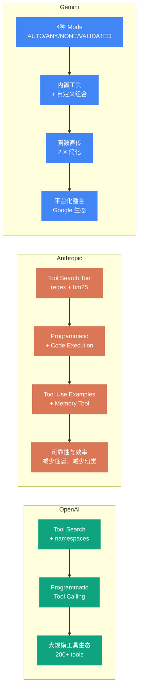
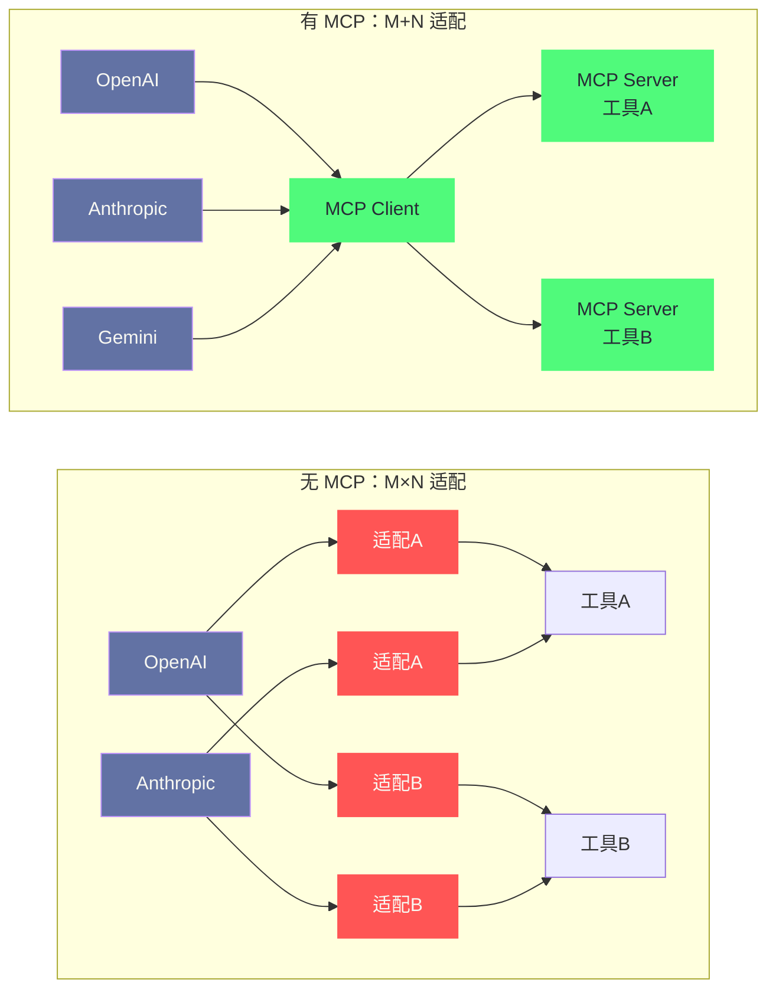

# 03 Tool Use 与 Function Calling——三大厂商的标准化博弈

> [!abstract] 摘要
> 上一篇 [[LLM/Agent技术/基础范式/02 ReAct 架构深度解析——Thought-Action-Observation 循环的本质]] 深入了 ReAct 循环的内部机制，指出 Action 环节已从"自由文本解析"演进为 Function Calling JSON Schema。本文把焦距进一步放大到**规范层**：系统对比 OpenAI、Anthropic、Gemini 三家的 Tool Use / Function Calling 规范，围绕五个主题展开——工具定义格式、`tool_choice` 语义、并行调用、结构化输出（Structured Outputs）、以及工具调用与各厂 Agent SDK 的关系。三家的基础机制高度一致（LLM 只输出"工具调用请求"而不执行工具），但在高级特性上各走各路：OpenAI 走平台化路线，2025 年 3 月推出 Responses API 与托管工具（web search / file search / code interpreter / computer use），用 `tool_search` + namespaces 解决"工具太多塞不进上下文"的问题；Anthropic 走可靠性路线，2025 年 11 月发布 Tool Search Tool、Programmatic Tool Calling、Tool Use Examples 三件套，并明确区分客户端工具与服务端工具；Gemini 走生态整合路线，内置 Google Search、Code Execution 等工具与自定义函数在同一框架下协作，用 VALIDATED 模式约束 schema 遵守。最后讨论从 Function Calling 到 MCP 的收敛——2025 年 3 月与 4 月，OpenAI 与 Google 相继宣布支持 MCP，三家殊途同归。核心认知：**Function Calling 是 Agent 与工具交互的"汇编语言"，MCP 是试图统一它的"高级语言"，但两者不是替代关系，而是叠加关系。**

---

## 第 1 章 Function Calling 的本质——从"生成文本"到"生成指令"

### 1.1 没有 Function Calling 时的世界

在 Function Calling 出现之前（2023 年 6 月以前），让 LLM 调用外部工具的方式是"prompt 约定 + 文本解析"——在 prompt 中告诉 LLM "当你想调用搜索工具时，输出 `Search[query]`"，然后用正则表达式从 LLM 的输出中提取工具名和参数。这种做法的历史比很多人想象的要长：2023 年 3 月 OpenAI 推出 ChatGPT Plugins 时，模型输出的是"插件调用描述"这种半结构化文本，底层仍然是靠文本约定与解析撑起来的。当时还有个更朴素的变体——把工具伪装成"特别格式的文本问题"，模型返回一段 JSON 字符串，开发者用 `json.loads` 兜底解析，解析失败就再问一次。整条链路本质上是一次又一次的"猜"。

这种方式的核心问题在上一篇已经详细分析：格式不稳定、参数幻觉、多参数难以表达。但这里值得再补一层——**格式不稳定不是偶发事故，而是输出分布的必然结果**。LLM 被训练为"生成自然语言文本"，工具调用需要的是"生成结构化指令"，这是两种不同的输出分布。prompt 约定可以"诱导"LLM 生成近似结构化的输出，但无法从根本上改变其输出分布，于是你会看到同一个模型今天输出 `Search[query]`、明天输出 `Search("query")`、后天在结果前多加一行 `I'll search for that`。每遇到一种新偏差就补一条正则，解析逻辑就像老房子里的违章搭建，越盖越多，承重墙却没人管。再叠加上下文占用的考量：把几十个工具的说明全部写进 prompt，无论本次用不用得到，token 都要照付，而这笔开销在工具数量上百之后会变得完全不可接受。

> [!note] 设计哲学：问题不是"模型不听话"，而是"我们在用文本通道传结构"
> 不妨换个思路想——文本解析失败的根子，在于我们强行用一个为"自然语言"设计的输出通道去承载"结构化指令"。自然语言通道的带宽都花在了"像不像话"上，而结构化指令在意的是"对不对"。两者目标不一致，模型只能在两难里摇摆。Function Calling 的出现，本质上是把工具调用从"文本通道"挪到了"专用通道"——模型被训练成在合适的时机输出专门的工具调用对象，而不是写一段看起来像 JSON 的话。

### 1.2 Function Calling 的核心机制

Function Calling（也叫 Tool Use、Tool Calling）的本质是：**在模型训练时就引入"工具调用"作为一种合法的输出类型，让 LLM 的输出分布天然包含结构化的工具调用格式**。注意这里的措辞——不是"在 prompt 里教它"，而是"在训练里内置它"。Chat Completions API 的 `tools` 参数、Anthropic Messages API 的 `tools` 数组、Gemini 的 `function_declarations`，都只是把模型在训练中已经学会的那套输出格式暴露给开发者而已。

具体实现上，三大厂商的思路高度一致：

1. **开发者定义工具 Schema**：用 JSON Schema 描述每个工具的名称、描述、参数及其类型
2. **API 请求携带工具定义**：在 LLM 调用时，把工具 Schema 列表作为参数传入
3. **LLM 决定是否调用工具**：LLM 根据用户请求和工具描述，自主判断是否需要调用工具
4. **LLM 输出结构化工具调用**：如果决定调用，LLM 输出一个包含工具名和参数 JSON 的结构化对象
5. **开发者执行工具并返回结果**：开发者在自己的代码中执行工具，将结果通过特定的消息格式返回给 LLM
6. **LLM 基于结果继续推理**：LLM 将工具结果作为上下文，继续生成下一步响应

这个流程与 ReAct 的"Thought → Action → Observation"循环完全对应——Function Calling 优化的是"Action"这一环的格式化和可靠性。把整个循环画成状态图，会更清楚地看到每一环的信息流向：

```mermaid
%%{init: {'theme': 'dracula', 'themeVariables': {'primaryColor': '#6272a4', 'primaryTextColor': '#f8f8f2', 'primaryBorderColor': '#bd93f9', 'lineColor': '#ff79c6', 'secondaryColor': '#44475a', 'tertiaryColor': '#282a36'}}%%
graph TD
    U["用户请求"] --> M1["LLM 推理<br/>判断是否需要工具"]
    M1 -->|"不需要"| TXT["直接输出文本回答<br/>finish_reason / end_turn"]
    M1 -->|"需要"| CALL["输出工具调用请求<br/>tool_calls / tool_use / functionCall"]
    CALL --> EXEC["开发者代码执行工具"]
    EXEC --> RES["工具结果以消息返回<br/>tool role / tool_result / functionResponse"]
    RES --> M2["LLM 基于结果继续推理"]
    M2 -->|"还需要工具"| CALL
    M2 -->|"完成"| FIN["最终文本回答"]

    classDef start fill:#50fa7b,stroke:#50fa7b,color:#282a36
    classDef llm fill:#6272a4,stroke:#bd93f9,color:#f8f8f2
    classDef exec fill:#ff79c6,stroke:#ff79c6,color:#282a36
    classDef end fill:#ffb86c,stroke:#ffb86c,color:#282a36

    class U start
    class M1,M2 llm
    class CALL,EXEC,RES exec
    class TXT,FIN end
```

> [!info] 核心概念：Function Calling 不是"执行工具"
> 一个常见的误解是"Function Calling 会自动执行工具"。实际上，**LLM 永远不会直接执行任何工具**——它只是生成一个"工具调用请求"（tool call request），告诉你"我想调用这个工具，参数是这样的"。工具的实际执行完全在开发者的代码中完成。Anthropic 文档明确指出："The model never executes anything on its own. It emits a structured request, your code runs the operation, and the result flows back into the conversation."这种设计确保了安全性——LLM 不能直接操作文件系统、数据库或网络，所有操作都经过开发者的代码执行层，开发者可以加入权限控制、日志审计、参数验证等安全措施。把 LLM 想象成高铁，Function Calling 就是受电弓——列车自己不发电，它只是通过受电弓从外部电网取电；电网（工具）长什么样、电流（数据）允许多大，由基础设施方（开发者）决定。这个比喻的限定在于：受电弓只负责"接触"，而 Function Calling 还负责"协商"——模型要自己判断该不该取电、取多少。

这里有个容易混淆的边界需要说清：**"模型训练时就引入"并不等于"所有模型天生都会"**。2023 年 6 月 OpenAI 首次在 Chat Completions API 中开放函数调用时，只有特定模型支持；Anthropic 的 tool use 直到 2023 年末才随 Claude 2.1 开放。也就是说，工具调用是"后训练（post-training）注入的能力"，而非预训练阶段自带的自然涌现。这也解释了笔者观察到的一个现象：不同厂商模型在工具调用上的"体质"差异很大——有的模型在几十个工具面前仍能稳定选对，有的模型一超过十个工具就开始张冠李戴，这种差异正是各厂商在后训练数据配比上的分叉。

### 1.3 为什么三大厂商的规范不同

Function Calling 的基础机制一致，但三大厂商在具体实现上各有设计选择。差异的根源在于三家的业务定位不同：

- **OpenAI**：平台化路线，追求"工具生态最大化"——一个 Agent 可能需要访问成百上千个工具，因此 OpenAI 率先推出 Tool Search 动态加载和 namespaces 组织机制
- **Anthropic**：安全与效率并重，追求"工具调用的可靠性和 token 效率"——Programmatic Tool Calling 让 LLM 在代码执行环境中批量调用工具，减少模型往返次数
- **Gemini**：Google 生态整合路线，追求"内置工具与自定义工具的无缝组合"——内置 Google Search、Code Execution 等工具与自定义 Function Calling 在同一框架下协作

值得强调的一点是：三家的规范都不是"先定标准、再实现"，而是"实现先跑起来、标准后补"。OpenAI 的 `tool_calls`、Anthropic 的 content block、Gemini 的 `function_call` part，最初都是为了自己产品的某个具体场景（Assistants、Claude 的多模态输出、Bard 的联网回答）长出来的形状，后来才被提炼成面向开发者的公开契约。理解这一点很重要——规范之间的差异里，藏着三家公司各自踩过的坑和押注的方向，而不只是工程师审美上的分歧。这篇专栏后续会沿着"规范差异 → 为什么差异 → 如何取舍"的线索展开，先看 OpenAI。

### 1.4 结构化输出（Structured Outputs）——给工具调用装上"模具"

工具调用可靠性的下一层问题，是**参数 JSON 本身的合法性**。即使模型输出了正确的 `tool_calls` 结构，参数内容仍可能漏掉必填字段、把 `location` 的字符串写成了对象、或者吐出一个根本不在 enum 取值范围内的值。对生产系统来说，一次 schema 违约就意味着一次解析失败、一次重试，而重试的成本按"次"计量时无感，按"百万次日调用"计量时就相当可观了。

2024 年 6 月，OpenAI 推出 Structured Outputs（结构化输出），核心做法是在函数定义上加 `strict: true`，让模型输出严格匹配 JSON Schema 的参数。这背后的技术是**约束解码（constrained decoding）**——在解码的每一步，把不满足 schema 的 token 直接从候选池里剔除，模型"想错"都错不出来，而不是靠"生成后再校验、错了再重试"。Anthropic 的 `strict: true`、Gemini 的 VALIDATED 模式走的是同一路线。三者都只支持 JSON Schema 的一个子集（譬如 `additionalProperties` 必须显式为 `false`、不支持正则约束等），原因是约束解码需要在采样阶段就能判断"某个 token 是否可能通向合法输出"，过于自由的 schema 无法静态判定。

> [!warning] 生产避坑：Structured Outputs 保证"语法合法"，不保证"语义正确"
> 一个常见的误读是"开了 strict 模式，参数就不会幻觉了"。实际上 Structured Outputs 只保证输出的 JSON **符合 schema**——字段齐全、类型正确、取值在枚举内。但它不保证参数在业务语义上是对的：模型可能规规矩矩地填出一个 `2025-13-45` 这种 schema 合法但现实不存在的日期（如果 schema 没加 `format` 约束），也可能把"美国最北城市"的搜索结果错填进 `get_weather` 的 `location`。约束解码治的是"格式病"，治不了"内容病"。内容层面的正确性仍然要靠工具描述的质量、参数来源的可追溯性、以及执行侧的校验来兜底。另外还有两个工程细节值得记下：一是新 schema 首次调用会有额外的解析延迟，但同一 schema 后续调用会被缓存，延迟消失；二是 OpenAI 在拒绝安全请求时会返回专门的 `refusal` 字段，程序可以据此区分"模型拒绝"与"输出不合法"，而不是把拒绝当解析失败反复重试。

结构化输出还有一层更广的用途：**当你不调用任何工具、只想让模型返回一段严格符合结构的 JSON 时**，也可以复用同一套 schema 约束机制——OpenAI 用 `response_format` 传 `json_schema`，Anthropic 用 `output_config.format`，Gemini 用 `response_format` 的 `application/json`。这层能力与工具调用的 `strict` 模式共享底层解码技术，但用途不同：前者约束"模型说给下游系统的数据"，后者约束"模型传给工具的参数"。具体差异我们留到第 5 章的结构化输出对比小节再展开。

---

## 第 2 章 OpenAI Function Calling 规范

### 2.1 工具定义格式

OpenAI 使用 `tools` 数组参数传递工具定义，每个工具是一个包含 `type` 和 `function` 字段的对象：

```json
{
  "type": "function",
  "function": {
    "name": "get_weather",
    "description": "Get current weather for a location",
    "parameters": {
      "type": "object",
      "properties": {
        "location": {
          "type": "string",
          "description": "City name, e.g. San Francisco"
        }
      },
      "required": ["location"]
    }
  }
}
```

`strict: true` 参数可以启用 Structured Outputs——保证 LLM 生成的参数严格遵循 Schema 定义，不会遗漏必填字段或生成类型不匹配的值。这对于需要可靠参数格式的生产系统至关重要。开启 strict 时，schema 需要满足额外约束：`additionalProperties` 必须设为 `false`、`properties` 与 `required` 必须完整列出等——官方文档称之为"严格模式下的 JSON Schema 子集"。这些约束不是刁难开发者，而是让约束解码器在采样阶段就能确定合法输出空间，代价是表达力的收窄，收益是"永远合法"的保证。

除了函数工具，OpenAI 还允许在同一 `tools` 数组里混入其他类型的工具：内置托管工具（`{"type": "web_search"}`、`{"type": "file_search"}`、`{"type": "code_interpreter"}` 等）、远端 MCP Server（`{"type": "mcp", "server_url": "..."}`）、以及 `tool_search` 元工具。这个"一个数组装所有工具"的设计，为后面的动态加载和托管工具预留了统一入口。

### 2.2 tool_choice 参数语义

OpenAI 的 `tool_choice` 参数控制 LLM 的工具调用行为，提供四种经典模式，外加 2025 年新增的第五种：

| tool_choice 值 | 语义 | 适用场景 |
| :--- | :--- | :--- |
| `"auto"`（默认） | LLM 自主决定调用零个、一个或多个函数 | 大多数 Agent 场景 |
| `"required"` | LLM 必须调用至少一个函数 | 强制工具使用（如必须查询数据库才能回答） |
| `{"type": "function", "name": "xxx"}` | 强制调用指定的函数 | 路由式工作流（先分类再强制路由到特定工具） |
| `"none"` | 禁止调用任何函数 | 临时禁用工具调用而不移除工具定义 |
| `{"type": "allowed_tools", "mode": "auto", "tools": [...]}` | 把可选工具限制到子集，但保留完整工具列表 | 兼顾"子集约束"与"prompt 缓存命中" |

最后一种 `allowed_tools` 值得单独说。它的应用场景是：你在 `tools` 数组里传了五十个工具（为了缓存不被打断、同一批工具反复复用），但这一轮请求只希望模型从其中三四个里选。传统做法是每次重新构造一个精简的 `tools` 数组——但这样一来，prompt 前缀发生变化，之前辛辛苦苦建立的模型上下文缓存就失效了，每一轮都要为同样的五十个 schema 重新付费。`allowed_tools` 让工具列表保持不动，只在"本轮可选范围"上做文章：

```json
"tool_choice": {
  "type": "allowed_tools",
  "mode": "auto",
  "tools": [
    { "type": "function", "name": "get_weather" },
    { "type": "function", "name": "search_docs" }
  ]
}
```

这就像超市的货架还是那一排，但今天只开放其中两个货道让顾客选购——扫描结账的缓存逻辑完全不受影响。缓存与约束原本是相互拉扯的两个目标，`allowed_tools` 把两者同时满足了，这是笔者眼中它在工程上最漂亮的一点。

### 2.3 并行工具调用

OpenAI 在 2023 年 11 月 6 日及之后发布的模型支持并行函数调用——LLM 可以在一个响应中返回多个 `tool_calls`，这些调用之间没有数据依赖，可以并行执行。

```json
{
  "tool_calls": [
    {
      "id": "call_001",
      "function": { "name": "get_weather", "arguments": "{\"location\": \"San Francisco\"}" }
    },
    {
      "id": "call_002",
      "function": { "name": "get_weather", "arguments": "{\"location\": \"Tokyo\"}" }
    }
  ]
}
```

这个特性与 [[LLM/Agent技术/基础范式/01 Agent 运行范式全景——从 ReAct 到 Production Agent 的演进|第一篇]]讨论的 LLMCompiler 范式呼应——LLM 自主识别哪些工具调用可以并行，减少了串行等待延迟。

不过，并行调用有它的边界条件，需要开发者主动把关：

- **依赖关系必须由开发者识别**。模型在生成多个 `tool_calls` 时，并不会声明它们之间有无依赖。把"先查库存、再下订单"两个调用并发提交，订单可能在库存还没返回时就执行，产生业务错误。实践上，要么在工具描述里明确"此工具依赖其他调用的结果，请勿并行"，要么干脆给这类工位加个"串行信号量"。
- **速率限制（rate limit）是并行度的真实天花板**。模型一次吐出十个调用，不代表你的 API 配额允许你十路并发；不少团队在并行初期被 429 打懵，最后退化成"分两批提交、每批五个"。
- **可以用 `parallel_tool_calls: false` 显式关闭并行**。当工具天然只能串行（譬如"创建资源 → 等待就绪 → 检查状态"的链式流程），与其赌模型不乱来，不如在请求层面就关掉。

### 2.4 Tool Search——动态工具加载

当 Agent 需要访问大量工具时（如统一集成了 CRM、ATS、HRIS、工单系统等多个 MCP Server，可能暴露 200+ 个工具），把所有工具定义塞进上下文会导致严重的 token 浪费。OpenAI 的 Tool Search 解决了这个问题：

**工作原理**：
1. 开发者在 `tools` 数组中添加 `{"type": "tool_search"}` 作为一个特殊的"元工具"
2. 将不常用的工具标记为 `defer_loading: true`——这些工具的完整 Schema 不会加载到上下文中
3. LLM 只看到 `tool_search` 元工具和非延迟加载的工具（最关键的几个）
4. 当 LLM 需要某个延迟工具时，先调用 `tool_search` 搜索相关工具
5. `tool_search` 返回匹配的工具定义，被注入到 LLM 的上下文中
6. LLM 现在可以调用新加载的工具

**namespaces 组织**：为了帮助 LLM 更好地搜索，OpenAI 引入了 namespaces 概念——将相关工具分组到一个命名空间下。LLM 搜索时先看到的是命名空间的名称和描述（而非其中每个工具的详细 Schema），这提供了"高层概览"，让 LLM 知道"哪组工具可能有用"，然后只加载那组工具中的相关成员。

```json
{
  "type": "namespace",
  "name": "crm_tools",
  "description": "Customer relationship management tools",
  "tools": [
    { "type": "function", "name": "create_contact", "defer_loading": true, ... },
    { "type": "function", "name": "search_contacts", "defer_loading": true, ... }
  ]
}
```

几个值得留意的工程细节：官方文档明确指出 `tool_search` 目前只在较新模型（gpt-5.4 及之后）上开放，并且**优先推荐用 namespaces 或 MCP Server 作为搜索面**——模型在这些面上训练得更充分，token 节省也更可观；对 namespace 而言，`defer_loading` 挂在里面的函数上，而不是挂在 namespace 对象本身。另外，对于单个延迟加载的函数，模型在开始时仍然看得到它的名字和描述，tool search 实际延迟的主要是参数 schema——所以如果要追求最大限度的 token 节省，应该把延迟函数归并进 namespaces 或 MCP Server，让模型连"这个名字+描述"都先不看到。

> [!note] 设计哲学：Tool Search 是"Just-in-Time Context"在工具层面的应用
> Tool Search 的设计思想与 Anthropic 的 Context Engineering 中的"Just-in-Time Context"原则完全一致——不要预加载所有可能用到的信息，而是在需要时按需加载。在工具层面，这意味着 LLM 的上下文中只保留"当前任务可能需要的工具"而非"所有可用工具"。OpenAI 的文档指出，Tool Search 设计为保持模型的缓存——新工具在上下文窗口末尾注入，不破坏已有内容的缓存命中。这种"缓存友好"的设计在实际使用中可以显著降低延迟和成本。不妨把 Tool Search 想象成图书馆里的目录柜：书都放在书库里（延迟加载），柜子上只有索引卡（名字与描述），读者先翻卡片、再按索书号取书——而不是把整个书库搬进阅览室。

### 2.5 Programmatic Tool Calling

OpenAI 还支持 Programmatic Tool Calling——让 LLM 通过编写 JavaScript 代码来协调工具调用，而非逐个发起独立的工具调用请求。

```json
{
  "type": "function",
  "name": "check_budget_compliance",
  "allowed_callers": ["programmatic"]
}
```

标记了 `allowed_callers: ["programmatic"]` 的工具只能从 LLM 生成的代码中调用，不能从常规的 tool_calls 中直接调用。LLM 生成一段 JavaScript 代码，在代码执行环境中运行，代码中可以调用这些工具、处理返回结果、执行循环和条件判断——所有这些都在一次模型往返中完成，不需要多次 LLM 调用。

这解决了一个重要的效率问题：如果 Agent 需要检查 20 个员工的预算合规性，传统方式需要 20 次独立的 LLM 往返（每次调用一个查询工具），Programmatic Tool Calling 只需要 1 次——LLM 生成一段循环调用查询工具的代码，在代码执行环境中批量执行。它的另一个隐性收益是上下文卫生：中间结果在代码环境里被过滤、聚合，只有最后几句结论回到模型上下文，避免了 20 份明细挤占窗口。代价是安全模型的改变——审计粒度从"单次工具调用"变成"整段代码"，我们稍后在 Anthropic 章节会看到同样的权衡，那里有更详细的分析。

### 2.6 托管工具与 Responses API——从"函数"到"平台服务"

2025 年 3 月 11 日，OpenAI 发布 Responses API，这是其工具调用历史上一个值得单独记录的分水岭。在此之前，工具调用意味着"模型给出函数名与参数，你的代码执行"——执行归属是开发者；Responses API 引入的**托管工具（hosted tools）**则把执行归属挪到了平台侧：模型决定调用 `web_search`、`file_search`、`code_interpreter` 这些内置工具后，OpenAI 的服务端直接执行（抓取网页、检索向量库、在沙箱里跑 Python），再把结果流式送回对话。从开发者视角看，一次 Responses 请求可以同时完成"搜索 → 读文件 → 跑代码 → 得出结论"的多跳任务，全程不再需要自己的后端参与。

```json
{
  "model": "gpt-4o",
  "tools": [
    {
      "type": "code_interpreter",
      "container": { "type": "auto", "memory_limit": "4g" }
    },
    {
      "type": "web_search",
      "search_context_size": "medium"
    }
  ],
  "instructions": "When asked a math question, write and run Python code to solve it.",
  "input": "Solve 3x + 11 = 14 step by step."
}
```

托管工具的取舍，本质上是"执行归属"的转移：

- **收益是延迟与运维**。抓取器、代码沙箱、向量检索这些通用能力，平台帮你搭好了，不再需要自己维护一套执行环境；官方博客强调托管工具省掉了"每步调用都从你的后端绕一圈"的往返开销，配合服务端状态管理（`store: true` 的会话上下文），多轮工具任务的成本与延迟都更可控。
- **代价是数据流向与审计边界**。查询关键词、检索到的文档、跑过的代码都会经过 OpenAI 服务端——这与自定义 function calling"数据留在你的基础设施"是两种完全不同的合规形态。对于把数据出境当红线（譬如金融、政务）的场景，托管工具再方便也只能绕开，回到自建执行层。
- **一个隐蔽的权衡是"沙箱能力边界"**。code interpreter 的沙箱能跑 Python、处理文件，但它是为"数据分析"设计的通用环境，不是为"你的私有依赖"设计的——需要特定 SDK、特定运行时的任务，托管工具够不着，只能退回自定义工具。

Responses API 在这条路上继续加码：2025 年 5 月 21 日，它加入了远端 MCP Server 支持（`tools` 数组里直接声明 `{"type": "mcp", "server_url": "..."}`）、图像生成工具，以及后台模式（background mode，长任务异步执行）、推理摘要（reasoning summaries）等配套能力。至此，OpenAI 的工具层从"函数调用"一路长成了"平台服务"——自定义函数、内置托管工具、远端 MCP Server 三种来源共用同一个 `tools` 数组，由同一套调用循环驱动。这个演化对开发者最大的意义是：**"工具"从一行 schema 变成了一等公民的服务抽象，选择哪个执行方（你自己、OpenAI、第三方 MCP Server）成了与选择哪个模型并列的架构决策**。

---

## 第 3 章 Anthropic Tool Use 规范

### 3.1 Content Block 架构

Anthropic 的 tool use 采用了一种独特的 **content block** 架构——LLM 的响应不是一个简单的文本字符串，而是一个由多个 content block 组成的数组，每个 block 可以是文本、工具调用或工具结果：

```json
{
  "role": "assistant",
  "content": [
    {
      "type": "text",
      "text": "Let me check the weather for you."
    },
    {
      "type": "tool_use",
      "id": "toolu_01abc",
      "name": "get_weather",
      "input": { "location": "San Francisco" }
    }
  ]
}
```

这种设计允许 LLM 在同一个响应中**交替输出文本和工具调用**——先说"让我查一下天气"，然后输出工具调用请求。文本和工具调用不是互斥的，而是可以交织在同一轮响应中。它像电影的分镜脚本：一段响应是一组镜头，文本 block 是交代剧情的镜头，tool_use block 是"此处插入外部动作"的镜头，`tool_result` block 则是动作完成的回放——剪辑（开发者）决定动作怎么执行，但每个镜头在脚本里的位置是模型定死的。

工具结果通过 `tool_result` content block 返回：

```json
{
  "role": "user",
  "content": [
    {
      "type": "tool_result",
      "tool_use_id": "toolu_01abc",
      "content": "Sunny, 72°F"
    }
  ]
}
```

每个 `tool_use` block 都要对应一个 `tool_result` block，用 `tool_use_id` 关联。哪怕某个调用因为前面的失败被跳过了，也要回一个带 `is_error: true` 的 `tool_result` 说明原因——漏掉任何一个，模型就会面对一段对不上的对话历史，产生连锁混乱。这与 OpenAI"每个 `tool_calls` 都要有对应 `tool` 消息"的约束是同构的：**结构化的轮次配对，是工具调用循环的地基**。

### 3.2 stop_reason 机制

Anthropic 的 ReAct 循环控制通过 `stop_reason` 字段实现（上一篇已详细介绍）：

- `stop_reason: "tool_use"` → LLM 请求调用工具，执行后继续循环
- `stop_reason: "end_turn"` → LLM 自然结束，任务完成

这个机制比 OpenAI 的 `finish_reason: "tool_calls"` 更语义化——`tool_use` 明确表示"LLM 想要使用工具"，而非"响应因为工具调用而停止"。从工程视角看，`stop_reason` 把"循环是否继续"这个决策点从文本解析挪到了 API 响应结构里，循环控制代码不再需要字符串匹配，出错概率骤降。

### 3.3 tool_choice 参数

Anthropic 的 `tool_choice` 语义与 OpenAI 类似但有细微差异：

| tool_choice 值 | 语义 | 对应 OpenAI |
| :--- | :--- | :--- |
| `{"type": "auto"}` | LLM 自主决定是否调用工具 | `"auto"` |
| `{"type": "any"}` | LLM 必须调用某个工具 | `"required"` |
| `{"type": "tool", "name": "xxx"}` | 强制调用指定工具 | `{"type": "function", "name": "xxx"}` |
| `{"type": "none"}` | 禁止调用任何工具 | `"none"` |

Anthropic 在 `tool_choice` 里还能叠加一个 OpenAI 没有的参数——**`disable_parallel_tool_use: true`**。它放在 `tool_choice` 对象内部（不是顶层参数），语义是"每个响应最多让 Claude 调用一个工具"。对"auto"模式而言，这意味着"至多一个工具调用，但仍可能纯文本回答"；对"any"/"tool"模式而言，它曾经意味着"恰好一个工具调用"，但随着 Anthropic 对部分较新模型收紧了强制调用语义（`any` 与 `tool` 会直接返回 400 错误），"恰好一个"的组合已经不存在了。这个收紧对开发者的实际影响是：依赖"强制调用工具来抽取 JSON"的老套路要换掉——官方建议改用 `strict: true` 的 schema 约束或结构化输出（`output_config.format`），让"必调工具"这个诉求让位于"输出必合规"这个更本质的诉求。**当工具调用的目的只是拿到一段合法 JSON 时，绕开工具、直接约束输出，往往比强制调用更稳。**

### 3.4 Tool Search Tool——Anthropic 的动态加载方案

2025 年 11 月，Anthropic 发布了三件套高级工具特性，其中 Tool Search Tool 是对 OpenAI Tool Search 的直接回应：

**两种搜索模式**：
- `tool_search_tool_regex_20251119`：正则表达式匹配——基于工具名称和描述的关键词匹配
- `tool_search_tool_bm25_20251119`：BM25 算法匹配——基于词频-逆文档频率的语义匹配

**使用方式**：
1. 在 `tools` 数组中添加 Tool Search Tool 定义
2. 将其他工具标记为 `defer_loading: true`
3. LLM 初始上下文中只有 Tool Search Tool 和非延迟工具
4. LLM 需要更多工具时，调用 Tool Search Tool 进行搜索
5. API 返回 3-5 个最相关的工具定义，自动展开到 LLM 上下文中

Anthropic 的研究博客给出了这组设计想要解决的量化痛点：一个典型的"五服务"多 MCP 配置（GitHub、Slack、Sentry、Grafana、Splunk 之类），仅工具定义就要吃掉约 55K token；而启用 Tool Search 后，工具相关上下文从约 77K token 降到约 8.7K，保留了约 95% 的上下文窗口，整体 token 消耗减少约 85%。更值得注意的是选择精度数据：当可用工具超过 30-50 个时，Claude 的工具选择准确率会明显下滑；启用 Tool Search 后，内部评测里 Opus 4 在 MCP 评测集上的准确率从 49% 提升到 74%，Opus 4.5 从 79.5% 提升到 88.1%。这组数字点破了笔者想强调的一个事实：**动态加载不只是省 token，它同时是"选择精度"的解药**——工具太多时，模型不是"想偷懒"，而是真的选不动了。

Anthropic 还支持客户端侧的 Tool Search 实现——开发者可以用 embedding 向量自己做语义搜索，而非依赖服务端的 regex/bm25 匹配。Claude Cookbook 提供了完整的客户端 Tool Search 实现，使用 cosine similarity 在工具 embedding 向量之间做匹配。服务端方案的优势是零额外代码，客户端方案的优势是可以用上你已有的向量检索基建、按自己的业务语义定制排序。

### 3.5 Programmatic Tool Calling

Anthropic 的 Programmatic Tool Calling 与 OpenAI 的方案目标一致——让 LLM 在代码执行环境中批量调用工具，减少模型往返。但实现方式不同：

Anthropic 的方案要求同时启用 Code Execution Tool——LLM 生成代码在 Anthropic 提供的代码执行容器中运行，代码中可以调用标记为 Programmatic 的工具。中间数据（工具返回结果）在代码执行容器中处理，**不进入 LLM 的上下文窗口**——只有代码的最终输出返回给 LLM。

Anthropic 的数据表明，在 BrowseComp 和 DeepSearchQA 等多步搜索基准上，Programmatic Tool Calling 平均提升 11% 性能的同时减少了 24% 的输入 token 消耗。官方文档举了一个贴切的例子：检查 20 名员工的预算合规性，传统方式要 20 次模型往返、把几千条费用明细全部拉进上下文；改用 PTC 后，一个脚本跑完 20 次查询、就地过滤、只把超支名单返回给模型——模型需要推理的材料从"几百 KB"缩到"几行"。

> [!warning] 生产避坑：Programmatic Tool Calling 改变了安全模型
> 传统的 Function Calling 中，每个工具调用都是独立的、可审计的——你可以记录每次调用的工具名、参数、返回值，并在调用前做权限检查。Programmatic Tool Calling 把多个工具调用打包进一段代码中执行，审计粒度从"每次调用"变为"每段代码"。这意味着你无法在单个工具调用级别做审批——要么批准整段代码执行（包含其中所有工具调用），要么拒绝。对于需要细粒度权限控制的场景（如 Coding Agent 执行 bash 命令），Programmatic Tool Calling 可能不适合——你需要在每个 bash 命令级别做审批，而非批准一段"可能包含任意 bash 命令"的代码。本专栏第 12 篇将深入讨论权限审批模型与 Programmatic Tool Calling 的兼容性问题。工程上还有一层要注意：PTC 依赖较新的 code execution 工具版本（官方文档标注为 `code_execution_20260120` 及之后），上线前要用 Models API 检查模型能力位 `capabilities.code_execution.supported`，而不是假设模型支持。

### 3.6 Tool Use Examples

Anthropic 的第三个高级特性是 Tool Use Examples——在工具定义中附加具体的使用示例，帮助 LLM 理解"这个工具应该怎么用"。

JSON Schema 定义了工具的"结构"（参数名、类型），但不传达"语义"（什么场景该用、参数应该长什么样）。Tool Use Examples 通过提供 `input_examples` 填补了这个空白：

```json
{
  "name": "search_database",
  "input_examples": [
    {
      "input": { "query": "active users in last 30 days" },
      "output": { "results": [...] }
    }
  ]
}
```

这类似于给 LLM 提供了工具的"few-shot 示例"——不是在 prompt 中，而是在工具定义中。这减少了格式错误和参数幻觉，因为 LLM 不再需要仅凭 Schema 推测正确用法，而是有具体示例可参考。要注意的是示例的质量比数量更重要：一组包含"正确用法 + 边界用法"的示例，胜过十组同质示例。如果示例里混入了错误的参数习惯（譬如把时间范围写成字符串拼接而非 ISO 格式），模型反而会照着坏例子学——毕竟 few-shot 示例在模型眼里是"权威样例"，不是"建议"。

### 3.7 客户端工具与服务端工具的分野

Anthropic 在 2025 年把工具按**执行位置**分成了两类，这是理解其 tool use 生态的关键线索：

- **客户端工具（client tools）**：在你的进程里执行的工具。包括用户自定义工具，以及 Anthropic 定义 schema、由你的应用执行的 `bash`、`text_editor` 等。模型输出 `stop_reason: "tool_use"` 与一个或多个 `tool_use` block，你的代码执行、回传 `tool_result`。
- **服务端工具（server tools）**：在 Anthropic 基础设施上执行的工具——`web_search`、`web_fetch`、`code_execution`、`tool_search`。模型直接调用，你不需要实现执行逻辑，结果直接出现在响应里。

这个分野的本质，是把"谁来执行工具"从"开发者自选"升级成了"平台托管"。对开发者而言，服务端工具省掉了维护抓取器、沙箱、搜索索引的负担；但代价是**数据流向变了**——查询关键词、抓取的网页内容都会经过 Anthropic 的服务端，数据合规敏感的场景必须事先评估。还有一个工程细节：当 Claude 在同一组并行工具调用里混用了服务端工具和你的客户端工具时，服务端工具的结果会先于你的代码执行返回，处理顺序有专门的约定（官方文档的"Stop reasons and fallback"一节），不读文档直接在循环里假设"所有工具结果同时回来"的代码会踩坑。

### 3.8 结构化输出：strict tool use 与 JSON outputs

Anthropic 的结构化输出也是两条腿走路，与 OpenAI 的形态几乎一一对应：

- **Strict tool use**：在工具定义里加 `strict: true`，保证模型传给该工具的参数严格符合 `input_schema`——对应 OpenAI 函数上的 `strict: true`。
- **JSON outputs**：用 `output_config.format` 指定 `type: "json_schema"` 让模型直接输出一段合规 JSON——对应 OpenAI 的 `response_format`。

官方文档强调这两者可以**在同一次请求里同时启用**：工具参数走 strict 约束，最终文本回答走 JSON 约束。共性技术同样是约束解码——Anthropic 称之为"constrained decoding"，文档里的承诺是"不再需要为 schema 违约做重试"。与 OpenAI 不同的是，Anthropic 还提供了 SDK 层的类型辅助（把 schema 定义在类型系统里，SDK 自动转换），把"schema 与代码类型漂移"这个隐患在编译期就按住了。

---

## 第 4 章 Gemini Function Calling 规范

### 4.1 function_declarations 格式

Gemini 使用 `tools[].function_declarations` 定义工具，格式与 OpenAI/Anthropic 类似但有命名差异：

```python
tools = [
    types.Tool(
        function_declarations=[
            types.FunctionDeclaration(
                name="get_weather",
                description="Get current weather for a location",
                parameters={
                    "type": "object",
                    "properties": {
                        "location": {"type": "string"}
                    },
                    "required": ["location"]
                }
            )
        ]
    )
]
```

`Tool` 是最外层容器，`function_declarations` 是数组——同一个 `Tool` 对象还可以同时承载内置工具（如 `google_search=types.GoogleSearch()`），这个"一个 Tool 里既放自定义函数又放内置工具"的结构，为 4.4 节要讲的工具组合埋下了伏笔。Gemini 3 起，模型返回的每个 `functionCall` 都会附带唯一的 `id`，开发者必须把这个 `id` 原样带回 `functionResponse`——和 OpenAI/Anthropic 的调用配对机制同构，但这是 Gemini 后补的（早期版本不强制），反映出后来者对齐行业惯例的节奏。

### 4.2 四种 Function Calling Mode

Gemini 的 `tool_config.function_calling_config` 提供了四种模式，比 OpenAI/Anthropic 更细粒度：

| Mode | 语义 | 对应 OpenAI | 特殊行为 |
| :--- | :--- | :--- | :--- |
| `AUTO` | LLM 自主决定是否调用工具 | `"auto"` | 仅启用 `function_declarations` 时的默认模式 |
| `ANY` | LLM 必须调用工具 | `"required"` | 可配合 `allowed_function_names` 限制可选工具 |
| `NONE` | 禁止调用工具 | `"none"` | 等价于不传工具定义 |
| `VALIDATED` | 确保 Schema 遵守 | 无直接对应（接近 OpenAI `strict: true`） | 工具组合或结构化输出启用时的默认模式 |

`VALIDATED` 是 Gemini 独有的——它约束 LLM 只能生成符合 Schema 的函数调用，减少格式错误。在只有 `function_declarations` 时它是非默认的，但在同时启用内置工具（如 Google Search）或 Structured Outputs 时，`VALIDATED` 成为默认模式。从 Gemini 3 开始，VALIDATED 还会强制参数必填字段的存在性——把"漏字段"这种最常犯的格式错误也一并堵上。这个设计耐人寻味：Gemini 把"格式纪律"直接做成了模式切换，而 OpenAI/Anthropic 把它做成工具定义上的布尔开关（`strict: true`），两种形态表达的是同一个意图，但默认值的选择暴露了各自的哲学——Google 默认在"复合场景"下替开发者做决定，OpenAI 则把决定权留给开发者。

### 4.3 allowed_function_names 精确控制

配合 `ANY` 模式，Gemini 的 `allowed_function_names` 可以精确限制 LLM 只能从指定的函数列表中选择：

```python
tool_config = types.ToolConfig(
    function_calling_config=types.FunctionCallingConfig(
        mode="ANY",
        allowed_function_names=["get_current_temperature"]
    )
)
```

这在 OpenAI 中需要通过 `tool_choice: {"type": "function", "name": "xxx"}` 实现（强制调用单个指定函数），但 Gemini 的 `allowed_function_names` 支持一个函数列表——LLM 必须调用其中一个，但不能调用列表外的函数。这提供了比 OpenAI 更灵活的"限定范围"控制。不过，Gemini 在 2025 年更新的文档里展示了另一套等价写法——在 `generation_config` 里用 `tool_choice.allowed_tools`，模式值变成小写风格（`auto` / `any` / `none` / `validated`），命名向 OpenAI 靠拢。同一能力两套 API 语法并存，恰恰说明 function calling 规范仍处于"实现先跑、标准后补"的演进期，开发者迁移时要注意 SDK 版本对应的语法形态。

### 4.4 内置工具与自定义工具的组合

Gemini 的独特优势是内置工具生态——Google Search、Code Execution、URL Context 等工具由 Google 托管执行，不需要开发者自己实现。2025 年 Gemini 支持了内置工具与自定义 Function Calling 的组合使用：

```python
response = client.models.generate_content(
    model="gemini-3.6-flash",
    contents="What is the northernmost city in the US? What's the weather there?",
    config=types.GenerateContentConfig(
        tools=[
            types.Tool(
                google_search=types.GoogleSearch(),          # 内置工具
                function_declarations=[get_weather]           # 自定义工具
            ),
        ],
        tool_config=types.ToolConfig(
            include_server_side_tool_invocations=True
        )
    )
)
```

这个例子中，LLM 可以先用 Google Search 查"美国最北的城市"，拿到答案后再调用自定义的 `get_weather` 函数查该城市的天气——内置工具和自定义工具在同一轮对话中协作。`include_server_side_tool_invocations=True` 让内置工具的执行结果也包含在响应中，保持完整的上下文链。

Google 当前的完整内置工具清单已经相当可观：**Google Search**（grounding，把回答锚定到实时网页事实，降低幻觉）、**Google Maps**（位置感知助手）、**Code Execution**（模型写并运行 Python 处理数学与数据）、**URL Context**（读取指定网页内容）、**File Search**（对自有文档做 RAG）、**Computer Use**（预览，浏览器 UI 自动化）。这份清单的形态，与 OpenAI 2025 年的托管工具几乎一一对应——两家在"平台托管通用工具"这件事上走向了同一条路，只是执行环境一个在 OpenAI 侧、一个在 Google 侧。

组合机制的底层在 Gemini 3 上被命名为**工具上下文流通（tool context circulation）**：内置工具产生的中间上下文（譬如搜索摘要）会被保留并暴露给自定义函数，让"内置检索 → 自定义处理"的多跳链路得以成立。实现上依赖两个字段：`id`（把 function_call 与 function_response 配对）与 `signature`（加密的上下文票据，验证后续请求里的步骤归属）。在无状态模式下，开发者必须把 `id` 和 `signature` 都原样传回，才能维持上下文链不散。

### 4.5 Gemini 2.X 简化

2025 年 4 月，Gemini 2.X 简化了 Function Calling 的使用——开发者不再需要手写 `function_declarations`，可以直接把 Python 函数传给模型，SDK 自动生成 Schema：

```python
def get_weather(location: str) -> str:
    """Get current weather for a location."""
    # implementation
    return f"Sunny, 72°F in {location}"

# 直接传函数，SDK 自动提取签名和 docstring 生成 Schema
response = client.models.generate_content(
    model="gemini-2.5-flash",
    contents="What's the weather in Paris?",
    config=types.GenerateContentConfig(tools=[get_weather])
)
```

这种"传函数而非传 Schema"的设计降低了使用门槛——函数签名就是 Schema，docstring 就是描述，类型注解就是参数类型。但代价是失去了对 Schema 的精细控制（如 enum 约束、format 约束等需要手写 Schema 才能表达）。到 2025 年下半年，google-genai SDK 更进一步把**自动函数调用（automatic function calling）设为了默认行为**——`generate_content` 里传了函数，SDK 会自动执行"模型决策 → 调用函数 → 回填结果 → 再次生成"的整段循环，开发者连循环都不用写了。这个变化的意义不小：它标志着"工具调用循环"正在从开发者手写的样板代码，变成 SDK 内置的默认运行时。我们会在 5.6 节回到这个话题。

### 4.6 tool_choice 的演进与"验证"哲学

把 Gemini 的 tool_choice 演进单独拎出来看，笔者会得到一个有趣的观察：它从"四选一的大开关"（AUTO/ANY/NONE/VALIDATED），逐步演化出"子集限制"（`allowed_function_names`）与"细粒度模式"（`tool_choice.allowed_tools`），并且把 `VALIDATED` 从"可选模式"抬升为"复合场景下的默认"。这背后是一条清晰的取舍线索：**Google 面对的问题不是"要不要让模型调用工具"，而是"模型调工具时，格式纪律谁来保证"**。OpenAI 把答案藏在 `strict: true` 布尔开关里，Anthropic 把答案藏在 "strict tool use + structured outputs" 双通道里，Google 把答案藏在模式切换里——三家的终点一致（约束解码保证 schema 遵守），起点与路径不同。

> [!note] 设计哲学：tool_choice 是"工具世界的红绿灯"
> 不妨把 tool_choice 想成一组红绿灯：`auto` 是黄灯（模型自己判断要不要走），`required`/`any`/`ANY` 是绿灯（必须走），`none`/`NONE` 是红灯（禁止通行），`allowed_tools`/`allowed_function_names` 则像是"只允许右转"的路牌——能走，但只能走规定的方向。红绿灯的价值不在于"管得严"，而在于"规则可预期"：路口（工具面）再乱，信号一致，车流（调用）就有序。这个比喻的限定在于：工具调用不像交通信号那样有物理强制力，模型可能"闯红灯"（绕过约束），所以信号之外还要有执行侧的校验兜底。

---

## 第 5 章 三大厂商横向对比

### 5.1 基础规范对比

| 维度 | OpenAI | Anthropic | Gemini |
| :--- | :--- | :--- | :--- |
| **工具定义参数** | `tools[].function` | `tools[]`（直接是工具对象） | `tools[].function_declarations` |
| **模型输出格式** | `tool_calls` 数组 | Content blocks（`tool_use` 类型） | `function_call` in parts |
| **结果返回格式** | `tool` role message | `tool_result` content block | `function_response` part |
| **停止原因字段** | `finish_reason: "tool_calls"` | `stop_reason: "tool_use"` | response parts 包含 function_call |
| **并行调用** | ✅ 多个 tool_calls（可 `parallel_tool_calls: false` 关闭） | ✅ 多个 tool_use blocks（`disable_parallel_tool_use` 关闭） | ✅ 多个 functionCall |
| **强制工具** | `tool_choice: {type, name}` | `tool_choice: {type: "tool", name}` | `mode: "ANY"` + `allowed_function_names` |
| **禁止工具** | `tool_choice: "none"` | `tool_choice: {"type": "none"}` | `mode: "NONE"` |
| **Structured Outputs** | `strict: true` / `response_format` | `tools[].strict` / `output_config.format` | `mode: "VALIDATED"` / `response_format` |

### 5.2 高级特性对比

| 特性 | OpenAI | Anthropic | Gemini |
| :--- | :--- | :--- | :--- |
| **动态工具加载** | Tool Search + `defer_loading` + namespaces | Tool Search Tool（regex/bm25）+ `defer_loading` | N/A（内置工具天然按需） |
| **编程化调用** | Programmatic Tool Calling（JS 代码执行） | Programmatic Tool Calling（代码执行容器） | N/A（自动函数调用兜底） |
| **工具使用示例** | N/A | Tool Use Examples（`input_examples`） | N/A |
| **托管/内置工具** | Web Search、File Search、Code Interpreter、Computer Use、Image Generation | web_search、web_fetch、code_execution（服务端工具） | Google Search、Google Maps、Code Execution、URL Context、File Search、Computer Use |
| **工具+内置组合** | 支持（同一 `tools` 数组混排） | 支持（客户端工具与服务端工具同组并行） | 支持（`include_server_side_tool_invocations` / tool context circulation） |
| **MCP 支持** | Agents SDK（2025-03）+ Responses API 远端 MCP Server（2025-05） | MCP 发起方；Claude API 原生支持 + `defer_loading` 配合 | 2025-04 宣布支持；google-genai SDK 实验性 MCP 工具 |
| **SDK Runner** | OpenAI Agents SDK | Tool Runner（beta，自动 agentic loop） | Google GenAI SDK（自动函数调用默认开启） |

### 5.3 设计哲学差异



> [!note] 设计哲学：三家的"第一性原理"不同
> **OpenAI** 的第一性原理是"平台化"——当一个 Agent 需要访问整个 SaaS 生态的工具时，如何让 LLM 在数千个工具中高效找到正确的那个？Tool Search + namespaces 是对"工具规模"问题的回答。
>
> **Anthropic** 的第一性原理是"可靠性"——当一个 Agent 需要连续调用多个工具完成复杂任务时，如何减少模型往返、减少 token 消耗、减少参数幻觉？Programmatic Tool Calling + Tool Use Examples 是对"调用质量"问题的回答。
>
> **Gemini** 的第一性原理是"整合"——当用户已经在 Google 生态中（Google Search、Google Cloud、Workspace）时，如何让内置工具和自定义工具无缝协作？内置工具组合 + 函数直传简化是对"生态整合"问题的回答。
>
> 这三种第一性原理没有优劣之分——它们反映了三家公司的不同业务定位和用户群体。作为开发者，理解这些差异有助于在不同场景下选择最合适的平台。

### 5.4 tool_choice 语义全景对比

把三家的 tool_choice 放在同一张表里，逐格对照语义，会比单独看每一家清晰得多：

| 诉求 | OpenAI | Anthropic | Gemini |
| :--- | :--- | :--- | :--- |
| **自主决定** | `"auto"` | `{"type": "auto"}` | `mode: "AUTO"` / `tool_choice: "auto"` |
| **必须调用（至少一个）** | `"required"` | `{"type": "any"}` | `mode: "ANY"` |
| **强制调用指定工具** | `{"type": "function", "name": "x"}` | `{"type": "tool", "name": "x"}` | `mode: "ANY"` + `allowed_function_names: ["x"]` |
| **禁止调用** | `"none"` | `{"type": "none"}` | `mode: "NONE"` |
| **子集限制（保缓存）** | `{"type": "allowed_tools", ...}` | 不支持（需改工具列表） | `allowed_function_names` / `tool_choice.allowed_tools` |
| **限制并行** | `parallel_tool_calls: false`（顶层） | `disable_parallel_tool_use: true`（tool_choice 内） | 无显式开关 |

逐行看下来，笔者以为有三个值得细品的差异点：

**其一，"required"与"any"的微妙差别**。OpenAI 的 `required` 保证"至少一个 tool_calls"，允许多个；Anthropic 的 `any` 同样保证"至少一个 tool_use block"。但 Anthropic 对部分较新模型已拒绝 `any`/`tool` 强制调用，OpenAI 与 Gemini 仍保留。这意味着"强制工具调用"这个能力本身正在被重新审视——它的使用场景（路由、抽取、分类）大多能被"结构化输出 + 约束解码"更优雅地替代，厂商收紧强制调用，其实是在推动开发者迁移到更稳的范式。

**其二，"子集限制"的实现位置不同**。OpenAI 把它做进 `tool_choice`，Anthropic 暂时没有对应物（只能改 `tools` 列表，代价是缓存失效），Gemini 用 `allowed_function_names`（配合 ANY）与 `tool_choice.allowed_tools` 两种语法。这个差异直接影响了"在多个子任务间复用同一批工具"的工程体验——缓存敏感的应用，这一行 API 的差异就是真金白银的 token 差异。

**其三，并行控制的"开关位置"不同**。OpenAI 是顶层参数，Anthropic 嵌在 `tool_choice` 对象里，Gemini 干脆没有显式开关。开关放哪层的差异看似琐碎，实则反映了两家对"并行"这个能力的态度：OpenAI 把它当成请求级的通用控制，Anthropic 把它当成 tool_choice 的策略的一部分（跟 auto/any/tool 组合出"至多一个"的语义）。

> [!warning] 生产避坑：强制调用与 schema 不匹配是幻觉温床
> 强制工具调用（`required`/`any`/`ANY`/`tool`）是一把双刃剑。当任务的答案不在任何工具的能力范围内时，模型仍然会被迫"凑"一次调用——它会从上下文里勉强抓一个看起来相关的参数填进去，制造出看似合理、实则凭空捏造的调用。典型的反面教材：一个只提供 `get_weather` 与 `get_news` 两个工具的 Agent，被 `tool_choice: "required"` 逼着回答"今天适合穿什么"，模型很可能会调 `get_weather` 然后从返回的温度里编一段穿衣建议——调用是合法的，参数是真实的，但"调用本身"是被逼出来的。所以强制调用只适合"工具面确实覆盖答案空间"的场景（譬如分类器必须落进某个类别、查询必须走数据库），其余场景一律用 `auto` 加上 prompt 里的明确指引。

### 5.5 结构化输出实现对比

| 维度 | OpenAI | Anthropic | Gemini |
| :--- | :--- | :--- | :--- |
| **函数参数约束** | 函数定义加 `strict: true` | 工具定义加 `strict: true` | `mode: "VALIDATED"`（复合场景默认） |
| **纯文本输出约束** | `response_format: {"type": "json_schema", ...}` | `output_config.format: {"type": "json_schema"}` | `response_format` + `schema`（mime_type 为 `application/json`） |
| **拒绝信号** | 专门 `refusal` 字段 | 遵循既有安全策略，无专门字段 | 无专门字段 |
| **Schema 子集** | 严格子集（`additionalProperties: false` 等） | 有限子集 | 有限子集（支持 `null` 联合类型等） |
| **SDK 类型辅助** | Pydantic / Zod 自动转 schema | 类型定义自动转 schema | 函数直传自动生成 schema |

三家的结构化输出在技术上殊途同归——都是约束解码，都把 JSON Schema 收窄到一个可静态判定的子集。差异集中在两个细节：其一，OpenAI 把"安全拒绝"做成了程序可检测的 `refusal` 字段，这在"用户请求违规、模型拒答"的场景里价值很大，另外两家暂时没有等价物；其二，SDK 辅助的深度不同——OpenAI 与 Anthropic 都有"用语言类型直接声明 schema"的通道，Gemini 则把函数直传做成默认。对生产系统而言，结构化输出的价值排序是：**参数约束 > 输出约束 > 拒绝信号**——先把工具参数堵严，再管最终文本，最后才是拒绝语义。

### 5.6 工具调用与 Agent SDK——从协议到运行时

这一节回答一个读者常问的问题：**既然各家 API 都支持工具调用，为什么还要引入 Agent SDK？** 答案是：API 层只给了你"协议"，循环还要自己写。回顾第 1 章的状态图，一次完整对话要经历"推理 → 检测 tool_use → 执行工具 → 回填结果 → 再次推理"的多次往返，每次往返都要处理 stop 语义、消息配对、错误回传。这部分样板代码家家相同，却家家手写，于是各家 SDK 开始把循环内置：

- **OpenAI Agents SDK**（2025 年 3 月随 Responses API 一并推出）：把工具、托管 MCP、tool search 统一成 Agent 的声明式配置，`Runner.run` 帮你跑完整个 agentic loop；支持 hosted tool search、HostedMCPTool、handoffs 等高级编排。
- **Anthropic Tool Runner**（beta）：自动执行"调用 API → 检测 tool_use → 执行 → 回填 tool_result → 继续"的循环，每次迭代 yield assistant message，让开发者有机会在工具执行前后插入审批与拦截。
- **Google GenAI SDK**：自动函数调用默认开启，传函数即可，SDK 自动闭环。

SDK 抽象的价值在于把"循环"从业务代码里抹掉，让开发者把精力放在"工具本身做什么"与"什么时候该让人介入"上。但抽象有泄漏点：一是 SDK 默认帮你选的 `tool_choice` 行为可能不符合你的约束（要显式覆盖）；二是循环被藏起来后，"中途插一个人工审批节点"这种需求，反而比手写循环更麻烦——这正是 LangGraph 这类图编排框架存在的理由（本专栏第 13 篇会展开）。所以一个务实的判断标准是：**单一 Agent、工具面固定 → 用官方 SDK 的默认循环；多步骤、需要人工介入、需要持久化 → 用显式循环或图编排**。工具调用协议是"语言"，SDK 是"方言"，图编排是"剧本"——层次不同，解决的问题不同。

---

## 第 6 章 从 Function Calling 到 MCP——为什么需要标准化

### 6.1 Function Calling 的碎片化问题

三大厂商的 Function Calling 规范虽然在基础层面一致（"让 LLM 输出结构化的工具调用请求"），但在具体格式上各不相同：

- OpenAI 用 `tools[].function` 定义工具，用 `tool_calls` 数组返回调用请求
- Anthropic 用 `content blocks` 中的 `tool_use` 类型，用 `tool_result` 返回结果
- Gemini 用 `function_declarations` 定义工具，用 `function_call` in parts 返回调用请求

这意味着如果你开发了一个 MCP Server 或工具集成，想让它在 OpenAI、Anthropic、Gemini 三个平台上都能用，你需要写三套适配代码——一套把工具定义转成 OpenAI 格式，一套转成 Anthropic 格式，一套转成 Gemini 格式。工具调用结果的返回也需要三套适配。

这种碎片化在工具数量少时还可以忍受，但当工具生态扩大到数十个、数百个时，适配成本就成了严重的负担。用组合数算一笔账：M 个 LLM 平台 × N 个工具，需要维护 M×N 套转换逻辑——3 个平台 50 个工具就是 150 套。而且每家的规范还在演进（`tool_choice` 加模式、工具类型加品种），任何一个平台升级，150 套适配都要跟着过一遍。

### 6.2 MCP 的标准化愿景

MCP（Model Context Protocol）由 Anthropic 于 2024 年 11 月发布，目标是建立一套**跨厂商的标准化协议**——用统一的 JSON-RPC 2.0 消息格式定义工具、资源和提示模板，让一个 MCP Server 实现可以被任何支持 MCP 的 Host 应用使用，而不需要为每个 LLM 厂商写适配代码。MCP 官方文档用了一个很有传播力的比喻——它是"AI 应用的 USB-C 接口"：USB-C 统一了充电与数据传输的物理层，MCP 统一了 AI 应用与工具服务之间的语义层。这个比喻的限定在于：USB-C 后面连接的设备仍需各自的驱动，MCP 后面每个 Server 也仍需各自的实现，协议统一的是"连接方式"，不是"设备能力"。

MCP 与 Function Calling 的关系不是"替代"而是"叠加"：

- **Function Calling** 是 LLM 与工具之间的"语言"——定义了 LLM 如何表达"我想调用这个工具"
- **MCP** 是应用与工具服务之间的"协议"——定义了工具如何被发现、描述、调用和返回

一个完整的技术栈是：LLM 用 Function Calling（OpenAI/Anthropic/Gemini 格式）表达工具调用意图 → Host 应用把调用意图翻译成 MCP 协议消息 → MCP Server 执行工具并返回结果 → Host 应用把结果翻译回 Function Calling 格式返回给 LLM。

### 6.3 从厂商适配到协议适配

没有 MCP 时：

```
LLM (OpenAI) → OpenAI 适配层 → 工具 A
LLM (OpenAI) → OpenAI 适配层 → 工具 B
LLM (Anthropic) → Anthropic 适配层 → 工具 A
LLM (Anthropic) → Anthropic 适配层 → 工具 B
```

M×N 问题：M 个 LLM 厂商 × N 个工具 = M×N 个适配需要写。

有 MCP 后：

```
LLM (OpenAI) → MCP Client → MCP Server → 工具 A
LLM (Anthropic) → MCP Client → MCP Server → 工具 A
LLM (Gemini) → MCP Client → MCP Server → 工具 A
```

M+N 问题：M 个 LLM 厂商各写一个 MCP Client + N 个工具各写一个 MCP Server = M+N 个适配。用图把两种格局画出来，差别一目了然：



> [!info] 核心概念：MCP 把"工具适配"从 M×N 降为 M+N
> 这是 MCP 最核心的工程价值。在 MCP 之前，让一个工具支持 3 个 LLM 平台需要写 3 套适配代码；10 个工具就是 30 套。MCP 之后，每个 LLM 平台写 1 个 MCP Client（共 3 个），每个工具写 1 个 MCP Server（共 10 个），总共 13 个适配而非 30 个。而且新增工具时只需要写 1 个 MCP Server，不需要改任何 LLM 平台的代码。这种"解耦"是标准化协议的核心价值——就像 HTTP 协议让 Web 服务器和浏览器解耦一样，MCP 让工具服务和 LLM 应用解耦。

### 6.4 三家的收敛：MCP 从"Anthropic 自家标准"到"行业事实标准"

2025 年发生的几件事，让 MCP 的行业地位发生了质变：

**OpenAI 的加入（2025 年 3 月 26 日）**。Sam Altman 在 X 上宣布 OpenAI 将在全线产品支持 MCP——当天就落地到 Agents SDK，ChatGPT 桌面应用与 Responses API 随后跟进。两个月后的 2025 年 5 月 21 日，Responses API 正式支持远端 MCP Server：在 `tools` 数组里声明 `{"type": "mcp", "server_url": "..."}`，模型即可直接调用任意公网 MCP Server 暴露的工具；私有 Server 走 Secure MCP Tunnel 接入，不需要暴露到公网。OpenAI 同时宣布加入 MCP 治理委员会（steering committee）。这对开发者是强烈信号：**"工具写一次、到处用"不再需要赌哪家会赢，三家都押了同一匹马上**。

**Anthropic 的持续深化**。作为 MCP 的发起方，Anthropic 不仅让 Claude API 原生支持 MCP Server 配置，还让 `defer_loading` 与 `mcp-client` beta header 配合实现 MCP Server 级延迟加载——Tool Search Tool 可以直接搜索 MCP Server 暴露的工具，把"动态加载"与"MCP 工具面"两个能力缝在了一起。

**Google 的跟进（2025 年 4 月 9 日）**。DeepMind CEO Demis Hassabis 表态支持 MCP，称其为"AI agent 时代的开放标准"；随后 Gemini API 提供实验性的原生 MCP 支持——google-genai SDK 允许直接把一个 MCP 会话对象当作工具传入，配合自动函数调用使用。Google I/O 2025 上，"Gemini API 原生支持 MCP"被列为开发者特性之一。

至此，三大厂商在工具层完成了罕见的步调一致。但需要澄清的是：**MCP 并没有取代 Function Calling**。Function Calling 仍然是 LLM 表达调用意图的"语言层"，MCP 是工具发现与执行的"服务层"。OpenAI 的 Responses API 内部，MCP 工具最终仍要转成模型能理解的 function schema；Anthropic 的 MCP Server 工具最终仍会以 `tool_use` block 的形式出现在响应里。MCP 消灭的是"每平台一套适配"，而不是"模型必须会的那套结构化输出"。这个区分在下一篇文章里会从协议层面展开。

> [!warning] 生产避坑：MCP Roots 不是安全边界
> MCP 规范中定义了 Roots 原语——Host 告诉 Server"允许访问的文件系统/URI 边界"。但 MCP 规范明确指出 Roots 是"协调机制而非强制边界"——Server 在 Host 无法直接管控的地方执行时，可能不遵守 Roots 约束。这意味着如果你把 MCP Server 部署在远程（非 stdio 本地进程），你不能仅依赖 Roots 来保证安全——还需要在 Server 实现中加入自己的访问控制逻辑。MCP 的安全模型将在本专栏第 4-5 篇深入讨论。

---

## 第 7 章 总结与下一篇导读

### 7.1 本文核心要点

1. **Function Calling 的本质**：在模型训练中引入"工具调用"作为合法输出类型，让 LLM 天然生成结构化指令而非靠 prompt 诱导；它只负责"表达调用意图"，执行永远在开发者代码里
2. **三大厂商基础一致、高级分化**：基础机制（工具 Schema + LLM 决策 + 结构化输出）一致，但 OpenAI 追求工具规模（Tool Search + namespaces + 托管工具）、Anthropic 追求调用可靠性（Programmatic + Tool Use Examples + 服务端工具）、Gemini 追求生态整合（内置工具组合 + 函数直传）
3. **tool_choice 语义正在趋同**：自主 / 强制任意 / 强制指定 / 禁止 / 子集限制五类诉求三家都有对应物，但实现位置与语义细节各异（`allowed_tools`、`disable_parallel_tool_use`、VALIDATED 模式）；强制调用在部分新模型上被收紧，替代方向是结构化输出
4. **结构化输出（Structured Outputs）是格式纪律的终极形态**：三家都靠约束解码保证 schema 遵守，保证"语法合法"但不保证"语义正确"；OpenAI 独有的 `refusal` 字段让"模型拒答"可被程序检测
5. **动态工具加载解决"工具太多塞不进上下文"**：OpenAI 与 Anthropic 的 Tool Search 不只是省 token，还能把 30-50 个工具以上的选择准确率拉回来（Anthropic 实测 Opus 4 从 49% 到 74%）
6. **MCP 的标准化价值**：把工具适配从 M×N 降为 M+N；2025 年 OpenAI（3 月）与 Google（4 月）相继宣布支持，MCP 从"Anthropic 自家标准"变成行业事实标准——但它叠加在 Function Calling 之上，而非替代它

### 7.2 下一篇导读

本文讨论了 Function Calling 作为"Agent 与工具交互的汇编语言"的规范差异和标准化趋势。下一篇 [[LLM/Agent技术/基础范式/04 MCP 协议深度解析——Agent 与工具的标准化连接]] 将深入 MCP 协议本身——JSON-RPC 2.0 基础、Host-Client-Server 三层架构、能力协商、三类 Server 原语（Tools/Resources/Prompts）、三类 Client 原语（Sampling/Roots/Elicitation）、传输层演进（stdio → HTTP+SSE → Streamable HTTP），揭示 MCP 如何在协议层面实现"一套 Server 适配所有 Host"的标准化愿景。

> [!info] 专栏导航
> 本文是 [[LLM/Agent技术/00 专栏导览|Agent 技术专栏]] 的第 3 篇。上一篇 [[LLM/Agent技术/基础范式/02 ReAct 架构深度解析——Thought-Action-Observation 循环的本质]] 深入了 ReAct 循环的内部机制，本文承接其"Action 环节"，放大到 Tool Use / Function Calling 的规范层；下一篇将从 Function Calling 的标准化趋势出发，深入 MCP 协议的技术细节，再在 [[LLM/Agent技术/基础范式/05 MCP 生态与实践——Server 开发、集成与生产部署|第 5 篇]] 落地到工程实践。

---

## 参考文献

1. OpenAI. "New tools for building agents." 2025-03-11. https://openai.com/index/new-tools-for-building-agents/
2. OpenAI. "New tools and features in the Responses API." 2025-05-21. https://openai.com/index/new-tools-and-features-in-the-responses-api/
3. Kyle Wiggers. "OpenAI adopts rival Anthropic's standard for connecting AI models to data." TechCrunch, 2025-03-26. https://techcrunch.com/2025/03/26/openai-adopts-rival-anthropics-standard-for-connecting-ai-models-to-data/
4. Kyle Wiggers. "Google to embrace Anthropic's standard for connecting AI models to data." TechCrunch, 2025-04-09. https://techcrunch.com/2025/04/09/google-says-itll-embrace-anthropics-standard-for-connecting-ai-models-to-data/
5. OpenAI. "Function calling." https://developers.openai.com/api/docs/guides/function-calling
6. OpenAI. "Using tools." https://developers.openai.com/api/docs/guides/tools
7. OpenAI. "Tool search." https://developers.openai.com/api/docs/guides/tools-tool-search
8. OpenAI. "Structured model outputs." https://developers.openai.com/api/docs/guides/structured-outputs
9. OpenAI. "MCP servers." https://developers.openai.com/api/docs/guides/tools-connectors-mcp
10. OpenAI. "Introducing Structured Outputs in the API." 2024-06. https://openai.com/index/introducing-structured-outputs-in-the-api/
11. Anthropic. "Introducing advanced tool use on the Claude Developer Platform." 2025-11-24. https://www.anthropic.com/engineering/advanced-tool-use
12. Anthropic. "How tool use works." https://platform.claude.com/docs/en/agents-and-tools/tool-use/how-tool-use-works
13. Anthropic. "Tool search tool." https://platform.claude.com/docs/en/agents-and-tools/tool-use/tool-search-tool
14. Anthropic. "Programmatic tool calling." https://platform.claude.com/docs/en/agents-and-tools/tool-use/programmatic-tool-calling
15. Anthropic. "Parallel tool use." https://platform.claude.com/docs/en/agents-and-tools/tool-use/parallel-tool-use
16. Anthropic. "Structured outputs." https://platform.claude.com/docs/en/build-with-claude/structured-outputs
17. Anthropic. "Introducing advanced tool use for Claude." https://www.anthropic.com/research/advanced-tool-use
18. Google. "Function calling with the Gemini API." https://ai.google.dev/gemini-api/docs/generate-content/function-calling
19. Google. "Using tools with Gemini API." https://ai.google.dev/gemini-api/docs/tools
20. Google. "Combine built-in tools and function calling." https://ai.google.dev/gemini-api/docs/generate-content/tool-combination
21. Google. "Structured output." https://ai.google.dev/gemini-api/docs/structured-output
22. Google. "Gemini Enterprise Agent Platform: Introduction to function calling." https://docs.cloud.google.com/gemini-enterprise-agent-platform/models/tools/function-calling
23. OpenAI Agents SDK. "Model context protocol (MCP)." https://openai.github.io/openai-agents-python/mcp/

---

## 思考题

1. **如果你的 Agent 需要同时访问 50 个工具（来自 5 个不同的 MCP Server），你会选择 OpenAI 的 Tool Search + namespaces 还是 Anthropic 的 Tool Search Tool（bm25）？为什么？** 提示：考虑两种方案的搜索精度、缓存友好度和延迟差异。

2. **Programmatic Tool Calling 在什么场景下不适用？** 提示：考虑安全审计粒度——如果你的 Agent 需要在每次 bash 命令执行前获得人工审批，Programmatic Tool Calling 的"批量执行"特性如何与"逐次审批"需求冲突？

3. **MCP 把工具适配从 M×N 降为 M+N，但引入了什么新的复杂性？** 提示：考虑协议层本身的开销——MCP Server 的生命周期管理、传输层选择（stdio vs HTTP）、能力协商、错误处理——这些在直接写 Function Calling 适配时不需要考虑。

4. **Structured Outputs（`strict: true`）只保证"语法合法"，不保证"语义正确"。如果你要构建一个"根据用户描述自动创建日历事件"的工具，你会如何在 schema 约束之外防止模型填出 `2025-13-45` 这类语义非法的时间？** 提示：考虑 JSON Schema 的 `format` 约束与执行侧校验的分工，以及错误回传（is_error）如何形成闭环。

5. **OpenAI 的 `allowed_tools` 与 Gemini 的 `allowed_function_names` 都能做"子集限制"，但 Anthropic 目前没有等价物。如果你的团队要同时维护三个平台，你会如何设计自己的工具注册层来弥合这个差异？** 提示：考虑把"可选工具范围"做成业务层概念，在各平台 SDK 里做翻译适配。

6. **托管工具（web search / code interpreter 由平台侧执行）与自定义 function calling 在"数据流向"和"审计能力"上有哪些本质差异？在什么合规场景下你宁可放弃托管工具而自建执行层？** 提示：平台托管执行意味着请求与结果都经过厂商服务端，自建执行层则把数据留在你的基础设施内，但要多维护一套执行环境。