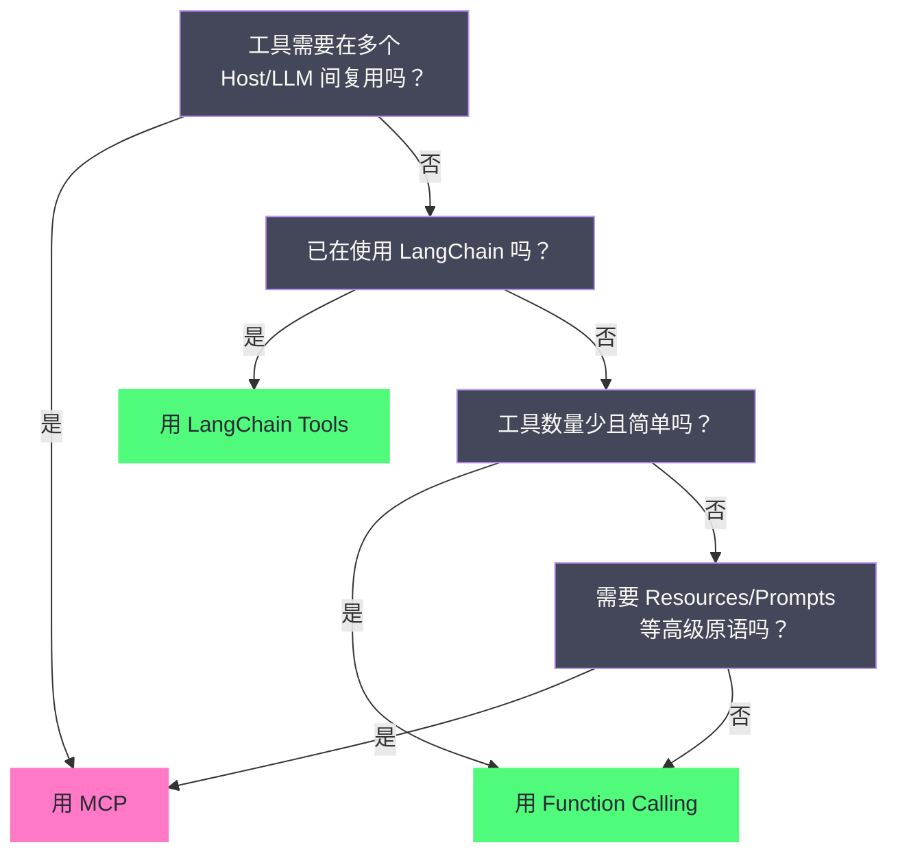

# 05 MCP 生态与实践——Server 开发、集成与生产部署

> [!abstract] 摘要
> 上一篇 [[LLM/Agent技术/基础范式/04 MCP 协议深度解析——Agent 与工具的标准化连接|MCP 协议深度解析]] 拆解的是协议规范本身，本文把视线投向协议之外的工程生态——Server 怎么开发、Host 怎么接入、Server 怎么分发、生产环境怎么部署。文章以一个贯穿全文的 Weather MCP Server 为案例，先用 Python FastMCP 与 TypeScript SDK 两条路线从零构建 Server，顺带讲清装饰器自动生成 Schema 的机制、FastMCP 从 v1 并入官方 SDK 到 v2/v3 独立演进的来龙去脉；随后梳理 2025 至 2026 年主流 Host 的 MCP 支持现状——Claude Desktop 已能通过 Connectors 接入远程 Server 并完成 OAuth 登录、OpenAI 在 Responses API 与 Agents SDK 中支持远程 MCP、Gemini CLI 与 Microsoft Copilot 相继接入，"三大 Host"的旧格局已经演化成一张更完整的支持矩阵；接着讨论 MCP Inspector 调试、四种分发模式与 2025 年 9 月上线的官方 MCP Registry，以及协议治理随 2025 年 12 月捐赠 Linux Foundation 下设 Agentic AI Foundation 而走向中立的过程；最后落在 MCP vs Function Calling vs LangChain Tools 的选型决策与生产部署安全实践上，其中工具投毒（Tool Poisoning Attack）等真实安全事件与远程 MCP 的 OAuth 鉴权落地是本次更新的重点。核心认知：MCP 生态在两年内从几十个参考实现膨胀到官方注册表数以万计的条目，但"能用 MCP"不等于"该用 MCP"——它的价值在工具复用与跨 Host 兼容，单 Host 单工具的简单场景，直接用 Function Calling 反而更简洁。

---

## 第 1 章 MCP Server 开发——从零构建

2024 年 11 月，当 Anthropic 把 Model Context Protocol（模型上下文协议，MCP）作为开源标准公之于众时，官方 SDK 只有 Python 与 TypeScript 两套，能数出来的参考实现不过几十个；到了 2026 年年中，这两套 SDK 的累计下载量各自突破了十亿次，官方注册表里的 Server 条目以万计。两年间 SDK 本身的形态也几经重组——这一点对开发者而言，比协议修订更直接地影响上手路径。本章从最朴素的问题开始：要写一个 MCP Server，代码该往哪里放？

### 1.1 两种 SDK 路线

MCP 官方 SDK 从第一天起就是双语的：Python SDK（`mcp` 包）与 TypeScript SDK（`@modelcontextprotocol/sdk`）。两者的选择通常取决于工具后端的语言——如果工具本身是 Python 写的（譬如要调用 pandas、scikit-learn 这类数据科学库，或是内部 Python 服务），用 Python SDK 顺手；如果工具跑在 Node.js 生态里（譬如要复用某个 npm 包），用 TypeScript SDK 更自然。先看两者在抽象层级上的直观对比：

| 维度 | Python SDK + FastMCP | TypeScript SDK |
| :--- | :--- | :--- |
| 抽象层级 | 高——装饰器自动生成 Schema | 中——需手动定义 Schema（可用 Zod 辅助） |
| 代码量 | ~20 行实现一个工具 | ~40 行实现一个工具 |
| 类型推断 | 从 Python 类型注解自动推断 | 从 TypeScript 类型 + Zod schema 推断 |
| 传输支持 | stdio / Streamable HTTP / SSE | stdio / Streamable HTTP / SSE |
| 适用场景 | Python 生态工具、快速原型 | Node.js 生态工具、生产 TypeScript 项目 |

代码量落差的根源，不在语言的表达能力，而在**两种语言的类型系统在运行时的行为不同**。Python 的类型注解在运行时可以被反射读取，装饰器在模块 import 的那一刻就能把函数签名、默认值、docstring 全部拿到手，JSON Schema 自然可以自动生成；TypeScript 的类型在编译期就被擦除，运行期拿不到任何类型信息，所以要么手写 JSON Schema，要么借助 Zod 这类运行时校验库把 schema 变成一等公民。由此可见，FastMCP 的"省事"是 Python 类型系统白送的红利，TypeScript 侧的"繁琐"是静态类型语言运行期失忆的必然代价。

> [!info] 核心概念：抽象层级是"框架替你做了多少"
> 抽象层级的差别，通俗地说，像**精装房与毛坯房的差别**——FastMCP 是拎包入住的精装房，装饰器替你完成了水电、墙面、开关这些协议层面的施工，你只需描述"这间房要用来做什么"；TypeScript SDK 是按图施工的毛坯房，每根管线都摊在你面前，看得见也改得动，代价是工期更长。但两者最终交付的都是符合 MCP 规范的 JSON-RPC 服务，区别只在于框架替开发者承担了多少协议翻译工作。低抽象意味着高控制，高抽象意味着低摩擦——没有高下之分，只有取舍。

### 1.2 Python FastMCP——装饰器如何生成 Schema

本文的贯穿案例是一个 Weather MCP Server，向美国国家气象局（NWS）的开放接口要天气预警与预报。用 FastMCP 实现，核心代码只有两个工具函数：

```python
from mcp.server.fastmcp import FastMCP
import httpx

mcp = FastMCP("weather-server")

NWS_API_BASE = "https://api.weather.gov"

@mcp.tool()
async def get_alerts(state: str) -> str:
    """Get weather alerts for a US state.

    Args:
        state: Two-letter US state code (e.g. CA, NY)
    """
    url = f"{NWS_API_BASE}/alerts/active/area/{state}"
    async with httpx.AsyncClient() as client:
        data = await client.get(url).json()

    if not data.get("features"):
        return "No active alerts for this state."

    alerts = [format_alert(f) for f in data["features"]]
    return "\n---\n".join(alerts)

@mcp.tool()
async def get_forecast(latitude: float, longitude: float) -> str:
    """Get weather forecast for a location."""
    # ... 实现略

def main():
    mcp.run(transport="stdio")

if __name__ == "__main__":
    main()
```

这段代码表面上是"一个装饰器 + 一个普通异步函数"，实际发生在框架内部的工作分两步。第一步发生在模块 import 时：`@mcp.tool()` 把函数对象注册进 FastMCP 的组件注册表。第二步发生在协议握手之后：当 Host 通过 `tools/list` 询问工具列表时，FastMCP 才把注册函数的类型注解与 docstring 翻译成符合 MCP 规范的 JSON Schema——参数名、参数类型、必填列表、工具描述全部从函数签名与 docstring 里推导。这个翻译过程依赖 pydantic 的类型系统：注解里的 `str`、`float` 被映射为 `type: "string"`、`type: "number"`，函数参数的顺序决定了 `required` 数组的次序，docstring 的第一段成为工具描述，`Args:` 块逐条成为每个参数的 description。

为什么必须分两步而不是 import 时就生成 schema？因为 MCP 的 `tools/list` 是运行时能力声明——Server 可以在连接期间动态增删工具，schema 只有到请求到来的那一刻才是确定的事实。把生成推迟到查询时，等于给 Server 保留了动态演化的能力，代价只是微不足道的延迟。开发者因此只需要写普通函数，协议层的序列化、能力声明、JSON-RPC 消息路由全部被框架吞掉——这正是"为什么 FastMCP 存在"的回答：**协议细节是必要的复杂度，但不该由每个 Server 作者重复实现**。

### 1.3 FastMCP 的演进——从并入官方到独立两条线

FastMCP 这个项目本身就是 MCP 生态演进的缩影，值得单独讲清它的来龙去脉，否则很容易被版本号绕晕。它诞生于 2024 年 11 月——MCP 协议发布后一周，独立开发者 Jeremiah Lowin 为了少写样板代码写下了这个装饰器框架，口号是 "because life's too short for boilerplate"（人生苦短，别写样板）。2025 年初，FastMCP 1.0 的核心代码被并进官方 Python SDK（`mcp.server.fastmcp`），官方文档里的示例从此以 FastMCP 为主，FastMCP 仓库一度宣告"不再维护"。但 2025 年 4 月 11 日，Lowin 发布了 2.0.0（版本代号 "Second to None"），项目恢复独立维护，与官方 SDK 分道扬镳——从此"FastMCP"这个名字下实际跑着两条线：官方 Python SDK 内置的 `mcp.server.fastmcp`，与独立发布的 `fastmcp` 包。

FastMCP 2.0 向后兼容 1.0，重心从"容易创建 Server"转向"容易操作 Server"：新增了 proxy（把远程 MCP Server 挂进本地做代理）、mount（把一个 FastMCP 实例作为子 Server 组合进另一个）、从 OpenAPI spec 或 FastAPI 应用自动生成 Server、以及 in-memory client（不经过网络直接调用 Server 做测试）。这些能力的共同指向是"组合"——把多个工具源聚合到一个入口，像搭积木一样拼出更大的能力面。

2026 年 2 月 18 日，FastMCP 3.0（"Three at Last"）稳定发布，仓库随迁至 PrefectHQ/fastmcp，官方统计两次 beta、两次 RC、21 位新贡献者、超过十万次预发布安装。3.0 重构为 provider/transform 架构：FileSystemProvider 从目录热加载工具、OpenAPIProvider 包装任意 REST API、ProxyProvider 代理远程 MCP Server、SkillsProvider 把 Agent 技能作为资源暴露；transform 链可以对组件改名、命名空间隔离、过滤、打版本。组件级版本化（`@tool(version="2.0")` 允许新旧版本并存于同一 Server）、细粒度授权（异步鉴权检查、AuthMiddleware、OAuth CIMD 与 Azure OBO）、OpenTelemetry 追踪与分布式 Redis 通知，把 FastMCP 从"原型工具"推到了"生产级框架"的位置。

> [!info] 核心概念：FastMCP 3.0 的定位
> 官方 Python SDK 内置的 FastMCP 与独立 `fastmcp` 包是两条演进线：前者随官方 SDK 走，聚焦协议完整性与稳定性；后者（当前即 3.0）面向生产，强调组合、授权与可观测性。对绝大多数新项目，官方 SDK 内置版足够；需要跨服务代理、OpenAPI 自动生成或细粒度授权时，再上独立 `fastmcp` 3.x——它的装饰器 API 与官方版几乎一致，迁移成本很低。这个"一分为二又互不冲突"的格局，恰好是开源生态常见的演进路径：官方吸收核心价值，社区在官方之外继续探索边界。

### 1.4 TypeScript SDK——显式 Schema 与 v2 包拆分

TypeScript 路线需要更显式的 Schema 定义，但换来的是对协议消息的细粒度控制。同样一个 Weather Server，用 TypeScript SDK v1 的写法大致如下：

```typescript
import { Server } from '@modelcontextprotocol/sdk/server/index.js';
import { StdioServerTransport } from '@modelcontextprotocol/sdk/server/stdio.js';
import { CallToolRequestSchema, ListToolsRequestSchema } from '@modelcontextprotocol/sdk/types.js';

const server = new Server(
  { name: 'weather-server', version: '1.0.0' },
  { capabilities: { tools: {} } }
);

// 定义工具列表——schema 必须显式写出，因为运行时拿不到类型信息
server.setRequestHandler(ListToolsRequestSchema, async () => ({
  tools: [{
    name: 'get_alerts',
    description: 'Get weather alerts for a US state',
    inputSchema: {
      type: 'object',
      properties: {
        state: { type: 'string', description: 'Two-letter US state code' }
      },
      required: ['state']
    }
  }]
}));

// 处理工具调用——按工具名分发，自行负责参数校验与错误封装
server.setRequestHandler(CallToolRequestSchema, async (request) => {
  if (request.params.name === 'get_alerts') {
    const { state } = request.params.arguments;
    const response = await fetch(`https://api.weather.gov/alerts/active/area/${state}`);
    const data = await response.json();
    return { content: [{ type: 'text', text: JSON.stringify(data) }] };
  }
});

const transport = new StdioServerTransport();
await server.connect(transport);
```

这段代码里，`ListToolsRequestSchema` 与 `CallToolRequestSchema` 是 SDK 预置的请求处理器常量，相当于把"收到 `tools/list` 走哪个 handler、收到 `tools/call` 走哪个 handler"这件事显式地摆到开发者面前。TypeScript SDK 的代码量大约是 FastMCP 的两倍，但你可以自定义错误处理、流式响应、通知发送等底层行为——在需要精确控制协议消息的生产项目里，这种粒度是特性而非缺陷。

TypeScript SDK 自身在 2025 至 2026 年间经历了一次大重组。2025 年 12 月，v1.24.0 对齐了 2025-11-25 规范；随后 SDK 跨入 v2，单一包 `@modelcontextprotocol/sdk` 被拆成 `@modelcontextprotocol/client`、`@modelcontextprotocol/server`、`@modelcontextprotocol/core` 等一组包，官方提供了 codemod 迁移脚本把 v1 代码自动改写成 v2。v2 的设计有一个值得玩味的地方：**同一个 Client 与 Server 同时说两代协议**——2026-07-28 之前的修订都带 `initialize` 握手（SDK 内部称为 legacy 时代），2026-07-28 起无握手（modern 时代），连接建立时协商一次，此后所有差异由 SDK 内部消化。对存量 v1 Server 而言，这意味着不需要为了接入新 Host 而重写——协议兼容性由 SDK 扛住，而非由每个 Server 作者扛住。

### 1.5 传输层选择

MCP Server 的传输层选择取决于部署场景，只有两个主流答案。**stdio（本地）**是本地工具集成的默认选项——Claude Desktop、Cursor 等都通过 stdio 启动本地 MCP Server 子进程：

```python
mcp.run(transport="stdio")
```

**Streamable HTTP（远程）**则把 Server 变成独立 HTTP 服务，可被多个远程 Client 连接，适用于企业内部共享工具与云端托管：

```python
mcp.run(transport="streamable-http", host="0.0.0.0", port=8000)
```

传输层的选择在 2026 年 7 月 28 日的规范修订之后变得更加干脆——Streamable HTTP 彻底无状态化：`initialize` 握手被移除，每个请求在 `_meta` 字段里自带协议版本与客户端能力；新增 `server/discover` 供客户端探测 Server 的能力与版本；Server 主动发起的 sampling/elicitation 请求改由 MRTR（Multi Round-Trip Requests，多轮往返请求）机制承载。对 Server 开发者的直接影响是部署形态从"每个 Client 维护一个会话"变成"任意请求落到任意实例"——纯轮询负载均衡、CDN 缓存、无状态扩缩容全部成为可能。这是第 4 篇讲过的"传输层做减法"逻辑的延续：MCP 正在让自己像任意 REST API 一样好部署。

> [!warning] 生产避坑：stdio 传输的 PATH 问题
> Claude Desktop 启动 MCP Server 子进程时，使用的是精简的 PATH 环境变量——可能不包含 `npx`、`python3`、`uvx` 等命令的路径。如果你的 MCP Server 配置中用 `npx` 启动但 Claude Desktop 报 "command not found"，这通常是 PATH 问题。解决方案：在配置中使用绝对路径（如 `/usr/local/bin/npx` 而非 `npx`），或在 `env` 字段中显式设置 `PATH`。这个问题在 Windows 与 macOS 上表现不同，排查时先确认子进程继承到的 PATH 到底有哪些目录，而不是盲目重装依赖。

---

## 第 2 章 Host 集成——从三大 Host 到全行业矩阵

如果第 4 篇回答的是"协议怎么说话"，本章回答的是"各家 Host 怎么听"。2024 年 11 月，MCP 的首批支持者只有 Claude Desktop 与寥寥几个早期客户；到 2025 年 12 月，Anthropic 官方的口径已是"ChatGPT、Cursor、Gemini、Microsoft Copilot、Visual Studio Code 等主流 AI 产品均采用了 MCP"。Host 阵营从"Anthropic 的独角戏"变成"全行业的合奏"，配置方式与安全模型的差异也随之扩大——同一个 MCP Server 接入不同 Host，好比**同一张车票在不同车站的检票方式**：目的地相同，但有人工窗口、有自助闸机、有刷码进站，甚至还有第三方代售点，走法各不相同。

### 2.1 Claude Desktop——本地 JSON 配置与远程 Connectors

Claude Desktop 是 MCP 的第一个 Host 实现，也是事实上的参考实现。本地 stdio Server 的配置至今仍通过 `claude_desktop_config.json` 管理：

**配置文件位置**：
- macOS: `~/Library/Application Support/Claude/claude_desktop_config.json`
- Windows: `%APPDATA%\Claude\claude_desktop_config.json`
- Linux: `~/.config/Claude/claude_desktop_config.json`

**配置结构**：

```json
{
  "mcpServers": {
    "filesystem": {
      "command": "npx",
      "args": [
        "-y",
        "@modelcontextprotocol/server-filesystem",
        "/Users/username/Documents"
      ]
    },
    "github": {
      "command": "docker",
      "args": ["run", "-i", "--rm", "-e", "GITHUB_PERSONAL_ACCESS_TOKEN", "ghcr.io/github/github-mcp-server"],
      "env": {
        "GITHUB_PERSONAL_ACCESS_TOKEN": "ghp_xxxxxxxxxxxx"
      }
    }
  }
}
```

每个 Server 条目包含三个字段：`command`（要执行的可执行文件，如 `npx`、`node`、`python3`、`docker`、`uvx`）、`args`（参数列表）、`env`（可选环境变量，通常用于传递 API Key）。配置修改后需要完全重启 Claude Desktop（不是关窗再开，而是退出进程再启动）。

需要特别澄清的一点是"Claude Desktop 只支持 stdio"这个流传甚广的说法——它在 2025 年年中之后只对配置文件成立。`claude_desktop_config.json` 至今不接受 `url` 字段，本地 stdio Server 必须通过它配置；但**远程 HTTP Server 的接入路径已经换了**：用户在聊天界面"+"菜单的 Connectors 里添加远程 Server，填一个 URL，再在浏览器里完成 OAuth 登录即可，全程不碰 JSON，也无需 mcp-remote 之类的桥接工具。Claude 生态（claude.ai、Claude Desktop、移动端、Claude Code、Cowork）共用同一套连接基础设施，对远程 MCP Server 提供三种鉴权方式：OAuth 2.0（每个用户用自己的账号登录）、静态凭证（管理员输入一次 API Key，处于 beta）、无鉴权。

对企业管理员，Claude 还提供了 `managedMcpServers` 配置键：把远程或本地 Server 批量下发到组织内每台设备，用户不可自行删除，并支持 per-tool policy——用 `allow` / `ask` / `blocked` 三种粒度锁定单个工具的可用性。这把 MCP 的安全边界从"个人配置"推进到了"组织策略"层面，是第 7 章企业治理讨论的伏笔。

### 2.2 Cursor——项目级配置与原生远程支持

Cursor 的 MCP 配置与 Claude Desktop 类似，但有三个重要差异。其一，支持项目级配置：`.cursor/mcp.json` 放在项目根目录，可以提交到 git 与团队共享；全局级 `~/.cursor/mcp.json` 所有项目共享；两者合并，同名 Server 项目级优先。其二，原生支持远程 Server——本地配置与 Claude Desktop 相同，远程配置则直接用 `url`：

```json
{
  "mcpServers": {
    "filesystem": {
      "command": "npx",
      "args": ["-y", "@modelcontextprotocol/server-filesystem", "/path"]
    }
  }
}
```

```json
{
  "mcpServers": {
    "my-service": {
      "url": "https://mcp.example.com/mcp",
      "headers": {
        "Authorization": "Bearer your-token"
      }
    }
  }
}
```

其三，Cursor 很早就支持带 OAuth 的远程 Server：

```json
{
  "mcpServers": {
    "oauth-server": {
      "url": "https://api.example.com/mcp",
      "auth": {
        "CLIENT_ID": "your-oauth-client-id",
        "CLIENT_SECRET": "your-oauth-client-secret",
        "scopes": ["read", "write"]
      }
    }
  }
}
```

此外，Cursor 有自己的 MCP Marketplace 与 cursor.directory 社区目录，支持通过 `cursor://` deeplink 一键安装。对开发者工作流而言，`.cursor/mcp.json` 可入库共享这一点价值最大——整个团队的 Agent 工具集随仓库走，新人 clone 下来即开即用。

### 2.3 Claude Code——命令行配置

Claude Code（CLI Agent）的 MCP 配置方式与前两者都不同，通过命令行管理：

```bash
# 添加 stdio Server
claude mcp add filesystem -- npx -y @modelcontextprotocol/server-filesystem /path

# 添加远程 HTTP Server
claude mcp add --transport http my-service https://mcp.example.com/mcp

# 列出已配置的 Server
claude mcp list

# 删除 Server
claude mcp remove filesystem
```

Claude Code 也支持项目级 `.mcp.json` 配置文件，格式与 Cursor 类似，可入库共享；远程 HTTP Server 原生支持，其 OAuth 流程复用 claude.ai 的连接基础设施——用户在浏览器完成授权，token 加密存于本地。Claude Code 的独特之处在于它把 MCP 视为"会话级资产"：`claude mcp add` 的 Server 默认绑定到当前会话，加 `--scope project` 才写进项目配置，加 `--scope user` 才全局生效。这个设计对长时运行的 Coding Agent 很关键——工具集可以随任务动态增减，而不是一次配置永久生效。

### 2.4 OpenAI——远程优先与托管调用

OpenAI 的入场路径与 Anthropic 形成鲜明对照。2025 年 5 月 21 日，OpenAI 在 Responses API 中宣布支持远程 MCP Server，并在 Agents SDK 中支持 stdio、Streamable HTTP 与 SSE 三种传输。OpenAI 主推的是"Hosted MCP tools"：开发者只声明 `server_url`，工具发现与调用由 OpenAI 的运行时托管执行，模型侧无需维护任何连接；对防火墙后的私有 Server，OpenAI 提供开源的 Secure MCP Tunnel（`openai/tunnel-client`），把本地 Server 安全桥接到 OpenAI 平台而不暴露公网。

这套设计把 token 生命周期管理（签发、刷新、轮换）纳入了平台运行时职责，与自托管方案相比省掉了大量胶水代码，但代价同样明显：工具定义与鉴权信息都要经手 OpenAI 的平台，工具调用的每个步骤都落在 OpenAI 的服务器上。OpenAI 同时强调工具调用审批（approvals）与 `allowed_tools` 白名单，要求开发者对敏感操作显式授权，并在官方安全指南里反复提醒：只连接可信 Server、使用最小权限凭据、把访问令牌放进 authorization 字段而非 URL。

### 2.5 Gemini 与 Microsoft——CLI 路线与企业办公路线

Google 走的是 CLI 路线。Gemini CLI 在 `~/.gemini/settings.json` 的 `mcpServers` 段声明 Server，stdio、SSE、Streamable HTTP 三种传输都支持；工具 schema 在注册前会被清洗、校验，冲突时按既有规则消解。Gemini Code Assist 的 agent mode 直接复用 Gemini CLI 的 MCP 能力，在 VS Code 内就能调用同一批工具。需要留意的是，2026 年 6 月 18 日起，免费层与 Google One 用户的 Gemini CLI 已由 Antigravity CLI 接替，MCP 配置能力延续到了新 CLI 上。

Microsoft 则把 MCP 嵌进企业办公场景：Microsoft 365 Copilot 的声明式 Agent 可以通过 MCP/API 插件调用远程 MCP Server，工具在运行时动态发现（server 新加一个工具，agent 无需重新打包即可用）；管理员可以在 Microsoft 365 管理中心的插件管理页面对 MCP Server 做准入、审批与下架治理。对 Copilot 而言，MCP Server 是"插件背后的能力源"，认证、权限、治理都挂在 Microsoft 现有的身份与策略体系上——这与 Anthropic 的 per-tool policy、OpenAI 的审批模型殊途同归：**Host 越往企业走，越要把 MCP 的开放边界收进自己的治理框架**。

### 2.6 2026 年 Host 支持矩阵

把上面各家的情况汇总成一张矩阵，可以直观看出"三大 Host"时代已经结束：

| 维度 | Claude Desktop | Cursor | Claude Code | OpenAI (Responses/Agents SDK) | Gemini CLI | Microsoft 365 Copilot |
| :--- | :--- | :--- | :--- | :--- | :--- | :--- |
| **配置方式** | JSON（stdio）+ Connectors UI（远程） | JSON / UI / deeplink | 命令行 / JSON | 代码内声明（server_url） | settings.json | 插件清单 |
| **本地 stdio** | ✅（JSON 配置） | ✅ | ✅ | ✅ | ✅ | 插件型（无本地进程） |
| **远程 HTTP** | ✅（Connectors UI） | ✅ 原生 | ✅ 原生 | ✅（Hosted/Tunnel） | ✅ | ✅（MCP 插件） |
| **OAuth 认证** | ✅（浏览器登录） | ✅ | ✅ | ✅（平台托管） | ✅ | ✅（Microsoft 身份） |
| **项目级配置** | ❌（仅全局） | ✅ `.cursor/mcp.json` | ✅ `.mcp.json` | ✅（代码内声明） | ✅ `settings.json` | ✅（插件清单） |
| **Marketplace** | Connectors UI + Claude 目录 | Cursor Marketplace + cursor.directory | N/A | N/A | N/A | Agent Store |
| **一键安装** | Connectors UI | `cursor://` deeplink | N/A | N/A | N/A | Agent Store 安装 |
| **托管调用** | ❌ | ❌ | ❌ | ✅（Hosted MCP） | ❌ | ✅（平台调用） |
| **企业治理** | ✅ `managedMcpServers` + per-tool policy | 有限 | ✅ 会话级 scope | ✅ 审批 + 白名单 | 有限 | ✅ M365 管理中心 |
| **目标用户** | 非技术用户 | 开发者 | 开发者/CLI 用户 | 开发者/平台用户 | 开发者/终端用户 | 企业办公用户 |

> [!note] 设计哲学：配置方式适配目标用户，治理能力适配组织规模
> 这张矩阵背后的规律与 2024 年时一致，只是范围扩大了：配置方式反映目标用户，治理能力反映组织规模。Claude Desktop 面向非技术用户，Connectors UI 的一键接入让普通用户无需接触 JSON；Cursor 面向开发者，项目级 JSON 入库共享是开发者工作流的自然延伸；Claude Code 面向 CLI 重度用户，命令行与会话级 scope 最贴合其习惯。而治理能力（per-tool policy、审批模型、管理中心）是 2025 年之后的新增维度——远程 Server 一旦进入企业，就从一个"工具配置问题"变成了"组织访问控制问题"，各家 Host 的治理深浅，将决定 MCP 在企业落地时的实际安全水位。

---

## 第 3 章 MCP Inspector——调试利器

### 3.1 什么是 MCP Inspector

写完了 Server，接下来要回答的问题是：它真的对吗？直接把它接进 Claude Desktop 再调试当然可以，但那样做有三个不便：看不到底层的 JSON-RPC 消息，难以区分"是 Server 的问题还是 Host 的问题"，每次改动都要重启 Host 才生效。MCP Inspector 正是为此而生——官方提供的调试工具，一个 Web 界面，让你在不连接任何 Host 的情况下直接测试 MCP Server 的工具列表、工具调用、资源读取等功能。

**启动方式**：

```bash
npx @modelcontextprotocol/inspector
```

Inspector 会在 `localhost:6274` 启动一个 Web 界面。你可以指定要测试的 MCP Server（通过 command+args 或 URL），Inspector 会作为 MCP Client 连接该 Server，展示：

- Server 声明的能力（capabilities）
- 可用工具列表及其 Schema
- 工具调用测试界面——填写参数、执行调用、查看返回结果
- 可用资源列表及其内容
- 可用 Prompt 模板及其参数
- 协议消息日志——查看 JSON-RPC 消息的完整请求和响应

> [!info] 核心概念：Inspector 是"MCP 的 Postman"
> MCP Inspector 在 MCP 生态中的角色，类似于 Postman 在 HTTP API 开发中的角色——一个独立的调试工具，让你在不依赖具体消费者的情况下测试服务端接口。它像**体检中心的影像科**：Server 在"上临床"（接进 Host 之前）先在影像科把结构看得明明白白，协议消息日志就是那张 X 光片。这解决了 MCP 开发中最常见的一个痛点——如果直接在 Claude Desktop 中测试，你很难区分"是 Server 的问题还是 Host 的问题"；Inspector 把这个环节独立出来，让 Server 开发者可以在"被 Host 消费之前"就验证正确性。

### 3.2 开发工作流

把 Inspector 放进开发流程，推荐的工作流是六步闭环：

1. 用 FastMCP/SDK 实现 Server：写工具函数、定义 Schema
2. 用 Inspector 测试：启动 Inspector，连接 Server，测试每个工具的调用
3. 验证 Schema 正确性：检查 Inspector 展示的工具 Schema 是否与预期一致——参数名、类型、必填项、描述逐项核对
4. 测试边界情况：传入空参数、错误类型参数、超长参数，检查 Server 的错误处理
5. 配置到 Host：测试通过后，将 Server 配置添加到 Claude Desktop / Cursor 的配置文件
6. 在 Host 中验证：重启 Host，确认工具出现在可用列表中

这套流程的关键在第 4 步。LLM 是"不可预测的调用方"——它会传空字符串、传错误类型、传超长参数、甚至在参数里夹带提示注入的文本。Server 的错误处理质量，往往决定了 Agent 能否在真实场景里从失败中恢复：返回结构化错误（`error` + 建议的替代方案）的 Server，能让 LLM 依据错误信息调整策略；只抛一个异常字符串的 Server，则会让 Agent 在同一个坑里反复摔倒。Inspector 把这一步从"生产事故"提前到了"开发期冒烟测试"。

### 3.3 把测试沉淀进 CI

手动点 Inspector 适合开发期，但 Server 会随代码演进，一次手动验证不能保证永远正确。生产级做法是把 MCP Server 的协议测试写进自动化测试套件：

- 用 SDK 的 in-memory client 做单测：Python SDK v2 的一等 `Client` 可以直接连接内存中的 Server 对象，FastMCP 2.0 也提供了 in-memory client——不经过网络栈，测试速度最快，适合断言工具列表、参数校验、返回结构。
- 用 Inspector 的 headless 模式做集成验证：CI 里启动 Server 进程，跑一轮 `tools/list` 与 `tools/call` 冒烟用例，断言关键工具可用。
- 对远程 Server 加健康检查：部署后定时执行 `server/discover`（2026-07-28 起的标准探测）与 `tools/list`，监控工具集是否与预期一致——这既是可用性检查，也是"Server 被换包"的早期告警。

自动化测试的意义在于把"Schema 正确性"从人的记忆变成机器的约束。协议层的小改动（譬如某个参数类型从 `string` 变成 `number`）在手工测试时极难察觉，但 LLM 会立刻在真实调用里踩到——把这层校验交给 CI，比交给用户的报错要体面得多。

---

## 第 4 章 MCP Server 分发模式

### 4.1 四种分发方式

MCP Server 写完之后，下一个问题是：用户怎么安装它？分发方式决定了安装门槛与维护成本，目前主流的四种方式各占一块地盘。**npm 包**是 TypeScript Server 最常见的分发方式，用户无需预装——`npx -y` 自动下载并执行：

```json
{
  "mcpServers": {
    "filesystem": {
      "command": "npx",
      "args": ["-y", "@modelcontextprotocol/server-filesystem", "/path"]
    }
  }
}
```

**PyPI 包**是 Python Server 的对应物，`uvx`（来自 `uv` 工具）是 Python 世界的 `npx` 等价物：

```json
{
  "mcpServers": {
    "weather": {
      "command": "uvx",
      "args": ["weather-mcp-server"]
    }
  }
}
```

**Docker 镜像**适用于需要复杂运行环境或需要隔离的 Server——GitHub 官方 MCP Server 就是通过 Docker 镜像分发的：

```json
{
  "mcpServers": {
    "github": {
      "command": "docker",
      "args": ["run", "-i", "--rm", "-e", "GITHUB_PERSONAL_ACCESS_TOKEN", "ghcr.io/github/github-mcp-server"],
      "env": {
        "GITHUB_PERSONAL_ACCESS_TOKEN": "ghp_xxx"
      }
    }
  }
}
```

**远程 HTTP Server** 由提供方托管运行，用户只需配置 URL，适用于 SaaS 型 MCP Server——如 Unified.to 提供的 CRM/ATS/HRIS 集成 Server：

```json
{
  "mcpServers": {
    "my-service": {
      "url": "https://mcp.example.com/mcp"
    }
  }
}
```

四种方式的取舍可以这样理解：**npx/uvx 像点外卖**——下单即送到，厨房在你不在的地方，但每次都要重新起锅（每次启动都重新解析依赖）；**Docker 像自带厨具的中央厨房**——环境自备、隔离干净，但要求用户家里装得下 Docker 这台"灶台"；**远程 HTTP 像下馆子**——什么都不用准备，但菜单（工具集）由馆子说了算，还得信任馆子的卫生条件。选择哪一种，取决于你的用户是开发者、企业 IT，还是 SaaS 客户。

### 4.2 官方 MCP Registry——分发从"发帖"走向"登记"

2025 年 9 月 8 日，官方 MCP Registry（注册表）以预览形态上线（registry.modelcontextprotocol.io），这是 MCP 分发模式的一个分水岭。此前的分发本质上是"发帖"——Server 作者把 README 和安装命令发到 GitHub、博客或社区目录，用户靠搜索找到它们，可靠性完全依赖作者的自觉。Registry 把这件事变成了"登记"：Server 作者提交一份标准化的 `server.json` 元数据（包含远程 URL、包名、传输方式、协议版本），经过命名空间验证后进入官方目录；客户端与聚合器通过 REST API 读取这些元数据，实现标准化的发现与安装。

Registry 有几个值得细说的设计。其一，**命名空间通过 DNS 或 HTTP 验证**——这像域名注册：作者证明"我控制这个域名/仓库"，才能用对应命名空间发布 Server，从机制上杜绝了"冒名顶替"。其二，**官方 Registry 是"元数据源"而非唯一目录**——规范明确支持子注册表，GitHub MCP Registry（面向 VS Code 的一键安装，约 400 余条）、Docker MCP Catalog（签名镜像 + SBOM）都是它的卫星，任何组织都可以搭建兼容的子注册表。其三，**API 自 2025 年 10 月 24 日起进入 v0.1 冻结期**——发布方承诺一段时间内不引入破坏性变更，让集成方可以放心对接，为 GA（正式可用）做准备。

不过，官方 Registry 的"登记制"也带来了一个老问题：**条目数量不等于质量**。各目录对"一个 Server"的计数口径差异极大——2026 年 10 月的统计里，官方注册表 API 约 4.4 万条记录，PulseMCP 约 2.2 万条，Smithery 约 1.8 万至 2.6 万条，Glama 的近十万则把子页面也算了进去。同一个 Server 可能出现在三个目录里、配着三套不同的元数据；条目增长速度同样惊人，官方注册表在 2026 年 6 月至 9 月间每月新增从 942 条一路涨到 3,886 条。数字对不齐本身，就是"发现困难"的证据——**Registry 解决了"能不能被找到"，没解决"该不该被信任"**，后者留给了第 7 章的安全实践。

### 4.3 分发方式选择

| 分发方式 | 适用场景 | 用户门槛 | 维护成本 |
| :--- | :--- | :--- | :--- |
| npm 包 | TypeScript 工具、开源社区 | 低（npx 自动下载） | 中（需维护 npm 包） |
| PyPI 包 | Python 工具、数据科学工具 | 低（uvx 自动下载） | 中（需维护 PyPI 包） |
| Docker 镜像 | 复杂环境、需要隔离的工具 | 中（需安装 Docker） | 高（需维护镜像） |
| 远程 HTTP | SaaS 工具、企业共享工具 | 低（只需 URL） | 高（需托管服务器） |

选择分发方式时，除了这张表的三个维度，2025 年之后还要多问一个问题：**用户是否信任你的分发渠道？** 对企业用户而言，"npx -y 拉一个来路不明的包"正在从默认选项变成被审查的对象；GitHub MCP Registry 的一键安装、Docker Catalog 的签名镜像、官方 Registry 的命名空间验证，本质都是在回答同一个问题——"我凭什么相信你给我的这个 Server"。这也解释了为什么远程 HTTP 模式在企业场景里增长最快：工具提供方（SaaS 厂商）自己承担托管与安全的全部责任，用户企业只需要在防火墙里放行一个域名、走一遍 OAuth。

这里还有一个容易被忽视的供应链细节：**版本锁定**。`npx -y` 与 `uvx` 默认拉取最新版本，这意味着 Server 的行为可能在某个时刻悄悄变化——上一周还好用的工具，这周因为上游包发布了一个破坏性版本就突然失效，甚至更糟：如果发布渠道被攻破，`-y` 会毫不犹豫地把被投毒的版本执行起来。对生产环境而言，把命令锁到具体版本（如 `npx -y @modelcontextprotocol/server-filesystem@0.8.0`）或在配置里固定镜像 digest，是把"上游不确定性"挡在门外的最低成本手段。分布式系统里有句老话：依赖的上游都是你能控制或不能控制的边界——MCP 的 stdio 分发把这条边界从"依赖库"扩展到了"可执行代码"，供应链的风险等级也随之升了一格。

---

## 第 5 章 官方与社区 MCP Server 生态

### 5.1 核心 Server 一览

MCP 发布两年多来，官方与社区已经实现了大量高质量的 MCP Server，覆盖面从开发者工具到企业应用：

| Server | 功能 | 分发方式 | 维护方 |
| :--- | :--- | :--- | :--- |
| **Filesystem** | 文件读写、glob、grep | npm | 官方 |
| **GitHub** | Issues、PRs、代码搜索、工作流 | Docker | GitHub 官方 |
| **PostgreSQL** | 数据库查询、Schema 浏览 | npm | 官方 |
| **SQLite** | 轻量数据库查询 | npm | 官方 |
| **Fetch** | HTTP 请求、网页抓取 | npm | 官方 |
| **Memory** | 持久化记忆存储 | npm | 官方 |
| **Puppeteer** | 浏览器自动化 | npm | 官方 |
| **Slack** | 消息发送、频道列表、搜索 | npm | 社区 |
| **Jira** | Issue 搜索、创建、状态流转 | npm | 社区 |
| **Brave Search** | 网页搜索 | npm | 社区 |
| **Google Drive** | 文件读写、搜索 | npm | 社区 |
| **Notion** | 页面读写、数据库查询 | npm | 社区 |

这张表只列了最有代表性的十几个。更完整的图景是：Stripe、Salesforce、ServiceNow、HubSpot 等 SaaS 厂商陆续发布了官方 Server，浏览器自动化、数据基础设施、可观测性等垂直领域也都有对应实现。到 2025 年底，Anthropic 官方的 Claude 连接器目录已有 75 个以上 connector（均由 MCP 驱动）——Server 不再只是社区玩具，而是厂商级产品的标准接口。

面对成百上千的 Server，一个实用的筛选框架是把它们分成三档：**官方（Official）**——由工具厂商自己维护，命名空间与代码经过验证，如 GitHub 的 Docker 镜像、Notion 官方 Server；**参考（Reference）**——由 MCP 项目组维护，用作协议实现的参照，如官方仓库里的 Filesystem、Memory；**社区（Community）**——个人或第三方公司维护，质量参差，需要额外审查。社区档并不等于差——很多社区 Server 的质量和活跃度远超无人维护的官方示例，但它的"信任基线"更低，接入前至少要看三样东西：最近一次提交时间（判断是否还在维护）、工具描述里有没有可疑指令（判断是否有投毒痕迹）、以及它要访问哪些外部服务（判断权限诉求是否与工具本职相符）。这套三档分类法，是第 5.2 节"数量不等于质量"的落地操作。

### 5.2 生态增长数据——口径不一本身就是信息

MCP 生态的增长速度，在 2025 至 2026 年经历了"参考实现 → 万级 Server → 注册表数万条目"三个阶段，但不同来源的数字需要仔细甄别：

| 时间 | 数量 | 口径 | 来源 |
| :--- | :--- | :--- | :--- |
| 2024-11 | ~50 | 参考实现 | OpenHelm 统计 |
| 2025-01 | ~150 | 公开 Server 实现 | OpenHelm 统计 |
| 2025-03 | 2,300+ | 社区个人统计 | 社区统计（LinkedIn） |
| 2025-12-09 | 10,000+ 活跃公共 Server | Anthropic 官方口径 | Anthropic 捐赠公告 |
| 2026-07-28 | SDK 月下载近 5 亿；Python/TS SDK 总下载均破 10 亿 | 官方 Tier 1 SDK 口径 | MCP 官方博客 |
| 2026-10 | 官方注册表约 4.4 万条记录 | 注册表 API 口径 | 第三方统计 |

三种口径各说各话，根源在于"Server 数量"本身不是一个清晰的概念：官方注册表数的是**登记的元数据条目**，PulseMCP 数的是**收录的目录页**，Anthropic 数的是**实际在用的活跃 Server**。同一个 Server 在三个口径里可能各计一次，也可能都不计。这提醒我们，在引用生态数字时不能只看绝对值，还要看计数口径——**生态增长的速度毋庸置疑，但"到底有多少 Server"至今没有一个权威答案，这本身就是发现问题的证据**。

> [!note] 设计哲学：生态增长验证协议价值
> MCP 生态的快速增长不是偶然的——它验证了一个基本的工程经济学原理：当集成成本从 M×N 降为 M+N 时，新增工具的边际成本从"N 个适配"降为"1 个 MCP Server"，新增 Host 的边际成本从"M 个适配"降为"1 个 MCP Client"。这种成本结构的改变让"为某个工具写一个 MCP Server"变成了一件值得做的事——因为写一次就能被所有 Host 使用；反过来，Host 厂商也有动力支持 MCP——因为支持一次就能接入所有已有的 MCP Server。这种正反馈循环，是标准化协议生态爆发的典型模式，LSP 验证过一次，MCP 正在验证第二次。

### 5.3 治理走向中立——MCP 捐赠给 Agentic AI Foundation

生态规模上来之后，一个绕不开的问题浮现了：**协议的控制权掌握在谁手里？** MCP 由 Anthropic 发起并主导，这在起步阶段是优势（决策快、方向清晰），但随着 OpenAI、Google、Microsoft 相继采纳，单厂商治理开始成为其他参与者的顾虑——谁也不愿意把自家产品的核心通路押在竞争对手的善意上。2025 年 12 月 9 日，Anthropic 宣布把 MCP 捐赠给 Linux Foundation 下设的 Agentic AI Foundation（AAIF），一个由 Anthropic、Block、OpenAI 联合创立、Google、Microsoft、AWS、Cloudflare、Bloomberg 支持的定向基金。

这次捐赠的意义是结构性的。协议治理从"发起厂商说了算"变成了"多厂商共同治理"，与 LSP 当年由微软主导、之后长期作为开放规范存在的路径形成对照——MCP 在发布仅一年后就主动走向了中立化，比 LSP 快得多。对生态的影响也立竿见影：协议修订的决策过程向所有成员开放，企业采用 MCP 时不再需要评估"Anthropic 会不会改变主意"。可以说，**AAIF 的成立，是 MCP 从"一个成功的开源项目"变成"一项基础设施标准"的成人礼**——集市还是那个集市，但市政规划局开始接管秩序了。

---

## 第 6 章 MCP vs Function Calling vs LangChain Tools——选型决策

### 6.1 三种方案的定位

把 MCP 与它的竞争者放在同一张桌子上，先看清各自的定位：

| 方案 | 定位 | 标准化程度 | 适用场景 |
| :--- | :--- | :--- | :--- |
| **MCP** | 跨 Host 标准化协议 | 开放标准 | 工具需要在多个 Host/LLM 间复用 |
| **Function Calling** | LLM 厂商专有工具调用 | 厂商专有 | 单 Host 单 LLM 的简单场景 |
| **LangChain Tools** | 框架内工具定义 | 框架生态 | 已使用 LangChain 的项目 |

三者的关系用一张卡片比喻就能说清：**MCP 是通用身份证**——任何机构都认，办理流程繁琐，但一旦办成，走遍全国有效；**Function Calling 是自家门禁卡**——只在发卡公司的门禁上有效，但发卡即用，无需任何中间环节；**LangChain Tools 是老东家的工牌**——在老东家的系统里权限齐全，跳槽到别的系统就失效了。身份证、门禁卡、工牌没有谁更高尚，只有使用场景的差别。

### 6.2 什么时候用 MCP

**用 MCP 的场景**：

- 你在开发一个工具，希望它被 Claude Desktop、Cursor、Gemini CLI 等多个 Host 使用
- 你在企业内部共享工具——多个团队使用不同的 LLM 应用，但需要访问同一组内部工具
- 你在开发 SaaS 工具，希望通过 MCP 让 AI 应用接入你的服务
- 你的工具有复杂的状态管理或需要 Resources/Prompts 等 MCP 高级原语

**不用 MCP 的场景**：

- 你只用一个 LLM（如只用 OpenAI），且工具只在自研应用中使用——直接用 Function Calling 更简单
- 你的工具非常简单（1-2 个函数），引入 MCP 的协议开销不值得
- 你的工具需要与 LLM 深度耦合（如自定义 prompt 模板），Function Calling 的直接控制更灵活
- 你已经在使用 LangChain，且工具只在 LangChain 生态内使用——LangChain Tools 足够

### 6.3 决策树



> [!warning] 生产避坑：不要为了"标准化"而强行用 MCP
> MCP 引入了协议层开销——JSON-RPC 消息序列化/反序列化、能力协商、生命周期管理、传输层选择。对于一个只有一个工具、只在一个 OpenAI 应用中使用的场景，直接用 Function Calling 的代码量是 MCP 的 1/3，且没有协议层开销。"用 MCP 因为它是标准"是一种过度工程——标准化的价值在"复用"和"互操作"，如果没有复用需求，标准化就是不必要的复杂性。判断标准很简单：如果你只需要写一次工具定义，用 Function Calling；如果你需要让同一个工具定义被多个不同的消费者使用，用 MCP。

### 6.4 选定了 MCP 之后的第二层选择

值得强调的是，6.3 的决策树只回答了"要不要 MCP"，选定了 MCP 之后还有两个容易忽视的岔路口。其一是 **stdio 还是远程**：本地个人使用、数据不出机器，选 stdio；多人共享、跨团队、云端部署，选远程 HTTP。判断依据很简单——**谁使用这个 Server，数据在哪里**。其二是 **自建还是托管**：自建 Server 保留完全控制权，但要自己处理托管、鉴权、扩容；Hosted 方案（如 OpenAI 的 Hosted MCP tools）把连接与 token 管理交给平台，代价是工具调用路径经过第三方。这两层选择叠加起来，才构成完整的部署决策。

顺带澄清一个常见的概念混淆：MCP 与 A2A（Agent-to-Agent）协议不是竞争关系，而是分工关系。MCP 解决的是"Agent 与工具"的连接，A2A 解决的是"Agent 与 Agent"的协作——前者问"我能调用什么"，后者问"我能委托谁"。两者甚至可以叠用：一个 Agent 通过 MCP 拿到工具，再通过 A2A 把带工具的整条能力委托给另一个 Agent。本专栏 [[LLM/Agent技术/应用开发/14 多 Agent 系统与 A2A 协议——协作、通信与特化|第 14 篇]] 会展开 A2A 的细节，这里只需要记住一条边界：**选型时先分清你连接的是"工具"还是"Agent"，再决定上哪套协议**。

---

## 第 7 章 生产部署最佳实践

### 7.1 安全实践

**API Key 管理**：MCP Server 经常需要 API Key 来访问外部服务（如 GitHub Token、Slack Token）。最佳实践是通过 `env` 字段传递，而非硬编码在 Server 代码中：

```json
{
  "mcpServers": {
    "github": {
      "command": "docker",
      "args": ["run", "-i", "--rm", "-e", "GITHUB_PERSONAL_ACCESS_TOKEN", "ghcr.io/github/github-mcp-server"],
      "env": {
        "GITHUB_PERSONAL_ACCESS_TOKEN": "ghp_xxx"
      }
    }
  }
}
```

**工具描述审查**：如 [[LLM/Agent技术/基础范式/04 MCP 协议深度解析——Agent 与工具的标准化连接|第 4 篇]]所述，工具描述是 Prompt Injection 的攻击面。对于来自不受信任来源的 MCP Server，应审查其工具描述中是否包含可疑指令——这不只是理论警告，而是 2025 年已被反复验证的真实攻击面，详见 7.3。

**权限最小化**：为 MCP Server 配置的 API Key 应使用最小权限——如 GitHub Token 只授予 `repo` 和 `read:org` scope，不授予 `admin` 或 `delete_repo` scope。理由很朴素：**Agent 的工具链是一条"间接执行链"，凭据的权限上限就是攻击者能造成的损失上限**——只给办事所需的图章，不给保险柜的钥匙。

### 7.2 远程 MCP 的鉴权落地——OAuth 是标配而非加分项

远程 Server 一旦面向组织使用，鉴权就不再是"要不要"的问题，而是"怎么合规落地"的问题。MCP 自 2025 年 6 月 18 日的规范修订起，把远程传输的授权机制定为基于 OAuth 2.1 的标准流，服务器端需要实现的组件包括：

- **Authorization Server Metadata**（授权服务器元数据，RFC 8414）：向客户端公布授权服务器地址、支持的 grant 类型、token 端点——客户端据此发现"该找谁要令牌"
- **Dynamic Client Registration**（动态客户端注册，RFC 7591）：允许客户端在首次连接时自助注册为 OAuth 客户端，省去人工在后台登记每个 Host 的流程
- **Authorization Code + PKCE**：面向桌面与 Web 客户端的主流授权码流程，PKCE 防止授权码被截获后重放

这个流程在用户侧的体验是"点一下、浏览器跳转、登录、回跳"，在协议侧则是标准的 OAuth 舞蹈。Claude 生态对远程 Server 的要求可以作为参照：以 `401` 响应触发登录、发现与注册端点 10 秒内响应、token 刷新 30 秒内完成、不支持 `client_credentials` 机器对机器授权（而是用 Anthropic 持有的客户端凭据做审批门控）。这些细节提醒 Server 开发者一个现实：**把远程 MCP 交给企业用户，意味着你的 Server 必须是一个合格的 OAuth 资源服务器**，而不是"挂一个 Bearer token 就完事"。

反观 stdio 传输，规范明确建议**不要**套用这套 OAuth 流程——本地进程的凭据应该从环境变量读取，由 Host 在启动子进程时注入。两套路径的分野，本质上是信任模型的差异：stdio 的信任建立在"进程在我机器上"，远程的信任建立在"令牌在我手里"。

### 7.3 工具投毒与间接提示注入——2025 年的真实安全事件

生产环境里最值得警惕的 MCP 安全问题，是工具投毒（Tool Poisoning Attack，TPA）——间接提示注入的一个特殊形态。2025 年 4 月，安全研究机构 Invariant Labs 公开了这一攻击：恶意指令被嵌入 MCP 工具的描述字段，用户看不到，但 LLM 看得到；一次工具调用就可能让模型执行攻击者预设的动作。2025 年 5 月，Invariant 又演示了 GitHub 官方 MCP Server 的漏洞——攻击者在公开仓库的 issue 里植入恶意文本，用户让 Agent 查看 issue 时，Agent 被诱导去读取并泄露私有仓库的内容。2025 年 8 月，Snyk 披露了"Cursor + Jira MCP 0-Click"漏洞：攻击者提交一个"武器化的 Jira 工单"，开发者把 Cursor 指向该工单后，Agent 被诱导搜索"以 eyJ 开头（JWT 前缀）的长字符串"并外发，受害者连一次点击都不需要。

这三个事件指向同一个结论：**MCP 的安全短板不在协议，而在"工具元数据被当作了指令"**。防御要落在四层：

1. **信任边界**：只连接可信 Server（官方维护、命名空间已验证、经过代码审计），对陌生 Server 保持怀疑
2. **工具描述审查**：把 description 当作不可信内容看待，Host 侧对工具描述做过滤或标注
3. **凭据最小化**：Agent 携带的凭据只给最低必要权限，即使被诱导调用，损失也可控
4. **沙箱隔离**：高风险操作（写文件、执行命令、改数据）在操作系统层面做隔离——这正是姊妹专栏 [[LLM/Agent沙箱技术/00 专栏导览|Agent 沙箱技术]] 的主题

工具投毒还揭示了一个更深的工程现实：**LLM 的"听话"既是能力也是漏洞**。它能遵循用户的指令，就能遵循藏在工具描述里的恶意指令；能在上下文里区分"用户数据"与"指令"是模型能力问题，而在架构上保证两者不被混用，是系统设计问题——后者才是工程能控制的。

### 7.4 企业级 MCP 治理

当 MCP Server 进入企业，安全实践就从"个人的好习惯"升级为"组织的策略体系"。2025 年之后，主流 Host 陆续补齐了治理能力，几种有代表性的做法：

- **Anthropic 的 per-tool policy**：`managedMcpServers` 支持对单个工具设置 `allow` / `ask` / `blocked`，管理员可以在 Admin Console 统一下发，用户不可自行绕过——把"工具可用性"从个人配置提升为组织策略
- **OpenAI 的审批与白名单**：工具调用默认需要显式审批，`allowed_tools` 限制模型可见的工具集
- **Microsoft 365 管理中心的插件治理**：管理员对 MCP Server 插件做准入、审批与下架，与组织现有的身份体系联动
- **网关层的路由与授权**：2026-07-28 规范把方法名与工具名放进 `Mcp-Method`、`Mcp-Name` HTTP 头，网关可以直接依据头部做路由和授权，不必解析 JSON-RPC 体——这为"MCP API 网关"这类统一治理入口铺平了道路

> [!note] 设计哲学：安全水位由最弱一环决定
> 企业采用 MCP 时最常见的误区，是把"Server 是自研的"当作"Server 是安全的"。实际上，一个企业内部 MCP 体系的安全水位，取决于最弱的一环——可能是某个用了管理员级凭据的历史 Server，可能是某个没做工具描述审查的第三方 Server，也可能是某个不设审批的 Host 配置。协议提供了信任框架，但执行质量完全在组织手里。这也是为什么成熟 Host 的治理能力（per-tool policy、审批、集中管理）在 2025 年之后成为选型的重要维度：**选 Host 不只看它支持多少协议特性，还要看它给了管理员多少控制权**。

### 7.5 可靠性实践

**超时控制**：MCP Server 的工具调用可能因为外部服务不可用而超时。Host 侧应设置调用超时，Server 侧应实现优雅的超时处理——不要把外部服务的 5 秒超时直接透传给 LLM 当错误。

**错误恢复**：Server 应返回结构化的错误信息（包含错误类型和建议的替代方案），而非简单的异常字符串。这让 LLM 能根据错误信息调整策略——譬如天气 Server 在 NWS 接口限流时返回"限流，请稍后重试或改用缓存"，Agent 就会等待重试而不是反复撞墙。

**重试与幂等**：Agent 对工具的调用天然会重试——模型上下文里"上一步失败了，换个参数再来一次"是常态，而 Host 侧的超时也可能导致同一请求被重复发出。这意味着**有副作用的工具必须处理重复调用**：写入型工具要么实现幂等（同样的输入只产生一次效果，如带请求 ID 去重），要么在工具描述里明确"不可重复调用"。一个典型的反例是"创建工单"工具被重试两次，产生了两个重复工单——Agent 会一头雾水，用户会更头疼。在协议层面，2025-11-25 规范引入了异步操作（任务句柄 + 结果查询），部分缓解了"长任务在超时后状态不明"的问题，但工具自身的幂等设计依然不可替代。

**日志记录**：Server 应通过 stderr 输出结构化日志（Host 可以捕获和转发），记录工具调用的参数、执行时间、返回状态。这是生产环境排查问题的关键依据。注意，stdio 传输下 stdout 是协议通道，日志只能走 stderr——把调试输出打进 stdout 会直接破坏协议帧，这是最常见的低级事故之一。

### 7.6 性能与可观测性

**异步实现**：工具函数应使用 async/await 而非同步阻塞——特别是涉及网络请求的工具。FastMCP 与 TypeScript SDK 都支持异步工具，同步写法在高并发下会卡死整个事件循环。

**连接池复用**：对于频繁调用外部 API 的 Server，应在 Server 内部维护 HTTP 连接池，而非每次调用都新建连接。一次 `tools/call` 就新建一次 TCP 连接，在 Agent 连续调用几十个工具的会话里，光握手开销就能把延迟放大一个数量级。

**Streamable HTTP 部署**：远程 MCP Server 应使用 Streamable HTTP（而非已废弃的 HTTP+SSE），确保与负载均衡器、CDN 等 HTTP 基础设施兼容；2026-07-28 无状态化之后，甚至可以放心部署在纯轮询负载均衡后面——任何实例都能处理任何请求，session 不再是约束。无状态部署时，确保不依赖 session 管理状态。

**可观测性**：生产级 Server 应该接 OpenTelemetry——FastMCP 3.0 已内置 OTel 追踪，官方 SDK 也有对应支持。工具调用的 span 与 LLM 调用的 span 串起来，才能回答"这个 Agent 行为为什么出错"这类问题。另外，Anthropic 在 2025 年 12 月发布的 Tool Search 与 Programmatic Tool Calling，专门面向"上千个工具"的规模化场景——工具太多塞不进上下文时，用 Tool Search 动态检索相关工具，再用 Programmatic Tool Calling 以编程方式调度。对计划把几十上百个 Server 接入同一 Agent 的团队，这组能力值得持续关注。

---

## 第 8 章 总结与下一篇导读

### 8.1 本文核心要点

1. **两种 SDK 路线**：Python FastMCP（高抽象、装饰器自动生成 Schema、~20 行/工具）和 TypeScript SDK（中抽象、显式 Schema、~40 行/工具），抽象层级差异源于两种语言类型系统在运行时的行为不同
2. **FastMCP 一分为二**：官方 Python SDK 内置的 `mcp.server.fastmcp` 与独立 `fastmcp` 包（2.0 组合/代理、3.0 provider/transform 架构）并行演进
3. **Host 矩阵已从三大扩展到全行业**：Claude Desktop 本地走 JSON、远程走 Connectors + OAuth；Cursor 项目级配置；Claude Code 命令行 + 会话级 scope；OpenAI 远程优先 + Hosted 调用 + Secure MCP Tunnel；Gemini CLI 与 Microsoft Copilot 相继接入
4. **MCP Inspector 是调试利器**：在连接 Host 前独立测试 Server，查看 JSON-RPC 消息流，验证 Schema 正确性；测试应沉淀进 CI
5. **分发进入"登记"时代**：npm/PyPI/Docker/远程 HTTP 四模式之外，官方 Registry（2025-09 上线）与子注册表提供了标准化发现，但条目数量不等于质量
6. **生态规模两年万倍级增长**：从 2024-11 的几十个参考实现到 2025-12 官方口径 10,000+ 活跃 Server、2026-10 官方注册表约 4.4 万条记录，SDK 月下载逼近 5 亿；2025-12 协议捐赠给 Linux Foundation 下设的 AAIF，治理走向中立
7. **选型决策**：工具需要跨 Host 复用 → MCP；单 Host 简单工具 → Function Calling；已用 LangChain → LangChain Tools；选定 MCP 后还要在 stdio/远程、自建/托管之间做第二层选择
8. **安全是生产部署的主线**：远程 MCP 的 OAuth 鉴权是标配；工具投毒（TPA）是 2025 年被反复验证的真实攻击面；企业治理（per-tool policy、审批、集中管理）决定安全水位

### 8.2 下一篇导读

本文完成了 MCP 从协议到生态、从开发到部署的完整闭环。下一篇 [[LLM/Agent技术/基础范式/06 Prompt 上下文管理——Context Engineering 的艺术]] 将转向 Agent 运行的另一个核心挑战——上下文管理。当 Coding Agent 连续工作数小时、执行上百步操作时，如何管理不断增长的上下文？Anthropic 的 Context Editing、Memory Tool、Factory.ai 的结构化压缩分别解决什么问题？这是长时 Agent 可靠运行的关键技术基础。一个值得留意的连接点是：MCP Server 暴露的工具描述与资源，正是上下文窗口里的一等公民——工具的多少、描述的优劣，直接决定了上下文管理的负担。如果说 MCP 解决了"Agent 能碰到哪些能力"，上下文管理解决的则是"Agent 如何在一堆能力中保持清醒"。

> [!info] 专栏导航
> 本文是 [[LLM/Agent技术/00 专栏导览|Agent 技术专栏]] 的第 5 篇，也是 MCP 主题的收官篇——从第 4 篇的协议规范到本文的工程生态，MCP 主题完整覆盖。上一篇 [[LLM/Agent技术/基础范式/04 MCP 协议深度解析——Agent 与工具的标准化连接|第 4 篇]] 讲协议怎么说话，本文讲各家怎么听、Server 怎么写、生产怎么部署。下一篇将转向 Agent 运行的另一个维度——上下文管理。

---

## 参考资料

1. MCP Registry 官方博客："Introducing the MCP Registry"（2025-09-08）. https://blog.modelcontextprotocol.io/posts/2025-09-08-mcp-registry-preview/
2. MCP Registry 说明. https://modelcontextprotocol.io/registry/about
3. Anthropic："Donating MCP to the Agentic AI Foundation"（2025-12-09）. https://www.anthropic.com/news/donating-the-model-context-protocol-and-establishing-of-the-agentic-ai-foundation
4. Linux Foundation 新闻稿："Linux Foundation Announces the Formation of the Agentic AI Foundation"（2025-12-09）. https://www.linuxfoundation.org/press/linux-foundation-announces-the-formation-of-the-agentic-ai-foundation
5. MCP 官方博客："The 2026-07-28 Specification"（2026-07-28）. https://blog.modelcontextprotocol.io/posts/2026-07-28/
6. MCP Authorization 规范（2025-06-18 引入，2025-11-25 持续）. https://modelcontextprotocol.org/specification/2025-11-25/basic/authorization
7. MCP 官方文档："Build an MCP Server". https://modelcontextprotocol.io/docs/2025-11-25/develop/build-server
8. MCP Python SDK. https://github.com/modelcontextprotocol/python-sdk
9. MCP Python SDK v2.0.0 Release（2026-07-28）. https://github.com/modelcontextprotocol/python-sdk/releases/tag/v2.0.0
10. MCP TypeScript SDK. https://github.com/modelcontextprotocol/typescript-sdk
11. MCP TypeScript SDK v2 文档（legacy/modern 双 era）. https://ts.sdk.modelcontextprotocol.io/v2/protocol-versions
12. FastMCP 2.0.0 Release（2025-04-11）. https://github.com/jlowin/fastmcp/releases/tag/v2.0.0
13. FastMCP 3.0.0 Release（2026-02-18）. https://github.com/PrefectHQ/fastmcp/releases/tag/v3.0.0
14. Claude 连接器文档：远程 MCP 鉴权要求. https://claude.com/docs/connectors/building/authentication
15. Claude Desktop 扩展与管理式 MCP Server. https://claude.com/docs/third-party/claude-desktop/extensions
16. OpenAI："New tools and features in the Responses API"（2025-05-21）. https://openai.com/index/new-tools-and-features-in-the-responses-api/
17. OpenAI MCP 服务器文档（Hosted MCP / Secure MCP Tunnel）. https://developers.openai.com/api/docs/guides/tools-connectors-mcp
18. Gemini CLI MCP 文档. https://geminicli.com/docs/tools/mcp-server/
19. Microsoft 365 Copilot：MCP 插件与治理. https://learn.microsoft.com/en-us/microsoft-365/copilot/extensibility/plugin-type-mcp-servers
20. Invariant Labs："MCP Security Notification: Tool Poisoning Attacks"（2025-04-01）. https://invariantlabs.ai/blog/mcp-security-notification-tool-poisoning-attacks
21. Invariant Labs："GitHub MCP Exploited"（2025-05-26）. https://invariantlabs.ai/blog/mcp-github-vulnerability
22. Snyk Labs："Cursor + Jira MCP 0-Click 漏洞"（2025-08-20）. https://labs.snyk.io/resources/cursor-jira-mcp-vulnerability-explained/
23. Microsoft："Protecting against indirect prompt injection attacks in MCP". https://developer.microsoft.com/blog/protecting-against-indirect-injection-attacks-mcp/
24. Scalekit："MCP Registry vs Managed MCP Integrations"（2026-10 目录口径对比）. https://www.scalekit.com/blog/mcp-registry-vs-managed-mcp-integrations
25. Giantage："How Many MCP Servers Are There?"（2026-10 统计）. https://gaintage.com/blog/mcp-server-statistics
26. OpenHelm："MCP Reaches 1,000 Server Implementations"（2025-09-28）. https://openhelm.ai/blog/mcp-protocol-adoption-ecosystem-growth
27. Cursor MCP Documentation. https://cursor.com/docs/mcp
28. GitHub Official MCP Server. https://github.com/github/github-mcp-server
29. MCP Inspector. https://github.com/modelcontextprotocol/inspector

---

## 思考题

1. **如果你要开发一个让 AI Agent 查询公司内部知识库的 MCP Server，你会选择 stdio 还是 Streamable HTTP 传输？为什么？** 提示：考虑"谁使用这个 Server"——是个人开发者在本地使用，还是整个公司多个团队共享？知识库数据是在本地还是在内网？远程方案要额外承担 OAuth 鉴权的实现成本，这笔账怎么算？

2. **Claude Desktop 的 `claude_desktop_config.json` 至今不支持 `url` 字段，远程 Server 只能走 Connectors UI。这是设计缺陷还是有意为之？** 提示：考虑目标用户——非技术用户对"连接到远程服务器"的安全意识和配置能力如何？把远程连接收进有明确审批流程的 UI，是否是一种安全默认？对照 Cursor 把 url 直接写进 JSON 的做法，两者的取舍在哪里？

3. **2025 年 12 月 Anthropic 官方口径是"10,000+ 活跃公共 MCP Server"，2026 年 10 月官方注册表条目约 4.4 万。但其中多少是"真正有用的工具"，多少是"为了演示 MCP 而存在的玩具"？** 提示：考虑评估维度——维护活跃度（最近 commit）、下载量/使用量、工具描述质量、是否有安全审计、是否来自可信组织、命名空间是否经过验证。

4. **工具投毒（TPA）攻击利用的是"LLM 会把工具描述当作指令"。在你见过的 MCP Server 里，有多少工具描述写得像"指令"而不是"说明"？** 提示：试着以攻击者的视角重写一个你常用工具的 description，看看它能否诱导模型执行与工具本职无关的动作。防御上，Host 侧的描述审查与模型侧的指令/数据区分，哪个更可依赖？

5. **MCP 捐赠给 AAIF 之后，协议的演进决策从 Anthropic 一家转到了多厂商基金会。这对 Server 开发者意味着什么？** 提示：考虑协议变更节奏会变慢还是变快、厂商博弈会不会让规范"叠床架屋"、以及你作为开发者，是更愿意依赖单一厂商的快速迭代，还是多厂商的稳定共识。