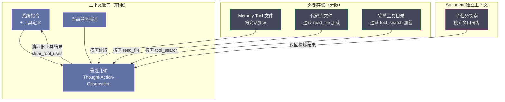

# 06 Prompt 上下文管理——Context Engineering 的艺术

**摘要：**

当 Coding Agent 连续工作数小时——读几十个文件、执行上百条命令、做多次代码修改——它产生的 Thought、Action、Observation 会迅速撑爆 LLM 的上下文窗口。更致命的是，即使没有撑爆，上下文中的信息越多，模型的注意力越分散、推理质量越退化，这个现象被命名为 Context Rot（上下文腐烂），Chroma 对 18 个前沿模型的测试证实它无一例外地存在于所有模型身上。本文从 Context Engineering 概念的诞生讲起：2025 年年中由 Shopify 创始人 Tobi Lütke 与 Andrej Karpathy 先后点题，同年 9 月 29 日被 Anthropic 写成工程文章并落地为产品能力；随后剖析 Context Rot 的注意力机制根因、最大有效上下文窗口（MECW）的量化证据，以及"修剪 + 摘要比完整历史效果更好"的硬数据；再逐一拆解 Anthropic 的四种上下文管理工具——Context Editing（clear_tool_uses / clear_thinking）、Memory Tool、Server-side Compaction——并对照 OpenAI 的 compaction 路线与 Gemini 的 1M 窗口与 context caching；之后讨论 Factory.ai 的 Anchored Iterative Summarization 结构化压缩、Just-in-Time Context 与 Subagent 上下文隔离；最后以 Claude Code 的 auto-compact、Auto Memory、Checkpointing 为例，给出长时任务的完整上下文策略。核心认知：**"更大上下文窗口"不是解决方案，"更聪明的上下文管理"才是**——但两者并非对立，而是在共同演进。

---

## 第 1 章 从 Prompt Engineering 到 Context Engineering

### 1.1 术语的诞生：从一条推文到一篇工程文章

2025 年 6 月 18 日，Shopify 创始人 Tobi Lütke 在社交平台上写下了一段后来被广泛引用的话：他更喜欢"context engineering"这个说法，胜过"prompt engineering"——因为它更准确地描述了这门核心手艺：为任务提供一切必要的上下文，让问题对 LLM 而言是"可解的"。

一周之后，Andrej Karpathy 接过了这个提法，给出了一段更完整的定义，大意是：上下文工程是"往上下文窗口里填入恰到好处的信息、供下一步推理使用"的微妙手艺兼科学——说它科学，因为要做好它，涉及任务描述与说明、few-shot 示例、RAG 检索、多模态数据、工具、状态与历史、压缩等一堆可以量化考量的环节；说它艺术，因为其中还夹杂着对模型行为心理的直觉判断。Karpathy 特意强调，塞得太多或太无关，成本会上升而表现会下降——"too much or too irrelevant and the LLM costs might go up and performance might come down"。

术语的流行，不等于概念的诞生。在 Lütke 发推之前，对话历史的修剪、记忆的持久化、检索增强生成（RAG）早就存在于每一个 Agent 工程里，只是缺少一个统摄性的名字。2025 年 9 月 29 日，Anthropic 发表《Effective Context Engineering for AI Agents》，把散落各处的实践收拢成一套系统的工程主张，并在同一天发布了配套的产品能力——context editing 与 memory tool 进入公开 beta。至此，Context Engineering 从一个口号，变成了一个有文档、有 API、有评测数据的工程领域。

这段命名史对理解本文主线是有价值的。Context Engineering 不是某个厂商凭空发明的"新概念"，而是长时 Agent 兴起之后，业界对"上下文窗口里应该放什么"这个老问题的一次重新命名与重新组织。下文讨论的所有机制——清理、压缩、外化、按需加载——都可以看作这次重新命名之后被系统化的具体实践。

> [!note] 设计哲学：先有实践，后有术语
> 笔者倾向于把 Context Engineering 看成一次"命名驱动认知"的案例。工具早就有了，但此前每个工具都被当成孤立的 trick；术语出现之后，人们开始用一个统一的框架去理解它们——清理旧上下文、压缩长历史、外化记忆、按需加载，本质上都在回答同一个问题：**每一步推理时，哪些 token 值得留在窗口里？**

### 1.2 两种工程范式的分野

在 LLM 应用的早期，大部分工程工作集中在 **提示词工程（Prompt Engineering）** 上——如何写出有效的系统指令、设计好的 few-shot 示例、构建清晰的输出格式要求。这个阶段的核心问题是"如何让 LLM 理解你想让它做什么"。

但随着 Agent 从单轮调用走向多轮循环、从简单任务走向长时复杂任务，一个更根本的问题浮现了：**在每一步推理时，上下文窗口中应该放什么？** Anthropic 在 2025 年 9 月的那篇文章里，明确区分了两种工程范式：

> [!info] 核心概念：Prompt Engineering vs Context Engineering
> **Prompt Engineering** refers to methods for writing and organizing LLM instructions for optimal outcomes.
> **Context Engineering** refers to the set of strategies for curating and maintaining the optimal set of tokens (information) during LLM inference, including all the other information that may land there outside of the prompts.

关键区别在于**作用域**。Prompt Engineering 关注的是"指令怎么写"——它主要操作系统提示词（system prompt）。Context Engineering 关注的是"整个上下文窗口里有什么"——不仅包括系统指令，还包括工具定义、MCP Server 暴露的上下文、外部数据、消息历史、工具调用结果、思考过程（thinking blocks）。打个比方：Prompt Engineering 是给新人写岗位说明书，Context Engineering 是决定这张办公桌上摆哪些材料——说明书写得再好，桌上堆满无关的旧图纸，新人照样找不到当下要用的那张。

### 1.3 为什么 Agent 让 Context Engineering 变得至关重要

在单轮 LLM 调用中，上下文是静态的——你写好 prompt，发送一次，得到响应，上下文管理的复杂度很低。但在 Agent 循环中，上下文是**动态增长**的：

- 每一步 Thought 产生推理文本，追加到上下文
- 每一步 Action 产生工具调用请求，追加到上下文
- 每一步 Observation 产生工具执行结果，追加到上下文
- 如果启用了 Extended Thinking，每一步的思考过程也追加到上下文

一个运行 50 步的 Coding Agent，可能累积数十万 token 的上下文。这些上下文在每一步推理时都会被完整发送给 LLM，由此带来三个问题：token 成本线性增长——第 50 步的调用包含前 49 步的全部记录；延迟线性增长——处理 30 万 token 的输入比处理 3 万 token 慢得多；推理质量退化——这是最致命的，上下文越大，LLM 越难聚焦于当前任务的关键信息。前两个问题花钱花时间，还能忍；第三个问题直接决定 Agent 能不能把活干完。

### 1.4 Context Engineering 的核心原则

Anthropic 给 Context Engineering 提出了一个核心指导原则：

> Given that LLMs are constrained by a finite attention budget, good context engineering means finding the smallest possible set of high-signal tokens that maximize the likelihood of some desired outcome.

翻译过来：好的上下文工程，就是找到**最小的高信号 token 集合**，最大化期望结果的可能性。关键词是"最小"——不是"尽可能多"，而是"尽可能少但足够"。这与人类专家的工作方式一致：一个经验丰富的工程师面对问题时，不会把可能相关的文档全读一遍，而是精准地找到最关键的几页。Context Engineering 就是为 Agent 设计同样的"信息筛选"能力。

值得展开的是"attention budget"这个词。它暗示了一个模型侧的事实：模型的注意力是一种有限的资源，每多一个 token，都会从这笔预算里分走一部分。把注意力预算想成一盏探照灯——光束的总功率是固定的，照亮范围铺得越大，每个角落的亮度就越暗。上下文工程的全部工作，说穿了就是决定这束光该照在哪里。

---

## 第 2 章 Context Rot——上下文腐烂现象

### 2.1 什么是 Context Rot

**上下文腐烂（Context Rot）** 是指：随着上下文中 token 数量增加，LLM 的推理质量、信息检索准确率和指令遵循度逐渐下降的现象。这个现象不是"上下文窗口满了才发生"——而是在远小于窗口最大值时就开始出现。

Chroma 在 2025 年 7 月对 18 个前沿模型（包括 GPT-4.1、Claude Opus 4、Gemini 2.5、Qwen3 等）进行了系统测试，发现：**所有模型都存在 Context Rot，无一例外**；有些模型在仅 1,000 token 的无关上下文后就显著退化。另一个更极端的证据来自同年 9 月的论文《Context Is All You Need：The Maximum Effective Context Window for Real World Limits of LLMs》（arXiv:2509.21361）：作者提出**最大有效上下文窗口（MECW）** 概念，在数十万数据点上发现，报告的最大上下文窗口（MCW）与实测的有效窗口差距巨大——个别模型在 100 token 的上下文中就失败，大多数模型到 1,000 token 时精度已严重下滑，全部模型的有效窗口距离标称值差出 99% 以上。

> [!info] 核心概念：MECW 把"窗口"从容量概念改写成质量概念
> 传统上我们说"128K 窗口""1M 窗口"，说的是**容量**——最多能塞多少 token。MECW 说的是**质量**——塞到这个长度之前，增量 token 对输出产生可测量的负面影响。容量可以无限扩（Llama 4 宣称 10M），但容量上限不是有效上限。上下文工程的意义，正是把实际运行点从"标称容量"拉回"有效容量"以内。

### 2.2 注意力机制的根因

Context Rot 的根因在 Transformer 的**注意力机制**本身。注意力机制的核心是给上下文中的每个 token 分配一个"注意力权重"——决定生成下一个 token 时应该"关注"上下文中的哪些部分。这些权重之和为 1——这意味着上下文越大，每个 token 平均获得的注意力权重越小。这就像一块大小固定的蛋糕，切的人越多，每人分到的越少；不同的是，蛋糕分得再小大家还能吃到一点，而注意力权重被稀释之后，模型对关键信息的"感知"会直接失真。

具体来说，当一个 Agent 的上下文中包含：
- 系统指令：500 token
- 工具定义：2,000 token
- 50 步的 Thought-Action-Observation：150,000 token
- 当前任务的最新 Observation：500 token

LLM 在生成下一步时，需要"关注"的是最新 Observation 和原始任务指令。但注意力机制不会自动"知道"这些是最重要的——它会把注意力分散在整个 153,000 token 的上下文中。原始指令在 500/153000 ≈ 0.3% 的位置，它的注意力权重被大量历史记录稀释了。

注意力机制之外，还有两个模型侧的放大因素。其一是**位置编码的插值退化**：模型在训练时见惯了较短的序列，超长序列要靠位置编码插值（position encoding interpolation）来"凑"出来，这会损失模型对 token 位置的精确感知，长距离依赖因此更不可靠。其二是**训练分布的偏差**：预训练语料中短序列远比长序列常见，模型对长序列内部结构的学习天然不充分；Anthropic 把这一点总结为"模型对上下文宽泛依赖的经验不足"。这些因素叠加起来，形成的是一个随长度变化的**性能渐变带**，而不是一道硬性悬崖——模型在长上下文里并非完全不能用，只是检索精度与长程推理能力被系统性削弱。早年的"Lost in the Middle"研究（Liu et al., 2023）描述过同一现象的另一面：模型倾向于记住上下文的开头与结尾，对中间部分"视而不见"——Agent 上下文里那些被夹在几十轮历史中间的关键 Observation，恰好就落在这块注意力盲区里。

> [!warning] 生产避坑：Context Rot 不是"窗口满了才退化"
> 很多开发者误以为"只要上下文没超过窗口最大值，就不用担心性能退化"。Chroma 的研究证明这是错误的——退化从上下文开始增长时就发生了，只是退化的速度因模型和任务而异。这意味着：即使你的 LLM 支持 200K 上下文窗口，也不应该把 150K 的历史记录全部塞进去——实际推理质量可能在 30K 时就已经开始下降。Anthropic 内部评估显示，Context Editing（清理旧上下文）相比不清理，可以提升 29% 的性能；Context Editing + Memory Tool 组合可以提升 39%。在 100 轮对话的 web 搜索评估中，Context Editing 减少了 84% 的 token 消耗。

### 2.3 量化数据："Less Context, Better Agents"

2026 年 6 月的论文"Less Context, Better Agents"（arXiv:2606.10209）用一组酒店费用明细化任务量化了上下文管理的影响。研究者用 GPT-5 在 Microsoft Dynamics 365 的 MCP 工具上执行 50 个费用归类任务，比较四种上下文策略：

| 策略 | 任务完成率 | token 消耗 | 耗时 |
| :--- | :---: | :---: | :---: |
| 无用户模型（基线） | 8.0% | — | — |
| 完整对话历史 | 71.0% | 1,480,996 | 14.56h |
| 修剪到最近 5 个工具对 | 79.0% | 535,274 | 5.39h |
| 修剪 + 摘要 | 91.6% | 553,374 | 5.79h |

最后一行是最令人震惊的——**修剪 + 摘要比完整历史的完成率高 20.6 个百分点，同时 token 消耗减少 63%，速度快 2.5 倍**。这不是"少即是多"的哲学主张——这是硬数据证明"更少的高信号上下文比更多的低信号上下文效果更好"。值得注意的是，这组数字还带出了另一个工程含义：完整历史并非"忠实记录"，在长任务里它反而是一种负担，因为模型会把注意力浪费在早已过时的工具输出上。

### 2.4 反例与争议：存在"长度无害"的证据吗

Context Rot 的结论并非没有异议。另一项控制实验（zenodo.20753848）在精心设计的条件下"未观察到长度驱动的退化"——这看起来与 Chroma 的结论直接矛盾。但仔细看实验设计会发现，两者测的根本不是一回事：前者测试的是真实多轮 agentic 工作流里的退化，后者测试的是控制条件下单轮固定 needle 检索。Context Rot 更可能是"多轮累积 + 无关干扰"的复合效应，而不是单纯的"长度"效应。

2025 年 10 月的论文《Context Length Alone Hurts LLM Performance Despite Perfect Retrieval》（arXiv:2510.05381）把这个讨论往前推了一步：作者在保证模型**完美检索**到所有相关信息的前提下，把输入长度从短到长变化，发现性能仍然下降了 13.9%–85%；更极端的是，即使把无关 token 全部替换成最小干扰的空格，甚至全部遮罩、强迫模型只关注相关 token，退化依旧存在。这说明"长度本身"确实是一种独立的负面影响源，检索失败只是退化的一部分解释。当然，论文也给出了一个实用的缓解手段：先让模型把检索到的证据复述出来，再把长上下文任务改写成短上下文任务——这本质上也是一种上下文工程。

> [!note] 设计哲学：争议的落点不是"谁对谁错"
> 如果把两派证据放在一起，结论反而更清晰：**退化是真实存在的，但它的强度高度依赖任务形态与模型能力**。对工程而言，不必纠结于"长度是否有害"这个理论问题，只需要采纳一个保守的行动原则——当上下文开始膨胀时，主动清理与压缩几乎总是比"让它继续长下去"更安全，成本也更低。

不过这个结论有两个边界，笔者想强调一下：其一，这些数字都是"特定模型、特定任务"下的测量，换一组模型或换一类任务未必复现同样的退化幅度；其二，即便退化强度因模型而异，"上下文越大越要小心"的工程原则依然成立——因为退化不是唯一的成本，token 费用与延迟同样随长度增长。

---

## 第 3 章 Anthropic 的四种上下文管理工具

Anthropic 在 Claude API 中提供了四种上下文管理工具，覆盖不同层面的上下文治理需求。它们共享同一个 beta 头（context-management-2025-06-27），但作用层面、触发方式与信息保留策略各不相同。

### 3.1 Context Editing——clear_tool_uses

功能：自动清理上下文窗口中过期的工具调用结果（tool results）。

机制：当对话上下文增长超过配置的阈值时，API 自动按时间顺序清理最旧的工具结果。每个被清理的结果被替换为占位符文本，让 Claude 知道"这里曾经有一个工具结果，但已被移除"。

配置：

```python
CONTEXT_MANAGEMENT = {
    "edits": [
        {
            "type": "clear_tool_uses_20250919",
            "trigger": {"type": "input_tokens", "value": 30000},  # 30K token 时触发
            "keep": {"type": "tool_uses", "value": 3},  # 保留最近 3 次工具调用
            "clear_at_least": {"type": "input_tokens", "value": 5000},  # 至少清理 5K
            "exclude_tools": ["web_search"]  # 排除特定工具不被清理
        }
    ]
}
```

关键配置参数：`trigger` 决定何时触发清理（譬如输入 token 超过 30K）；`keep` 决定保留多少最近的工具调用（譬如保留最近 3 次）；`clear_at_least` 保证每次至少清理出有意义的空间，而不是只清几百 token；`exclude_tools` 可以把特定工具的结果排除在清理之外——web_search 的结果往往需要反复引用，就不适合被当成"过期内容"清掉。

为什么有效：工具结果（如文件内容、API 响应）通常是上下文中最大的组成部分。一旦 Claude 处理了某个工具结果，原始内容很少需要再次引用——如果需要，可以重新调用工具获取。清理旧工具结果是最安全的上下文治理手段：它移除了"体积大、信息密度低"的内容，保留了"体积小、信息密度高"的 Thought 和决策记录。这就像把旧图纸归档进档案室而不是销毁——桌面腾出来了，需要时还能再调出来。

`clear_tool_inputs` 选项：默认只清理 tool_result（工具返回值），保留 tool_use（工具调用请求）。如果设置 `clear_tool_inputs: true`，连工具调用参数也一起清理——进一步减少 token，但失去了"Agent 曾经调用了什么工具、传了什么参数"的信息。这个开关值得谨慎：对调试与审计而言，工具调用参数往往比返回值更关键。

### 3.2 Context Editing——clear_thinking

功能：管理 Extended Thinking 产生的 `thinking` blocks。

机制：Extended Thinking 让 Claude 在输出前进行长篇内部推理——这些推理过程作为 `thinking` blocks 保存在上下文中。对于需要多轮推理的任务，thinking blocks 可能占据大量 token。`clear_thinking` 策略允许选择性保留或清理这些 blocks。

配置：

```python
{
    "type": "clear_thinking_20251015",
    "keep": {"type": "thinking_turns", "value": 1}  # 保留最近 1 轮的 thinking
}
```

`keep` 参数选项：
- `{"type": "thinking_turns", "value": 1}`：保留最近 1 轮的 thinking blocks
- `{"type": "all"}`：保留所有 thinking blocks（不清理）

默认行为因模型等级而异——更强的模型倾向于保留更多 thinking blocks：

| 模型 | 默认行为 |
| :--- | :--- |
| Claude Opus 4.5+ | 保留所有 thinking |
| Claude Opus 4.1- | 保留最近 1 轮 |
| Claude Sonnet 4.6+ | 保留所有 thinking |
| Claude Sonnet 4.5- | 保留最近 1 轮 |
| Claude Haiku | 保留最近 1 轮 |

> [!note] 设计哲学：thinking blocks 的保留策略因模型而异
> 为什么不同模型有不同的默认 thinking 保留策略？因为更强的模型（Opus/Sonnet 4.5+）的 thinking 质量更高，保留历史 thinking 可以为后续推理提供更好的上下文；而较弱的模型的 thinking 可能包含更多噪音，保留它们反而可能干扰后续推理。这种"因模型能力差异化配置"的设计，反映了一个更深层的认知：上下文管理的最优策略与具体模型的注意力特性强相关，不存在一套放之四海皆准的配置。文档还特别提醒，如果代码要跑在多个模型等级上，最好显式设置 `keep`，而不是依赖模型各自的默认值。

### 3.3 Memory Tool——跨会话的外部记忆

功能：让 Claude 通过文件系统在上下文窗口之外存储和检索信息——跨会话持久化。

机制：Memory Tool（`memory_20250818`）是一个特殊的工具，Claude 可以主动调用它来创建、读取、更新、删除存储在专用记忆目录中的文件。这些文件在对话之间持久存在——Session 1 中 Claude 写入的记忆，在 Session 2 中可以被读取。

与 Context Editing 的关系：Context Editing 是"自动清理旧上下文"——被动防御。Memory Tool 是"Claude 主动将重要信息存到外部"——主动外化。两者互补：Context Editing 移除不再需要的大块内容，Memory Tool 把仍然需要但不适合放在上下文中的内容外化到文件。前者像清理桌面，后者像把重要材料收进笔记本。

工作方式：Memory Tool 完全在客户端通过工具调用实现——开发者管理存储后端（如本地文件系统、S3），完全控制数据存储位置和持久化方式。Claude 自己决定什么时候写入记忆、什么时候读取记忆——这是"模型驱动的记忆管理"。

```python
# Memory Tool 配置示例
from anthropic.types.beta import BetaMemoryTool20250818Command

memory_tool = BetaMemoryTool20250818Command(
    type="memory_20250818",
    name="memory",
    storage=BetaLocalFileStorage(
        type="local_file",
        path="/memories"  # 记忆文件存储目录
    )
)
```

记忆工具的深层价值是**语义外化**：它不只是把 token 移出窗口，而是把"跨会话仍然有用的知识"与"本次任务的一次性过程"区分开。适用场景：
- 跨会话知识积累：Agent 在 Session 1 中了解了项目架构，写入记忆文件；Session 2 开始时读取记忆，无需重新探索
- 长时任务状态维护：Agent 在多日工作中维护任务进度，每次会话开始时读取上次的状态
- 调试经验保存：Agent 发现的 bug 模式和解决方案存入记忆，未来遇到类似问题时可以参考

值得留意的是，Memory Tool 与记忆体系的关系会在本专栏第 12 篇（[[LLM/Agent技术/应用开发/12 Agent 记忆体系——从短期缓冲到长期知识|Agent 记忆体系]]）展开——那里讨论的是更广义的短期缓冲、工作记忆与长期知识的分层，Memory Tool 只是其中一个具体的实现载体。

### 3.4 Server-side Compaction——服务端自动压缩

功能：API 服务端自动压缩对话历史——当上下文增长到阈值时，自动生成摘要替换原始历史。

机制：Compaction（`compact_20260112`）在输入 token 达到阈值（默认 150K，最低 50K）时触发。服务端将对话历史总结为一段压缩文本，替换原始的详细消息。压缩后的上下文包含：压缩摘要 + 最近几轮的原始对话。

与 Context Editing 的区别：Context Editing 是"删除"——直接移除旧内容，用占位符替代；Compaction 是"压缩"——用摘要替换原始内容，保留信息要点。删除牺牲的是"可能性"，压缩牺牲的是"保真度"——前者的信息彻底没了，后者的信息被改写成了概括。

可定制性：Compaction 的 `instructions` 参数允许自定义压缩提示——你可以指定"压缩时保留文件路径、函数名和错误信息，丢弃具体的代码内容"。这让压缩结果更适合特定任务的需求。

```python
{
    "type": "compact_20260112",
    "trigger": {"type": "input_tokens", "value": 150000},
    "instructions": "Preserve file paths, function names, error messages, and architectural decisions. Discard verbose code snippets and detailed search results."
}
```

### 3.5 四种工具的对比

| 工具 | 作用层面 | 触发方式 | 信息保留 | 适用场景 |
| :--- | :--- | :--- | :--- | :--- |
| clear_tool_uses | 工具结果 | token 阈值 | 不保留（占位符） | 大量工具调用的 agentic 工作流 |
| clear_thinking | 思考过程 | 配置驱动 | 可配置保留轮数 | 启用 Extended Thinking 的长对话 |
| Memory Tool | 外部存储 | 模型主动调用 | 完全保留（在文件中） | 跨会话知识持久化 |
| Compaction | 整体历史 | token 阈值 | 摘要保留 | 超长对话的自动压缩 |

> [!info] 核心概念：四种工具不是互斥而是叠加
> 最佳实践是组合使用：clear_tool_uses 清理大块工具结果 + clear_thinking 管理思考过程 + Memory Tool 外化跨会话知识 + Compaction 作为最后兜底。Anthropic 的内部评估显示，clear_tool_uses + Memory Tool 的组合相比单独使用 clear_tool_uses，性能提升了额外 10 个百分点（从 29% 到 39%）。Claude Code 在生产中正是采用了这种组合策略——compaction 用于长对话压缩，两个互补的记忆系统用于跨会话持久化。

### 3.6 上下文编辑的语义边界

把四种工具放在一起，可以提炼出一个分析框架：上下文治理的三个基本动作是**删除（deletion）、压缩（compaction）与外化（externalization）**，它们的信息损失模式完全不同。

删除只移除"被判定为过期"的内容，保留所有其他内容，信息损失是局部的、可控的——代价是占位符会让模型"知道这里少了一块"，偶尔会去猜测被删掉的内容。压缩把整段历史改写为摘要，信息损失是全局的、不可逆的——丢失的往往是最不起眼却最关键的细节，譬如一个错误信息的原文。外化把信息移到窗口之外，理论上零损失——代价是模型必须记得"去哪里取"以及"什么时候该取"。

这三者的选择不是技术问题，而是对"哪些信息在未来还可能被用到"的预判问题。clear_tool_uses 默认保留 Thought 与决策记录、只清工具结果，就是基于一个工程经验判断：工具结果的重取成本低（重新调用即可），而思考与决策的重构成本高（无法重放）。这个判断不一定永远成立——`exclude_tools` 参数的存在，就是承认了"有些工具结果永远值得留在窗口里"的反例。

---

## 第 4 章 厂商方案的对照：OpenAI 与 Gemini

Context Engineering 不是 Anthropic 的专利。2025 年末到 2026 年，OpenAI 与 Google 相继把自己的上下文管理能力产品化。对照三家方案，能更清楚地看到"上下文管理"这个问题的通用形态。

### 4.1 OpenAI：从客户端 compaction 到服务端 compaction

OpenAI 的上下文管理主线是 compaction（压缩）。2025 年 12 月 11 日，GPT-5.2 发布，官方变更日志明确写道新版本带来"tool calling and context management in the API"——其中的上下文管理能力就是基于 compaction 的；同一天，OpenAI 发布了 `/responses/compact` 端点，提供**客户端压缩**：开发者手动调用它，把长对话压缩成更小的上下文，再继续下一轮。

2026 年 2 月 10 日，OpenAI 进一步发布了**服务端压缩**：在 Responses API 的请求里带上 `context_management` 配置与 `compact_threshold` 阈值，当上下文 token 数越过阈值时，服务端自动执行压缩，把结果作为一个加密的 compaction item 注入响应流，然后继续推理。这个 item 是"不透明"的——文档明确说它不打算被人可读地解释，它只是把关键的状态与推理"打包带走"。2026 年 3 月，GPT-5.4 把 1M token 上下文窗口与原生 compaction 支持一起发布；同年 9 月，Agents API 公开 beta，托管式的 Codex harness 在会话逼近上下文上限时自动压缩，把"实现自己的压缩逻辑"这件事从开发者手里拿走。此外，OpenAI 在 2026 年 10 月还上线了 12 小时 prompt caching，让共享指令、工具与上下文可以跨请求长期命中缓存，进一步降低重复输入的成本。

```python
# OpenAI Responses API 服务端压缩配置
response = client.responses.create(
    model="gpt-5.2",
    input="...",
    context_management=[{"type": "compaction", "compact_threshold": 200_000}],
)
```

OpenAI 的压缩设计有一个值得玩味的取舍：**加密与不透明**。compaction item 加密传输、对人类不可读，这换来了 ZDR（零数据保留）场景下的合规性——`store=false` 时服务端压缩依然可用，压缩产物不落库、不留存。但代价是开发者对"压缩后到底保住了什么"几乎没有可见性：既不能指定保留字段（对比 Anthropic 的 `instructions` 参数），也无法检查摘要内容。对审计敏感的场景，这是需要在"省心"与"可控"之间做出的权衡。

> [!info] 核心概念：压缩的透明度是一条连续谱
> 把三家放在透明度谱系上：Anthropic 的 Compaction 允许自定义压缩指令（中等透明、可控）；Factory.ai 的结构化摘要完全可见可校验（高透明）；OpenAI 的加密 compaction item 则走向了另一个方向——**把压缩当成服务端的黑箱**（低透明、高省心）。透明度的选择与数据合规、调试能力、任务可预测性直接相关，没有绝对优劣。

### 4.2 Gemini：1M 窗口下的上下文策略

Google 的路线一开始就与众不同：**先把窗口做大，再解决大窗口的成本问题**。Gemini 1.5 Pro 在 2024 年初就引入了 1M token 上下文窗口；到 Gemini 2.5/3，1M 成为标配；Gemini 4（Argon）进一步把 1M 窗口在输入、思考与输出 token 之间共享，并支持最长 1M 输出 token 的 long decode。

1M 窗口下，上下文工程的重心从"装不下"转移到"装得起"。一个典型的"chat with your data"应用，用户上传 10 个 PDF 加几段视频，历史上要么拆进 RAG 流程，要么为进入窗口的 token 付高昂费用；现在可以整段放进窗口，但每次请求都重新计费。Google 的答案是**上下文缓存（context caching）**：

- **隐式缓存（Implicit caching）**：Gemini 2.5 及更新模型默认开启，系统自动把常见 prompt 前缀缓存下来并转嫁成本节省——开发者什么都不用配。
- **显式缓存（Explicit caching）**：手动创建带 TTL 的缓存对象，保证成本节省；Gemini 3 与 2.5 支持，Gemini 4 Argon 起不再支持（改走隐式）。

定价上差距显著：以 Gemini 2.5 Flash 为例，标准输入 $0.30/1M token，缓存命中的输入只要 $0.03/1M token——约 90% 的折扣，另按 $1.00/1M token/小时收取存储费。也就是说，缓存把"反复读取同一大段上下文"的成本降到接近免费，但要求上下文前缀保持稳定，并容忍 TTL 内的存储开销。

1M 窗口还改变了多轮 Agent 循环的缓存策略：Gemini 4 在多轮 agent 循环里，只有在新请求比上一次至少多出 2,050 token 时才缓存完整前序请求，否则就按标准输入价格重新处理最近 2,050 token——这实际上是在提示开发者：如果每一轮都只加一点新 token，**前缀缓存的收益会大打折扣**。不过窗口再大，上下文工程的原则没有变——只是从"怎么装下"变成了"怎么以最低成本反复利用"。

### 4.3 三家方案对照

| 维度 | Anthropic | OpenAI | Gemini |
| :--- | :--- | :--- | :--- |
| 清理策略 | context editing（clear_tool_uses / clear_thinking） | 客户端自行裁剪 | 客户端自行裁剪 |
| 压缩策略 | server-side compaction（可自定义指令） | /responses/compact + server-side compaction（加密不透明） | 无原生压缩，靠缓存降成本 |
| 持久化 | memory tool（客户端，`/memories`） | ChatGPT 记忆（产品侧） | — |
| 窗口策略 | 200K/1M 视模型而定 | GPT-5.4 起 1M + 原生 compaction | 1M 起步，缓存为核心 |
| 标志性取舍 | 细粒度编辑 + 可定制压缩 | 黑箱压缩换合规与省心 | 大窗口 + 缓存换低成本 |

这张表的价值不在于排名，而在于看清一个事实：**上下文管理的工具箱在快速收敛**——清理、压缩、外化、缓存，各厂商都在这几个动作上做文章，差异只在组合方式与透明度上。开发者选型时，真正该问的不是"谁家方案更先进"，而是"我的任务对透明度、合规、成本、控制力各有多少要求"。

---

## 第 5 章 Factory.ai 的 Anchored Iterative Summarization

### 5.1 朴素摘要压缩的三个问题

最简单的上下文压缩方案是"当上下文超过阈值时，把前面的历史总结一下"——但 Factory.ai 在实践中发现这种朴素方案有三个严重问题：

问题一：冗余重摘要。每次触发压缩时，都对整个对话前缀做完整摘要——即使大部分前缀在上一轮已经被摘要过了。这意味着第 N 轮的摘要包含了第 N-1 轮已经做过的工作，造成计算浪费。

问题二：成本线性增长。需要摘要的文本量随对话长度线性增长——第 10 轮摘要 10 轮的内容，第 100 轮摘要 100 轮的内容。摘要本身的 LLM 调用成本随时间线性增加。

问题三：永远在边缘。一旦开始摘要，后续每一轮都运行在接近上下文最大值的状态——而如前所述，Context Rot 在远小于窗口最大值时就开始了。这意味着"开始摘要后，推理质量持续处于退化状态"。

### 5.2 Anchored Iterative Summarization 的设计

Factory.ai 的方案是**结构化的锚定迭代摘要**：

结构化持久摘要：维护一个持久化的摘要对象，包含固定结构化的字段——会话意图（session intent）、文件修改（file modifications）、已做决策（decisions made）、下一步（next steps）。每个字段作为检查清单存在。

增量摘要：压缩触发时，只摘要新被截断的 span（段落），然后与已有的持久化摘要合并，而非对整个前缀做完整重摘要。这消除了"冗余重摘要"问题——每次只处理增量部分。在实现上，Factory 维护两个阈值：`T_max` 是压缩触发线（可以想成蓄水池的"满水线"），`T_retained` 是压缩后保留线（"放水线"），两者之间是每次压缩释放出的空间；每次压缩以某个 anchor 消息为锚点，把该锚点之前的摘要与新增内容合并。

结构强制保留：每个字段作为检查清单——如果新截断的 span 中有新的文件修改，就追加到"file modifications"字段；如果有新的决策，就追加到"decisions made"字段。这种结构化设计强制保留了操作细节（文件路径、函数名、错误信息），而非把它们模糊地"总结掉"。它像记流水账：不是把一整周的花销凭记忆重写一遍，而是每天只记新增的一笔，账本自然准确。

### 5.3 评估结果

Factory.ai 构建了一个基于 probe 的评估框架——在压缩后，向 Agent 提出需要记住截断历史中特定细节的问题（如"最初的错误是什么？""我们修改了哪些文件？"），用 LLM judge 评分。四种 probe 类型：

- Recall：事实保留（"最初的错误是什么？"）
- Artifact：文件追踪（"我们读取/修改了哪些文件？"）
- Continuation：任务续接（"Agent 能否从上次中断处继续？"）
- Decision：决策推理（"为什么我们选择了方案 A 而非方案 B？"）

评估结果：**Factory.ai 的结构化摘要保留了更多"继续任务"所需的信息**——相比 OpenAI 的 `/responses/compact` 和 Anthropic 的 SDK 压缩，且在相似的压缩率下实现。2025 年 12 月，Factory 公布了更大规模的供应商对照研究：在 36,611 条真实工程会话消息上，用 GPT-5.2 作为裁判对四种 probe 打分（五分制），Factory 总分 3.70、Anthropic 3.44、OpenAI 3.35；值得注意的是，**Artifact 追踪是三家共同的短板**——Factory 2.45、Anthropic 2.33、OpenAI 2.19——说明"压缩后还能不能准确说出改了哪些文件"是全行业都没做好的地方。Factory 因此给出的工程建议是：压缩摘要只是线索，工作树（working tree）与补丁才是文件状态的权威证据，恢复执行前应当以仓库实际状态为准，而不是完全信任摘要。

> [!note] 设计哲学：上下文压缩的目标不是"最小化 token"，而是"最大化任务续接能力"
> Factory.ai 的评估框架揭示了一个关键认知：上下文压缩的质量不应该用"压缩率"或"ROUGE 分数"来衡量——应该用"Agent 能否基于压缩后的上下文继续完成任务"来衡量。一个压缩到 1/10 大小但丢失了文件路径和错误信息的摘要，比一个只压缩到 1/5 但保留了这些操作细节的摘要更差——因为前者导致 Agent 无法继续工作，需要重新探索（re-fetch），实际消耗的 token 更多。"关键指标不是 tokens per request，而是 tokens per task"——因为丢失细节导致的返工成本远高于多保留几个 token 的成本。

### 5.4 压缩的度量：从压缩率到续接率

顺着上面的讨论，可以把"压缩质量"的度量体系拆成两个维度。**压缩率（compression ratio）** 衡量"省了多少"，**续接质量（continuation quality）** 衡量"还剩下多少可用信息"。二者的关系不是线性的：压缩率提高 10 个百分点，续接质量可能崩掉 30 个百分点——因为被压掉的部分往往不是均匀分布的"普通细节"，而是集中在对任务续接至关重要的操作痕迹上。

这解释了为什么 ROUGE 之类面向摘要的指标在 Agent 场景失效：ROUGE 奖励"用词重叠"，而 Agent 续接需要的是"事实与操作可重放"。一个摘要把"我们决定改用 Saga 处理跨服务事务"概括成"讨论了事务方案"，ROUGE 可能给出不错的分，但任务续接时 Agent 已经不知道决策内容。因此，笔者建议凡是把压缩接进生产 Agent 的团队，都建立自己的 probe 集——从真实会话里抽取文件路径、决策、错误信息、下一步行动四类要素，压缩前后各问一遍，用"回答一致率"而非"token 节省率"来验收压缩策略。

---

## 第 6 章 Just-in-Time Context——按需加载而非预加载

### 6.1 预加载 vs 按需加载

**预加载（Eager Loading）**：在任务开始时，把所有可能相关的信息都放入上下文——整个代码库的文件列表、所有工具的完整 Schema、所有相关的文档。这种方式的问题是：大部分预加载的信息在实际任务中用不到，但它们占据了上下文 token 并引发 Context Rot。

**按需加载（Just-in-Time Loading）**：上下文中只保留轻量级的标识符（文件路径、存储查询 ID、Web 链接），在运行时通过工具调用动态加载需要的数据。这是 Anthropic Claude Code 采用的策略——也是 Context Engineering 的核心实践之一。它像用导航 app 而不是下载整国离线地图：app 里只保留"当前位置 + 目的地"这类轻量状态，具体路段的图块在行进中按需拉取。

### 6.2 Claude Code 的 Just-in-Time 实践

Claude Code 不在上下文中预加载整个代码库——它通过 `read_file`、`grep`、`glob` 等工具按需加载文件内容。上下文中保留的是文件路径（轻量级标识符），而非文件内容（重量级数据）。

当 Claude Code 需要查看某个文件时，它调用 `read_file` 工具——文件内容作为 Observation 进入上下文。当 Claude Code 处理完这个文件后，Context Editing 的 `clear_tool_uses` 会自动清理这个 Observation——释放上下文空间给下一步操作。这种"加载→处理→清理→加载下一个"的循环，让 Claude Code 的有效上下文始终保持在"当前任务所需的最小集合"，而非"所有可能相关的信息的全集"。

### 6.3 Just-in-Time 与 Tool Search 的关系

[[LLM/Agent技术/基础范式/03 Tool Use 与 Function Calling——三大厂商的标准化博弈|第 3 篇]]讨论的 Tool Search（OpenAI）和 Tool Search Tool（Anthropic）本质上是 Just-in-Time Context 在工具层面的应用——不预加载所有工具定义，而是在需要时搜索并加载相关工具。这与文件层面的 Just-in-Time Loading 是同一个设计原则在不同层面的实例化：

| 层面 | 预加载策略 | Just-in-Time 策略 |
| :--- | :--- | :--- |
| 文件内容 | 预读所有文件入上下文 | 保留路径，按需 read_file |
| 工具定义 | 预载所有工具 Schema | 保留工具名描述，按需 tool_search |
| 外部数据 | 预查数据库入上下文 | 保留查询 ID，按需 query |
| 网页内容 | 预抓所有链接入上下文 | 保留 URL，按需 fetch |

> [!info] 核心概念：Just-in-Time 是 Context Engineering 的第一性原则
> Anthropic 在 Context Engineering 文章中明确指出：Just-in-Time Context 是所有上下文管理策略的基础原则。无论是 Context Editing（清理旧上下文）、Memory Tool（外化到文件）、还是 Tool Search（按需加载工具），本质上都是在实践"Just-in-Time"——让上下文中只保留当前推理步骤需要的最小信息集合，其余信息存储在外部，需要时再加载。这与计算机内存管理的虚拟内存/换页机制异曲同工——物理内存（上下文窗口）有限，大部分数据放在磁盘（外部存储）上，只按需加载到内存中。

### 6.4 贯穿案例：一次大型代码库重构的上下文预算

为了让后面的策略有一个具体的落点，笔者在这里设定一个贯穿全文的案例：某团队让一个 Coding Agent 把一个约 20 万行、耦合严重的单体 Java 服务，按模块边界拆分成若干个可独立部署的服务。任务描述只有三句话，但真正的工作量是探索性的——Agent 需要读数百个文件、追踪调用关系、识别数据边界、写出拆分方案并实施。

任务开始时，Agent 的上下文预算大致是这样的：系统指令与工具定义占 3,000 token，任务描述占 500 token，剩下约 20K–30K token 的"工作预算"要留给每一步的 Thought-Action-Observation。如果 Agent 选择预加载——把整个仓库的文件树、所有 Maven 模块的依赖声明都塞进窗口——预算瞬间见底，后续每一步推理都运行在上下文退化的区间里。正确做法是 Just-in-Time：先 `grep` 找出核心入口类，`read_file` 读入口文件，把观察结果处理后交给 `clear_tool_uses` 清理，再读下一个文件；对"找出所有调用某 API 的位置"这类大规模探索，则委派给 Subagent（第 7 章展开）。整个重构过程的上下文预算分配，就是一张随步骤流动的资产负债表——Just-in-Time 负责"少借"，清理负责"还债"，压缩与外化负责"转移负债"。

---

## 第 7 章 Subagent 上下文隔离

### 7.1 为什么需要上下文隔离

当主 Agent 的上下文已经很大时，如果它还需要执行一个需要大量独立探索的子任务（如"搜索代码库中所有使用了某 API 的位置"），把这个子任务放在主 Agent 的上下文中执行会进一步加剧 Context Rot。

Subagent 机制（Claude Code 的核心特性之一）解决了这个问题——主 Agent 委派子任务给一个拥有**独立上下文窗口**的 Subagent。Subagent 在自己的上下文中完成探索，只把最终结果（而非中间的 Thought-Action-Observation 链）返回给主 Agent。这像项目经理把一项深度调研外包给独立小组，只回收一页纸的结论报告，而不是把小组的会议纪要、草稿、失败尝试全部搬回自己的办公室。

### 7.2 上下文隔离的效果

```
没有 Subagent：
主 Agent 上下文 = [系统指令 + 任务描述 + 前 20 步历史 + 子任务探索的 15 步]
                  ≈ 80,000 token（Context Rot 已显著）

有 Subagent：
主 Agent 上下文 = [系统指令 + 任务描述 + 前 20 步历史 + Subagent 返回的 500 token 结果]
                  ≈ 40,500 token（Context Rot 可控）
Subagent 上下文 = [子任务指令 + 15 步探索] ≈ 30,000 token（独立窗口，不影响主 Agent）
```

Subagent 的上下文隔离效果是：**主 Agent 上下文不被子任务的中间过程污染**——只接收最终结果；**Subagent 有自己的完整上下文窗口**——可以在自己的窗口中做深度探索；并行性——多个 Subagent 可以同时运行，各自有独立上下文，不互相干扰。

> [!warning] 生产避坑：Subagent 结果也要控制大小
> Subagent 返回给主 Agent 的结果应该被严格控制大小——理想情况下是几百到几千 token 的摘要，而非几万 token 的完整探索记录。如果 Subagent 返回了一个 20,000 token 的结果，它同样会毒化主 Agent 的上下文。Claude Code 的 Subagent 设计要求返回"精炼的结果摘要"而非"完整的探索日志"——这是 Subagent 机制有效的前提。在第 6.4 节的案例里，"找出所有调用某 API 的位置"这个子任务，Subagent 应当返回"共 23 处调用，分布在 5 个模块，详见路径清单"，而不是把 23 处调用的完整代码贴回来。

---

## 第 8 章 长上下文与上下文工程的权衡

### 8.1 窗口军备竞赛：从 128K 到 1M 再到 10M

上下文窗口在过去两年里经历了一场军备竞赛。2024 年初 Gemini 1.5 Pro 率先把 1M 窗口带进商用模型；2025 年 GPT-4.1 跟进 1M，Llama 4 宣称 10M；2026 年，Claude 家族里连 Haiku 5.5 都跑在 1M 窗口上，GPT-5.4 也带着 1M 窗口与原生 compaction 一起发布。窗口从 128K 到 1M 再到 10M，"装不下"的问题正在从技术问题变成成本问题。

但窗口变大没有消灭 Context Engineering，反而把它推到了更微妙的位置。Karpathy 发那条定义推文的时候，就有人追问过："窗口都 1M 了，还需要上下文工程吗？"答案藏在 Chroma 与 MECW 的证据里：**容量扩大不等于有效容量扩大**。把 150K 历史塞进 200K 窗口和塞进 1M 窗口，退化的绝对量或许不同，但"无关内容稀释注意力"的机理没有改变。

### 8.2 更大的窗口解决了什么，没有解决什么

需要公允地说，大窗口解决了三个真实问题：单次处理能力——一段 500K 的日志可以直接喂进去分析，不必先分块；RAG 必要性的降低——某些场景下全量检索可以退化为全量阅读；实现简单性——"全塞进去"比"决定塞什么"简单得多，工程上省心。

但大窗口同时留下了三个问题。第一，**注意力退化依旧存在**——MECW 研究证明有效容量与标称容量的差距在所有模型上都存在，窗口越大，这个差距的绝对量可能越大。第二，**成本非线性**——1M 窗口的输入定价虽然不断下降，但"每次都把 500K 塞进去"的总成本仍然显著高于"只塞最相关的 20K"，而上下文缓存只能缓解重复读取的部分。第三，**"全塞进去"改变不了信息结构**——一个 500K 的上下文中，最新 Observation 的注意力权重照样被稀释，模型依然可能"看不到"近在眼前的报错。

反例也值得一提。一些团队在 1M 窗口时代重做了早年的"全量塞入"实验，发现把整套文档塞进窗口的效果，往往不如用 Just-in-Time 挑出关键章节——不是因为窗口装不下，而是因为装得下不代表"看得清"。这与"更大的办公桌不等于更高效的办公"是同一个道理：桌面大了，探照灯的亮度没有变。

### 8.3 模型侧改进与应用侧上下文工程

对抗退化的努力分两条战线。**模型侧**：把更多长文本放进预训练语料、改进位置编码（如 RoPE 的缩放与插值策略）、优化注意力机制（稀疏注意力、注意力汇聚）、乃至用强化学习把长上下文行为直接对齐进模型。这些改进真实有效——新一代模型在长上下文基准上的表现确实在进步。

**应用侧**：就是本文讨论的全部内容——Just-in-Time、清理、压缩、外化、隔离。模型侧改进不会让应用侧失效，理由是注意力预算的约束是结构性的：只要"每个 token 都要被注意力机制处理"这一架构前提不变，信息稀释的物理就在。模型侧能把"有效窗口/标称窗口"的比值从 1% 提升到 10% 甚至更高，但不会把它变成 100%。

> [!note] 设计哲学：窗口是能力上限，上下文工程是能力利用率
> 把两者放回认知框架里：这不是"谁取代谁"的问题，而是"能力"与"利用率"的互补关系。窗口决定了单次推理的**物理上限**，上下文工程决定了实际运行点距离上限**有多远**。上限不断抬高，利用率的提升空间也在变大——每一次窗口扩容，都在为更好的上下文工程创造新的用武之地。对开发者而言，正确的姿势是两手都抓：跟随模型侧的长上下文改进，同时把应用侧的预算纪律坚持到底。

---

## 第 9 章 Claude Code 的上下文管理现状

前几章讨论的是 API 层面的上下文管理，本章把这些机制落地到一个具体的产品上。Claude Code 作为 Anthropic 官方 CLI Agent，是观察"上下文管理如何工程化"的最佳样本——它把 auto-compact、memory、checkpointing 组合成了一整套生产级策略。

### 9.1 auto-compact：自动压缩的工程化

Claude Code 的压缩体系分为手动与自动两条路径。手动是 `/compact` 命令——把整个会话替换成结构化摘要；它还支持带焦点的压缩，譬如 `/compact focus on the auth bug fix`，让摘要保留你指定的主题，而不是自动猜测什么重要。自动则是 auto-compact：当上下文接近上限时，Claude Code 自动触发压缩——先清掉较早的工具输出，再对剩余会话做摘要，整个会话不会因为上下文满了而中断。

auto-compact 的触发窗口是可配置的，这在生产里非常重要。默认窗口随模型而变（例如 Haiku 5.5 默认在约 967K token 时触发）；你可以用 `/autocompact 500k` 调整当前模型窗口，用 `autoCompactWindow` 写入配置文件，用 `CLAUDE_CODE_AUTO_COMPACT_WINDOW` 环境变量整体控制，甚至用 `CLAUDE_AUTOCOMPACT_PCT_OVERRIDE` 把触发点压到窗口的某个百分比。为什么需要这些旋钮？因为压缩是"有损"的，触发太晚，模型长时间运行在退化区间；触发太早，频繁压缩带来重复的摘要开销与信息损失。合适的触发点依赖任务形态，给开发者旋钮比给固定策略更务实。

### 9.2 压缩后什么存活

压缩不是"推倒重来"——Claude Code 的 compaction 保留了机制性的内容，重载后自动回到上下文里：

| 内容 | 压缩后 | 说明 |
| :--- | :--- | :--- |
| 系统提示与输出风格 | 仍生效 | 不变 |
| 项目根 CLAUDE.md 与全局规则 | 重新注入 | 从磁盘重新读取 |
| Auto memory | 重新注入 | 从磁盘重新读取 |
| Skill 描述 | 重建后注入 | 需 Claude Code v2.1.304+ |
| Git 状态快照 | 重新读取 | 从仓库取新的 |
| Plan 模式里的计划 | 重新注入 | 从磁盘读取 |
| 带 `paths:` 的路径作用域规则 | 按需重载 | 触发对应文件时再加载 |

这张表透露出一个设计判断：**压缩应该只牺牲会话内的一次性信息，不牺牲机制性的配置与记忆**。CLAUDE.md 是用户写的长期指令，auto memory 是跨会话积累的知识，它们在压缩后重新注入，意味着压缩的损失面被刻意收窄到"本次对话的历史过程"。这也解释了为什么"只把重要指令写在对话里"是一个坏习惯——对话内容会被压缩掉，而写进 CLAUDE.md 的指令会活下来。

### 9.3 Auto Memory：四类记忆

Claude Code 的 **Auto Memory（自动记忆）** 让 Claude 在会话中为自己做笔记，跨会话积累。它记录四类信息，写在记忆文件 frontmatter 的 `type` 字段里：

- user：用户的角色、专长与工作偏好
- feedback：用户给出的纠正与确认过的方法
- project：正在进行的工作、截止时间、无法从代码或 git 历史推导的决策
- reference：项目之外信息的去处（如 issue 跟踪器、看板的地址）

Auto memory 存储在 `~/.claude/projects/` 下、按 git 仓库隔离；会话开始时，`MEMORY.md` 索引的前 200 行或 25KB 会加载进上下文。设计上它刻意"少记"：能从代码库推导的（架构、文件路径、调试修复）不记，CLAUDE.md 已经写过的也不记，只记"未来对话里会用到且其他来源找不到"的信息。

这里值得对比它与第 3.3 节的 Memory Tool：两者都是"模型驱动的记忆"，但层次不同。Memory Tool 是 API 层面的通用工具，由开发者在自己的应用里实现存储后端；Auto Memory 是 Claude Code 产品内置的记忆系统，与 CLAUDE.md 分工——**CLAUDE.md 是"你写给我"的指令，Auto memory 是"我自己写给自己"的笔记**。二者加上 `/memory` 命令与记忆文件的管理界面，构成了 Claude Code 的完整记忆体系。这与本专栏第 12 篇（[[LLM/Agent技术/应用开发/12 Agent 记忆体系——从短期缓冲到长期知识|Agent 记忆体系]]）的短期缓冲、长期知识分层遥相呼应。

### 9.4 Checkpointing：可回滚的上下文状态

压缩是"向前看"的策略——牺牲旧信息换取继续运行的空间。但长会话里还有一个"向后看"的需求：**如果 Agent 走偏了，能不能退回去？** Claude Code 用 Checkpointing（检查点）回答这个问题。

机制上，每一轮 prompt 开始前，Claude Code 自动为文件编辑做快照，一个会话保留最近 100 个检查点；`/rewind` 命令（或快速按两次 Esc）打开回退菜单，可以选择：恢复代码与对话（回到那个点的全部状态）、只恢复对话（对话回退但保留当前代码）、只恢复代码（文件回退但保留对话）、以及从这里开始摘要（把从该点至今的对话压缩成摘要）。检查点随会话保存，恢复会话后仍可回退；快照默认保留约 30 天，可用 `cleanupPeriodDays` 调整。

Checkpointing 与上下文压缩构成了一个有趣的互补：压缩丢失的是"历史细节"，回退能找回的是"历史状态"。两者结合，Agent 的上下文管理第一次拥有了"撤销"的能力——而撤销是任何可靠系统的标配。不妨设想第 6.4 节的案例：Agent 在重构进行到第 40 步时把两个模块的边界切错了，如果没有检查点，要么靠摘要里的只言片语推测之前的状态，要么从头再来；有了 `/rewind`，直接回到第 25 步的状态重做，代价是"丢弃第 25 到 40 步的上下文"——这笔账通常非常划算。

---

## 第 10 章 Coding Agent 的上下文策略综合

### 10.1 多层上下文管理体系

一个生产级 Coding Agent（如 Claude Code）的上下文管理不是单一策略，而是多层体系的组合——下面的图把"窗口内、外部存储、Subagent 独立窗口"三层放在一起：



图中值得注意的一条链路是 `FILES --> RE`：文件内容不是直接进窗口，而是先经过 `read_file` 这个工具调用、以 Observation 的身份进入上下文，随后又可以被 `clear_tool_uses` 清理掉。Just-in-Time 的"轻量标识符在窗口中、重量级数据在工具结果里"正是靠这条链路实现的。整个体系像一座城市的供水系统：水厂（外部存储）提供水源，管网（工具调用）决定水流方向，水塔（Subagent 窗口）缓冲高峰，而每家每户的水龙头（窗口内的按需加载）保证用水量不超预算。

### 10.2 策略组合的时间轴

在一个长时 Coding Agent 会话中，上下文管理策略的运作时间轴：

1. **会话开始**：上下文 = 系统指令 + 工具定义 + 用户任务描述。读取 Auto Memory / Memory Tool 中的上次会话记忆（如果有）。
2. **探索阶段**：通过 read_file/grep/glob 工具按需加载代码库内容。每个工具结果作为 Observation 进入上下文。
3. **上下文增长**：随着步骤增加，上下文逐渐增大。当达到 clear_tool_uses 的触发阈值时，旧工具结果被自动清理。
4. **子任务委派**：遇到需要大量探索的子任务时，委派给 Subagent，避免污染主上下文。
5. **上下文压缩**：如果对话极长（如多日会话），auto-compact / Compaction 触发，将旧历史压缩为摘要。
6. **会话结束**：将本次会话的关键发现写入 Auto Memory / Memory Tool 文件，供下次会话使用。

把第 6.4 节的案例放回这条时间轴：会话开始时读取"上次已识别出的 5 个核心模块"记忆；探索阶段逐文件读入再清理，上下文预算始终在 30K 上下波动；"调用关系分析"委派给 Subagent，主窗口只收结论；第 200 步附近触发一次 compact，把前 150 步的探索过程压成摘要；一天后继续会话，Auto Memory 里已经躺着"模块边界初步方案与待决策项"。整个过程中没有哪一步是"魔法"——每个环节都是前面几章讲过的机制，组合起来就是生产级的长时任务上下文策略。

### 10.3 与 Anthropic 的最佳实践对齐

Anthropic 在 Context Engineering 文章中推荐的实践，与上述策略体系高度一致：

1. **把上下文当作稀缺的宝贵资源**——不预加载，按需加载
2. **构建最小、干净的系统提示**——系统指令也消耗 token，应该精简
3. **设计 token 高效的工具和 API**——工具返回结果应该精炼，不返回大量无关数据
4. **动态检索上下文**——Just-in-Time，不预加载
5. **长时任务的一致性技术**——Memory Tool + Compaction + Subagent 组合

其中第 3 条"设计 token 高效的工具"在生产中常常被忽略，但它其实是成本最低的上下文工程手段：一个 MCP Server 如果每次返回 5,000 token 的冗余字段，比任何清理策略都更快地耗尽预算。工具的返回值设计，应当像接口契约一样被评审——返回什么字段、多少行、什么格式，直接决定 Agent 的上下文健康状况。

---

## 第 11 章 总结与下一篇导读

### 11.1 本文核心要点

1. **Context Engineering ≠ Prompt Engineering**：前者关注"哪些 token 该在窗口中"，后者关注"指令怎么写"——Agent 的多轮循环让前者变得同样重要
2. **Context Rot 是所有模型的通病**：Chroma 18 模型研究证明所有前沿模型都存在上下文退化，MECW 研究显示有效窗口可能只有标称值的百分之几——"更大窗口"不是解药
3. **"Less Context, Better Agents"**：修剪+摘要比完整历史的完成率高 20.6 个百分点、token 减少 63%——更少的高信号上下文效果更好
4. **Anthropic 四种工具叠加使用**：clear_tool_uses（清理工具结果）+ clear_thinking（管理思考过程）+ Memory Tool（跨会话外化）+ Compaction（服务端压缩兜底）
5. **厂商方案殊途同归**：OpenAI 以 compaction 为主线（客户端 + 服务端 + Agents API 自动压缩），Gemini 以 context caching 应对 1M 窗口成本，透明度与可控性的取舍各不相同
6. **Factory.ai 结构化摘要优于朴素摘要**：Anchored Iterative Summarization 通过结构化字段强制保留操作细节，增量摘要避免冗余——但 Artifact 追踪仍是全行业短板
7. **Just-in-Time Context 是第一性原则**：不预加载，按需加载——文件、工具、数据、网页都遵循同一原则
8. **Subagent 上下文隔离**：子任务在独立窗口中执行，只返回精炼结果——避免子任务中间过程污染主上下文
9. **窗口与上下文工程共同演进**：窗口决定物理上限，上下文工程决定利用率；更大的窗口没有消灭上下文工程，反而放大了它的价值
10. **Claude Code 是策略体系的完整样本**：auto-compact 处理自动压缩、Auto Memory 处理跨会话积累、Checkpointing 提供可回滚的撤销维度

### 11.2 下一篇导读

本文讨论了"上下文里应该放什么"——这是 Agent 执行能力的上限问题。但一个能干的 Agent 在动手之前，还要回答另一个问题："这件事我能做吗？"——也就是权限与审批。下一篇 [[LLM/Agent技术/基础范式/07 Agent 权限与审批模型——人在环路的工程实践|Agent 权限与审批模型]] 将讨论人在环路的工程实践：OpenAI Agents SDK 的 interruptions 机制、Cloudflare Agents 的三种审批模式、Claude Code 的权限模式与规则优先级，以及权限传播的工程难点。上下文管理与权限管理是一枚硬币的两面：前者决定 Agent"知不知道该看什么"，后者决定 Agent"能不能动不该动的东西"。

> [!info] 专栏导航
> 本文是 [[LLM/Agent技术/00 专栏导览|Agent 技术专栏]] 基础范式部分的第 6 篇。上一篇 [[LLM/Agent技术/基础范式/05 MCP 生态与实践——Server 开发、集成与生产部署|第 5 篇]] 讨论了 Agent 与工具的标准化连接——MCP 的生态与实践；本文在此基础上聚焦"上下文窗口这个更稀缺的资源如何管理"。下一篇 [[LLM/Agent技术/基础范式/07 Agent 权限与审批模型——人在环路的工程实践|第 7 篇]] 将讨论权限与审批模型，收束基础范式部分；此后进入应用开发部分（第 8 篇起），把 Prompt 工程、RAG、记忆、框架选型逐一展开。

---

## 参考文献

1. Anthropic. "Effective Context Engineering for AI Agents." 2025-09-29. https://www.anthropic.com/engineering/effective-context-engineering-for-ai-agents
2. Anthropic. "Managing context on the Claude Developer Platform." 2025-09-29. https://www.anthropic.com/news/context-management
3. Anthropic. "Context editing." https://platform.claude.com/docs/en/build-with-claude/context-editing
4. Anthropic. "Memory & context management with Claude Sonnet 4.6." https://platform.claude.com/cookbook/tool-use-memory-cookbook
5. Anthropic. "Context engineering: memory, compaction, and tool clearing." https://platform.claude.com/cookbook/tool-use-context-engineering-context-engineering-tools
6. Anthropic. "Claude Code: Explore the context window." https://code.claude.com/docs/en/context-window
7. Anthropic. "Claude Code: Checkpointing." https://code.claude.com/docs/en/checkpointing
8. Anthropic. "Claude Code: How Claude remembers your project." https://code.claude.com/docs/en/memory
9. Anthropic. "Claude Code: Model configuration（auto-compact window）." https://code.claude.com/docs/en/model-config
10. OpenAI API Changelog. "GPT-5.2 / /responses/compact / server-side compaction / GPT-5.4 / Agents API / 12-hour prompt caching." 2025-12-11 至 2026-10-20. https://developers.openai.com/api/docs/changelog
11. OpenAI. "Introducing the Agents API." 2026-09-10. https://openai.com/index/introducing-the-agents-api/
12. OpenAI. "Compaction." https://developers.openai.com/api/docs/guides/compaction
13. OpenAI Help Center. "Memory FAQ." https://help.openai.com/en/articles/8590148-memory-in-chatgpt-remembering-what-you-chat-about
14. Google. "Long context." https://ai.google.dev/gemini-api/docs/long-context
15. Google. "Context caching." https://ai.google.dev/gemini-api/docs/generate-content/caching
16. Google. "Gemini API pricing." https://ai.google.dev/gemini-api/docs/pricing
17. Factory. "Evaluating Context Compression for AI Agents." 2025-12. https://factory.com/news/evaluating-compression
18. Factory. "Compressing Context." https://factory.com/news/compressing-context
19. Factory. "Context compaction must preserve the next step." https://factory.com/articles/coding-agent-context-compaction
20. Lodha, A. et al. "Less Context, Better Agents." arXiv:2606.10209, 2026.
21. Chroma. "Context Rot: How Increasing Input Tokens Impacts LLM Performance." 2025-07-14. https://www.trychroma.com/research/context-rot
22. Paulsen, N. "Context Is All You Need: The Maximum Effective Context Window for Real World Limits of LLMs." arXiv:2509.21361, 2025.
23. "Context Length Alone Hurts LLM Performance Despite Perfect Retrieval." arXiv:2510.05381, 2025.
24. "Diagnosing and Mitigating Context Rot in Long-horizon Search." arXiv:2606.29718, 2026.
25. Karpathy, A. "Context engineering over prompt engineering." 2025-06-25. https://x.com/karpathy/status/1937902205765607626
26. the-decoder. "Shopify CEO and ex-OpenAI researcher agree that context engineering beats prompt engineering." 2025-06-28. https://the-decoder.com/shopify-ceo-and-ex-openai-researcher-agree-that-context-engineering-beats-prompt-engineering/

---

> [!note] 思考题
> 1. **你的 Coding Agent 运行到第 30 步时，上下文已经 50K token。你选择触发 Compaction（整体压缩）还是 clear_tool_uses（只清理工具结果）？为什么？** 提示：考虑两种策略的信息损失差异——Compaction 把所有历史总结为摘要，可能丢失操作细节；clear_tool_uses 只清理工具结果但保留 Thought 和决策记录。哪种信息损失对你的任务更致命？
>
> 2. **Memory Tool 让 Claude 自己决定"什么时候写入记忆、写入什么"。这种"模型驱动的记忆管理"相比"开发者预定义的记忆规则"有什么优势和风险？** 提示：优势是灵活性——Claude 可以根据具体任务决定什么值得记住；风险是 Claude 可能记住了不重要的事情而忘记了关键的——如何确保记忆质量？
>
> 3. **Chroma 研究发现有些模型在仅 1,000 token 的无关上下文后就显著退化。但另一项研究（zenodo.20753848）在控制实验中"未观察到长度驱动的退化"。这两个结论矛盾吗？如何调和？** 提示：考虑实验设计的差异——前者测试的是真实多轮 agentic 工作流中的退化，后者测试的是控制条件下的单轮固定 needle 检索。Context Rot 可能是"多轮累积"效应而非"单轮长度"效应。
>
> 4. **OpenAI 的 compaction item 是加密且不透明的，Anthropic 的 Compaction 允许自定义压缩指令，Factory 的结构化摘要在客户端完全可见。如果你的生产 Agent 要求"压缩后必须能审计保住了什么"，你会选哪种？如果要求是"零数据保留合规"呢？** 提示：把"透明度"与"合规性"拆成两个正交的评估维度，再对照三家方案逐项权衡。
>
> 5. **在第 6.4 节的代码库重构案例中，Agent 在第 200 步触发 compact 后，发现摘要里丢失了"第 60 步曾确认过的一个模块边界决策"。你手上有哪些手段可以弥补？** 提示：除了"重新探索"这种高成本手段，考虑 Auto Memory、CLAUDE.md、checkpointing 的 `/rewind` 与 "Summarize from here"，以及 Factory 建议的"以工作树与补丁为准"。