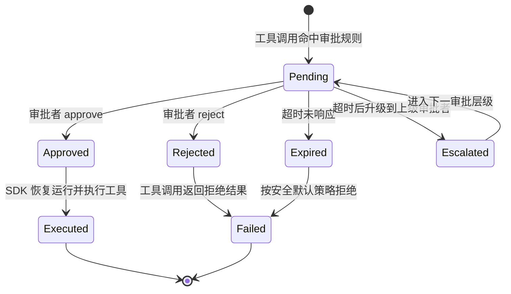
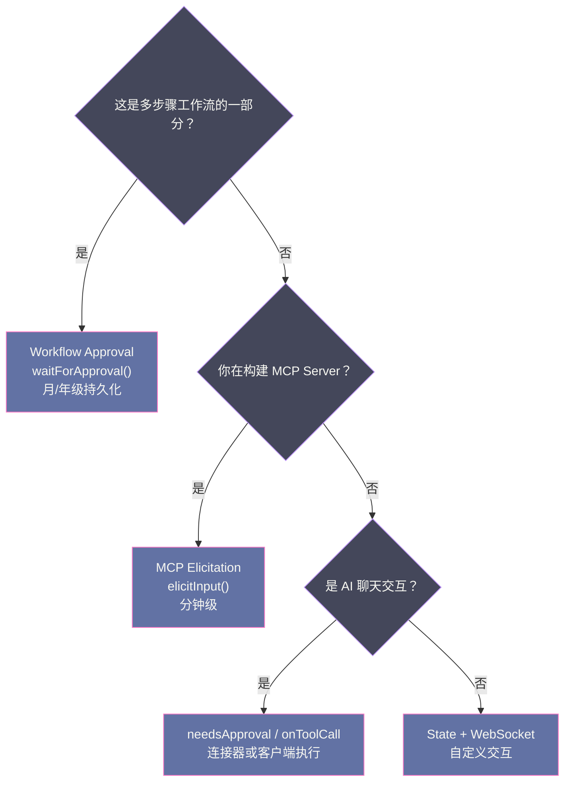
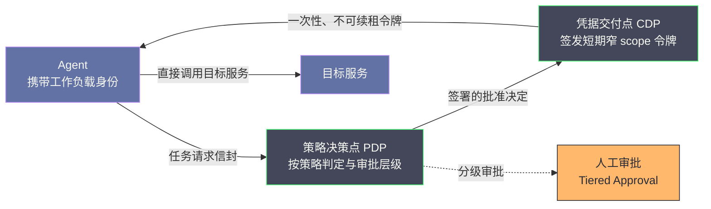

# 07 Agent 权限与审批模型——人在环路的工程实践

> [!abstract] 摘要
> 这是 Agent 技术专栏基础范式部分的收官篇（全专栏第 7 篇）。前 6 篇回答了 Agent "怎么想"（ReAct 范式）、"怎么调工具"（Function Calling/MCP）、"怎么管上下文"（Context Engineering），本文回答最后一个根本问题："Agent 做事前要经过谁同意？"——权限与审批模型。文章先从 2025-2026 年频发的 Agent 安全事故（EchoLeak、ForcedLeak、AgentFlayer）讲起，说明审批为何从"可选增强"变成"部署前提"；随后系统拆解四大平台的实现：OpenAI Agents SDK 的 interruptions 机制（needsApproval 声明 + RunState 序列化/恢复 + 嵌套 Agent.asTool 双层审批）、Cloudflare Agents 的三种审批模式（MCP Elicitation 分钟级、Workflow waitForApproval 月/年级、Code Mode 连接器调用审批）、Claude Code 的六种权限模式与 Hooks/plan 扩展、Agentrail 的工具权限策略；接着讨论权限传播的工程难点（Subagent 权限继承 bug、嵌套审批的 surface 层、超时升级、长等待审批的状态有效性），并延伸到 MCP Elicitation 与远程 MCP 的 OAuth 凭据安全、Agent 凭据管理与最小权限原则的工程化（OAuth device flow、凭据代理 CB4A）。核心认知：审批模型不是"阻碍 Agent 自主性"的负担，而是"让 Agent 可以被信任地部署在生产环境中"的基础设施——没有可靠的审批与凭据机制，就没有人敢让 Agent 执行有副作用的操作。

---

## 第 1 章 为什么 Agent 需要审批模型

### 1.1 从一次"零点击"攻击说起

2025 年 6 月，安全研究机构 Aim Security 公开了一个被命名为 EchoLeak（CVE-2025-32711）的漏洞：攻击者只需要向微软 M365 Copilot 的用户发一封构造过的邮件，就能让 Copilot 在用户毫无察觉的情况下读取企业内网文件并把内容外传——不需要点击链接、不需要任何交互，一封邮件即可完成一次远程的、未认证的数据窃取。

这个案例的震撼之处不在漏洞本身（微软已在当月补丁中修复），而在于它划出了 Agent 时代与传统软件安全模型的分界线。传统软件的安全边界是"输入→处理→输出"，恶意输入顶多污染一个回答；到了 Agent 这里，边界变成了"输入→处理→工具调用→真实世界的副作用"，攻击者操纵的不再是文本，而是一连串实际发生的操作——读文件、发邮件、改数据库、推送代码。Palo Alto 的 Unit 42 在 2025 年的《AI Agents Are Here. So Are the Threats.》报告中把这类风险归纳为几条并存的路径：Prompt Injection 仍是威力最大的向量，但"未加约束的 Prompt"、"配置不当的工具"、"未加沙箱的代码解释器"、"凭据泄露"同样可以独立构成攻击链，且没有任何单一缓解措施能覆盖全部——防线必须是叠加的。

行文至此，审批模型（Approval Model）为什么值得专门写一篇，答案已经浮出水面：当 Agent 获得调用工具的授权，它每执行一次有副作用的操作，都在替操作背后的"人"做一次决策。这个决策要不要先经过人，就是本专栏基础范式部分要收束的最后一个问题。

### 1.2 自主性与安全性的根本张力

Coding Agent 的核心价值是"自主性"——它能自己决定下一步做什么、调用什么工具、修改什么文件。但自主性与安全性存在根本张力：一个完全自主的 Agent 可以执行 `rm -rf /`、`git push --force`、把 API Key 写入公开文件——这些操作不可逆且后果严重。

**没有审批模型的后果**：
- 开发者不敢让 Agent 执行有副作用的操作——Agent 只能做"只读"任务，失去了"做事"的核心价值
- Agent 的每次操作都需要开发者全程盯着——失去了"自主性"的核心价值
- 在生产环境中，Agent 无法被信任——没有审计和控制的系统无法上线

**审批模型的角色**：不是"阻碍自主性"，而是"让自主性可被信任"——通过在关键操作前插入人工审批门控，让开发者敢于让 Agent 自主执行大部分操作，只在"不可逆/有破坏性"的操作前介入。

> [!info] 核心概念：审批模型是 Agent 的"安全带"
> 审批模型之于 Agent，就像安全带之于汽车——安全带不是"阻碍驾驶"的束缚，而是"让驾驶可以被安全地进行"的基础设施。没有安全带的汽车不是"更自由"的——它是不敢开快的。同样，没有审批模型的 Agent 不是"更自主"的——它是不敢被部署的。好的审批模型让 Agent 在"大部分操作自主执行"和"关键操作人工把关"之间找到平衡——开发者可以放心地让 Agent 跑 95% 的操作，只在 5% 的关键操作前审查。

### 1.3 审批的三个维度

一个完整的审批模型需要回答三个问题：

**维度一：什么操作需要审批？**
- 所有写操作？所有 Bash 命令？只有特定的危险命令？
- 这个决策可以静态配置（规则）还是需要动态判断（每次调用评估）？

**维度二：谁有权审批？**
- 当前交互的用户？
- 另一个审批者（如团队 lead）？
- 自动化策略（如只读操作自动批准，写操作需要人工）？

**维度三：审批后如何恢复执行？**
- 同步等待——Agent 暂停，等待审批后继续
- 异步恢复——Agent 状态序列化，审批后从序列化状态恢复
- 超时处理——审批者不响应时怎么办？

### 1.4 审批的完整状态机

一个审批请求从发出到落地，其生命周期远不止"同意/拒绝"两个瞬间。把待审批项（Pending Approval）抽象成一张有限状态机（Finite State Machine，FSM），是理解各家实现差异的最短路径：



这张状态图揭示了一个常被忽视的事实：**"审批者不响应"不是一个异常分支，而是一个必须显式建模的常态状态**。后文会看到，OpenAI Agents SDK 把 Expired 分支留给开发者自己实现，Cloudflare Workflow 则内置了 timeout 与升级路径，Claude Code 的 dontAsk 模式本质上把 Pending 直接映射到 Rejected——同一张状态图，各家的取舍完全不同。

审批状态机的流转，像一张纸质支票的旅程：签发（Pending）之后，可能被签收兑付（Approved）、被拒付退回（Rejected）、也可能过了有效期而作废（Expired）。支票的背书栏可以加签（Escalated 到更高级审批者），但一切都要在有效期内完成——过期支票没人会兑现。设计审批系统时，把"有效期"想清楚，比把"同意按钮"做得漂亮重要得多。

### 1.5 反事实论证：没有审批模型会怎样

不妨做一个思想实验：假如把上述安全事件里的"人"完全移除，结果会怎样？

Salesforce Agentforce 的 ForcedLeak（2025 年 9 月，Noma Security 披露）走的正是"无审批"的路径：攻击者通过 Web-to-Lead 表单提交构造过的线索信息，当员工让 Agent 处理这条线索时，恶意指令触发，Agent 自动把 CRM 中收集到的邮箱地址作为参数发往攻击者控制的服务器，整个流程不经过任何人工确认。研究者还发现，攻击可以借一个已经过期的受信任 Salesforce 域名放大，让整个流程有很大机会不被察觉。若这条链路中有任何一环要求人工确认——处理外部表单之前、发起对外请求之前——攻击的成功率都会大幅下降。

AgentFlayer（Black Hat USA 2025，Zenity 披露）则展示了零点击/一击攻击链在 ChatGPT、Copilot Studio、Cursor+Jira MCP、Salesforce Einstein、Gemini 等主流 Agent 上的通用性。它的核心手法是"利用 Agent 自动执行工具调用的信任"：只要外部内容（网页、邮件、文档、MCP 返回数据）能进入上下文，就能诱导 Agent 执行攻击者想要的工具调用。审批恰恰是打断这种自动信任的闸门——它让"工具被调用"与"工具被批准"之间永远隔着一次可审计的确认。

结论是反直觉的：审批模型看似增加了人工成本，实则在"工具自动化"与"灾难性副作用"之间维持着一条可审计的裂缝。没有这层裂缝，安全团队只能在"完全禁用 Agent"和"裸奔上线"之间二选一——而这两种选择都比"带上审批"更昂贵。这回答了本文开头的设问：为什么 2025 年之前"审批"还是 Agent 框架的选修课，到了 2025-2026 年就变成了生产部署的前提条件。

---

## 第 2 章 OpenAI Agents SDK——interruptions 机制

### 2.1 needsApproval 声明

OpenAI Agents SDK 通过 `needsApproval` 参数声明工具是否需要审批：

```python
from agents import function_tool

@function_tool(needs_approval=True)
async def cancel_order(order_id: int) -> str:
    """Cancel a customer order."""
    return f"Cancelled order {order_id}"
```

（Python 侧亦可用 `@tool(needs_approval=True)` 装饰器，语义相同。）`needsApproval` 接受三种值：
- `True`：总是需要审批
- `False`（默认）：不需要审批
- `async function`：动态决策——函数接收运行上下文、工具参数和调用 ID，返回 `bool`

**动态审批的威力**：不是"所有调用都需要审批"或"都不需要"，而是"根据具体调用内容决定"：

```python
async def _needs_approval_for_oakland(ctx, params, call_id) -> bool:
    """只在查询 Oakland 天气时需要审批"""
    return "Oakland" in params.get("city", "")

@function_tool(needs_approval=_needs_approval_for_oakland)
async def get_temperature(city: str) -> str:
    return f"Temperature in {city}: 20°C"
```

这个例子展示了动态审批的精妙——查询旧金山的天气不需要审批（低风险），查询奥克兰的天气需要审批（可能因为奥克兰有特殊的数据访问合规要求）。这种"基于参数内容的动态审批"比"一刀切"的静态规则更灵活。

需要注意，动态审批函数是 **fail-closed** 的：当 SDK 无法安全地检查参数时——参数缺失、为空、只含空白、JSON 解析失败、解析结果不是对象（譬如 `null` 或数组）、或包含 `NaN`/`Infinity`/`-Infinity` 这类非标准常量——调用式规则不会被触发，该调用直接要求人工审批。这个设计把"看不清"和"危险"同等对待，宁可多问一次，也不冒险放行，且对普通 Runner 与 Realtime 调用一视同仁。

### 2.2 interruptions 机制

当工具调用需要审批时，SDK 不会执行工具，而是：

1. 记录一个 `RunToolApprovalItem`（待审批项）
2. 在当前 turn 结束时暂停运行
3. 返回所有待审批项在 `result.interruptions` 数组中

```python
result = await Runner.run(agent, "Cancel order 123.")

if result.interruptions:
    state = result.to_state()  # 序列化运行状态
    for interruption in result.interruptions:
        print(f"Tool: {interruption.name}")
        print(f"Arguments: {interruption.arguments}")
        
        # 人工审批
        if await confirm("Approve?"):
            state.approve(interruption)
        else:
            state.reject(interruption)
    
    # 从序列化状态恢复执行
    result = await Runner.run(agent, state)
```

**关键设计**：
- `result.to_state()` 序列化运行状态——可以保存到数据库
- `state.approve(interruption)` / `state.reject(interruption)` 处理每个待审批项
- `Runner.run(agent, state)` 从序列化状态恢复执行——不需要从头开始
- `{ alwaysApprove: true }` 选项（Python 中为 `always_approve=True`）——"以后这个工具总是批准"（减少重复审批）

运行暂停的语义像一个调试器的断点：程序并没有被杀死，而是在断点处挂起，你可以查看局部变量（`interruptions` 数组里的每一项）、修改现场（approve/reject）、然后继续。与调试器不同的是，这个断点可以跨越进程与机器——`to_state()` 把整个 RunState 序列化，存进数据库，服务重启后照样能恢复。

在流式运行（`Runner.run_streamed`）场景下，流程略有不同：需要先消费完 `stream_events()`，再检查 `result.interruptions`，最后从 `result.to_state()` 恢复——暂停的时机从"turn 结束时"精确到了"事件流消费完毕后"，这对实时交互应用（如语音 Agent）尤其重要。

审批决策本身也可以持久化：`always_approve=True`/`always_reject=True` 可以把"同一工具身份的后续调用"按同一决策处理，按工具调用 ID 作用域隔离。这解决了"同一操作反复问"的提示疲劳问题——但要注意，它同时把"审批者只审了一次"变成了"审批者对同类操作全权委托"，语义上已经从"人工审批"滑向"策略授权"，是否启用需要结合业务风险来判断。

SDK 还支持把审批状态放进会话（Sessions）层，配合 SQLAlchemy/Redis 等持久化后端，让"审批前把状态存到服务器"成为官方推荐的长时审批模式；文档还专门讨论了"版本化待审批任务"——当运行状态在等待期间发生变化（代码或模型版本升级）时，如何处理存量 pending 项，这是一个容易被忽略的边界问题，在第 6 章还会展开。

### 2.3 嵌套 Agent 的双层审批

OpenAI Agents SDK 支持 `Agent.asTool()`——把一个 Agent 作为另一个 Agent 的工具。这引入了双层审批问题：

```typescript
const agent = new Agent({
    tools: [
        weatherAgent.asTool({
            toolName: 'ask_weather_agent',
            needsApproval: async (_ctx, { input }) => input.includes('San Francisco'),
        }),
    ],
});
```

**两层审批**：
1. **Agent-as-Tool 层**：调用 `ask_weather_agent` 本身是否需要审批（如输入包含"San Francisco"时需要）
2. **嵌套 Agent 内部工具层**：嵌套 Agent 内部的工具（如 `get_temperature`）可能也有自己的 `needsApproval`

**关键设计**：两层审批都在外层 run 的 `interruptions` 中 surface——"approve 或 reject 在外层 `result.state` 上操作，恢复原始顶层 run"。这意味着审批者只需要在一个地方处理所有审批——不需要分别在外层和嵌套层各处理一次。同样的规则也适用于 handoff（Agent 间移交）：被移交的 Agent 触发的审批，仍然回到顶层 run 的审批面上。

### 2.4 支持审批的工具类型

`needsApproval` 可用于：
- `function_tool`：自定义函数工具
- `Agent.as_tool`：Agent 作为工具
- `ShellTool`：Shell 命令执行
- `ApplyPatchTool`：补丁应用
- 本地 MCP Server（`MCPServerStdio/Sse/StreamableHttp` 的 `require_approval`）
- Hosted MCP Server（`HostedMCPTool` 的 `tool_config={"require_approval": "always"}`）

对于 Shell 和 apply_patch 工具，还可以用 `on_approval` 回调做"自动审批/自动拒绝"——不需要暂停运行，在代码中决定。

有两个容易踩的细节。其一，Hosted MCP Server 除了 `tool_config` 之外，还可以挂 `on_approval_request` 回调，在审批请求到达时做程序化处理；其二，对本地 ShellTool 和 ApplyPatchTool，审批是 **opt-in** 的——只挂 `on_approval` 回调并不会开启审批，必须同时设置 `needs_approval=True` 或提供调用式策略，SDK 才会把该调用纳入审批流程。此外，ComputerTool（计算机操作工具）走的是独立的 `on_safety_check` 路径——它复用 Responses API 的 safety check，并不经过 interruption 的暂停-恢复流程，设计上要把这两条路径分开看待。

### 2.5 程序化审批：当"审批者"是代码

审批不一定要经过真人。`on_approval` 回调允许在代码里直接决定批准或拒绝——于是审批规则可以演进为"先查策略库，策略库不覆盖再问人"的两级结构：第一级用规则引擎（命中 deny 名单直接拒绝、命中 allow 名单直接放行、风险分低于阈值自动批准），第二级才把请求推给人工。这相当于把 1.4 节状态机中的 Approved/Rejected 决策前移了一层，Pending 状态只对"规则无法裁决"的调用开放。

这种两级结构像机场安检：X 光机（规则引擎）先过一遍，能判定的行李直接放行或拦截，只有看不清楚的才开箱人工检查。把规则引擎放在前面，不是为了省掉人工，而是为了让人工只处理真正的模糊地带——审批的粒度因此从"每次调用都问"细化到"只在规则没有把握时问"，这正是生产级 Agent 减少提示疲劳的主要手段。

---

## 第 3 章 Cloudflare Agents——三种审批模式

### 3.1 三种模式的定位

Cloudflare Agents 提供三种 HITL 模式，按"等待时长"和"发起方"区分：

| 模式 | 审批层 | 发起方 | 典型等待时长 | 关键 API |
| :--- | :--- | :--- | :--- | :--- |
| **MCP Elicitation** | MCP 请求由 Agent Client 处理 | MCP Server 开发者 | 分钟级 | `configureElicitationHandlers()` / `elicitInput()` |
| **Workflow Approval** | 持久化应用任务或工具操作 | Agent 应用开发者 | 月/年级 | `waitForApproval()` |
| **Code Mode Approval** | 模型生成代码中的连接器调用 | Code Mode Agent 开发者 | 配置的过期时间前 | `requiresApproval`, `approve()`, `reject()` |

### 3.2 Workflow Approval——月/年级的持久化审批

Cloudflare 的 Workflow Approval 是三种模式中最独特的——它可以等待**数月甚至数年**而不需要保持 Agent 运行。

```typescript
export class ExpenseWorkflow extends AgentWorkflow {
    async run(event, step) {
        const expense = event.payload;
        
        // 步骤 1: 验证
        const validated = await step.do("validate", async () => {
            if (expense.amount <= 0) throw new Error("Invalid amount");
            return { ...expense, validatedAt: Date.now() };
        });
        
        // 步骤 2: 等待人工审批（最长 7 天）
        const approval = await this.waitForApproval(step, {
            timeout: "7 days",
        });
        
        // 步骤 3: 审批通过后处理
        const result = await step.do("process", async () => {
            return { expenseId: crypto.randomUUID(), ...validated };
        });
    }
}
```

**为什么能等数月**：Cloudflare Workflows 是持久化的——`waitForApproval()` 创建一个持久化的审批门控，由 Cloudflare Workflows 基础设施支撑。Agent 本身不需要保持运行——Workflow 在审批到来时自动恢复。这意味着一个费用审批流程可以在"提交→等待审批→处理"之间跨越数天，中间不需要任何计算资源消耗。

围绕 `waitForApproval`，Cloudflare 提供了配套的 Agent 侧接口：`approveWorkflow(instanceId, { reason, metadata })` 与 `rejectWorkflow(instanceId, { reason })` 在 Agent 侧触发批准/拒绝，`reportProgress()` 向客户端汇报等待进度（状态、百分比、消息），被拒绝时 workflow 抛出 `WorkflowRejectedError` 让失败路径显式化。这些方法把"审批"从 UI 细节提升为 Workflow 的一等公民——审批记录（谁、何时、以什么理由）随 instance 一起持久化，天然形成审计链。

**超时与升级**：`timeout` 参数定义最大等待时间。超时后 Workflow 可以配置升级策略——如自动转给上级审批者、自动拒绝、或发送提醒。需要强调的是，超时策略本身也是一种策略：默认"超时即拒绝"偏安全，但可能误杀低风险审批；"超时即升级"偏可用，但可能把审批链拉得更长。没有普适答案，只有按业务损失面做的取舍。

Workflows 的另一层保障是重试：workflow 中的每个 `step.do` 都是可重试的，失败会按配置自动重试——审批门控之前与之后的步骤各自独立遵循这个语义，审批等待本身不消耗重试预算。也就是说，持久化审批与持久化执行是同一套基础设施的两面：审批不是"卡住的执行"，而是"等待外部事件的执行"。

`waitForApproval` 的持久化等待，像把包裹放进快递柜而不是守在门口：Agent 不必一直"盯着"审批，快递柜（Workflows 基础设施）替它保管包裹，收件人（审批者）来取件时才触发下一步——三个月不来取，包裹还在柜子里，但取件码（上下文中的假设）可能早已过期，这正是第 6 章要展开讨论的问题。

### 3.3 MCP Elicitation——Server 请求用户输入

Cloudflare Agents SDK 支持 MCP Elicitation——MCP Server 在工具执行过程中请求用户结构化输入：

```typescript
const confirmation = await this.elicitInput({
    message: `Are you sure you want to increment the counter by ${amount}?`,
    requestedSchema: {
        type: "object",
        properties: {
            confirmed: {
                type: "boolean",
                title: "Confirm increment",
                description: "Check to confirm the increment",
            },
        },
        required: ["confirmed"],
    },
});
```

**Hibernate 安全**：Cloudflare 的 Elicitation 使用持久化存储保存 elicitation 状态——即使 Agent 在等待用户输入期间 hibernate（休眠），状态也不会丢失。Agent 恢复后可以继续处理用户响应。

**Handler 注册**：Agent 在 `onStart()` 中注册 elicitation handler：

```typescript
class MyAgent extends Agent {
    onStart() {
        this.mcp.configureElicitationHandlers({
            form: (request, serverId) => this.forwardToUI(request, serverId),
            url: (request, serverId) => this.forwardToUI(request, serverId),
        });
    }
}
```

`serverId` 标识发送 elicitation 请求的 MCP Server 连接——可以据此应用 Server 特定的策略（如某些 Server 的 elicitation 自动批准，另一些需要人工审查）。

补充一条协议层面的进展：Elicitation 在 2025 年进入 MCP 规范，2025-11-25 版规范进一步引入了 URL mode——对于密码、支付等敏感交互，Server 不再把数据塞进表单，而是引导用户在 Host 之外完成（譬如跳转到独立的授权页），表单模式（form mode）则被规范明确禁止索取密码、API Key、访问令牌、支付凭据这类敏感信息。也就是说，Elicitation 从诞生起就内置了"什么能问、什么不能问"的边界——form 是客厅，URL mode 才是处理机密事务的密室。此外，Client 必须在握手时声明 `elicitation` 能力（含 form/url 两个子能力），Server 不得向未声明能力的 Client 发送请求——协议层用能力协商把"问不问"的兼容性问题提前解决。

### 3.4 Code Mode Approval——连接器调用审批

Code Mode 是 Cloudflare 的 Programmatic Tool Calling 实现——模型在代码执行环境中调用工具。Code Mode Approval 在连接器调用前插入审批门控：

- `requiresApproval`：声明连接器是否需要审批
- `approve()` / `reject()`：处理审批请求
- 配置的过期时间前等待——超时后自动处理

### 3.5 三种模式的选型：一个决策问题

Cloudflare 官方给出了一个简洁的决策指南，按"请求从哪来、要等多久"分岔：



三个问题背后其实是三个不同的"等待主体"：多步骤工作流等的是"流程推进"（需要持久化），MCP Server 等的是"一次结构化输入"（需要表单），聊天交互等的是"一次是/否决策"（需要即时确认）。把等待主体想清楚，选型就不会错——用 `waitForApproval` 去实现一个秒级确认，杀鸡用了牛刀；用 Elicitation 去承载一个跨月的审批，又牛刀成了杀鸡。

---

## 第 4 章 Claude Code——六种权限模式（回顾与深化）

### 4.1 回顾：六种模式

[[LLM/Agent技术/Coding-Agent解构/17 Claude Code 架构解构——Anthropic 的 CLI Agent 设计哲学|第 17 篇]]已经详细介绍了 Claude Code 的六种权限模式。这里从"审批模型"视角做深化分析：

| 模式 | 自动批准范围 | 审批需求 | 等价于 |
| :--- | :--- | :--- | :--- |
| `default` | 仅读取 | 所有写操作和 Bash | OpenAI `needsApproval=True`（所有写工具） |
| `acceptEdits` | 读取 + 文件编辑 | Bash 命令 | OpenAI `needsApproval` 仅 Bash |
| `plan` | 读取 + 只读 Shell | 不做修改 | OpenAI 全部 `needsApproval=True` |
| `auto` | 一切（分类器审查） | 分类器判定的危险操作 | OpenAI 动态 `needsApproval` 函数 |
| `dontAsk` | 仅 allow 规则命中的 | 其余全部拒绝 | 无审批——白名单模式 |
| `bypassPermissions` | 一切 | 无 | OpenAI `needsApproval=False`（全部） |

这里补几条时效性信息：Claude Code v2.1.283 起，auto 模式已经是交互式 Terminal 与 VS Code 会话的默认启动权限模式（更早版本仅在 Pro/Max/Team 套餐上默认）；dontAsk 模式的语义也明确为"凡是会触发提示的调用一律自动拒绝"——连 `AskUserQuestion`、标记了 `requiresUserInteraction` 的 MCP 工具、组织在连接器上配置为 ask 的调用也会被拒绝。它的本质不是"少问"，而是"把 Pending 状态直接映射为 Rejected"，比表面上的"白名单模式"更严格。

### 4.2 权限规则优先于模式

Claude Code 的关键设计是 **deny 和 ask 规则优先于权限模式**：

```
权限检查顺序：
1. Hooks → 可拒绝或放行
2. deny 规则 → 匹配则阻止（即使 bypassPermissions）
3. ask 规则 → 匹配则要求确认（即使 bypassPermissions）
4. 权限模式 → 决定是否自动批准
```

这意味着：即使在 `bypassPermissions` 模式下，`Bash(rm *)` 的 deny 规则仍然阻止所有 `rm` 命令——"无论如何都不能执行的操作"始终被阻止。这是"安全兜底"设计——防止 bypassPermissions 模式被滥用导致灾难性后果。

权限规则与模式的关系，像机场安检的黑名单与舱位等级：即使你买的是头等舱（bypassPermissions），行李里有违禁品（命中 deny 规则）照样过不去；ask 规则像是"开箱检查"，与舱位无关，只与物品性质有关。模式决定"大面上放行多少"，规则决定"无论如何都不能放行什么"——后者永远是前者的底线。

### 4.3 auto 模式的分类器审批

Claude Code 的 auto 模式是一种独特的"自动化审批"——不是人工审批，也不是全部自动批准，而是用 LLM 分类器做实时安全判断：

- 分类器（Sonnet 4.6）评估每个工具调用
- 安全操作自动执行
- 不可逆/有破坏性/目标在环境之外的操作被阻止
- `autoMode.environment` 配置可信的仓库、存储桶和域名

这是"AI 审批 AI"的实践——用一个较小的 LLM 做安全决策，让较大的 LLM 做任务执行。风险是分类器可能误判——但相比"全部需要人工审批"（效率太低）或"全部自动批准"（风险太高），分类器提供了一个合理的折中。

分类器审查的操作范围主要是 Shell 命令与网络请求，而 `deny` 与 `ask` 规则优先于分类器评估——规则是硬边界，分类器只在规则没有覆盖的地方做概率判断。`autoMode.environment` 的配置告诉分类器"哪些仓库、云存储桶和域名是可信的"，默认只信任工作目录与当前仓库的配置 remote——推送到公司源代码组织、写入团队云存储桶等操作，在配置前会被阻止。这相当于把"可信边界"显式画了出来：分类器回答"这个操作危不危险"，environment 配置回答"这个目标在不在我们的地盘上"。

### 4.4 plan 模式与 Hooks：审批的工程化扩展

六种模式之外，Claude Code 的审批体系还有两个容易被忽略的工程化部件：plan 模式与 Hooks。

plan 模式本身是一种"审批前置"：Claude 只读文件、跑只读 Shell 命令来探索代码库，把方案整理好，通过 `ExitPlanMode` 工具请求"可以开始改了吗"——用户批准后才回到之前的权限模式开始动手。这不是六种模式之外的第七种模式，而是把"审批"从"每个工具调用一次"压缩成"方案级一次"：审查的对象从单条命令变成一整份计划。

PermissionRequest 钩子可以进一步接管这一环节：开发者写一个返回 `{"behavior": "allow"}` 的钩子，Claude Code 就会在计划就绪时自动批准退出 plan 模式，不再弹出对话框。Hooks 的价值在于它把审批决策从"内置对话框"扩展成了"任意外部程序"：hook 可以读环境变量、查策略服务、调内部审批 API，把审批规则接到企业的既有治理体系上。这让 Claude Code 的权限系统从"单机配置"变成了"可编程的审批策略点"。

不过，hook 的威力也意味着责任——一个写错的自动批准钩子等于给 bypassPermissions 开了条旁路。类似地，`bypassPermissions` 本身也受到启动开关约束：只有通过 `--dangerously-skip-permissions`、`--permission-mode bypassPermissions`、`--allow-dangerously-skip-permissions` 或 `permissions.defaultMode: "bypassPermissions"` 等显式途径启动的会话才可以使用该模式。组织管理员还能通过 managed settings 的 `disableBypassPermissionsMode` 彻底禁用。对待这类"全量放行"的开关，应当像对待生产代码一样：版本化、评审、测试，并尽量收紧到隔离环境。

---

## 第 5 章 Agentrail——工具权限策略

### 5.1 规则格式

Agentrail 提供了一种声明式的工具权限策略——用规则模式匹配控制工具调用：

```javascript
{
    mode: "default",
    allow: [],                                    // 自动允许的工具
    deny: parseRules(["Bash(rm:*)"]),             // 永远拒绝
    ask: parseRules(["Bash", "Write"])            // 需要审批
}
```

**规则格式**：`ToolName` 或 `ToolName(content-pattern)`
- `Bash(git:*)`：匹配所有 `git` 开头的 Bash 命令
- `Bash(rm:*)`：匹配所有 `rm` 开头的命令（deny 规则）
- `Write(/workspace/**)`：匹配 workspace 下的所有 Write 操作
- `Bash`（无参数）：匹配所有 Bash 工具调用

### 5.2 三种规则集的优先级

`deny` → `ask` → `allow`——第一个匹配的规则决定行为：

1. 检查 `deny` 规则——匹配则直接阻止
2. 检查 `ask` 规则——匹配则要求审批
3. 检查 `allow` 规则——匹配则自动允许
4. 如果都不匹配，根据 `mode` 决定

这种"deny 优先"的设计确保了"危险操作永远不会被误批准"——即使 `allow` 规则不小心匹配了一个危险操作，只要 `deny` 规则也匹配了，操作仍然被阻止。

`mode` 字段则决定"没有任何规则命中时"的兜底行为，这是策略的最后一道防线：把 mode 设计成"未匹配即 ask"（默认）还是"未匹配即 allow"，直接决定了策略是安全默认还是开放默认。一个常见的实践误区是只写 allow 规则而忽略兜底语义——结果策略在"规则没写到的地方"悄悄放行，等出了事故才从审计日志里发现，那些操作从未经过任何审批。

### 5.3 DSL 的工程细节与项目现状

Agentrail 的策略 DSL 有两个值得注意的工程细节。

第一个是冒号约定：规则里写 `Bash(git:*)`，而真实命令是 `git status` 这样的空格分隔形式——Agentrail 在求值前会把命令规范化（normalize），把空格转换成冒号再与规则匹配。这个细节看起来不起眼，却是这类 DSL 最容易翻车的地方：如果规则引擎拿原始命令去匹配模式，`Bash(git status)` 永远匹配不上 `Bash(git:*)`，策略会静默失效。

第二个是策略落地的完整链路：从 `parseRules` 解析 DSL 字符串，到 `ToolPermissionPolicy` 贯穿 `createAgentApp`，再到每次工具调用前的 `checkPermissions` 求值、`permission_request` 运行时事件（会被写入 trace log 供审计），最后 `agentrail.yaml` 里声明的 permissions 块可以离线转换成运行时策略——一条从配置到审计的闭环，而不是孤立的"规则列表"。sandboxed 的文件与 Bash 工具也都接受策略参数，把"权限策略"和"沙箱"两件事在工具层面合并了。

最后是一个诚实的现状提示：截至 2026 年，Agentrail 仍处于 pre-GA 阶段，其 GitHub 仓库已于 2026 年 4 月 17 日被作者归档为只读——这个项目现在的价值更接近"参考实现"而非"可依赖的运行时"。不过，它把工具权限策略的 DSL、求值顺序、审计事件设计得相当干净，读它的源码与文档，仍然是把"工具级权限控制"这个概念落地的最佳教材之一。笔者的建议是，把它的 docs 目录当作"工具权限策略该考虑哪些点"的检查清单来读，这比绑定任何特定实现都更有长期价值。

Agentrail 的规则 DSL 像交警的手势语言：`Bash(rm:*)` 是一条"看到 rm 开头就拦下"的指令，`Bash(git:*)` 是"git 开头的放行"。手势数量少、语义清晰、人人看得懂——它不追求表达一切策略，而是用极小的语言覆盖最常见的工具调用形态，这正是"小而美"的取舍。反面教材则是那种试图表达"一切"的通用规则引擎：表达能力越强，越容易写出没人能审计的规则，策略就退化成了一堆难以验证的咒语。

---

## 第 6 章 权限传播的工程难点

### 6.1 Subagent 权限继承

[[LLM/Agent技术/Coding-Agent解构/17 Claude Code 架构解构——Anthropic 的 CLI Agent 设计哲学|第 17 篇]]已经提到 Claude Code Subagent 的权限继承 bug。从审批模型视角看，这是一个更深层的问题：

**问题**：主 Agent 在 `bypassPermissions` 模式下运行（如在 CI/CD 容器中），主 Agent 委派子任务给 Subagent。Subagent 是否应该继承 `bypassPermissions`？

**直觉答案**：应该继承——如果主 Agent 被信任到可以跳过所有审批，它的 Subagent 也应该被同等信任。

**实际情况**：由于 bug（Issue #37442），Subagent 不继承 `bypassPermissions`——Subagent 仍然会要求权限确认。这在 CI/CD 无人值守场景中是致命的——Agent 会卡在"等待审批"上，但没有人来审批。同族问题还包括：运行时 UI 接受的权限不传播给子 Subagent（Issue #51289）、Workflow Subagents 不继承 settings.local.json 的 allow-rules（Issue #73633）。

这类 bug 的深层原因在于权限模型的两个正交维度没有分开建模：**授权（Entitlement）** 与 **执行上下文（Execution Context）**。主 Agent 拿到 bypassPermissions 是"授权"层面的信任，但 Subagent 是独立上下文中的独立执行——它在"上下文"维度上并没有继承主 Agent 的任何东西。于是出现一种语义分裂：组织想表达的是"这批任务全权委托"，而系统实际表达的是"每个执行体都要独立审批"。在无人值守 CI/CD 里，这个分裂直接表现为"卡死在等待审批上"。修复 bug 治标，把两个维度建模清楚才是治本——设计权限系统时，应当显式回答"授权是否随上下文传播"这个问题，而不是留给实现去猜。

### 6.2 嵌套 Agent 的审批 surface 层

OpenAI Agents SDK 的 `Agent.asTool()` 引入了"嵌套 Agent"——Agent A 作为 Agent B 的工具被调用。如果 Agent A 内部的工具需要审批，这个审批应该在哪一层 surface？

**OpenAI 的答案**：在外层 run 的 `interruptions` 中 surface——"approve 或 reject 在外层 `result.state` 上操作"。这意味着审批者只需要关注最外层的 `interruptions` 数组——无论审批请求来自外层 Agent 还是嵌套 Agent 的工具。

**为什么不在嵌套层 surface**：如果在嵌套层 surface，审批者需要逐层进入嵌套 Agent 的状态去处理——这在多层嵌套时极其复杂。统一在外层 surface 简化了审批者的工作。

这里可以对比 Claude Code 的做法：Claude Code 的 Subagent 审批仍然落在"当前 Agent 的上下文"里——主 Agent 不会替 Subagent 看到它的审批提示，而是 Subagent 自己停下来问。两种方案各有取舍：OpenAI 的"统一 surface"把审批集中到一个入口，但代价是外层审批者需要理解嵌套内部工具调用的语义（审批的上下文被摊平了）；Claude Code 的"就近 surface"让审批发生在最理解语义的那一层，但代价是多层嵌套时审批可能散落在多个上下文里。没有高下之分，只有"审批上下文摊平"与"审批上下文就地"两种哲学的差异。

### 6.3 审批超时与升级

**问题**：审批请求发出后，审批者不响应怎么办？

**OpenAI Agents SDK**：没有内置的审批超时——运行暂停后无限期等待，直到 `approve` 或 `reject` 被调用。开发者需要自己实现超时逻辑（如 `setTimeout` 后自动 reject）。

**Cloudflare Workflow Approval**：内置 `timeout` 参数——超时后 Workflow 自动处理（如升级到上级审批者或自动拒绝）。还支持 `escalation` 策略——超时后自动转给另一个审批者。

**最佳实践**：生产环境中的审批系统应该有超时和升级策略——"审批者不响应"是一个必须处理的场景，不能让 Agent 永远卡在等待中。

超时窗口本身是一个需要刻意设计的参数。审批者是人，人的响应时间分布有厚尾——下午五点半发出的审批请求，往往要等到第二天早上；跨时区团队则可能拖过整个周末。把 timeout 设得太短，会把"没看见"误判成"不同意"；设得太长，Agent 停摆的代价又会滚雪球。笔者的经验是，先按业务 SLA 倒推：审批必须在多长时间内完成，决定了超时预算能分几级。一个常见的缓解是把超时与升级解耦：主审批者 24 小时未响应 → 升级给备份审批者 → 备份也超时 → 按业务规则自动拒绝或执行降级路径。Cloudflare 的 `waitForApproval(timeout: "7 days")` 提供了一个具体参考值，但具体数值永远要回到业务容忍度上去校准。

> [!warning] 生产避坑：审批模型的无超时等待是生产事故的常见来源
> 很多团队在实现审批模型时忘记考虑"审批者不响应"的场景——Agent 暂停等待审批，审批者在开会/下班/度假，Agent 永远卡住。在生产环境中，必须设置审批超时——超时后自动拒绝（安全默认）或升级到备选审批者。Cloudflare 的 `waitForApproval(timeout: "7 days")` 是一个好范例——明确设置了最大等待时间。OpenAI SDK 的"无限等待"设计在开发时方便，但在生产中需要开发者自己加超时保护。

### 6.4 长等待审批的状态有效性

waitForApproval 能把等待拉长到"月/年级"，这引出一个更隐蔽的问题：审批通过那一刻，审批所依据的上下文还有效吗？三个月前提交的费用报告，审批通过时预算可能已经冻结；审批者可能已离职；公司政策可能已经更新。把"审批时通过"直接等同于"执行时有效"，是把世界的静止当成了假设。

应对手段有几类：
1. **重新验证（Re-validation）**：恢复执行前重新检查审批依赖的关键事实（预算、额度、权限），失效则把任务打回重新审批；
2. **状态快照与版本化**：把审批时点的上下文（输入、假设、版本）随审批记录一起持久化，执行时对比当前状态，差异超过阈值就暂停——OpenAI SDK 文档中"版本化待审批任务"讨论的正是这类问题；
3. **审批语义分级**：把"审批通过"分为"本次操作批准"与"同类操作授权"，前者随执行即时消耗，后者带有效期，过期即失效。

三个月前批准的方案，像三个月前签的字画——笔迹是真的，但字画背后的市场行情早已变化。审批系统要管的不仅是"谁签的字"，还有"签字时的那张行情表"。这是"长等待审批"与"秒级审批"最本质的区别：等待越久，状态有效性（State Validity）问题越突出。

---

## 第 7 章 MCP Elicitation——标准化的用户输入请求

### 7.1 Elicitation 在审批模型中的角色

[[LLM/Agent技术/基础范式/04 MCP 协议深度解析——Agent 与工具的标准化连接|第 4 篇]]介绍了 MCP Elicitation 作为 Client 原语——Server 在执行过程中请求结构化用户输入。从审批模型视角，Elicitation 可以被视为一种"轻量级审批"——不是"是/否"的二元审批，而是"请提供更多信息才能继续"的结构化输入请求。

**Elicitation vs 传统审批**：

| 维度 | 传统审批 | MCP Elicitation |
| :--- | :--- | :--- |
| **请求类型** | "允许执行这个操作吗？"（是/否） | "请提供这些信息才能继续"（结构化输入） |
| **Schema** | 无（二元决策） | JSON Schema（定义需要哪些字段） |
| **安全限制** | 无 | 禁止请求密码等凭证 |
| **典型场景** | 危险操作前的确认 | 缺少必要信息时的补充请求 |

### 7.2 Elicitation 与 Sampling 的哲学呼应

MCP 的 Client 原语有两个：Sampling（Server 借用 LLM）和 Elicitation（Server 请求用户输入）。两者都体现了"Server 向 Client 借用能力"的设计哲学：

- **Sampling**：Server 没有 LLM，通过 Client 借用 Host 的 LLM 能力
- **Elicitation**：Server 没有直接访问用户的界面，通过 Client 借用 Host 的用户交互能力

这种"借用"哲学让 MCP Server 保持轻量——不需要自带 LLM、不需要自带 UI、不需要自带用户数据库——所有"重量级能力"都通过协议从 Host 借用。Server 只需要实现自己的核心逻辑（工具执行、数据访问），其余能力按需从 Host 获取。

### 7.3 Elicitation 的安全限制

MCP 规范对 Elicitation 的 Schema 做了安全限制——**禁止请求密码等凭证**。这防止了恶意 Server 以"需要密码才能继续"为由骗取用户凭证。

如果一个 Server 尝试请求包含 `password` 字段的 Elicitation，Host 应该拒绝这个请求或向用户发出安全警告。这是 MCP 安全模型"Host 是守门人"原则的具体体现。

规范层面，2025-11-25 版进一步把这一限制结构化：form mode **MUST NOT** 用于请求密码、API Key、访问令牌、支付凭据等敏感信息，这类交互必须走 URL mode——引导用户在 Host 之外完成，Host 只负责展示目标域名/主机并征得用户同意后跳转。同时，Client 必须在界面上明确展示"是哪个 Server 在请求"，并给用户提供审阅、修改与拒绝/取消的选项。这套要求把"谁来问、问什么、能问什么"都写进了协议，而不是留给各 Host 自行发挥。

在 wire 层面还有一个容易忽略的设计：Elicitation 的请求不是独立消息，而是作为 `InputRequiredResult` 的一部分携带 `elicitation/create` 请求，工具的原始调用被挂起；用户的答复通过 `inputResponses` 随重试的原始请求返回，工具调用才继续。这种"请求挂在结果里"的设计，让 Elicitation 与 MCP 现有的请求-响应模型完全兼容——不需要引入新的消息类型，工具调用天然获得了"中途问一下"的能力。

### 7.4 远程 MCP 的 OAuth：审批的"前一公里"

Elicitation 解决的是"工具执行中问用户要信息"，但远程 MCP Server 还面临更前置的一步：**这个工具本身有没有权限被调用？** 2025-2026 年，MCP 规范对远程授权的要求围绕 OAuth 2.1 展开，核心要点可以归纳为一张表：

| 安全要求 | 内容 |
| :--- | :--- |
| **授权端点** | Server 通过 `/.well-known/oauth-protected-resource` 暴露受保护资源元数据（PRM），声明支持的 scope |
| **令牌绑定** | 客户端在授权与令牌请求中携带 `resource` 参数（RFC 8707），令牌绑定到特定 audience；Server 必须校验令牌确实是发给自己的 |
| **令牌生命周期** | 使用短期访问令牌，公共客户端必须轮换刷新令牌；被窃取的长寿令牌危害窗口更长 |
| **通信安全** | 所有授权端点必须走 HTTPS；redirect URI 只能是 localhost 或 HTTPS |
| **最小权限** | 不要使用 catch-all scope，按工具/能力拆分 scope，每个路由按 scope 校验 |
| **实现建议** | 不要自己写令牌校验逻辑，用成熟的库；不要记录 Authorization 头、令牌、code 等敏感信息 |

这套要求里最有意思的是"token passthrough 被明确禁止"——Server 不能把用户令牌原样转发给下游资源服务器，因为这样令牌的 audience 就失去了边界，一次泄露会波及整条链路。动态客户端注册（DCR）仍是生态里的一块短板：GitHub 的工程师在 2025 年的实践中指出，主流身份提供商对 DCR 的支持还在陆续铺开，这直接影响"任意 MCP 客户端能否自助接入任意授权服务器"的体验。

远程 MCP 的 OAuth 像是进办公楼的访客系统：先在大堂登记（OAuth 授权），领一张只到指定楼层的临时门禁卡（scope 受限的短期令牌），每道门都验卡（audience 校验）——而不是把整栋楼的钥匙（长期全量凭据）交给访客。审批模型管的是"能不能执行这个操作"，OAuth 管的是"以什么身份、什么权限执行"——两者是同一件事的前后两半。

---

## 第 8 章 Agent 凭据管理与最小权限——审批模型的延伸

### 8.1 为什么凭据管理是审批模型的下一个战场

审批模型回答的是"这个操作要不要问人"，但它有个隐蔽的前提：Agent 用什么身份、什么凭据去执行操作？如果 Agent 手里握着的是长期有效的全量 API Key，那么审批通过与否只是"何时引爆"的问题——Key 一旦泄露，攻击者根本不需要经过审批。

Unit 42 的报告把"凭据泄露"列为 Agent 攻击路径之一：暴露的服务令牌或密钥可导致身份冒充、权限提升与基础设施沦陷。更糟的是 Agent 特有的**凭据蔓延（Credential Sprawl）**：一个 Agent 聚合了十几个服务的访问权限，它本身就成了高价值的攻击目标——攻破一个 Agent，等于拿到一把万能钥匙。CB4A 草案的摘要把这个问题说得很直接：Agent 跨服务聚合访问能力，使其成为"高价值的攻击目标"，而传统"每个 Agent 一份长期凭据"的做法让风险随集成数量线性放大。

把长期 API Key 直接交给 Agent，如同把家里的备用钥匙藏在门口脚垫下——钥匙本身没做错什么，但位置决定了任何人弯腰就能拿到。凭据管理的本质，是让 Agent 手里"没有可以长期偷的东西"。

### 8.2 三种"找到人"的方式：授权码、设备流与 CIBA

OAuth 生态针对"Agent 如何替用户拿授权"给出了三条路径，区别在于"人此刻在哪里"：

| 路径 | 适用场景 | 机制 | 关键点 |
| :--- | :--- | :--- | :--- |
| **授权码 + PKCE（RFC 7636）** | Agent 有浏览器 | 跳转授权页，用户登录并同意 | OAuth 2.1 强制要求 PKCE；可用 PAR 防篡改 |
| **设备授权流（Device Flow）** | 无浏览器：终端/服务器/聊天窗口 | Agent 显示短码与 URL，用户在其他设备确认，Agent 轮询 | `authorization_pending` 是协议的常态而非错误 |
| **CIBA（反向通道）** | 知道用户身份，可离线触达 | 授权服务器主动推送审批提示到用户手机 | 无重定向；适合"人不在场"的异步 Agent |

oauthforagents.dev 在《OAuth for Agents》场景文档里提醒：设备流与 CIBA 都把审批移到了"与发起请求不同的设备"上，这恰好也是钓鱼攻击的经典形态——实现时必须遵循 RFC 10027（跨设备授权的最新实践）并把 DPoP 绑定用上，让令牌与 Agent 持有的密钥绑定，令牌被复制到别处也无法使用。

授权码路径上还有一个容易被忽略的加固件：PAR（Pushed Authorization Requests，RFC 9126）把授权请求参数从浏览器"搬到"授权服务器直接接收——Agent 先向授权服务器推送请求拿到一个 `request_uri`，再让用户跳转到引用该 URI 的授权页，从而防止浏览器侧篡改参数。对于"Agent 生成授权请求、人只负责点击确认"的场景，PAR 几乎是必选项，因为请求里往往带着 Agent 自己协商好的 scope 与状态。

### 8.3 凭据代理：CB4A 的 PDP/CDP 分离

2026 年 3 月，IETF 出现了一份名为 Credential Broker for Agents（CB4A）的草案，直指"凭据蔓延"问题。它的核心主张是：**Agent 永远不持有真实的长期凭据**，取而代之的是由 Broker 签发的短期、窄 scope、可审计的代理凭据。



这条链路把"策略决策"与"凭据交付"拆成两个独立组件（PDP 与 CDP，灵感来自 NIST SP 800-207 的零信任模型）：PDP 负责"能不能给"，CDP 负责"怎么给"。Agent 拿到的令牌绑定了请求上下文、不可续租，到期必须重新走一遍评估。配合 SPIFFE/SPIRE 的工作负载身份与 DPoP（RFC 9449）的令牌绑定，整套架构把"审批"从"操作前确认"延伸到了"身份本身的每次签发"——每一次工具调用背后，都是一次经过策略评估与人工/自动审批的临时授权。

### 8.4 最小权限的工程化

把"最小权限"（Least Privilege）从口号变成工程，至少有三件事可做：

1. **工具级 scope 拆分**：不要给 Agent 一个"可以读写全部客户数据"的 scope，而是拆到工具粒度——`read_customer`、`update_customer`、`delete_customer` 各自独立，规则引擎按调用命中情况发放；
2. **令牌衰减（Token Exchange）**：OAuth 2.0 Token Exchange（RFC 8693）允许把高权限令牌"衰减"成低权限令牌交给 Agent，配合富授权请求（Rich Authorization Requests，RFC 9396）把授权细到具体操作与资源——Agent 只拿到完成当前任务所需的最小能力；
3. **凭据包装与审计**：WIMSE 工作组的凭据委托草案提出了"凭据包装"——Agent 看不到底层 OAuth 令牌本身，只拿到能力形态的委托令牌，配合级联撤销与防篡改审计链。HashiCorp Vault 的"AI Agent 动态凭据"模式也走了同样的路线：Agent 不持有长期秘密，每次通过 OBO（On-Behalf-Of）交换取临时凭据，用完即失效。

这三件事的共同点，是把"审批"从"一次性的操作确认"扩展成"持续的凭据治理"——审批不再是终点，而是身份生命周期里的一个环节。面向 Agent 委托授权的 OAuth 配置（如 IETF 2026 年出现的 OAuth Agent Grants 草案）正在把"识别 Agent 客户端实例、获得用户同意、签发资源绑定且发送方受限的令牌、通过令牌交换衰减权限、安全轮换刷新令牌"串成一条完整的标准路径，这与本文讨论的审批模型是同一枚硬币的两面。

---

## 第 9 章 专栏总结——从范式到实践的完整闭环

### 9.1 21 篇文章的逻辑结构

本专栏由原「Agent 开发技术」与「Coding-Agent 运行范式」两个系列合并重组，共 21 篇正文，从"理论"到"实践"分成三个层次：

**基础范式（01-07）——Agent 怎么"转起来"**：
- 01 ReAct 范式全景——Agent 如何"想"
- 02 ReAct 深度解析——循环如何"转"
- 03 Tool Use 与 Function Calling——Agent 如何"调工具"
- 04 MCP 协议——工具如何"标准化"
- 05 MCP 生态——标准如何"落地"
- 06 Context Engineering——上下文如何"管"
- 07 权限与审批模型——Agent 做事前要经过谁同意（本文）

**应用开发（08-16）——Agent 应用怎么"造出来"**：
- 08 Prompt 工程、09 RAG 架构、10 高级 RAG、11 Agent 核心能力、12 Agent 记忆体系、13 框架选型、14 多 Agent 系统与 A2A、15 应用实战、16 评估与可靠性工程

**Coding-Agent 解构（17-21）——主流产品怎么"拆开看"**：
- 17 Claude Code、18 Devin 与 ACI、19 OpenHands 与 Aider、20 Cursor 与 IDE 类 Agent、21 Agent 与操作系统的交互接口

### 9.2 核心认知总结

贯穿基础范式 7 篇、并在全专栏各篇反复回响的核心认知：

1. **没有"最好的"范式，只有"最合适的"权衡**——ReAct vs Plan-and-Execute、MCP vs Function Calling、本地运行 vs 沙箱——每个选择都是在灵活性、效率、安全、成本之间的取舍

2. **工程细节决定系统能否上线**——stop sequence vs stop_reason、原子写入、两阶段终止、输出截断——这些不写在论文里的细节决定了 Agent 是"demo 玩具"还是"生产系统"

3. **Context Engineering 是 Agent 的核心挑战**——Context Rot、Just-in-Time Loading、Memory Tool、Subagent 上下文隔离——管理"哪些 token 该在窗口中"比"怎么写 prompt"更重要

4. **标准化协议降低生态成本**——MCP 把工具适配从 M×N 降为 M+N，如同 LSP 在编辑器领域做的事

5. **ACI 设计是性能关键变量**——同样的 LLM，好的 ACI 可以带来 6 倍性能提升——Coding Agent 的瓶颈往往不在模型，在接口

6. **审批模型是 Agent 可被信任的基础**——没有可靠的审批机制，就没有人敢让 Agent 执行有副作用的操作——审批不是"阻碍自主性"，而是"让自主性可被信任"

7. **凭据即权限的边界**——审批模型管"能不能做"，凭据管理管"以什么身份做"。没有后者，前者的每一次批准都是在替一个可能被冒充的身份背书

8. **审批状态是分布式状态**——审批请求跨进程、跨机器、跨月，必须像对待分布式状态一样对待它：序列化、持久化、版本化、超时、重试。把审批当"弹个对话框"，是生产事故的温床

### 9.3 专栏关联

> [!info] 专栏导航
> 本文是 [[LLM/Agent技术/00 专栏导览|Agent 技术专栏]] 的第 7 篇，也是基础范式部分的收官篇。前 6 篇回答了 Agent"怎么想、怎么调工具、怎么管上下文"，本文回答"做事前要经过谁同意"——至此，基础范式这条线从运行循环到安全边界形成闭环。下一篇 [[LLM/Agent技术/应用开发/08 Prompt 工程——从零样本到思维链|第 8 篇]] 将进入应用开发部分。本文讨论的"Agent 在哪安全运行"还指向姊妹篇 [[LLM/Agent沙箱技术/00 专栏导览|Agent 沙箱技术]]——审批模型解决"谁允许做"，沙箱解决"在哪里做"，两者互为补充；权限规则与隔离边界（如 Bash deny 规则配合 Egress 网络过滤）往往要一起设计才完整。

---

## 参考资料

1. OpenAI Agents SDK. "Human-in-the-loop (Python)." https://openai.github.io/openai-agents-python/human_in_the_loop/
2. OpenAI Agents SDK. "Human-in-the-loop (TypeScript)." https://openai.github.io/openai-agents-js/guides/human-in-the-loop/
3. OpenAI. "Guardrails and human review." https://developers.openai.com/api/docs/guides/agents/guardrails-approvals
4. OpenAI Agents SDK. "Results: Interruptions and RunState." https://github.com/openai/openai-agents-python/blob/fea17ef5/docs/results.md
5. Cloudflare. "Human-in-the-loop patterns." https://developers.cloudflare.com/agents/guides/human-in-the-loop/
6. Cloudflare. "Human-in-the-loop concepts." https://developers.cloudflare.com/agents/concepts/human-in-the-loop/
7. Cloudflare Agents. "docs/agents/human-in-the-loop.md." https://github.com/cloudflare/agents/blob/main/docs/agents/human-in-the-loop.md
8. Cloudflare Agents. "docs/workflows.md." https://github.com/cloudflare/agents/blob/main/docs/workflows.md
9. Cloudflare. "Agents SDK MCP Elicitation support." 2025-08-05. https://developers.cloudflare.com/changelog/post/2025-08-05-agents-mcp-update/
10. Cloudflare. "McpClient API - Elicitation." https://developers.cloudflare.com/agents/api-reference/mcp-client-api/index.md
11. Claude Code. "Permission modes." https://code.claude.com/docs/en/permission-modes
12. Claude Code. "Configure permissions." https://code.claude.com/docs/en/permissions
13. Claude Code. "Automate actions with hooks." https://code.claude.com/docs/en/hooks-guide
14. Agentrail. "Tool Permissions." https://agentrail.run/guides/tool-permissions
15. Agentrail（GitHub，2026-04 归档）. https://github.com/yai-dev/agentrail
16. Model Context Protocol. "Elicitation." https://modelcontextprotocol.io/specification/draft/client/elicitation
17. Model Context Protocol. "Authorization." https://modelcontextprotocol.io/specification/2025-03-26/basic/authorization
18. Model Context Protocol. "Security Best Practices." https://modelcontextprotocol.io/docs/2025-06-18/tutorials/security/security_best_practices
19. Model Context Protocol. "Authorization Security Considerations." https://modelcontextprotocol.io/specification/draft/basic/authorization/security-considerations
20. GitHub Blog. "How to build secure and scalable remote MCP servers." 2025. https://github.blog/ai-and-ml/generative-ai/how-to-build-secure-and-scalable-remote-mcp-servers/
21. Aim Security. "EchoLeak: The First Real-World Zero-Click Prompt Injection Exploit in a Production LLM System (CVE-2025-32711)." arXiv:2509.10540. https://arxiv.org/html/2509.10540
22. OWASP GenAI Security Project. "Q2 2025 GenAI Incident & Exploit Round-up." 2025-07-14. https://genai.owasp.org/2025/07/14/owasp-gen-ai-incident-exploit-round-up-q225/
23. CSO Online. "Black Hat: Researchers demonstrate zero-click prompt injection attacks in popular AI agents (AgentFlayer)." 2025-08-08. https://www.csoonline.com/article/4036868/
24. SecurityWeek. "Salesforce AI Hack Enabled CRM Data Theft (ForcedLeak)." 2025-09-25. https://www.securityweek.com/salesforce-ai-hack-enabled-crm-data-theft/
25. Palo Alto Networks Unit 42. "AI Agents Are Here. So Are the Threats." https://unit42.paloaltonetworks.com/agentic-ai-threats/
26. K. Hartman. "Credential Broker for Agents (CB4A)." draft-hartman-credential-broker-4-agents-00, 2026-03-29. https://datatracker.ietf.org/doc/html/draft-hartman-credential-broker-4-agents-00
27. "OAuth for Agents — The agent acts for a person." https://oauthforagents.dev/scenarios/01-acting-for-a-person.html
28. S. Kumar 等. "OAuth Profile for Delegated AI Agent Authorization." draft-mishra-oauth-agent-grants. https://datatracker.ietf.org/doc/draft-mishra-oauth-agent-grants/
29. K. Sweeney. "Credential Delegation Protocol (WIMSE)." draft-sweeney-wimse-credential-delegation-01. https://datatracker.ietf.org/doc/html/draft-sweeney-wimse-credential-delegation-01
30. HashiCorp. "Secure AI agent authentication using HashiCorp Vault dynamic secrets." https://developer.hashicorp.com/validated-patterns/vault/ai-agent-identity-with-hashicorp-vault
31. "Human Approval (Agent Patterns)." https://www.agentpatterns.tech/en/governance/human-approval

---

## 思考题

1. **OpenAI Agents SDK 的 `needsApproval` 可以是动态函数——根据工具调用参数决定是否需要审批。请设计一个动态审批函数，用于 Coding Agent 的 Bash 工具——哪些命令需要审批，哪些不需要？** 提示：考虑命令的风险等级——`ls`/`cat`/`grep` 不需要审批（只读）；`git add`/`npm install` 可以自动批准（可逆）；`rm`/`git push --force`/`docker rm` 必须审批（不可逆）。

2. **Cloudflare 的 Workflow Approval 可以等待"月/年级"——这意味着 Agent 可以在"提交费用报告→等待审批→处理"之间跨越数月。这种"超长等待"的审批模型有什么工程挑战？** 提示：考虑"世界变化"——三个月后，费用报告相关的预算可能已经变了、审批者可能已经离职了、公司政策可能已经改了。Agent 恢复执行时需要重新验证"审批时的假设是否仍然成立"。

3. **本专栏 21 篇文章（其中基础范式 7 篇）贯穿了一个核心认知——"没有最好的方案，只有最合适的权衡"。请回顾基础范式篇目，选出你认为最重要的三个"权衡"，并解释为什么它们比其他权衡更重要。** 提示：考虑"如果选错了这个权衡，后果有多严重"——安全性 vs 效率的权衡（选错可能导致安全事故或效率低下）、自主性 vs 可控性的权衡（选错可能导致 Agent 失控或无法自主工作）、标准化 vs 灵活性的权衡（选错可能导致生态碎片化或过度统一）。

4. **请为一个生产级审批系统设计"超时与升级"策略。假设审批者响应时间有厚尾分布（下午五点后的请求常拖到次日），且存在主审批者与备份审批者两级。** 提示：考虑分级超时——主审批者 24 小时未响应则升级给备份，备份再超时则按业务规则自动拒绝或执行降级路径；同时思考"超时即拒绝"（安全默认）与"超时即升级"（可用优先）分别适用于什么业务。

5. **CB4A 主张"Agent 永远不持有真实的长期凭据"，改用凭据代理动态签发短期、窄 scope 的令牌。请对比"直接给 Agent 一个 scope 受限的服务账号"与"通过凭据代理动态签发令牌"两种方案。** 提示：考虑凭据泄露后的危害窗口（长期 vs 短期）、审计粒度（固定账号 vs 每次请求的委托记录）、以及实现复杂度（前者几乎是零成本，后者需要引入 Broker 组件）——在什么规模的系统上，后者才值得？

---

*本文为 Agent 技术专栏基础范式部分收官篇，前 6 篇见 [[LLM/Agent技术/00 专栏导览|00 专栏导览]]。文中涉及的平台能力、版本与安全事件信息均以 2025-2026 年公开文档与报道为准，具体版本号见参考资料。*