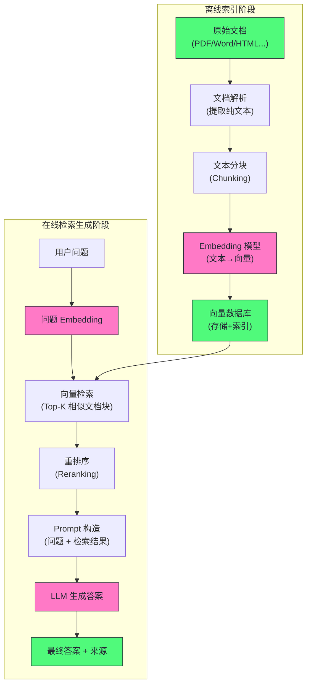
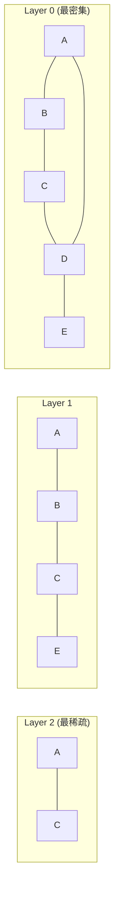

# 09 RAG 架构——核心原理与工程实践

**摘要：**

大语言模型有两个先天局限：知识截止日期——训练语料只覆盖到某个时间点，此后的事件一概不知；以及幻觉——模型在不确定时会自信地编造"听起来合理"的答案。**检索增强生成（Retrieval-Augmented Generation, RAG）** 是目前解决这两个问题最成熟的工程方案，其思路朴素到近乎直觉：与其教模型记住知识，不如在每次提问时把相关知识检索出来塞进上下文。本文以 RAG 的全链路工程为主线，逐层拆解文档解析、文本分块（Chunking）、Embedding 模型选型、向量数据库索引（HNSW/IVF）、检索策略（语义/关键词/混合）、重排序（Reranking）与生成阶段的 Prompt 构造，并落到增量更新、多租户、延迟与成本的工程取舍。本文还核对了 2025-2026 年 RAG 工程实践的变化：Qwen3-Embedding 登顶 MTEB、混合检索成为各引擎内置的生产默认、晚分块（Late Chunking）与 Late Interaction 检索的落地形态、RAGAS 指标体系的扩展，以及"长上下文模型是否取代 RAG"这场争论的实证结论。核心认知：RAG 的每个环节都是权衡，没有银弹，只有因地制宜。

---

## 第 1 章 为什么需要 RAG

### 1.1 LLM 的两大根本局限

2020 年 5 月，Lewis 等人在 NeurIPS 2020 上发表了那篇定义了检索增强生成的论文，第一次把"检索"与"生成"焊进同一个框架，并提出一个日后不断被验证的判断：知识密集型任务上，先检索再作答，比凭参数记忆作答更可靠。笔者以此为起点，是因为它划定了一条至今依然成立的边界——大语言模型的语言能力，与它所掌握的知识，是两回事。

经过预训练和对齐的 LLM 是一个强大的通用语言能力系统，但它有两个根本性的局限，不能通过简单地"让模型更大"来解决：

**局限一：知识截止日期（Knowledge Cutoff）**

LLM 的知识来源于训练数据，而训练数据有一个截止日期。GPT-4 的知识截止于 2023 年 4 月，此后发生的事情它一概不知。这个问题的本质是预训练的一次性"灌装"：语料在某个时间点被采样、清洗、切分为 token，模型训练完成后参数更新就停止了，此后世界的任何变化都不会再写进参数。对于企业应用来说，这个问题更加严峻——LLM 完全不了解公司内部的私有文档（产品手册、会议记录、内部 Wiki、客户合同），这些数据从未出现在训练语料中。

**局限二：幻觉（Hallucination）**

LLM 是概率生成模型——它的目标是生成"看起来合理的"next token，而非"保证准确的"next token。当模型不确定某个事实时，它倾向于生成一个听起来合理但实际错误的答案，而非承认不知道。这就是幻觉——模型自信地"编造"了不存在的引用、错误的数据、失真的历史事件。从机制上看，幻觉源于生成目标与事实性之间的错位：训练信号奖励的是"与语料分布一致"，而不是"与客观事实一致"，一个从未在语料中出现过的专有名词组合，只要在概率上说得通，模型就会顺理成章地把它写出来。更麻烦的是，幻觉与自信程度无关——错误答案往往措辞笃定，用户难以凭语气判断真伪。

> [!info] 核心概念
> RAG 本质上是一个"开卷考试"方案——LLM 是考生，私有知识库是可以查阅的参考书，每次提问都先从参考书中检索相关内容，再结合问题让 LLM 作答。闭卷考试（纯参数知识）考验的是记忆，开卷考试（RAG）考验的是理解和应用。对于需要频繁更新、追求准确性的企业知识库场景，开卷考试远优于闭卷。但这个比喻有一个需要立刻补上的限定：开卷考试的前提是"参考书里真的有答案"——如果检索环节没找到正确段落，考生照样会瞎编，这正是本文后面各章反复强调检索质量的原因。

### 1.2 为什么不用微调来注入知识

面对"模型不知道私有文档里的内容"这个问题，直觉上的解决方案是微调——在私有数据上对模型进行 SFT（监督微调）。但实践证明，**微调并不适合知识注入**，原因深刻：

**微调会遗忘（Catastrophic Forgetting）**：在新数据上微调往往会损害模型在旧数据上的性能。要让模型记住 10 万页文档的内容，需要大量的微调数据和精心的训练策略，代价极高。即使采用 LoRA 这类参数高效微调手段，也只是降低了训练成本，并没有改变"新知识挤占旧知识"的本质矛盾。

**知识更新昂贵**：当文档内容发生变化（如政策更新、产品迭代），需要重新微调——而每次微调都需要数小时的 GPU 时间和相应成本，永远跟不上企业知识库每天的更新频率。

**微调不能精确控制信息来源**：微调后的模型会将新知识与原有参数知识"混合"，无法保证对特定问题调用特定文档的内容，也无法追溯答案的来源。对于合规要求严格的行业（法律、医疗、金融），"答案必须有出处"是硬约束，参数化知识在这一点上天然不合格。

**知识密度问题**：模型参数的信息存储效率远低于文本本身。一个 70B 模型（140 GB）能存储的"专有知识"远不如直接在推理时给模型看原始文档来得多和准确。参数更像是一个"压缩器"，它擅长保留高频、一般化的模式，却会丢失低频、具体化的细节——而企业知识库里恰恰充满了这类细节。

相比之下，RAG 的思路更直接：**与其教模型记住知识，不如在需要时把相关知识找出来塞进 prompt**。不过，这两种路线并非对立，实践中存在"先 RAG 检索、再针对检索暴露出的盲区微调"的混合路径，但那是后话。

### 1.3 RAG 的适用场景

| 场景 | RAG 适合度 | 理由 |
| :--- | :--- | :--- |
| **企业内部知识问答** | 极高 | 私有文档，实时更新，需要来源可追溯 |
| **客服机器人** | 高 | 产品手册、FAQ 需要精确引用 |
| **法律/医疗文档分析** | 高 | 需要基于原始文本精确回答，容忍度低 |
| **最新资讯问答** | 高 | 需要训练截止日期后的信息 |
| **代码风格检查** | 低 | 无需外部知识，纯能力任务 |
| **数学推理** | 低 | 计算能力，非知识检索 |

这张表给出的是"适合度"，它背后是一个更本质的判断标准：**问题的答案是否存在于某份外部文本里**。如果答案是"推理出来"的（数学、逻辑、代码生成），RAG 帮不上忙；如果答案是"查出来"的（政策、规格、历史记录），RAG 就是最合适的工具。这个标准在第 12 章讨论长上下文模型时还会用到。

### 1.4 一个绕不开的设问：长上下文来了，还要 RAG 吗

2023 年以来，各大厂商把上下文窗口从几千 token 一路推到 128K、200K，乃至 1M 以上，于是有了一个尖锐的疑问：既然模型一次能读完几十万字，为什么不直接把全部文档塞进 prompt，还要费劲做分块、检索、重排序这套管线？这个问题触及了 RAG 存在意义的根基，笔者会在第 12 章展开它的研究结论与工程取舍，这里先给出一个反直觉的预告：**窗口变长并没有消灭检索，而是改变了检索的粒度**——长上下文让"检索整篇文档再通读"成为可能，但"从百万级语料里找出该读哪一篇"依然需要检索。换言之，长上下文缓解了"读到多少"的问题，没有解决"该读什么"的问题。

---

## 第 2 章 RAG 的整体架构

### 2.1 完整流程概览

RAG 分为两个阶段：**离线索引阶段**（准备知识库）和**在线检索生成阶段**（响应查询）。这个划分可以类比仓储物流：离线阶段是"入库分拣"——把文档拆成标准件（文本块）、贴好标签（向量），摆进货架（向量数据库）；在线阶段是"按单拣货"——从货架上拣出最相关的几件货，连同订单交给 LLM。



图中有两点值得留意：其一，离线与在线通过"向量数据库"这个共享状态解耦，知识库的任何更新都发生在离线侧，在线侧无需改动代码；其二，在线链路里除了 LLM，还串着 Embedding、检索、重排序三个环节，每环都有各自的失败模式。RAG 之所以"看起来简单、做好很难"，正是因为链路的总质量取决于最弱的一环。

### 2.2 从 Naive 到 Modular：RAG 的分代

Gao 等人在 2023 年发表的综述把 RAG 的演化分为三代，这个分法至今仍是理解该领域的主线：

| 分代 | 时间跨度 | 结构特征 | 代表技术 |
| :--- | :--- | :--- | :--- |
| **Naive RAG** | 2020-2023 | 固定的"检索-增强-生成"三段式 | Lewis et al. 2020 的原始 RAG |
| **Advanced RAG** | 2023-2024 | 在检索前后增加优化环节 | 查询改写、HyDE、重排序、上下文压缩 |
| **Modular RAG** | 2024 至今 | 检索策略可编排、可路由、可迭代 | GraphRAG、Self-RAG、Agentic RAG |

Naive RAG 的问题在于"一条流水线走到底"：无论问题什么类型，都用同一套分块、同一个检索器、同一次生成。Advanced RAG 试图在流水线两侧打补丁——检索前优化查询、检索后精排压缩。Modular RAG 则把检索本身变成可动态选择的策略集合。本文聚焦 Naive 与 Advanced 之间的完整工程链路；GraphRAG、Self-RAG、Agentic RAG 等高级技术留给下一篇 [[LLM/Agent技术/应用开发/10 高级 RAG——查询改写、图谱检索与多跳推理]] 展开。

### 2.3 全链路的失败模式地图

在逐章深入之前，先给出一张"失败模式地图"，回答"不这样会怎样"：**RAG 系统的绝大多数线上问题，都能被定位到这条链路的某个具体环节上**。

| 环节 | 关键决策 | 典型失败模式 |
| :--- | :--- | :--- |
| **文档解析** | 格式支持、结构保留 | 乱码、多栏乱序、表格丢失，检索"找不到本应找到的内容" |
| **分块** | 块大小、边界选择 | 语义单元被切断，同一信息被拆分到两块，两块都搜不全 |
| **Embedding** | 模型选型、指令前缀 | 语义鸿沟过大，问句与文档向量不接近，漏召回 |
| **向量检索** | 索引类型、Top-K | 精确词匹配失败（型号、人名），召回噪音 |
| **重排序** | 候选集大小、模型精度 | 粗排把正确答案挤出候选集，精排无从救回 |
| **生成** | Prompt 构造、引用格式 | 幻觉未根除、答非所问、来源标注错位 |

这张地图的用途有二：排查故障时按图索骥，立项时把每个环节的决策显式化。

---

## 第 3 章 文档解析——从原始文件到可处理文本

### 3.1 解析的挑战

知识库的原始文档通常不是干净的纯文本，而是各种格式的复杂文件：PDF（可能是扫描件）、Word、PowerPoint、HTML、Excel、Markdown 等。可以把解析理解为"把实体书搬进数字仓库前的分拣"——书页顺序、章节层级、表格行列都必须被正确识别，任何一步出错，都会污染后面所有环节。

**PDF 的复杂性**是最大的挑战。PDF 本质上不是一个"文档格式"，而是一个"页面描述格式"——它描述每个字符在页面上的精确位置，但并不保留段落、标题、表格等语义结构。一个技术文档的 PDF 可能包含：多栏排版（列的顺序需要正确识别）、图表（需要 OCR 或多模态模型处理）、页眉页脚（通常需要过滤掉）、公式（很难正确解析为文本）。常见的一个坑是双栏论文：按坐标流式读取时，左右两栏文字交织成乱序，段落被拦腰截断，后续分块与 Embedding 全部建立在错误的文本顺序上。

| 文档类型 | 解析难度 | 主要工具 | 常见问题 |
| :--- | :--- | :--- | :--- |
| **Markdown/纯文本** | 低 | 直接读取 | 几乎无 |
| **HTML** | 低-中 | BeautifulSoup, trafilatura | 噪音（导航栏/广告/脚本） |
| **Word (.docx)** | 中 | python-docx, mammoth | 样式丢失，嵌入图片 |
| **PDF（可搜索）** | 中-高 | PyMuPDF, pdfminer, pypdf | 多栏、表格、公式 |
| **PDF（扫描件）** | 高 | OCR: Tesseract, PaddleOCR | 识别精度、布局分析 |
| **PowerPoint** | 中 | python-pptx | 文本框顺序，图表 |
| **Excel/CSV** | 中 | pandas | 表格结构化处理 |

### 3.2 结构化与非结构化内容的处理

**表格处理**：表格中的信息是高度结构化的——每一行/列的含义依赖于表头。如果直接将表格序列化为线性文本（"张三, 25, 工程师, 北京, 李四, 30, 产品经理, 上海..."），模型难以理解其结构。更好的做法是将表格转换为 Markdown 表格格式，或者为每一行生成一句自然语言描述（"张三，25岁，职业是工程师，所在城市北京"），再分别索引。后一种方式下，检索问句与转述句的语义距离更近，代价是多花一次 LLM 调用。

**图像与图表**：纯文本 Embedding 无法处理图像。解决方案有两种：
- **多模态 Embedding**：用多模态 Embedding 模型（如 CLIP）将图像编码为向量，存储在向量库中
- **图像描述生成**：用多模态 LLM（如 GPT-4V）自动生成图像的文字描述，再作为文本索引

2024 年之后出现了一条更激进的路线：把整页文档渲染成图像，直接用视觉语言模型对页面图像做检索，代表工作是 ColPali（Faysse 等，ICLR 2025）——它整体跳过了"解析"环节，表格、版式、图表以像素形式参与检索，避免了解析链路的误差累积。第 8 章还会回到这条路线。

### 3.3 文档解析工具推荐

对于生产级的 RAG 系统，推荐以下工具组合：

- **[Docling](https://github.com/DS4SD/docling)**（IBM 开源，MIT 协议）：支持 PDF、DOCX、XLSX、HTML 等多种格式，底层由布局分析模型 DocLayNet 与表格结构识别模型 TableFormer 驱动，能保留文档结构（标题层级、表格、列表）。Docling 于 2024 年开源后不到一个月即收获上万 GitHub star，论文发表于 AAAI 2025，v2 版本引入了统一的 DoclingDocument 中间表示，已被 LangChain、LlamaIndex、spaCy 集成
- **[Unstructured.io](https://unstructured.io/)**：企业级文档解析服务，支持 30+ 文档格式，提供结构化元素（Title/NarrativeText/Table）的识别
- **[LlamaParse](https://llamaindex.ai/llamaparse)**：LlamaIndex 出品，专注于复杂 PDF 解析，特别是含有复杂表格和图表的技术文档

### 3.4 解析质量是检索上限的隐形瓶颈

解析环节最容易被低估，因为它不直接出现在评测指标里——只有当某个答案反复检索不到时，排查才会一路追到解析层。但解析质量事实上设定了整个系统的检索上限：**解析引入的错误（乱序、丢字、表格塌陷）会以"脏文本"的形式进入分块与 Embedding，向量化之后无法挽回**。一个典型的例子是 OCR 把"l"识别成"1"、把"0"识别成"O"，产品型号、代码标识这类精确信息从此在向量空间里"变形"，混合检索里的 BM25 也救不回来，因为关键词匹配依赖字符层面的精确一致。

由此得出两条工程原则：其一，解析阶段应保留文档的结构信息（标题层级、表格边界）作为元数据，供分块与检索使用；其二，对解析结果应做抽样人工校验——随机挑几十页对比原文与解析结果，重点检查表格、公式、多栏版面，成本远低于上线后追查漏召回。

---

## 第 4 章 文本分块——Chunking 策略

### 4.1 为什么需要分块

为什么不直接将整个文档作为一个索引单元？主要有两个原因：

**Embedding 精度问题**：Embedding 模型将一段文本压缩为一个固定维度的向量。文本越长，信息损失越多——一篇 10 页的文档压缩成一个 1536 维向量，具体细节无法精确表达，而短块的 Embedding 质量远高于长文本。

**检索精度与上下文长度的矛盾**：如果索引单元是整个文档（10 页），检索时返回整个文档，然后将 10 页内容全部塞进 prompt——这会快速填满上下文窗口，而且其中大部分内容与用户问题无关，"稀释"了相关信息。分块后可以精确定位到相关的段落，而非返回整个文档。

### 4.2 固定大小分块

最简单的分块策略：按固定字符数或 token 数切分，相邻块之间有一定的**重叠（Overlap）**。

```
块大小（Chunk Size）：512 token
重叠（Overlap）：50 token

块 1: [token 1-512]
块 2: [token 463-974]  (从 463 开始，与块1重叠50个token)
块 3: [token 925-1436]
...
```

重叠的作用：避免一个完整的语义单元（如一个句子）被硬切断——若切断点落在句子中间，该句在两个块里都不完整；当查询恰好命中切分点附近时，重叠区保证该句子在至少一个块里完整。50-100 token 的重叠通常是合理的。

**局限**：固定大小分块不考虑文本的语义边界——可能在句子中间切断，或将段落的开头和结尾分到不同的块中。分块算法对文本本身也敏感：对英文按空格切分还算可靠，对中文不做分词时，按字符硬切更容易落在语义单元中间。

### 4.3 语义分块

更智能的分块策略是按照文本的**语义边界**切分——按段落、按章节、按标题层级。

**按段落分块**：以空行或 `\n\n` 为边界，每个段落为一个块。适合有清晰段落结构的文档。问题是段落长度差异巨大——有的段落 10 个词，有的 500 个词。

**递归字符分块**（LangChain 的 `RecursiveCharacterTextSplitter`）：按优先级顺序尝试不同的分隔符（`\n\n` → `\n` → `. ` → ` `），先按段落分，段落太长则按句子分，句子太长则按空格分。这是最实用的分块策略，兼顾了语义完整性和块大小的可控性。

**基于 Markdown/HTML 结构分块**：如果文档有明确的标题结构（`# ## ###`），按标题层级切分，每个标题下的内容为一个块，同时在块的 metadata 中记录标题路径（如"第2章 > 2.3节 > 安装配置"）。标题路径的价值不止于定位：它能在检索结果里直接展示"这份内容属于哪个章节"，也是按章节粒度返回上下文的基础。

### 4.4 块大小的选择

块大小没有统一的最优解，需要根据文档类型和检索模式来调整：

| 场景 | 推荐块大小 | 理由 |
| :--- | :--- | :--- |
| **精确问答**（如"XX 产品的价格是多少"） | 128-256 token | 短块语义更精确，检索相关性高 |
| **摘要/综述类问答** | 512-1024 token | 需要更多上下文来理解主题 |
| **代码文档** | 函数级（整个函数） | 代码语义单元是函数，不应硬切断 |
| **法律/合同文档** | 条款级（一个条款） | 法律条款是语义单元 |

> [!warning] 生产避坑
> 块大小是 RAG 系统中最被低估的超参数。许多团队直接使用默认的 512 token，但这对于不同类型的文档和问题来说可能远非最优。建议对代表性问题集做系统的块大小消融实验（128/256/512/1024 token），用检索的 Recall@K 指标来选择最优的块大小。消融实验的结论往往反直觉：同一个知识库，精确问答与综述问答各自的最优块大小可能差一倍以上，因此"一套参数打天下"的想法在生产中并不成立。

### 4.5 小到大检索（Small-to-Big Retrieval）

一种平衡精确检索和完整上下文的策略：

- **小块**用于检索（如 128 token）——小块 Embedding 精度高，检索准确
- **大块**用于生成（如 512 token）——检索到小块后，取其所属的父块（更大的上下文）输入 LLM

这样既保证了检索精度（用精确的小块匹配），又给 LLM 提供了足够上下文（用大块生成答案）。LlamaIndex 的 `NodeWithScore` 机制支持这种父子块结构——可以理解为"先拿放大镜定位，再退一步看全貌"，检索负责精确，生成负责上下文完整，两个目标分配到两个粒度的文本上。

### 4.6 分块策略的演进：晚分块

2024 年 9 月，Jina AI 的 Günther 等人发表了晚分块（Late Chunking）技术（arXiv 2409.04701），它针对的正是"先分块再编码"的一个固有缺陷：**孤立块在编码时看不到全文上下文，代词、省略的主语、跨段落的指代全部丢失**。晚分块的做法是颠倒顺序——先用支持长上下文的 Embedding 模型把整篇文档一次性过 Transformer，得到每个 token 的向量表示，然后再按句子或段落的边界对这些 token 向量做平均池化（mean pooling），生成每个块自己的向量。

晚分块的收益是块向量携带全文语境，检索质量随之提升；但它的适用前提是 Embedding 模型支持长输入（否则整篇文档过不完），且需要以 token 级输出参与池化。它与 Anthropic 的 Contextual Retrieval（索引前用 LLM 给每个块生成上下文说明并拼接进原文，详见 [[LLM/Agent技术/应用开发/10 高级 RAG——查询改写、图谱检索与多跳推理]]）是两条不同的路：Contextual Retrieval 在模型外部"加前缀"，晚分块在模型内部"共享编码"；前者多一次 LLM 调用，后者要求长上下文模型。二者并不互斥，也可以组合使用。

### 4.7 结构化内容的边界与反例

分块策略最常见的反例出现在"文本"与"代码"混居的知识库里：固定 token 分块会把一个函数从中间劈开，把一段 SQL 切成两半。对这类内容，语义单元优先于长度均匀：

- **代码**按函数/类切分，一个函数一个块，函数头（签名与 docstring）要完整保留
- **表格**整表为一个块（或按行组切分），不要把表头与数据行拆散
- **条款型内容**（法律、合同、政策）按条款切分，保留条款编号

另一个边界问题是"超长段落"：一个 3000 token 的段落超出了任何目标块大小，只能递归切分，但切分出的子块语义相关度极高，检索时会出现"同一段落被重复召回"的冗余。缓解办法是引入父子块结构：子块负责命中，父块负责去重后提供完整上下文。

---

## 第 5 章 Embedding 模型——语义向量化

### 5.1 什么是 Embedding

Embedding 模型将一段文本映射为一个固定维度的浮点数向量（如 1536 维）。**语义相似的文本，其 Embedding 向量在高维空间中的距离也近**。可以把它想象成给每段文本拍一张"特征快照"——捕捉的是语义特征而非字面特征。

这个性质使向量搜索成为可能：用户的问题被编码为一个向量，知识库中的所有文档块也被编码为向量，通过计算查询向量与所有文档向量的相似度（余弦相似度或欧氏距离），可以找到语义上最接近的文档块——即使它们之间没有词语上的完全匹配。

譬如，查询"如何申请年假"可以匹配到文档"员工请假流程——年休假申请方式"，即使两段文本的关键词不重叠，但语义是相同的。

### 5.2 主流 Embedding 模型

2025 年的 Embedding 市场发生了明显的座次变动：阿里在 6 月开源了 Qwen3-Embedding 系列（Apache 2.0），其 8B 规格一度位居 MTEB 多语言榜榜首，中文与多语言检索从此有了新的开源选项。下表以 2025 年中为时间快照，列出生产环境中最常被评估的几款模型：

| 模型 | 提供方 | 维度 | 最大输入 | 语言 | 特点 |
| :--- | :--- | :--- | :--- | :--- | :--- |
| **text-embedding-3-small** | OpenAI | 1536（可压缩） | 8191 token | 多语言 | 2024-01 发布，便宜，质量好，v3 起支持 dimensions 参数 |
| **text-embedding-3-large** | OpenAI | 3072（可压缩） | 8191 token | 多语言 | 最高质量的 API 模型，成本高 |
| **bge-m3** | BAAI | 1024 | 8192 token | 多语言 | 开源，稠密+稀疏+多向量三合一，中文友好 |
| **Qwen3-Embedding-0.6B** | 阿里 | 1024 | 32768 token | 100+ 语言 | 2025-06 发布，Apache 2.0，支持 MRL 与指令感知 |
| **Qwen3-Embedding-8B** | 阿里 | 4096 | 32768 token | 100+ 语言 | MTEB 多语言榜 No.1（2025-05-26，综合 70.58） |
| **e5-mistral-7b-instruct** | Microsoft | 4096 | 32768 token | 多语言 | 超长上下文，质量极高，7B 参数 |
| **jina-embeddings-v3** | Jina | 1024 | 8192 token | 多语言 | 支持查询/文档不同 task 前缀 |
| **voyage-3-large** | Voyage | 1024 | 32000 token | 多语言 | 长文档，代码场景表现好 |

表格之外还有两个趋势：其一，开源与闭源 API 的差距在缩小，Qwen3-Embedding 与 bge 系列在中文场景已能对标甚至超过闭源 API，"本地化部署、数据不出域"更加现实；其二，长上下文成为新标配——32K 输入让"整篇文档一次编码"成为可能，也支撑了第 4.6 节的晚分块。

### 5.3 非对称检索与指令 Embedding

标准 Embedding 模型使用同一个向量空间编码"查询"和"文档"。但二者语言风格往往不同——查询通常是短句疑问句（"苹果的营养价值是什么"），文档通常是陈述性长文（"苹果富含维生素C和膳食纤维，研究表明......"）。

**非对称 Embedding**（Asymmetric Search）使用不同的编码方式处理查询和文档：

- **E5 系列**：在输入前加 `query: ` 或 `passage: ` 前缀，用不同的前缀引导模型产生适合查询或文档的向量表示
- **BGE 系列**：类似机制，加 `为这个句子生成表示以用于检索相关文章：` 等指令
- **jina-embeddings-v3**：通过 `task` 参数区分检索、分类、聚类等任务
- **Qwen3-Embedding**：支持指令感知（Instruction Aware），官方评测显示使用指令相比不用指令通常能带来 1%-5% 的提升，多语言场景下用英文书写指令效果更佳

在实际部署中，务必在查询和文档上使用正确的指令前缀，忽略这一点会导致检索质量显著下降——这一项值得在评估时单独做一次 A/B。

### 5.4 Matryoshka 表示学习与维度压缩

2022 年提出的 Matryoshka 表示学习（Matryoshka Representation Learning, MRL）让"降维"从训练期的事后操作变成了模型内建的能力：MRL 训练出的向量，其前 d 个维度本身就是一套可用的低维表示，因此可以在推理时按需截断维度，而无需重新训练。OpenAI 的 text-embedding-3 系列把这一能力暴露为 `dimensions` 参数（如 3072 维可压缩到任意更小维度），Qwen3-Embedding 同样支持 MRL，官方列出的可选输出维度从 64 一直到 4096。

维度压缩的价值是实打实的存储成本：索引内存与磁盘占用随维度线性增长，百万级块 × 1536 维与 × 256 维的存储差距接近一个数量级。但压缩也有代价——低维表示的语义保真度下降，检索精度可能随之降低。稳妥路径是先以满维度评估模型上限，再逐档压缩对比检索指标，找到"精度可接受的最小维度"。

### 5.5 Embedding 模型的评估：MTEB

**MTEB（Massive Text Embedding Benchmark）** 是 Embedding 模型的标准评测基准，覆盖检索（Retrieval）、语义相似度（STS）、分类（Classification）、聚类（Clustering）等多个任务。MTEB 由 Hugging Face 等机构持续维护，目前覆盖超过 1000 种语言，2026 年 6 月还发布了基于 FastAPI 与 Svelte 重建的新版排行榜（v3），把筛选、模型对比与透明度提升了一个量级。

选择 Embedding 模型时，建议：
1. 先在 MTEB 上筛选综合评分高的模型
2. 再在自己的领域数据上进行专项评测（通用榜单不一定反映特定领域的表现）
3. 中文场景重点关注 MTEB 中文子榜与多语言榜；2025 年上半年多语言榜头名长期由 Qwen3-Embedding-8B 占据（综合 70.58，2025-05-26 快照）

榜单更新频繁，榜首的"保质期"通常只有数月，选型记录里务必写下"参考的是哪一天的榜单快照"。

### 5.6 本地部署还是 API：一个工程决策

Embedding 模型的部署方式没有绝对答案，取决于三个约束：

| 约束 | 倾向本地（开源模型） | 倾向 API（闭源模型） |
| :--- | :--- | :--- |
| **数据隐私** | 私有文档不外传，本地部署 | 允许文本出域 |
| **调用量** | 千万级/天，API 费用不可控 | 调用量小，API 划算 |
| **延迟敏感度** | 本地 GPU 延迟可控 | 网络往返可接受 |
| **维护成本** | 需自建推理服务与 GPU | 零运维，按量付费 |

对中文企业知识库，bge-m3 与 Qwen3-Embedding-0.6B 是本地方案的常见起点；若团队已有 GPU 集群或能接受 API，则从 text-embedding-3 与 Qwen3-Embedding-8B 中做精度对比。无论选哪条路，都要记住 5.5 节的结论：**榜单决定候选，领域数据决定最终选择**。

---

## 第 6 章 向量数据库——高效的近似最近邻搜索

### 6.1 为什么需要专用向量数据库

一个企业的知识库可能包含数百万个文档块，每个块对应一个 1536 维的浮点向量。当用户查询到来时，需要在毫秒级内找到与查询向量最相似的 Top-K 个向量——这是一个**近似最近邻搜索（Approximate Nearest Neighbor, ANN）** 问题。

暴力搜索（逐一计算查询向量与所有向量的距离）在向量数量达到百万级时延迟无法接受。可以这样理解：暴力搜索是在全城挨家挨户问路，ANN 索引则是先修了高架桥和路标，只沿着最可能的方向走。

### 6.2 HNSW 索引——向量数据库的主流选择

**HNSW（Hierarchical Navigable Small World）** 是当前最主流的 ANN 索引算法，被 Chroma、Milvus、Qdrant、Weaviate、pgvector 等几乎所有向量数据库采用。

HNSW 的核心思想借鉴了**六度分隔理论**（Small World Graph）和**跳表**（Skip List）：

1. **多层图结构**：底层（Layer 0）是完整的向量图，每个节点连接到距离最近的 $M$ 个邻居。越高层的图越稀疏（节点越少），但每个节点的连接跨度越大
2. **贪心搜索**：从顶层的入口点开始，在每一层贪心地向查询向量移动（每次移动到邻居中最近的那个），到达底层后得到精确的近似最近邻



HNSW 的搜索复杂度为 $O(\log N)$（$N$ 为向量数量），百万级向量上延迟通常在毫秒级。关键超参数：
- **M**：每个节点的最大连接数，越大召回率越高但内存占用越大（通常 16-64）
- **ef_construction**：构建时搜索宽度，越大索引质量越好但构建越慢（通常 100-200）
- **ef_search**：搜索时的宽度，越大召回率越高但延迟越大，可在运行时调整

HNSW 是"用内存换速度"的典型：它把整个图常驻内存，换来毫秒级查询。数据量大到内存装不下时，就要考虑 IVF 或磁盘型索引（如 DiskANN）了。

### 6.3 IVF 索引——大规模场景

**IVF（Inverted File Index）** 是另一种常用索引，适合数据量极大（亿级+）的场景。

核心思想：先用 K-means 把所有向量聚类为 $K$ 个簇，每个向量分配到最近的簇；搜索时只在与查询向量最近的 $nprobe$ 个簇中搜索。这相当于先"按城市分区"，再在命中的几个区里找人，而不是全国搜捕。

IVF 的内存占用比 HNSW 低（不需要存储全图），但召回率通常略低，适合显存/内存受限的场景。生产中的常见做法是 IVFPQ——在 IVF 基础上叠加乘积量化（Product Quantization），把每个向量的存储进一步压缩，代价是精度损失，需要靠增大 nprobe 找补。

### 6.4 主流向量数据库对比

| 数据库 | 部署方式 | 索引类型 | 特色 | 适用规模 |
| :--- | :--- | :--- | :--- | :--- |
| **Chroma** | 本地/云 | HNSW | 轻量，Python 原生，快速原型 | 小-中 |
| **Qdrant** | 本地/云 | HNSW | Rust 实现，高性能，过滤功能强 | 中-大 |
| **Milvus** | 本地/云 | HNSW/IVF/DiskANN | 企业级，高可用，多索引支持 | 大型企业 |
| **Weaviate** | 本地/云 | HNSW | 内置混合搜索，GraphQL API | 中-大 |
| **pgvector** | PostgreSQL 扩展 | HNSW/IVF | 与 PostgreSQL 生态无缝集成 | 小-中 |
| **Pinecone** | 纯云服务 | 私有 | 全托管，零运维 | 任意 |
| **Faiss** | 库（非数据库） | HNSW/IVF/PQ | Facebook 出品，底层研究标准 | 本地实验 |

对于初创团队或快速原型：**Chroma** 或 **pgvector**（如果已有 PostgreSQL）是最简单的选择。对于生产级企业应用：**Qdrant** 或 **Milvus** 提供了更好的性能、可用性和管理能力。向量库的内部机制可参考 [[中间件/Milvus/00 专栏导览|Milvus]] 专栏的专项拆解。

### 6.5 2025-2026 的向量库演进：多向量与量化

2024-2025 年，向量数据库最值得关注的变化是**对多向量（Multi-Vector）Embedding 的原生支持**。以 Weaviate 为例，其 1.29 以技术预览引入多向量 Embedding，1.30（2025 年 4 月）将这一能力与 BlockMax WAND 索引一起推向正式可用（GA），并支持对多向量做量化以压缩内存；Milvus 社区同样在推进 Late Interaction 的支持。推动力来自 ColBERT、ColPali 这类模型的工程化需求——向量库必须先能存、能算，才能在 RAG 流水线里被用起来，第 8 章会再审视这条路线。

### 6.6 选型：专用向量库还是既有存储

在引入一套新的向量库之前，先回答"我是否已经拥有可以承载向量的存储"：

- 已有 **PostgreSQL**：pgvector 扩展（HNSW/IVF 都支持）可以零新组件地承接向量检索，适合数据量在千万级以内、运维团队不想引入新系统的场景
- 已有 **Elasticsearch**：其 kNN 检索能力配合成熟的全文检索，是"混合检索天然一体"的存量方案（参考 [[中间件/Elasticsearch/00 专栏导览|Elasticsearch]] 专栏）
- 数据量亿级、需要独立扩缩容与高可用：专用向量库（Milvus/Qdrant/Weaviate）更合适
- 不想自建任何东西：Pinecone 等全托管云服务

这个决策的要点是"从已有资产出发，而不是从榜单出发"——向量库的运维成本往往超过它带来的检索收益，只有当存量方案确实成为瓶颈时，才值得引入新组件。

---

## 第 7 章 检索策略——语义、关键词与混合

### 7.1 纯语义搜索的局限

向量相似度搜索擅长**语义匹配**——能找到语义相似但措辞不同的内容。但它有一个重要的局限：对于**精确词汇匹配**（如产品型号、人名、专有名词、ISBN 号），向量搜索的表现往往不如关键词搜索。

譬如，查询"iPhone 15 Pro Max 的电池容量"——用户明确知道要找的是"iPhone 15 Pro Max"这个精确的型号。向量搜索可能会返回关于"iPhone 14 Pro Max"或"iPhone 15 性能"的内容（语义相似），而非"iPhone 15 Pro Max 规格"（精确匹配）。原因在于 Embedding 的语义压缩特性：它把"型号"这类高精度信息与周边语义一起压进了向量，精确度被"平均"掉了。

### 7.2 BM25——经典的关键词搜索

**BM25**（Best Match 25）是信息检索领域经典的关键词打分算法，是 Google 等搜索引擎使用的核心算法之一。

BM25 的核心思想是 **TF-IDF 的改进版**：给定查询词 $q_i$ 和文档 $D$：

$$\text{BM25}(D, Q) = \sum_{i=1}^{n} \text{IDF}(q_i) \cdot \frac{f(q_i, D) \cdot (k_1 + 1)}{f(q_i, D) + k_1 \cdot (1 - b + b \cdot \frac{|D|}{\text{avgdl}})}$$

其中 $f(q_i, D)$ 是词 $q_i$ 在文档 $D$ 中的频率，$|D|$ 是文档长度，$\text{avgdl}$ 是平均文档长度，$k_1$ 和 $b$ 是超参数（通常 $k_1 = 1.5$，$b = 0.75$）。

BM25 的两个关键特性：
- **TF 饱和**：词频的贡献随频率增加而饱和（不是线性的），避免了一个词重复出现就无限增大分数的问题
- **文档长度归一化**：在较长的文档中出现相同次数的词，贡献应该打折扣（因为长文档天然包含更多词）

BM25 还有个常被忽视的工程优点：不依赖任何模型，无需 GPU 与 Embedding，中文场景配合分词器即可运行，成本几乎为零。

### 7.3 混合搜索（Hybrid Search）

**混合搜索**将向量语义搜索和 BM25 关键词搜索的结果融合，取长补短：

1. 对查询分别执行向量搜索（返回 Top-K1 个结果）和 BM25 搜索（返回 Top-K2 个结果）
2. 用 **RRF（Reciprocal Rank Fusion）** 等融合算法合并两个排序列表

$$\text{RRF}(d) = \sum_{r \in \text{rankers}} \frac{1}{k + r(d)}$$

其中 $r(d)$ 是文档 $d$ 在排序 $r$ 中的名次，$k$ 通常取 60。直觉上，在多个排序中都排名靠前的文档会获得更高的综合分数。RRF 的巧妙之处在于只看"名次"不看"分数"——两种搜索的分数尺度完全不同，直接加权没有意义，而名次融合天然免疫了尺度问题。

实践中，混合搜索在大多数场景下优于纯向量或纯关键词搜索，是生产级 RAG 系统的首选检索策略。

### 7.4 稀疏检索的现代形态：SPLADE

BM25 的现代替代是**学习式稀疏检索**，代表模型是 SPLADE（SParse Lexical AnD Expansion）——它用 Transformer 学习每个词的权重，并把同义词、相关词"膨胀"进查询表示，从而兼得关键词匹配的精确性与一定的语义扩展能力。其检索结果仍是稀疏向量、可走倒排索引，但生成需要模型推理（GPU），成本高于 BM25 的纯统计打分。

务实分层是：**默认稀疏路用 BM25（零成本、稳定、可解释），当检索精度确实受限于词汇鸿沟时，再评估 SPLADE 或 BM25 加同义词扩展**。混合检索的价值在于两条腿：向量路负责"语义够得着"，BM25 路负责"字符对得上"。

### 7.5 元数据过滤

向量搜索可以结合**元数据过滤**——在执行相似度搜索的同时，过滤满足特定条件的文档块：

```python
results = collection.query(
    query_embeddings=[query_embedding],
    n_results=10,
    where={"source": "产品手册-v2.pdf", "department": "研发部"},
    where_document={"$contains": "iPhone 15"}
)
```

元数据过滤对权限控制（只检索当前用户有权访问的文档）和范围限制（只在特定文档集中搜索）非常重要。工程上的关键是把"权限"当作检索的硬过滤条件而非软约束：先过滤、再相似度排序，顺序不能反，否则模型会在无权访问的内容上生成答案，构成越权信息泄漏。这与 [[LLM/Agent技术/基础范式/07 Agent 权限与审批模型——人在环路的工程实践|Agent 权限模型]] 的原则一脉相承：过滤发生在检索器内部，而非依赖生成阶段"自觉"遵守。

### 7.6 混合搜索的工程地位与测量

截至 2025 年，混合检索已经从"可选优化"变成了各主流检索引擎的**内置默认能力**：OpenSearch、Weaviate、Qdrant 均把混合搜索列为标准功能，NVIDIA 的 RAG Blueprint 也把"hybrid"作为默认检索类型。工程社区对它的态度也趋于一致——**默认开启，但用数据说话**：Qdrant 在官方文档中给出的实测是，在其选取的 5 个公共数据集上，默认 RRF 融合在 4 个上超过了单路最强检索器，但"融合分数低于纯稠密检索"的反例同样存在。这说明混合搜索不是无条件占优：当语料几乎不存在精确词匹配需求时，向量路单独就能覆盖绝大多数查询，混合检索多出来的存储与计算成本未必值得。

由此引出测量方法：为混合检索建立带标注的评估集，对比"纯向量 / 纯 BM25 / RRF 融合 / 加权融合"四条路线的 nDCG@10 或 Recall@K，再决定开启与否、权重几何。

---

## 第 8 章 重排序——精排提升准确度

### 8.1 检索的两阶段架构

向量搜索是一个**粗排**过程——它能快速从百万文档中筛选出 Top-50 个候选，但由于 Embedding 的有损压缩，排序并不总是最优的。可以类比招聘：粗排是海选（简历初筛，快但只看大概），精排是终面（逐一面谈，慢但看细节）。

**重排序（Reranking）** 是一个**精排**过程：对初检结果中的每个文档块，用一个更精确但更慢的模型重新计算与查询的相关性分数，重新排序后取 Top-K（通常 3-5 个）输入 LLM。

这种两阶段架构在信息检索中是标准做法，且是必然：更精确的模型必然更慢，不可能对百万级候选逐个计算，只能被约束在粗排圈出的小候选集上。

### 8.2 Cross-Encoder Reranker

最常用的 Reranker 是 **Cross-Encoder**——将查询和文档**拼接**后一起输入模型，模型输出一个 0-1 的相关性分数。

```
输入: [CLS] 查询文本 [SEP] 文档块文本 [SEP]
输出: 相关性分数 ∈ [0, 1]
```

Cross-Encoder 与 Bi-Encoder（标准 Embedding 模型）的区别：

| 维度 | Bi-Encoder（Embedding） | Cross-Encoder（Reranker） |
| :--- | :--- | :--- |
| 编码方式 | 查询和文档分别编码 | 查询和文档联合编码 |
| 交互深度 | 通过向量点积（浅层） | 通过 Self-Attention 充分交互（深层） |
| 质量 | 中（受压缩损失限制） | 高（充分理解语义关联） |
| 速度 | 快（文档可离线编码） | 慢（每对查询-文档都要计算） |
| 适用阶段 | 粗排（大规模候选） | 精排（小规模候选） |

Cross-Encoder 因为能让查询和文档在 Self-Attention 中充分"互看"，相关性判断更准确，但无法离线编码文档，每次查询都要对所有候选重新计算——因此只适用于候选集较小（20-100 个）的精排阶段；候选集太小（<10）精排余地不足，太大（>100）延迟失控，需要显式权衡。

### 8.3 主流 Reranker 模型

2025 年的 Reranker 生态大致可以分成三个阵营：

| 模型 | 提供方 | 规模 | 特点 |
| :--- | :--- | :--- | :--- |
| **bge-reranker-v2-m3** | BAAI | 0.6B | 多语言，开源，社区常用基线 |
| **Qwen3-Reranker-0.6B/4B/8B** | 阿里 | 0.6B/4B/8B | 2025-06 发布，MTEB-R 上 4B 达 69.76，显著高于 bge-reranker-v2-m3（57.03） |
| **jina-reranker-v2** | Jina | 中 | 多语言，支持长文本 |
| **Cohere Rerank** | Cohere | 云 API | 闭源托管，零运维，按量计费 |

Qwen3-Reranker 让"本地精排"的精度天花板明显抬升——4B 规格在 MTEB-R 上大幅超过此前的 bge-reranker-v2-m3，0.6B 小规格也足以覆盖大部分中文场景。另一条路是"用 LLM 当 Reranker"：把候选块列表交给大模型排序或打分，精度上限更高，但延迟与成本高一个量级，只在候选集极小且精度极其敏感的场景值得。

### 8.4 Late Interaction：第三条路线

在 Bi-Encoder（单向量）与 Cross-Encoder（全交互）之间，还有第三条路线——**Late Interaction（延迟交互）**，其代表是 ColBERT（Khattab 与 Zaharia，SIGIR 2020）与它的视觉版 ColPali（Faysse 等，ICLR 2025）。它的做法是：查询与文档分别编码为**一组 token 级向量**，检索时对每个查询 token，取它与文档所有 token 相似度的最大值，再对全部查询 token 求和，这个分数叫 MaxSim。

| 维度 | Bi-Encoder | Late Interaction | Cross-Encoder |
| :--- | :--- | :--- | :--- |
| 编码方式 | 各编码为单个向量 | 各编码为 token 向量集 | 拼接联合编码 |
| 交互深度 | 点积，无 token 级交互 | MaxSim，token 级局部交互 | Self-Attention 全量交互 |
| 离线编码 | 支持 | 支持 | 不支持 |
| 相对精度 | 中 | 高 | 最高 |
| 相对速度 | 快 | 中（可并行、可量化） | 慢 |

Late Interaction 的工程价值在于同时占了"离线可索引"和"token 级精排"两头：文档侧可预先编码存储，查询到来时只计算查询 token 与候选文档 token 的交互——这正是第 6.5 节向量库多向量支持的用武之地。Weaviate 在 1.30 将多向量检索推进到 GA 并支持量化压缩，说明这条路已从论文走进生产。主要代价是存储：一个 512 token 的块按 128 维/token 存储，体积是单向量表示的几十倍，量化是控制成本的常见手段。ColPali 则更进一步，把"页面图像直接作为文档表示"与 Late Interaction 结合，绕过了文本解析环节，在版面复杂、依赖视觉结构的文档检索上表现突出。

### 8.5 什么时候不该用 Reranker

重排序并非总是必要的，以下场景要克制：

- **候选集本来就不大**：粗排 Top-5 直接进生成，再套一层 Reranker 徒增延迟
- **延迟预算极紧**：Rerank 通常要 100-500ms（视候选数与模型规模），在交互式场景里这笔开销要算进端到端预算
- **效果已经饱和**：如果评测显示 Rerank 前后的答案质量无显著差异，说明粗排已经足够好，或瓶颈不在排序而在召回（答案压根不在候选集里）

最后一条尤其值得注意：**Reranker 只能重排"已召回"的候选，救不回"未召回"的相关内容**。当评估显示精排之后 Faithfulness 仍低时，先回头查粗排的 Recall 而不是继续调精排——这是第 2.3 节失败模式地图的直接应用。

---

## 第 9 章 生成阶段——Prompt 构造与答案生成

### 9.1 RAG Prompt 模板

将检索到的文档块（经过重排序后的 Top-K）和用户问题组合成 prompt：

```
[System]
你是一个专业的知识库助手。根据以下提供的参考文档回答用户的问题。
- 只根据参考文档中的信息作答，不要使用你自己的背景知识
- 如果参考文档中没有足够的信息回答问题，请明确说明"文档中没有相关信息"
- 在答案末尾注明信息来源（文档名称和章节）

[参考文档]
文档1（来源：产品手册第3章）:
{chunk_1}

文档2（来源：FAQ-2024.pdf 第15页）:
{chunk_2}

文档3（来源：内部Wiki-发布流程）:
{chunk_3}

[用户问题]
{user_question}

[回答]
```

模板本身并不神秘，它只是在执行"开卷考试"的考务规则：划定参考资料范围、禁止超纲作答、要求注明出处。真正决定生成质量的是背后的设计决策。

### 9.2 答案生成的关键设计决策

**是否限制模型只使用检索结果**：

- **严格 RAG**：System Prompt 明确要求"只根据提供的参考文档作答"。适合对准确性要求极高的场景（法律/医疗/金融）
- **知识增强 RAG**：允许模型在检索结果的基础上调用自身知识进行推理补充。适合对全面性要求更高的场景

**如何处理检索失败**：当检索结果与问题无关时（所有相似度分数都很低），应该让模型据实回复"文档中没有相关信息"，而非强行生成可能幻觉的答案。可以在代码层面检测：如果最高相似度分数低于阈值（如 0.5），直接返回"未找到相关文档"，不调用 LLM。这个"检索质量门"是生成阶段的第一道防线，比任何 prompt 措辞都可靠——它是确定性的代码逻辑，不依赖模型自觉。

**来源引用（Citation）**：生产级 RAG 系统应该在答案中注明信息来源，允许用户验证答案。实现方式：在每个文档块的元数据中存储来源（文件名、页码、章节），检索后将来源信息附在对应的内容上，生成时引导模型以"[来源: XX 文档第 XX 页]"的格式标注。来源引用的深层价值是"把幻觉变成可审计的偏差"——模型无法引用一个不存在的来源而不被发现。

### 9.3 生成阶段的进阶实践

- **检索结果的组织**：进入 prompt 的块按重排序分数降序排列，来源信息随块携带；相关度垫底的结果可以直接丢弃，避免"长尾噪音"稀释注意力
- **上下文去噪**：对同一个来源的多个块做合并去重，防止同一段落以不同分块形式重复出现
- **引用的一致性**：流式输出时，引用的标注位置可能与生成文本错位，需要在流式框架里把"引用"设计成结构化字段而非文本内联
- **与检索评估的联动**：当生成质量波动时，先用第 10 章讲的评估指标区分是"检索没找到"（Recall 问题）还是"模型没用对"（Faithfulness 问题），再决定改检索还是改 prompt——这正是 [[LLM/Agent技术/应用开发/08 Prompt 工程——从零样本到思维链]] 与本文的交接点

---

## 第 10 章 RAG 的评估

### 10.1 RAG 评估的三个维度

评估 RAG 需要从三个维度入手：

| 维度 | 度量指标 | 含义 |
| :--- | :--- | :--- |
| **检索质量** | Recall@K, Precision@K, MRR | 检索到的文档块中有多少是真正相关的 |
| **答案质量（含 Context）** | Faithfulness（忠实度） | 答案是否完全基于检索结果，有没有幻觉 |
| **答案质量（不含 Context）** | Answer Relevance（相关性） | 答案是否回应了用户的问题 |

这套划分的价值在于**定位问题**：检索分低说明召回不行，Faithfulness 低说明模型没用好检索结果，Answer Relevance 低说明回答没切中问题——三个维度对应三个不同的修复方向。

### 10.2 RAGAS 评估框架

**RAGAS**（RAG Assessment）是评估 RAG 系统最流行的开源框架，提供了一套自动化指标：

- **Faithfulness**：生成答案的每个陈述是否都能从检索文档中找到依据（用 LLM 自动判断）
- **Answer Relevance**：答案是否回应了问题（用 Embedding 相似度衡量：将答案还原为问题，与原始问题的相似度）
- **Context Recall**：在有标准答案的测试集上，检索结果是否覆盖了生成正确答案所需的所有信息
- **Context Precision**：检索结果中有多少比例是真正相关的（而非噪音）

这些指标可以在没有人工标注的情况下自动计算，大幅降低了评估成本。RAGAS 自 2024 年发表于 EACL 以来持续迭代，已是 RAG 评估的事实标准之一。

### 10.3 评估框架的演进（2025-2026）

RAGAS 的指标体系在 2025 年明显扩展，从最初的四个经典指标发展为一个覆盖多类任务的指标家族：

- **检索侧**新增 Noise Sensitivity（对检索噪音的敏感度）、Context Entities Recall（上下文中的实体覆盖率）等
- **生成侧**新增多模态 Faithfulness 与 Relevance；NVIDIA 也贡献了 Answer Accuracy、Context Relevance、Response Groundedness 等指标
- **Agent 侧**新增 Tool Call Accuracy、Agent Goal Accuracy 等面向工具调用场景的指标——这反映了 RAG 与 Agent 架构融合的趋势

与此同时，"LLM 当裁判（LLM-as-Judge）"的可靠性问题也被摆上台面：裁判模型自身的偏见、对长文本的注意力衰减都会污染评分，实践中需要对裁判输出做抽样人工复核与一致性校准。另一个现实约束是成本：一次评估要对每个样本发起多次 LLM 调用，评估集规模与预算之间需要明确取舍。

### 10.4 评估的工程化：离线回归与在线监控

评估要持续做，就要工程化：

- **离线回归**：维护一份带标准答案的 golden set（通常几百到几千条），每次改动分块策略、Embedding 模型、检索参数后跑一轮全量评估决定是否上线。这个集合也是第 4.4 节消融实验和第 7.6 节混合检索测量的共同底座
- **在线监控**：线上指标包括检索延迟分位数、无命中率、引用覆盖率（答案中带来源的比例）、用户反馈（点赞/点踩）等；无命中率与引用覆盖率是幻觉风险的先行指标
- **失败样本回流**：线上被点踩或引用覆盖率低的样本，定期回流进 golden set，形成"线上发现问题 → 离线复现 → 修复 → 回归"的闭环。这与 [[LLM/Agent技术/应用开发/16 Agent 评估与可靠性工程|Agent 评估与可靠性]] 的框架一脉相承

---

## 第 11 章 生产级 RAG 的工程挑战

### 11.1 知识库的增量更新

文档会持续更新——旧文档修改、新文档添加、过时文档删除。处理方式：

- 为每个文档块存储一个内容哈希值，更新文档时重新解析并对比哈希，只对变更的块重新 Embedding
- 删除文档时，从向量数据库中删除对应的所有块（需要存储文档ID到块ID的映射关系）

增量更新最容易被忽略的是"版本一致性"：检索发生在向量库，答案呈现依赖原始文本，如果向量库更新了而原始文本没跟上（或反过来），就会出现"检索到了但内容对不上"的错乱。生产上要么把二者放在同一个事务边界里更新，要么接受短暂不一致并在文档层面标记版本。

### 11.2 多租户数据隔离

企业 RAG 系统通常需要为不同的部门或用户提供数据隔离——研发部门只能检索研发文档，销售部门只能检索销售文档。

实现方式：
- **Namespace 隔离**：为每个租户创建独立的向量集合（Collection）
- **元数据过滤**：所有文档块存储 `tenant_id` 或 `department` 字段，检索时强制过滤

两种方式各有适用场景：Namespace 隔离查询性能更好，但集合数量爆炸会带来运维负担；元数据过滤更灵活，但过滤逻辑必须严密，漏加一个过滤条件就是一次越权。实践中的推荐：租户少且数据量大时用 Namespace，租户多且单租户数据量小时用元数据过滤，并在检索层做服务端强制过滤，不信任客户端传参。

### 11.3 延迟优化

端到端延迟 = 查询 Embedding + 向量检索 + Rerank + LLM 生成，在实际系统中：

- **查询 Embedding**：通常 10-50ms（本地模型）或 50-200ms（API 调用）
- **向量检索**：通常 5-50ms（取决于数据量和索引类型）
- **Rerank**：100-500ms（取决于候选数量和模型大小）
- **LLM 生成**：500ms-10s（取决于模型和输出长度）

LLM 生成通常是最大的延迟来源，且与输入上下文长度相关——塞进 prompt 的块越多，首 token 延迟越高。优化策略：对 Embedding 和 Rerank 使用本地部署的小型模型，节省网络往返时间；对候选集与 Top-K 做预算控制（见 11.4）；必要时用流式输出让用户先看到开头，而不是等完整答案。

### 11.4 成本优化

RAG 的成本由三块构成：离线索引（一次性 Embedding 计算）、在线推理（Embedding + Rerank + LLM）、存储。成本控制手段：

- **查询缓存**：对高频查询的检索结果（甚至完整答案）做缓存，命中时跳过整条在线链路
- **维度压缩**：用第 5.4 节的 MRL 把向量维度压到"精度可接受的最小值"，同时降低存储与检索内存
- **候选集控制**：粗排 Top-K 与精排候选集不必是常量，可以按查询置信度动态调整——高置信查询走小候选集，低置信查询才放大候选集
- **块级复用**：批量文档更新时，内容哈希未变的块直接跳过重算（见 11.1）

### 11.5 可观测性与失败归因

生产 RAG 系统需要回答"现在好不好、坏了坏在哪"，一组实用的观测指标：

| 指标 | 含义 | 恶化时的含义 |
| :--- | :--- | :--- |
| 检索命中率 | 有结果返回的查询占比 | 索引缺失或语料未同步 |
| 无命中率 | 返回"文档中无相关信息"的占比 | 召回不足，需查解析/分块/Embedding |
| 引用覆盖率 | 答案中带来源标注的占比 | 生成 Prompt 或引用机制失效 |
| 端到端延迟分位 | P50/P95 延迟 | 某环节成为瓶颈 |
| 用户反馈 | 点赞/点踩、追问率 | 答案质量的最终信号 |

归因的顺序遵循第 2.3 节的失败模式地图：先看是"检索阶段失败"（无命中、召回不足）还是"生成阶段失败"（答案不忠实、答非所问），再下钻到具体环节。

---

## 第 12 章 RAG 与长上下文：一场被过度渲染的争论

### 12.1 长上下文模型凭什么"不需要 RAG"

回到第 1.4 节的设问。2024 年以来，Claude 3 系列将窗口推到 200K，Gemini 1.5 更是宣称 1M token，GPT-4o 也有 128K。于是"把整个知识库塞进 prompt，RAG 已死"的说法一度甚嚣尘上。支持者的理由很朴素：如果模型能一次读完 100 万字，检索带来的召回损失（Recall 不可能是 100%）就毫无必要——让模型自己从头读到尾，信息一点不丢。

但这个朴素推理漏掉了两个工程事实：其一，输入 token 是要计费的，长上下文的 KV Cache 与注意力成本随长度超线性增长，把百万 token 塞进每次请求，成本与延迟都难以承受；其二，长窗口不等于长记忆——模型对长输入中信息的利用并不均匀，这正是下面的研究发现。

### 12.2 Lost in the Middle 与 U 型曲线

Stanford 的 Liu 等人在 2023 年发表 Lost in the Middle（TACL 2024）：多文档问答与键值检索任务中，**模型对上下文中间位置信息的利用显著弱于开头与结尾**——相关段落放在开头或结尾时准确率最高，放到中间明显下降，即使对显式优化的长上下文模型也不例外。这条"U 型曲线"意味着：就算把整库文档塞进窗口，"该读的内容恰好落在中间"的概率并不低，模型照样会漏掉它。

这条结论给"全量塞窗口"方案泼了一盆冷水：窗口变长解决的是"装得下"，没有解决"用得动"，检索的价值恰恰在于把"该读的内容"从长输入里挑出来、放到显眼的位置。

### 12.3 2025 年的对比研究

2025 年出现了一批直接对比长上下文（LC）与 RAG 的实证研究，结论比"谁取代谁"的争论要细腻得多：

- **Long Context vs. RAG**（arXiv 2501.01880）：在自包含的 Wikipedia 式问答上，LC 一般优于 RAG；但在对话式、碎片化信息的问答上，RAG 反而占优；基于摘要的检索性能接近 LC，而基于块（Chunk）的检索明显落后
- **DOS RAG**（EMNLP 2025）：一个简单得近乎"朴素"的基线——按文档原始顺序整体检索再阅读（Document's Original Structure RAG），在多个长上下文问答基准上匹敌甚至超越了 ReadAgent、RAPTOR 这类复杂多阶段流水线

这两项研究共同指向一个务实结论：**"该读什么"（选择问题）比"怎么读"（组织问题）更关键**。RAG 的真正短板不是"检索会丢信息"，而是"检索策略粗糙"——2025 年的工作证明，把检索策略做对（哪怕只是保持文档结构的简单策略），效果就能逼近甚至超过全量输入。

### 12.4 工程决策：语料规模与更新频率

把研究结论翻译成工程决策，按两个变量划分：

| 语料规模 | 更新频率 | 推荐方案 |
| :--- | :--- | :--- |
| 小（< 上下文窗口的 1/10） | 低 | 长上下文全量输入即可，省掉检索复杂度 |
| 小 | 高 | 仍建议 RAG——全量塞窗口的 prompt 每次都要重发，版本管理混乱 |
| 大（远超窗口） | 任意 | RAG 是唯一可行方案，检索粒度决定质量 |
| 大 | 高 | RAG + 增量索引，检索粒度可适当放大（整篇文档级） |

三个要点值得强调：其一，**检索粒度可随窗口变大而放大**——长上下文让"检索整篇、读整篇"成为可能，块级的碎片化检索反而未必最优；其二，**成本曲线决定了 RAG 在规模上的必然性**——百万 token 输入的价格是检索成本的几十倍，规模上来后经济性会替你做决定；其三，**二者不是替代而是组合**——"先用检索定位相关文档，再把整篇文档放进长上下文窗口"的混合形态，正在成为大语料 RAG 的主流姿势。

由此可见，所谓"RAG 已死"与"长上下文无用"都是被过度渲染的立场。长上下文改写的是 RAG 的参数——块可以更大、候选可以更少、甚至可以"检索到文档级再通读"；但没有检索的长上下文，在语料超过窗口、或需要精确控制成本与来源时，依然寸步难行。

---

## 第 13 章 总结

RAG 是当前 LLM 应用中最成熟、最广泛部署的架构模式，其价值在于用工程手段弥补了 LLM 的两大先天局限——知识截止和幻觉。一个生产级 RAG 系统的核心环节：

| 环节 | 关键决策点 | 推荐方案 |
| :--- | :--- | :--- |
| **文档解析** | 格式支持、结构保留 | Docling / Unstructured |
| **分块策略** | 块大小、分块方式 | 递归字符分块（256-512 token），结构化内容按语义单元 |
| **Embedding** | 模型选择、指令前缀 | Qwen3-Embedding / bge-m3（开源）或 text-embedding-3（API） |
| **向量数据库** | 规模、运维复杂度 | Qdrant（中大型）/ pgvector（小型） |
| **检索策略** | 召回率、精确度 | 混合搜索（向量 + BM25），默认开启但需测量 |
| **重排序** | 精排准确度 | Qwen3-Reranker / bge-reranker-v2-m3 |
| **生成** | 幻觉控制、来源引用 | 严格 RAG Prompt + Citation |
| **评估** | 自动化评估 | RAGAS + golden set 回归 + 在线监控 |

回顾全文，有几条一以贯之的认知。第一，RAG 是一条串联链路，质量取决于最弱环节，排查问题要按"解析 → 分块 → Embedding → 检索 → 重排 → 生成"的顺序逐段定位，而非在生成端反复调 prompt。第二，每个环节都是权衡：块大小在语义完整与检索精确之间、维度在存储成本与精度之间、混合检索在覆盖度与成本之间、重排序在精度与延迟之间。第三，选型要相信数据而不是信仰——MTEB 榜单、Qdrant 的融合实测、Long Context vs RAG 的对比研究给出的都是"有条件的最优"。第四，长上下文没有终结 RAG，而是改变了它的参数空间，检索在可见的未来依然是"让模型只读该读的内容"的唯一手段。

由此可见，RAG 的价值不在于某个环节的先进性，而在于它把"知识的供给"从模型参数中解放出来，变成一条可以独立更新、独立评估、独立治理的工程链路；至于每一环该用什么模型、多大块、几路召回、要不要精排，没有放之四海皆准的答案，因地制宜地权衡取舍，才是唯一有效的做法。而标准 RAG 无法覆盖的那些复杂问题——多跳推理、聚合问答、关系查询——正是下一篇的主题。

> [!info] 专栏导航
> 本文是 [[LLM/Agent技术/00 专栏导览|Agent 技术专栏]] 应用开发部分（08-16）的第 9 篇。上一篇 [[LLM/Agent技术/应用开发/08 Prompt 工程——从零样本到思维链]] 解决了"如何把指令写好"，本文回答"知识从哪来"——把 RAG 从动机到评估的全链路工程拆开讲透，并核对了 2025-2026 年混合检索、Embedding 模型、晚分块、Late Interaction、RAG 评测与长上下文之争的最新进展；下一篇 [[LLM/Agent技术/应用开发/10 高级 RAG——查询改写、图谱检索与多跳推理]] 将在此基础上讨论标准 RAG 在复杂问题上的失效模式，以及查询改写、HyDE、GraphRAG、Self-RAG 与 Agentic RAG 如何突破这些局限。

---

## 参考文献

1. Lewis et al., "Retrieval-Augmented Generation for Knowledge-Intensive NLP Tasks", NeurIPS 2020
2. Gao et al., "Retrieval-Augmented Generation for Large Language Models: A Survey", arXiv 2023
3. Es et al., "RAGAS: Automated Evaluation of Retrieval Augmented Generation", EACL 2024
4. Robertson & Zaragoza, "The Probabilistic Relevance Framework: BM25 and Beyond", 2009
5. Malkov & Yashunin, "Efficient and Robust Approximate Nearest Neighbor Search Using HNSW", IEEE TPAMI 2020
6. Reranking with Cross-Encoders, sentence-transformers documentation
7. Douze et al., "The Faiss Library", arXiv 2024
8. Günther et al., "JINA EMBEDDINGS: A Novel Set of High-Performance Sentence Embedding Models", arXiv 2023
9. Zhang et al., "Qwen3 Embedding: Advancing Text Embedding and Reranking Through Foundation Models", arXiv 2506.05176, 2025
10. Günther et al., "Late Chunking: Contextual Chunk Embeddings Using Long-Context Embedding Models", arXiv 2409.04701, 2024
11. Liu et al., "Lost in the Middle: How Language Models Use Long Contexts", TACL 2024
12. "Long Context vs. RAG for LLMs: An Evaluation and Revisits", arXiv 2501.01880, 2025
13. "Stronger Baselines for Retrieval-Augmented Generation with Long-Context Language Models", EMNLP 2025 (DOS RAG)
14. Faysse et al., "ColPali: Efficient Document Retrieval with Vision Language Models", ICLR 2025
15. OpenAI, "Embeddings FAQ"（text-embedding-3 发布说明，2024-01-25；dimensions 参数）
16. Livathinos et al., "Docling: An Efficient Open-Source Toolkit for AI-driven Document Conversion", AAAI 2025
17. Weaviate, "Weaviate 1.30 Release"（多向量检索 GA 与量化，2025-04）；"An Overview of Late Interaction Retrieval Models", 2025
18. RAGAS 文档, "List of available metrics", docs.ragas.io, 2025
19. HuggingFace MTEB, "MTEB Leaderboard: From a slow demo to feature-rich leaderboard"（v3 排行榜，2026-06-12）
20. Qdrant 文档, "Hybrid Search"（RRF 融合与实测结论）

---

> [!note] 思考题
> 1. RAG 的核心流程是'检索相关文档 → 拼接到 Prompt → 生成回答'。但如果检索到的文档与问题不相关（低召回率）或包含矛盾信息，模型可能生成错误答案且'看起来很自信'。在什么场景下 RAG 的回答质量反而低于纯模型生成？你如何设计'检索质量评估'环节来过滤低质量检索结果？
> 2. 向量检索（如 FAISS、Milvus）基于语义相似度（余弦相似度/L2 距离）召回文档。但语义相似不等于问题相关——'猫吃鱼'和'鱼吃猫'在向量空间中可能很近但含义相反。在法律、医疗等需要精确匹配的领域，纯向量检索的局限性是什么？关键词检索（BM25）与向量检索的混合检索（Hybrid Search）是如何互补的？
> 3. RAG 中的 Chunking 策略（将长文档切分为固定大小的文本块）直接影响检索质量。Chunk 太小会丢失上下文，太大会引入噪声。在一个包含代码和文档混合的知识库中，固定大小的 Chunking 是否合适？你会如何设计针对代码和文档分别优化的 Chunking 策略？
> 4. 长上下文模型（128K-1M token 窗口）兴起后，'把整个知识库塞进 prompt，RAG 已死'的说法一度流行。结合 Lost in the Middle 的 U 型曲线与 2025 年 Long Context vs RAG 的实证结论，你认为在什么语料规模与更新频率组合下，纯长上下文方案仍然可行？什么情况下它会在成本或质量上失控？
> 5. 晚分块（Late Chunking）让块向量携带全文上下文，Qwen3-Embedding 这类长上下文模型使其可用。但在 Embedding 模型不支持长输入时，它无法生效。如果换用 Contextual Retrieval（给每个块加 LLM 生成的上下文说明），二者的成本结构差异是什么？在什么约束下你会选择哪一边？