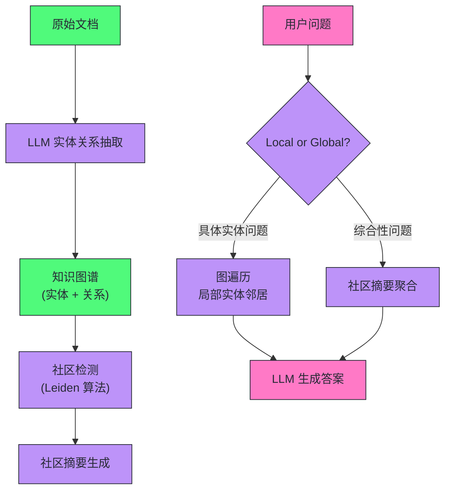
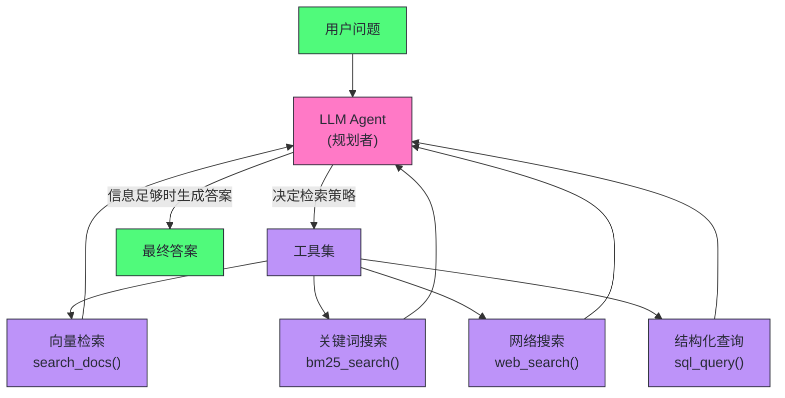
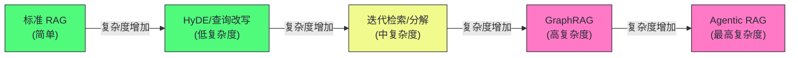

# 10 高级 RAG——查询改写、图谱检索与多跳推理

**摘要：**

标准 RAG（[[LLM/Agent技术/应用开发/09 RAG 架构——核心原理与工程实践]]）能稳定处理"单跳"问题——用户问题与某一段文档存在直接的语义对应时，一次检索、一次生成就够了。但现实中的复杂问题常常要跨文档、多步推理才能回答：比较性问题要分别找到双方的资料，聚合性问题要覆盖散落在几十份文档里的答案，多跳推理（"Y 的创始人曾就读于哪所大学"）要先定位中间实体再查它的属性。本文沿"高级 RAG"这条主线展开，先划清标准 RAG 在四类问题上的系统性失败边界，再从三个方向组织解法：**查询优化**（HyDE、查询改写、查询分解、Step-Back）解决"问得不对"，**检索优化**（迭代检索、GraphRAG 及其轻量继任者）解决"找得不全"，**生成与架构优化**（Self-RAG、CRAG、Agentic RAG）解决"用不好检索结果"。写作过程中核实了 2024-2025 年的关键演进：LazyGraphRAG 把图索引成本压到完整 GraphRAG 的 0.1%、LightRAG 与 Nano-GraphRAG 走出轻量开源路线、HyDE 的效果在强检索器时代受到系统性复现挑战、Deep Research 类产品把查询分解工业化。全文的落点是：**高级 RAG 不是一套技术替换另一套，而是按失败模式对症下药**，每种增强都有它的代价与适用前提。

> [!abstract] 专栏定位
> 本文是「Agent 技术」专栏的第 10 篇（全专栏共 21 篇正文），属于「应用开发」部分。上一篇 [[LLM/Agent技术/应用开发/09 RAG 架构——核心原理与工程实践|09 RAG 架构]] 讲清了标准 RAG 的全链路——解析、分块、嵌入、检索、重排、生成；本篇处理它的后继问题：当问题变复杂、标准检索不够用时，高级技术如何补位。下一篇 [[LLM/Agent技术/应用开发/11 Agent 核心能力——推理、规划与工具调用|11 Agent 核心能力]] 会把视野从"检索"扩展为 Agent 的推理、规划与工具调用三件事，届时 RAG 只是 Agent 工具箱里的一件工具。

---

## 第 1 章 标准 RAG 的局限

### 1.1 单跳检索的边界

上一章把 RAG 讲成了一条流水线：文档进来，解析、分块、嵌入、建索引；问题进来，检索、重排、拼 prompt、生成。这条流水线背后藏着一个隐含假设——**问题与答案之间，存在一段可以一次匹配上的文本**。这个假设在什么情况下不成立，是本章要划清的边界；它同时决定了后面几章每一种"高级"技术出现的原因。

标准 RAG 的检索模式是"一次检索"——将用户问题编码为向量，一次性从知识库中取回相关文档块，然后生成答案。这个模式对单跳问题效果很好，但在以下几类问题上会系统性失败：

**类型一：多跳推理问题**

问题："DeepMind 的创始人 Demis Hassabis 本科学的是什么专业？"

这需要两跳：第一跳找到"Demis Hassabis 是 DeepMind 创始人"，第二跳用 Demis Hassabis 的名字查他的教育背景。一次向量检索无法同时完成这两跳——如果直接用原问题检索，可能匹配到 DeepMind 公司介绍，其中并不包含 Hassabis 的本科专业。注意中间实体的位置：Demis Hassabis 既不出现在问题里，也不直接出现在答案里，它只在第一跳的检索结果中"涌现"出来，而一次检索返回的是与问题向量最近的快照，不是指向下一跳的指针。

**类型二：比较性问题**

问题："LLaMA 3 和 Mistral 7B 相比，哪个在代码生成任务上性能更好？"

这需要分别检索 LLaMA 3 和 Mistral 7B 的性能数据，再做比较。单次检索往往只能召回其中一个的信息，或者召回一个泛泛讨论两者的综述，而非精确的性能对比数据。

**类型三：聚合性问题**

问题："我们公司在 2024 年签署了哪些重要合同？"

答案分散在大量文档中，每个合同可能在不同的文件里。单次检索只能找到几个合同，无法保证覆盖所有相关文档——它本质上是在一个语义相似度排名上截取前 K 个，而聚合性问题的正确答案分布在整个语料里，前 K 名天然覆盖不全。

**类型四：查询与文档语言风格差距大**

用户问题："这个系统崩了怎么办"，文档里写的是"系统故障恢复操作流程"——语义相近但用词差距大。标准的向量检索相似度可能不够高，导致漏检。

单跳检索好比只拿一张地图问一次路——路人只能指一个方向。真要问清"那个人的老师当年在哪所学校读书"，你得先知道"那个人是谁"，才有办法开口问第二句；向量空间本身不分层，它只告诉你哪些坐标离你近，不告诉你坐标之间的因果。

### 1.2 从失败模式到分层演进

把上面的失败摊开看，可以归纳成五类模式：**查询表达不足**（问题太短、口语化、含指代，在向量空间里够不到任何文档）、**分块粒度不当**（答案横跨多个块，任何一块都不完整）、**信息分散**（答案散落在不同文档，一次 Top-K 取不齐）、**检索错误**（召回了语义相近但事实无关的内容）、**生成不加鉴别**（无论检索质量如何，都强行把检索结果当依据——噪声进，幻觉出）。第五类最隐蔽，它在检索一切正常时也会发生，是 09 篇没来得及展开的雷区，第 5 章的 Self-RAG 与 CRAG 专门处理它。

Gao 等人的 RAG 综述（2023）据此把 RAG 的发展划成三代：**Naive RAG**（论文原初形态，检索-拼接-生成三件套）、**Advanced RAG**（针对检索前与检索后的工程化增强，重排、混合搜索、查询改写都属于这一代）、**Modular RAG**（把 RAG 拆成可编排的独立模块，允许检索器、生成器、路由、记忆按需组合）。本篇讲的高级技术横跨后两代，读的时候不妨带着一个问题：每种技术究竟在修补五类失败模式里的哪一类？带着这个问题往下读，你会发现所有高级 RAG 技术都能对号入座。

### 1.3 高级 RAG 的解法分类

针对上述局限，高级 RAG 技术从四个方向突破：

| 方向 | 代表技术 | 解决的问题 |
| :--- | :--- | :--- |
| **查询优化** | HyDE, 查询改写, 查询分解 | 提升查询向量与文档的匹配度 |
| **检索优化** | 多向量检索, 迭代检索, GraphRAG | 多跳、聚合、关系型问题 |
| **生成优化** | Self-RAG, CRAG | 自我评估检索质量，减少幻觉 |
| **架构优化** | Agentic RAG | 动态规划检索策略 |

四个方向层层递进：查询优化在"入口"改善提问质量，检索优化在"过程"扩大信息获取范围，生成优化在"出口"把关答案质量，架构优化则把前三者从固定的预设规则升级为运行时的动态决策。

---

## 第 2 章 查询优化——让检索找得更准

### 2.1 HyDE——假设性文档嵌入

**HyDE（Hypothetical Document Embedding，假设性文档嵌入）**（Gao et al., 2023）基于一个深刻的观察：**用户的问题（短句疑问）和文档内容（陈述段落）之间存在语言风格鸿沟**，这导致两者的 Embedding 向量在空间中不够接近，即使语义相关。

HyDE 的解法非常优雅：

1. 用 LLM 根据用户问题**生成一个假设性的答案**（即使这个答案可能不准确）
2. 对这个假设答案做 Embedding，用它来检索知识库
3. 用检索到的真实文档生成最终答案

核心逻辑是：假设答案和真实文档都是"陈述性文本"，语言风格一致，它们的 Embedding 向量比"问句"和"陈述"更接近。

```
用户问题: "苹果公司的 Vision Pro 头显的分辨率是多少？"

假设答案 (LLM生成): 
"Apple Vision Pro 采用了 micro-OLED 显示技术，每只眼睛的分辨率
高达 3840×2160 像素（即 4K），总像素数超过 2300 万..."

→ 用假设答案的 Embedding 检索 → 找到包含精确分辨率数据的文档块
→ 用真实文档生成最终答案
```

HyDE 论文的设计其实由两步组成：第一步，用零样本 prompt 让指令遵循模型生成假设文档——它捕捉的是"与问题相关的文档长什么样"的相关性模式（Relevance Pattern），而不是事实本身；第二步，用无监督对比学习编码器（论文里是 Contriever）给假设文档做嵌入——**编码器的稠密瓶颈会把假设文档里的幻觉细节过滤掉**，只留下与语料空间接近的方向。打个比方，假设答案像一张素描像，不必精确，只要神似，就能在照片库里圈出正确的候选；检索质量来自"风格与主题相近"，不来自"事实正确"。

> [!warning] 生产避坑
> HyDE 需要额外一次 LLM 调用来生成假设答案，会增加约 300-500ms 的额外延迟和相应成本。在对延迟敏感的场景，需要权衡检索质量提升与延迟代价。建议仅对初始检索相似度较低的查询启用 HyDE，高置信度的查询直接用原始问题检索。

HyDE 的适用性在 2023 年之后被系统性复现研究打上问号。Ma 等人（2023）横跨 11 种生成式扩展技术、12 个分布漂移的数据集与 24 个检索模型做对照，得到一个与直觉相反的结论：**扩展增益与检索器性能负相关**——扩展能救弱检索器，但往往干扰强检索器，因为扩展带来的额外信息在提升召回的同时也引入了噪声，让排序前端的真正相关文档被淹没。HyDE 正是生成式扩展的一种，逃不出这条规律。2024 年 MTEB 榜首的强嵌入模型（e5-mistral、Linq-Embed-Mistral 一代）出现后，"简单查询 + 强检索器"在不少基准上不输甚至胜过"HyDE + 中等检索器"，社区对 HyDE 的态度也从论文发布时的追捧转向审慎。笔者的判断是：HyDE 的适用前提可以概括为三条——检索器偏弱或查询-文档领域差距大（论文原始场景）、查询是事实型而非多跳型（一次假设文档覆盖不了两步推理）、不苛求端到端延迟；对型号、人名、编号这类精确匹配场景，假设答案反而可能把检索引向错误的事实邻居。

### 2.2 查询改写（Query Rewriting）

查询改写通过 LLM 对用户的原始问题进行**语言层面的优化**，使其更适合向量检索。

常见的改写策略：

**去除歧义**：用户问"怎么连这个"，改写为"如何连接数据库（根据上下文判断）"。

**扩展同义词**：用户问"这玩意儿的价格"，改写为"产品定价/售价/费用"，提升召回率。

**规范化术语**：用户用口语或缩写提问，改写为知识库中使用的标准术语（"CI/CD 流水线"→"持续集成/持续部署流程"）。

实现上，可以用一个简单的 prompt 让 LLM 完成改写：

```
你是一个搜索查询优化专家。将以下用户问题改写为更适合文档检索的形式，
使用更规范的技术术语，避免代词和模糊表达。只输出改写后的查询，不要解释。

用户问题: {user_question}
改写后的查询:
```

查询改写在工程上还有一层容易被忽略的职责：**指代消解（Coreference Resolution）**。多轮对话里用户说"那它呢"，脱离了上一轮的上下文，检索器完全不知道"它"是谁——改写阶段必须把指代还原成具体的实体。这与第 6 章的 Agentic RAG 形成分工：Agent 负责决定"要不要再问一次"，查询改写负责让"这一次"问得更准。

查询改写本质上是用一次 LLM 调用换检索质量，它同样会引入偏差——LLM 对领域术语理解不准时，改写后的查询可能比原问题更偏，而且这种偏差是隐性的，不对比很难发现。稳妥的做法是**保留原查询与改写查询并行检索、按融合分数取结果**，或对比改写前后两次检索的置信度，让差的改写能被系统识别出来而不是悄悄生效。一句话：把改写当作一种"候选查询生成"，而不是对原查询的替代。

### 2.3 查询分解（Query Decomposition）

对于复杂的多跳或比较性问题，先将原始问题**分解为多个简单的子问题**，分别检索，最后综合答案。

```
原始问题: "LLaMA 3 和 GPT-4 相比，在多语言推理能力上有何异同？"

分解后:
子问题1: "LLaMA 3 的多语言能力如何？支持哪些语言？"
子问题2: "GPT-4 的多语言推理能力如何？"
子问题3: "LLaMA 3 和 GPT-4 的多语言基准测试对比结果"
```

三个子问题分别检索，各自获取相关文档块，最后合并所有检索结果，用一次 LLM 调用综合生成对比答案。

**LLM Decomposer Prompt**：

```
将以下复杂问题分解为 2-4 个独立的、可以通过文档检索直接回答的简单子问题。
子问题应该覆盖原问题的所有方面，且每个子问题都可以独立检索。
以JSON数组格式输出: ["子问题1", "子问题2", ...]

原始问题: {question}
```

查询分解有一个关键前提：**子问题之间相互独立**。比较性问题的两个分支互不依赖，可以并行检索，把串行延迟摊平成单次；但一旦子问题之间存在依赖（先知道 A 才能问 B），分解就退化成串行——这一步已经跨进第 3 章迭代检索的地界。所以查询分解与迭代检索的分工可以概括为：能并行就分解，必须串行就迭代。

### 2.4 Step-Back Prompting——抽象上移

**Step-Back Prompting**（Zheng et al., 2023）针对的是一类"过于具体"的问题——用户问的是一个非常具体的实例，而知识库中的文档更多描述的是通用原理。

例如，用户问"当 AWS Lambda 函数内存设置为 256MB 时，Python 的 GC（垃圾回收）是否会显著影响执行时间"——这个问题非常具体，直接检索可能找不到完全对应的文档。

Step-Back 先让 LLM 将这个具体问题"抽象上移"一步："Python 垃圾回收机制对函数执行时间的影响"——这个更通用的问题更容易在文档中找到匹配内容。

检索步骤：
1. 用 Step-Back 问题检索（获取通用原理文档）
2. 同时用原始问题检索（获取具体场景文档，如果有的话）
3. 将两种检索结果合并，让 LLM 综合回答原始具体问题

Step-Back 的命名很贴切——它退后一步（Step Back）看全局，先找到普遍规律，再回到具体实例。它的边界也很清楚：只适用于"通用原理 + 具体实例"的知识结构，如果知识库里连通用原理都没有，退后一步同样一无所获。

### 2.5 查询分解的工业化：Deep Research 类产品

查询分解最出圈的落地形态，是 2025 年各大厂商押注的 Deep Research 类产品。OpenAI 在 2025 年 2 月把 deep research 放进 ChatGPT：它把一个高层问题先规划成多步研究轨迹，再逐段搜索、阅读、回溯，最终合成带引用的研究报告，单次任务耗时 5-30 分钟；在 API 层面，o3-deep-research、o4-mini-deep-research 两个模型把 web search、远程 MCP server、向量库 file search、代码执行打包成可用工具，输出里完整暴露 web_search_call（search/open_page/find_in_page）等中间动作——也就是说，"分解"不再是一次性的离线预处理，而是每一步都由模型动态决定的在线决策，中间步骤全部留痕、可审计。

Google 的 Gemini Deep Research 走的是同一条路：先把问题拆成一份可编辑的研究计划（plan），由模型逐个子任务执行、迭代搜索，2025 年随 Gemini 3 的迭代把规划与搜索的强化学习训练推到新高度，并配套开源了 DeepSearchQA 评测基准。这类产品对查询分解的工程启示有三点：**分解要可被用户审阅**（计划先行，用户能在执行前修改方向）、**分解要可回溯**（中间步骤与引用留痕，答案可验证）、**分解要能根据搜索结果动态修正**（而不是死板地执行预设子问题）。回头看 2.3 节的静态分解，它更像 Deep Research 的"离线简化版"——同一个思想，从一次性预处理进化成了 Agent 循环里的决策单元。

---

## 第 3 章 迭代检索——多轮信息补充

### 3.1 为什么需要迭代检索

单次检索假设用户问题能一次性获取所有需要的信息。但在多跳推理场景中，第二次检索的查询往往依赖于第一次检索的结果——在获取中间信息之前，你甚至不知道第二步需要检索什么。

上一章已经埋下伏笔：查询分解要求子问题相互独立，但多跳推理的中间信息是"涌现"的——第二次检索该搜什么，取决于第一次检索回了什么。在拿到中间实体之前，你甚至不知道下一步该问什么。这就把"离线规划"逼成了"在线循环"：检索 → 推理 → 再检索，直到信息足够。

**迭代检索**（也叫 Iterative RAG 或 Multi-hop RAG）通过多轮"检索→推理→再检索"的循环，逐步补充解题所需的信息。这个过程好比顺藤摸瓜——摸到瓜蔓上第一个节点，才知道下一根藤往哪个方向长，站在地头一次性规划完整条藤的走向是做不到的。

### 3.2 IRCoT——交错推理与检索

**IRCoT（Interleaving Retrieval with Chain-of-Thought Reasoning）**（Trivedi et al., 2022）是迭代检索的代表性方法。

流程：

1. 用 LLM 开始推理过程（生成 CoT 的第一步）
2. 将当前推理步骤作为新的检索查询，检索补充信息
3. 将检索结果加入上下文，继续推理下一步
4. 重复 2-3，直到推理完成得出最终答案

```
问题: "Demis Hassabis 本科就读于哪所大学？"

第1步推理: "要回答这个问题，我需要先知道 Demis Hassabis 是谁。"
检索: ["Demis Hassabis"] → 得到: "Demis Hassabis 是 DeepMind 联合创始人和 CEO..."

第2步推理: "知道了 Hassabis 是 DeepMind 创始人，现在查他的教育背景。"
检索: ["Demis Hassabis 教育背景 大学"] → 得到: "Hassabis 毕业于剑桥大学国王学院..."

第3步推理: "根据检索结果，Demis Hassabis 本科就读于剑桥大学国王学院。"
最终答案: "剑桥大学国王学院"
```

IRCoT 的关键设计是：**每一步的推理文本就是下一步的检索查询**——CoT 推理过程自然地引导了检索方向，不需要额外的查询规划模块。论文的对照实验显示，交错（Interleave）优于"先推理完再统一检索"（CoT-then-Retrieve）——因为中途检索会及时纠正推理的方向偏差，而事后统一检索往往已经跑偏。后续的 IRCoT+ 进一步用自洽性（Self-Consistency）采样多条推理路径，对最终答案投票，把单一路径的偶然错误摊平。

### 3.3 Self-Ask——另一条串行路线

与 IRCoT 几乎同时出现的 Self-Ask（Press et al., 2022）换了个问法：不让推理文本直接当查询，而是让模型显式生成中间问题（Follow-up Question），逐个检索、逐个回答，最后把中间答案汇总成最终答案。它与查询分解的区别在于：查询分解是离线一次规划、子问题并行检索；Self-Ask 是模型在生成过程中动态抛出问题、严格串行。

| 维度 | 查询分解 | Self-Ask | IRCoT |
| :--- | :--- | :--- | :--- |
| 规划时机 | 离线一次规划 | 在线动态生成 | 在线隐式生成 |
| 子问题形式 | 显式问题列表 | 显式中间问题 | 推理文本即查询 |
| 执行方式 | 可并行 | 串行 | 串行 |
| 可审计性 | 高 | 高 | 低（查询是推理的副产品） |
| 延迟 | 摊平为单次 | 多轮累积 | 多轮累积 |

相较之下，Self-Ask 的中间问题是显式的、可审计的，代价是多轮串行带来的延迟；IRCoT 省掉了"构造问题"这一步，更省 token，但中间查询难以解释。工程上按"是否需要审计中间问题"来选，需要可解释性就 Self-Ask，追求成本就用 IRCoT。

### 3.4 迭代检索的代价与边界

迭代检索把"检索次数"从常数变成了变量，这既是它的灵活性，也是它的不确定性来源。三个生产约束值得留意。其一，**轮数必须设上限**——LLM 判定"信息已足够"不可完全信任，超时或超轮强制收敛比无限循环体面。其二，**早停要可判**——可以让模型在每轮结束输出一个"信息充分性"评分，低于阈值才继续检索，这相当于把第 5 章 Self-RAG 的检索决策偷师过来。其三，**知识库覆盖不足时，迭代再多轮也是白转**——此时该触发的是网络搜索扩展（CRAG 的兜底），而不是继续在本库内打转。迭代检索解决的是"信息分散但存在"的问题，解决不了"信息根本不存在"的问题，这个边界要记牢。

另外，IRCoT 类方法的代价还包括上下文污染：每一轮的检索结果都堆在同一个上下文窗口里，前几轮的噪声块会稀释后续推理的注意力；轮数一多，token 消耗和延迟同步上涨，推理链中任何一步的错误都会向下游传播。所以迭代检索与查询分解不是互斥的——实践中常把两者叠用：外层分解出多个相对独立的子任务，每个子任务内部用短链迭代。

---

## 第 4 章 GraphRAG——知识图谱增强检索

### 4.1 标准 RAG 对关系型信息的盲点

向量检索擅长找语义相似的"段落"，但它对**实体间的关系和图结构信息**是盲的。

考虑这样一个问题："找出所有与张三有过合作关系的公司的 CEO"——这是一个典型的图查询：从张三出发，沿着"合作关系"边找到公司，再从公司沿着"CEO"边找到人。向量数据库只能存储文本块，无法直接表达和查询这种结构化的实体关系网络。

不妨想象两套材料：一叠景点照片，和一张城市地铁图。照片能认出"这座山"，却看不出"这座山和那座山之间有没有公路"；地铁图恰恰相反，把线路、换乘站、站点之间的连接关系画得清清楚楚。向量库是前者，知识图谱是后者——**GraphRAG** 通过构建**知识图谱（Knowledge Graph）** 把后者引入 RAG，弥补向量检索对关系结构的盲区。

### 4.2 Microsoft GraphRAG

把图与 RAG 结合的方案里，最有影响力的是 Microsoft Research 在 2024 年发布的 **GraphRAG**（Edge et al., 2024）。它的时间线值得记一笔：2024 年 2 月以博客形式提出概念，4 月挂出论文《From Local to Global: A Graph RAG Approach to Query-Focused Summarization》，7 月 2 日正式开源到 GitHub；发布时的实验显示，在全面性（Comprehensiveness）与多样性（Diversity）两个维度上，GraphRAG 对朴素 RAG 的胜率约在 70%-80%。

**离线索引阶段**：

1. **实体和关系抽取**：用 LLM 对每个文档块进行信息抽取，提取实体（人名/组织/地点/概念）和实体间的关系（"张三 —— 就职于 ——> 阿里巴巴"）
2. **图构建**：将所有文档中抽取的实体和关系合并，构建一个大型知识图谱
3. **社区检测**：用图算法（如 Leiden 算法）对知识图谱中的实体进行聚类，找到关联紧密的"社区"（如一个研究领域、一个公司生态）
4. **社区摘要**：用 LLM 为每个社区生成一段摘要描述

**在线检索阶段**：

- **Local Search**（局部搜索）：用于具体实体的问题。先在图中找到相关实体，获取其直接邻居和关系，再结合原始文本块回答
- **Global Search**（全局搜索）：用于跨文档的综合性问题（如"这个语料库主要讲什么主题"）。扫描所有社区的摘要，聚合生成宏观答案



索引阶段最关键的步骤是社区检测——用 Leiden 算法对实体图做层次化聚类，把紧密相连的节点分成社区，再用 map-reduce 式的 LLM 摘要给每个社区写一段总结。这一步的巧妙之处在于：它让语料库在"被提问之前"就有了结构化的全局视图，Global Search 回答"这个语料库主要讲什么"这类问题时，不需要翻遍全文，只要把社区摘要逐层聚合即可。2024 年 10 月推出的 **DRIFT Search** 则是 Local 与 Global 的混合体：先用社区摘要给一个宽泛的初步答案，再沿着图谱做局部细化，试图用更少的查询成本拿到接近 Global 的质量。

### 4.3 GraphRAG 的工程代价

GraphRAG 的能力强大，但工程代价也很高：

- **索引成本高**：实体抽取需要对每个文档块调用 LLM，一个大型知识库（10 万块）的索引可能需要数百到数千次 LLM 调用和相应费用
- **图的维护复杂**：文档更新时，需要重新抽取变更文档的实体和关系，并更新图结构
- **查询延迟高**：Global Search 需要聚合大量社区摘要，可能需要多次 LLM 调用

成本的量级可以更具体地感受一下。微软官方的成本分析文章以《绿野仙踪》这样一本几十万词的书为例：向量化全文只花约 0.0056 美元，而建图的 token 消耗高出几个数量级——差距不在同一个量级上，这正是 GraphRAG 让很多团队望而却步的原因。适用场景也因此收敛为：知识库规模适中（数百到数千个文档）、关系型信息丰富（如医学/法律/企业组织知识库）、对综合性问题的回答质量要求高。到 2025 年，官方仓库已明确进入维护模式——不再接受新特性 PR，只做缺陷修复与依赖更新，技术沉淀进 Microsoft Discovery 与 Azure 等服务。图增强 RAG 从"学术明星"转入"产品化的前半段"，轻量化的接力棒交给了下一节。

### 4.4 LazyGraphRAG——把摘要推迟到查询期

微软在 2024 年 11 月 25 日发布的 **LazyGraphRAG**，把上一节的成本结构整个翻转过来。它的核心思想是延迟摘要（Deferred Summarization）：**索引期完全不生成社区摘要**，索引只做两件事——嵌入文本块，以及用名词短语抽取与共现统计构建概念图（纯 NLP 统计，不调用 LLM）。由此索引成本降到与纯向量 RAG 相同，等于完整 GraphRAG 的 0.1%。

摘要没有消失，只是挪到了查询期。查询到来时，LLM 把问题展开成子查询，在概念图上匹配，候选块按嵌入相似度与社区结构排序，再由低成本 LLM 对排名靠前的块做句子级相关性检验——整个搜索沿社区层次做迭代深化，没有产出的分支直接剪掉，最后把命中的相关片段提取、排序、合成答案。一个相关性预算（Relevance Budget）参数统一控制"每查询做多少次 LLM 相关性检验"：预算 100 时查询成本约等于标准向量 RAG，预算 500 或 1500 则买到更高质量的答案。官方报告里，同样的配置在全局查询上达到与 GraphRAG Global Search 相当的质量，而查询成本低 700 倍以上；只用 Global 4% 的查询成本，就能在局部与全局两类查询上全面超过对比方法。2025 年 6 月起，LazyGraphRAG 集成进 Microsoft Discovery 与 Azure Local 的公共预览。

这笔交易的本质是**把索引成本转嫁给查询延迟**——它不再为"从未被问到的内容"预先花钱，适合交互式问答；而完整 GraphRAG 仍然适合对响应时间不敏感、需要一次性全局分析的批处理场景。LazyGraphRAG 的取舍，恰恰说明图检索没有免费的午餐：摘要的"勤快"与"懒惰"，换来的是两条完全不同的成本曲线。

### 4.5 LightRAG 与 Nano-GraphRAG——轻量开源路线

开源社区在同一时期给出了另一条路线：不要复杂的社区层次，只要"图 + 向量"双索引。香港大学团队的 **LightRAG**（2024 年 10 月挂出论文，后收入 EMNLP 2025）是其中代表：它同时维护知识图谱与向量索引，检索时分两级——低级检索（Low-level）抓实体级事实，高级检索（High-level）抓主题级概念——并配了增量更新算法，新文档进来只更新相关子图，不用全量重建。论文强调它即使配 30B 量级的开源模型也能保持质量，GitHub 上星标增长极快，到本稿检索时已约 4 万。

另一个极端是 **Nano-GraphRAG**：一个剔除测试与提示词后约 1100 行代码的 GraphRAG 实现，异步、强类型、可换 faiss/neo4j/ollama 后端，定位是"能读懂、能改"的教学与轻量实现。下表把四条路线放在一起对比：

| 方案 | 索引方式 | 检索方式 | 索引成本 | 查询成本/延迟 | 适用场景 |
| :--- | :--- | :--- | :--- | :--- | :--- |
| **GraphRAG** | LLM 抽取实体关系 + 社区摘要 | Local / Global / DRIFT | 高 | 高（Global 秒级） | 离线全局分析、叙事语料 |
| **LazyGraphRAG** | 嵌入 + 概念图（无生成） | 概念图 + 迭代相关性检验 | 低（≈向量 RAG） | 中（预算参数可调） | 交互式问答 |
| **LightRAG** | 图 + 向量双索引 | 低级 / 高级双级检索 | 中 | 低 | 垂直领域知识库、增量更新频繁 |
| **Nano-GraphRAG** | 简化图索引 | Local / Global | 低 | 低 | 学习、原型、小规模 |

### 4.6 轻量级知识图谱方案

对于不需要完整 GraphRAG 的场景，可以用更轻量级的方案：

**属性图 + 向量混合查询**：将知识库文档的结构化元数据（作者、日期、部门、标签、文档间的引用关系）建模为图，用图查询过滤候选集，再用向量检索精排。

**LlamaIndex Property Graph**：LlamaIndex 提供了 Property Graph Index，支持在图上进行向量+关键词+图路径的混合检索，是 GraphRAG 的工程化实现。

这两类方案都不做实体抽取与社区摘要，因此没有 GraphRAG 的索引成本，代价是关系结构只覆盖"元数据层面"，无法表达文档内容里深层的实体关系——对"张三与哪些公司有过合作"这类问题无能为力。选哪条路，本质上是"关系信息的价值"与"图构建的成本"之间的权衡。

---

## 第 5 章 Self-RAG——自我反思的检索生成

### 5.1 标准 RAG 的"不加鉴别"问题

标准 RAG 不管检索质量如何，都会将检索到的文档块塞进 prompt 让 LLM 生成答案——即使检索结果与问题无关，或者检索结果互相矛盾。更糟糕的是，有些问题根本不需要检索（如"1+1=?"），强制检索只会引入噪音。

普通 RAG 像个交卷前从不检查的学生——检索到什么就拼什么，哪怕检索结果与问题无关、互相矛盾，也照单全收。**不加鉴别的检索，是 RAG 幻觉的第二来源**：第一来源是模型本身的参数知识，第二来源就是喂进去的劣质证据。09 篇把幻觉归因于模型，这里要补上另一半：即使模型完全可靠，检索侧的错误证据照样能诱导出错误答案。

**Self-RAG**（Asai et al., 2023）通过引入**反思 token（Reflection Token）** 让模型学会自主决定：是否需要检索？检索结果有没有用？生成的答案是否基于了检索内容？

### 5.2 Self-RAG 的反思机制

Self-RAG 训练模型在生成过程中输出四类特殊的"反思 token"：

| 反思 Token | 含义 | 可能值 |
| :--- | :--- | :--- |
| **Retrieve** | 是否需要检索 | `[Retrieve]` / `[No Retrieve]` |
| **ISREL** | 检索结果是否相关 | `[Relevant]` / `[Irrelevant]` |
| **ISSUP** | 生成内容是否有文档支持 | `[Fully supported]` / `[Partially supported]` / `[No support]` |
| **ISUSE** | 生成内容是否有用 | 评分 1-5 |

生成流程：

1. 模型生成 `[Retrieve]` → 触发检索，获取文档块
2. 模型生成 `[Relevant]` → 继续生成，利用文档块
3. 模型生成每个句子后，输出 `[Fully supported]` → 该句子有可信的文档支持
4. 最后输出 `[ISUSE: 5]` → 整体答案质量高

如果模型判断检索结果 `[Irrelevant]`，则重新检索或直接基于自身知识回答。

注意这四类 token 的分工：Retrieve 解决"要不要检索"，ISREL 解决"检索结果要不要用"，ISSUP 解决"生成的句子有没有依据"，ISUSE 解决"整段答案好不好用"——从检索决策到生成质检，覆盖了 RAG 的两个阶段。训练侧，论文用 GPT-4 为语料标注反思 token，再通过带 token 级奖励的强化学习在开放模型上微调，这让完整版 Self-RAG 很难被直接套用——绝大多数团队不会为检索反思专门训练一个模型。但它的思想可以降级使用，见 5.4 节。

### 5.3 CRAG——纠正性 RAG

**CRAG（Corrective RAG）**（Yan et al., 2024）是 Self-RAG 的工程化简化版。它引入一个轻量级的**检索评估器**（Retrieval Evaluator）对检索结果进行质量评分，根据评分触发不同的策略：

- **Correct（高置信）**：检索结果相关，直接使用
- **Incorrect（低置信）**：检索结果不可信，触发网络搜索作为补充（如调用 Tavily/Bing Search API）
- **Ambiguous（中等）**：部分相关，对检索结果进行精炼（Knowledge Refinement），过滤掉不相关的句子

CRAG 的核心价值是引入了"退化检索"机制——当本地知识库检索不到足够相关的信息时，自动扩展到网络搜索，确保每次查询都能获取高质量的参考信息。

CRAG 论文（Yan et al., arXiv 2401.15884）的工程细节值得展开：检索评估器基于 T5-large 微调，对"查询-文档"对打分后映射为上述三档置信度；Incorrect 分支把检索词重写后交给外部搜索 API，拿回的结果再走一遍评估，避免"补进来的还是噪声"；Ambiguous 分支执行 decompose-then-recompose——把文档按段落拆开，逐段过滤与问题无关的句子，再重新组合，保住关键信息、剔掉噪声。整个模块是插拔式的，可以直接接在任意 RAG 流水线的检索与生成之间。

### 5.4 自我评估的工程落地

不动手训练模型，也能把"鉴别"装进 RAG 流水线，三种近似方案按投入递增排列。其一，**阈值兜底**：检索结果最高相似度低于阈值（如 0.5）时直接拒答或降级，这是成本最低的一道闸门，09 篇 9.2 节提过。其二，**LLM-as-judge**：让一个轻量模型对检索结果打分（"这些文档与问题相关吗？评 1-5"），低分触发重检索或网络搜索——这相当于 CRAG 评估器在无监督训练条件下的替代品，实现成本只有一段 prompt。其三，**评估驱动**：用 RAGAS 的 Context Precision 类指标在代表性问题集上持续跟踪"检索结果中有多少真正相关"，把检索质量恶化提前暴露在监控里，而不是等用户投诉。三种方案可以叠加，它们共同的原则是：**检索质量不是生成质量的附属品，而是一等公民，必须被显式度量与决策**。这层"鉴别"补上之后，第 6 章的 Agentic RAG 才有了可靠的反馈信号——Agent 判断"信息是否足够"时，靠的就是这类评估器。

---

## 第 6 章 Agentic RAG——让 RAG 拥有自主规划能力

### 6.1 从流水线到 Agent

标准 RAG 是一个固定流水线：解析→分块→Embedding→检索→生成。无论问题多复杂，流程都是一样的。而高级 RAG 的各种技术（HyDE、查询分解、迭代检索）试图通过预设的规则来处理不同类型的问题。

前面几章的高级技术有一个共同点：它们都是"预设规则"——在系统外把改写、分解、迭代、鉴别写好，系统照着规则执行。**Agentic RAG** 走向了不同的路径：**将 LLM 本身作为规划者，让它自主决定如何检索、检索什么、是否需要多轮检索**。在 Modular RAG 的分层里，这是把"编排"从静态 DAG 换成了动态决策。它回答的问题是：当失败模式多到预设规则写不过来时，把规则交给模型。从装配线到独立作业的工程师，这是 RAG 系统角色的一次转变——工人（流水线）变成了工程师（Agent），前者按图纸干活，后者自己画图纸。

### 6.2 RAG 作为工具的 Agent 架构

在 Agentic RAG 中，知识库检索只是 Agent 的工具之一。Agent（使用 [[LLM/Agent技术/应用开发/11 Agent 核心能力——推理、规划与工具调用]] 中的 ReAct 架构）会：

1. **分析问题**：判断问题类型（单跳/多跳/比较/聚合）
2. **选择工具**：是用向量检索还是关键词搜索？是查本地知识库还是联网搜索？
3. **执行检索**：调用选定的检索工具
4. **评估结果**：判断检索结果是否足够回答问题
5. **迭代**：如果信息不足，规划下一步检索（改写查询、选择不同工具）
6. **综合回答**：信息足够时生成最终答案



这个架构里隐含了一个关键组件——**路由（Router）**：Agent 每轮都要判断"该用哪个工具"，这个判断本身也是一次 LLM 调用；检索工具则应返回结构化结果与来源，便于 Agent 与用户双方审计。灵活性的另一面随之而来：这种架构能处理任意复杂的问题——但也带来了不确定性（Agent 的规划路径不可完全预测）和成本（多轮 LLM 调用）。

### 6.3 ReAct + RAG：完整示例

以下展示 Agentic RAG 在处理复杂问题时的推理链：

```
用户: "比较一下 2024 年我们公司在上海和北京两个城市的销售额，
       并分析主要差异原因"

Thought: 这是一个比较性+聚合性问题，需要分别查询上海和北京的销售数据，
         还需要分析差异原因，可能涉及多个文档。

Action: search_docs(query="2024年上海销售额", filters={"year": 2024, "city": "上海"})
Observation: [文档块1: 上海Q1销售额1.2亿, Q2 1.5亿...] [文档块2: 上海年度报告...]

Action: search_docs(query="2024年北京销售额", filters={"year": 2024, "city": "北京"})
Observation: [文档块3: 北京Q1销售额0.9亿, Q2 1.1亿...] [文档块4: 北京年度报告...]

Thought: 有了两城市的数量数据。上海全年约5.8亿，北京约4.3亿，上海高出35%。
         需要查差异原因分析。

Action: search_docs(query="上海北京销售差异 原因 2024")
Observation: [文档块5: 分析报告——上海区域拥有更多旗舰门店和大客户资源...]

Thought: 现在有足够的信息来综合回答了。

Final Answer: 2024年上海销售额约5.8亿，北京约4.3亿，上海高出约35%。
主要差异原因：1. 上海门店数量更多（18家 vs 北京12家）；
2. 上海大客户占比更高（52% vs 北京38%）；3. 华东区市场容量更大...
```

这个例子把第 2、3 章的技术全部"吸收"进了 Agent 的行为：Thought 里隐式完成了查询分解（上海/北京/差异原因三个子问题），两次平行的 search_docs 是并行检索，第三次检索是迭代补充——区别在于这些动作不是预设规则触发的，而是模型在运行时自己规划的。

### 6.4 Agentic RAG 的生产边界

Agentic RAG 的灵活性不是免费的。2025 年初的综述（arXiv 2501.09136）把它的主要挑战归纳为：多 Agent 协调的复杂度、规模化与延迟、专门评估基准的缺失，以及幻觉与安全责任的可追溯性。生产一线的教训更直接——Salesforce 等团队在复盘 Agentic/RAG 生产失败时反复强调：这类系统首先是分布式软件系统，其次才是 AI 系统；裸的 ReAct 循环在并发与故障面前是脆弱的，生产实现通常要退回到状态机或 DAG 编排（LangGraph 等），并用 LLM-as-judge 做路径选择、把检索到生成的全链路打进可观测性平台（Langfuse、Opik 一类）。

笔者的建议是：**Agentic RAG 是增量不是默认值**——当查询类型可以枚举、失败模式可以用预设规则覆盖时，固定流水线或路由型 RAG 更便宜、更可预测；当查询空间开放、需要动态组合多个数据源时，才值得把编排交给 Agent。这与 Anthropic 在 Agent 构建指南里"能用 Workflow 就不要上 Agent"的建议一脉相承——灵活性是买来的，买的时候要想清楚为谁、为什么付钱。

---

## 第 7 章 RAG 的进阶工程实践

### 7.1 多向量检索（Multi-Vector Retrieval）

**多向量检索**为每个文档块生成多个 Embedding，从不同角度捕捉文档的语义。

**ColBERT**：不同于单向量 Embedding（整个文档块→一个向量），ColBERT 为文档中的每个 token 生成一个向量。检索时，计算查询 token 向量集与文档 token 向量集之间的最大相似度之和（MaxSim），精度远高于单向量。代价是存储量和检索复杂度大幅增加。后续的 ColBERTv2 通过残差压缩与 PLAID 索引把存储开销压了下来，但"每个 token 一个向量"的代价结构没有根本改变——它更适合对精度敏感、规模可控的场景。

**Summary + Chunk**：为每个文档块同时存储两个 Embedding：一个是原始块的 Embedding，另一个是 LLM 生成的该块摘要的 Embedding。检索时两个 Embedding 都参与相似度计算，取更高分。这能同时捕捉"词汇层面的精确匹配"和"语义层面的主题匹配"。

**Parent + Child**：在 [[LLM/Agent技术/应用开发/09 RAG 架构——核心原理与工程实践]] 的小到大检索基础上，为父块（大）和子块（小）分别建立 Embedding 索引。检索时对子块精确定位，返回父块的完整上下文。

### 7.2 Contextual Retrieval（Anthropic, 2024）

Anthropic 在 2024 年 9 月提出了 **Contextual Retrieval** 技术——在分块和 Embedding 之前，先用 LLM 为每个文档块生成一段**上下文说明**，解释该块在整个文档中的位置和作用，然后将上下文说明拼接在文档块前面再做 Embedding。

```
原始块:
"该功能需要管理员权限才能使用。配置方法见第3章。"

上下文说明 (LLM生成):
"这段文字来自《用户权限管理手册》第5章，讨论的是超级管理员功能的访问控制..."

拼接后索引:
"这段文字来自《用户权限管理手册》第5章，讨论的是超级管理员功能的访问控制...
该功能需要管理员权限才能使用。配置方法见第3章。"
```

它处理的是分块的老问题：孤立的块丢失了上下文（代词、省略的主语），嵌入向量携带的语义不完整。这就像给一张从相册里剪下来的照片补一句"拍摄于 2019 年青海湖"——照片本身没变，但它从此有了能被检索到的位置感。Anthropic 官方评测跨代码库、小说、学术论文等语料，仅 Contextual Embeddings 一项就把 Top-20 检索失败率从 5.7% 压到 3.7%（降幅 35%），叠加 Contextual BM25 后降幅达 49%，再加一层重排则到 67%。成本侧，批量生成上下文说明时用 Prompt Caching 可以把 token 开销压低近一半。它和 09 篇的小到大检索互补：一个补"块的上下文"，一个补"块的粒度"。

### 7.3 Fusion RAG——多查询结果融合

**RAG Fusion**（Rackauckas, 2023）的思路：
1. 用 LLM 对原始问题生成 4-5 个**多角度的变体查询**
2. 对每个变体查询分别检索（返回 Top-10）
3. 用 RRF 融合所有查询的检索结果
4. 取融合后的 Top-5 输入 LLM 生成答案

多角度查询通过覆盖不同的表达方式和关注点，显著提升了召回率——即使原始查询某个角度检索不到，其他角度的变体查询可能成功检索。它与 2.2 节查询改写的区别值得点明：改写追求"把一个问题问得更准"，Fusion 追求"从多个角度同时问"——前者是收敛，后者是发散，两者的失败模式也因此不同：改写失败时检索结果整体偏移，Fusion 至少还有原始查询垫底。

---

## 第 8 章 选择合适的高级 RAG 技术

### 8.1 问题类型 × 技术匹配

| 问题类型 | 推荐技术 | 理由 |
| :--- | :--- | :--- |
| 查询-文档语言风格差异大 | HyDE、查询改写 | 弥合语言鸿沟 |
| 复杂多部分问题 | 查询分解、RAG Fusion | 分而治之 |
| 多跳推理 | IRCoT、Agentic RAG | 迭代获取中间信息 |
| 比较性问题 | 查询分解 + 并行检索 | 分别检索再比较 |
| 聚合性问题 | GraphRAG Global Search | 跨文档全局视角 |
| 实体关系问题 | GraphRAG Local Search | 利用图结构 |
| 检索质量不稳定 | CRAG、Self-RAG | 自我评估和纠正 |
| 任意复杂问题 | Agentic RAG | 动态规划，最灵活 |

这张表回答的是"什么病用什么药"。但要真正用对药，还要看预算——同一张表里，各味药的价钱差别极大，这是 8.3 节的内容。

### 8.2 工程复杂度权衡



**工程建议**：从标准 RAG 起步，在生产数据上评估检索质量（用 RAGAS 或人工评估），根据失败案例的类型逐步引入针对性的高级技术，而非一开始就上最复杂的方案。复杂度阶梯图的每一级都对应着可测量的收益，先确认收益存在，再往上爬。

### 8.3 成本、延迟与运维视角

| 技术路线 | 每查询额外 LLM 调用 | 索引成本 | 延迟特征 | 运维复杂度 |
| :--- | :--- | :--- | :--- | :--- |
| 查询改写 | 1 次 | 无 | +100-300ms | 低 |
| HyDE | 1 次 | 无 | +300-500ms | 低 |
| 查询分解 | 1 次 + N 子查询 | 无 | 并行≈单次 | 低-中 |
| 迭代检索 | 每轮 1 次 | 无 | 随轮数线性增长 | 中 |
| GraphRAG | 查询期多次 | 高 | 秒级 | 高 |
| LazyGraphRAG | 预算参数控制 | 低 | 中 | 中 |
| Self-RAG / CRAG | 评估 1 次 + 兜底 | 无/低 | +评估开销 | 中 |
| Agentic RAG | 每轮 1-多次 | 无 | 不确定 | 高 |

表格之外的选型纪律只有一条：**评估先行**。用 RAGAS 与人工抽样在代表性问题集上测出基线，把失败案例按 1.2 节的五类模式聚类，哪类失败多就先补哪类——而不是把本章所有技术全部堆上生产线。高级 RAG 的每种技术都是一把有副作用的药，先确诊、再开方，比把所有药都喂下去靠谱得多。

---

## 第 9 章 总结

高级 RAG 不是用一套技术替换另一套，而是**在标准 RAG 的基础上，针对不同类型的失败模式，精准引入相应的增强手段**：

- **检索精度不足** → HyDE / 查询改写 / 上下文增强分块
- **复杂问题处理能力不足** → 查询分解 / 迭代检索 / Agentic RAG  
- **关系型信息处理能力不足** → GraphRAG
- **检索质量不稳定** → Self-RAG / CRAG
- **召回率不足** → RAG Fusion / 混合搜索 / 多向量检索

把这些串起来看，一条主线浮现出来：**复杂性没有消失，只是转移**。查询优化把复杂度押在改写 prompt 上，GraphRAG 把复杂度押在索引期，LazyGraphRAG 把它押回查询期，Agentic RAG 干脆把复杂度交给模型在运行时消化。选择哪条路，取决于你的知识库规模、问题形态、延迟预算与运维能力——没有放之四海皆准的答案，只有对症下药与因地制宜。高级 RAG 的路线图仍在快速演进：从 2024 年 GraphRAG 开源，到 2025 年 LazyGraphRAG 的成本革命与 Deep Research 产品的工业化，中间不过一年有余，未来还会出现什么变体，目前仍然言之尚早；但"按失败模式对症下药、用评估数据说话"的判断框架，短期内不会过时。

上一篇 [[LLM/Agent技术/应用开发/09 RAG 架构——核心原理与工程实践|09 RAG 架构]] 建立了标准 RAG 的完整链路，本文在其上补齐了查询、检索、生成与架构四个层次的高级手段。下一篇 [[LLM/Agent技术/应用开发/11 Agent 核心能力——推理、规划与工具调用|11 Agent 核心能力]] 将离开知识检索的专有场景，进入 Agent 的通用核心能力——届时你会看到，本文第 6 章的 Agentic RAG，只是"推理、规划、工具调用"这三件事在一个具体领域里的投影。

---

## 参考资料

1. Gao et al., "Precise Zero-Shot Dense Retrieval without Relevance Labels", ACL 2023（HyDE）
2. Ma et al., "When do Generative Query and Document Expansions Fail? A Comprehensive Study Across Methods, Retrievers, and Datasets", arXiv 2309.08541, 2023
3. Trivedi et al., "Interleaving Retrieval with Chain-of-Thought Reasoning for Knowledge-Intensive Multi-Step Questions", ACL 2022（IRCoT）
4. Press et al., "Measuring and Narrowing the Compositionality Gap in Language Models", EMNLP 2022（Self-Ask）
5. Asai et al., "Self-RAG: Learning to Retrieve, Generate, and Critique through Self-Reflection", ICLR 2024
6. Yan et al., "Corrective Retrieval Augmented Generation", arXiv 2401.15884, 2024（CRAG）
7. Edge et al., "From Local to Global: A Graph RAG Approach to Query-Focused Summarization", arXiv 2024（GraphRAG）
8. Microsoft Research, "GraphRAG: New tool for complex data discovery now on GitHub", 2024-07-02
9. Microsoft Research, "LazyGraphRAG: Setting a new standard for quality and cost", 2024-11-25
10. Guo et al., "LightRAG: Simple and Fast Retrieval-Augmented Generation", arXiv 2410.05779, 2024（EMNLP 2025）
11. gusye1234/nano-graphrag, GitHub（约 1100 行 GraphRAG 实现）
12. Anthropic, "Introducing Contextual Retrieval", 2024-09-19
13. Rackauckas, "RAG-Fusion: A New Take on Retrieval-Augmented Generation", arXiv 2024
14. Khattab et al., "ColBERT: Efficient and Effective Passage Search via Contextualized Late Interaction over BERT", SIGIR 2020
15. Zheng et al., "Take a Step Back: Evoking Reasoning via Abstraction in Large Language Models", ICLR 2024（Step-Back Prompting）
16. Gao et al., "Retrieval-Augmented Generation for Large Language Models: A Survey", arXiv 2312.10997, 2023
17. OpenAI, "Introducing deep research", 2025-02
18. Google, "Gemini Deep Research"（Gemini API / Interactions API 文档）
19. "Agentic Retrieval-Augmented Generation: A Survey on Agentic RAG", arXiv 2501.09136, 2025
20. Salesforce, "5 Reasons Why AI Agents and RAG Pipelines Fail in Production"

---

> [!note] 思考题
> 1. 查询改写（Query Rewriting）将用户的口语化查询转换为更适合检索的形式。例如用户问'这个东西为什么不工作'，改写为'XXX 组件报错的常见原因'。但查询改写本身依赖 LLM——如果 LLM 对领域术语理解不准确，改写后的查询可能偏离原意。你如何评估查询改写的质量？如果改写导致检索结果变差，有没有回退机制？
> 2. 知识图谱检索（Graph RAG）将实体和关系组织为图结构，支持多跳推理（如'A 的上级公司的 CEO 是谁'）。纯向量检索无法处理这类需要关系推理的查询。但构建和维护知识图谱的成本远高于向量索引。在什么规模和场景下，引入知识图谱是值得的？Graph RAG 和 Text-to-SQL 在结构化查询方面有什么互补性？
> 3. 多跳推理（Multi-hop Reasoning）需要从多个文档中提取信息并组合。例如'比较 Kafka 和 Pulsar 的存储架构差异'需要同时检索两个系统的文档。单次检索可能只召回其中一个。Iterative Retrieval（迭代检索：先检索 Kafka → 提取关键点 → 再检索 Pulsar 对应内容）是否能有效解决？每增加一轮迭代，延迟和成本如何增长？