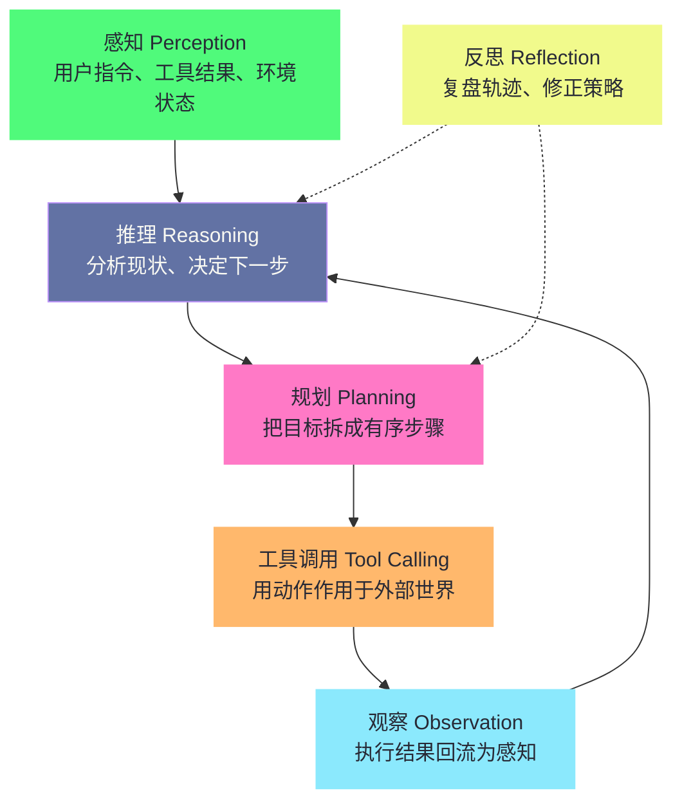
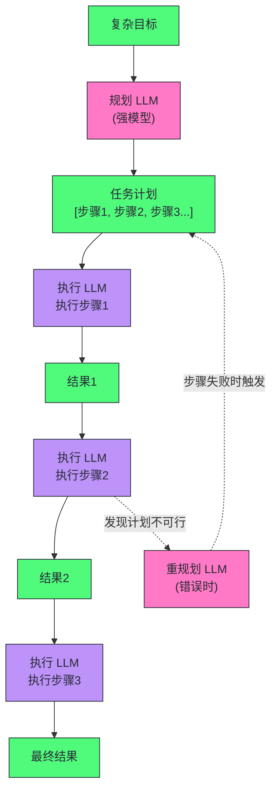

# 11 Agent 核心能力——推理、规划与工具调用

**摘要：**

一个 LLM 应用和一个 LLM Agent 的根本区别在哪里？如果只允许用一句话回答，笔者的答案是：应用是"一问一答"，Agent 是"想一步、做一步、看结果、再想"的闭环。但"闭环"二字落到工程上，背后是一条完整的能力栈——**感知（Perception）**、**推理（Reasoning）**、**规划（Planning）**、**工具调用（Tool Calling）**、**反思（Reflection）**，它不是某一个模型或框架单方面拥有的东西，而是模型、循环、工具与状态组装出来的结果。本文站在**应用开发**视角回答两个问题：其一，能力栈的每一层是什么、由什么技术承载、在 2025-2026 年发生了哪些变化；其二，这五层能力如何组装成一个能稳定跑完复杂任务的生产系统。ReAct 与 Function Calling 的机制细节已在基础范式篇（第 2、3 篇）讲透，本文只做衔接与交叉链接，重点放在规划方法的三路比较（任务分解、多计划选择、外部规划模块）、代码执行作为"能力乘数"的工程化、能力边界与失效场景。时效部分覆盖 2025-2026 年的四个关键变化：o3、Claude 思考模式、Gemini 2.5 这类推理模型把"分解与自纠"内化进模型之后，规划与反思的职责如何在模型内化与外部编排之间重新划分；Plan-and-Execute 在 2026 年的工程实践形态；E2B 等代码执行沙箱的现状；τ-bench、AgentBench 等 Agent 评估基准的演进。

---

## 第 1 章 能力栈——Agent 的组装视角

### 1.1 从"循环"到"能力栈"

本专栏第 1 篇开篇问过一个略显冒犯的问题：ChatGPT 每天都在回答无数人的问题，为什么没有人认真把它叫做 Agent？到了应用开发这一部分，问题可以再往前走一步——**什么样的一组能力，才能让一个系统配得上"Agent"的称呼，并且能在生产环境里靠得住？**

前几篇的答案集中在"循环"上：第 1 篇（[[LLM/Agent技术/基础范式/01 Agent 运行范式全景——从 ReAct 到 Production Agent 的演进|Agent 运行范式全景]]）给出了运行范式的全景地图，第 2 篇（[[LLM/Agent技术/基础范式/02 ReAct 架构深度解析——Thought-Action-Observation 循环的本质|ReAct 架构深度解析]]）拆透了 Thought-Action-Observation 循环的内部机制，第 3 篇（[[LLM/Agent技术/基础范式/03 Tool Use 与 Function Calling——三大厂商的标准化博弈|Tool Use 与 Function Calling]]）讲清了工具调用规范的标准化博弈。循环确实是 Agent 区别于普通 LLM 应用的骨架，但骨架不等于身体——一个能稳定跑完复杂多步任务的生产 Agent，还需要一整套互相咬合的能力。本文把这些能力组织成一条**能力栈（Capability Stack）**——这个分层框架参考了 Sumers 等人在 "Cognitive Architectures for Language Agents"（TMLR 2024）中对语言 Agent 认知架构的梳理，并用它串起全文的叙述：



图里的五层能力，每一层都对应一个具体的工程问题。**感知**是 Agent 的"眼睛和耳朵"——模型无法直接接触现实世界，它看到的世界全部是上下文窗口（Context Window）里呈现出来的文本与结构化内容，用户指令、工具返回、检索结果、环境状态都从这里进入认知，感知质量因此由上下文工程（Context Engineering）决定。**推理**是"大脑"——基于当前感知状态决定下一步该做什么。**规划**是"路线图"——当任务超过三五步时，把目标拆解为有序的子步骤，识别依赖关系与并行机会。**工具调用**是"双手"——把决策翻译成对外部世界的具体动作。**反思**是"复盘"——任务完成后回顾轨迹，总结哪里做对了、哪里做错了，供下一次尝试参考。

这五层能力不是并列的五块拼图，而是一条有先后依赖的流水线：感知喂养推理，推理产生决策，决策经规划展开成步骤，步骤靠工具落地，执行结果回流为新的感知，反思则在旁路对整个循环进行修正。用施工队打个比方：感知是测量员，负责搞清楚工地现状；推理是工头，判断接下来该干什么；规划是图纸，把大目标画成分步施工方案；工具调用是脚手架与机械，让动作真正落地；反思是收工后的复盘会，把今天的教训写进明天的干法。这个比喻有一个必须立刻补上的限定——真实 Agent 的五层并不像施工队那样由不同的人承担，它们常常由同一个模型在同一个上下文里完成，层与层之间的边界是分析性的，不是物理性的；正因如此，任何一层的缺陷都会沿流水线向下游传导，这是后文反复出现的主题。

### 1.2 能力栈与基础范式篇的对应

能力栈的每一层在本专栏里都有对应的"机制篇"，把它们列出来，能看清本专栏"机制与组装分离"的编排思路：

| 能力层 | 承担的技术 | 基础范式篇的对应 |
| :--- | :--- | :--- |
| **感知** | 上下文管理、Observation 治理、错误反馈 | 第 6 篇（Context Engineering）、第 2 篇第 3 章 |
| **推理** | Chain-of-Thought、推理模型 | 第 8 篇（[[LLM/Agent技术/应用开发/08 Prompt 工程——从零样本到思维链|Prompt 工程]]）、第 2 篇第 6 章 |
| **规划** | 任务分解、Plan-and-Execute、DAG 调度 | 第 1 篇第 3 章（范式演进） |
| **工具调用** | Function Calling、MCP、代码执行 | 第 3、4、5 篇（[[LLM/Agent技术/基础范式/04 MCP 协议深度解析——Agent 与工具的标准化连接|MCP 协议]]与生态） |
| **反思** | Reflexion、评估器（Evaluator） | 第 1 篇第 3 章、第 2 篇第 7 章 |

这张表想表达两层意思。其一，本专栏刻意让"机制"与"组装"分离：基础范式篇负责把每一块能力的内部机制讲透，应用开发篇负责把它们组装起来，并暴露组装中才会出现的工程问题——单看工具调用规范看不出"工具描述写不好会怎样"，单看 ReAct 循环看不出"没有规划的长任务会怎样"。其二，能力栈的每一层在 2025-2026 年都发生了实质变化：推理模型把推理内化进了模型内部，规划正在从"prompt 里的段落"变成"结构化工具调用"，代码执行沙箱从开源玩具长成了企业基础设施，评估基准从"问答题"演进到"可验证的端到端任务"。这些变化正是本文后半部分逐一展开的内容。

### 1.3 Workflow 与 Agent：先决定要不要用能力栈

在组装能力之前，先回答一个前置问题：这条能力栈是不是一定要用？Anthropic 在 2024 年 12 月发布的"Building Effective Agents"一文中给过一个被工业界广泛引用的划分——**工作流（Workflow）**是 LLM 与工具沿着预定义代码路径被编排的系统，**Agent** 则是 LLM 动态决定自身流程与工具使用的系统。两者的分界线是控制流的归属：Workflow 里每一步做什么、按什么顺序做，在设计时就固定了；Agent 里下一步做什么，由模型根据当前状态在运行时决定。流程是涌现的（Emergent），而非预先编排的。

这个区分决定了适用场景：已知流程、高可靠性要求 → Workflow；未知流程、需要灵活应对 → Agent。Anthropic 在文中明确建议：**在任务能被 Workflow 完成时，优先用 Workflow；只有当需要动态适应性时，才引入 Agent**。

> [!note] 设计哲学
> Agent 的灵活性是有代价的：不确定性增加、调试困难、成本难以预测（循环次数不固定）。真正的工程智慧是**判断什么时候需要 Agent 的灵活性，什么时候 Workflow 的确定性更有价值**。盲目地将所有东西都做成 Agent，是当前业界的一个常见误区。笔者见过不少团队把一段固定流水线硬做成全自主 Agent，结果是延迟翻倍、token 翻倍、调试困难，任务质量却没有提升——能力栈不是越完整越好，而是越贴合任务越好。

---

## 第 2 章 感知与推理——认知底座

### 2.1 感知：上下文里的世界

先谈感知，因为它常常被当作"理所当然"，却恰恰是生产事故的高发地带。模型的感知通道只有一个——上下文。工具返回了一个 50KB 的日志文件，这个文件进入上下文的方式、被截断还是被摘要、是否占用太多 token，直接决定了后续推理的原料质量。第 2 篇第 3 章详细讨论过的 Observation 治理（截断、结构化摘要、外部存储+按需加载）本质上就是"感知的预处理"；第 6 篇（[[LLM/Agent技术/基础范式/06 Prompt 上下文管理——Context Engineering 的艺术|Context Engineering]]）讨论的 Just-in-Time Context 则回答"感知应该装载多少信息"。这两篇的结论合起来是一条应用层的铁律：**感知的广度和精度受限于上下文，而上下文是成本、是注意力资源，更是 Agent 认知的边界**——上下文里没有的信息，模型再强也无从感知。

有一个工程细节值得在此点明：错误也是感知的一部分。工具执行失败后，错误信息作为 Observation 回流到上下文，Agent 才能据此调整策略；但如果错误信息被吞掉（返回空字符串），模型会以为调用成功了，基于空结果继续推理——这种"沉默的错误传播"比明确的失败更危险。感知层的基本功，就是保证反馈链路既完整又不臃肿。

### 2.2 显式推理：ReAct 的交替循环

推理层的第一种形态是显式推理——模型把推理过程写进上下文，与行动交替进行。这就是 ReAct（Reasoning + Acting），第 2 篇已经把它拆到了 prompt 模板、终止条件、失败模式的粒度，这里只做衔接性回顾，并保留一个完整的示例作为锚点。

ReAct 的洞见在于：推理和行动应该交替进行、互相增强——推理指导行动（决定调用哪个工具），行动更新推理（工具结果成为新的推理依据）。它引入了三类输出：**Thought（思考）**是模型当前的推理过程，对工具不可见，只是"内心独白"；**Action（行动）**是决定执行的具体操作；**Observation（观察）**是工具执行结果，被注入回上下文作为下一轮推理的输入。一个完整的推理链长这样（任务：查询 DeepMind CEO 的母校）：

```
Thought: 要回答这个问题，我需要先找出 DeepMind 的 CEO 是谁。
Action: search("DeepMind CEO")
Observation: DeepMind 的 CEO 是 Demis Hassabis，他也是联合创始人。

Thought: 找到了 CEO 是 Demis Hassabis。现在需要查找他的教育背景。
Action: search("Demis Hassabis 教育背景 大学")
Observation: Demis Hassabis 在剑桥大学国王学院读计算机科学本科，
             后在伦敦大学学院获得认知神经科学博士学位。

Thought: 已经获得了完整的教育信息。Hassabis 本科在剑桥大学，博士在伦敦大学学院。
Final Answer: DeepMind CEO Demis Hassabis 本科就读于剑桥大学国王学院（计算机科学），
              博士就读于伦敦大学学院（认知神经科学）。
```

这个例子值得反复玩味的地方在于：**每一步 Action 之前都有一句 Thought**——不是给人类看的解释，而是给模型自己的推理脚手架。显式推理比隐式推理更准确，因为自回归生成意味着每一步的输出都会影响下一步；把"推理"写进上下文，等于让模型在决策时"看到"自己的推理过程。第 2 篇给出了完整的 prompt 模板与实现细节（stop sequence、终止条件、max_iterations），本文不再重复；对从应用开发视角入手的读者，记住一句话即可——**ReAct 是能力栈的"默认循环"，理解它，是理解后续所有推理形态的起点**。

### 2.3 推理模型：把思考内化进模型

2024 年底 OpenAI 发布 o1，第一次把"推理"做成了显式计费的产品特性——模型在给出答案前会消耗一批不可见的推理 token（reasoning tokens），这是强化学习（Reinforcement Learning）训练出的内部思维链。此后这个方向以极快的节奏推进：2025 年 3 月 25 日，Google 发布 Gemini 2.5，官方博客的原话是"Gemini 2.5 models are thinking models"（思考模型），并宣布"今后我们把思考能力直接内置进我们所有的模型"；2025 年 4 月 16 日，OpenAI 发布 o3 与 o4-mini，官方博客的措辞更直白——"我们的推理模型第一次可以在 ChatGPT 里以 Agent 的方式使用并组合每一个工具"，包括搜索网页、用 Python 分析上传文件、思考图像输入；Anthropic 一侧，Claude 的 extended thinking（扩展思考）把推理放进显式的 `thinking` content block。到 2026 年，"思考模式"已是主流模型的标配，推理模型（Reasoning Model）成为 Agent 的默认骨干。

这一变化对能力栈最深远的影响，是**推理的载体变了**。传统 ReAct 里，分解任务、选择策略、发现错误后自我纠正全部显式写在上下文里，由外部运行时组织成循环；推理模型则把"分解 → 策略选择 → 自我纠正"用强化学习训练进了模型内部，在**一次生成**里完成。o3 的系统卡（System Card）里有一句很说明问题的话：模型"在思维链中使用工具"——裁切图像、搜索网页、跑 Python 都发生在内部思考的过程中。Gemini 2.5 的定位则是把长上下文、多模态与推理组合成"新的 Agent 工作流"。第 2 篇第 6 章已经把这个转变对 ReAct 循环的影响讲透了（循环还在，只是 Thought 从可见文本变成了模型内部状态），本文不再展开，只承接其结论。

### 2.4 内化之后：规划与反思的职责重划

推理模型把"单次认知"内化之后，一个此前被含糊处理的问题变得尖锐起来：**规划与反思，到底是模型内化，还是外部编排？**笔者的答案是：两者都有，但要分清各自的边界——这也是 2025-2026 年生产系统最值得关注的分工变化。

先看规划。推理模型的内部思维链确实擅长把一个大目标拆成小步骤——这正是"任务分解"能力的内化形态，o3 的官方宣传里"agentically 组合工具"就包含这种路径规划。但要注意，模型内化的规划有两个先天盲区：其一，它是一次性的，模型无法把计划持久化为一个可以被审查、被回滚、被他人修改的工件；其二，它看不见工具执行的真实反馈——计划做出来容易，计划在现实里走不走得通是另一回事。所以 2026 年的工程实践普遍采用"模型内化 + 外部工件"的混合：模型负责生成计划内容，外部运行时负责承载计划、校验计划、在计划与现实错配时触发重规划。这个分工是第 3 章的主题。

再看反思。反思（Reflection）在推理模型身上呈现出两种并存形态：一种是模型内部的自我校验——推理模型在生成过程中天然会"回头检查"，这属于内化；另一种是外部反思——任务失败后，把整条轨迹喂给评估器（Evaluator）与反思器（Self-Reflector），生成显式的反思文本存入记忆，供下一次尝试使用，这属于外部编排。两者的分工边界在于**时间尺度**：模型内部的自我校验只能作用于"这一次生成"的内部，跨试验、跨会话的教训积累必须依赖外部记忆——这正是第 12 篇（[[LLM/Agent技术/应用开发/12 Agent 记忆体系——从短期缓冲到长期知识|Agent 记忆体系]]）的主题。第 2 篇第 7 章提到的"LLM 执行 + LRM 思考"混合架构，本质上也是这条职责重划的应用侧对应物：让推理模型当规划者与反思者，让普通模型当执行者，各干各最擅长的事。

### 2.5 推理的边界与成本

推理模型不是免费的午餐，它的代价恰好是能力栈应用层必须兜住的。第一是**成本**：推理 token 的计费远高于普通 token，o3 这类模型在复杂任务上会消耗数千个 reasoning token，对 token 预算敏感的生产系统必须显式管理"思考预算"（thinking budget）。第二是**过度思考**：推理模型可能"想太久"——简单任务也被拉长成几千 token 的思考链，延迟与费用同时失控，这是推理模型在生产中真实存在的问题。第三是**可审计性**：Claude 官方文档明确说明，thinking block 里显示的是模型推理的"摘要"（a summary of Claude's reasoning），永远不会是原始思维链；OpenAI 的 reasoning summaries 同理。对需要合规审计、故障回溯的场景，显式 Thought 文本依然是唯一能拿给监管看的决策记录。

> [!info] 核心概念：推理能力是"单次认知"，能力栈是"跨次认知"
> 推理模型把分解、策略选择、自我纠正在一次生成里做到了极致，但它无法独立完成两件跨次的事：跨工具往返的规划执行（Action-Observation 循环），以及跨试验的经验积累（反思与记忆）。这两件事必须由外部编排承担——**模型负责"想得深"，系统负责"走得远"**。理解这条分工，是理解 2026 年所有 Agent 架构的前提。

用主持人备稿来收束本章：显式 ReAct 像一位"边讲边想"的直播主持人，思路全暴露在台上，观众能跟着他的思路走，但一旦紧张就容易卡壳；推理模型像提前在后台备好稿的主持人，上台只讲结论，流畅且深，但观众看不到他改稿的过程，而且"备稿"本身要花时间、花版面费。这两类主持人都还在台上，只是分工不同——这正是能力栈在推理层的现状。

---

## 第 3 章 规划——把目标拆成路径

### 3.1 为什么需要显式规划

推理模型把"单步想得深"做到了极致，但"单步想得深"解决不了"多步走得远"。ReAct 是一个"贪心"的规划者——每一步只看当前状态，决定下一步行动，不提前规划整个任务路径。这对短任务（3-5 步以内）效果很好，面对复杂的长任务（10+ 步，涉及多个阶段）就会露出三个问题：

**上下文累积**：每一步的 Thought/Action/Observation 都追加到上下文中，长任务的上下文会快速膨胀，导致性能下降和成本增加（[[06 推理优化——KV Cache、量化与投机解码]] 中讨论的 KV Cache 问题与此同源）。

**全局视野缺失**：ReAct 没有全局计划，容易在局部做出次优决策——比如为了解决眼前的小问题，走了一条绕远的路，而忽略了更直接的捷径。笔者用过一个贴切的比喻来向团队解释这件事：**自驾游如果每到一个路口才决定往哪开，你大概率会在城里绕圈子，而不是沿着高速直奔目的地**——任务分解（Task Decomposition）就是先把城市、路线、加油站标在图上，再出发。这个比喻的限定在于：地图再详尽也防不住封路，所以真实系统必须保留"现场改道"的能力（见 3.5 节）。

**错误传播**：早期步骤的错误如果没有被发现，会被后续步骤继承和放大，最终导致整个任务失败。

### 3.2 规划方法的三条路线

针对"如何规划"，2023-2025 年的研究与实践大致分化出三条路线，理解它们的差异比记住具体方法更重要：

| 路线 | 代表方法 | 核心思想 | 优势 | 代价 |
| :--- | :--- | :--- | :--- | :--- |
| **任务分解** | ReAct 贪心分解、Plan-and-Execute、ReWOO | 把目标拆成有序子步骤，依次执行 | 实现简单、路径可解释 | 分解质量决定成败上限；贪心分解缺乏全局视野 |
| **多计划选择** | Tree of Thoughts、LATS | 生成多个候选路径，评估后择优，可回溯 | 路径更优、容错更强 | token 消耗 10-100 倍；推理模型时代价值被大幅摊薄 |
| **外部规划模块** | LLMCompiler、Programmatic Tool Calling、dynamic workflows | 规划逻辑移出 prompt，由代码与运行时承担 | 确定性、可审计、token 省 | 失去模型灵活性；编排逻辑要自己写 |

第一条路线是主流。任务分解把"规划"当作一个显式环节：要么在每步现想（贪心），要么一开始就生成完整计划（Plan-and-Execute），要么用占位符引用前序步骤结果（ReWOO，[[LLM/Agent技术/基础范式/01 Agent 运行范式全景——从 ReAct 到 Production Agent 的演进|第 1 篇]]已详述）。第二条路线多计划选择在推理模型出现后价值被摊薄——模型已经能在内部隐式做多路径探索，外部再挂一棵搜索树往往得不偿失。第三条路线则越来越重要：**规划逻辑正在从"模型的 prompt"迁移到"代码与运行时"**——LLMCompiler 把计划编译成 DAG 由调度器并行执行，OpenAI 与 Anthropic 的 Programmatic Tool Calling 让模型写代码来协调批量工具调用，Anthropic 的 dynamic workflows 让模型生成 JavaScript 编排脚本交给运行时执行。这条路线的本质是：把"规划"从模型的临时发挥，变成系统的确定性资产。

### 3.3 Plan-and-Execute 的工程实现

**Plan-and-Execute**（也叫 Task Decomposition + Execution）是任务分解路线的代表架构，它将 Agent 的工作分为明确的两个阶段。它的思想源头可以追溯到 Wang 等人的 Plan-and-Solve Prompting，以及 AutoGPT、BabyAGI 这批把"分解与执行"显式化的早期项目，但真正的工程化形态是 LangChain 在 2024 年 2 月发布的三套参考实现（Plan-and-Execute、LLMCompiler、ReWOO）之后才成型：

**规划阶段**：用一个专门的"规划 LLM"（通常是更强大的模型）将复杂任务分解为有序的子任务列表（Plan）。这个 Plan 是全局性的，考虑了所有步骤的依赖关系和顺序。

**执行阶段**：用一个"执行 LLM"（可以是较小的模型，因为每步任务更简单）按 Plan 逐步执行，每步只关注当前子任务，不被全局的复杂性干扰。



Plan-and-Execute 的核心优势是**关注点分离**——规划和执行各自专注于不同层次的问题，互不干扰：强模型只做最需要判断力的事（分解与重规划），弱模型处理机械性的执行步骤，token 预算因此被精确分配。它的代价是第 2 篇第 7 章已分析的三个已知失败模式：计划漂移（执行器遇到意外仍按旧计划推进）、规划器单点故障（Planner 输出被污染则全盘皆错）、缺乏自适应重规划。工程化的方向就是针对这三个失败模式逐一加固。

### 3.4 DAG 规划与并行执行

对于存在并行关系的复杂任务，可以将 Plan 表示为一个**有向无环图（DAG）**，而非简单的线性序列：

```
任务: "研究竞品公司A、B、C，生成对比报告"

任务 DAG:
         ┌─── 研究公司A ───┐
起点 ────┤─── 研究公司B ───├── 生成对比报告 ── 终点
         └─── 研究公司C ───┘
```

研究三家公司是互相独立的，可以并行执行；只有三个研究任务都完成后，才能执行"生成对比报告"。DAG 规划允许调度器并行执行没有依赖关系的任务，显著减少总耗时——这与 [[LLM/Agent技术/应用开发/08 Prompt 工程——从零样本到思维链]] 中的查询分解思路呼应，也是 LLMCompiler 的核心机制（第 1 篇已详述）。工程上的关键在依赖标注：模型生成计划时往往不显式声明依赖关系，调度器要么靠"步骤间是否引用彼此的输出"推断，要么在 Prompt 里要求计划显式给出依赖字段。依赖标注错误比并行度不足更危险——把有依赖的步骤并发执行，会产生竞态，得到错误结果。

### 3.5 动态重规划

计划不可能完美预测执行中的所有意外。当某个子任务失败或执行结果与预期不符时，需要**动态重规划**：

1. 将失败原因和当前已完成步骤的结果告知规划 LLM
2. 规划 LLM 基于新信息修订剩余步骤的计划
3. 继续执行修订后的计划

动态重规划使 Plan-and-Execute 架构具备了 ReAct 的灵活性——在保持全局视野的同时，也能适应执行中的意外。它是计划与现实的"仲裁器"：重规划触发得太频繁，退化成每步都问一次的重规划风暴（replan loop），token 与延迟双双失控；触发得太迟，计划漂移累积成灾难。实践中通常给重规划设触发条件——只有"步骤失败"或"关键预期检查点偏离"才触发，而不是每步都检查。

### 3.6 2026 年的规划工程实践

规划在 2026 年的工程实践，已经远远超出"prompt 里写一句'请先制定计划'"的范畴，几个有代表性的进展值得记录。

其一，**Plan-then-Execute 被确认为默认架构**。2025 年 9 月的一篇安全导向的系统性指南（arXiv:2509.08646）给出了一个明确的架构建议：对任何非平凡任务（超过一两次工具调用），Plan-then-Execute 应当是默认的高层架构，因为它天然具有可预测性、可控性与对控制流劫持的抵抗性；同时，静态计划是脆弱的，生产系统必须内置重规划循环，让 Agent 在目标语境中评估失败并制定新策略；对高风险、不可逆的任务，进一步升级为 Plan-Validate-Execute——先出计划、人工验证、再执行。这份指南的立场与第 2 篇"组合模式"的结论互相印证：规划不是可选项，而是生产 Agent 的骨架。

其二，**计划本身正在成为结构化工件**。Arize AI 在 2025 年公开的 Agent 规划实践里有一条很关键的经验：把规划做成一个**结构化工具调用**，而不是一段 prompt 指令——模型调用专门的 `plan` 工具返回结构化计划对象，计划消息以固定位置注入每一轮迭代的上下文；任务的四种状态（pending/in_progress/completed/blocked）被显式建模；更狠的是，`finish` 工具被加了一道硬门禁——如果 Agent 带着未完成（pending 或 in_progress）的任务调用 finish，运行时直接拒绝并列出哪些任务还没做完。这个设计解决的是 Agent 最常见的坏毛病：计划了三步、做了两步就声称完成。把"完成"从模型的自觉变成系统的强制，是 2026 年规划工程的主流取向。

其三，**计划工件要可审查、可回滚**。既然计划是"一次计算、错误也一次性放大"的脆弱资产，工程上就把它当作独立工件（plan-as-artifact）来对待：在第一个工具调用之前，人可以审查这份计划（OpenLegion 的建议，第 2 篇 7.2 节已引）；计划与执行隔离部署，把规划器输出被污染的爆炸半径限制在计划本身。Agent Patterns Catalog 对 Plan-and-Execute 失效模式的归纳——计划-现实错配（plan-world mismatch）、静默偏离（executor 不打招呼就改步骤）、重规划风暴、弱执行器——几乎每一条都能对应真实生产事故，值得在做规划功能时逐条对照排查。

---

## 第 4 章 工具调用——能力栈与外部世界的接口

### 4.1 一次工具调用的完整往返

工具调用（Tool Calling）是能力栈中"手"的部分——把推理与规划的决策翻译成对外部世界的动作。它的规范层（Function Calling 的 JSON Schema、三家厂商的差异、tool_choice 语义、结构化输出）在第 3 篇已经完整讲过，这里从应用开发视角回顾一次工具调用的完整往返，因为组装视角下最重要的不是格式，而是**消息的历史结构**：

**步骤 1：工具注册**。调用 API 时，在 `tools` 参数中传入工具的 JSON Schema 描述：

```python
tools = [
    {
        "type": "function",
        "function": {
            "name": "get_weather",
            "description": "获取指定城市的当前天气",
            "parameters": {
                "type": "object",
                "properties": {
                    "city": {"type": "string", "description": "城市名称"}
                },
                "required": ["city"]
            }
        }
    }
]
```

**步骤 2：模型决策**。LLM 推理后判断需要调用工具，返回一个特殊的 `finish_reason: tool_calls` 响应：

```json
{
  "finish_reason": "tool_calls",
  "message": {
    "role": "assistant",
    "tool_calls": [
      {
        "id": "call_abc123",
        "type": "function",
        "function": {
          "name": "get_weather",
          "arguments": "{\"city\": \"北京\"}"
        }
      }
    ]
  }
}
```

**步骤 3：工具执行**。Host 应用解析 `tool_calls`，执行实际的函数，获取结果。注意这里有一个反直觉的事实：**模型永远不会直接执行任何工具**——它只输出一个"调用请求"，执行权始终在应用代码手里，这既是安全边界，也是审计边界。

**步骤 4：结果注入**。将工具结果以 `role: tool` 消息的形式追加到对话历史中，再次调用 LLM：

```python
messages.append({
    "role": "tool",
    "tool_call_id": "call_abc123",
    "content": "北京：晴天，气温 25°C，湿度 60%"
})
```

**步骤 5：最终生成**。LLM 基于工具结果生成最终的自然语言回答。

在这个往返里，开发者真正拥有的控制点是步骤 3——执行前后可以插入权限检查、参数验证、日志审计、人在回路审批（本专栏第 7 篇详述）。工具调用规范（第 3 篇）解决的是"模型能不能可靠地表达调用意图"，应用层要解决的则是"表达出来的意图该不该被允许、执行的结果如何回流"。

### 4.2 并行工具调用与依赖边界

现代 LLM API（OpenAI GPT-4 及之后、Anthropic Claude）支持在单次回复中调用**多个工具**。当任务中的多个工具调用互相独立时（没有数据依赖），LLM 会在一次 `tool_calls` 响应中返回多个调用请求，Host 可以并行执行这些调用，显著减少总延迟。

譬如任务"比较北京和上海的天气"，LLM 会同时请求调用 `get_weather("北京")` 和 `get_weather("上海")`，Host 并行执行两个 API 调用，将两个结果都注入后，LLM 一次性生成对比答案。

并行调用有一个必须由开发者主动把关的边界条件：**依赖关系模型不会替你声明**。模型在生成多个 `tool_calls` 时，并不会说明它们之间有无依赖；把"先查库存、再下订单"两个调用并发提交，订单可能在库存还没返回时就执行，产生业务错误（第 3 篇 2.3 节给了完整的处置建议：工具描述里写明依赖、加串行信号量、或用 `parallel_tool_calls: false` 显式关闭）。此外，**速率限制是并行度的真实天花板**——模型一次吐出十个调用，不代表你的 API 配额允许十路并发，不少团队在并行初期被 429 打懵，最后退化成"分两批提交、每批五个"。

### 4.3 工具 Schema 的设计艺术

工具的 `description` 和 `parameters.description` 字段直接影响 LLM 的工具选择准确率。设计原则：

**description 要说清楚"何时用"**，而不只是"是什么"：

❌ 差的描述：`"查询数据库"`
✅ 好的描述：`"在用户订单数据库中按条件查询订单。当用户询问自己的历史订单、订单状态、某个时间段的订单时使用。不用于查询产品信息。"`

**parameters 要说清楚格式约束**：

```json
"date_range": {
  "type": "string",
  "description": "查询的日期范围，格式为 'YYYY-MM-DD,YYYY-MM-DD'，
                  如 '2024-01-01,2024-03-31' 表示查询 2024 年第一季度"
}
```

**必填 vs 可选要合理设计**：只将真正必须的参数放在 `required` 中，其余设为可选（带默认值）。过多的必填参数会让 LLM 在无法确定参数值时犹豫是否调用工具。

把工具 Schema 比作乐高积木的咬合齿，是个恰当的意象：积木能不能拼在一起，取决于咬合齿的形状（参数类型与必填约束），而积木"该不该拼在这里"，取决于积木侧面的说明书（description 里的使用场景）。模型在运行时做的事，本质上是在一堆积木里挑出当下最合适的那一块——说明书写得含混，它就只能瞎猜。

### 4.4 工具多了怎么办

工具数量少时，模型把全部工具 Schema 都看在眼里，选择准确率尚可；一旦可用工具超过 30-50 个，选择准确率会明显下滑——第 3 篇引用了 Anthropic 的量化数据：启用 Tool Search 后，Opus 4 在 MCP 评测集上的工具选择准确率从 49% 提升到 74%。这组数字说明了一个反直觉的事实：**工具选择准确率的瓶颈往往不在模型，而在"给模型看的工具目录"**。

工程上有三条应对路径。第一，动态加载——OpenAI 的 Tool Search 与 Anthropic 的 Tool Search Tool 都允许把不常用的工具标记为延迟加载，模型需要时先搜再取，让上下文里始终只保留当前任务可能用到的工具子集（第 3 篇 2.4、3.4 节详述）。第二，分层组织——用 namespaces 或工具类别做两级选择，模型先选类别、再选具体工具，把"上百选一"变成"十几选一"再"几选一"。第三，路由收敛——让路由决策尽量前移：能在规划阶段确定工具路径的，就不在运行时让模型从全部工具里挑（第 2 篇 4.2 节"代码确定性路由"把重试浪费从 90.8% 降到 0% 的案例，就是这条路径的证据）。

### 4.5 从工具到技能：能力的可组合封装

2025 年 10 月，Anthropic 发布了一个对能力栈组装方式影响深远的概念——**Agent 技能（Agent Skills）**：把领域专家经验打包成"目录 + SKILL.md 说明 + 脚本与资源"的文件夹，模型在相关任务出现时按需发现并加载，把通用 Agent 变成特定领域的专家。它的关键特征有三：按需加载（不占常驻上下文）、可组合（多个技能叠加处理复合任务）、程序性知识（procedural knowledge）的载体——技能承载的是"这件事怎么做"的步骤与方法，而不是"答一道题"的即时响应。

从能力栈的视角看，工具（Tool）与技能（Skill）是两种互补的封装：**工具封装"动作"**——可以被调用、参数化、执行并返回结果；**技能封装"知识"**——告诉模型在某个领域该怎么行动，可能需要调用多个工具才能完成。实践中两者常常配合：一个"发票处理"技能内部会调用 PDF 解析、OCR、数据库写入等多个工具。不过，技能的按需加载也引入了新的安全面——技能文件本质上是"可被模型加载的指令"，2025 年已有研究展示过隐藏在长技能文件里的提示注入攻击（prompt injection），在生产中采用技能机制时，对技能的来源审查与内容审计应当与工具同等对待。

### 4.6 工具调用的失效防线

工具调用环节的失效主要分为三类，第 2 篇第 4 章已给出根因分析与防治，这里从应用层组装视角做一个收束：

**工具名幻觉**：模型调用了不存在的工具。第 2 篇引用的生产数据显示，这类错误占重试浪费的 90% 以上，根因是运行时允许模型动态选择工具名；防治手段是把工具路由改为代码确定性路由——规划阶段确定工具，运行时只填参数。

**参数幻觉**：工具名正确，参数是编造的。防治手段是契约式工具描述（明确输入范围与反例）、执行前参数验证、per-tool 断路器（每个工具设置最大调用次数）。

**错误反馈失真**：工具执行失败但错误信息没有正确回流。注意第 2 篇的提醒——瞬时错误（超时、429）应由执行器层有界重试，终止错误（权限被拒、参数无效）应作为 Observation 反馈给模型调整策略，两者不能混为一谈。

这三类防线加起来说明一件事：工具调用的可靠性不是模型单方面保证的，而是"工具契约 + 执行器校验 + 错误分类回流"三层工程共同兜底的结果——这正好是能力栈"组装"二字的含义。

---

## 第 5 章 代码执行——能力乘数与沙箱

### 5.1 为什么代码执行器如此特殊

在 Agent 的所有工具中，**代码执行器（Code Interpreter）**具有特殊地位——它不是一个针对特定功能的工具，而是一个**能力乘数**：Agent 可以编写代码来完成任何可以被编程完成的任务，从数学计算到数据分析、从文件处理到 API 调用。OpenAI 的 Code Interpreter（现更名为 Advanced Data Analysis）让 ChatGPT 能处理 CSV 文件、绘制图表、执行复杂计算——这一功能极大地扩展了 LLM 的实用能力，因为代码执行赋予了模型**精确计算**的能力（弥补了 LLM 数学计算不可靠的缺陷），也让"写一段代码验证假设"成了 Agent 对抗自身幻觉的手段：与其让模型猜一个结果，不如让它在沙箱里跑一遍。

把代码执行器比作能力栈里的"瑞士军刀"并不准确——瑞士军刀是一堆固定的功能，代码执行器更像一台**万能机床**：它本身不产出任何成品，但任何可以被车削、铣削、焊接的零件它都能加工。一台万能机床需要有功率上限、防护罩和操作规范，这就引出了沙箱。

### 5.2 安全沙箱的六条技术基线

代码执行是一把双刃剑——赋予了 Agent 强大能力的同时，也引入了安全风险。未经限制的代码执行环境中，恶意或意外的代码可能删除文件、发起网络攻击、耗尽系统资源。**沙箱技术（Sandboxing）**是代码执行器的安全保障，六条基线缺一不可：

- **容器隔离（Container Isolation）**：在独立容器中执行代码，与宿主系统隔离（Docker 是最普及的起点）
- **微虚拟机隔离（MicroVM Isolation）**：用轻量虚拟机（如 AWS 开源的 Firecracker）做内核级隔离，比容器多一道防线
- **网络限制（Network Policy）**：禁止沙箱内的代码访问外部网络，或只允许访问白名单 URL（egress 策略）
- **文件系统限制（Filesystem Limitation）**：只允许访问特定的临时目录，宿主目录与密钥文件不可见
- **资源限制（Resource Limits）**：CPU/内存/时间的硬限制，防止死循环和资源耗尽
- **系统调用过滤（seccomp）**：限制可以执行的系统调用集合，把提权路径堵死

这六条基线按"越权成本"从低到高排列：容器隔离挡住粗心的错误，微虚拟机挡住更坚决的逃逸尝试，网络与文件系统限制缩小攻击面，资源限制防止自噬，seccomp 收窄内核入口。生产实践中不是每条都要上到最严——隔离强度与启动开销、运维复杂度成正比，关键是要按代码的信任级别分级：完全不可信的第三方代码上全套，可信度较高的内部脚本可以只做资源限制。

### 5.3 2026 年的代码沙箱格局

代码执行沙箱在 2026 年已经从"开源玩具"长成了"企业基础设施"，最典型的证据是 E2B——2025 年 7 月，这家专为 AI Agent 设计的代码沙箱公司完成 2100 万美元 A 轮融资，由 Insight Partners 领投，官方口径称 94 家 Fortune 100 公司中已有 94 家注册了其平台（不同页面口径分别为 88% 与 94 家）；到 2026 年，官方主页披露累计启动超过 20 亿个沙箱，SDK 月下载量超过 1700 万次。E2B 的技术底座正是 Firecracker 微虚拟机——每个 Agent 会话获得一个独立的微 VM，从快照秒级启动，支持暂停/恢复、网络端口转发、文件系统 API，并且可以部署在客户自己的 AWS/GCP/Azure 账号里（BYOC）。它的商业模式印证了一个判断：**对生产级 Agent 来说，"在哪里执行"已经从部署细节上升为安全架构决策**。

另一条路线是平台托管执行。OpenAI 的 Responses API 提供内置的 `code_interpreter` 托管工具，Anthropic 提供 `code_execution` 服务端工具（代码在 Anthropic 的基础设施上运行），Gemini 也有内置的 Code Execution——这些平台方案省去了自建沙箱的运维负担，代价是代码与数据要流经厂商服务端（第 3 篇 2.6 节已详细权衡）。对数据出境敏感的场景（金融、政务），自建或 BYOC 的沙箱是唯一选择。姊妹专栏 [[LLM/Agent沙箱技术/00 专栏导览|Agent 沙箱技术]] 对沙箱平台的分层模型与产品路线有完整的展开，本文不再重复。

### 5.4 沙箱的边界与权衡

沙箱不是银弹，它的边界值得清醒认识。第一，"能执行"不等于"可验证"——沙箱保证代码跑在受控环境里，但不保证跑出来的结果是正确的，验证责任仍在应用层（用测试、schema 校验、grounding 检查兜底）。第二，**托管的通用沙箱适配不了私有依赖**——OpenAI 的 code interpreter 是为数据分析设计的通用环境，需要特定 SDK、特定运行时的任务，托管工具够不着，只能退回自定义工具（第 3 篇 2.6 节）。第三，**沙箱资源限制与任务时长互斥**——长时任务（如数据管道）与"单次执行限时几分钟"的沙箱天然冲突，需要外部的任务队列与断点续跑配合，而不是在沙箱里硬扛。权衡的落点始终是：隔离强度、启动成本、能力边界三者按任务信任级别与数据敏感度取一个平衡，而不是一律上最严隔离。

---

## 第 6 章 反思——能力栈的自我修正

### 6.1 为什么 Agent 需要反思

ReAct 和 Plan-and-Execute 都是"一次性"的推理框架——它们在当前 episode 内推理，但不会从当前 episode 的失败中学习，以便在**同一个任务的重试**中做得更好。第 2 篇第 7 章已经给过一组生产参数（reflect_on 触发条件、max_reflection_rounds 预算），这里从能力栈视角解释反思为什么是独立的第五层：推理负责"当下这一步怎么做"，规划负责"整条路怎么走"，而反思负责"走完之后，这条路本身值不值得改进"。没有反思，Agent 对同一个坑会反复踩；有了反思，Agent 才具备第 12 篇记忆体系所依赖的"经验产出"。

**Reflexion**（Shinn et al., 2023）通过引入**语言化的自我反思**（Verbal Reinforcement）解决这个问题：当 Agent 完成一个 episode 后（无论成功还是失败），它会生成一段关于"这次哪里做对了、哪里做错了、下次应该如何改进"的反思文本，并将这段反思存储在工作记忆中。在下一次尝试同一任务时，反思内容会被注入到上下文中，指导 Agent 避免重蹈覆辙。它的妙处在于不更新模型权重——"学习"完全通过语言反馈实现，不需要梯度、不需要训练数据，代价是一次额外的 LLM 调用。

### 6.2 Reflexion 的三个组件

**行动者（Actor）**：执行任务的 Agent，使用 ReAct 或其他框架。

**评估者（Evaluator）**：对 Actor 的输出进行评分，判断任务是否成功以及质量如何。评估者可以是：
- 确定性规则（代码测试通过/失败）
- 另一个 LLM（对结果质量的主观评判）
- 外部信号（用户反馈、程序运行结果）

**自我反思者（Self-Reflector）**：在 episode 结束后，接收 Actor 的轨迹（Thought/Action/Observation 序列）和 Evaluator 的评分，生成反思文本：

```
[反思示例]
在这次任务中，我犯了以下错误：
1. 第3步我搜索了"Python sort list"，但任务要求的是对字典列表按特定键排序，
   应该搜索"Python sort list of dicts by key"
2. 我在没有验证结果正确性的情况下就提交了答案，
   应该先运行代码验证输出

下次遇到类似任务时，我应该：
- 在搜索时包含更具体的技术细节
- 对生成的代码进行测试验证再提交
```

在下一次尝试时，这段反思会被加入到 System Prompt 的末尾，让 Actor 能避免同样的错误。注意评估者在这里的关键地位——反思的质量上限由评估者决定：如果评估者无法准确判断"这一步到底做没做对"，反思就失去了可靠的原料。这正是为什么在代码、测试这类有明确 pass/fail 信号的任务上反思效果最好，而在开放式创意任务上反思常常沦为自我表扬。

### 6.3 反思的工程应用

Reflexion 的完整实现在工程上有一定复杂度，但其核心思想（**让 Agent 在每次任务后总结经验，下次做得更好**）可以轻量级地应用于很多场景：

- 代码生成 Agent：代码执行失败后，LLM 分析错误信息并生成"下次避免这个错误的注意事项"，重试时注入这些注意事项
- 测试驱动开发 Agent：每次代码提交后运行测试，测试失败的信息和 LLM 的自我分析都保存为反思，指导后续修改
- 对话式 Agent：在多轮对话中，发现用户对某个回答不满意时，分析原因并在后续回复中改进

用飞行员复盘（debrief）来类比这一层：航班落地后，机长与副驾驶会坐下来把整个航程过一遍——哪个环节判断得准、哪个环节差点出事、下次遇到同样天气要怎么处理。**复盘本身不改变这趟航班，但它改变了下一趟航班**。Agent 的反思同理：它不修改已完成的轨迹，而是把经验写进记忆，让下一次尝试站在更高的起点上。这个比喻的限定在于——飞行员复盘有强制流程与标准记录格式，Agent 的反思则需要工程上的触发条件与预算约束，否则就会变成无节制的"反思的反思"。

### 6.4 反思的预算与边界

反思是能力栈里最容易失控的一层，因为它本质上是一个递归结构——反思失败，可以再反思反思为什么失败。2026 年的工程实践（第 2 篇 7.1 节已给出完整参数）普遍从三个维度给反思上预算：**触发条件**（只对 tool_error 与 empty_result 触发，慎用 always）、**次数上限**（max_reflection_rounds 建议为 2）、**输入范围**（是否包含完整工具输出，须警惕 PII 泄漏）。另外要划清一条边界：**Reflexion 不等于人工评审**——反思始终是同一个 Agent 的自我批评，没有独立的审批链，合规场景里必须的拒绝流程不能靠"让 Agent 反思一下"绕过。推理模型兴起后，反思又多了一种形态——模型内部思考时的自我校验，但正如第 2 章所述，那是"单次认知"层面的内化，跨试验的反思依然要靠外部编排与记忆承载。

---

## 第 7 章 能力栈的失效模式与边界

### 7.1 五种典型失效模式

理解 Agent 的失效模式与理解它的能力同样重要。能力栈的每一层都有自己的失效形态，汇总起来是生产中最常见的五种：

**无限循环**：Agent 陷入"调用工具→得到结果→判断需要再调用→..."的循环，无法收敛到最终答案。常见形态是自我循环（重复同一调用）、乒乓循环（在两个工具间来回切换）、探索循环（不断调工具但不评估结果）。防范：设置严格的 `max_iterations` 限制、循环检测拦截器、哈希去重（第 2 篇 2.2、4.1 节有完整方案）。

**工具误用**：Agent 调用了不适合当前情境的工具，或者以错误的方式使用工具（参数错误、误解工具功能）。防范：精心设计工具描述，在工具 Schema 中加入用法示例和反例。

**幻觉式工具调用**：Agent 编造了不存在的工具名，或者编造了工具的参数（如填入不存在的文件路径）。防范：在 Host 层严格验证工具名和参数格式，对无效调用返回明确的错误信息；更根本的是代码确定性路由（第 2 篇 4.2 节）。

**上下文溢出**：长任务中 Thought/Action/Observation 的累积导致上下文超过模型限制，或超出后注意力稀释、推理漂移。防范：实现上下文压缩（将早期步骤摘要化）、设置步骤数限制、使用支持更长上下文的模型（第 6 篇与第 2 篇第 3 章）。

**目标漂移**：Agent 在执行过程中"忘记"了原始目标，被中间步骤的细节所吸引，最终输出的答案与原始任务偏离。防范：在每一轮推理的系统提示中重申原始目标，让 Agent 始终"看到"自己要完成什么。

用一艘船的航行来收束这五条：无限循环是船在原地打转，工具误用是看错了航海图，幻觉式调用是地图上标了一个不存在的岛，上下文溢出是船舱进水挤占了生活空间，目标漂移是偏离航向而不自知。船长的职责不是保证海面风平浪静，而是让每一种故障都有对应的处置预案——**能力栈的可靠性，正是建立在"知道每种死法"之上的**。

> [!warning] 生产避坑
> 在生产环境中，任何涉及写操作（创建/修改/删除文件、发送邮件、提交代码、执行支付）的工具调用，都应该在执行前呈现给用户确认。这个"人在回路"（Human-in-the-Loop）机制是当前 Agent 系统安全性的最后防线——模型的推理不够可靠，特别是在高风险操作上，人工确认是不可或缺的。第 7 篇（[[LLM/Agent技术/基础范式/07 Agent 权限与审批模型——人在环路的工程实践|Agent 权限与审批模型]]）对中断、审批原语与权限传播有完整展开，本文只强调一条原则：能力栈的自主程度，应当与操作的不可逆程度成反比。

### 7.2 能力边界：不是所有任务都该上 Agent

失效模式讲的是"能做什么、会怎么坏"，能力边界讲的则是"什么任务根本不该交给 Agent"。三条边界值得铭记。第一，**确定性优于自主性**：任务路径已知、步骤可枚举、对延迟敏感的场景，Workflow 永远比 Agent 便宜且可靠——Anthropic 的原文是"最成功的实现不是使用复杂框架或专门库，而是使用简单、可组合的模式"。第二，**单次调用优于循环**：如果任务可以一次 LLM 调用完成（哪怕是带结构化输出的复杂生成），就不要为了"看起来智能"而套上工具循环。第三，**评估门槛**：没有评估器（Evaluator）的任务不适合做自主 Agent——无法判断成功与否，就无法闭环，反思层直接失效（第 6 章）。把这三条边界翻译成一句决策口诀：**先问任务要不要动态决策，再问能不能可靠评估，最后才问用哪条能力栈**。

### 7.3 评估：给能力栈量体温

能力栈的最后一块拼图是评估——没有度量，就不知道每一层能力的真实水位。2024-2026 年，Agent 评估基准经历了一轮明显的"去问答题化"：从"模型能否给出正确答案"转向"Agent 能否在真实环境里完成任务"。

**τ-bench**（Yao et al., ICLR 2025，Sierra 团队）是这条转向的代表。它模拟一个动态对话环境——由语言模型扮演用户，与配备了领域 API 工具与策略指南的 Agent 对话（航空公司、零售、电信三个领域），评测方式是把对话结束时的数据库状态与标注的目标状态对比，而不是看模型输出与参考答案的文本相似度。它的核心发现至今仍被广泛引用：即使是当时最强的函数调用 Agent（gpt-4o），成功率也不到 50%，且行为很不稳定（retail 领域 pass^8 < 25%）。τ-bench 后续演进为 2.0 版，加入 τ-i18n（英语、西班牙语、葡萄牙语、印地语、中文、韩语六语言，文本与全双工语音两种形态）、新的 τ-Entity 入站信息采集领域（200+ 任务），以及对话自然度与语音保真度的后置裁判（judges）。2025 年 6 月发布的 **τ²-bench** 更进一步，把环境改成"双控"（dual-control）——用户与 Agent 都能操作共享环境里的工具，模拟技术支持场景中用户也要动手的真实情形，实验显示从"单控"切换到"双控"后 Agent 性能显著下滑。这些基准共同指向一个结论：**Agent 能力的瓶颈正在从"会不会调工具"转向"会不会跟人协作、会不会长期遵守策略"**。

**AgentBench** 则是另一条谱系的注脚。它由清华 THUDM 于 2023 年提出，覆盖操作系统、数据库、知识图谱、数字卡牌游戏等八个交互环境，是早期 LLM-as-Agent 评测的通行标准；到 2025 年 10 月，原仓库被改造成 **AgentBench FC**——函数调用风格的新版本，五个容器化任务、配套 AgentRL 强化学习框架，原版榜单不再更新。这个"退役与新装"的过程本身就是一个信号：**评测基准的生命周期正在加速**，2023 年够用的基准到 2026 年已经测不动前沿模型了。另一条线上的 **Terminal-Bench 2.0**（2026 年 1 月）专门评测终端环境里的 Agent，89 个贴近真实工作流的任务，前沿模型得分不足 65%——即便最强的模型，在真实终端任务上也远未饱和。

把这几条线索合起来，可以看到评估方法论的三点演进：其一，从"输出文本对比"到"环境状态对比"（τ-bench 的数据库状态）；其二，从"单 Agent 独舞"到"Agent 与用户/环境双控"（τ²-bench）；其三，从"通用问答"到"领域化、容器化、可复现"（AgentBench FC、Terminal-Bench 2.0）。对应用开发者的启示是：**不要迷信单一榜单，要为自己的任务建"最小可评估闭环"**——先定义成功谓词（测试通过、schema 校验、状态一致），再谈能力栈优化；这也正是第 16 篇（[[LLM/Agent技术/应用开发/16 Agent 评估与可靠性工程|Agent 评估与可靠性工程]]）的主题。

---

## 第 8 章 标准 Agent 循环的工程实现

### 8.1 循环的骨架伪代码

把前七章的能力栈落成代码，最小的骨架是一个标准 ReAct 循环。它不包含规划模块与反思模块——这正是理解能力栈组装方式的起点：**先有一个能转的循环，再按任务需要往上叠能力**。

```python
def run_agent(goal: str, tools: list[Tool], max_iterations: int = 10) -> str:
    """
    标准 ReAct Agent 循环

    Args:
        goal: 用户的目标/问题
        tools: 可用工具列表
        max_iterations: 最大迭代次数，防止无限循环
    """
    # 初始化对话历史，注入目标和工具描述
    messages = [
        {"role": "system", "content": build_system_prompt(tools)},
        {"role": "user", "content": goal}
    ]

    for i in range(max_iterations):
        # 调用 LLM，让它决定下一步行动
        response = llm.chat(messages, tools=get_tool_schemas(tools))

        # 如果 LLM 认为任务完成，直接返回最终答案
        if response.finish_reason == "stop":
            return response.content

        # LLM 决定调用工具
        if response.finish_reason == "tool_calls":
            # 将 LLM 的工具调用请求追加到历史
            messages.append(response.message)

            # 执行工具调用（可能是并行的多个调用）
            tool_results = []
            for tool_call in response.tool_calls:
                result = execute_tool(tool_call.name, tool_call.arguments)
                tool_results.append({
                    "role": "tool",
                    "tool_call_id": tool_call.id,
                    "content": result
                })

            # 将所有工具结果注入对话历史
            messages.extend(tool_results)
            # 继续下一轮循环
            continue

    # 超过最大迭代次数，返回当前状态
    return "任务未能在规定步骤内完成，请尝试分解为更简单的子任务。"
```

这个骨架里埋着三个后续升级的挂载点：`build_system_prompt(tools)` 是感知与反思注入的位置（把记忆、反思文本、原始目标重申都拼进 system prompt），`llm.chat` 是切换推理模型的接缝（普通模型跑显式 ReAct，推理模型直接给 thinking budget），`execute_tool` 是沙箱、权限与错误分类的执行入口（第 5、7 章的内容都挂在这里）。**能力栈的组装，本质上是往这个骨架上按任务类型挂载模块**——需要长任务就接 Plan-and-Execute 与重规划，需要经验积累就接反思与记忆，需要安全就接沙箱与审批。

### 8.2 框架选型速览

把骨架交给框架，不同框架给了不同的组装方式。第 13 篇（[[LLM/Agent技术/应用开发/13 Agent 框架选型——LangChain、LlamaIndex 与 LangGraph|Agent 框架选型]]）会做完整的选型决策，这里只做速览：

| 框架 | 核心特性 | Agent 支持 | 适用场景 |
| :--- | :--- | :--- | :--- |
| **LangChain** | 丰富的组件生态、LCEL（链式表达式） | ReAct, Plan-and-Execute | 通用 Agent 开发，最成熟 |
| **LlamaIndex** | RAG 专精、数据连接器丰富 | ReAct, Sub-Question | 以 RAG 为核心的 Agent |
| **CrewAI** | 多 Agent 协作、角色定义 | Multi-Agent | 多 Agent 任务分工 |
| **AutoGen (Microsoft)** | 多 Agent 对话框架 | Multi-Agent | 复杂多 Agent 工作流 |
| **LangGraph** | 状态图（State Graph）架构 | ReAct, 自定义循环 | 需要精确控制流的 Agent |

选择框架时，真正值得看的不是"支持多少种范式"，而是三件事：**状态管理**（长任务中断后能否从检查点恢复）、**可插拔性**（能否在循环的任意位置插入审批、日志、拦截器）、**与平台能力的对齐**（推理模型、托管工具、MCP 的接入成本）。框架只是组装能力的脚手架，能力栈的五层该在哪一层实现，主动权始终在开发者手里。

---

## 第 9 章 总结与专栏导航

Agent 的能力栈可以归纳为一条主线：**感知喂养推理，推理产生决策，决策经规划展开成步骤，步骤靠工具落地，反思在旁路修正整条链路**。五个关键结论：

1. **能力栈是组装出来的，不是模型自带的**。模型负责"想得深"，系统负责"走得远"——单次认知（推理模型的内部思考）与跨次认知（规划工件、反思记忆、工具往返）的分工，是 2026 年 Agent 架构的第一原则。
2. **推理正在内化，规划与反思正在外化**。o3、Claude 思考模式、Gemini 2.5 把分解与自我纠错训练进了模型内部；但计划的持久化与审查、重规划循环、跨试验反思，依然要靠外部编排（结构化计划工具、plan-as-artifact、Reflexion 预算）承载。
3. **规划的三条路线各有权衡**。任务分解最主流，多计划选择在推理模型时代价值被摊薄，外部规划模块（LLMCompiler、Programmatic Tool Calling、dynamic workflows）正在把规划从 prompt 迁往代码与运行时。
4. **代码执行是能力乘数，沙箱是它的安全带**。E2B 用 Firecracker 微虚拟机把沙箱做成了企业基础设施，平台托管执行（OpenAI code interpreter、Anthropic code execution）则把执行归属移到了厂商侧——"在哪里执行"已经是与"用哪个模型"并列的架构决策。
5. **评估正在从"答得对不对"转向"事办没办成"**。τ-bench 的状态对比、τ²-bench 的双控环境、Terminal-Bench 2.0 的真实终端任务，都在逼着 Agent 的能力栈接受端到端的检验。

如果把能力栈比作一艘船的推进系统，本章想留给你的是一个权衡而非一个答案：**每一层能力都有成本，每一层能力的缺失都有代价**——没有规划的长任务是"走一步看一步"的短视，没有反思的重试是"同一个坑踩两次"的浪费，没有沙箱的代码执行是"把方向盘交给不可信代码"的冒险。能力栈的组装没有放之四海皆准的完整度，它永远是任务复杂度、可逆性与成本三者之间的妥协；因地制宜地决定"哪一层做到什么程度"，比机械地追求"五层齐全"更接近工程的本义。

> [!info] 专栏导航
> 本文是 [[LLM/Agent技术/00 专栏导览|Agent 技术专栏]] 应用开发部分（08-16）的第 11 篇。上一篇 [[LLM/Agent技术/应用开发/10 高级 RAG——查询改写、图谱检索与多跳推理]] 解决了"Agent 怎么获取知识"，本文解决"Agent 怎么组织认知与行动"——推理、规划、工具调用与反思的能力栈；下一篇 [[LLM/Agent技术/应用开发/12 Agent 记忆体系——从短期缓冲到长期知识]] 将回答能力栈的"时间维度"：如何让 Agent 在单次任务中维持上下文（短期记忆），以及如何在任务之间积累知识（长期记忆）。本文反复出现的"反思依赖记忆"、"感知依赖上下文"两条线索，将在下一篇获得完整的工程展开。

---

## 参考资料

1. Yao et al., "ReAct: Synergizing Reasoning and Acting in Language Models", ICLR 2023
2. Shinn et al., "Reflexion: Language Agents with Verbal Reinforcement Learning", NeurIPS 2023
3. Wang et al., "Plan-and-Solve Prompting: Improving Zero-Shot Chain-of-Thought Reasoning by Large Language Models", ACL 2023
4. Significant Gravitas, "AutoGPT: An Autonomous GPT-4 Experiment", GitHub 2023
5. Chase, "LangChain: Building applications with LLMs through composability", GitHub 2022
6. OpenAI, "Function Calling Documentation", 2023
7. Anthropic, "Building Effective Agents", 2024-12-19
8. Sumers et al., "Cognitive Architectures for Language Agents", TMLR 2024
9. OpenAI, "Introducing OpenAI o3 and o4-mini", 2025-04-16（o3 在 SWE-Bench Verified 上 69.1%）
10. Google, "Gemini 2.5: Our newest Gemini model with thinking", 2025-03-25
11. "Architecting Resilient LLM Agents: A Guide to Secure Plan-then-Execute Implementations", arXiv:2509.08646, 2025
12. Arize AI, "How to Build Planning Into Your AI Agent", 2025
13. Agent Patterns Catalog, "Plan-and-Execute"（Planner/Executor/Replan/Plan artifact 模式目录）
14. E2B, "We Raised $21M to Give Fortune 100 Cloud for AI Agents", 2025-07-28；e2b.dev 官方数据（2B+ 沙箱、17M+ 月下载量，2026）
15. Anthropic, "Equipping agents for the real world with Agent Skills", 2025-10-16
16. Yao et al., "τ-bench: A Benchmark for Tool-Agent-User Interaction in Real-World Domains", ICLR 2025；taubench.com（τ-bench 2.0：τ-i18n、τ-Entity）
17. Barres et al., "τ²-Bench: Evaluating Conversational Agents in a Dual-Control Environment", arXiv:2506.07982, 2025
18. Liu et al., "AgentBench: Evaluating LLMs as Agents", ICLR 2024；THUDM AgentBench（2025-10 转型 AgentBench FC）
19. "Terminal-Bench 2.0: Benchmarking Agents on Hard, Realistic Tasks in Command Line Interfaces", arXiv:2601.11868, 2026

---

> [!note] 思考题
> 1. ReAct（Reasoning + Acting）框架让 Agent 交替进行推理和行动。但 Agent 的推理链可能陷入死循环——譬如反复调用同一个工具但无法获得想要的结果。你如何设计'循环检测'和'优雅降级'机制？最大迭代次数限制是唯一的方案吗？
> 2. Agent 的规划能力（Planning）决定了它能否将复杂任务分解为可执行的子任务。当前 LLM 的规划能力在面对需要 10+ 步骤的复杂任务时会显著下降。你认为规划能力的瓶颈是 LLM 的推理深度限制，还是 Prompt 设计的问题？Tree-of-Thought 等方法能在多大程度上提升长链规划的可靠性？
> 3. Function Calling 是 Agent 调用工具的核心机制。当可用工具数量很多（50+）时，LLM 选择正确工具的准确率会下降。你如何组织工具的层级结构（如先选择类别再选择具体工具），或者实现'工具检索'（根据用户意图动态检索最相关的工具子集）来提升选择准确率？
> 4. 2026 年的规划实践倾向于把计划做成结构化工具调用，并用硬门禁阻止 Agent 带着未完成任务就声称完成。如果让你设计'计划状态机'，你会为计划步骤设计哪几种状态？"重规划"应该由谁触发——执行器、计划器，还是两者都能触发？
> 5. τ-bench 发现即使最强的 Agent 在真实领域任务上的成功率也低于 50%。如果你要为自己的 Agent 建一个最小评估闭环，你会选择哪种成功谓词（测试通过、数据库状态对比、人工打分）？为什么"输出文本对比"式的评估在 Agent 场景里不可靠？