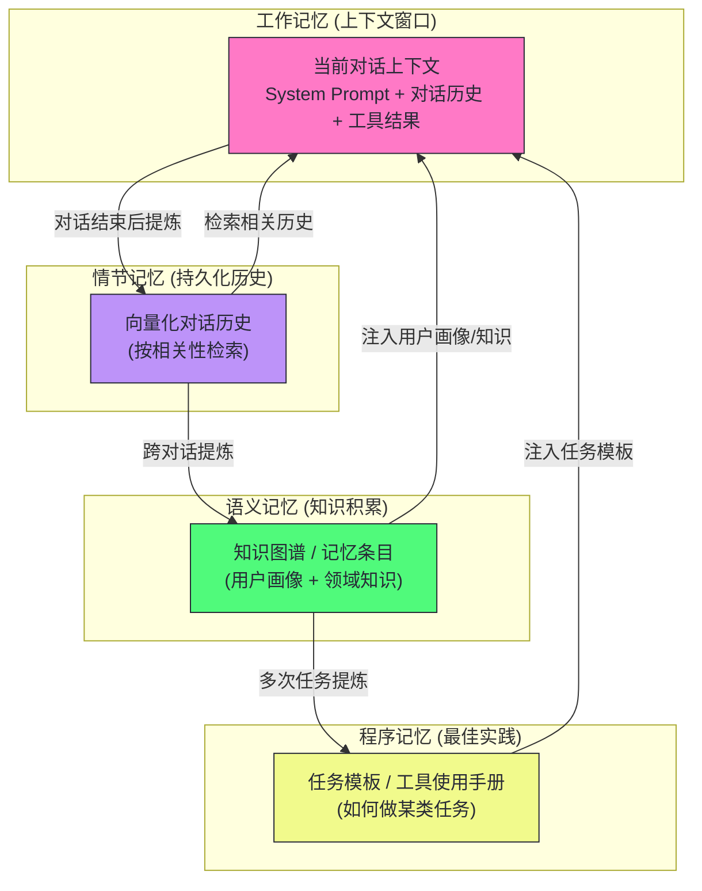

# 12 Agent 记忆体系——从短期缓冲到长期知识

**摘要：**

一个没有记忆的 Agent 是"失忆症患者"——每次对话都从零开始，无法积累用户偏好，无法记住过去的任务结果，无法在多次交互中形成连贯的知识体系。**记忆**是 Agent 从"工具"演进为"伙伴"的关键能力跨越。本文从人类认知科学的记忆分类出发，系统剖析 Agent 记忆的完整四层体系：**In-Context Memory（短期缓冲）** 如何在单次任务中维持工作状态，**Episodic Memory（情节记忆）** 如何跨会话保存交互历史，**Semantic Memory（语义记忆）** 如何积累结构化知识，**Procedural Memory（程序记忆）** 如何沉淀最佳实践。随后以 MemGPT 与 Letta 为主线讲述"记忆的操作系统化"——虚拟上下文管理、核心记忆与外部记忆的分层、Sleep-time 记忆巩固；再深入记忆的读写时机（何时写、何时取、何时忘）、记忆评估基准（LOCOMO、LongMemEval、DolphinBench）的演进，以及记忆工程化中的存储选型、索引与隐私隔离。最后正面回答一个 2025-2026 年反复出现的争论：上下文窗口越来越大，外部记忆还有必要吗？本文的立场是——窗口解决"装得下"，记忆解决"找得到、用得上、跨会话"，二者互补而非互斥。全文的技术落点是权衡：每一层记忆都有容量、成本、一致性与隐私的取舍，因地制宜地组合才是唯一有效的做法。

---

## 第 1 章 为什么 Agent 需要记忆

### 1.1 无状态 LLM 的根本局限

一个 Agent 今天记住了你的偏好，明天再见面时却像从未见过你——这种断裂不是模型能力不够，而是架构里压根没有"记忆"这个部件。标准 LLM API 是**无状态的（Stateless）**——每次 API 调用完全独立，模型不保留任何之前调用的信息。这在单轮问答场景下不是问题，但在需要持续交互的 Agent 场景中，无状态造成了严重的能力局限：

用户体验割裂：用户在今天的对话中告诉 Agent "我不喜欢代码注释用英文，请用中文"，第二天重新打开对话，Agent 完全不记得这个偏好，又用英文注释了——用户需要不断重复说明自己的偏好和背景，体验极差。

任务不可持续：一个需要多天完成的复杂研究任务，Agent 每次都要从头开始理解上下文，无法在前一天的工作基础上继续——每次都重新"热身"，效率极低。

知识无法积累：Agent 在执行任务中发现了一个有用的技巧（比如"这个 API 需要先调用认证接口获取 token"），但这个知识随着会话结束而消失，下次遇到同样情况又要重新探索。

无法个性化：不知道用户是初级还是资深工程师，不知道用户偏好简洁回答还是详细解释，不知道用户的技术栈和项目背景——Agent 只能提供千人一面的通用回答。

把这个状态推演到极限，一个没有记忆的 Agent 就像一家只聘用日结实习生的公司：每天清晨，所有人都把昨天的客户关系、项目背景、技术决策重新问一遍，能力再强也抵不过"归零"的成本。这里的"记忆"需要先做一个限定——它不指模型权重里固化的参数知识（那部分决定了模型"会什么"），而指运行时对具体交互历史的保留与利用（这部分决定了 Agent"记得什么"）。前者是预训练给的，后者是应用架构给的，本专栏讨论的全部是后者。

不过，记忆也并非越多越好，这是贯穿全文的一条暗线。**记忆悖论**在这里就埋下了：塞进上下文的记忆过多，会稀释模型的注意力；存进外部存储的记忆过多，会让检索变慢、召回变噪。记忆系统的设计，本质上是在"记住什么"与"忘掉什么"之间找平衡——这个反直觉的起点，后面几章会反复回到它。

### 1.2 人类记忆的启发

理解 Agent 记忆体系，先从人类记忆的分类说起——这不是类比的噱头，而是因为现代认知科学对记忆的分类确实为 Agent 记忆架构提供了有效的框架。认知心理学把长期记忆按"记的是什么"切成两大阵营：陈述性记忆（Declarative Memory）回答"知道什么"，又细分为情节记忆与语义记忆；程序性记忆（Procedural Memory）回答"怎么做"，与陈述性记忆在神经回路上就是分开的——海马体受损的病人记不住新事实，却仍然会骑自行车。

工作记忆（Working Memory）：当前"意识舞台"上的内容——你现在正在思考的事情，阅读一个句子时脑中保持的前几个词。容量极小（约 7±2 个组块），但访问速度极快。对应 Agent 的**上下文窗口（In-Context Memory）**。

情节记忆（Episodic Memory）：对具体事件和个人经历的记忆——"上周三我在星巴克和老王谈了那个项目"。可以回忆具体时间、地点、情境。对应 Agent 的**会话历史（Episodic Memory Store）**。

语义记忆（Semantic Memory）：对概念、事实、知识的抽象记忆——"巴黎是法国首都"、"Python 的列表推导式语法是 `[x for x in iterable]`"。不依赖具体经历，是去情境化的知识。对应 Agent 的**知识库（Semantic Memory Store）**。

程序记忆（Procedural Memory）：如何做某件事的记忆——骑自行车、打字、驾车。高度自动化，不需要有意识地回忆步骤。对应 Agent 的**最佳实践库（Procedural Memory Store）**：已验证的工具使用方式、任务执行模板。

认知科学还给这套分类配了一条"生产线"：记忆要经过**编码（Encoding）、存储（Storage）、提取（Retrieval）**三个阶段才真正可用；而遗忘不是缺陷而是功能——艾宾浩斯在一百多年前测出的遗忘曲线告诉我们，不重要的信息随时间快速衰减，正是这种"有损"让重要的信息相对突出。Agent 记忆工程里的重要性评分、时间衰减、检索注入，几乎都能在这条曲线上找到原型。但类比到此为止：人类的每次回忆都是一次重构，会走样、会添油加醋；Agent 的存储层可以做到逐字节无损，这既是优势（不会记错），也是负担（不会自己清理），所以遗忘机制要人为设计。下文每一层记忆，都会反复用到"编码-存储-提取"这个三阶段框架来对照。

---

## 第 2 章 In-Context Memory——上下文窗口

### 2.1 上下文即记忆

LLM 的上下文窗口（Context Window）就是它的"工作记忆"——所有当前会话中的信息：System Prompt、对话历史、工具调用记录、检索到的文档……都存放在这个"工作台"上。模型在生成每个 token 时，可以通过 Self-Attention 机制自由访问上下文中的任何位置。

把上下文窗口想成一张物理工作台很贴切：桌上摆得下多少材料，决定了此刻能同时参考多少信息；但桌上每多一张纸，找东西的视线就被多挡掉一点。而且这张工作台有一个和人类工作台迥异的特性——每次推理，模型都要把桌上的所有材料从头重读一遍，材料越堆越高，重读的代价就越大。这是 Agent 最基础的记忆层，也是唯一"天然存在"的记忆形式。但它有几个不可回避的限制：

容量上限（Context Length Limit）：即使是 Claude 3.5 的 200K token 上下文，在密集的多轮对话加上大量工具调用结果后，也可能在几十轮内被填满。填满后，最早的对话内容要么被截断（丢失），要么超出计费范围（成本剧增）。到了 2026 年，Gemini 与 GPT 系列的旗舰模型已经把窗口推到 1M token，容量这条物理上限在松动，但下面两条限制并没有消失。

注意力稀释（Lost in the Middle）：[[LLM/Agent技术/基础范式/06 Prompt 上下文管理——Context Engineering 的艺术|本系列第 06 篇]] 中提到的实验结论——即使模型声称支持 128K 上下文，对中间位置的内容的"注意力"也显著低于开头和结尾。超长上下文并不等于超强的信息利用能力。这条限制在 2025 年被进一步量化成"上下文腐烂（Context Rot）"：Chroma 对 18 个前沿模型的测试发现，退化在远小于窗口上限时就已开始，个别模型塞进 1,000 个无关 token 后表现就显著下滑。

成本正比增长：LLM API 按 token 计费，上下文越长，每次请求的成本越高。一个对话进行到第 100 轮时，每次回复都需要处理前 100 轮的所有内容——成本是第 1 轮的 100 倍。即便引入上下文缓存把重复前缀的单价打下一到两个数量级，"每轮全量重读"这个结构性的成本压力依然存在。

### 2.2 上下文管理策略

针对上下文的局限，工程上有几种成熟的管理策略：

策略一：滑动窗口（Sliding Window）

只保留最近的 $K$ 轮对话，超出的历史直接丢弃。实现最简单，但会硬切断对话历史，可能丢失重要的上下文（如用户在第 5 轮设定的偏好，在第 50 轮时被遗忘）。适合上下文依赖不强的场景（如简单问答）。

策略二：摘要压缩（Summary Compression）

当对话历史接近上下文上限时，用一个小型 LLM（或同一个模型）将较早的对话历史压缩为一段摘要，用摘要替换原始的多轮对话。

```
原始历史（20轮，10000 token）：
[用户: 我在做一个 FastAPI 项目...]
[助手: 好的，FastAPI 是...]
[用户: 我想连接 PostgreSQL...]
... (大量中间过程)

压缩后（1段摘要，300 token）：
"用户正在开发一个基于 FastAPI 和 PostgreSQL 的后端服务。
当前进度：已完成用户认证模块（JWT），正在开发订单管理 API。
用户偏好：代码注释用中文，函数名用小驼峰命名。
技术栈：Python 3.11, FastAPI, SQLAlchemy 2.0, PostgreSQL 15。"
```

摘要保留了任务进度、用户偏好、技术栈等关键信息，而丢弃了详细的问答过程。通常需要精心设计摘要 Prompt，确保摘要包含 Agent 后续工作所需的关键信息。这里有一个在 2025-2026 年反复被验证的结论：**修剪加摘要的效果，经常好过保留完整历史**——本系列第 06 篇引用的一项量化实验里，完整对话历史的任务完成率是 71.0%，修剪到最近 5 个工具对是 79.0%，修剪加摘要反而冲到 91.6%，同时 token 消耗减少约 63%。完整历史不是"忠实记录"，在长任务里它更接近一种负担。

策略三：关键信息提取（Key-Value Store）

在对话过程中，让 Agent 主动识别和提取关键信息（用户偏好、任务状态、已完成步骤、待办事项），以结构化的键值对存储。这些信息总是注入 System Prompt，不受对话历史长度的影响。

```json
{
  "user_profile": {
    "tech_level": "senior",
    "preferred_language": "zh-CN",
    "tech_stack": ["Python", "FastAPI", "PostgreSQL"],
    "naming_convention": "snake_case"
  },
  "current_task": {
    "project": "订单管理系统",
    "current_module": "订单状态流转 API",
    "completed": ["用户认证", "商品查询", "购物车"],
    "pending": ["支付集成", "消息通知"]
  }
}
```

这种方案对结构化信息效果好，但对非结构化的对话细节（如"用户提过一个特殊的业务规则"）不易捕捉。

策略四：RAG 增强上下文

将历史对话存储到向量数据库中，每次新对话时检索与当前话题最相关的历史片段，动态注入上下文。这样上下文始终保持在合理长度，同时能按需取回任意历史信息。详见本章第 3 节（Episodic Memory）。

> [!info] 核心概念
> 上下文管理的核心矛盾是：**保留更多历史 → 成本增加 + 注意力稀释**，**删减历史 → 可能丢失关键上下文**。没有完美的解决方案，只有针对具体使用场景的最优权衡。高频短对话优先滑动窗口；长任务优先摘要压缩；需要长期个性化的场景优先 RAG 增强。四类策略不是互斥的，生产系统里它们通常叠加使用——滑动窗口保底、摘要压缩兜住中间层、KV 提取负责高频关键信息、RAG 负责按需取回历史。

---

## 第 3 章 Episodic Memory——情节记忆

### 3.1 跨会话的对话历史

情节记忆存储的是 Agent 与用户/环境交互的具体事件序列——"什么时间、在什么上下文中发生了什么"。在 Agent 工程中，情节记忆的主要载体是持久化的对话历史。

标准聊天 API 的对话历史只存在于单次会话中，会话结束即消失。要实现跨会话的情节记忆，需要：

1. 在每次对话结束后，将对话历史持久化到外部存储（数据库、文件系统）
2. 在新会话开始时，从存储中加载历史（全量加载或检索式加载）
3. 将历史注入到新会话的上下文中，让 Agent"记得"之前的交互

情节记忆很像一本日记：按时间顺序记录每天发生的事，内容具体、带情境、可回溯。但日记也有写不动的时刻——几年攒下来，谁也不会在每次见面前把整本日记重读一遍。于是"检索式加载"取代"全量加载"就成了必然，而检索要解决的首要问题，是以什么粒度落笔。按单轮对话存，检索回来的片段太碎；按整个会话存，一个会议记录可能长达数千 token。折中的做法是会话内分段 + 会话级摘要：每一段对话按主题切块存入，同时为每个会话生成一段结构化摘要（会话意图、结论、待办），让"细节"与"概览"各得其所。MemoryBank 的会话级摘要机制是这条路线的一个代表，它的摘要在会话结束时生成，随新记忆逐步累积。

### 3.2 向量化的情节记忆

全量加载所有历史对话不现实——用户可能有几年的对话历史，无法全部放入上下文。更实用的方案是将历史对话向量化存储，按需检索：

```python
class EpisodicMemory:
    def __init__(self, vector_store, embedding_model):
        self.vector_store = vector_store      # 如 Chroma/Qdrant
        self.embedding_model = embedding_model

    def save_episode(self, episode: dict):
        """保存一个对话片段到情节记忆"""
        text = f"[{episode['timestamp']}] 用户: {episode['user_msg']}\n助手: {episode['agent_msg']}"
        embedding = self.embedding_model.encode(text)
        self.vector_store.add(
            ids=[episode['id']],
            embeddings=[embedding],
            documents=[text],
            metadatas=[{
                "timestamp": episode['timestamp'],
                "user_id": episode['user_id'],
                "topic": episode.get('topic', ''),
                "importance": episode.get('importance', 0.5)
            }]
        )

    def retrieve_relevant(self, current_context: str, top_k: int = 5) -> list[str]:
        """检索与当前上下文最相关的历史片段"""
        query_embedding = self.embedding_model.encode(current_context)
        results = self.vector_store.query(
            query_embeddings=[query_embedding],
            n_results=top_k
        )
        return results['documents'][0]
```

在每次新对话开始时，用当前的 System Prompt 或用户首条消息检索最相关的历史片段，将其注入上下文：

```
[注入到 System Prompt 的历史记忆]
相关历史记忆（供参考）：
- [2024-12-15] 用户曾询问过 FastAPI 的认证实现，我提供了 JWT 方案。
  用户确认采用了这个方案。
- [2024-12-20] 用户遇到了 PostgreSQL 连接池耗尽的问题，
  我建议使用 asyncpg + SQLAlchemy async，用户表示已解决。
- [2025-01-03] 用户提到他们的团队代码规范要求所有公共 API 都要有 docstring。
```

代码里的 `metadatas` 字段值得单独强调：`timestamp`、`user_id`、`topic`、`importance` 这些元数据不是摆设。向量检索只解决"语义相似"，元数据过滤解决"时空约束"——查询时先用 `user_id` 圈定归属，再按 `timestamp` 限定时间范围，最后在候选集上做相似度排序，检索的精度和成本都会好很多。第 10 章讨论多租户隔离时，`user_id` 这个字段会从"优化项"变成"安全红线"。

向量化情节记忆也有它的先天短板。embedding 是对整段文本的压缩表示，一段很长的多轮对话被压成一个向量后，其中的具体事实往往被稀释——"用户问过 JWT"和"用户最终用了 asyncpg"挤在同一段里，检索时谁先被命中全凭运气。所以工程上倾向于把片段切小（一轮或几轮一组），让每个向量承载尽量单一的信息。

### 3.3 情节记忆的重要性评分

并非所有对话片段都值得长期保存。一个成熟的情节记忆系统需要对片段的"重要性"进行评分，优先保存高价值内容：

高重要性（应长期保存）：
- 用户明确声明的偏好（"我不喜欢..."、"我的团队规范是..."）
- 任务的重大决策节点（"我们决定用 microservice 架构"）
- 已解决的技术难题（问题描述 + 解决方案）
- 错误和教训（"之前用这个方案失败了，因为..."）

低重要性（可以压缩或丢弃）：
- 简单的一问一答（"Python 列表用什么方法排序？" "sort()"）
- 重复性的打招呼和寒暄
- 中间过程的探索步骤（最终被放弃的路线）

可以用一个简单的 LLM 分类来自动评分："给这段对话的重要性打分 1-5，并说明理由"。

重要性评分并不是新点子。Generative Agents（Park et al., 2023）的"记忆流（Memory Stream）"就把每条经验打上时间戳，检索时用一个加权公式综合**新近性（Recency）、重要性（Importance）、相关性（Relevance）**三项打分——新近性随时间指数衰减，重要性由 LLM 在写入时判定，相关性由与当前查询的相似度给出。这个三因子模型至今仍是情节记忆检索的标配，差别只在于各因子的权重怎么调。不过，重要性这个因子本身是个递归问题：用 LLM 判断"这段对话重不重要"，依赖的恰恰是 LLM 对"以后什么会用得上"的预测能力，而预测是会错的。低价值内容被误判为高价值，代价是记忆库膨胀；高价值内容被误判为低价值，代价是"明明记得却检索不到"——后者的危害远比前者隐蔽。

### 3.4 检索的边界

把"检索不到"和"没有记忆"区分开，是情节记忆最容易被忽视的一课。语义相似度是检索的唯一依据，但语义相似并不等于事实相关：用户今天问"帮我查一下去年定下的容量规划"，向量检索很可能把"容量规划"相关的段落召回来，却不一定能定位到"去年、在某个具体会议里"的那一段——时间与因果这类结构化信息，恰恰是纯向量检索的弱项。2025 年的记忆综述《Rethinking Memory in LLM-based Agents》给出了更刺眼的证据：在多组基准上，前沿模型的事后检索召回率（Recall@5）可以超过 90，但下游生成指标（F1）普遍落后 30 分以上——**检索得到，不等于用得上**。这个"检索-生成差距"会在第 8、9 两章反复出现，它是记忆评估从"考检索"转向"考行动"的直接动因。

---

## 第 4 章 Semantic Memory——语义记忆

### 4.1 情节记忆的局限

情节记忆保存的是"发生过什么"——具体的时间、事件、对话。但知识的积累需要从大量具体事件中提炼出**通用、去情境化的事实和规律**。

例如，用户在不同时间段说过：
- "我们用 Kubernetes 部署服务"（第 5 次对话）
- "我们的 k8s 集群用 Helm 管理"（第 23 次对话）
- "我们的 pod 内存限制通常是 512Mi"（第 41 次对话）

这三条情节记忆可以提炼成一条语义记忆："用户使用 Kubernetes + Helm 部署服务，典型 Pod 内存限制 512Mi"。这条语义记忆比三条原始情节更紧凑、更易检索、更通用。用写作来打比方：情节记忆是流水账，语义记忆是把流水账里反复出现的规律提炼成词条——词条不带时间戳，但它描述的规律比任何单日记录都持久。

### 4.2 知识图谱式语义记忆

最结构化的语义记忆形式是知识图谱——将知识表示为实体（Entity）和关系（Relation）的三元组：

```
(用户, 使用, Kubernetes)
(用户项目, 采用, 微服务架构)
(用户团队, 规模, 5人)
(用户, 擅长, Python)
(用户, 不熟悉, Rust)
```

MCP 官方 Servers 仓库里的 Memory Server（`@modelcontextprotocol/server-memory`，由 Anthropic 主导维护）就是基于知识图谱实现的——它以本地 JSON 文件维护一个知识图谱，提供 `create_entities`、`create_relations`、`add_observations` 等原子工具，随对话积累自动提炼实体和关系，在后续对话中由模型决定何时检索相关节点注入上下文。注意归属要澄清：这是 MCP 官方参考实现里的记忆服务，不是 OpenAI 的产品；OpenAI 的记忆能力至今主要停留在 ChatGPT 产品侧（2025 年 4 月起可自动引用全部历史对话），开发者并不能通过公开 API 直接读写那份记忆，这也是 Mem0 这类开源记忆层能迅速获得关注的原因之一。

知识图谱相对向量条目的核心优势是可遍历：查询"我们给用户项目配过哪些中间件"不需要把整段记忆读一遍，沿实体关系做一次图遍历就能得到结构化答案；实体消歧也比纯文本自然——"老王"和"王工"在向量空间里是两段文本，在图里可以指向同一个节点。代价也明显：图的质量完全取决于抽取器的准确率，实体识别错了，后面的查询都建立在歪斜的地基上；而"维护一个本地知识图谱"听起来轻巧，实体合并、关系去重、孤立节点清理都需要持续投入。

### 4.3 语义记忆的提炼与更新

从情节记忆提炼语义记忆需要一个**知识提炼（Knowledge Distillation）** 过程。可以在每次对话结束后，用 LLM 分析本次对话，提炼出新的知识点：

```python
KNOWLEDGE_EXTRACTION_PROMPT = """
分析以下对话，提炼出关于用户、用户项目、用户偏好的结构化知识点。
每条知识点格式：(主体, 属性/关系, 值)
只提炼明确、可验证的信息，不要推测。

对话：
{conversation}

提炼出的知识点（JSON数组格式）：
[
  {"subject": "...", "predicate": "...", "object": "..."},
  ...
]
"""
```

语义记忆还需要处理知识更新——用户的技术栈、项目状态会随时间变化。需要检测与现有知识的冲突（"用户之前用 Python，现在说改用 Go 了"），并更新对应的知识节点，而非简单追加。这里的工程难点是冲突检测的时机：新知识写入时，它要与"哪些"旧知识做比对？穷举全部存量记忆不可行，通常的做法是检索与新知语义相近的候选条目做比对——这又回到了第 3 章的问题：检索召回不够，冲突就检测不到，新旧两条矛盾的事实会同时在库里存很久。

更进一步的设计是**双时态（Bitemporal）建模**——把"这条知识什么时候开始为真（valid time）"与"这条知识什么时候被系统学到（transaction time）"分开记录。这样"用户曾经用 Python、后来改用 Go"就不是一条覆盖另一条，而是两条各自带有效时间段的记录，追问历史时依然答得上来。Memento 这类双时态知识图谱记忆库（2025-2026 年出现的一批 MCP 记忆服务）走的正是这条路。它的代价是查询逻辑变复杂——每一次读取都要带上时间语义，简单场景下反而显得笨重。

### 4.4 自然语言语义记忆（Mem0 方案）

对于不需要严格图结构的场景，Mem0（一个开源 Agent 记忆库，GitHub 星标在 2026 年已超过六万）提供了更工程化的语义记忆方案：

1. 每次对话后，用 LLM 从对话中提炼出"记忆条目"（自然语言句子，如"用户偏好简洁的代码，不喜欢过度注释"）
2. 将记忆条目向量化存储
3. 查询时，将新问题与现有记忆条目做相似度匹配，检索相关记忆注入上下文
4. 添加新记忆时，自动检测与现有记忆的冲突，更新矛盾的记忆而非重复添加

Mem0 的优势是实现简单（不需要维护图数据库），同时通过向量检索实现了灵活的记忆查询。

它的内部管线值得展开，因为它是 2025-2026 年开源记忆层的事实标准：整个流程分**提取（Extract）、更新（Update）、检索（Retrieve）**三步。提取阶段用 LLM 把一段对话压缩成候选记忆条目；更新阶段是精髓——系统把候选条目与库内相似条目做比对，输出四类事件之一：**ADD**（新事实，直接入库）、**UPDATE**（与旧条目冲突，改写旧条目）、**DELETE**（旧条目被证伪，移除）、**NOOP**（无新信息，丢弃）。检索阶段再把命中的条目连同元数据拼进上下文。这套"先比对再落笔"的流程，正是对第 4.3 节冲突检测问题的工程化回答；Mem0 官方论文（arXiv:2504.19413，2025）在 LOCOMO 基准上的实验显示，它在 LLM-as-a-Judge 指标上比 OpenAI 的 ChatGPT 记忆方案高约 26%，相比"全量塞上下文"的方案 p95 延迟降低约 91%、token 成本节省超过 90%——注意这些数字是特定基准、特定模型的测量，参考价值在于量级而非精确值。

当需要把实体间的关系也利用起来时，Mem0 还提供图记忆变体（Graph Memory），把实体和关系单独入图，语义条目与图谱双轨并存。这与 Zep 的路线殊途同归——Zep 用名为 Graphiti 的**时序知识图谱（Temporal Knowledge Graph）**引擎，把对话与业务数据都合入带时间戳的图谱（arXiv:2501.13956，2025），在 Deep Memory Retrieval（DMR）基准上以 94.8% 对 93.4% 超过 MemGPT，并在 LongMemEval 基准上最高带来 18.5% 的准确率提升、响应延迟降低约 90%。图谱派与向量派的取舍，用一张表可以看清：

| 维度 | 向量记忆条目 | 知识图谱 | 时序知识图谱 |
| :--- | :--- | :--- | :--- |
| **存储单元** | 自然语言句子 | 实体-关系三元组 | 带有效时间的三元组 |
| **查询方式** | 相似度检索 | 图遍历 + 实体检索 | 图遍历 + 时间过滤 |
| **冲突处理** | 写入时语义比对 | 实体合并/关系去重 | 双时态版本化 |
| **时间推理** | 弱（靠元数据） | 弱（需自建） | 强（原生支持） |
| **实现成本** | 低 | 中 | 高 |
| **适合场景** | 通用个性化 | 知识密集型问答 | 需要回答"什么时候"的长期场景 |

---

## 第 5 章 Procedural Memory——程序记忆

### 5.1 从经验到最佳实践

程序记忆是最高层次的记忆抽象——它不记录"发生了什么"（情节），也不记录"知道什么"（语义），而是记录**"如何做某件事"**：完成特定类型任务的步骤、工具的最佳使用方式、已验证的模板和脚手架。

一个具体的例子：Agent 在处理第 20 个"分析 CSV 数据文件并生成报告"的任务时，已经形成了一套高效的工作流：

1. 先用 `read_file` 读取 CSV 文件的前 5 行，了解列名和数据格式
2. 检查数据类型（用 pandas `dtypes`）
3. 检查缺失值（`isnull().sum()`）
4. 生成基础统计描述（`describe()`）
5. 根据数据特点选择可视化类型（数值型→直方图，分类型→柱状图）
6. 按照用户偏好的报告模板生成 Markdown 报告

这套工作流是从大量类似任务的执行经验中提炼出来的"最佳实践"。如果 Agent 能记住这套流程，下次遇到类似任务时直接复用，而不是从头推导，效率会大幅提升。用人类的肌肉记忆来理解最直接——骑车、打字、驾车，最初都需要有意识地想每一步，熟练之后变成"身体自己会做"；程序记忆的目标就是让 Agent 对一类任务产生这种"熟练"。

### 5.2 程序记忆的技术实现

程序记忆的存储形式通常比情节记忆更结构化：

工具使用模板：特定工具（如 GitHub API、Jira API）的标准调用序列，以及每种场景下应该传递的参数模板。

任务执行模板：对特定类型任务（代码审查、数据分析、文档生成）的标准执行步骤，以 Prompt 模板或伪代码的形式存储。

错误处理手册：常见错误的识别特征和对应的修复策略。例如"如果 SQL 查询返回空结果，先检查日期范围，再检查表名拼写"。

在工程实践中，程序记忆通常以 System Prompt 片段的形式存储——当 Agent 开始一个特定类型的任务时，自动将对应的程序记忆片段注入 System Prompt，给 Agent 提供"肌肉记忆"。

2025-2026 年，程序记忆有了一个更流行的载体——**技能（Skills）**。Anthropic 的 Agent Skills 规范和 Hermes 的 SKILL.md 体系（详见 [[LLM/Hermes-Agent/06 持久记忆——MEMORY.md、USER.md、Honcho|Hermes 系列第 06 篇]]）都是把"如何做某类任务"写成一份结构化文档，配说明、步骤、陷阱与验证方法，按需渐进式加载。这比把流程写死成代码更符合"记忆"的本意：技能是给 Agent 参考的"操作手册"，Agent 执行时仍保留临场判断。不过要警惕反向走偏——程序记忆一旦固化，就成了另一种形式的"死代码"：环境变了（API 升级、工具改名），旧的最佳实践反而变成误导。所以程序记忆需要版本化与定期复核，这也是它与语义记忆最大的不同——语义记忆错了是"静默的"，程序记忆错了会在下一次执行时暴露出来，这反而给了系统自我修复的机会。

---

## 第 6 章 记忆体系的整体架构

### 6.1 四层记忆的分工与协作



这四层记忆形成一个**由下到上的抽象层次**，以及一个**由上到下的注入路径**：

- 抽象方向（下→上）：具体事件→经验积累→知识提炼→最佳实践
- 注入方向（上→下）：程序记忆/语义记忆/情节记忆按需检索，都注入到上下文窗口（工作记忆）

把这套架构想成一座图书馆的四个楼层更形象：一楼是报纸合订本（情节记忆，按时间排架，忠实记录每一天），二楼是百科词典（语义记忆，去情境化的词条），三楼是操作规程手册（程序记忆，教你怎么干），而借阅台（上下文窗口）只摆当次任务真正要用的那几本。四层之间靠"提炼"向上流动、靠"检索"向下供给，整个系统运转的核心问题只有一个：每一次推理时，该把哪几页书放到借阅台上。

### 6.2 记忆与遗忘的平衡

人类记忆有遗忘机制——不重要的信息会逐渐淡化，重要的信息会强化。Agent 的记忆系统同样需要处理"遗忘"：

时间衰减（Temporal Decay）：老旧的记忆随时间降低权重。用户三年前用的是 Python 2.7，现在肯定已经升级了，这条记忆的相关性应该降低。实现：为记忆条目记录创建时间，检索时对老记忆的相似度分数乘以一个时间衰减因子。

显式更新与删除：当用户明确声明某个信息已经变化（"我换工作了"、"我们不用 Vue 了，改用 React"），旧的相关记忆应该被更新或标记为过期。

重要性阈值：只有重要性评分超过阈值的信息才进入长期记忆，低价值的信息不保存，控制记忆库的规模。

遗忘不是记忆系统的缺陷，而是它的**内存管理**。人类大脑在睡眠时修剪突触、巩固重要记忆，Agent 记忆库也需要对应的"清理任务"——这个思路在 2025-2026 年演化成了一条专门的工程路线，下一章讲 MemGPT 与 Letta 时会看到它的操作系统化形态，第 8 章再讲它的落地细节。

---

## 第 7 章 MemGPT 与 Letta——记忆的操作系统化

### 7.1 MemGPT：把 LLM 当成操作系统

2023 年 10 月，一篇题为《MemGPT: Towards LLMs as Operating Systems》的论文（Packer et al., arXiv:2310.08560）给 Agent 记忆带来了一次视角转换。此前的记忆增强思路都是"外挂"——把历史存到向量库，需要时检索出来拼进 prompt；MemGPT 则提出了一个更系统的隐喻：**把 LLM 当成一个操作系统**——上下文窗口是物理内存，向量库是磁盘，记忆管理是操作系统的换页（Paging）机制。

这个隐喻的骨架是两层存储。主上下文（Main Context）相当于内存，存放当前任务的推理状态；外部上下文（External Context）相当于磁盘，分两块——召回存储（Recall Storage）存对话历史，档案存储（Archival Storage）存用户主动写入或系统提炼的长期记忆。当主上下文逼近容量上限时，系统不是简单截断，而是执行一次"上下文编辑（Context Editing）"：把旧的对话轮次"换出"到召回存储，把当前需要的记忆"换入"主上下文——和操作系统把不常用的内存页换出到 swap 分区是一个道理。

MemGPT 的第二个关键设计是**自编辑记忆（Self-editing Memory）**：不是外部程序决定写什么，而是模型自己通过工具调用来管理记忆。它给 Agent 提供了 `heartbeat` 请求机制（`request_heartbeat` 工具）——模型可以在一次推理结束后主动请求继续执行，从而在"完成任务"和"管理记忆"之间自主调度；对话通过特殊的 `send_message` 工具输出，让一切交互都变成工具调用。这套设计的代价也很直白：它要求底层模型具备可靠的工具调用能力，在 2023 年这是相当苛刻的前提。

把 MemGPT 与传统 RAG 对比，能看清它到底新在哪。RAG 是"查询式"的外部记忆——用户来查，系统去取，取回来的是文档片段；MemGPT 是"换页式"的记忆管理——Agent 主动决定什么进内存、什么出内存，外部存储里的内容以"记忆单元"而非"文档"的身份参与推理。前者把记忆当数据，后者把记忆当系统资源。这个区别决定了后续记忆框架演进的分水岭。

### 7.2 Letta：从论文到产品

MemGPT 团队随后把项目产品化，更名为 Letta（letta-ai/letta），并在 2024-2025 年间完成了从论文架构到生产框架的迁移。Letta 的记忆架构忠实继承了 MemGPT 的两层模型，但给出了更细的分工：

- **核心记忆（Core Memory）**：占据上下文窗口内一块固定的、可编辑的区域，由若干记忆块（Blocks）组成——最常见的配置是两个块：记录用户信息的 `persona` 块与记录 Agent 自我设定的 `human` 块。Agent 用 `core_memory_append`、`core_memory_replace` 工具更新它们，实现"长期活在上下文里"的小容量高优先级记忆。
- **召回记忆（Recall Memory）**：自动记录全部对话历史，Agent 用 `conversation_search` 工具检索——对应情节记忆。
- **档案记忆（Archival Memory）**：向量数据库，Agent 用 `archival_memory_insert` 写入自由格式的长期记忆，也可由开发者直接灌数据——对应语义记忆。

这套架构把"上下文窗口内的一块常驻区域"从工程 hack 变成了显式设计——记忆块像操作系统里常驻内存的内核区，小、快、永不换出；而检索式记忆像用户态进程，按需换入。

### 7.3 演进与争议

2025 年是 Letta 架构大幅转身的一年，几件大事值得记录。其一，2025 年 4 月 Letta 与 UC Berkeley 联合发表《Sleep-time Compute》（arXiv:2504.13171），提出让模型在"空闲时间"离线思考上下文、预计算用户可能追问的答案：在 Stateful GSM-Symbolic 与 Stateful AIME 两个任务上，同样的准确率所需的测试时算力降低约 5 倍，多问题共享上下文时单查询成本再降 2.5 倍。其二，同年 Letta 把"睡眠"产品化为 **Sleep-time Agent**（博客标题直接称其为 MemGPT 2.0）：系统背后跑两个 Agent——负责对话的主 Agent 不再拥有编辑核心记忆的工具，记忆的管理权交给专门的"睡眠 Agent"，在对话间隙或定时后台运行，负责整理、去重、重写记忆。这等于承认了原版 MemGPT 的一个隐患：让主 Agent 一边干活一边管理记忆，既拖慢对话又不可靠——把记忆管理从"在线路径"挪到"离线路径"，换来了写入延迟的消失和记忆质量的提升。其三，2025 年 9 月底 Letta 引入 **Memory Omni-Tool**，配合 Claude Sonnet 4.5 的记忆能力，让 Agent 可以动态创建、删除、重组记忆块，记忆管理从"两个固定工具"变成"一个万能工具"。

不过，操作系统化这条路不是没有争议。原版 MemGPT 对工具调用的强依赖，在 2023 年是个限制，2025 年却成了负担——当模型原生推理能力足够强之后，让模型在每一步都显式地"决定要不要心跳、要不要换页"反而显得笨拙。Letta 自己也在 2025 年 10 月发布的 v0.12.1 中推出了全新的 `letta_v1_agent` 架构，明确弃用 `send_message` 与心跳机制，理由是"现代模型已经内化了 agentic 控制循环，不需要框架再教它"。这意味着记忆管理的控制权正在从"框架的显式工具"交还给"模型的原生推理"——操作系统隐喻本身没死，但"由谁来按换页键"的答案变了。

---

## 第 8 章 记忆的读写时机——何时写、何时取、何时忘

前面几章回答了"记什么"，这一章回答工程上更磨人的问题："什么时候记、什么时候取、什么时候忘"。读写时机看似实现细节，实际上决定了记忆系统的成本结构、时效性和可靠性——同样的存储与检索代码，时机选错，效果天差地别。

### 8.1 写入时机：快写还是精写

记忆写入有三个可选时机，各有取舍：

实时写入：对话进行中，Agent 边聊边把值得记的事实写进存储。优点是信息不丢——一段对话结束前 Agent 可能已经忘了开头出现过的重要细节；缺点是**写入路径占用了对话路径的延迟预算**。记忆提取通常要调一次 LLM，如果每次写记忆都让用户多等几秒，体验代价不小。社区流传的 Agent 记忆工程资料（Mem-101）给出的经验法则是：写入路径必须快，快的前提是"只做当下最少必要的工作"——比如只在检测到与存量记忆冲突时才触发合并，而不是每次写入都全量比对。

会话结束批量写入：对话结束后统一提炼。延迟压力消失，但信息有丢失风险——长对话的中间过程可能已经被上下文压缩"吃掉"。MemoryBank 和多数记忆框架的会话级摘要走的是这条路线。

离线/睡眠写入：把记忆整理完全移出在线路径，交给后台进程。这是 Letta Sleep-time Agent 的做法——整理、去重、重写都发生在对话之外，主 Agent 永远不为记忆操作等待。代价是"生效延迟"：新记忆要等下一次整理运行后才对 Agent 可见。Hermes 的快照机制（会话中记录、会话后生效，详见 [[LLM/Hermes-Agent/06 持久记忆——MEMORY.md、USER.md、Honcho|Hermes 系列第 06 篇]]）也是同一思路的不同实现。

三种时机的本质是**在"写入的实时性"与"对话的响应速度"之间做交易**，不存在通吃的方案。生产里的常见组合是：对话中只做轻量 KV 提取（快），会话结束时做一次完整提炼（全），定期跑一次后台整理（净）。

### 8.2 检索时机：预检索还是按需检索

检索时机的选择比写入更微妙。会话开始预检索（把与首条消息相关的历史一次性注入）简单直观，但注入的记忆占住上下文位置，如果检索不准，反而挤压了当次任务的推理空间；每轮检索信息最新鲜，但每轮都多一次检索调用的延迟与 token 开销；按需检索（Just-in-Time）把检索权交给 Agent 自己——模型判断"此刻需要回忆什么"时再触发检索工具，这是 Claude Code、Letta 等生产 Agent 的主流选择，也是本系列第 06 篇讲过的 Context Engineering 原则的延伸。

无论哪种时机，检索结果注入的位置都值得讲究：注入 System Prompt 的记忆会被模型当作"背景设定"，可信度默认很高；注入对话中间的记忆会被当作"普通上下文"，模型可能反复权衡是否采信。记忆条目里若混入了过时事实，放在 System Prompt 里的危害远大于放在对话里——这也是为什么很多系统坚持在注入时附上时间戳与来源，让模型有机会判断"这条记忆还新鲜吗"。

检索-生成差距在这里再次出现：检索召回率高不等于生成效果好。同一份综述（arXiv:2505.00675）给出的解释很有启发——检索结果太多会引入噪声，干扰模型聚焦当前任务；时间距离越远，即使检索准确，模型也越难把它用好；还有语言差异，同一套记忆在英文查询上表现好，换中文就掉一截。这些都不是"检索器不够准"能解释的，它们指向一个更深的问题：**记忆的最终价值不在检索命中，而在生成时被正确使用**。

### 8.3 遗忘的工程化：从时间衰减到记忆生命周期

第 6 章讲的三种遗忘手段（时间衰减、显式更新、重要性阈值）是"概念层"的，工程层还有一个更完整的分层框架。2026 年 8 月，Mem0 发布了名为 **Dream** 的后台记忆整理服务，把遗忘工程化成三个显式操作：

- **合并（Merge）**：新记忆完整包含旧记忆的信息时，旧条目标记为 `merged` 并指向新条目，检索默认不再返回它。
- **取代（Supersede）**：新记忆取代旧事实时，旧条目标记为 `superseded`，检索默认返回新条目，但历史仍可查询（`latest_only` 开关）。
- **综合（Synthesize）**：后台任务把多条相关记忆综合成一条更上位的概括记忆——多条分散的"周二上瑜伽课、周四上瑜伽课、习惯早起"最终沉淀成一条"用户的晨间瑜伽惯例"。

Dream 的三个操作有一个共同前提：**什么都不真删**。所有变更都记录为带指针的状态转移，用户可以逐条审查。Mem0 官方博客用数据库领域的既有实践作类比——LSM 树的压缩、PostgreSQL 的 vacuum、git 的垃圾回收——记忆系统的快写路径（提取+检索）早就有了，缺的正是后台维护进程。这个类比点破了一件事：遗忘工程化不是新发明，而是把数据库系统几十年验证过的"前台快写 + 后台维护"架构搬到记忆层。

这一章可以提炼出一个总原则：**记忆系统要同时管好三条时间线——写入的实时性、检索的新鲜度、遗忘的周期性**。任何一条线失衡，都会在"记了却用不上"、"用了却已过期"、"该忘的忘不掉"三种故障里兑现。

---

## 第 9 章 记忆的评估——从问答正确率到行动完成率

### 9.1 基准的演进：LOCOMO、LongMemEval 与 DolphinBench

记忆系统的评估基准在 2024-2026 年经历了至少两代更迭。第一代是问答式基准。LOCOMO（Maharana et al., ACL 2024, arXiv:2402.17753）是最有代表性的一个：它构造了十组超长对话（每组平均约 300 轮、9K token、跨最多 35 个会话），按单跳（Single-hop）、多跳（Multi-hop）、时间推理（Temporal）、开放域（Open-domain）、对抗性（Adversarial）五类问题考察 Agent 的长期记忆，结论相当悲观——无论是长上下文模型还是 RAG 方案，都明显落后于人类水平。LongMemEval（Wu et al., ICLR 2025, arXiv:2410.10813）把考察维度整理成**信息提取、跨会话推理、时间推理、知识更新、弃答（Abstention）**五项能力，构造了 500 道题，并且做了两档规模——S 档约 115K token（30-40 个会话）、M 档约 500 个会话、150 万 token；实验发现商业聊天助手与长上下文模型在长程记忆上准确率普遍下滑 30%-60%。这些数字的共同含义是：**窗口大了、检索强了，长期记忆依然没有解决**。

第二代基准在 2026 年出现，代表性事件是 Mem0 发布的 **DolphinBench**（arXiv:2609.24971）。它的设计哲学是"把问题从考卷里拿掉"：不给 Agent 任何"这需要回忆"的提示，只给它一个真实的任务请求（"把这条发布说明发到合适的频道"），而正确答案取决于三年多以前用户随口定下的一条规则。基准为三个虚拟用户各生成约 50 万 token 的对话历史与 600 个工具调用型任务，用 Agent 实际采取的行动来评分，同时报告准确率、总成本与延迟，并用"给全历史能过、不给历史必挂"的可解性验证来防止答案本身出错。一句话概括两代基准的差异：**问答式基准考的是"检索得到吗"，行动式基准考的是"用得对吗"**——后者才是记忆在生产里的真实价值。

### 9.2 记忆系统的评估指标

如何判断记忆系统运作良好？关键指标：

| 指标 | 衡量方式 | 目标 |
| :--- | :--- | :--- |
| **记忆召回率** | 相关历史是否被检索到 | > 80% |
| **记忆精度** | 检索到的历史中有多少真正相关 | > 70% |
| **知识一致性** | 语义记忆中是否存在互相矛盾的条目 | < 5% |
| **上下文注入量** | 注入的记忆占上下文的比例 | < 20% |
| **用户感知** | 用户是否感觉 Agent"记住"了重要信息 | 主观评分 |

这张表需要补两个 2025-2026 年新增的维度。其一是**成本与延迟**——记忆系统的开销不是免费的，Mem0 论文中"相对全量上下文方案 p95 延迟降低 91%、token 成本节省 90% 以上"这类数字说明，记忆系统经常不是为了让 Agent"更准"，而是为了让 Agent"用得起地更准"。其二是时间敏感度——用 LOCOMO 的时间推理题和 LongMemEval 的知识更新题专门测"记得住多久以前的事"与"能不能跟上变化"，这是普通召回率测不出来的维度。

### 9.3 评估的局限与陷阱

三个陷阱值得提醒。其一，**高召回不等于高可用**——第 3.4 节的检索-生成差距已经说明，检索指标漂亮的下游可能一塌糊涂，评估必须延伸到生成端。其二，基准的"给答案提示"问题——问答式基准的提问本身就宣告了"有这样一个事实"，等于替系统完成了最难的一步（判断何时该检索）；行动式基准正是冲着这个漏洞来的。其三，合成数据的保质期——所有基准都是合成对话，合成数据的分布与真实用户对话有偏差，基准上的领先不完全等于生产里的领先。合理的做法是把基准当体检指标而非期末考试——定期测、看趋势、和生产指标（用户是否觉得 Agent"记得"）对照着看。

---

## 第 10 章 记忆的工程化——存储、索引与隐私

### 10.1 存储选型

四层记忆对存储引擎的要求各不相同，先看清这张地图再选型：

| 存储方案 | 适合的记忆层 | 优势 | 代价 |
| :--- | :--- | :--- | :--- |
| **向量数据库** | 情节记忆、语义条目 | 语义检索直接、生态成熟 | 精确匹配弱、时间推理弱 |
| **KV/关系数据库** | 用户画像、会话摘要 | 强一致、事务、易审计 | 无语义检索 |
| **知识图谱数据库** | 语义记忆（实体关系） | 可遍历、可推理 | 抽取质量依赖 LLM、运维重 |
| **文件系统** | 程序记忆、轻量记忆 | 人类可读、零依赖、可 diff | 无索引、规模受限 |

向量库是默认选择，但默认选择不总是正确选择。回忆一下四层记忆的访问模式：情节记忆是"语义相似"驱动的，向量库合适；用户画像与 KV 提取是"精确键"驱动的，KV 或关系库反而更稳——JSON 里读一个 `naming_convention` 字段，用不着向量检索；程序记忆是"任务类型"驱动的，文件系统（如 SKILL.md）配合按需加载就够了。**存储选型应该跟着记忆层的访问模式走，而不是所有记忆都塞进一个向量库**——这是记忆工程化最容易踩的坑之一。

### 10.2 最小可行记忆系统

对于大多数生产 Agent，一个实用的"最小可行记忆系统"由两部分组成：

**持久化的用户画像（User Profile）**：以结构化 JSON 存储用户的关键属性，每次新会话时全量注入 System Prompt。内容通常包括：技术水平、偏好语言、技术栈、项目背景、沟通风格偏好。总大小控制在 300-500 token 以内，不影响上下文预算。

**向量化的对话历史**：对话历史存入向量数据库，每次新会话开始时检索 Top-5 最相关的历史片段注入上下文。这两部分就能覆盖 80% 的记忆需求场景。

这个最小系统有清晰的演进路径：当用户画像从"固定 JSON"变成"自动提炼 + 冲突解决"，就升级成了 Mem0 式的语义记忆；当历史检索从"相似度 Top-5"变成"时间加权 + 元数据过滤"，就接近了生产级情节记忆；当"怎么干活"的经验沉淀成可加载的技能文档，程序记忆就位了。先把两件最小的事做对，比一开始就追求四层齐全更稳妥。

### 10.3 多租户隔离与隐私

Agent 记忆系统需要认真对待隐私问题——这在多租户 SaaS 场景里已经不是"最佳实践"，而是安全红线：

数据隔离：多用户系统中，每个用户的记忆必须严格隔离，不能被其他用户的 Agent 访问。向量数据库中需要为每条记忆记录 `user_id`，所有查询都必须带上 `user_id` 过滤条件。生产级系统还会再加一层租户维度：`tenant_id`（客户）→ `user_id`（用户）→ `memory_space_id`（记忆空间）三级隔离，每一级都在查询时强制过滤——授权判定必须发生在相似度排序之前，否则系统可能在返回结果后才意识到"这条记忆不该给这个用户看到"，而那时数据已经泄漏了。

敏感信息保护：对话中可能包含密码、API Key、个人隐私信息。记忆系统在存储前应过滤或脱敏这类信息，避免将敏感数据持久化到记忆库。2025 年 OWASP 发布的 MCP Top 10 风险清单把"上下文注入与过度共享（Context Injection & Over-Sharing）"列为高危项——多个 Agent、多个用户共享同一记忆库时，一个会话的敏感内容可能被另一个会话检索到，这种跨会话泄漏在 agentic 系统里传播得又快又隐蔽。建议为记忆条目设置 TTL 或过期规则，并对"记忆能被谁检索"做显式声明。

用户控制权：用户应该能查看 Agent 存储了哪些关于自己的记忆，并能删除不想保留的记忆。这是 GDPR 等隐私法规的基本要求，也是用户信任的基础。OpenAI 的 ChatGPT 记忆（2024 年 2 月上线、2025 年 4 月扩展为自动引用全部历史对话）从一开始就提供了"查看记忆、删除记忆、关闭记忆"的控制面板，记忆的写入还会在界面上提示用户——产品侧的记忆控制权设计可以作为参考样板。工程上要注意删除的完整性：删一条记忆不等于删干净，向量里的 embedding、图谱里的实体、缓存里的副本都可能残留，级联删除与"已删除内容不得再被检索"的验证要写进验收标准。

### 10.4 记忆的可观测性

最后补一条常被忽略的工程要求——记忆必须**可观测**。记忆是影响 Agent 行为的重要输入，如果记忆库对开发者是个黑盒，出了问题根本无从排查。最务实的做法是让记忆对人类可读：Hermes 用 MEMORY.md/USER.md 纯文本文件存记忆，用户随时能打开看、手动改；Mem0 的记忆条目本身就是自然语言句子，配管理界面逐条审查；Dream 的合并/取代/综合操作全部留下状态转移记录。把记忆当"配置项"而非"内部状态"来管理，这条原则比任何高级特性都更能决定记忆系统的可信度。

---

## 第 11 章 记忆与长上下文——竞争还是互补

### 11.1 窗口变大的时代

2025-2026 年，一个声音越来越大："上下文窗口都到 1M token 了，还要外部记忆干什么？"论据看起来很硬：Gemini 1M 窗口早已是标配，GPT-5.4（2026 年初）也把 1M 窗口与原生压缩一起发布，配合上下文缓存，长上下文推理的成本降了不止一个数量级。把全部历史整段塞进窗口，"记不住"的问题似乎可以直接绕过去。

这个论证的缺口在于：**窗口解决的是"装得下"，记忆解决的是"找得到、用得上、跨会话"**。装得下不等于用得好——第 2 章的注意力稀释与 Context Rot 已经说明，退化在窗口远未装满时就已开始；一篇 2025 年的综述实验（arXiv:2501.01880）直接对比了长上下文与 RAG 两条路线：在纯问答基准上长上下文通常略占上风（尤其基于 Wikipedia 的检索），但在对话式与通用查询上 RAG 反而有优势，而"两者组合是否更好"在不同论文里结论互相矛盾——没有一条路线是稳定的通吃方案。

### 11.2 成本账与记忆的本质功能

再算一笔成本账。1M 窗口再便宜，"每轮全量重读"的结构依然存在：一个 500 轮的对话，第 500 轮仍要为前 499 轮付费，哪怕其中有 480 轮与当前问题毫无关系。Mem0 论文里"全量上下文方案"作为对照基线全面落败的数据（延迟与成本高一个数量级），本质上就是在证明这笔账。而记忆系统的立身之本恰恰是**选择性**——只把当下推理需要的高信号片段放上工作台，其余留在仓库里。

还有两个窗口永远替代不了记忆的场景。其一是跨会话的连续性：窗口是会话内的概念，会话结束窗口即清空，而记忆是会话间的——明天的会话凭什么记得昨天的结论？除非把历史全部再灌进明天的窗口（成本爆炸），否则跨会话只能靠外部存储。其二是共享与隔离：同一个记忆库可以被多个 Agent 按权限共享（团队规则、项目背景），也可以按用户严格隔离（第 10.3 节），这是窗口这种"会话私有空间"根本做不到了——窗口里没有"别的 Agent"，更没有"不该看这个的 Agent"。

### 11.3 融合的形态

所以更准确的图景是二者融合，而不是二选一。2026 年主流的做法可以概括为"**大窗口管当下，记忆管跨会话**"：窗口内保持精简的高信号上下文（Context Engineering 的修剪、压缩、外化三件套），记忆层负责在会话边界之间搬运、沉淀、筛选知识，检索回来的记忆再经过精选（数量克制、时间戳标注、冲突检查）才注入窗口。Letta 的立场更彻底——它直接断言"把更多信息塞进窗口不是长期方案"，并给出了"上下文污染（Context Pollution）"这个命名；但在同一篇文章里，它也承认新的基础模型原生推理能力让记忆管理变得更可靠。窗口与记忆不是零和博弈，它们各自在解决不同层面的问题：**窗口是容量问题，记忆是组织问题；容量会继续膨胀，组织问题不会消失**。对工程团队而言，正确的姿态不是站队，而是按任务形态分配预算——单会话、一次性的任务尽量留在窗口里；跨会话、个性化、团队共享的知识交给记忆层。

---

## 第 12 章 总结

Agent 记忆体系是从"工具"到"伙伴"的关键跨越。四层记忆各司其职：

| 记忆层 | 存储内容 | 持久化时间 | 技术实现 |
| :--- | :--- | :--- | :--- |
| **In-Context** | 当前会话工作状态 | 会话内 | LLM 上下文窗口 |
| **Episodic** | 历史对话事件 | 跨会话，长期 | 向量数据库 |
| **Semantic** | 提炼的用户/领域知识 | 长期，可更新 | KV 存储 / 知识图谱 |
| **Procedural** | 任务模板 / 最佳实践 | 长期，版本化 | 结构化文档 / Prompt 库 |

把这十几章的讨论收束成一条主线：记忆的本质不是"存得多"，而是"**在正确的时间，把正确的信息，放到正确的位置**"。In-Context 层解决"当下"、Episodic 层解决"发生过什么"、Semantic 层解决"知道了什么"、Procedural 层解决"会做什么"；MemGPT/Letta 把记忆从外挂变成了操作系统的换页机制；读写时机与遗忘工程把"记什么、何时忘"从哲学问题变成了工程参数；评估基准从"考检索"走向"考行动"；隐私与多租户隔离把记忆从功能问题升级为安全问题；而窗口与记忆的关系，最终落回本文开头埋下的那个权衡——**没有哪一层记忆是免费的，也没有哪个单一方案通吃所有场景**。窗口大了就用窗口装当下，记忆仍然负责跨会话；向量库简单就用向量库，需要时间推理再上图谱；写实时性重要就实时写，响应速度优先就挪到睡眠时间写。因地制宜地组合，才是 Agent 记忆工程唯一有效的做法。

下一篇 [[LLM/Agent技术/应用开发/13 Agent 框架选型——LangChain、LlamaIndex 与 LangGraph]] 将从记忆的能力抽象，回归到工程框架的具体选型——不同框架在记忆管理、工具集成、多 Agent 协作上各有侧重，如何根据项目需求做出正确的选择？

> [!info] 专栏导航
> 本文是 [[LLM/Agent技术/00 专栏导览|Agent 技术专栏]] 应用开发篇的第 12 篇。上一篇 [[LLM/Agent技术/应用开发/11 Agent 核心能力——推理、规划与工具调用|Agent 核心能力]] 拆解了推理、规划与工具调用三大能力，本文在此基础上补上第四块拼图——记忆；下一篇 [[LLM/Agent技术/应用开发/13 Agent 框架选型——LangChain、LlamaIndex 与 LangGraph|Agent 框架选型]] 将从记忆的能力抽象回归工程框架选型，比较主流框架在记忆管理、状态编排上的设计侧重。关于"窗口内怎么装"的上下文工程细节，可回看 [[LLM/Agent技术/基础范式/06 Prompt 上下文管理——Context Engineering 的艺术|本系列第 06 篇]]；关于文件式记忆的产品化落地，可对照 [[LLM/Hermes-Agent/06 持久记忆——MEMORY.md、USER.md、Honcho|Hermes 系列第 06 篇]]。

---

## 参考资料

1. Park et al., "Generative Agents: Interactive Simulacra of Human Behavior", UIST 2023
2. Sumers et al., "Cognitive Architectures for Language Agents", TMLR 2024
3. Packer et al., "MemGPT: Towards LLMs as Operating Systems", arXiv:2310.08560, 2023
4. Zhong et al., "MemoryBank: Enhancing Large Language Models with Long-Term Memory", AAAI 2024
5. OpenAI, "Memory and New Controls for ChatGPT", openai.com/index/memory-and-new-controls-for-chatgpt/, 2024（含 2025-04 更新）
6. Anthropic, "Knowledge Graph Memory Server", github.com/modelcontextprotocol/servers（`@modelcontextprotocol/server-memory`）
7. Maharana et al., "Evaluating Very Long-Term Conversational Memory of LLM Agents"（LOCOMO）, ACL 2024, arXiv:2402.17753
8. Wu et al., "LongMemEval: Benchmarking Chat Assistants on Long-Term Interactive Memory", ICLR 2025, arXiv:2410.10813
9. Chhikara et al., "Mem0: Building Production-Ready AI Agents with Scalable Long-Term Memory", arXiv:2504.19413, 2025
10. Lin et al., "Sleep-time Compute: Beyond Inference Scaling at Test-time", arXiv:2504.13171, 2025
11. "Zep: A Temporal Knowledge Graph Architecture for Agent Memory", arXiv:2501.13956, 2025
12. "Long Context vs. RAG for LLMs: An Evaluation and Revisits", arXiv:2501.01880, 2025
13. "Rethinking Memory in LLM based Agents: Representations, Operations, and Emerging Topics", arXiv:2505.00675, 2025
14. OWASP, "MCP Top 10 2025", github.com/OWASP/www-project-mcp-top-10, 2025
15. Letta, "Introducing Claude Sonnet 4.5 and the Memory Omni-Tool", letta.com/blog, 2025-09-30
16. Letta, "Introducing the Agent Development Environment", letta.com/blog
17. Letta v0.12.1 Release Notes（`letta_v1_agent`）, github.com/letta-ai/letta/releases/tag/0.12.1, 2025-10
18. Mem0, "Dream: Background memory consolidation for AI agents", mem0.ai/blog, 2026-08
19. Mem0, "Introducing DolphinBench: Mapping the Pareto Frontier of Agent Memory", mem0.ai/blog, 2026-09（论文 arXiv:2609.24971）
20. Mem0, "The Memory Layer for AI Apps", github.com/mem0ai/mem0, 2024

---

> [!note] 思考题
> 1. Agent 的短期记忆（对话历史）受限于 LLM 的上下文窗口。即使模型支持 128K token，将所有对话历史塞入 Prompt 也会导致'注意力稀释'（信息太多模型反而找不到关键内容）。滑动窗口（保留最近 N 轮）和摘要压缩（用 LLM 总结历史对话）各有什么取舍？在什么场景下摘要压缩会丢失关键信息？
> 2. Agent 的长期记忆（跨会话的知识）通常存储在向量数据库中。但记忆的'遗忘'和'更新'同样重要——如果用户修正了之前的偏好，旧记忆不应继续影响 Agent 行为。你如何设计记忆的版本管理和过期机制？直接覆盖旧记忆与保留历史版本各有什么优劣？
> 3. 反思（Reflection）机制让 Agent 在任务完成后回顾执行过程，总结经验教训并存储为长期记忆。但反思的质量取决于 LLM 的自我评估能力——如果 LLM 无法准确判断'哪一步做得不好'，反思可能产生错误的经验。你如何验证反思结果的正确性？外部评估（如人工反馈）与自动评估（如结果验证）如何配合？
> 4. MemGPT 把记忆管理权交给了模型自己（自编辑记忆），但模型写错记忆、在不该写的时候写入时，系统如何自愈？Letta 后来把记忆编辑权从主 Agent 剥离给"睡眠 Agent"——这种拆分在哪些场景值得，在哪些场景反而多余？
> 5. LOCOMO、LongMemEval 这类问答式基准测的是"检索得到"，DolphinBench 测的是"用得对"。如果只按问答式基准调优你的记忆系统，生产中最可能漏掉什么问题？
> 6. 在 1M 窗口时代，"全量塞窗口"的准确率可能略高于检索式记忆，但成本和延迟高一个数量级。你的生产系统应该如何在这两者之间选择？什么情况下值得为准确率付全量成本？