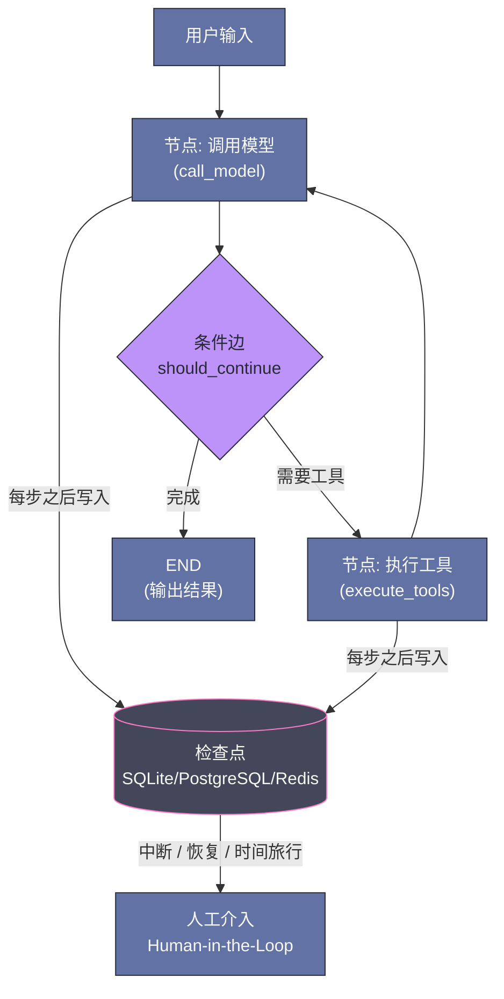
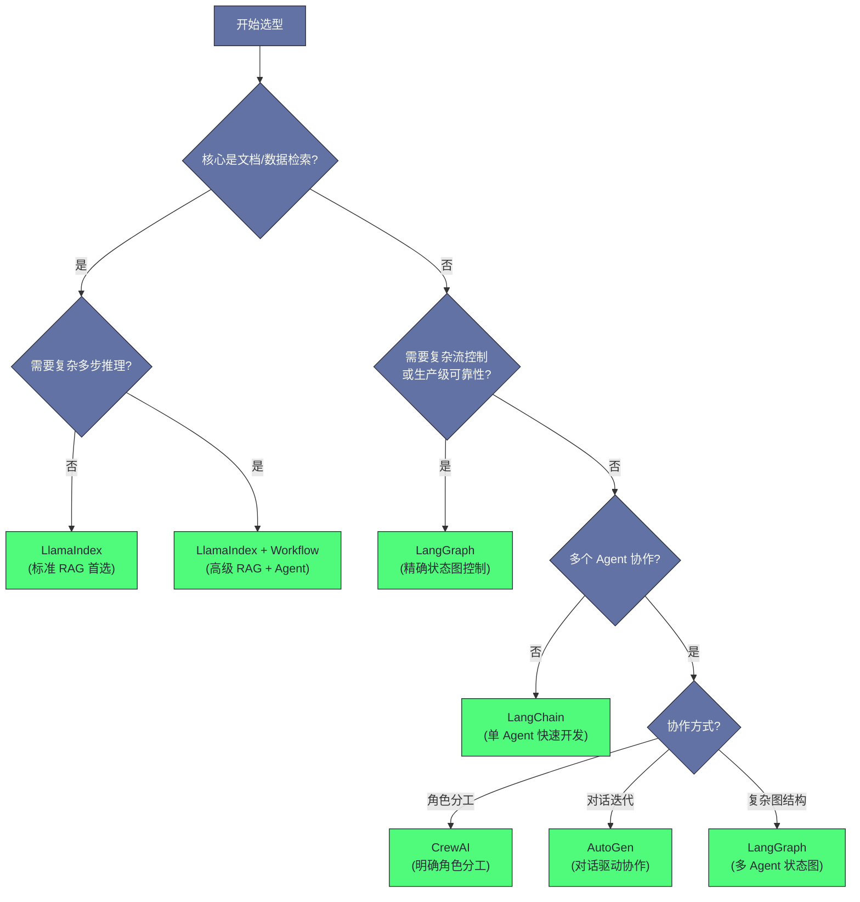

# 13 Agent 框架选型——LangChain、LlamaIndex 与 LangGraph

> [!abstract] 摘要
> 上一篇 [[LLM/Agent技术/应用开发/12 Agent 记忆体系——从短期缓冲到长期知识|Agent 记忆体系]] 建立了 Agent 能力组件的完整图谱，本文则把视角从"能力组件"转向"工程框架"——当你要把 Agent 变成产品时，第一个绕不开的决策就是：用什么框架来组织它。本文先回答"框架选型为什么重要"，点明框架的本质是一套关于 Agent 应该如何组织与运行的预设决策，选错框架意味着长期与它的设计哲学对抗；再逐一拆解主流框架的核心抽象与适用边界：LangChain 的组件生态与 1.0 转身、LlamaIndex 的数据中心定位与向 Document AI 的再定位、LangGraph 的状态图编排与持久化运行时、CrewAI 的角色协作与 Flow 补课、AutoGen 与 Semantic Kernel 合并为 Microsoft Agent Framework，以及 2025 年新登场的平台原生三件套——OpenAI Agents SDK、Claude Agent SDK 与 Gemini ADK 如何把 Agent 循环从应用层下沉到平台层。最后给出 2026 年更新的选型决策矩阵，并正面回应"少用框架 vs 用框架"这场持续多年的工程争论。核心认知：框架选型没有唯一正确答案，只有"框架替我省下的成本"与"我为框架支付的抽象税"之间的权衡，而 2026 年最该优化的，是可切换的模型而非可切换的框架。

---

## 第 1 章 为什么框架选型如此重要

2025 年 10 月 22 日，LangChain 与 LangGraph 同日发布 1.0 正式版，成为 Agent 框架领域第一批公开承诺"2.0 之前不再引入破坏性变更"的稳定主版本。对一个两年前还在以周为单位重写 API 的生态来说，这份承诺的份量，不亚于给一座仍在施工的大厦提前封顶。然而恰恰是这份稳定，把选型问题推到了每个工程团队的案头——框架不再是"先凑合用、不行再换"的临时脚手架，而是一次需要为长期负责的架构决策。

### 1.1 框架的本质：设计决策的集合

一个 Agent 框架不仅仅是"封装了一些 LLM 调用的库"——它是一套**关于 Agent 应该如何组织和运行的观点（Opinionated Design）**。不同框架对以下问题有不同的答案：

- Agent 的状态应该如何表示和传递？
- 工具调用应该如何声明和执行？
- 多步骤任务应该如何调度和编排？
- 错误处理和重试应该在哪一层处理？
- 如何在灵活性和约束性之间取得平衡？

这些设计决策深度渗透到框架的每一个 API 中。选错框架意味着不断和框架的设计哲学"对抗"——你想做的事情，框架不支持或者绕路很大；框架强迫你做的事情，对你的场景又没有意义。这有点像装修时选了全包方案——墙体拆不拆、水电怎么走都由装修公司先定了，日后想动承重墙还是只刷墙漆，代价天差地别；更麻烦的是，很多问题要等入住（上线）之后才会暴露出来，而那时改动地基的成本已经高得吓人。

### 1.2 框架的生命周期风险

LLM 框架是一个快速演化的领域，选型时必须把"框架自己会不会变"当成与功能同等重要的变量：

- **LangChain** 在 2023-2024 年经历了剧烈的 API 重构（从 `Chain` 到 LCEL），大量早期教程代码已过时，升级旧项目代价高；直到 2025 年 10 月的 1.0 才正式承诺 API 稳定
- **AutoGen** 在 0.2 到 0.4 版本之间有重大架构变更，从单一框架拆分为多个包；又在 2025 年 10 月宣布与 Semantic Kernel 合并为 Microsoft Agent Framework——框架的"生命周期"有时比项目的还短
- **新框架不断涌现**：仅 2025 年一年，OpenAI Agents SDK、Claude Agent SDK、Gemini ADK 三个平台级框架就相继登场，每一家都宣称解决了现有框架的所有问题

在框架选型时，不仅要看当前的功能，还要评估框架的社区活跃度、背后的维护团队（是个人项目还是有公司支持）、和主流 LLM 提供商的关系。技术选型好比在火山口附近选址盖房——脚下是活跃的地质活动，你只能挑相对稳定的板块，却不能保证它永远不动，所以"这个框架三年后还在不在、还动不动"应当写进评估清单的第一页。

### 1.3 2025-2026 的格局突变：循环下沉与平台化

如果说 2023-2024 年的框架之争是"开源库之间的功能竞赛"，那么 2025 年发生的变化是结构性的：Agent 最核心的部件——ReAct 循环本身——开始从应用层下沉到平台层。OpenAI 把循环搬进了 Responses API 的服务端，Anthropic 把 Claude Code 的运行内核做成 Claude Agent SDK 开放出来，Google 则开源了支撑自家 Agentspace 的 Gemini ADK。三家平台厂商不约而同地认定，"循环不该由开发者自己搭"。

这套变化与 [[LLM/Agent技术/基础范式/01 Agent 运行范式全景——从 ReAct 到 Production Agent 的演进|范式选择]] 形成一组对照：范式之争回答"用哪种循环"（ReAct、Plan-and-Execute 还是 Reflexion），框架之争则回答"循环由谁运行、在哪里运行"——是在你的进程里由你全权控制，还是被平台托管、你只做编排。理解这个维度，是读懂后面所有章节的前提。

除此之外，2025 年还有一个横切所有框架的变量：**工具协议**。随着 MCP 在 2024 年 11 月由 Anthropic 提出、随后被各大平台接受，工具的声明与调用方式正在从"每家框架各写一套"走向"接入 MCP 即插即用"，框架对 MCP 的支持强度（客户端接入、远程 Server、鉴权）开始成为选型的硬指标之一——这个话题的协议细节可以回看 [[LLM/Agent技术/基础范式/04 MCP 协议深度解析——Agent 与工具的标准化连接]]，本节只提醒一点：一个框架"自带多少第三方集成"的重要性正在下降，因为它能轻松接入多少 MCP Server 的重要性在上升，后文各家的能力对比都该在这个前提下重新读。

---

## 第 2 章 LangChain——组件生态的领导者

### 2.1 设计哲学

LangChain 的核心设计思路是**组件化**——将 LLM 应用的各个部分（模型调用、Prompt 模板、输出解析、记忆、工具、检索器）抽象为可独立替换的标准组件，通过"链"（Chain）将它们连接起来。

这个思路很像乐高积木：零件种类齐全，组合方式由你决定，缺什么都能找到对应的标准件。它的直接优势是**灵活性和可替换性**——你可以用 OpenAI 的模型，也可以换成 Anthropic 或本地的 Ollama，接口不变；你可以用 Chroma 向量库，也可以换成 Qdrant，接口不变。LangChain 提供了统一的抽象层。

但组件化的代价同样真实：为了通用性引入的大量抽象，让"实际发生了什么"变得难以追踪；集成越丰富，学习曲线越长，新手越容易在"用哪一层抽象"上迷失。这套代价在后文会反复出现，笔者给它一个名字——**抽象税（Abstraction Tax）**，指的是框架为了让接口通用而增加的理解、调试与性能开销。

### 2.2 LCEL——LangChain 表达式语言

2024 年，LangChain 推出了 **LCEL（LangChain Expression Language）** 作为构建应用的核心方式。LCEL 使用管道运算符（`|`）将组件串联，形成声明式的处理链：

```python
from langchain_core.prompts import ChatPromptTemplate
from langchain_openai import ChatOpenAI
from langchain_core.output_parsers import StrOutputParser

# LCEL: prompt | model | output_parser
chain = (
    ChatPromptTemplate.from_messages([
        ("system", "你是一个代码助手"),
        ("human", "{question}")
    ])
    | ChatOpenAI(model="gpt-4o")
    | StrOutputParser()
)

# 同步调用
result = chain.invoke({"question": "解释一下什么是 Python 装饰器"})

# 流式输出
for chunk in chain.stream({"question": "写一个快速排序的实现"}):
    print(chunk, end="", flush=True)
```

LCEL 的优势是：所有 LCEL 链天然支持 `.invoke()`、`.stream()`、`.batch()`、`.ainvoke()` 等调用方式——你用同样的代码可以同步调用、流式输出、批量处理或异步并发，无需额外修改。

不过 LCEL 骨子里是一条线性管道：条件分支、循环、并行这些控制流结构在管道里没有位置，要做就得绕路，或者退回命令式代码。这个局限正是 LangChain 团队后来推出 LangGraph 的直接动机——管道的下一站，是一张图。

### 2.3 LangChain Agent

LangChain 的 Agent 实现基于 `create_react_agent`（[[LLM/Agent技术/应用开发/11 Agent 核心能力——推理、规划与工具调用]] 中的 ReAct 框架）。工具通过 `@tool` 装饰器声明：

```python
from langchain.tools import tool
from langchain.agents import create_react_agent, AgentExecutor

@tool
def search_knowledge_base(query: str) -> str:
    """在公司知识库中搜索相关信息。当需要查询产品文档、FAQ 或内部规范时使用。"""
    # 实际实现：调用向量数据库检索
    return retriever.get_relevant_documents(query)

@tool
def create_jira_ticket(title: str, description: str, priority: str = "Medium") -> str:
    """在 Jira 中创建一个新的工单。当需要记录 Bug 或功能需求时使用。"""
    # 实际实现：调用 Jira API
    return jira_client.create_issue(title, description, priority)

tools = [search_knowledge_base, create_jira_ticket]
agent = create_react_agent(llm=ChatOpenAI(model="gpt-4o"), tools=tools, prompt=react_prompt)
executor = AgentExecutor(agent=agent, tools=tools, max_iterations=10, verbose=True)
result = executor.invoke({"input": "查一下我们的退款政策，然后为这个客户投诉创建 Jira 工单"})
```

这段代码对应 LangChain 0.x 时代的经典形态：`create_react_agent` 构建 ReAct 智能体，`AgentExecutor` 负责执行固定的 while 循环。在 LangGraph 1.0（2025 年 10 月 22 日）中，`create_react_agent` 已被官方弃用，替代品是 LangChain 1.0 的 `create_agent`——这标志着"ReAct 专用预构建"向"通用图编排"的正式让位，ReAct 不再是特殊范式，而是图模型的一种实例化。新的写法要简洁得多：

```python
from langchain.agents import create_agent

agent = create_agent(
    model="claude-sonnet-4-6",
    tools=[search_knowledge_base, create_jira_ticket],
    system_prompt="你是一个严谨的客服助理，先查证再回答，需要时创建 Jira 工单。",
)
result = agent.invoke({
    "messages": [{"role": "user", "content": "查一下退款政策，并为客户投诉创建 Jira 工单"}]
})
```

### 2.4 LangChain 1.0 的转身：create_agent 与中间件

LangChain 1.0 的三件事值得单独说。其一是 **create_agent**：以最少的参数（模型、工具、system prompt）启动一个标准 Agent 循环，底层跑在 LangGraph 运行时上。其二是**中间件（Middleware）**：create_agent 把定制点从"改参数"升级为"插钩子"，开发者可以在模型调用前（`before_model`）、调用后（`after_model`）、工具调用时（`wrap_tool_call`）插入自己的逻辑——动态提示词、会话摘要、按需裁剪工具、护栏，都能以可组合的方式挂进循环，这比 0.x 时代"为每个需求换一种 Chain"要克制得多。其三是**标准内容块（Standard Content Blocks）**：一份跨厂商统一的输出规范，配合大幅精简的命名空间（旧功能迁入 `langchain-classic`），让"换模型"真正变成改一个参数的事。

LangChain 与 LangGraph 的分工在 1.0 里被官方说得直白：**LangChain 是构建 Agent 的最快路径，LangGraph 是面向生产级长时任务的底层运行时**。两套框架共用同一运行时，先高层快速起步、需要细粒度控制时再下沉到图，迁移不是二选一，而是一架梯子的两端。官方还给出了配套的观测方案：快速原型期用 LangSmith 追踪每次 LLM 调用的输入输出，进入生产后可以叠加 LangGraph Studio 的可视化调试——图在画布上逐节点跑起来的样子，比任何日志都直观。对 0.x 时代被 API 变动折磨过的团队，1.0 之后"升级不再撕心裂肺"本身就是最大的卖点。

### 2.5 LangChain 的优势与短板

**优势**：
- **生态最丰富**：集成了 200+ LLM 提供商、100+ 向量数据库、50+ 工具——找任何第三方服务的集成，LangChain 几乎都有现成的
- **文档最完善**：大量教程、Cookbook、最佳实践
- **社区最活跃**：GitHub 100k+ star，Stack Overflow 有大量问答
- **LangSmith 追踪**：配套的调试/可观测性平台，可以追踪每一次 LLM 调用的输入输出

**短板**：
- **抽象层过多**：为了通用性引入了大量抽象，调试时很难理解"实际发生了什么"（1.0 已通过精简命名空间缓解，但历史包袱仍在）
- **文档滞后**：框架更新快，很多文档对应的是旧版 API
- **过度设计风险**：新手容易被丰富的功能诱惑，构建出过度复杂的应用，而本质上几十行原生代码就能实现
- **对复杂 Agent 流控制力弱**：ReAct Agent 的执行路径不可预测，复杂业务逻辑难以嵌入（这正是 LangGraph 存在的理由）

**适用场景**：快速原型、标准 RAG 应用、需要集成大量第三方服务的应用。

---

## 第 3 章 LlamaIndex——数据中心的 RAG 专家

### 3.1 设计哲学

LlamaIndex 的出发点与 LangChain 不同：它不是"构建任意 LLM 应用的框架"，而是专注于**将 LLM 与各种数据源连接**——文档、数据库、API、代码仓库。它的核心抽象围绕"数据"展开：`Document`（文档）、`Node`（节点/文本块）、`Index`（索引）、`QueryEngine`（查询引擎）。

如果说 LangChain 是百货超市，那 LlamaIndex 更像中央厨房——它只管把原料（数据）洗好、切好、配好，至于顾客怎么吃、在哪个厅堂吃，它并不操心。这一定位让它把"数据"这一件事做到了极致，也注定了"通用 Agent 编排"从来不是它的主场。

### 3.2 核心组件

**Data Connectors（数据连接器）**：LlamaIndex 提供了大量数据加载器，能从 PDF、Word、CSV、数据库、GitHub、Notion、Slack 等 100+ 数据源加载文档。

在数据连接器背后，是一条完整的加工管线：加载（Loading）→ 解析（Parsing）→ 分块（Chunking）→ 向量化（Embedding）→ 索引（Indexing）。`Document` 被切分为带 `metadata` 的 `Node`（文本块），每个 Node 既保留来源、页码、层级等上下文信息，又被嵌入成向量供检索使用——这套管线是 LlamaIndex 对"数据"二字最实质的贡献：别的框架把分块当成一个参数，它把分块当成一门手艺。管线中每一环都有可插拔的实现（不同的解析器、不同的分块器、不同的 Embedding 模型），这既是它的灵活性，也是它学习曲线陡的原因。

**Index 类型**：LlamaIndex 提供了多种索引类型，适合不同的查询场景：

| 索引类型 | 适用场景 | 底层机制 |
| :--- | :--- | :--- |
| `VectorStoreIndex` | 语义相似度检索 | 向量 Embedding + ANN 搜索 |
| `SummaryIndex` | 对整个文档集做摘要 | 顺序读取所有节点 |
| `KnowledgeGraphIndex` | 实体关系查询 | 三元组提炼 + 图查询 |
| `PropertyGraphIndex` | 复杂图结构查询 | 属性图 + 混合检索 |

**SubQuestion Query Engine**：自动将复杂问题分解为子问题，分别在不同数据源上检索，再综合答案——这是 [[LLM/Agent技术/应用开发/10 高级 RAG——查询改写、图谱检索与多跳推理]] 中查询分解技术的工程化实现。

```python
from llama_index.core import VectorStoreIndex, SimpleDirectoryReader
from llama_index.core.query_engine import SubQuestionQueryEngine
from llama_index.core.tools import QueryEngineTool

# 加载两个不同的文档集
product_docs = VectorStoreIndex.from_documents(
    SimpleDirectoryReader("product_manual/").load_data()
)
sales_docs = VectorStoreIndex.from_documents(
    SimpleDirectoryReader("sales_data/").load_data()
)

# 创建工具
tools = [
    QueryEngineTool.from_defaults(product_docs.as_query_engine(), name="product_manual",
                                   description="产品手册，回答产品功能和使用方法"),
    QueryEngineTool.from_defaults(sales_docs.as_query_engine(), name="sales_data",
                                   description="销售数据，回答销量、收入等指标"),
]

# Sub-Question 引擎自动分解复杂问题
query_engine = SubQuestionQueryEngine.from_defaults(query_engine_tools=tools)
response = query_engine.query(
    "我们的旗舰产品 A 的销量如何，它的主要卖点是什么？"
)
```

### 3.3 LlamaIndex Agent

LlamaIndex 的 Agent 实现（`ReActAgent`）与 LangChain 类似，但工具系统与其数据框架深度集成——`QueryEngine` 可以直接作为工具使用，这使得 RAG + Agent 的组合更为自然：

```python
from llama_index.core.agent import ReActAgent
from llama_index.core.tools import QueryEngineTool, FunctionTool

# 将 RAG 查询引擎直接作为工具
kb_tool = QueryEngineTool.from_defaults(
    query_engine=knowledge_base_index.as_query_engine(),
    name="company_knowledge_base",
    description="查询公司内部知识库，包括产品文档、操作规范、FAQ"
)

# 自定义函数工具
def send_notification(user_id: str, message: str) -> str:
    """向用户发送系统通知"""
    return notification_service.send(user_id, message)

notify_tool = FunctionTool.from_defaults(fn=send_notification)

agent = ReActAgent.from_tools([kb_tool, notify_tool], llm=llm, verbose=True)
response = agent.chat("查一下退款政策，然后通知用户 12345 他的退款已经处理")
```

### 3.4 从 RAG 到 Document AI：2025 年的再定位

LlamaIndex 在 2025 年的一系列动作，值得选型者单独梳理，因为它们揭示了这家框架的自我定位变迁。2025 年 1 月 22 日，LlamaIndex 发布 **AgentWorkflow**，在既有 `Workflow` 抽象之上提供协调多 Agent、维护状态、实时流式观测的能力；2025 年 6 月 30 日，**Workflows 1.0** 正式发布，这是一个**事件驱动（Event-Driven）**、async-first 的轻量编排框架，用 `@step` 装饰器把函数组织成事件图，循环、并行、条件分支、状态恢复都能表达。

与此同时，公司的商业化重心明显向**文档智能**倾斜：LlamaParse 主打复杂文档（嵌套表格、图表、手写体）的高质量解析，LlamaCloud 提供托管的摄取与检索，LlamaAgents 提供一键部署的文档 Agent 产品；2025 年 5 月，Databricks 与 KPMG 对 LlamaIndex 做了少数股权投资。到 2025 年底的官方年度回顾里，团队自述的主题已经变成"Document AI"——从"RAG 框架"到"数据框架"再到"文档智能平台"，LlamaIndex 用一年时间走完了一次再定位。

对选型者的含义很明确：当核心诉求是"把复杂文档变成可查询的知识"，LlamaIndex 依然是最专业的选项；但如果你需要的是通用 Agent 编排，它的 Workflows 更像是"数据管线里的 Agent"，而不是与 LangGraph 正面竞争的产品。

### 3.5 LlamaIndex 的优势与短板

**优势**：
- **RAG 能力最强**：分块、索引、检索、重排序的每个环节都有深度优化，是企业知识库的首选
- **数据连接器丰富**：100+ 数据源，企业常用的数据格式基本全覆盖
- **高级 RAG 开箱即用**：SubQuestion、HyDE、Recursive Retrieval 等高级技术都有官方实现
- **Workflow 框架**：2024 年推出的 `Workflow` 抽象、2025 年的 Workflows 1.0 与 AgentWorkflow，对复杂多步骤应用的编排支持持续增强

**短板**：
- **工具生态不如 LangChain**：第三方工具集成数量少于 LangChain
- **学习曲线陡**：概念较多（Document/Node/Index/Retriever/QueryEngine/...），新手上手成本高
- **通用 Agent 支持弱于 LangGraph**：对于复杂的 Agent 状态管理，不如 LangGraph 精确；它的编排能力是数据管线的延伸，而非独立的通用编排层

**适用场景**：以 RAG 为核心的应用（企业知识库、文档问答、数据分析 Agent）。

---

## 第 4 章 LangGraph——状态机驱动的精确控制

### 4.1 设计哲学

LangGraph 是 LangChain 团队针对"复杂 Agent 流控制"痛点推出的框架。它的核心洞察是：**复杂的 Agent 应用本质上是一个有状态的计算图（Stateful Computational Graph）**——每个节点是一个处理步骤，边是控制流，整个 Agent 的运行状态在节点间传递。

LangGraph 将 Agent 建模为**图（Graph）**，其中：
- **节点（Node）**：执行具体操作的函数（调用 LLM、执行工具、做判断）
- **边（Edge）**：节点间的连接，可以是无条件的（总是执行 B 在 A 之后）或条件的（根据 A 的输出决定走 B 还是 C）
- **状态（State）**：在图中所有节点间共享和传递的数据结构

LangGraph 的诞生本身就是对 LangChain 的一次反省。LangChain 官方在《Building LangGraph》一文中坦言，多年收到最多的反馈是"LangChain 上手容易，但定制与规模化很难"，所以 LangGraph 的设计目标从一开始就定成"几乎不做抽象（little to no abstraction）"，一切为生产可靠性让路。如果用比喻来说，LangChain 是给你一箱积木让你自由发挥，LangGraph 则是一张地铁线路图——站与站之间的走向被明确画死，乘客（状态）在站台间流转；你可以在图上加站、改线，但哪一站到哪一站、何时停靠，全都清清楚楚、可被审计。

### 4.2 LangGraph 的核心概念

```python
from typing import TypedDict, Annotated
from langgraph.graph import StateGraph, END
import operator

# 定义 Agent 的状态结构
class AgentState(TypedDict):
    messages: Annotated[list, operator.add]   # 对话历史（追加模式）
    tool_calls: list                           # 待执行的工具调用
    final_answer: str                          # 最终答案

# 定义节点函数
def call_llm(state: AgentState) -> AgentState:
    """调用 LLM，决定下一步行动"""
    response = llm.invoke(state["messages"])
    return {"messages": [response]}

def execute_tools(state: AgentState) -> AgentState:
    """执行 LLM 请求的工具调用"""
    results = []
    for tool_call in state["messages"][-1].tool_calls:
        result = tool_map[tool_call["name"]].invoke(tool_call["args"])
        results.append(ToolMessage(content=result, tool_call_id=tool_call["id"]))
    return {"messages": results}

def should_continue(state: AgentState) -> str:
    """条件路由：判断是继续工具调用还是结束"""
    last_message = state["messages"][-1]
    if hasattr(last_message, "tool_calls") and last_message.tool_calls:
        return "use_tools"   # 跳转到工具执行节点
    return "end"             # 结束

# 构建图
workflow = StateGraph(AgentState)
workflow.add_node("llm", call_llm)
workflow.add_node("tools", execute_tools)

# 设置入口
workflow.set_entry_point("llm")

# 添加条件边（路由）
workflow.add_conditional_edges(
    "llm",
    should_continue,
    {"use_tools": "tools", "end": END}
)
# 工具执行完后总是回到 LLM 节点
workflow.add_edge("tools", "llm")

# 编译为可运行的 Agent
agent = workflow.compile()
result = agent.invoke({"messages": [HumanMessage(content="帮我查一下明天北京的天气")]})
```

这段代码里有三个容易被新手忽略的机制细节。其一是**部分状态更新（Partial State Update）**：节点函数返回的 dict 只声明它想改的字段，未被声明的字段原样保留——`call_llm` 只写 `messages`，`tool_calls` 与 `final_answer` 不会被动过，这让多个并行分支可以各改各的键而互不干扰。其二是**显式路由表**：`add_conditional_edges` 的第三个参数 `{"use_tools": "tools", "end": END}` 是一张"输出值 → 目标节点"的映射，路由逻辑（`should_continue`）只负责给出键，跳去哪由表决定——这种"判断与跳转分离"的设计让流程审计变得很容易，出问题只需查表。其三是**任意拓扑**：图可以是循环（`tools → llm`）、分支、并行乃至嵌套子图，这正是它与 `AgentExecutor` 那种固定 while 循环的本质差异——固定循环里你只能在"继续/结束"之间选择，图里你可以画出任何执行路径。

### 4.3 运行时深潜：状态合并、检查点与时间旅行

图只是 LangGraph 的表层，真正让它区别于普通编排库的，是运行时对"状态"的认真程度。

首先是**状态合并（Reducers）**：`Annotated[list, operator.add]` 里的第二个参数就是 reducer，它定义了节点的返回值如何与既有状态合并——默认是覆盖，`operator.add` 是追加，也可以写自定义的合并函数。这套机制保证了并行分支的更新也能被确定性地合并，不会互相覆盖；没有它，fan-out/fan-in 的并行节点一多，状态就会乱成一锅粥。

其次是**检查点（Checkpointing）**：每次节点执行（super-step）完成后，完整状态会被写入 Checkpointer——SQLite、PostgreSQL、Redis 都可以。由此衍生出三层生产能力：

- **中断恢复**：长任务中途断开后，可以从最后的检查点继续，而不是从头开始
- **人工介入（Human-in-the-Loop，后文简称 HITL）**：在执行到敏感操作前（发送邮件、提交代码、扣款）调用 `interrupt()` 暂停，等待人工确认后再恢复
- **时间旅行（Time Travel）**：可以回溯到历史的任意检查点，修改状态后重新执行——这对调试复杂 Agent 行为极其有用

第三是**流式观测**：`stream_mode` 支持 values（整状态）、updates（增量）、messages（逐条消息）、custom（自定义事件）等多种粒度，配合 LangSmith 或 LangGraph Studio 的可视化，能实时看到 Agent 停在哪个节点、为什么走那条边。这三样能力合在一起，等于把"可观测、可恢复、可接管"从 Agent 的奢侈品变成了框架的内建默认。

笔者要提醒的是，LangGraph 的检查点并非万能：它持久化的是图的**状态**，不是工具调用产生的**副作用**——一个已经发出去的邮件不会因为回滚检查点而被撤回，所以 HITL 的正确用法是在副作用发生前 interrupt，而不是事后补救；另外检查点会随状态体积增长，对话历史一长，每次写入的成本和存储占用都会上升，生产上通常配合摘要压缩或状态裁剪一起用，这与 [[LLM/Agent技术/应用开发/12 Agent 记忆体系——从短期缓冲到长期知识|记忆体系]] 里讨论的上下文治理是同一件事。还有一个常被问起的比较：LangGraph 的持久化执行（Durable Execution）与 Temporal、DBOS 这类通用工作流引擎是什么关系？前者把图语义、LLM 节点、检查点存续做成了一体化产品，后者是语言无关的通用基础设施，能把任意 Agent 工作流跑得"断点续跑"；2025 年出现了把两者组合使用的做法（用通用引擎承载 LangGraph 或 Pydantic AI 的运行时），适合对可靠性要求极高的场景，但复杂度也上了一个台阶。下图把节点、条件边与检查点的关系画在一起：



### 4.4 LangGraph 1.0 与生产实证

LangGraph 在 1.0（2025-10-22）之前，已经在 Uber、LinkedIn、Klarna 等公司的生产环境里运行了一年多。1.0 的发布要点有三：图的核心 API 与执行模型保持不变（刻意压低升级成本）、**持久化执行（Durable Execution）**与检查点成为默认一等公民、`create_react_agent` 正式弃用并由 LangChain 的 `create_agent` 接棒——后者的底层运行时正是 LangGraph。换言之，LangGraph 在 1.0 时代同时扮演两个角色：对需要细粒度控制的团队，它是独立的编排框架；对只想快速起步的团队，它是 `create_agent` 身后那个看不见的引擎。

### 4.5 LangGraph 的适用场景

LangGraph 最适合以下场景：

- **需要复杂条件分支的 Agent**：根据中间结果动态选择不同的执行路径
- **需要 Human-in-the-Loop 的 Agent**：在执行敏感操作前等待人工确认
- **长时间运行的任务**：需要中断恢复能力，不能因为单点失败重头来过
- **多 Agent 编排**：LangGraph 天然支持将多个 Agent 组合为更大的工作流图
- **生产级可靠性要求高的 Agent**：需要可预测的执行路径、完善的错误处理、可审计的执行记录

---

## 第 5 章 CrewAI——角色与协作

### 5.1 设计哲学

CrewAI 的设计比喻来自"团队"——每个 Agent 是一个有明确**角色（Role）**、**目标（Goal）** 和**背景故事（Backstory）** 的"成员"，多个 Agent 组成一个"团队（Crew）"协作完成任务。

这个设计哲学的优势是**直观性**——对于很多业务场景，用角色来描述 Agent 的职责非常自然：研究员、分析师、写作者、审核员……每个角色做自己擅长的事，通过任务分发和结果传递协作完成复杂工作。这有点像剧组：导演定角色、分剧本，演员按角色演，道具、灯光各司其职，谁该干什么在开拍前就定了。

```python
from crewai import Agent, Task, Crew, Process

# 定义角色
researcher = Agent(
    role="资深市场研究员",
    goal="深入调研目标市场，提供准确的竞品分析数据",
    backstory="你有 10 年市场研究经验，擅长从公开数据中提炼竞争洞察",
    tools=[web_search_tool, data_analysis_tool],
    llm=ChatOpenAI(model="gpt-4o")
)

writer = Agent(
    role="商业分析师",
    goal="将研究数据转化为清晰、有说服力的商业报告",
    backstory="你擅长将复杂数据转化为管理层能快速理解的商业建议",
    llm=ChatOpenAI(model="gpt-4o")
)

# 定义任务（注意：任务有明确的期望输出）
research_task = Task(
    description="调研 AI 代码助手市场，分析 GitHub Copilot、Cursor、Windsurf 的定价策略、用户评价和市场份额",
    expected_output="包含三家竞品的定价表格、核心功能对比和用户评价摘要的 Markdown 报告",
    agent=researcher
)

writing_task = Task(
    description="基于研究员的数据，撰写一份针对管理层的市场进入建议报告",
    expected_output="500 字以内的执行摘要 + SWOT 分析 + 3 条战略建议",
    agent=writer,
    context=[research_task]   # writing_task 依赖 research_task 的输出
)

# 组建团队，顺序执行
crew = Crew(
    agents=[researcher, writer],
    tasks=[research_task, writing_task],
    process=Process.sequential   # 也可以是 Process.hierarchical（层级管理）
)

result = crew.kickoff()
```

### 5.2 从 Crew 到 Flow：为生产补课

CrewAI 的演进路径可以概括成一句话：先用角色隐喻降低上手门槛，再用 **Flow** 补上生产控制面。2025 年它明显在两条线上发力。

产品线上，CrewAI OSS 于 2025 年 10 月 20 日发布 1.0 GA，官方宣布累计执行了 14 亿次 Agent 自动化、覆盖超过 60% 的 Fortune 500 企业、GitHub 40k+ star、月下载量 180 万+；同年的 CrewAI Enterprise 与部署产品 Factory（2025 年 5 月）把管理、监控、实时追踪、私有工具仓库与基于角色的访问控制带进了企业场景。

技术线上，**Flows** 被官方推荐为生产架构的起点：用 `@start`、`@listen` 装饰器定义事件驱动的流程，用 Pydantic 模型管理跨步骤状态，支持循环、条件分支与 HITL；在 1.6/1.8 版本里又陆续加入了流式结果、A2A 协议支持与全局 HITL 配置。这等于公开承认了角色分工的边界：光有角色分工不足以支撑生产，必须有显式的流程编排与状态管理——而这正是它早期不屑于做、LangGraph 一开始就做的事。两家从相反方向出发，在 2025 年殊途同归。

### 5.3 CrewAI 的优势与短板

**优势**：
- **直观的角色抽象**：适合业务人员也能理解的场景描述
- **任务依赖管理**：自动处理任务间的数据传递和执行顺序
- **层级管理模式**：支持"管理者 Agent"分配任务给"执行者 Agent"的层级结构
- **独立轻量**：0.x 时代重构后不再依赖 LangChain，依赖面更干净

**短板**：
- **流控制能力弱**：任务执行路径相对固定，不如 LangGraph 灵活
- **Agent 间通信原语有限**：Agent 主要通过"任务输出"传递信息，不支持复杂的状态共享
- **生产级特性起步晚**：持久化、检查点、流式观测等特性依靠 Flows 与 Enterprise 补课，成熟度仍在追赶 LangGraph

**适用场景**：明确角色分工的内容生产工作流（报告生成、代码审查流水线、多角色分析任务）。

---

## 第 6 章 AutoGen 与 Microsoft Agent Framework——对话驱动多 Agent 的归宿

### 6.1 设计哲学

AutoGen（Microsoft Research）的核心抽象是**可对话的 Agent（Conversable Agent）**——每个 Agent 都可以与其他 Agent 进行多轮对话来协作完成任务。Agent 之间通过"消息"通信，不需要预先定义数据传递的格式和接口。

这种设计的哲学依据是：对话本身就是一种灵活的信息传递和协作机制——就像人类团队通过讨论来协调工作，Agent 也可以通过对话来澄清需求、分工、反馈和迭代。AutoGen 让"多 Agent 圆桌会议"成为可能：谁发言、谁反驳、谁拍板，都由对话自然涌现，而不是预先写死——灵活是它的天性，失控的风险（聊偏、循环、无人收场）也是。

### 6.2 AutoGen v0.4 的核心设计

AutoGen v0.4 引入了全新的架构，核心是异步消息传递：

```python
import asyncio
from autogen_agentchat.agents import AssistantAgent, UserProxyAgent
from autogen_agentchat.teams import RoundRobinGroupChat
from autogen_ext.models.openai import OpenAIChatCompletionClient

# 定义模型客户端
model_client = OpenAIChatCompletionClient(model="gpt-4o")

# 代码编写 Agent
coder = AssistantAgent(
    name="Coder",
    model_client=model_client,
    system_message="你是一名优秀的 Python 工程师。编写清晰、有注释的代码。"
)

# 代码审查 Agent
reviewer = AssistantAgent(
    name="Reviewer",
    model_client=model_client,
    system_message="你是一名资深代码审查员。重点检查安全漏洞、性能问题和代码规范。"
)

# 用户代理（执行代码，收集人工反馈）
user_proxy = UserProxyAgent(name="User", code_execution_config={"use_docker": True})

# 组建轮询对话组
team = RoundRobinGroupChat([coder, reviewer, user_proxy], max_turns=10)

async def main():
    result = await team.run(task="实现一个线程安全的 LRU 缓存，包含单元测试")
    print(result.messages[-1].content)

asyncio.run(main())
```

v0.4 把原来的单体框架拆成了 `autogen-core`（事件驱动运行时，Actor 模型）与 `autogen-agentchat`（面向开发者的 Agent/Team 高层 API）等多个包，事件循环、分布式执行、容错都下沉到 core 层，这让 AutoGen 从"研究原型库"向"可扩展运行时"迈了一步；代价是 API 的又一次断裂——0.2 时代的大量教程代码在 0.4 下直接失效。

### 6.3 AutoGen 的适用场景

AutoGen 最适合：
- **需要代码执行的 Agent**：UserProxyAgent 内置了代码执行和结果反馈机制
- **多角色对话式协作**：多个 Agent 通过讨论迭代改进输出（如写作→审查→修改的循环）
- **研究原型**：AutoGen 是 Microsoft Research 的产品，对新型多 Agent 交互模式的探索支持好

### 6.4 合流：AutoGen 与 Semantic Kernel 的统一

2025 年 10 月 2 日，AutoGen 团队发布公告：AutoGen 与微软的另一套企业级框架 **Semantic Kernel** 合并，统一为新项目 **Microsoft Agent Framework**（简称 MAF）。公告直言，合并的理由是"研究创新（AutoGen）与企业就绪（Semantic Kernel）本就不该二选一"。

对既有 AutoGen 用户，MAF 的单 Agent 接口与 AutoGen 几乎一致，新增了会话线程管理、中间件与托管工具；最大的变化是新的图工作流 API——sequential、parallel、Magentic 等编排模式都建立在图之上，这几乎是在向 LangGraph 的设计语言靠拢。2026 年 4 月 3 日，MAF 1.0 在 .NET 与 Python 双端正式 GA：中间件钩子、图工作流、可插拔记忆（Mem0、Redis、Neo4j 等后端）、基于 A2A 与 MCP 的跨运行时互操作，以及覆盖 OpenAI、Anthropic、Amazon Bedrock、Gemini、Ollama 等的一等连接器。微软官方把 MAF 定位为"Semantic Kernel 的 v2.0"。

对从 AutoGen 迁移的团队，官方提供了迁移指南，核心路径几乎是把 `autogen_agentchat` 的调用换成 `agent_framework` 的对应 API——单 Agent 与 Team 的用法基本不变，只有底层的事件流与状态管理换成了新运行时。这恰恰暴露了合并的另一重动机：AutoGen 与 Semantic Kernel 两套用户群的代码有一大半可以平移，合并的迁移成本被压到了最低，微软要的是一次"市场集中"，而不是让两套 API 长期并存分裂开发者。

对选型者来说，这场合并的信号意义大于功能意义：曾经最活跃的研究型多 Agent 框架主动并入企业框架，标志着"多 Agent 编排"已经从研究前沿变成了工程常规——而微软的赌注是，这个常规应该默认长在 .NET 与 Azure 的土壤里。你可以在 [[LLM/Agent技术/应用开发/14 多 Agent 系统与 A2A 协议——协作、通信与特化|下一篇]] 中看到这套常规的更完整图景。

---

## 第 7 章 平台原生三件套——OpenAI Agents SDK、Claude Agent SDK 与 Gemini ADK

如果说前面几章讲的都是开源编排框架，那么 2025 年真正改变格局的，是三家模型厂商亲自下场做的"平台原生"框架。它们的共同点是把 Agent 循环托管起来——好比叫了代驾：路线（编排逻辑）还是你定，方向盘（循环本身）由平台握着。区别只在于，各家握方向盘的方式完全不同。

### 7.1 OpenAI Agents SDK：托管循环与轻量编排

2025 年 3 月 11 日，OpenAI 发布 **Responses API** 与开源的 **Agents SDK**。前者把工具调用、网络搜索、文件检索、计算机使用等能力内建到 API 层；后者是配合它的轻量编排库，核心抽象不多：**Agent**（指令 + 工具 + 护栏 + 交接配置）、**交接（Handoff）**（Agent 把任务转给另一个 Agent，类似电话转接）、**护栏（Guardrail）**（输入输出校验，拦截越界内容与注入）、**会话（Session）**（跨运行的对话历史自动管理）、**追踪（Tracing）**（内置观测，默认开启）。SDK 声称 provider-agnostic，支持 100+ 模型，但真正的默认主场显然是 OpenAI 生态。

2025 年 10 月 6 日，OpenAI 又推出 **AgentKit**，把可视化工作流画布（Agent Builder）、连接器注册表、嵌入式聊天组件（ChatKit）与评测工具打包成平台产品。值得留意的是，2026 年 6 月 OpenAI 宣布将从 2026 年 11 月 30 日起下线 Agent Builder 与 Evals 产品，官方建议：代码路径继续使用 Agents SDK，自然语言路径改用 ChatGPT 里的 Workspace Agents——平台产品策略的反复，本身就是"托管循环"路线尚未定型的注脚。此外还有一条更重的托管路线：**Agents API** 直接运行 OpenAI 托管的 Codex harness，替你管理会话与沙箱，适合"既不想碰循环、也不想要沙箱运维"的团队。Agents SDK 的取舍很清晰：换来的是极低的上手成本与一致的内置观测，代价是对循环内部的控制粒度明显小于自己画的图。

Agents SDK 的几个抽象还值得多一句机制说明。**Guardrail** 不是加在 Prompt 里的一句"你要安全"，而是运行时里一个独立的校验节点——输入护栏在模型被调用前执行，输出护栏在模型返回后执行，任何一边不通过，运行即被打断并返回护栏的兜底输出，这比"在 System Prompt 里祈祷"可靠得多；**Session** 把对话历史自动持久化到服务端，跨运行续聊时不必手动拼历史；**交接（Handoff）**本质上是一种特殊的工具调用——目标 Agent 作为"工具"被调起，接走对话后，主 Agent 不再继续参与。这套原语组合起来的观感是：它把多 Agent 协作里最容易出错的三件事（校验、状态、转场）都做成了框架内建行为。

### 7.2 Claude Agent SDK：把"给 Agent 一台电脑"做成产品

2025 年 9 月 29 日，Anthropic 随 Claude Sonnet 4.5 一起发布了 **Claude Agent SDK**——前身是 Claude Code SDK，更名本身就是一个宣言：这个 SDK 的野心不止于写代码。它的内核与 Claude Code 完全相同：文件读写、Shell 执行、搜索等工具，上下文管理系统，权限与审批框架，全部开放给开发者；并支持 subagents 与 hooks（生命周期钩子）。

Anthropic 的设计原则是**"给 Agent 一台电脑"（Give Your Agent a Computer）**——与其给模型一堆精心封装的小工具，不如给它一个能像人一样操作电脑的环境。这个设计有一个明显的绑定：SDK 只面向 Claude 模型。作为交换，它给到的是目前生产级 Coding Agent 里验证过的最完整内核之一——Anthropic 官方承认，Claude Code 的这套 harness 已经在支撑公司内部几乎所有主要的 Agent 循环。

### 7.3 Gemini ADK：从层级执行器到图运行时

2025 年 4 月 9 日，Google 在 Cloud NEXT 2025 上开源 **Gemini ADK（Agent Development Kit）**，它同时支撑着 Google 自家的 Agentspace 与 Customer Engagement Suite 的 Agent，是三家平台框架里唯一在发布时就宣称"被自家大规模产品使用"的。ADK 主打 code-first，声称 model-agnostic 但为 Gemini 优化，覆盖 Python、TypeScript、Go、Java、Kotlin 五种语言。

它的 1.x 版本是**层级执行器（Hierarchical Agent Executor）**架构——Agent 可以嵌套，父 Agent 委派子 Agent；2026 年 5 月 19 日发布的 2.0（Python GA）则转向 **Workflow Runtime**：一个图执行引擎，Agent、工具、函数都被当作图里的节点，支持路由、扇出/扇入、循环、重试、动态节点、HITL 与嵌套工作流，并新增了结构化 Agent 间委派的 **Task API**。这个演进轨迹值得玩味：Google 用一年时间，从"层级委派"走到了"图编排"，方向与 LangGraph、Microsoft Agent Framework 惊人地一致——图似乎成了 2026 年生产级编排的事实收敛点。

### 7.4 平台框架的代价：绑定与可控性

平台框架当然不是免费的午餐。最直接的代价是**绑定**：Claude Agent SDK 绑定 Claude，Agents SDK 的最优体验在 OpenAI 生态，ADK 为 Gemini 优化——选择平台框架，基本等于签下一份与某个模型供应商的长期契约。其次是**可控性**：托管循环把"循环内部的每一帧"藏进了平台，你能干预的粒度取决于平台暴露的钩子；当模型厂商调整平台策略（譬如 AgentKit 的下线）时，你的编排层也可能跟着被动。

但反过来看，平台框架也确实省下了最昂贵的一部分工程：循环的终止治理、会话管理、沙箱与观测，这些在自建方案里最容易出问题的环节，正是平台最愿意替你兜底的部分。所以更准确的说法是：**开源编排框架与平台原生框架不是替代关系，而是两条路线**——要细粒度控制选开源，要省心一致选平台，多数生产团队最终会同时使用两者，这正是 MCP 与 A2A 这类互操作协议存在的意义。

选型时可以握一条实用的判据：如果你的 Agent 重度依赖某家模型的独有能力（推理、多模态、内建工具、超长上下文），平台框架是顺手的；如果你希望模型、工具、运行时三方都能自由组合，开源编排是更稳的选择。还有一个被实践反复验证的折中方案：先用开源框架把业务逻辑写对、把模型接入层抽象出来，再在需要时把某个子 Agent 换成平台托管循环——不少团队的架构最终长成这种混合形态，既保住了编排的控制权，也借到了平台的托管红利。

---

## 第 8 章 框架选型决策矩阵（2026 版）

选框架像去菜市场前列采购清单——先想清楚今晚要做什么菜，再决定买什么、在哪个摊位买。上一章的框架剖析是"认识食材"，本章则给出"下单"的方法。

### 8.1 核心决策维度

| 决策维度 | 关键问题 |
| :--- | :--- |
| **任务复杂度** | 是单步任务还是多步骤长任务？ |
| **流控制需求** | 是否需要复杂的条件分支和状态管理？ |
| **数据中心程度** | 是否以文档检索/RAG 为核心能力？ |
| **多 Agent 需求** | 是否需要多个 Agent 协作？协作方式是分工还是对话？ |
| **生产可靠性** | 是否需要持久化、中断恢复、人工介入？ |
| **开发速度** | 是快速验证原型还是生产级产品？ |

### 8.2 决策树

以下决策树整合了 2024 年以来的选型经验，2026 年新增的平台框架会在 8.3 与 8.4 中补充：



这张决策树有一个隐含前提：它假设你在开源框架之间做选择。叠加平台三件套之后，真正的第一问变成了"能否接受模型绑定"——如果不能接受，直接落到本树的 LangGraph、LlamaIndex 分支；如果能接受，还要先回答语言与部署平台（.NET 看 MAF、Vertex 看 ADK、Bedrock 上看 Claude Agent SDK），再回到本树判断单 Agent 还是多 Agent。可以这样理解：**本树是"功能层"的决策，8.4 的三个前提是"环境层"的决策，两层都要过**。

### 8.3 综合对比矩阵

先看 2024 年格局下的五家对比：

| 维度 | LangChain | LlamaIndex | LangGraph | CrewAI | AutoGen |
| :--- | :--- | :--- | :--- | :--- | :--- |
| **RAG 能力** | 中 | **最强** | 中 | 弱 | 弱 |
| **Agent 流控** | 中 | 中 | **最强** | 中 | 中 |
| **多 Agent** | 弱 | 弱 | 强 | **角色分工好** | **对话协作好** |
| **生态丰富度** | **最丰富** | 丰富 | 中 | 中 | 中 |
| **学习曲线** | 中 | 陡 | 陡 | **平缓** | 中 |
| **生产就绪** | 中 | 中 | **高** | 低 | 中 |
| **调试便利性** | 中（LangSmith） | 中 | **高（可视化图）** | 低 | 中 |

不过这张表是 2024 年格局的写照，2026 年选型还需要把它与另一张表叠加——2025 年后登场的平台框架，各自回答的是不同的问题：

| 维度 | OpenAI Agents SDK | Claude Agent SDK | Gemini ADK | Microsoft Agent Framework |
| :--- | :--- | :--- | :--- | :--- |
| **归属** | OpenAI 平台 | Anthropic 平台 | Google 平台 | 微软生态 |
| **核心抽象** | Agent / Handoff / Guardrail | Claude Code 运行内核 | 图工作流 + 层级 Agent | 图工作流 + 中间件 |
| **模型绑定** | 偏 OpenAI（自称兼容 100+） | 仅 Claude | 偏 Gemini | 多供应商一等连接器 |
| **托管循环** | 有（Responses / Agents API） | 有（Managed Agents） | 有（Agent Engine） | 无（自托管运行时） |
| **适合谁** | 快速多 Agent 原型 | Coding / 计算机操作 Agent | GCP / Gemini 团队 | .NET / Azure 团队 |

### 8.4 三个新的决策前提：语言、绑定与运行位置

到了 2026 年，选型的前置问题已经比"任务复杂度"更早出现。第一个是**语言与平台**：.NET 团队应该直接看 Microsoft Agent Framework，Python 与 TypeScript 团队才有资格做完整对比。第二个是**供应商绑定**：Claude-only on Bedrock 就选 Claude Agent SDK，Azure OpenAI 就选 MAF，Gemini on Vertex 就选 ADK，多云或多模型团队才需要 LangGraph 这类中立编排。第三个是**运行位置**：想要托管循环与零运维就上平台托管路线，需要自托管与细粒度控制就选开源框架。

业界 2026 年还有一个常被引用的选型法则：**优化可切换的模型，而不是可切换的框架**——模型领导地位大约每两三个月就会易主，框架选型应当保证"换模型"只是改一个参数的事，而不是换一套架构的事。

把上述维度压成一张"快速选型表"，供项目启动时对照：

| 你的情况 | 2026 建议 |
| :--- | :--- |
| 企业知识库 / 文档问答 | **LlamaIndex**（文档管线最强） |
| 快速原型 / 大量第三方集成 | **LangChain 1.0**（create_agent 起步） |
| 生产级单 Agent，需要精确流控与 HITL | **LangGraph**（检查点 + 图编排） |
| 多角色分工的内容生产流水线 | **CrewAI**（角色隐喻 + Flows） |
| .NET / Azure 技术栈 | **Microsoft Agent Framework** |
| 深度绑定 Claude 的 Coding / 计算机操作 Agent | **Claude Agent SDK** |
| 快速多 Agent 服务，重视内置观测 | **OpenAI Agents SDK** |
| GCP / Gemini 技术栈 | **Gemini ADK** |
| 简单 Agent（< 3 个工具、< 5 步） | **原生 SDK（无框架）** |

---

## 第 9 章 无框架方案：什么时候直接调用 API

### 9.1 框架的隐性成本

使用框架意味着接受它的所有设计决策——包括你不需要的部分。对于简单的应用，框架带来的抽象层往往比直接调用 API 更复杂：

- **调试困难**：出了问题，不知道是自己的代码、框架逻辑还是 LLM 的问题
- **版本依赖**：框架频繁更新，可能引入 breaking change
- **性能开销**：框架的多层抽象引入了额外的函数调用开销（虽然通常可忽略不计）
- **过度依赖**：团队对框架产生依赖，失去了对底层原理的理解

框架之于 Agent，有点像成品橱柜之于厨房——柜门颜色统一、配件齐全，但你永远不知道哪块背板是板材的，哪天想改个尺寸，动刀的就不是你的手艺而是橱柜商的规矩了。自己打家具费时费力，但每一块料都心里有数。

### 9.2 什么时候选择直接调用 API

以下场景建议**直接使用 OpenAI/Anthropic SDK**，不引入框架：

- **简单的单 Agent 应用**（< 3 个工具，< 5 步执行）：几十行原生代码就能实现
- **性能极度敏感**：每一毫秒都重要，不能接受框架的额外开销
- **高度定制化的流**：与任何现有框架的设计哲学都格格不入
- **学习和理解 LLM 底层机制**：用框架会屏蔽重要的学习机会

一个只有两三个工具的单 Agent，用原生 SDK 加一个显式循环就能写清，效果与框架的 AgentExecutor 等价：

```python
import json
from openai import OpenAI

client = OpenAI()

def search_knowledge_base(query: str) -> str:
    return retriever.query(query)   # 你的检索实现

tools = [{
    "type": "function",
    "function": {
        "name": "search_knowledge_base",
        "description": "在公司知识库中搜索相关信息",
        "parameters": {
            "type": "object",
            "properties": {"query": {"type": "string"}},
            "required": ["query"],
        },
    },
}]

messages = [{"role": "user", "content": "查一下退款政策"}]
for _ in range(5):   # 显式迭代上限，等价于框架的 max_iterations
    resp = client.chat.completions.create(model="gpt-4o", messages=messages, tools=tools)
    tool_calls = resp.choices[0].message.tool_calls
    if not tool_calls:
        print(resp.choices[0].message.content)
        break
    for call in tool_calls:
        result = search_knowledge_base(json.loads(call.function.arguments)["query"])
        messages.append({"role": "tool", "tool_call_id": call.id, "content": result})
```

一条工程经验法则：**先用原生 API 实现，当代码开始有大量重复模式时，再引入框架来解决**。不要因为"大家都用框架"就无脑套用。

### 9.3 "少用框架 vs 用框架"：一场持续到 2026 的争论

这可能是 Agent 工程里最持久的一场争论，而且证据在两边都有。反对框架的一方拿出的多是具体代价：有人用 200 行 TypeScript 替换掉生产环境里跑了半年的 LangChain，理由是版本漂移（0.1.x 三个月后被生态抛弃）、47 层深的调用栈让排障变成读框架源码、通用执行器在每次工具调用上都有序列化与回调开销；有人实测自研编排比框架省约 30% 的 token 与 25% 的延迟；还有人指出"框架耦合思维"——用着用着，你的架构开始为框架的抽象服务，而不是反过来。

支持框架的一方则强调：多供应商切换、持久化执行、可观测性、HITL 这些工程能力，自研的成本远高于省下的 token；而且 1.0 时代框架开始承诺稳定性，LangGraph 甚至公开宣称"几乎不做抽象"。有意思的是，争论的双方正在互相靠拢——框架在变轻（LangGraph、Agents SDK 都在去抽象），反对者也在承认 1.0 之后的框架确实在变化。

这场争论最容易陷入的误区，是把"自研"与"框架"当成信仰问题，而不是成本问题。在笔者看来，要跳出情绪，至少应该量化两件事：其一是**运行时开销**——同一个任务在框架与原生实现下各跑一遍，对比平均每次请求多消耗的 token 数与端到端延迟，前者通常能精确到个位数百分比；其二是**维护开销**——记录一次排障的平均时长（Mean Time To Diagnose），框架抽象每让这个数字翻一倍，就相当于把一半的工程时薪付给了抽象层。这两组数字会让争论自然终结：在 token 与延迟敏感的场景里，无框架方案的优势是实打实的；在需要持久化、HITL 与多供应商切换的场景里，框架省下的工程时间同样实打实。

落到选型上，判断标准其实只有一条：**框架替我省下的成本，是否大于我为框架支付的抽象税**。它不该由社区热度决定，而该由你的具体场景决定——这正应了那句话：没有银弹，架构即权衡，有利有弊才需要决策，有取有舍才需要权衡。

---

## 第 10 章 总结与下一篇导读

### 10.1 本文核心要点

1. **框架是设计决策的集合**：状态表示、工具声明、任务调度、错误分层、灵活性与约束的平衡，选框架等于一次性购买一整套默认答案
2. **2025 年的格局突变是"循环下沉"**：OpenAI、Anthropic、Google 三家把 Agent 循环从应用层下沉到平台层，框架之争从"开源库功能竞赛"变成"托管 vs 自控"的路线之争
3. **LangChain 1.0 = 快速起步 + 中间件**，LangGraph 1.0 = 生产级持久化运行时，`create_react_agent` 退役，ReAct 成为图模型的一种实例化
4. **LlamaIndex 转向 Document AI**：Workflows 1.0 与 AgentWorkflow 补上编排能力，但它的编排是数据管线的延伸，不与 LangGraph 正面竞争
5. **LangGraph 把"可观测、可恢复、可接管"变成内建能力**：Reducer、检查点、中断、时间旅行、多粒度流式，是它区别于普通编排库的护城河
6. **CrewAI 用 Flows 补生产控制面**：从角色隐喻出发，向事件驱动流程、HITL、A2A 一路补课，与 LangGraph 殊途同归
7. **AutoGen 并入 Microsoft Agent Framework**：研究型多 Agent 框架并入企业框架，"多 Agent 编排"成为工程常规
8. **平台三件套的交换**：托管循环与内置观测，换来的是模型绑定与可控性下降
9. **选型三前提**：语言生态、供应商绑定、运行位置；法则——优化可切换的模型而非可切换的框架
10. **无框架派与框架派互相靠拢**：判断标准始终是"省下的成本 vs 支付的抽象税"

### 10.2 下一篇导读

本文把单个 Agent 应用里的框架选型讲清楚了，但当一个 Agent 做不完任务时，问题就从"选框架"变成"选协作结构"。下一篇 [[LLM/Agent技术/应用开发/14 多 Agent 系统与 A2A 协议——协作、通信与特化]] 将深入多 Agent 系统的三种架构模式（层级式、扁平式、混合式）、Agent 间通信的核心问题，以及 Google 在 2025 年提出的 A2A 协议如何为跨框架、跨企业的 Agent 互操作提供标准——你会在那里看到，本章讨论的框架们如何在更大的协作图景中各就各位。

> [!info] 专栏导航
> 本文是 [[LLM/Agent技术/00 专栏导览|Agent 技术专栏]] 应用开发部分（08-16）的第 13 篇。上一篇 [[LLM/Agent技术/应用开发/12 Agent 记忆体系——从短期缓冲到长期知识]] 建立了记忆能力的完整图谱，本文承接"能力组件齐备之后"的问题——用什么框架把这些组件组织成生产系统，并把视野更新到 2025-2026 年的框架格局（LangChain/LangGraph 1.0、OpenAI Agents SDK、Claude Agent SDK、Gemini ADK、Microsoft Agent Framework）；下一篇将从单个 Agent 的框架走向多 Agent 的协作与通信协议。

---

## 参考资料

1. LangChain, "LangChain and LangGraph Agent Frameworks Reach v1.0 Milestones", 2025-10-22. https://www.langchain.com/blog/langchain-langgraph-1dot0
2. LangChain, "LangGraph v1 migration guide", 2025. https://docs.langchain.com/oss/python/migrate/langgraph-v1
3. LangChain, "Building LangGraph: Designing an Agent Runtime from first principles", 2025. https://www.langchain.com/blog/building-langgraph
4. OpenAI, "New tools for building agents", 2025-03-11. https://openai.com/index/new-tools-for-building-agents/
5. OpenAI, "Introducing AgentKit", 2025-10-06. https://openai.com/index/introducing-agentkit/
6. OpenAI, "Agents SDK"（含 2026-06-03 Agent Builder/Evals 下线说明）. https://developers.openai.com/api/docs/guides/agents/sdk
7. Anthropic, "Enabling Claude Code to work more autonomously", 2025-09-29. https://www.anthropic.com/news/enabling-claude-code-to-work-more-autonomously
8. Anthropic, "Building agents with the Claude Agent SDK", 2025. https://claude.com/resources/articles/building-agents-with-the-claude-agent-sdk
9. Google, "Agent Development Kit: Making it easy to build multi-agent applications", 2025-04-09. https://developers.googleblog.com/agent-development-kit-easy-to-build-multi-agent-applications/
10. Google, "Welcome to ADK 2.0", 2026-05-19. https://adk.dev/2.0/
11. LlamaIndex, "Introducing AgentWorkflow", 2025-01-22. https://www.llamaindex.ai/blog/introducing-agentworkflow-a-powerful-system-for-building-ai-agent-systems
12. LlamaIndex, "Announcing Workflows 1.0: A Lightweight Framework for Agentic Systems", 2025-06-30. https://www.llamaindex.ai/blog/announcing-workflows-1-0-a-lightweight-framework-for-agentic-systems
13. LlamaIndex, "Looking Back on 2025", 2025-12-30. https://www.llamaindex.ai/blog/llamaindex-newsletter-2025-12-30
14. LlamaIndex, "KPMG and Databricks invest in LlamaIndex", 2025-05-01. https://kpmg.com/us/en/media/news/llamaIndex-announces-investments-from-databricks-and-kpmg.html
15. CrewAI, "CrewAI OSS 1.0 - We are going GA", 2025-10-20. https://blog.crewai.com/crewai-oss-1-0-we-are-going-ga/
16. CrewAI, "Production Architecture"（Flow-First 生产架构）. https://docs.crewai.com/edge/en/concepts/production-architecture
17. Microsoft, "AutoGen Update"（AutoGen 与 Semantic Kernel 合并公告）, 2025-10-02. https://github.com/microsoft/autogen/discussions/7066
18. Microsoft, "Introducing Microsoft Agent Framework", 2025-10-07. https://devblogs.microsoft.com/foundry/introducing-microsoft-agent-framework-the-open-source-engine-for-agentic-ai-apps/
19. Microsoft, "Microsoft Agent Framework Version 1.0", 2026-04-03. https://devblogs.microsoft.com/agent-framework/microsoft-agent-framework-version-1-0/
20. Wu et al., "AutoGen: Enabling Next-Gen LLM Applications via Multi-Agent Conversation", ICLR 2024
21. Joao et al., "CrewAI: Framework for Orchestrating Role-Playing AI Agents", GitHub 2024
22. Anthropic, "Building Effective Agents: Prefer Simple, Composable Patterns", 2024
23. Falnoa, "Why We Stopped Using LangChain", 2025-06-17. https://falnoa.com/pt/blog/why-we-stopped-using-langchain/
24. Wong, M., "LangChain vs Building Your Own LLM Orchestration", 2025. https://www.matthewswong.com/en/blog/langchain-vs-custom-llm/
25. aiarch.dev, "AI agent frameworks: the landscape and how to choose", 2026. https://aiarch.dev/agent-frameworks
26. LangChain, "The best AI agent frameworks in 2026". https://www.langchain.com/resources/ai-agent-frameworks
27. Chase, "The Problem with LangChain", 2023 (批评性分析)
28. LangChain, "LangChain Documentation", docs.langchain.com, 2024
29. LlamaIndex, "LlamaIndex Documentation", docs.llamaindex.ai, 2024
30. LangGraph, "LangGraph Documentation", langchain-ai.github.io/langgraph, 2024

---

> [!note] 思考题
> 1. LangChain 的 Chain 抽象（LCEL）将 Prompt → LLM → OutputParser 组合为管道。但当逻辑变得复杂（需要条件分支、循环、并行执行）时，Chain 的线性模型变得笨拙。LangGraph 引入了'图'结构——节点是函数，边是条件转换。在什么复杂度下你会从 LangChain Chain 迁移到 LangGraph？Graph 抽象的学习成本是否值得？
> 2. LlamaIndex 专注于 RAG 和数据索引，而 LangChain 更通用（支持各种 Agent 模式）。在一个'以知识库问答为核心，辅以少量工具调用'的应用中，你会选择哪个框架？两个框架可以混合使用吗？譬如用 LlamaIndex 处理检索，用 LangChain 编排 Agent 逻辑。
> 3. Agent 框架的抽象层增加了调试难度——当 Agent 行为不符合预期时，你需要追踪 Prompt 内容、LLM 输出、工具调用参数和返回值。LangChain 的 LangSmith 提供了可观测性平台。在没有 LangSmith 的情况下，你如何搭建 Agent 的可观测性体系？最少需要记录哪些信息？
> 4. LangGraph 1.0 中 `create_react_agent` 已被 `create_agent` 取代，中间件成为定制入口。什么情况下你会保留手写 StateGraph，什么情况下直接用 `create_agent`？`before_model` / `after_model` / `wrap_tool_call` 这三类钩子能否覆盖你需要的全部定制点？
> 5. 平台原生框架（OpenAI Agents SDK、Claude Agent SDK、Gemini ADK）都内置了托管循环，代价是模型绑定与平台策略变化的风险（譬如 OpenAI 对 Agent Builder 的下线）。评估一个平台框架时，"绑定"成本应该占选型权重的多少？什么信号出现时你会把托管循环迁回自托管？
> 6. 无框架派的核心论据是"抽象税"——token 与延迟开销、调试距离。如果一个团队对延迟极其敏感、只有 3 个工具，你会建议自研还是用框架？给出你的判断标准，以及至少一个可以量化的指标（譬如每次请求多消耗的 token 数、平均排障时长）。