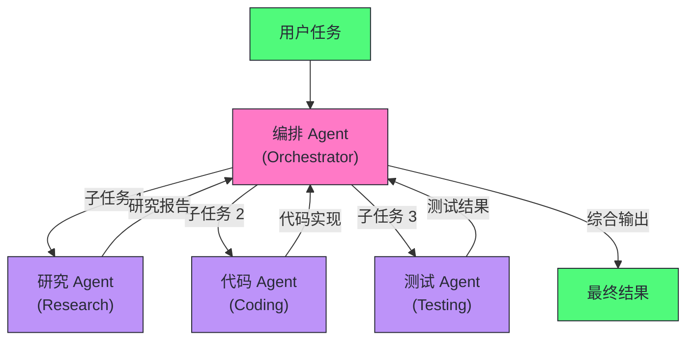
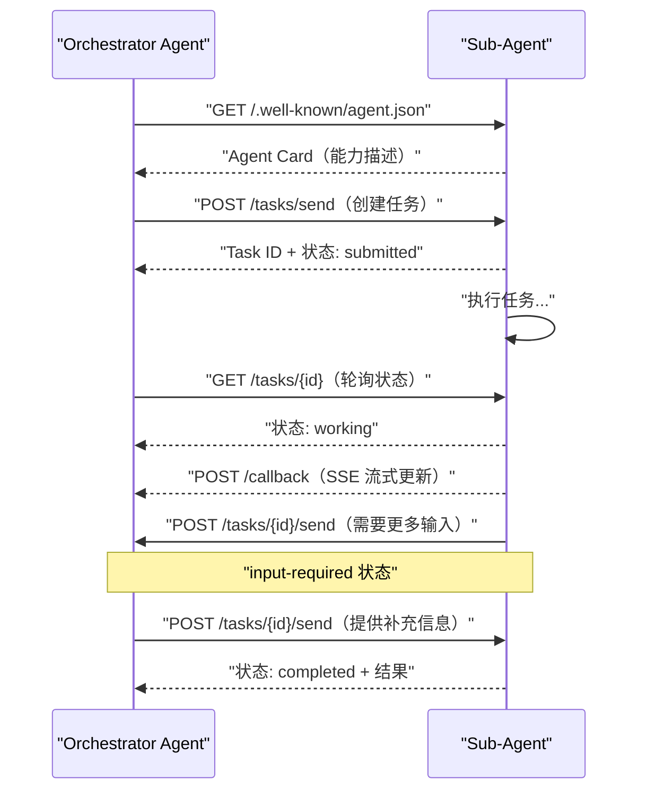

# 14 多 Agent 系统与 A2A 协议——协作、通信与特化

**摘要：**

单个 Agent 的能力边界是客观存在的——上下文窗口有限、工具集有限、对单一任务的专注深度也有限。**多 Agent 系统**通过让多个特化 Agent 分工协作来突破这层天花板，但突破的代价是系统复杂度的急剧上升：谁来分解任务、谁来协调进度、Agent 之间如何发现彼此、如何传递上下文、失败之后如何定位。本文从"为什么需要多 Agent"的根本动机出发，剖析多 Agent 架构的三种主要模式（层级式、扁平式、混合式）以及它们背后"编排与协商"两种控制流哲学；随后系统拆解 Google 于 2025 年 4 月提出、同年 6 月捐赠给 Linux Foundation 的 **A2A（Agent-to-Agent）协议**——Agent Card 能力发现、Task 生命周期、Message 与 Part 的语义、v0.2 的无状态化与认证、2026 年 3 月 v1.0 的签名 Agent Card 与多协议绑定，以及 MCP、A2A、AGNTCY 三者之间的分工与治理格局；接着讨论多 Agent 系统的工程挑战——可观测性、错误容错、并发竞态、成本控制与调试困境；最后结合 Anthropic 多 Agent 研究系统、OpenAI Agents SDK 的 handoff、Google ADK 与 Cognition 的两次公开表态，提炼适合生产的模式选型经验。上一篇 [[LLM/Agent技术/应用开发/13 Agent 框架选型——LangChain、LlamaIndex 与 LangGraph]] 讨论的是单 Agent 与多 Agent 框架的选型，本文则聚焦多 Agent 自身的组织、通信与工程化。

---

## 第 1 章 为什么需要多 Agent

2025 年 4 月 9 日，Google 在 Cloud Next 大会上与五十多家企业一起发布了 A2A 协议，同一天开源了 Agent Development Kit（ADK），两天新闻背后是同一个判断：单 Agent 的落地场景已经积累到足够多，多 Agent 之间的互操作问题开始变成显性需求。但在进入协议与框架的细节之前，不妨先退一步问一个更基本的问题——一个 Agent 能干完的活，为什么非要拆给一队 Agent？

### 1.1 单 Agent 的四大天花板

在 [[LLM/Agent技术/应用开发/11 Agent 核心能力——推理、规划与工具调用]] 中我们构建了单 Agent 的能力模型。单 Agent 是优雅的——一个大脑，感知-推理-行动的循环，状态自洽，调试路径线性。但现实中的复杂任务往往超出了单 Agent 的能力边界，具体体现在四个天花板上。这四个天花板不是并列的四个问题，而是同一件事的四个侧面：**单 Agent 的所有资源——上下文、注意力、执行时间、故障域——都是共享的，而共享意味着互相挤占**。

**天花板一：上下文长度**

一个 Agent 在执行复杂的长期任务时，其 Thought/Action/Observation 的累积会快速填满上下文窗口。更根本的问题是：即使有 128K 甚至 1M 的上下文窗口，把所有中间过程都塞在一个上下文里，LLM 的"注意力"会被大量无关内容稀释，推理质量下降——这就是 [[LLM/LLM原理/08 长上下文与多模态——技术前沿]] 中讨论的 Lost in the Middle 问题。ReAct 循环还有一层雪上加霜的机制：每一轮推理都要把此前所有轮次的轨迹重新放进 prompt，token 消耗随步数近似平方增长（[[LLM/Agent技术/基础范式/02 ReAct 架构深度解析——Thought-Action-Observation 循环的本质|第 2 篇]] 对此有完整分析）。上下文窗口越堆越满，越满推理越差，越差越需要更多轮次去补救——这是一个正反馈的恶化循环。

**天花板二：专注度与深度**

一个通用 Agent 同时扮演研究员、分析师、代码工程师、报告撰写者，它能完成每件事，但每件事都是"够用"而非"专精"。就像一个人不可能同时是世界顶尖的外科医生和世界顶尖的钢琴家——深度专精要求专注，而通用 Agent 的注意力是分散的。这个天花板在 prompt 层面表现为**角色指令的相互干扰**：把"你是严谨的审计员"与"你是富有创造力的文案"写进同一个 system prompt，模型会在两种风格之间摇摆，最后两头都不够好。

**天花板三：并行能力**

单 Agent 是串行的——完成任务 A 后才能开始任务 B。对于可以并行处理的任务（如同时调研五个不同的技术方案），单 Agent 只能顺序执行，效率低下。这里的差距不是常数级的：串行执行的总耗时等于各子任务耗时之和，并行执行则约等于最长子任务的耗时，任务越多、差距越大。吞吐量上同样如此，一个 Agent 的推理吞吐就是它单模型的吞吐，而 N 个 Agent 可以近似线性扩展（只要底层模型服务不成为瓶颈）。

**天花板四：任务隔离与可靠性**

一个负责所有事情的单 Agent，一旦在某个子任务上发生错误（如调用 API 失败、模型幻觉），错误会顺着同一条状态链蔓延到整个任务——它没有"失败域"的概念。而多 Agent 系统可以将不同子任务隔离在不同 Agent 中，每个 Agent 拥有独立的上下文、独立的工具调用序列、独立的执行历史，一个 Agent 的失败不会直接污染其他 Agent 的中间结果。

### 1.2 多 Agent 的核心收益

把这四个天花板翻过来，就是多 Agent 的核心收益：

| 收益 | 机制 | 典型场景 |
| :--- | :--- | :--- |
| **突破上下文限制** | 每个 Sub-Agent 维护自己的上下文，不相互污染 | 长期研究任务、复杂软件开发 |
| **能力专化** | 每个 Agent 只做一件事并做到最好 | 代码生成 + 代码审查 + 测试用三个专化 Agent |
| **并行加速** | 独立的子任务同时执行 | 并行调研多个竞品，并行处理多个用户请求 |
| **故障隔离** | 子 Agent 失败不级联到整体 | 一个检索 Agent 超时，不影响其他已完成的子任务 |
| **模型异构** | 不同子任务用最适合的模型 | 简单任务用小模型，复杂推理用大模型 |

前四条是从"单 Agent 的缺陷"直接推出的补集，第五条却是多 Agent 独有的一份红利：既然每个 Agent 是独立运行的个体，就没有任何理由让它们共用同一个模型。调度型子任务可以用便宜的小模型，长文档精读可以用长上下文模型，复杂推理可以只用推理模型——模型异构让"在合适的地方花合适的钱"第一次成为结构性可能，而不只是手工调参。

### 1.3 动机要过一道反事实的拷问

不过，把动机列成一张收益表，并不等于"多 Agent 就是更好的"。Cognition 的联合创始人 Walden Yan 在 2025 年 6 月写了一篇流传甚广的文章《Don't Build Multi-Agents》，立场鲜明地反对在编程场景使用多 Agent 架构：多个并行 agent 各自对风格、边界情况、代码模式做出隐含的取舍，而这些取舍彼此冲突，最终产出一个脆弱的整体。他给出的两条原则——"共享上下文"与"行动携带隐含决策"——后来成了讨论 Agent 上下文工程时的常用引语。Anthropic 在同月发布的多 Agent 研究系统又给出了相反方向的证据（详见第 6 章）。两篇文章针锋相对，恰好说明多 Agent 不是一条无脑的升级路径，而是一道需要论证的工程选择题。笔者的判断是：多 Agent 的动机必须落到"**单 Agent 的失败是结构性失败**"这个判据上——上下文塞不下、角色互相干扰、串行慢到不可接受、单一失败域扛不住风险，四条里占了两条以上，多 Agent 才值得认真考虑；否则它带来的只是复杂度税。

---

## 第 2 章 三种架构模式：控制流归谁

多 Agent 系统的第一道设计题不是"用几个 Agent"，而是"**谁说了算**"。三种主流架构的分野，本质上是对同一个问题的不同回答。

### 2.1 层级式（Hierarchical）——指挥与执行分离

层级式架构是最常见的多 Agent 组织形式：一个**编排 Agent（Orchestrator）** 负责任务分解和全局协调，多个**执行 Agent（Sub-Agent）** 负责执行具体的子任务。它像一支工程队：项目经理（Orchestrator）不亲手砌墙，但他决定砌什么墙、谁去砌、砌完怎么验收——注意这个比喻的边界，真实的项目经理拥有对成员的行政权，而编排 Agent 对子 Agent 只有"委托权"，子 Agent 依然是独立运行的个体，不听令也可以失败。



**Orchestrator 的职责**：
- 理解顶层目标，制定全局计划
- 将任务分解为子任务，并分配给合适的 Sub-Agent
- 接收子任务结果，判断是否完成或需要重试
- 综合所有子任务的输出，生成最终答案

**Sub-Agent 的职责**：
- 专注执行分配到的单一子任务
- 维护自己的工具集，与其他 Sub-Agent 解耦
- 完成后将结果返回给 Orchestrator

层级式的关键优势是**清晰的责任边界**——每个 Agent 都知道自己的角色和任务范围，控制流可以被审计：某一轮失败的决策，总能回溯到编排器当时的分解指令。它适合任务可以被清晰分解、子任务间依赖关系明确的场景。但层级式也把全部压力集中到了编排器身上：任务分解的质量直接决定整个系统的上限，编排器的上下文要同时容纳全局计划与所有子任务的结果摘要，规模一大，编排器自己先撞上第 1 章说的上下文天花板。这是一个值得记住的反讽——**我们用多 Agent 逃避单 Agent 的上下文天花板，层级式又把上下文压力加倍还给了编排器**。

### 2.2 扁平式（Peer-to-Peer）——平等协作

扁平式架构中没有中央指挥者，所有 Agent 地位平等，通过消息传递协商和协作。任何 Agent 都可以向其他 Agent 发起请求，也可以接收请求。它更像一场圆桌会议而非军队行军——会议的议题、发言顺序、结论都不由主席决定，而是由与会者的交互自然涌现。

这种架构在实践中比理论上更难控制——没有全局协调者意味着容易出现循环依赖、消息风暴等问题。但在某些场景下非常自然：

- **辩论与校验**：一个 Agent 提出方案，另一个 Agent 批评，第三个 Agent 综合——三方平等参与，不存在天然的主从关系
- **共识机制**：多个 Agent 对同一个问题独立分析，通过投票或讨论达成共识（类似 Self-Consistency 的多路径投票）
- **竞争与选优**：多个 Agent 并行提出不同方案，由"评审 Agent"选出最优

扁平式的本质是把"谁说了算"这个问题交给运行时的对话去回答，换来的是灵活性，付出的是可预测性——没有全局视角，也就没有人能回答"整个系统现在处于什么状态"。

### 2.3 混合式——最实用的架构

实际生产系统通常是层级式和扁平式的混合：顶层有一个 Orchestrator 协调全局，但某些子任务由一个"小团队"的 Sub-Agent 通过平等协作完成。

```
顶层 Orchestrator
├── 研究小组（扁平式协作）
│   ├── 文献检索 Agent
│   ├── 数据分析 Agent
│   └── 报告撰写 Agent
└── 工程实现小组（层级式）
    ├── 架构设计 Agent
    └── 代码实现 Agent（由架构设计 Agent 的输出驱动）
```

混合式不是架构上的妥协，而是对两种模式适用范围的诚实回应：需要全局一致性的地方用层级式收拢控制权，需要多视角碰撞的地方用扁平式放开对话。判断哪里该用哪种，标准只有一个——**这个子任务的结果是需要"对齐全局"还是需要"碰撞出质量"**。

### 2.4 编排 vs 协商：两种控制流哲学

把三种架构并排看，层级式与扁平式的对立可以提炼成一个更抽象的分野：**编排（Orchestration）与协商（Negotiation）**。编排是中心化的——控制流由编排器显式决定，任务分解、分配、汇总都发生在明面上，系统行为可预测、可审计，代价是编排器成为关键单点。协商是去中心化的——控制流从参与者的一次次对话中涌现，任务边界在执行过程中动态调整，系统更灵活、更能应对开放问题，代价是没有单一视角、行为难以预测、终止性没有保证。

| 维度 | 编排（Orchestration） | 协商（Negotiation） |
| :--- | :--- | :--- |
| 决策者 | 中心编排器 | 参与者共同 |
| 控制流 | 显式、预定义 | 隐式、运行时涌现 |
| 状态可见性 | 单一视角 | 无全局视角 |
| 可预测性 | 高 | 低 |
| 终止保证 | 由编排器决定 | 需显式约定 |
| 典型实现 | LangGraph 图编排、CrewAI 流程 | AutoGen 对话、辩论式、投票式 |
| 适用任务 | 可分解、结构已知 | 开放、多解、需要多视角 |

这两者没有高下之分，只有匹配问题。AutoGen 把多 Agent 建模成一组可以互相对话的参与者，本质是协商式的；LangGraph 用状态图把每一步转移画死，本质是编排式的；CrewAI 介于其间——角色是预定义的（编排），但同一角色内部的执行是自主的。选择的关键是任务的开放程度：任务边界清楚、质量判据明确，用编排；任务本身需要探索、答案需要多视角碰撞，用协商。笔者的经验是，绝大多数生产系统最终落在编排为主、协商为辅的混合区，因为生产环境首先要可预测。

### 2.5 架构选择的边界与失效场景

任何架构都有失效场景，多 Agent 也不例外。层级式（Supervisor 模式）最常见的失效是**编排器退化**：任务分解过粗，子 Agent 拿到的任务描述含糊，结果各做各的，编排器又不具备判断力，只能把残缺结果拼接上交。扁平式最常见的失效是**协商失序**：消息风暴（Agent 之间互相追问、无限往返）、循环依赖（A 等 B、B 等 A）、以及无终止——没有约定"什么算达成一致"，会议就永远开不完。混合式看似安全，实则把前两者的风险都保留了下来，只是摊薄了。

| 架构 | 失效场景 | 前置检查 |
| :--- | :--- | :--- |
| **层级式** | 编排器分解质量差、编排器上下文超载、编排器单点故障 | 任务能否清晰分解；编排器的上下文预算是否够 |
| **扁平式** | 消息风暴、循环依赖、无终止保证、调试无锚点 | 是否显式约定轮次上限与终止条件 |
| **混合式** | 层级/扁平边界模糊，错误互相渗透 | 每个子任务的协作模式是否有明确归属 |

这张表的读法不是"避免失效场景"，而是"在选型时就为失效场景设计退路"——层级式的编排器必须有超时与降级路径，扁平式必须约定最大轮次，混合式必须在边界处显式声明控制权交接。多 Agent 架构的成熟度，恰恰体现在它对自己失效方式的预判上。

---

## 第 3 章 Agent 间通信的核心问题

架构定了，接下来的问题是：Agent 之间到底怎么说话？这一章讨论的是与具体协议无关的通信基本面，它们是后面理解 A2A 的地基。

### 3.1 通信的三个维度

多 Agent 系统中，Agent 间的通信需要解决三个维度的问题：

**信息内容（What）**：传递什么信息？是结构化的任务指令（JSON），还是自然语言的对话消息，还是二进制数据（图像、文件）？内容维度决定了消息的解析成本——结构化指令可以被程序直接路由，自然语言则要交给接收方 Agent 再理解一遍。

**交互模式（How）**：以什么方式交互？同步请求-响应（Agent A 发出请求，等待 Agent B 返回结果再继续），还是异步消息（Agent A 发出消息后继续运行，B 在某个时刻处理并可能在未来某时回复）？同步简单直观，但把 A 的执行时间直接绑定在 B 的响应时间上，一次慢调用就拖住整条链；异步解耦了时间，却把"什么时候能等到结果"变成了一个需要管理的问题，于是引出超时、回调、轮询、队列一套工程设施。

**发现机制（Where）**：Agent A 如何知道 Agent B 的存在、能力和地址？是静态配置（在代码里写死），还是动态发现（通过注册中心查找）？静态配置部署简单，但每加一个 Agent 就要改一遍所有相关方的配置，N 个 Agent 之间就是 N×N 的配置面；动态发现把"谁知道谁"交给一个运行时组件，代价是系统里多了一个必须高可用的依赖。A2A 的 Agent Card（第 4 章）正是想把这第三个维度标准化。

### 3.2 任务委派的语义

当一个 Orchestrator 把子任务"委派"给 Sub-Agent 时，这个委派包含哪些信息？一个完整的任务委派应包含：

- **目标（Goal）**：Sub-Agent 需要完成什么
- **输入（Input）**：完成任务所需的输入数据
- **输出格式（Output Schema）**：期望的结果格式（关系到 Orchestrator 如何解析结果）
- **约束（Constraints）**：时间限制、资源限制、不能做什么
- **上下文（Context）**：帮助 Sub-Agent 理解背景的附加信息

在当前的工程实践中，这些信息通常以**自然语言 + JSON Schema** 的形式编码在传递给 Sub-Agent 的第一条消息中，缺乏标准化。委派语义含糊的后果在规模上来之后会集中爆发：子 Agent 理解偏了，产出格式不对，编排器解析失败，只能整单重做。这正是 A2A 协议试图解决的问题——把"委派"这一动作的语义固定成协议层面的 Task 对象，让任何实现都遵循同一套字段与状态机。

### 3.3 结果传递的可靠性

Sub-Agent 执行完任务后，如何可靠地将结果传回 Orchestrator？几种常见模式：

**直接返回（同步）**：Sub-Agent 函数执行完毕，返回值就是结果。最简单，但受制于调用栈深度和超时限制。

**共享状态（State Store）**：Sub-Agent 将结果写入共享的状态存储（如 Redis、数据库），Orchestrator 从中读取。适合长时间运行的子任务。

**回调（Callback/Webhook）**：Sub-Agent 完成后通过 HTTP 回调通知 Orchestrator。适合异步、跨进程的场景。

**消息队列**：结果发布到消息队列（如 Kafka、RabbitMQ），Orchestrator 订阅并消费。适合高吞吐量、需要缓冲的场景。

这四种模式没有优劣，只有吞吐与复杂度的取舍。但有一条底线是共通的：**结果传递必须能回答"这单到底成没成"**。分布式系统里网络不可靠，譬如回调可能丢、队列可能积压、共享状态可能被并发覆盖，所以结果消息要带幂等键、要允许查询状态、要能重放。多 Agent 的"结果传递"本质上和微服务之间的异步通信面对的是同一套问题，解法也同源——只是这里传递的负载不是结构化数据，而是"另一个 LLM 的产出"，格式更难校验。

### 3.4 共享状态 vs 消息传递：黑板的诱惑

在多 Agent 通信的具体实现上，存在两种经典路线的对立：**共享状态（黑板模式）与消息传递**。黑板（Blackboard）模式源自经典 AI 的黑板架构——多个专家 Agent 读写同一个共享工作区，各自的发现写在黑板上，其他专家看见后继续补充，像一个会议室里的白板，先到者写下想法，后来者在其上勾画。消息传递则相反，Agent 之间只通过点对点的消息交换数据，不共享任何可写状态，像传纸条，每张纸条只有收发双方可见。

| 维度 | 黑板（共享状态） | 消息传递 |
| :--- | :--- | :--- |
| 可见性 | 全局可见，天然广播 | 点对点，按需路由 |
| 并发冲突 | 需要版本控制与锁 | 无共享写，无写冲突 |
| 失败恢复 | 状态集中，易持久化 | 消息可能丢失，需重试 |
| 耦合度 | 低（只依赖黑板） | 中（依赖对方地址与协议） |
| 适用场景 | 多专家协作解同一问题 | 职责清晰的任务委派 |

黑板模式最诱人的地方是它天然适合"多人协作推进一个问题"——竞品研究、头脑风暴、代码评审都是这类任务。但它的代价是并发控制：两个 Agent 同时写同一块区域，后写者覆盖先写者，如果没有版本号与冲突仲裁，黑板会变成垃圾场。Cognition 在 2026 年 4 月复盘时给出的经验恰好是对黑板模式的修正——"写入保持单线程（writes stay single-threaded）"：多 Agent 可以各自贡献智能、贡献评审意见、贡献发现，但最终的写入（写文件、改代码、落报告）只允许一个 Agent 执行。共享状态适合"读多写少"的协作，消息传递适合"写多读少"的委派，而生产中更稳妥的做法往往是前者只读、后者才写。

### 3.5 上下文传递的成本——压缩是通信的第一要务

多 Agent 通信里最容易被低估的成本是**上下文传递**。Agent A 要把自己知道的事告诉 Agent B，有几种做法：把全部历史消息原样转发（保真但昂贵，且会把 B 的上下文窗口撑爆）；把关键结论提炼成摘要（省 token 但丢细节）；把历史存入外部存储、只传给 B 一个引用（省上下文但多一次检索）。Anthropic 在多 Agent 研究系统的工程复盘里给过一个精辟的说法——**"搜索的本质是压缩"**：每个子 Agent 用自己独立的上下文窗口去探索问题的一个侧面，然后把最重要的信息压缩成少量 token 交还给主导 Agent，主导 Agent 不必也不应看到子 Agent 的全部探索轨迹。这与 Cognition 的"共享上下文，共享完整轨迹而非只共享单条消息"看似矛盾，实则互补：共享的是"决策所需的上下文"，压缩的是"探索过程的细节"，二者的分界线恰好就是"对方要不要据此做决策"。上下文传递没有免费的午餐，每一次转发都是一次有损压缩，而通信设计的全部艺术，就是决定哪些信息值得无损、哪些必须丢弃。

---

## 第 4 章 A2A 协议——Agent 间通信的标准化

### 4.1 A2A 的背景：为什么又需要一个协议

2025 年 4 月 9 日，Google 在 Cloud Next 大会上正式发布 **A2A（Agent-to-Agent）协议**，联合了 50 多家技术伙伴，其中包括 Atlassian、Box、Cohere、Intuit、LangChain、MongoDB、PayPal、Salesforce、SAP、ServiceNow、UKG、Workday，以及 Accenture、BCG、Deloitte、McKinsey 等一批大型服务商。A2A 的出现背景与 [[LLM/Agent技术/基础范式/04 MCP 协议深度解析——Agent 与工具的标准化连接]] 中 MCP 出现的背景高度相似：**当每个 Agent 框架都有自己的 Agent 间通信方式，跨框架的 Agent 协作就变成了一场噩梦**。

- LangGraph 的 Agent 怎么调用 CrewAI 的 Agent？
- 公司 A 的专有 Agent 怎么与公司 B 的 Agent 安全交互？
- 企业内部不同团队分别用不同框架开发的 Agent，如何组成更大的系统？

Google 的官方表述把 A2A 与 MCP 的分工说得非常清楚：A2A 是一个**互补（complements）** MCP 的开放协议——MCP 解决"Agent 与工具/数据的连接"，A2A 解决"Agent 与 Agent 的协作"。它建立在两个朴素的技术选择之上：传输层用 HTTP(S)，消息格式用 JSON-RPC 2.0，都不发明新东西，只把"发现彼此、协商交互方式、协作完成任务"这件事的语义标准化。与其说 A2A 发明了一套新协议，不如说它把分散在各框架内部的多 Agent 通信机制抽出来，写成了公开的规范。

### 4.2 从 v0.1 到 v1.0：一年内的版本演进与治理变迁

A2A 的演进速度是协议史上少见的快。从 2025 年 4 月发布到 2026 年 3 月 v1.0 稳定，不到一年，且中途完成了从"Google 的标准"到"Linux Foundation 的项目"的治理转移：

| 时间 | 事件 | 关键内容 |
| :--- | :--- | :--- |
| **2025-04-09** | 发布 v0.1 | Google Cloud Next 发布，50+ 伙伴；JSON-RPC 2.0 over HTTP(S)，Agent Card 发现，同步/SSE/推送三种交互 |
| **2025-05-20** | 发布 v0.2 | 支持无状态交互（无需会话管理的轻量模式）；标准化认证（OpenAPI 风格的 authentication schema） |
| **2025-06-23** | 捐赠 Linux Foundation | 成立 Agent2Agent 项目，创始成员 AWS、Cisco、Google、Microsoft、Salesforce、SAP、ServiceNow；支持公司超过 100 家 |
| **2025-07-29** | AGNTCY 加入 Linux Foundation | Cisco 主导的 Agent 基础设施项目进入 LF，与 A2A、MCP 互操作（详见 4.8） |
| **2026-03-12** | 发布 v1.0 | 首个生产级稳定版：a2a.proto 成为规范事实来源、多协议绑定（JSON-RPC/gRPC/REST）、签名 Agent Card、多租户、tasks/list、OAuth 2.1 现代化 |
| **2026-05-26** | v1.0.1 | 规范修正补丁（HTTP 绑定媒体类型、TaskStatus 取值等） |

这段演进背后有一条清晰的治理线索：**从公司主导到多厂商项目，再到稳定版本**。v0.1 时代规范由 Google 团队维护，虽有 50 多家伙伴背书，但解释权在发起方手里；2025 年 6 月捐赠给 Linux Foundation 后，成立了由 AWS、Cisco、Google、Microsoft、Salesforce、SAP、ServiceNow 等组成的指导委员会，技术方向进入多厂商共同治理；v1.0 的发布标志着规范从"提案"变成"可用承诺"。对一个要押注它的企业而言，这条治理线索比任何技术特性都重要——协议的长期走向不再由一家公司的商业决策左右。

### 4.3 核心概念之一：Agent Card（Agent 名片）

每个 A2A 兼容的 Agent 都暴露一个 `/.well-known/agent.json` 端点，描述自己的能力、输入输出格式、认证方式等——类似于 OpenAPI Spec，但专门为 Agent 设计：

```json
{
  "name": "DataAnalysisAgent",
  "description": "专业的数据分析 Agent，擅长统计分析、可视化和趋势预测",
  "url": "https://agents.company.com/data-analysis",
  "version": "1.0.0",
  "capabilities": {
    "streaming": true,
    "pushNotifications": true,
    "stateTransitionHistory": false
  },
  "skills": [
    {
      "id": "analyze_csv",
      "name": "CSV 数据分析",
      "description": "分析 CSV 格式的数据文件，生成统计摘要和可视化图表",
      "inputModes": ["text", "file"],
      "outputModes": ["text", "file", "data"]
    },
    {
      "id": "trend_forecast",
      "name": "趋势预测",
      "description": "基于历史时序数据预测未来趋势",
      "inputModes": ["text", "data"],
      "outputModes": ["text", "data"]
    }
  ],
  "authentication": {
    "schemes": ["bearer"]
  }
}
```

Agent Card 是多 Agent 系统中**动态能力发现**的基础——Orchestrator 可以通过网络发现附近的 Agent，读取它们的 Agent Card，动态决定把哪些子任务委派给哪个 Agent，而不需要在代码里硬编码每个 Agent 的位置和能力。如果说 Task 是 A2A 的"动词"，Agent Card 就是 A2A 的"名词表"：它让"对方有什么能力"从一个需要试错的问题，变成一个可以查询的答案。

需要留意的是，上述 JSON 是 v0.x 时代的形态；v1.0 对 Agent Card 做了结构性重组——扩展字段（如认证）被并入 capabilities 的命名空间，新增了 **签名 Agent Card（Signed Agent Card）** 机制：用 JWS（JSON Web Signature）对卡片内容做密码学签名，接收方可以验证这张卡片确实来自声称的 Agent，而不是被中间人篡改过的冒牌货。这对跨企业边界的场景是刚需——你愿意把任务委托给"Salesforce 的分析 Agent"，但前提是你能验证它真的是 Salesforce 的分析 Agent。

### 4.4 核心概念之二：Task（任务）的生命周期

A2A 中 Agent 间的基本交互单位是 **Task**，而非简单的 HTTP 请求。Task 是有生命周期的：

```
submitted（已提交）→ working（执行中）→ completed（已完成）
                   ↓                 ↓
              input-required       failed（失败）
             （需要补充输入）         canceled（已取消）
```

Task 的状态可以被查询，允许 Orchestrator 追踪子任务的进度，而不是盲目等待。这里的设计取舍值得多说两句。其一，Task 状态机的存在意味着 A2A 把"任务"当作一等公民——委托方拿到的是一个可查询、可取消、可续传的实体，而不是一次性的函数调用，这让"长时间运行的 Agent 任务"成为可能。其二，`input-required` 状态对应了现实中最常见的协作场景：子 Agent 执行到一半发现缺信息，回头向委托方要——这是编排式多 Agent 系统里最麻烦的"对话中途折返"，A2A 用一个状态把它显式化，让双方都知道"任务停在了哪里、等什么"。v1.0 又新增了 `tasks/list` 方法（带过滤与分页），让一个 Agent 可以列出自己名下所有任务的执行情况，对批量调度和运维审计都有直接价值。

### 4.5 核心概念之三：Message 与 Part

Task 中的通信通过 **Message** 进行，每条 Message 可以包含多个 **Part**（部分），每个 Part 有自己的内容类型：

```json
{
  "role": "user",
  "parts": [
    {
      "type": "text",
      "text": "请分析这份销售数据文件，重点关注 Q4 的增长趋势"
    },
    {
      "type": "file",
      "file": {
        "name": "sales_2024.csv",
        "mimeType": "text/csv",
        "bytes": "base64_encoded_content..."
      }
    }
  ]
}
```

这种 Part 设计使 A2A 天然支持多模态内容传递——文本、文件、图像、结构化数据都可以在同一条 Message 中传递，且不同 part 的类型由 `type` 字段区分，接收方可以按类型分别处理。v1.0 对 Part 做了两处简化：去掉了区分消息类型的判别字段（`kind`），改用 JSON 成员本身表达类型；把 FilePart 与 DataPart 的字段压平，减少了不必要的嵌套。这符合协议演进的一贯规律——**第一版为了表达力可以冗余，稳定版为了实现一致性必须精简**。

### 4.6 通信流程：一次完整的 A2A 交互



A2A 支持三种响应模式，按任务的轻重缓急选用：
- **同步响应**：Sub-Agent 在 HTTP 响应中直接返回结果（适合快速任务）
- **异步 + SSE 流式更新**：Sub-Agent 先返回 Task ID，通过 Server-Sent Events 推送进度和中间结果（适合长时间任务）
- **异步 + 推送通知**：Sub-Agent 完成任务后向委托方预先注册的回调地址推送通知，委托方无需持续轮询（适合事件驱动场景）

三种模式的分工本质上是"等待的成本"的权衡：同步最简单，但双方必须同时在线；SSE 让委托方实时看到进度但保持连接；推送通知最解耦，但要处理回调丢失与重试。对一个要跑十分钟的研究任务，同步等待是不可接受的；对一个几十毫秒的查询，用上推送通知又纯属过度设计。

### 4.7 A2A vs MCP：互补而非竞争

A2A 发布后，一个常见的问题是：A2A 和 MCP 是竞争关系吗？答案是**互补**，两者解决的是不同层面的问题——用 a2a-protocol.org 官方主页上的话来说，A2A 是"让用户通过 MCP 把 Agent 接到工具和数据上，再通过 A2A 把 Agent 接到其他 Agent 上"的开放标准：

| 维度 | MCP | A2A |
| :--- | :--- | :--- |
| **连接对象** | Agent ↔ 工具/数据资源 | Agent ↔ Agent |
| **交互粒度** | 单次工具调用（同步，短时） | 任务（异步，可长时间运行） |
| **能力描述** | Tools/Resources/Prompts | Skills（技能） |
| **状态管理** | 无状态（每次调用独立） | 有状态（Task 有生命周期） |
| **适用关系** | 垂直：LLM 使用工具 | 水平：Agent 委托 Agent |

在完整的多 Agent 系统中，两者通常同时存在：

- 每个 Agent 通过 **MCP** 连接它所需的工具（文件系统、数据库、API）
- Agent 与 Agent 之间通过 **A2A** 进行任务委派和协作

> [!note] 设计哲学
> MCP 和 A2A 的分工体现了一个重要的系统设计原则：**不同层次的交互需要不同的协议**。工具调用是轻量、快速、无状态的（适合 JSON-RPC）；Agent 任务是重量级、异步、有状态的（需要 Task 生命周期管理）。用同一个协议试图覆盖两种完全不同的交互模式，要么太复杂，要么有取舍。MCP 和 A2A 的共存体现了关注点分离的设计哲学。换个视角看，这也是一层"协议栈"：MCP 是 Agent 的"手"——去够工具；A2A 是 Agent 的"嘴"——去委托同类；两者各管一段，中间没有重叠，也就没有竞争。

### 4.8 AGNTCY：Agent 的"互联网基础设施"层

如果说 MCP 与 A2A 分别是"手"与"嘴"，那么 2025 年加入 Linux Foundation 的 **AGNTCY** 项目想做的是整个"神经系统"。AGNTCY 最初由 Cisco 于 2025 年 3 月开源，2025 年 7 月 29 日正式被 Linux Foundation 接纳，创始成员包括 Cisco、Dell Technologies、Google Cloud、Oracle、Red Hat，支持企业超过 65 家。它的目标被概括为"**Internet of Agents**"——为多 Agent 系统提供发现、身份、消息与可观测四类基础设施：

- **发现（Discovery）**：基于 Open Agent Schema Framework（OASF）描述 Agent 能力，任何 Agent 都能发现并理解其他 Agent 能做什么——A2A 的 Agent Card 和 MCP Server 都可以通过 AGNTCY 的目录被发现
- **身份（Identity）**：提供密码学可验证的 Agent 身份与访问控制，让 Agent 能跨组织边界安全行动
- **消息（Messaging）**：基于 SLIM（Secure Low Latency Interactive Messaging）协议提供低延迟的 Agent 间消息传输
- **可观测（Observability）**：提供可观测性 SDK，让分布在多个框架里的 Agent 行为可以被统一追踪

把三个项目放在一起，A2A 解决"Agent 怎么说话"，MCP 解决"Agent 怎么够到工具"，AGNTCY 解决"Agent 在哪、是谁、消息走哪条路"——前两者是语义与协议，后者是目录与管道。这层分工在 2025 年后半年逐渐成为业界的共识表述：**协议负责语义，基础设施负责连接，二者叠加才构成完整的互操作图景**。

### 4.9 治理归属的澄清：三个不同的 Linux Foundation 实体

AGNTCY 出现后，一个常见的混淆是把它与 A2A、MCP 的治理归属混为一谈，笔者在此专门澄清：这三者在 Linux Foundation 体系下分属**三个不同的实体**。A2A 属于 2025 年 6 月成立的 **Agent2Agent 项目**（Linux Foundation 下独立的多厂商项目）；MCP 于 2025 年 12 月 9 日捐赠给了 **Agentic AI Foundation（AAIF）**——Linux Foundation 下属的定向基金，创始项目是 MCP、goose 与 AGENTS.md，创始白金会员包括 AWS、Anthropic、Block、Bloomberg、Cloudflare、Google、Microsoft、OpenAI；AGNTCY 则是 2025 年 7 月加入的另一个独立 Linux Foundation 项目。三者都归 Linux Foundation 治理，但分属不同的项目/基金，各自的指导委员会与决策流程并不相同。

这个澄清不是考据癖。对一个要在生产中押注协议的企业，治理归属直接决定了"这套协议会不会被某一家公司牵着走"：A2A 的走向由八家厂商组成的指导委员会决定，MCP 的走向由 AAIF 的多厂商治理决定，AGNTCY 的走向由它自己的社区决定——三个实体互不隶属，恰恰保证了即使 Google 改变 A2A 的商业策略，项目本身依然可以在 Linux Foundation 的框架下独立演进。

---

## 第 5 章 多 Agent 系统的工程挑战

多 Agent 系统的工程挑战，本质上可以概括为一句话：**复杂性的转移**。单 Agent 的复杂性集中在模型行为内部，多 Agent 把复杂性扩散到了系统层面——调用链、状态、成本、失败模式全都变成了工程对象。这一章的五个小节，对应五道必答题。

### 5.1 可观测性：看清黑箱

单 Agent 系统中，一次推理失败，追踪路径是线性的：输入→LLM 调用→工具执行→输出。多 Agent 系统中，一次任务失败可能涉及 5 个 Agent、20 次 LLM 调用、10 次工具调用——在哪里出了问题？想象一下调查一场五辆车连环相撞的事故：你不能只看最后一辆车的行车记录仪，得把每一辆车的轨迹、每一次刹车的时机全部对齐到同一条时间线上。

多 Agent 系统的可观测性需要三样东西：

**分布式追踪（Distributed Tracing）**：给每个任务一个唯一的 Trace ID，所有子任务的 LLM 调用和工具执行都携带这个 ID，通过 Trace ID 可以在 LangSmith 或 OpenTelemetry 仪表板中重建完整的执行路径。多 Agent 的追踪比微服务更讲究"父子结构"——子 Agent 的全部调用必须嵌套在父 Agent 的 span 之下，这样 trace 树本身就还原了委派关系。

**结构化日志**：每个 Agent 的每次行动记录包含：Agent 名称、输入、输出、执行时间、调用的子 Agent 或工具、是否发生错误。

**状态快照**：在关键节点保存 Agent 状态的快照，便于事后分析和调试。LangGraph 的 Checkpointing 机制天然支持这一点。

工具生态在过去一年已经成型。OpenTelemetry 的 GenAI 语义约定（semantic conventions）项目正在把 Agent 的 span 类型标准化——`gen_ai.operation.name` 统一了推理、工具执行（`execute_tool`）、Agent 内部调用（invoke-agent）等操作的命名，LangGraph、CrewAI、AutoGen、google-adk、openai-agents 等框架的遥测都在向这套约定靠拢；LangSmith 提供了专为 Agent 可观测设计的 SmithDB 与在线评估；Langfuse 以开源方式提供 agent graph 可视化与工具调用分析（2026 年 1 月被 ClickHouse 收购，继续开源路线）；AgentOps、Arize Phoenix、Braintrust、W&B Weave 等也在各自的方向上覆盖了同一片需求。可观测性的坑不在工具选择，而在**埋点纪律**——Trace ID 必须贯穿父子 Agent 的全部调用，漏了任何一环，trace 树就断成碎片。

### 5.2 错误处理与容错

多 Agent 系统中的错误处理比单 Agent 复杂得多，需要在多个层次进行：

**Sub-Agent 级别**：Sub-Agent 内部的工具调用失败，应该在 Sub-Agent 内部处理——重试、换一种方式、或返回明确的错误状态。不应该让内部错误直接暴露给 Orchestrator（除非是不可恢复的致命错误）。这里的关键是区分**瞬态错误（transient）与终态错误（terminal）**：譬如网络抖动、限流这类瞬态错误，重试是有意义的；而参数非法、权限不足这类终态错误，重试只会放大浪费。重试的前提是操作的幂等性——一个"创建工单"的工具被重试两次，就可能造出两张工单。

**Orchestrator 级别**：当 Sub-Agent 返回失败状态时，Orchestrator 需要决策：是重新委派给同一个 Agent（重试）、委派给备用 Agent（降级）、还是终止整个任务（放弃）。这个决策不该靠编排器的临场发挥，而应该在系统设计时就为每个子任务声明降级路径。

**任务级别**：整个多 Agent 任务是否需要原子性保证（要么全部完成，要么全部回滚）？如果是，需要实现类似分布式事务的补偿机制。不过与微服务场景一样，多 Agent 任务的"全有或全无"代价高昂，实践中更多是接受部分完成——某个子 Agent 的调研失败，不应当让整个研究报告作废，而是让编排器带着已完成的部分继续，并在最终输出里标注缺口。

### 5.3 并发与竞态条件

当多个 Sub-Agent 并行运行时，需要注意竞态条件：

- 两个 Agent 同时修改同一个共享文件
- 两个 Agent 同时调用需要幂等性的外部 API
- Sub-Agent A 的结果还没写入共享状态，Sub-Agent B 就开始读取

工程上的处理策略：
- **不可变消息传递**：Agent 间通过不可变消息传递数据，而非共享可变状态
- **乐观锁**：对共享资源用版本号做乐观并发控制
- **任务依赖声明**：在任务图中明确声明任务间的依赖关系，调度器确保依赖满足后才执行后续任务

并发问题最隐蔽的地方在于它的**偶发性**——单测环境不并发，压测环境才并发；本地不重现，生产才重现。处理它的第一原则是把"谁写、谁读、何时写"画成一张依赖图，凡是图上没有明确边的访问，都要默认存在竞态。

### 5.4 成本控制

多 Agent 系统的成本爆炸是一个真实的工程风险——每增加一层 Agent 分解，LLM 调用次数可能成倍增加。单 Agent 的成本是"一次任务的 token 总和"，多 Agent 的成本是"所有子任务 token 之和 + 编排与汇总的 token + 重试与协商的往返 token"，后两项往往是隐藏的大头：编排器要把所有子任务的结果摘要读进自己的上下文，这一步的 token 与子任务数量线性相关；协商式架构的往返消息更是可能让成本呈超线性增长。

成本控制策略：

**模型分级**：Orchestrator 使用最强大的模型（如 GPT-4o/Claude 3.5 Sonnet），Sub-Agent 使用轻量模型（如 GPT-4o-mini/Claude 3 Haiku）。Orchestrator 负责高层次推理和决策，Sub-Agent 执行具体、限定范围的任务，不需要最强的模型。这是第 1 章"模型异构"红利在生产里的兑现，也是多 Agent 相对单 Agent 少有的成本优势——单 Agent 只能用最贵模型的账单覆盖所有步骤。

**任务缓存**：相同的子任务（如对同一文档的 RAG 查询）结果应该缓存，避免重复执行。尤其是在多 Agent 并行时，可能有多个 Agent 执行相同的检索。

**早期终止**：Orchestrator 实时监控成本，当总 token 消耗超过预算时主动终止任务并返回当前最佳结果，而非无限制地继续。

成本还有一个容易忽视的工程侧面：**归因**。多 Agent 的成本是分散在各子任务上的，没有一个清晰的归因结构，你根本说不清"是哪一步吃掉了预算"。可观测平台要能按 Agent 维度汇总 token 消耗——把成本当作一等指标来埋点，而不是事后看账单。

### 5.5 调试与评估的困境

多 Agent 系统最难的不是写出来，而是出了问题之后"想明白为什么"。调试困境有三个层次。其一是**不可重现**：LLM 的输出有随机性，同一条输入跑两次可能走向完全不同的分支，单 Agent 时代"复现 bug"的习惯在多 Agent 时代失效——复现不了，就只能靠 trace 重放。其二是**级联失败**：子 Agent 的失误会被父 Agent 的错误判断放大，最终呈现在用户面前的失败，根因可能在三四层之下，且根因与表象之间隔着 LLM 的推理，不是简单的调用栈。其三是**评估缺失**：多 Agent 系统的质量等于"协作质量"，而协作质量恰恰是最难自动判断的——Meta 的 Collaborative Reasoner（2025 年 4 月）在评估中发现，当前模型并不能稳定地利用协作来提升任务表现，社会性行为反而让协作场景的表现变差；Meta 随后的 ARE 平台与 Gaia2 基准（2025 年 9 月）进一步指出，需要异步协作的评测暴露了静态评测看不见的失败模式，且没有任何单一系统在智能与效率之间全面占优。这些发现从研究侧印证了一个工程判断：**多 Agent 的评估要评估"协作的净收益"，而不是"任务的绝对成绩"**——系统是不是因为多 Agent 而变好，需要一个与单 Agent 基线的对照实验才能回答。评估方法的系统讨论留给 [[LLM/Agent技术/应用开发/16 Agent 评估与可靠性工程|第 16 篇]]，这里只需要记住：多 Agent 系统上线前，先建一条单 Agent 的基线。

---

## 第 6 章 多 Agent 系统的设计模式

如果说第 2 章回答"控制流归谁"，本章回答"团队怎么搭"。几种被反复验证的设计模式，可以看成不同的乐队编制——同样的乐手，不同的配器，奏出完全不同的音乐。

### 6.1 Orchestrator-Workers（最常用）

最经典的多 Agent 模式，第 2 章已详细描述。核心是明确的 Orchestrator 与 Workers 的分工。

适用场景：任务可以被清晰分解为独立子任务，子任务间依赖关系可以事先确定。

### 6.2 Pipeline（流水线）

一系列 Agent 串联，前一个 Agent 的输出是后一个 Agent 的输入。类似于 [[LLM/LLM原理/03 预训练——数据、算力与 Scaling Law]] 中的数据处理流水线概念。

```
原始文档 → 提取 Agent → 分析 Agent → 写作 Agent → 审核 Agent → 最终报告
```

适用场景：内容生产、数据处理、代码生成-审查-测试流程。优势是每个 Agent 只关注一个步骤，易于替换和优化。Pipeline 的命门是**单点拖累**——整条链的吞吐等于最慢环节的吞吐，任何一个 Agent 的输出格式漂移都会让下游全部重做，所以环节之间的接口契约（输出 Schema）比环节内部的质量更重要。

### 6.3 Evaluator-Optimizer（评估-优化循环）

一个"生成 Agent"产出内容，一个"评估 Agent"对内容打分并提出改进建议，生成 Agent 根据反馈迭代改进，直到评估 Agent 满意。

```
生成 Agent ─────────────────────────────────────────> 结果
    ↑                                                   │
    │                  不满意                            │
    └──── 评估 Agent ← 评分 + 改进建议 ← 检查内容 ←────┘
```

适用场景：高质量内容生成（报告、代码、设计方案），需要通过迭代提升质量，且质量标准可以被明确编码给评估 Agent。这个模式成败的关键是评估 Agent 的质量标准写得够不够具体——"写得好一点"式的反馈会让生成 Agent 在原地打转，而"第 3 段论证缺少数据支撑，请补充至少两个来源"式的反馈才推动收敛。

### 6.4 Specialized Team（专化团队）

多个高度专化的 Agent 组成"专家团队"，每个成员有独特的知识和工具集。Orchestrator 根据任务性质，灵活调动不同专家参与。

一个软件开发 Agent 团队的示例：

| Agent | 专长 | 工具集 |
| :--- | :--- | :--- |
| **架构师 Agent** | 系统设计、技术选型 | 无（纯推理） |
| **前端 Agent** | React/Vue 代码生成 | 代码执行、npm 工具 |
| **后端 Agent** | API 设计、Python/Go 代码 | 代码执行、数据库工具 |
| **数据库 Agent** | SQL、索引优化、Schema 设计 | SQL 执行、数据库连接 |
| **测试 Agent** | 测试用例生成、覆盖率分析 | 代码执行、测试框架 |
| **安全审计 Agent** | 漏洞扫描、代码安全审查 | SAST 工具、CVE 数据库 |

Specialized Team 与 Orchestrator-Workers 的区别不在结构，而在**团队的固化程度**：前者把"角色-工具-知识"固化成可复用的资产，一个团队配置可以被多个任务反复调用；后者则是一次任务一次的动态分解。生产系统通常是先建一个固化团队，再在团队内部按任务动态分工。

### 6.5 生产案例一：Anthropic 的多 Agent 研究系统

2025 年 6 月，Anthropic 公开了支撑 Claude Research 的多 Agent 研究系统的工程细节，这是目前公开材料中最完整的多 Agent 生产案例。系统的架构是典型的 orchestrator-worker：一个主导 Agent（lead agent）接收用户问题，规划研究策略并存入外部记忆，然后派生 3-5 个子 Agent 并行搜索，每个子 Agent 拿到明确的目标、输出格式与工具指引；子 Agent 用交错思考（interleaved thinking）评估搜索结果、迭代收窄，最后主导 Agent 汇总所有子 Agent 的发现并决定是否追加一轮。

两个数字值得记住。其一，系统引入了两级并行化——主导 Agent 同时派生多个子 Agent、每个子 Agent 同时使用多个工具并行搜索——把复杂查询的研究时间最多缩短了 90%。其二，内部评估显示，用 Claude Opus 4 做主导、Claude Sonnet 4 做子 Agent 的多 Agent 系统，比单独使用 Claude Opus 4 的表现高出 90.2%，尤其在"广度优先"的查询上优势明显。Anthropic 把原因归结为"搜索的本质是压缩"：子 Agent 用独立的上下文窗口并行探索不同侧面，把最重要信息压缩成少量 token 交还主导 Agent，主导 Agent 因此看到了广度而不被细节淹没。

但 Anthropic 也坦承了未解的问题：当前架构下主导 Agent 必须等所有子 Agent 完成才能推进，异步化执行（子 Agent 自主派生、不受同步等待约束）带来的协调、状态管理与错误处理难题"尚未完全解决"。这个案例最有价值的地方在于它同时展示了多 Agent 的收益上限与代价边界——收益真实存在，但集中在"可并行、广度优先"的任务上，且工程复杂度同样真实。

### 6.6 生产案例二：OpenAI Agents SDK 与 Google ADK

OpenAI 的路径经历了从实验到生产的两次跳跃。2024 年 10 月，OpenAI 以实验性质开源了 Swarm，用两个原语——Agent（指令 + 工具）与 **handoff（交接）**——演示了多 Agent 编排的极简形态：当前 Agent 可以在对话中的任意时刻把会话交接给另一个 Agent，就像电话转接，但接收方拥有此前对话的完整上下文。2025 年 3 月 11 日，OpenAI 发布正式的 Agents SDK，Swarm 的角色被明确定位为"教育性质、已被取代"，SDK 把 handoff 保留为核心机制，并内置了完整的分布式追踪（每个 run 生成一条 trace，模型调用、工具调用、handoff、guardrail 全部记录在 span 层级里）。Agents SDK 还明确了两种编排模式的选择：**handoff**（把某分支的对话控制权交给专精 Agent）与 **agents-as-tools**（管理者保持控制，把专精 Agent 当作受限工具来调用）——前者是控制权移交，后者是能力封装，二者对应第 2 章的层级式与一种"工具化的扁平式"。

Google 的 ADK 则把"多 Agent 由设计"写进了框架基因：2025 年 4 月 9 日开源时，ADK 的核心抽象就是 **Agent 层级树**——根 Agent（root agent）通过 LLM 驱动的委派把对话转移给子 Agent，子 Agent 可以继续有孙 Agent，每个 Agent 只能有一个父 Agent；后续版本又补充了 SequentialAgent、ParallelAgent、LoopAgent 等模板工作流 Agent，以及 ADK 2.0 引入的图工作流与动态工作流。ADK 的多 Agent 设计强调"层级即控制"：树状结构让委派路径可预测、可调试，同一个任务不会出现两个相似 Agent 抢活的歧义。

两个框架的对照很有趣：OpenAI 用 handoff 表达"对话归属权的转移"，Google 用层级树表达"委派路径的受控"，前者让控制权流动，后者让控制权固化——而两者最终都汇入了同一条底层逻辑：**多 Agent 的生产价值不在架构形式，而在控制流是否清晰、可追踪**。

### 6.7 反例与经验：Cognition 的两次表态

Cognition 的两篇文章构成了对多 Agent 最有力的反向检验。2025 年 6 月，Walden Yan 的《Don't Build Multi-Agents》断言多数人不应构建多 Agent 系统，理由是并行 writer swarm 里的隐式决策（风格、边界情况、代码模式）彼此冲突；2026 年 4 月，他在《Multi-Agents: What's Actually Working》里更新了判断——过去十个月里 Cognition 开始部署真正有效的多 Agent 系统，但有效的模式高度收敛：**写入保持单线程，额外的 Agent 贡献智能而非行动**。所谓"贡献智能"，是让一个拥有干净上下文的评审 Agent 去抓编码 Agent 看不见的 bug，让一个更强的模型当"聪明朋友"去捕捉弱模型主力的疏漏，让一个管理者 Agent 跨子 Agent 协调范围而不碎片化决策。Cognition 还明确指出，多 Agent 的开放问题全是通信问题：弱模型何时学会升级上报、子 Agent 如何把影响兄弟工作的发现传递出去、如何不淹死接收者地传递上下文。

把 Anthropic 与 Cognition 的经验放在一起，可以得到一条相当一致的生产经验：多 Agent 擅长的是**并行探索**（Anthropic 的研究搜索）与**异构校验**（Cognition 的评审），而不擅长的是**并行写作**——凡是"多个写者同时产出并合并"的模式，两个团队都给出了负面证据。写作单线程、探索多线程，这可能是 2025-2026 年多 Agent 生产实践最值得带走的一条经验。

### 6.8 模式选型的决策边界

综合上述模式与案例，选型的决策可以归纳为四个追问：

1. **任务可分解吗**——子任务边界清楚、依赖明确，用 Orchestrator-Workers；边界模糊、需要探索，考虑协商式或混合式。
2. **有几个写者**——最终产出（代码、报告、文件）只允许一个写者，其余 Agent 全部以"评审/提供智能"的方式参与，这是 Cognition 经验的直接推论。
3. **有质量反馈吗**——迭代是否收敛取决于能否自动评估，能编码质量标准，用 Evaluator-Optimizer；不能，就用单 Agent 加人工审查。
4. **并行收益大于协调成本吗**——并行探索的收益与任务数量成正比，协调与上下文传递的成本与 Agent 数量也成正比，二者交叉点一般在 3-8 个 Agent 之间，超过后边际收益急剧下降。

| 场景 | 推荐模式 | 关键前提 |
| :--- | :--- | :--- |
| 可分解、依赖明确 | Orchestrator-Workers | 编排器上下文预算充足 |
| 内容生产流水线 | Pipeline | 环节间 Schema 契约稳定 |
| 高质量内容迭代 | Evaluator-Optimizer | 质量标准可编码 |
| 跨角色专家协作 | Specialized Team | 角色-工具资产可复用 |
| 广度优先并行调研 | 多写者并行探索（Anthropic 式） | 单写者汇总，探索可并行 |
| 编码/写作类任务 | 单写者 + 多评审 | 写入单线程，评审异构化 |

---

## 第 7 章 实战：构建一个多 Agent 研究系统

### 7.1 系统设计

以一个"竞品研究多 Agent 系统"为例，展示多 Agent 架构的完整设计思路——这套设计与第 6.5 节 Anthropic 研究系统同构，但规模更小，适合作为团队内部落地的模板。

**目标**：给定一个产品领域，自动完成竞品调研并生成分析报告。

**Agent 设计**：

```
ResearchOrchestrator（协调者）
├── WebSearchAgent（网络搜索，调用 Brave/Bing API）
├── DataExtractAgent（从搜索结果提取结构化数据）
├── ComparisonAgent（多维度对比分析）
└── ReportWriterAgent（撰写 Markdown 报告）
```

**执行流程**：

1. `ResearchOrchestrator` 接收用户的研究主题
2. 生成一个竞品列表（先问 LLM：这个领域主要有哪些竞品？）
3. **并行**：对每个竞品，分配一个 `WebSearchAgent` 实例搜索信息
4. **并行**：每个 `DataExtractAgent` 处理对应竞品的搜索结果，提取结构化数据
5. `ComparisonAgent` 接收所有竞品的结构化数据，生成多维对比分析
6. `ReportWriterAgent` 将对比分析转化为完整的 Markdown 报告
7. `ResearchOrchestrator` 返回最终报告

**并行化效果**：如果有 5 个竞品，步骤 3 和 4 并行执行，总时间约等于单个竞品的研究时间，而非 5 倍。

设计上刻意让 `ReportWriterAgent` 成为唯一的写者——它接收结构化的对比数据，输出整份报告，其他 Agent 只负责"贡献智能"。这正是第 6.7 节"写入单线程"原则的实践。

### 7.2 Orchestrator 的任务分配逻辑

Orchestrator 的核心能力是**动态任务分配**——它需要判断哪些子任务可以并行（无依赖关系），哪些必须串行（有数据依赖）：

```python
async def run_research(topic: str) -> str:
    # 步骤1: 生成竞品列表（串行，后续并行的基础）
    competitors = await orchestrator_llm.generate_competitor_list(topic)

    # 步骤2-3: 并行搜索和提取（无依赖，最大化并发）
    search_tasks = [web_search_agent.search(c) for c in competitors]
    search_results = await asyncio.gather(*search_tasks)

    extract_tasks = [data_extract_agent.extract(r) for r in search_results]
    structured_data = await asyncio.gather(*extract_tasks)

    # 步骤4: 对比分析（依赖所有提取结果）
    comparison = await comparison_agent.analyze(structured_data)

    # 步骤5: 报告撰写（依赖对比分析）
    report = await report_writer_agent.write(topic, comparison)

    return report
```

这段代码展示的是"同一进程内的 Agent 编排"——所有 Agent 都是函数调用。它的优点是简单、可调试，缺点是所有 Agent 必须部署在同一套代码里。当团队想要把某个子任务外包给另一个团队、甚至另一个公司维护的 Agent 时，就需要下一节的内容。

### 7.3 把 A2A 引入系统：从进程内编排到跨组织委派

假设 `ComparisonAgent` 的分析能力由另一个团队独立维护、甚至部署在外部，`ResearchOrchestrator` 就可以通过 A2A 把它变成远程 Agent。改造分两步。第一步，远程一方把能力发布成 Agent Card，放在 `/.well-known/agent.json`：

```json
{
  "name": "ComparisonAgent",
  "description": "多维度竞品对比分析，输入结构化竞品数据，输出对比矩阵",
  "url": "https://analytics.example.com/comparison",
  "version": "1.0.0",
  "capabilities": {
    "streaming": false,
    "pushNotifications": true
  },
  "skills": [
    {
      "id": "compare",
      "name": "对比分析",
      "description": "按价格/功能/生态等维度生成竞品对比矩阵",
      "inputModes": ["data"],
      "outputModes": ["text", "data"]
    }
  ],
  "authentication": {
    "schemes": ["oauth2"]
  }
}
```

第二步，Orchestrator 侧不再直接调用函数，而是按 4.6 节的流程发起 A2A 交互：读 Agent Card（发现能力）→ `POST /tasks/send` 创建任务 → 轮询或订阅 Task 状态 → 在 `input-required` 时补交数据 → 收到 `completed` 后取回结果。改动集中在通信层，编排逻辑不变——这正是协议标准化的价值：**Orchestrator 感知的是"A2A 兼容"，而不是"某个具体实现"**。作为对照，如果这个远程 Agent 还通过 MCP 暴露了几个数据查询工具，那么 Orchestrator 用 MCP 调工具、用 A2A 委派任务，两个协议在同一系统里各司其职——这正是 4.7 节分工共识的一次完整落地。

### 7.4 落地清单：可观测、预算与容错

把第 5 章的工程挑战落到这个系统上，会得到一张必须逐项勾掉的清单：

- **Trace**：整个调研任务一个 Trace ID，每个子 Agent 的调用嵌套为子 span，`group_id` 关联到用户会话
- **成本归因**：按 Agent 维度统计 token 与费用，编排器设置总预算，超预算早期终止并返回部分结果
- **容错**：搜索失败按瞬态/终态分类——网络超时重试两次，权限错误直接降级（用缓存结果替代）
- **竞态**：`ComparisonAgent` 依赖全部提取结果，用 `asyncio.gather` 的返回顺序保证数据对齐；共享缓存写入用版本号防覆盖
- **基线对照**：上线前跑一遍单 Agent 直答的基线，用第 16 篇的评估方法对比"多 Agent 是否真的更好"

这张清单不解决所有问题，但它把"多 Agent 系统"从一句抽象的口号，变成了一组可以验收的具体条目——这恰恰是生产系统与 demo 的分水岭。

---

## 第 8 章 总结与下一篇导读

### 8.1 本文核心要点

1. **多 Agent 的动机必须落到"结构性失败"上**：上下文塞不下、角色互相干扰、串行慢到不可接受、单一失败域扛不住风险，四条占两条以上才值得引入多 Agent，否则只是复杂度税。
2. **架构的分野是控制流归属**：层级式（编排）把控制流收拢到编排器，扁平式（协商）把控制流交给运行时对话，混合式在"对齐全局"与"碰撞质量"之间切分——没有高下，只有匹配。
3. **通信的三个维度是内容、模式与发现**：任务委派要语义化（Goal/Input/Output/Constraints/Context），结果传递要能回答"成没成"，上下文传递本质是一次有损压缩。
4. **A2A 用一年走完了"发布-捐赠-稳定"的协议生命线**：2025 年 4 月发布 v0.1、5-6 月 v0.2（无状态化与标准化认证）、6 月捐赠 Linux Foundation 成立 Agent2Agent 项目、2026 年 3 月 v1.0（签名 Agent Card、gRPC/REST 多绑定、多租户、tasks/list、OAuth 2.1），治理从公司主导走向多厂商指导委员会。
5. **MCP、A2A、AGNTCY 是分工不是竞争**：MCP 连工具、A2A 连 Agent、AGNTCY 管发现/身份/消息/可观测，且三者分属 Linux Foundation 下三个不同的实体。
6. **工程挑战的四道必答题**：可观测（Trace 贯穿父子 Agent）、容错（transient/terminal 分类 + 幂等）、并发（依赖图 + 不可变消息）、成本（模型分级 + 归因 + 预算护栏）。
7. **生产的经验共识是"探索多线程、写入单线程"**：Anthropic 的并行研究系统证明了广度优先任务的收益（最高 -90% 时间、+90.2% 内部评估），Cognition 的复盘证明了并行写作的失败——多 Agent 贡献智能、单 Agent 负责写入。
8. **评估要看"协作的净收益"**：Meta 的研究显示模型尚不能稳定利用协作提升表现，多 Agent 系统上线前必须建单 Agent 基线做对照。

### 8.2 下一篇导读

本文讨论了多 Agent 系统的架构、通信协议与工程挑战，给出了"什么情况下值得用多 Agent"的判据。但多 Agent 只是手段，终局是交付一个可靠的生产级 Agent 应用。下一篇 [[LLM/Agent技术/应用开发/15 Agent 应用实战——从零构建生产级 Agent|Agent 应用实战]] 将把这些理论落到三个完整的工程场景——企业知识库 Agent、代码审查 Agent 与数据分析 Agent，从需求分析、架构设计、关键实现决策到生产级考量（延迟、成本、可靠性）与上线后的迭代优化。本文反复强调的"可观测性、容错、成本归因、基线对照"，在下一篇会以完整案例的形态再次出现；届时本文的 7.4 落地清单，将与下一篇的生产部署最佳实践逐条对账。

> [!info] 专栏导航
> 本文是 [[LLM/Agent技术/00 专栏导览|Agent 技术专栏]] 应用开发部分（08-16）的第 14 篇。上一篇 [[LLM/Agent技术/应用开发/13 Agent 框架选型——LangChain、LlamaIndex 与 LangGraph]] 讨论了单 Agent 与多 Agent 框架的选型哲学与决策矩阵，本文在其基础上聚焦多 Agent 自身的组织模式、Agent 间通信与 A2A 协议，并补充了 2025-2026 年 A2A v1.0、AGNTCY、Anthropic/OpenAI/Google/Cognition 生产案例的最新核实信息；下一篇 [[LLM/Agent技术/应用开发/15 Agent 应用实战——从零构建生产级 Agent]] 将把多 Agent 与框架选型的知识落地为三个完整的生产级 Agent 案例，其中安全与监控实践与本文第 5 章的工程挑战一一对应。

---

## 参考资料

1. Google Developers Blog. "Announcing the Agent2Agent Protocol (A2A)." 2025-04-09. https://developers.googleblog.com/en/a2a-a-new-era-of-agent-interoperability/
2. A2A Protocol Specification (v1.0). https://a2a-protocol.org/latest/specification/
3. A2A Protocol. "What's New in A2A Protocol v1.0." https://a2a-protocol.org/latest/whats-new-v1/
4. A2A Protocol. "A2A Protocol Ships v1.0: Production-Ready Standard." 2026-03-12. https://a2a-protocol.org/latest/blog/2026/03/12/a2a-protocol-ships-v10-production-ready-standard-for-agent-to-agent-communication/
5. A2A 版本发布记录. https://github.com/a2aproject/A2A/releases
6. Google Developers Blog. "Google Cloud donates A2A to Linux Foundation." 2025-06-23. https://developers.googleblog.com/en/google-cloud-donates-a2a-to-linux-foundation/
7. Linux Foundation. "Linux Foundation Welcomes the AGNTCY Project." 2025-07-29. https://www.linuxfoundation.org/press/linux-foundation-welcomes-the-agntcy-project-to-standardize-open-multi-agent-system-infrastructure-and-break-down-ai-agent-silos
8. Linux Foundation. "Linux Foundation Announces the Formation of the Agentic AI Foundation (AAIF)." 2025-12-09. https://www.linuxfoundation.org/press/linux-foundation-announces-the-formation-of-the-agentic-ai-foundation
9. Google Developers Blog. "What's new with Agents: ADK, Agent Engine, and A2A Enhancements." 2025-05-20. https://developers.googleblog.com/agents-adk-agent-engine-a2a-enhancements-google-io/
10. Google Developers Blog. "Agent Development Kit: Making it easy to build multi-agent applications." 2025-04-09. https://developers.googleblog.com/agent-development-kit-easy-to-build-multi-agent-applications/
11. OpenAI. "New tools for building agents." 2025-03-11. https://openai.com/index/new-tools-for-building-agents/
12. OpenAI Agents SDK. "Orchestration and handoffs." https://developers.openai.com/api/docs/guides/agents/orchestration
13. Anthropic. "How we built our multi-agent research system." 2025-06-13. https://www.anthropic.com/research/multi-agent-research-system
14. Cognition. Walden Yan. "Don't Build Multi-Agents." 2025-06-12. https://cognition.com/blog/dont-build-multi-agents
15. Cognition. Walden Yan. "Multi-Agents: What's Actually Working." 2026-04-22. https://cognition.com/blog/multi-agents-working
16. OpenTelemetry. "AI Agent Observability - Evolving Standards and Best Practices." 2025. https://opentelemetry.io/blog/2025/ai-agent-observability/
17. Meta AI. "Collaborative Reasoner: Self-improving Social Agents with Synthetic Conversations." 2025-04-17. https://ai.meta.com/research/publications/collaborative-reasoner-self-improving-social-agents-with-synthetic-conversations/
18. Meta AI. "ARE: scaling up agent environments and evaluations." 2025-09-22. https://ai.meta.com/research/publications/are-scaling-up-agent-environments-and-evaluations/
19. Langfuse. "AI Agent Observability, Tracing & Evaluation." https://langfuse.com/blog/2024-07-ai-agent-observability-with-langfuse
20. Wu et al., "AutoGen: Enabling Next-Gen LLM Applications via Multi-Agent Conversation", ICLR 2024
21. Hong et al., "MetaGPT: Meta Programming for A Multi-Agent Collaborative Framework", ICLR 2024
22. Park et al., "Generative Agents: Interactive Simulacra of Human Behavior", UIST 2023
23. Anthropic, "Building Effective Agents", anthropic.com, 2024
24. LangGraph, "Multi-Agent Networks Documentation", 2024
25. Qian et al., "Communicative Agents for Software Development", ACL 2024 (ChatDev)

---

> [!note] 思考题
> 1. 多 Agent 系统中，不同 Agent 负责不同子任务（如'研究 Agent'负责信息收集，'编码 Agent'负责代码生成）。Agent 之间的通信方式有'共享黑板'（所有 Agent 读写同一个状态）和'消息传递'（点对点通信）。在一个 5 个 Agent 协作的系统中，哪种通信方式更适合？共享状态如何避免并发冲突？
> 2. A2A（Agent-to-Agent）协议定义了 Agent 之间的发现、协商和任务委托标准。在一个开放的 Agent 生态中，Agent A 需要委托 Agent B 执行子任务——但 Agent A 如何信任 Agent B 的能力声明？如果 Agent B 声称能'精确分析财务数据'但实际能力不足，Agent A 如何在运行时检测并降级？
> 3. 多 Agent 系统中的'群体思维'（Groupthink）风险——如果所有 Agent 使用相同的底层 LLM，它们可能产生类似的偏见和错误。使用不同的 LLM（如 GPT-4 + Claude + Gemini）作为不同 Agent 的基座能否有效降低这种风险？多样性带来的额外成本和延迟如何评估？
> 4. A2A v1.0 引入了签名 Agent Card（JWS 验证）与多租户支持。在企业跨组织委派场景中，签名 Agent Card 解决了'身份伪造'问题，但它能否解决'能力夸大'问题？如果一张合法的 Agent Card 声明了它实际不具备的能力，信任模型里还缺什么？
> 5. 把一个任务从单 Agent 改成 3 个 Agent（编排 + 两个 Worker）后，token 消耗通常上升而非下降。在什么前提下，这种成本上升才值得？请用第 1 章'结构性失败'的判据评估你自己的一个任务场景。