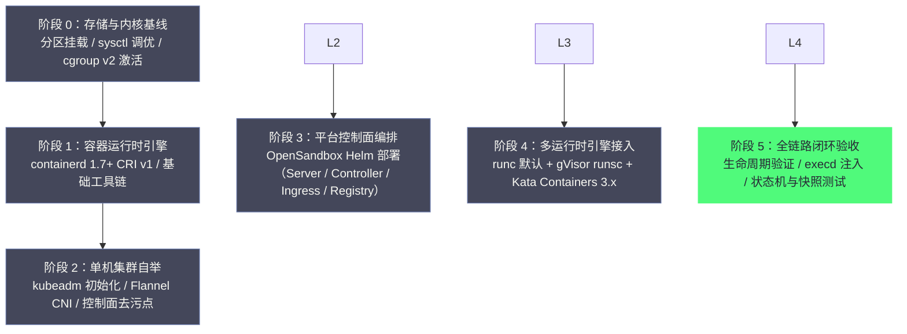
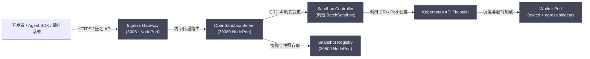
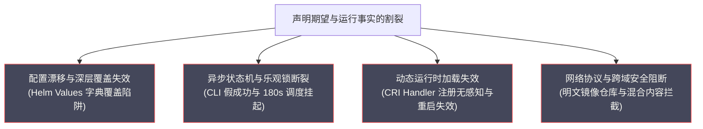
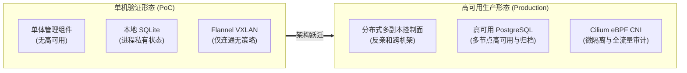

# 10 Agent 沙箱部署实战——从单机 PoC 到测试集群

**摘要：**

在本专栏的前半程，我们从底层的 Linux 命名空间、微虚机虚拟化监视器，一路推演至 OpenSandbox 的协议分层与编排模型，建立起相对完备的理论框架。本文将视角切换至工程交付一线，完整复盘基于 OpenSandbox 的 Agent 沙箱系统从单机概念验证（PoC）走向企业级测试集群的实战部署路径。全文围绕四段式工程逻辑展开：首先剖析部署形态决策、宿主机内核调优基线与存储分区的物理拓扑；继而深入单机验证环境的流水线，详解 containerd CRI v1 插件配置、Kubernetes 多运行时（runc、gVisor、Kata Containers）的四层一致性注册以及 Helm 平台服务安装；随后建立覆盖配置漂移、调度挂起与明文仓库拦截的故障分类学与三层交叉排障法；最后提炼十阶企业级准入门禁（Gate 0-9）体系与向生产隔离集群演进的技术债务治理矩阵。核心认知在于：**沙箱平台的部署绝非单次 Helm 命令的机械执行，而是一场涵盖基础设施基准、多运行时内核适配、平台控制面编排与渐进式准入验收的系统化工程；唯有以证据链为准绳，方能抹平声明期望与运行事实之间的鸿沟**。

---

## 第 1 章 部署前的架构决策：形态拓扑与宿主基线

### 1.1 三种部署形态与演化路径

在分布式系统工程中，部署往往被初学者误解为一段脚本或几行自动化命令的执行。然而在生产级沙箱平台建设中，真正决定系统稳定性与生命周期的，往往是在敲下第一行初始化指令之前的架构形态抉择、环境基线评估与资源容量精算。倘若前期架构拓扑与隔离边界未曾厘清，自动化脚本运行得越迅速，便只是将底层的架构缺陷以更高的效率放大至整个集群。

从工程演化生命周期来看，建设 Agent 沙箱平台通常需要经历三个目标各异的物理部署形态：

| 部署形态 | 核心目标 | 资源拓扑特征 | 交付成果与验证边界 |
| :--- | :--- | :--- | :--- |
| **单机验证节点（PoC）** | 验证控制链路闭环、生命周期状态机与多运行时切换能力 | 独立高配物理机或直通硬件虚拟化的裸金属实例 | 基础功能证据链、冷启动性能基线、内核兼容性报告 |
| **预发测试集群（Staging）** | 验证控制面高可用、并发配额控制、发布流程与多租户隔离 | 独立控制面节点 + 至少 3 节点独占沙箱工作节点池 | 生产化差距台账、容量水位压测报告、发布准入流水线 |
| **高可用生产集群（Production）** | 承载大规模多租户真实业务流量，保证绝对数据隔离与 SLO | 多可用区跨机架控制面 + 硬件级物理隔离节点池 | 生产级安全审计认证、跨可用区灾备体系、SLO 承诺保障 |

这三种形态绝非同一套拓扑结构的简单线性缩放，而是服务于截然不同的工程验证目的：**单机验证节点回答“系统核心能力能不能跑通”，测试集群回答“平台治理规则能不能落地”，而高可用生产集群则回答“高并发与极端异常下服务能不能持续稳定”**。

在企业实际落地演进中，面对硬件资源与交付周期的双重约束，业界普遍采用的破局策略是**“复用通用控制面，物理隔离数据面”**。亦即沙箱平台的 API Server、控制器（Controller）等管理组件可以复用企业既有的基础设施控制面，但承载不可信 AI 代码执行的数据面工作节点（Worker Nodes），必须划入专有且打上独立污点（Taints）与标签（Labels）的物理节点池。

我们可以用现代写字楼的物业管理模式作一类比：企业可以与整栋大厦共享门禁系统、前台接待与供电主干（共享控制面），但研发团队存放核心机密资产的实验室（数据面），必须设立独立的物理门禁、专用隔断与防尾随通道。若贪图省事将沙箱工作负载与通用微服务混部在同一批 Worker 节点上，不可信代码的狂暴资源消耗便会直接穿透 cgroup 边界，引发邻居节点的内存抖动甚至 OOM 级联崩溃；预热池（WarmPool）的空闲 Pod 亦会抢占生产微服务的调度配额；更为致命的是，在混部环境下，残存的孤儿沙箱进程将严重污染宿主机的调度拓扑，导致计费模型与资源记账全面失真。因此，“控制面共享、数据面独占”并非权宜之计，而是从架构根源上拆分故障域（Failure Domain）与安全域（Security Domain）的标准设计。

### 1.2 宿主机硬件抽象与内核基线

当形态决策敲定后，接下来必须解决宿主机选型与操作系统内核基线对齐的问题。Agent 沙箱执行不可信代码时，极度依赖底层的虚拟化加速与安全隔离原语，这决定了沙箱对宿主机的要求远比通用无状态 Web 应用苛刻：

| 维度 | 生产推荐基线 | 兼容底线要求 | 架构决策依据与技术原理 |
| :--- | :--- | :--- | :--- |
| **操作系统** | Linux 6.x 内核发行版（如 RHEL 9.x / Ubuntu 22.04+） | Linux 5.14+（RHEL 8.7+） | 默认启用 cgroup v2 单一统一层次结构，完善 eBPF 运行时跟踪与安全探针 |
| **CPU 虚拟化** | 具备硬件虚拟化扩展（Intel VT-x / AMD-V）并开启 EPT/NPT | 物理裸金属或具备硬件直通能力的嵌套虚拟化第一层客户机 | Kata Containers 等微虚机必须依赖 `/dev/kvm` 硬件加速，纯软件模拟无法满足毫秒级冷启动 |
| **内存容量** | 节点单机 $\ge 128\text{ GiB}$ ECC 内存 | 单节点 $\ge 64\text{ GiB}$ | 需抵扣 Kata 虚机基线开销（约 $397\text{ MiB}$/实例）及 WarmPool 常驻预热池占用 |
| **存储体系** | 独立 NVMe SSD 双分区，区分镜像缓存与写层 | 企业级 SATA SSD 独立挂载 | 隔离 containerd 镜像存储与 kubelet 容器可写层，防止镜像拉取风暴压垮写 I/O |
| **系统调用拦截** | 内核启用 Seccomp、Landlock、User Namespace | 仅开启基本 Seccomp 过滤 | 保障 gVisor systrap 平台及非特权安全容器的平稳降级与隔离穿透防御 |

在操作系统层面，**强烈推荐采用将 cgroup v2 设为默认的现代化 Linux 发行版**。正正如 [[02 Linux 隔离原语——namespace、cgroups、seccomp 与 capabilities 的安全地基]] 所剖析的那样，cgroup v1 存在进程与子系统层级分离的硬伤，导致内存与块设备 I/O 控制器无法进行统一的资源账本核算；而在沙箱高频创建、瞬时高并发读写的场景下，cgroup v1 极易触发控制器死锁与统计漂移。

在硬件虚拟化支持方面，必须在节点纳管前执行硬件能力探针。在物理宿主机上执行如下指令，验证硬件辅助虚拟化支持与 `/dev/kvm` 设备节点状态：

```bash
# 验证 CPU 虚拟化指令集支持（Intel 为 vmx，AMD 为 svm）
egrep -c '(vmx|svm)' /proc/cpuinfo

# 验证 KVM 模块加载与设备权限
ls -l /dev/kvm
# 确保权限满足非特权或容器运行时组访问需求（常规为 0666）
crw-rw-rw- 1 root kvm 10, 232 Aug 15 10:00 /dev/kvm
```

若在公共云或私有云虚拟机环境中部署测试节点，必须严苛执行嵌套虚拟化（Nested Virtualization）的前置准入检查。嵌套虚拟化下 外层宿主虚拟机与内层微虚机之间的 VM-Exit 损耗极为显著，且易遭遇未暴露的 MSR 寄存器读写故障。单机 PoC 若跳过该检查，常会导致后续安装 Kata Containers 到最后联调步骤时，虚机监视器因无法获取 VMX 扩展而突发崩溃，产生高昂的返工排查成本。

在 Linux 内核参数调优层面，通用服务器的默认配置无法承受沙箱平台万级瞬时进程涌入与文件监听。必须通过 `/etc/sysctl.d/99-agent-sandbox.conf` 固化下述系统内核基线：

```ini
# 开启网络桥接与数据包转发（容器网络与 CNI 通信基础）
net.ipv4.ip_forward = 1
net.bridge.bridge-nf-call-iptables = 1
net.bridge.bridge-nf-call-ip6tables = 1

# 调优文件句柄与 inotify 监听实例（保障高并发开发沙箱内 LSP 与文件监控不耗尽）
fs.file-max = 2097152
fs.inotify.max_user_watches = 524288
fs.inotify.max_user_instances = 8192

# 调优 PID 上限与虚拟内存映射区域（防止高并发子进程派生失败与 JVM/Python 堆崩溃）
kernel.pid_max = 4194304
vm.max_map_count = 262144

# 启用非特权用户命名空间克隆（支撑无特权沙箱容器启动与根文件系统映射）
kernel.unprivileged_userns_clone = 1

# TCP 接收队列与连接跟踪调优（平抑 WarmPool 高频探活与 API 短连接抖动）
net.core.somaxconn = 32768
net.netfilter.nf_conntrack_max = 1048576
```

### 1.3 存储与网络的专有拓扑

在传统无状态微服务集群中，节点磁盘通常采用单根分区挂载即可满足需求；但在沙箱工程实践中，存储拓扑必须采取**“镜像缓存与容器写层物理双分离”**的设计：

```
/dev/nvme0n1p1 → /var/lib/containerd（或 /data/containerd-disk，ext4/xfs，镜像只读层与快照缓存）
/dev/nvme0n1p2 → /var/lib/kubelet   （或 /data/kubelet-disk，   ext4/xfs，容器可写层、emptyDir 与日志）
```

之所以必须进行物理或分区级切分，根源在于沙箱环境特有的 I/O 竞争特征：Agent 执行任务期间常需要并发拉取数个十 GiB 级别的全功能开发环境镜像（如预装 Python、Rust、Node.js 及大型机器学习库的厚镜像）；与此同时，沙箱内部的不可信代码可能正在编译大型工程或写入临时数据。倘若两者共用同一个底层文件系统，一旦镜像缓存填满存储空间，kubelet 上的所有容器写层将由于宿主机底层触发 `ENOSPC`（No space left on device）而集体陷入只读错误，连排障日志与 crictl 调试指令都无法写入。实行存储物理隔离后，镜像下载风暴导致的磁盘写满最多只会延缓新沙箱的调度拉取，绝不至于将运行中的存量沙箱写层直接击穿。

在网络平面规划上，工程师极易忽视 CNI 网络插件的“策略真伪问题”。单机验证阶段，为求极简通常会采用基于 VXLAN 封包的 Flannel CNI，其 Pod CIDR（如 `172.29.0.0/16`）与 Service CIDR（如 `172.28.0.0/16`）规划清晰，能快速打通节点内容器间的三层连通性。

> [!warning] 核心风险：Flannel 不执行 NetworkPolicy
> Flannel 仅能保证数据面数据包“能否送达”，正如 [[08 OpenSandbox 数据面——execd 与 egress 的盒内世界]] 中分析的网络策略真伪问题，Flannel 代码内部完全没有集成针对 Kubernetes NetworkPolicy 的执行引擎。这意味着即便在清单中声明了精细的出入站安全策略，Flannel 也会静默将其忽略，所有沙箱容器实质上处于无防护的扁平网络互通状态。在演进至测试与生产集群时，必须将 CNI 切换为支持 eBPF 或 iptables 安全策略执行的成熟方案（如 Calico 或 Cilium），并设计严格的沙箱隔离实验，杜绝“已声明网络策略即代表安全隔离”的心理盲区。

### 1.4 最小资源拓扑模型与容量前置测算

部署前的最后一步决策，是对验证节点的承载极限进行数学建模与前置容量测算。沙箱与普通 Pod 的根本区别在于：普通 Pod 的内存使用量由应用自身决定，而沙箱（尤其是轻量级微虚机）存在不可忽视的**运行时基础设施底噪开销（Runtime Overhead）**。

基于真实物理机基准测算，正如后续在 [[12 沙箱性能工程——Runtime 基准与 WarmPool 容量管理]] 中实测的数据，单实例在处于空闲待命状态下，三种主流运行时的物理内存常驻集大小（PSS）存在显著阶梯：
- **标准容器（runc）**：仅需承载 shim 进程与基础命名空间开销，单槽底噪仅约 $15\text{ MiB}$；
- **进程级沙箱（gVisor）**：需运行独立的 Sentry 虚拟内核及 Go 运行时，单槽物理底噪约 $45\text{ MiB}$；
- **微虚机沙箱（Kata Containers）**：需承载独立的虚拟机监视器（VMM，如 QEMU 或 Cloud Hypervisor）、Guest 内核及 virtiofs 守护进程，单槽待命底噪高达约 $397\text{ MiB}$。

设宿主机可用物理内存为 $M_{\text{available}}$，保留给操作系统、kubelet、containerd 及平台控制面组件的安全冗余为 $M_{\text{reserved}}$，预期并发沙箱槽位数为 $N$，单沙箱用户业务限制配额为 $M_{\text{limit}}$，运行时固定底噪为 $M_{\text{overhead}}$，超分系数为 $lpha$（一般生产环境要求强隔离时 $lpha = 1.0$）。则节点能够支撑的最大沙箱密度受制于严格的物理不等式：

$$N \le rac{M_{\text{available}} - M_{\text{reserved}}}{lpha \times M_{\text{limit}} + M_{\text{overhead}}}$$

以一台配置为 $256\text{ GiB}$ 物理内存的典型四路服务器为例，扣除 $32\text{ GiB}$ 宿主管理与平台组件常驻内存，若为每个 Agent 沙箱分配 $2\text{ GiB}$ 业务配额：
- 若运行于 runc 模式，理论可承载实例数：$\lfloor (256 - 32) \times 1024 / (2048 + 15) 
floor pprox 111$ 个；
- 若切换为 Kata Containers 微虚机强隔离模式，理论可承载实例数直接缩减为：$\lfloor (256 - 32) \times 1024 / (2048 + 397) 
floor pprox 93$ 个。

这意味着仅仅因为隔离档位的切换，节点的物理容积就蒸发了近 $16.2\%$。这种前置测算杜绝了脱离运行时底噪而凭空许诺容器密度的空想，为后续架构设计提供了坚实的物理约束。

---

## 第 2 章 单机验证环境：基础设施到多运行时接入

### 2.1 部署全景流水线

在确立形态与基准之后，部署工作进入单机 PoC 的落地阶段。整个安装链路被严格划分为六个环环相扣的推进阶段（阶段 0 至阶段 5），每一阶段均设有明确的验收门禁：



阶段划分的根本价值在于**设立不可逾越的故障熔断点**：阶段 0 若存储分区挂载失败或 cgroup 仍处于 v1 状态，绝不推进至阶段 1；阶段 1 若 containerd 的 CRI 插件无法响应 `crictl info`，绝不盲目启动 kubeadm。分阶段递进能将部署异常牢牢锁定在最小责任单元内，避免将所有底层错误堆积至最后的平台联调阶段导致定位困难。

### 2.2 基础设施与容器运行时引擎

Kubernetes 自 1.24 版本彻底移除 dockershim 之后，基于容器运行时接口（CRI v1）与底层引擎直连已成为行业唯一标准通路。在沙箱平台中，containerd 的配置不仅是普通的容器拉起通道，更是注册 Kata 与 gVisor 等多运行时的调度枢纽。

在 `/etc/containerd/config.toml` 中，必须重点配置两项核心机制：一是 `SystemdCgroup` 必须显式激活；二是必须在 CRI 插件中精准声明各类沙箱运行时的 Shim 处理器路径与配置模板：

```toml
version = 2

[plugins."io.containerd.grpc.v1.cri"]
  sandbox_image = "registry.k8s.io/pause:3.9"
  
  [plugins."io.containerd.grpc.v1.cri".containerd]
    default_runtime_name = "runc"
    
    [plugins."io.containerd.grpc.v1.cri".containerd.runtimes.runc]
      runtime_type = "io.containerd.runc.v2"
      runtime_engine = ""
      runtime_root = ""
      [plugins."io.containerd.grpc.v1.cri".containerd.runtimes.runc.options]
        SystemdCgroup = true

    # 注册 gVisor (runsc) 进程级沙箱运行时
    [plugins."io.containerd.grpc.v1.cri".containerd.runtimes.runsc]
      runtime_type = "io.containerd.runsc.v1"
      [plugins."io.containerd.grpc.v1.cri".containerd.runtimes.runsc.options]
        TypeUrl = "io.containerd.runsc.v1.options"
        ConfigPath = "/etc/containerd/runsc.toml"

    # 注册 Kata Containers 3.x 硬件虚拟化微虚机运行时
    [plugins."io.containerd.grpc.v1.cri".containerd.runtimes.kata]
      runtime_type = "io.containerd.kata.v2"
      privileged_without_host_devices = false
      [plugins."io.containerd.grpc.v1.cri".containerd.runtimes.kata.options]
        ConfigPath = "/usr/share/defaults/kata-containers/configuration-qemu.toml"
```

> [!important] 陷阱提示：SystemdCgroup 驱动一致性
> kubelet 默认使用 `systemd` 作为 cgroup 驱动器。若 containerd 的 runc options 中遗漏了 `SystemdCgroup = true`（默认值为 false，采用 cgroupfs 驱动），系统将在 kubelet 启动时产生隐藏的拓扑认知撕裂。此时 kubelet 与 containerd 分别在不同的 cgroup 目录树下操作同一个 Pod 的限制组，最终导致 kubelet 在自检阶段判定节点未就绪（NotReady），其错误信息往往埋没在庞杂的系统日志末尾，极易排查迷失。

在集群自举阶段，使用 `kubeadm init` 建立单机控制面，声明与 CNI 完全契合的 Pod 子网：

```bash
kubeadm init   --pod-network-cidr=172.29.0.0/16   --service-cidr=172.28.0.0/16   --kubernetes-version=v1.30.4

# 单机 PoC 特别步骤：解除控制面节点污点，允许调度普通沙箱载荷
kubectl taint nodes --all node-role.kubernetes.io/control-plane-
```

### 2.3 平台控制面与编排层部署

完成 Kubernetes 集群自举与 Flannel 网络打通后，平台进入 OpenSandbox 核心控制面的编排部署。作为遵循协议优先的现代 Agent 沙箱平台（详见 [[07 OpenSandbox 架构深度解析——协议优先与六责任面]]），OpenSandbox 由四个核心平台级组件协同运转：



1. **OpenSandbox Server**：提供面向北向客户端与 SDK 的生命周期管理 REST/gRPC API，维护沙箱状态机，单机阶段采用本地 SQLite 或轻量嵌入式存储记录元数据，生产阶段平滑演进至外置高可用 PostgreSQL。
2. **Sandbox Controller**：核心控制器组件，持续监听并调谐 [[09 OpenSandbox 编排面——BatchSandbox、WarmPool 与快照]] 中定义的 `BatchSandbox` 及 `SandboxPool` 等自定义资源（CRD），负责冷热实例转换、失效重试与垃圾回收。
3. **Ingress Gateway**：基于 Envoy 或定制反向代理网关，负责外部请求到沙箱内部动态端口的高性能多路复用路由，并对请求执行基于 HMAC 签名的凭据校验与流控。
4. **Snapshot Registry**：专用的 OCI 镜像与沙箱内存/文件系统差异快照存储仓库，支撑快速实例化与沙箱分支恢复。

在 Helm 部署过程中，`values.yaml` 的关键配置必须严密对齐宿主机的网络拓扑与运行时声明：

```yaml
global:
  environment: poc
  defaultRuntime: runc
  storageClass: local-path

server:
  replicaCount: 1
  service:
    type: NodePort
    nodePort: 30080
  database:
    type: sqlite
    storagePath: /var/lib/opensandbox/server.db
  config:
    defaultTimeoutMinutes: 60
    maxConcurrentSandboxes: 30

controller:
  replicaCount: 1
  resources:
    limits:
      cpu: "2"
      memory: 2Gi
    requests:
      cpu: 500m
      memory: 512Mi

ingressGateway:
  replicaCount: 1
  service:
    type: NodePort
    nodePort: 30081
  enableSignatureAuth: true

snapshotRegistry:
  replicaCount: 1
  service:
    type: NodePort
    nodePort: 30500
  persistence:
    enabled: true
    size: 100Gi
    mountPath: /data/registry-disk
```

### 2.4 多运行时引擎接入实战：runc、gVisor 与 Kata Containers 的四层一致性联动

平台安装完成后，沙箱隔离能力能否真正落地，完全取决于**四层配置一致性链条**的建立。所谓四层一致性，是指从平台 API 的声明，到 Kubernetes 对象的落地，再到底层宿主机调用，必须保持逐层对应的映射关系：

$$\text{Server 业务声明} \longrightarrow \text{Sandbox CRD spec.runtime} \longrightarrow \text{Kubernetes RuntimeClass} \longrightarrow \text{containerd CRI Handler}$$

任何一层出现命名拼写偏差、Handler 缺失或节点标签不匹配，最终在客户端都只会体现为模糊笼统的“Pod 创建超时”，而排查难度却呈几何级数增加。

在 Kubernetes 集群中，必须显式定义并生效对应于[[03 隔离边界的光谱——从共享内核到 MicroVM 的四档技术路线]] 划分的不同档位的 `RuntimeClass` 资源：

```yaml
# 1. 默认 Linux 原生容器运行时 (runc)
apiVersion: node.k8s.io/v1
kind: RuntimeClass
metadata:
  name: runc
handler: runc

---
# 2. 进程级虚拟内核沙箱运行时 (gVisor)
apiVersion: node.k8s.io/v1
kind: RuntimeClass
metadata:
  name: gvisor
handler: runsc
scheduling:
  nodeSelector:
    sandbox.runtime/gvisor: "true"

---
# 3. 硬件辅助虚拟化微虚机运行时 (Kata Containers)
apiVersion: node.k8s.io/v1
kind: RuntimeClass
metadata:
  name: kata-containers
handler: kata
overhead:
  podFixed:
    cpu: "250m"
    memory: "397Mi"
scheduling:
  nodeSelector:
    sandbox.runtime/kata: "true"
  tolerations:
    - key: "sandbox.runtime/kata"
      operator: "Exists"
      effect: "NoSchedule"
```

在此处有两处极其关键的工程细节：
其一是在 Kata Containers 的 `RuntimeClass` 中必须明确声明 `overhead.podFixed`。微虚机本身运行 QEMU/Dragonball 监视器与 Guest 内核需要消耗宿主机物理资源，若不配置该项，Kubernetes 调度器将完全忽略微虚机的系统级底噪，极易导致节点发生隐蔽的物理内存超卖并触发宿主机 OOM-Killer；
其二是节点标签（Labels）与节点选择器（nodeSelector）的配合。由于 Kata 需要物理机 VT-x 硬件支持，通过节点选择器可以严格确保微虚机沙箱只被调度至具备硬件虚拟化能力的物理节点，防止误入未开启嵌套虚拟化的节点引发容器崩溃。

### 2.5 基础链路闭环验证与双向状态证据链

完成多运行时注册后，必须立即构建端到端的验收验证闭环，其验证清单涵盖五个核心维度：

| 验证项 | 测试命令与判定标准 | 成功证据与断言 | 失败归因与处置路径 |
| :--- | :--- | :--- | :--- |
| **基础生命周期** | 创建标准 runc 沙箱并在 10 秒内执行简单指令 | API 返回 200/201，返回状态由 Pending 转为 Running | 检查 Controller 日志与 CRD 调谐状态机 |
| **盒内守护注入** | 校验主容器内 `/opt/opensandbox/execd` 是否常驻 | `crictl exec <cid> ps aux` 观察到 execd 以非 PID 1 稳定存活 | 检查 `execd-installer` 初始化容器是否正常复制文件 |
| **gVisor 隔离验证** | 在 gVisor 沙箱中读取系统内核版本信息 | 执行 `uname -a`，输出包含 `Linux ... gVisor` 标识字符串 | 检查 containerd runsc 配置及 `/etc/containerd/runsc.toml` |
| **Kata 虚机验证** | 在 Kata 沙箱中读取 `/proc/cpuinfo` 与 dmesg | 执行 `dmesg | grep -i kata`，宿主机出现独立 QEMU 线程 | 检查宿主机 `/dev/kvm` 权限与 Kata 配置路径一致性 |
| **文件系统快照** | 在沙箱写层落盘特定文件，调用快照 API 并重新实例化 | 新沙箱实例中预置文件哈希与元数据与原始环境完全吻合 | 检查 Snapshot Registry 连通性与本地快照器存储挂载 |

通过逐项收集上述执行输出，便建立起一套可审计、可追溯的双向状态证据链，宣告单机验证阶段圆满收官。

---

## 第 3 章 部署排障台账：从典型故障到根因分类学

### 3.1 故障分类学：声明期望与运行事实的割裂模型

在大型沙箱系统的部署落地过程中，工程师所遭遇的排障困境，往往并不来自代码崩溃或语法错误，而是源自**声明期望（Declared Intent）与运行事实（Runtime Reality）之间的脱节**。

分布式系统的声明式 API（Declarative API）为我们描绘了美好的图景：用户提交一份 YAML 清单，底层系统便会自动向目标状态收敛。然而，当容器编排系统（Kubernetes）与低层硬件原语（KVM/VT-x）、宿主操作系统内核、CRI 运行时插件以及盒内守护进程产生多层交织时，任何一层的抽象泄漏（Leaky Abstraction）都会导致控制面自以为已达成期望，而数据面早已支离破碎。我们将排障中踩过的深坑归纳为四种基础分类：



### 3.2 配置漂移与模板覆盖陷阱

在通过 Helm 部署复杂微服务或沙箱控制面时，最隐蔽的一类问题是**多层嵌套 YAML 字典的覆盖失效**。

在实践中，许多运维团队习惯使用 `--set` 参数或准备多份局部的 `values-override.yaml` 文件进行环境适配。例如为了开启 Kata 运行时支持，在定制的 values 文件中编写了如下配置：

```yaml
# values-override.yaml（错误的覆盖方式）
server:
  secure_runtime:
    kata:
      enabled: true
```

然而在官方或上游 Chart 的默认 `values.yaml` 中，`secure_runtime` 下包含完整的内核镜像路径、启动模板及 QEMU 超时参数字典。当 Helm 执行模板渲染时，根据 Helm 的合并策略，同名对象的浅层字典可能会整体替换默认的深层配置，导致原本内置的预设参数瞬间蒸发。此时 Helm 安装指令毫无报错，但在 Server 组件实际调用 CRI 创建 Kata 容器时，因缺少默认参数而抛出空指针异常。

规避该问题的铁律是：**拒绝盲目的字典级局部覆写；所有针对生产环境的 values 变更，必须先经由 `helm template` 渲染出完整 Kubernetes 资源清单，再使用校验工具比对渲染前后的 AST 差异，确保未发生意料之外的属性截断**。

### 3.3 异步编排与乐观锁断裂

沙箱平台的 API 调用常呈现出**“异步提交、乐观返回”**的特征。当客户端向 OpenSandbox Server 发起创建沙箱请求时，Server 经过参数校验向 etcd 写入自定义资源（CR），随即向客户端返回 `HTTP 202 Accepted` 或带有沙箱 ID 的成功响应。

此时，客户端往往误以为沙箱已处于可用状态，立即发起 `exec` 执行指令。然而在编排底层，该沙箱的 Pod 可能正因底层镜像拉取超时、节点 CPU 调度耗尽或卷挂载锁死而停留在 `Pending` 状态。在经历默认约 180 秒的等待超时后，Server 的后台调谐循环才将沙箱标记为 `Failed` 并触发回滚清理。在客户端看来，系统表现为“先返回成功，随后执行操作时报 504 Gateway Timeout 或 404 Not Found”。

解决该裂痕的核心在于两点：其一是客户端 SDK 必须严格实现带有指数退避（Exponential Backoff）的就绪轮询探活状态机，以盒内 `execd` 守护进程的健康心跳而非单纯的 Kubernetes Pod 调度事件作为沙箱真正就绪的判定标准；其二是控制面必须针对不同阶段设置精细的 SLA 告警（如拉镜像不可超 60 秒，容器启动不可超 5 秒），一旦超时主动阻断，绝不让无效等待长时间占死连接池。

### 3.4 运行时 handler 动态加载断裂与命名空间错位

在运行中的 Kubernetes 节点上为 containerd 追加 `runsc` 或 `kata` 运行时配置时，工程师最常犯的一个经验主义错误是：**“修改完 `/etc/containerd/config.toml` 并重启 containerd 服务后，便以为 Kubernetes 可以立即使用新运行时”**。

在真实集群中，kubelet 在启动初期会通过 CRI 的 `RuntimeService.ListPodSandbox` 与 `Status` 接口与 containerd 进行握手通信，并缓存当前节点支持的 Runtime Handler 列表。若仅重启了 containerd，kubelet 内部与 CRI Socket 的长连接可能会维持半开状态，导致其运行时尚未被动态刷新。当带有新 `RuntimeClass` 的 Pod 被调度至该节点时，kubelet 会直接判定该节点不支持对应的 handler，瞬间抛出下述经典故障：

```
Failed to create pod sandbox: rpc error: code = Unknown desc = RuntimeHandler "kata" not supported
```

因此，多运行时更新的规范化运维动作必须包含完备的三步走闭环：
1. 更新 `/etc/containerd/config.toml` 并通过 `systemctl restart containerd` 重启引擎；
2. 执行 `crictl info`，在输出的 `config.runtimes` 列表中确认目标 handler（如 kata 或 runsc）真实存在且加载无误；
3. **滚动重启节点的 kubelet 服务**（`systemctl restart kubelet`），强制其重新拉取底层 CRI 的全量运行时特征集并向 API Server 上报节点能力。

### 3.5 纯明文镜像仓库混合内容拦截与鉴权短路

在单机验证阶段，为了免去复杂的证书签发流程，团队通常会搭建基于纯 HTTP 协议的本地 Docker Registry 或 Snapshot Registry（例如监听在 `30500` 端口）。这一临时性妥协往往会在后续步骤中引发一系列连锁反应：

首先，现代 Linux 容器运行时（包括 Docker 与 containerd）基于安全规范，默认强制要求对所有非环回地址（`127.0.0.1`）的镜像仓库走 TLS 加密连接。若未在 `/etc/containerd/config.toml` 的 `[plugins."io.containerd.grpc.v1.cri".registry.mirrors]` 中为该私有地址显式声明 `insecure_skip_verify = true`，沙箱在拉取快照或基础镜像时将无一例外报 `http: server gave HTTP response to HTTPS client` 错误。

其次更为致命的是浏览器端的混合内容（Mixed Content）安全拦截。当 OpenSandbox 部署了控制台前端（Console）并配置为通过 HTTPS 访问时，前端界面若尝试直接向底层的 HTTP Snapshot Registry 发起 REST 请求或图片预览，浏览器底层网络栈将直接拦截该请求（报错 `Blocked mixed-content request`），页面表现为按钮点击无反应或网络请求全红。解决这一妥协的根本途径是：即便在 PoC 阶段，也应通过内部自签 CA 证书或轻量级 ACME 工具为所有外部接口配置 TLS 证书，坚决不在网络层遗留纯明文传输漏洞。

### 3.6 系统级日志追踪路径与三层调试工具链

沙箱故障的排查效率，直接取决于工程师能否迅速穿透复杂的抽象层，直抵产生异常的物理核心。必须建立自底向上的三层诊断路径：

```
第 1 层：宿主内核层（Host Kernel）
  - 命令：dmesg -T | grep -E "(kvm|kata|vhost|oom-killer|segfault)"
  - 核心排查：VT-x 硬件虚拟化异常、内存越界 OOM 杀进程事件、虚拟化设备挂载死锁

第 2 层：容器运行时引擎层（CRI / containerd）
  - 命令：journalctl -u containerd -f --no-tail
  - 辅助工具：crictl pods / crictl ps / crictl inspectp <pod_id>
  - 核心排查：CRI 接口 gRPC 报错、Shim 进程启动崩溃、命名空间挂载冲突

第 3 层：编排控制与业务层（Kubernetes / OpenSandbox）
  - 命令：kubectl describe pod <pod_name> -n <namespace>
  - 命令：kubectl logs -f deployment/opensandbox-server -n <namespace>
  - 核心排查：调度器事件（FailedScheduling）、Init 容器退出码、execd 心跳上报超时
```

当出现沙箱异常时，严禁盲目胡乱翻看业务代码，而应依序执行下述排查矩阵：先看 Pod Describe 的 Events 确定卡死阶段；若阶段显示调度就绪但容器启动失败，立即下潜至宿主机查看 containerd 系统日志；若日志显示微虚机 VMM 启动中断，直接检索 `dmesg` 确认硬件加速与内资分配真相。

### 3.7 从故障反思到预防：十项前置校验准则

为将踩坑经验固化为可复用的工程资产，我们将排障教训沉淀为十项标准化前置防御动作：

| 校验项 | 防护领域 | 触发阶段 | 具体校验动作与防御策略 |
| :--- | :--- | :--- | :--- |
| **P01 模板深度比对** | 配置管理 | Helm 部署前 | 执行 `helm diff` 或 AST 清单比对，杜绝嵌套 YAML 字典覆盖丢参 |
| **P02 cgroup 统一性** | 容器基础设施 | containerd 启动前 | 校验 `SystemdCgroup = true`，确保 kubelet 与运行时驱动一致 |
| **P03 硬件加速探针** | 虚拟化基线 | 节点纳管前 | 校验 `/dev/kvm` 设备可读写及 CPU VMX/SVM 指令集状态 |
| **P04 双分区物理隔离** | 存储架构 | 操作系统初始化 | 独立挂载 containerd 目录与 kubelet 目录，防镜像写满磁盘 |
| **P05 CNI 策略真伪核验**| 网络安全 | 网络选型阶段 | 运行跨 Namespace 访问控制实验，杜绝纯连通 CNI 假安全 |
| **P06 运行时能力重启** | CRI 链路 | 变更 config.toml 后 | 强制重启 containerd 并在重启 kubelet 后通过 API 确认 Handler 就绪 |
| **P07 凭据显式声明** | 认证安全 | 部署清单编写时 | 禁止依赖环境变量隐式继承，所有外部依赖均走 Secret 显式挂载 |
| **P08 端口无冲突核验** | 基础网络 | 组件拉起前 | 预检 NodePort 30080-30500 范围占用情况，防止组件静默起不来 |
| **P09 证书全链路覆盖** | 通信安全 | 外部接入设计 | 统一使用 TLS 证书端点，彻底根除浏览器混合内容拦截隐患 |
| **P10 调度记账防黑洞** | 容量调度 | RuntimeClass 定义 | 显式配置微虚机 `overhead.podFixed`，消除物理内存超卖盲区 |

---

## 第 4 章 企业级测试集群：十阶准入门禁体系

### 4.1 为什么需要分阶段渐进式准入门禁

当沙箱平台从单机验证走向服务于研发团队的预发测试集群时，环境的复杂度发生了指数级跳跃。在单机环境下，所有组件处于同一个本地环回或局域网内，控制面抖动与短暂的配置错位可以被人工介入快速掩盖。然而在测试集群中，服务面临着多控制面高可用切换、分布式存储并发挂载、多节点网络路由抖动以及多个 Agent 团队并发压测的真实冲击。

如果在部署完毕后仅仅执行一条简单的“创建沙箱 Hello World”脚本便宣布集群就绪，那么系统内部潜藏的节点调度偏斜、跨主机网络丢包、镜像拉取雪崩以及凭据泄露风险，将会在业务接入的第一天集中爆发。

为此，现代平台工程倡导**渐进式准入门禁（Progressive Qualification Gate）机制**。其核心理念在于：将整个部署交付过程拆解为从 Gate 0 到 Gate 9 十个彼此解耦、前置依赖明确的里程碑门禁。每一阶门禁均具备严格的准入前置条件、自动化执行步骤、客观判定依据与熔断回滚机制。任何一阶门禁未完全通过，系统严格阻断后续发布，严禁“带病投产”。

### 4.2 Gate 0 至 Gate 9 准入门禁规范详解


#### Gate 0：制品与配置规范冻结（Artifact & Spec Freeze）
- **准入前置**：各组件代码仓库完成 Release 分支打标，容器镜像已推送至企业私有安全镜像中心。
- **执行内容**：校验所有镜像的 Sha256 内容摘要（Digest）不可变性，杜绝使用 `latest` 等动态标签；校验 Helm Chart 清单的 Schema 语法正确性与命名规范。
- **判定标准**：所有组件镜像通过漏洞静态扫描（CVE 零高危）；Helm lint 输出零错误。

#### Gate 1：租户安全与命名空间边界（Namespace & RBAC Security Boundary）
- **准入前置**：Kubernetes 集群控制面正常运转，管理员凭据加载就绪。
- **执行内容**：创建沙箱系统专有的命名空间（如 `opensandbox-system` 与 `opensandbox-workloads`）；绑定遵循最小特权原则的 ServiceAccount、Role 与 RoleBinding。
- **判定标准**：普通沙箱工作负载使用的凭据在尝试读取宿主机敏感 ConfigMap 或控制面 Secret 时，被 API Server 严格以 403 Forbidden 阻断。

#### Gate 2：基础设施宿主就绪度（Host Infrastructure & CRI Bootstrap Readiness）
- **准入前置**：所有 Worker 物理节点操作系统装竣，网络打通。
- **执行内容**：自动化探针巡检每个节点的内核参数、cgroup v2 挂载点、`/dev/kvm` 权限、存储双分区挂载及 containerd CRI 插件响应延迟。
- **判定标准**：所有节点状态为 Ready，无任何与虚拟化相关的告警或驱动降级提示。

#### Gate 3：控制面与编排控制器健康（Control Plane & Controller CRD Health）
- **准入前置**：Gate 2 验收全绿通过。
- **执行内容**：通过 Helm 部署 OpenSandbox Server、Controller 及对应 CRD；执行控制面的 Liveness 与 Readiness 探针压力校验。
- **判定标准**：Server 与 Controller Pod 副本数达标，CRD 注册成功，控制面组件重启期间无内存泄漏或死锁。

#### Gate 4：动态路由与网关鉴权（Ingress Gateway & Routing Integrity）
- **准入前置**：控制面平稳运行，Gateway 服务端口对外暴露。
- **执行内容**：测试客户端经由 Gateway 发起 API 调用，重点校验基于 HMAC-SHA256 签名的 Header 鉴权、跨域 CORS 头及 WebSocket 长连接握手。
- **判定标准**：未携带签名或签名伪造的请求被网关瞬时拦截（HTTP 401）；合法签名请求在 5 毫秒内完成反向路由并转发至 Server。

#### Gate 5：多运行时引擎资格认证（Multi-Runtime Engine Qualification）
- **准入前置**：集群完成 `runc`、`gvisor` 与 `kata-containers` 的 `RuntimeClass` 注册。
- **执行内容**：分别向不同节点调度下发三类运行时的标准测试沙箱，验证启动时延、内核特征与特权逃逸防护。
- **判定标准**：Kata 虚机成功绑定独占虚拟网卡与 virtiofs，gVisor 成功拦截非法系统调用（如直接修改宿主时间），三种运行时全部完成状态机自闭环。

#### Gate 6：Agent 载荷端到端联调（Agent Workload E2E Integration）
- **准入前置**：多运行时资格认证无误。
- **执行内容**：以 [[11 三类 Agent 沙箱落地——OpenCode、Hermes 与 LangChain 镜像化实战]] 中构建的真实 Agent 镜像实例化沙箱，校验主容器与 `execd` 协同启动流程，执行高频文件写入与交互式终端命令流传输。
- **判定标准**：交互终端无乱码与断连，文件上下传 MD5 哈希严格一致，沙箱主动下线时生命周期钩子正确执行。

#### Gate 7：WarmPool 容量与水位治理（WarmPool Capacity, Hit Ratio & Pre-warming）
- **准入前置**：业务载荷联调通过。
- **执行内容**：配置预热池常驻容量（如保持 10 个 Kata 空闲实例），模拟并发突发流量拉取沙箱，验证冷启动与热命中切换延迟。
- **判定标准**：热命中（Warm Hit）场景下沙箱就绪时延由秒级降至 200 毫秒以内；池消耗后自动触发平滑补充，无突发抖动超卖。

#### Gate 8：故障注入与高可用恢复（Chaos Injection, Node Reboot & Self-healing）
- **准入前置**：业务稳态运行基准确立。
- **执行内容**：主动杀灭 Server Pod、重启单台沙箱 Worker 节点、人为切断镜像仓库网络连接，检验系统容灾表现。
- **判定标准**：Server Pod 瞬间拉起并接管状态机，故障节点上的异常沙箱在设定 TTL 后被 Controller 安全清理，无残留孤儿进程。

#### Gate 9：遥测基准与运营验收（Telemetry Baselines, SLO Verification & Audit Sign-off）
- **准入前置**：所有功能与混沌测试全部完成。
- **执行内容**：接入 Prometheus/Grafana 监控指标大盘，核验启动时延 P50/P90/P99 分布、内存物理开销（PSS）、API 成功率及安全审计日志流。
- **判定标准**：各项 SLI 满足预设目标，监控告警规则全部生效，安全团队与平台负责人正式签署上线验收报告。

### 4.3 准入证据归档与可追溯性机制

在传统的随意运维中，部署完成往往仅凭口头承诺或群内通知，一旦日后出现性能退化或安全审计挑战，根本无法核查初始状态的合规性。

在十阶准入门禁体系中，**“部署即证据”是不可妥协的工程纪律**。每一阶门禁执行过程中产生的自动化测试脚本输出、`crictl` 系统快照、Kubernetes Event 事件列表以及 Prometheus 监控截屏，必须统一打包为 JSON 格式的元数据证据包，并以 GitOps 方式打上部署版本标签归档入库。这使得任何一次配置漂移或性能退化，均能迅速比对历史基准，实现百毫秒级的责任断点定位。

### 4.4 集群自动化巡检与“零残留”审计纪律

在多租户沙箱环境中，最严重的隐性杀手不是服务崩溃，而是**“沙箱残留（Ghost Sandboxes）”**。

不可信的 AI 代码在运行过程中，可能因为逻辑死循环、网络悬挂或客户端异常下线，导致沙箱生命周期未能优雅结束。这些孤儿实例若长时间驻留宿主机，不仅会持续霸占高昂的物理内存与 CPU 槽位，其绑定的虚拟网络设备（veth / tap）更会撑爆内核的网桥转发表。

为此，测试集群必须确立严格的**“零残留（Residual Zero）自动化巡检纪律”**。巡检系统每隔固定周期（如每小时）执行下述三层交叉审计脚本：

```bash
#!/usr/bin/env bash
# 零残留巡检伪代码：三层交叉核对
api_sandboxes=$(curl -s https://sandbox-server/api/v1/sandboxes | jq -r '.[].id')
k8s_pods=$(kubectl get pods -n opensandbox-workloads -o jsonpath='{.items[*].metadata.name}')
cri_containers=$(crictl ps -q)

# 审计逻辑：
# 1. 若 k8s_pods 存在某沙箱，但 api_sandboxes 已不存在 -> 触发强制清理与控制器漏收告警
# 2. 若 cri_containers 存在未被任何 k8s_pod 关联的孤儿容器 -> 触发底层运行时泄漏告警
```

只有在 API 层、CRD 编排层与 CRI 物理执行层三者对活跃沙箱实例的统计数量达到绝对一致（差额严格为 0）时，集群的容量巡检才算合格。

### 4.5 API / CR / Pod 三层交叉对照排障法

当准入门禁执行或集群日常运转遭遇异常时，我们总结出了一套**“API / CR / Pod 三层交叉对照排障法”**。由于现代沙箱基于 Kubernetes 自定义资源机制实现声明式驱动，因此系统的真实运转逻辑必然在这三层中留存事实印迹：

```
第 1 层：北向 API 层（OpenSandbox Server API）
  - 核心事实：HTTP 状态码、业务返回 payload、异步任务 Job ID、认证网关拦截日志
第 2 层：编排模型层（Kubernetes Custom Resources）
  - 核心事实：BatchSandbox 的 metadata.generation、status.phase、conditions 调谐原因
第 3 层：物理载荷层（Kubelet Pod & CRI Runtime）
  - 核心事实：Pod 状态（Running/CrashLoop/Pending）、容器 ExitCode、crictl 真实进程状态
```

通过这三层状态的排列组合，我们可以像医生判读生化指标一样，精准锁定故障源头：

| API 层状态 | CR 层状态 | Pod 层状态 | 核心诊断结论与责任归属 |
| :--- | :--- | :--- | :--- |
| 返回 200 成功 | Status: Ready | Status: Running | **基础设施与编排完全正常**；若通信中断，问题必然在沙箱内数据面（如 `execd` 未监听指定端口或防火墙阻断） |
| 返回 200 成功 | Status: Pending | 缺失或处于 Pending | **平台控制面正常，但调度或资源发生阻塞**；应排查节点 CPU/内存配额耗尽、污点不容忍或 PVC 绑定失败 |
| 返回 400/500 报错 | 根本未生成 CR | 无 Pod 派生 | **平台北向网关或 Server 校验失败**；应检查客户端请求 Schema、凭据合法性或 Server 对接的数据库锁死 |
| 返回 200 成功 | Status: Error | Status: CrashLoopBackOff | **镜像载荷或启动配置缺陷**；应下潜至 Pod 查看容器标准错误输出，排查 entrypoint 缺失或底层 syscall 违规 |

三层对照排障法的精妙之处在于“系统化地缩窄排查视野”——它指导工程师明确“何时不需要看业务代码”、“何时不需要看网络抓包”，将平均故障排查时长（MTTR）从数小时骤降至分钟级。

---

## 第 5 章 环境演进差异：从单机验证到高可用生产集群

### 5.1 架构形态的三重核心跃迁

从单机验证节点迈向生产隔离集群，并非简单地多买几台服务器并加入 Kubernetes 节点树，而是要在架构理念与系统设计上完成**三重根本性跃迁**：



#### 跃迁一：拓扑解耦——从单点共生到控制面与数据面的严格物理隔离
在单机环境下，Server、Controller、Registry 与所有的沙箱实例共存于同一台机器的 CPU 与内存中；而在生产环境中，必须建立专有的控制面节点池与异构沙箱工作节点池。沙箱节点必须配置独立的网络平面与物理机架分布，杜绝任何数据面崩溃冲击控制面的物理可能性。

#### 跃迁二：状态持久化——从本地进程文件到高可用企业级数据层
单机阶段依赖本地文件系统（如 SQLite 文件或 HostPath 挂载），一旦机器断电或操作系统损坏，所有元数据灰飞烟灭；生产集群必须按照 [[13 Agent 状态与存储——六类状态的正确拆分]] 的原则，将沙箱元数据、租户状态机与生命周期记录交由高可用 PostgreSQL 集群托管，并配置实时的 Write-Ahead Logging（WAL）异地灾备复制。

#### 跃迁三：网络防御模型——从扁平连通到零信任微隔离
单机阶段关注的是网络“通不通”，生产阶段则关注“谁允许访问谁”。必须将 CNI 演进为支持 eBPF 探针的现代化网络安全网格（如 Cilium），对出入沙箱的每一条 TCP 连接进行 L3/L4/L7 层级的细粒度阻断与加密，从物理根源上切断多租户横向越权与内网渗透链条。

### 5.2 生产化落地的转化清单与缺陷治理矩阵

为清晰界定从 PoC 到生产环境的技术债务鸿沟，我们制定了下述多维度转化清单：

| 架构维度 | 单机验证阶段的临时妥协 | 生产环境的标准设计规范 | 转化风险与治理手段 |
| :--- | :--- | :--- | :--- |
| **高可用性** | Server / Controller 单副本部署 | 多副本跨节点部署，结合 Leader Election 选举机制 | 需彻底消除代码内对本地内存变量的依赖，实现完全无状态化 |
| **存储底座** | 本地 HostPath 或单盘 ext4 目录 | 基于 CSI 的分布式企业存储或云原生分布式块存储 | 需验证动态卷挂载在微虚机环境下的附加延迟（Attach Latency） |
| **网络安全** | Flannel 扁平网络，未启用策略限制 | Cilium eBPF 驱动的 NetworkPolicy，限制沙箱互访 | 需通过自动化混沌工具注入渗透测试，验证沙箱隔离有效性 |
| **凭据管理** | 静态共享 API Key，明文存放在 values | 基于 [[14 沙箱安全体系——三层防护、短期凭据与多租户]] 阐述的短期动态凭据下发与自动轮转 | 彻底剔除沙箱环境变量中固化的数据库密码与全局密钥 |
| **资源调度** | 未声明微虚机 overhead，任由物理超卖 | 严格配置 `RuntimeClass.overhead`，精细化资源账本 | 重构调度器的评分策略，防止节点内存隐性透支 |
| **监控报警** | 仅依赖 `crictl` 与 `kubectl` 人工命令行巡检 | 接入统一可观测大盘，配置基于 SLI/SLO 的多级呼叫 | 建设沙箱专用的冷启动 P99 时延指标与异常泄漏看板 |

### 5.3 生产 Worker 节点资源规格与配额预算模型

在构建生产沙箱节点池时，硬件选型应遵循“大内存、高 I/O、适度 CPU 超分”的黄金比例。以下为一个经过严苛工业级验证的典型生产 Worker 节点硬件画像与资源划分模型：

```
物理服务器硬件规格（单节点）：
  - CPU：双路 Intel Xeon Platinum 8468 (96 核 / 192 线程，基频 2.1 GHz)
  - 内存：512 GiB DDR5-4800 ECC Registered
  - 磁盘：2 × 3.84 TB Enterprise NVMe SSD (PCIe 4.0，配置硬件 RAID 1 / ZFS 镜像)
  - 网卡：双口 25 Gbps SFP28 光纤网卡（配置 LACP 动态链路聚合）

节点操作系统与虚拟化保留区（System Reserved）：
  - CPU：保留 8 核专用于 Linux 内核软中断、vhost-net 线程及 containerd 处理
  - 内存：物理保留 64 GiB（保障宿主 OS、Kata VMM 监视器开销及监控代理常驻）

沙箱可分配资源预算（Allocatable Quota）：
  - 可用 CPU 核心：88 物理核（按 1:3 适度超分计算，可提供 264 vCPU 算力槽位）
  - 可用内存空间：448 GiB 净空

Kata 微虚机承载容量计算：
  - 单沙箱典型配置：2 vCPU / 4 GiB 业务配额 + 397 MiB 虚机底噪开销
  - 节点硬性内存安全承载上限：Floor(448 × 1024 / (4096 + 397)) = 102 个强隔离微虚机实例
```

该模型确保了即使当全部 102 个微虚机沙箱内的不可信代码同时发起大内存计算或高频系统调用时，宿主机物理内存仍有 64 GiB 的缓冲垫底，绝对不会触发操作系统级的 OOM 级联崩溃。

### 5.4 临时折中方案的收敛节奏与技术债务清偿

在系统工程中，妥协与折中是推进初期验证的必然手段。然而，**“未被记录的妥协是永久的安全隐患，带有退出路线图的折中才是架构的艺术”**。

在单机验证阶段，团队通常会为了抢抓进度而引入多项技术妥协（如使用自签名非受信证书、使用本地 HostPath 存储快照、使用单点控制面）。进入测试集群后，必须将这些折中项正式纳入**技术债务清偿看板（Debt Retirement Board）**：

1. **设置清偿时间戳（Sunset Deadline）**：明确每一项临时配置的最迟服役期限。例如在单机阶段使用的静态 API 共享密钥，必须在测试集群多租户接入日前被彻底替换为动态 Token 鉴权。
2. **自动化防回退拦截（Linting & Gate Control）**：通过在 CI/CD 流水线中编写 Conftest 或 OPA Gatekeeper 规则，对提交的 Helm values 清单执行合规性静态扫描。一旦检测到类似 `insecure_skip_verify = true` 或缺少 `overhead` 声明的清单，直接在代码合并阶段强行阻断，防止单机时期的低级配置倒流回生产环境。

---

## 第 6 章 总结、演进动态与思考题

### 6.1 核心工程要点收敛

行文至此，我们将从单机 PoC 到企业级测试集群的完整演化提炼为四条贯穿始终的工程公理：

1. **部署是体系化工程而非单次命令**：沙箱平台建设必须恪守“基础设施基线 $\to$ 容器运行时引擎 $\to$ 平台编排面 $\to$ 渐进式门禁验收”的四段式推进顺序。跳过任何底层的基准核验，都会在后续的高并发阶段付出数倍的返工排查代价。
2. **形态定位决定设计取舍**：单机 PoC 的唯一使命是验证控制面闭环与多运行时兼容性，测试集群的使命是验证治理规则与容量水位。在资源受限场景下，“复用通用控制面、物理隔离数据面”是平衡成本与安全的最佳平衡点。
3. **消除声明与运行事实的割裂**：分布式沙箱排障的核心在于建立证据链。通过“API / CR / Pod”三层交叉对照法，将抽象的编排状态还原为物理层面的真实执行事实，是消除系统“假就绪”与隐性挂起的唯一利器。
4. **渐进式门禁筑牢质量底座**：从 Gate 0 到 Gate 9 的逐级准入机制，将传统的经验主义部署转变为客观、可量化、可审计的工程流水线，确保每一次系统交付都具备坚实的可靠性证据。

### 6.2 部署落地的时间线与人力基准

综合企业标准落地的真实节奏，建设一套具备完整功能的沙箱测试集群，标准资源投入模型如下表所示（基于 1 至 2 名资深系统与云原生工程师配置）：

| 阶段划分 | 标准建议周期 | 核心里程碑交付产物与产出 | 风险缓冲建议 |
| :--- | :--- | :--- | :--- |
| **阶段一：环境与硬件基线评估** | 1 - 2 个工作日 | 宿主机硬件抽象画像、内核参数固化配置、存储双分区挂载清单 | 遇嵌套虚拟化门禁时预留额外 1 天 |
| **阶段二：容器引擎与集群自举** | 1 - 2 个工作日 | containerd CRI v1 插件配置、K8s 控制面自举、CNI 网络连通验证 | 重点排查 SystemdCgroup 一致性 |
| **阶段三：平台控制面编排部署** | 1 个工作日 | OpenSandbox Helm 安装全绿、API 网关鉴权就绪、Registry 镜像打通 | 准备完备的 values 深度比对方案 |
| **阶段四：多运行时接入与资格认证**| 2 - 3 个工作日 | runc、gVisor、Kata 三运行时注册、RuntimeClass 生效、四层链路打通 | 多运行时兼容性坑最多，加设 50% 余量 |
| **阶段五：十阶准入门禁全量验收** | 3 - 5 个工作日 | Gate 0-9 自动化流水线执行通过、零残留巡检就绪、证据包归档入库 | 重点验证 WarmPool 预热与混沌恢复 |

从开箱勘察到测试集群稳定承接 Agent 业务载荷，**端到端合理落地周期约为两周**。明确该基准节奏，有助于研发团队在项目规划期建立起符合客观物理规律的合理预期。

### 6.3 部署工具链技术演进核实

截至 2026 年底，云原生与沙箱隔离底层技术栈持续演进，一系列行业新标准的普及进一步优化了沙箱的部署复杂度：

- **容器设备接口（CDI，Container Device Interface）原生化**：Kubernetes 1.30+ 与 containerd 2.0+ 正式将 CDI 推进至成熟阶段。以往为微虚机沙箱或 GPU 沙箱挂载特权设备时，需要繁琐地修改底层配置文件；如今通过声明式 CDI 规格定义，即可实现诸如 `/dev/kvm` 或 vNPU 设备的非特权、安全直通注入。
- **Kata Containers 3.x 内置轻量监视器演进**：Kata Containers 社区对 Dragonball VMM 及 Cloud Hypervisor 的深度优化，大幅削减了传统 QEMU 的内存底噪。其单槽虚机基线内存开销正逐步由过去的近 $400\text{ MiB}$ 向 $150\text{ MiB}$ 区间靠拢，微虚机冷启动时延向百毫秒以内稳步迈进。
- **控制面存储引擎解耦**：现代开源沙箱控制器项目（如 OpenSandbox 最新主干）已彻底重构存储访问层，支持通过标准环境变量在部署初期无缝切换 SQLite（单机）与高可用云原生 PostgreSQL（集群），无需再为了元数据迁移重写底层迁移脚本。

### 6.4 关键术语速查对照

| 术语名称 | 英文全称 | 核心概念定义与架构定位 |
| :--- | :--- | :--- |
| **CRI** | Container Runtime Interface | Kubernetes 定义的一套 gRPC 接口规范，用于解耦 kubelet 与底层容器运行时实现 |
| **RuntimeClass** | RuntimeClass Resource | Kubernetes 内置资源对象，用于将 Pod 规范关联到指定的底层容器或微虚机运行时 Handler |
| **SystemdCgroup** | Systemd Cgroup Driver | containerd 与 runc 的配置参数，指示容器引擎将 cgroup 管理委托给操作系统的 systemd 进程 |
| **execd** | In-Sandbox Execution Daemon | 驻留在沙箱容器内部的轻量级管理守护进程，向控制面提供命令执行、文件传输与 PTY 交互通道 |
| **Pod Overhead** | Pod Resource Overhead | Kubernetes 为 Pod 基础设施（如虚拟机监视器、Guest 内核）预留的固定资源底噪记账机制 |
| **WarmPool** | Pre-warmed Sandbox Pool | 沙箱编排控制器维持的一组处于待命状态的预热容器池，用以抹平冷启动时延 |
| **Zero Residual** | Residual Zero Policy | 一套多层交叉审计纪律，要求 API、CRD 与底层宿主机之间的活跃沙箱统计数量严格清零对齐 |

---

## 参考文献

1. Kubernetes Documentation. *RuntimeClass Configuration and Pod Overhead Accounting*. [https://kubernetes.io/docs/concepts/containers/runtime-class/](https://kubernetes.io/docs/concepts/containers/runtime-class/)
2. containerd Project. *CRI Plugin Configuration Architecture Specification (v1/v2)*. [https://github.com/containerd/containerd/blob/main/docs/cri/config.md](https://github.com/containerd/containerd/blob/main/docs/cri/config.md)
3. Kata Containers Architecture Committee. *Kata Containers 3.x Architecture and Hypervisor Backends*. [https://github.com/kata-containers/kata-containers/tree/main/docs/design](https://github.com/kata-containers/kata-containers/tree/main/docs/design)
4. Google Open Source. *gVisor Architecture: Sentry Kernel and Syscall Interception Platforms*. [https://gvisor.dev/docs/architecture_guide/](https://gvisor.dev/docs/architecture_guide/)
5. OpenSandbox Specification. *OpenSandbox Architecture, Control Plane, and In-Sandbox Protocol*. [https://github.com/opensandbox/opensandbox](https://github.com/opensandbox/opensandbox)
6. Linux Kernel Organization. *Control Group v2 Unified Hierarchy Manual*. [https://www.kernel.org/doc/html/latest/admin-guide/cgroup-v2.html](https://www.kernel.org/doc/html/latest/admin-guide/cgroup-v2.html)
7. Cloud Native Computing Foundation (CNCF). *Cloud Native Security Whitepaper (v2)*. [https://www.cncf.io/reports/cloud-native-security-whitepaper/](https://www.cncf.io/reports/cloud-native-security-whitepaper/)

---

> [!note] 思考题
> 1. 在生产环境中，为什么微虚机沙箱（Kata Containers）的 `RuntimeClass` 中若遗漏声明 `overhead.podFixed`，会导致节点的物理内存超卖并最终诱发宿主机的 OOM-Killer？请从 Kubernetes 调度器的资源账本计算模型与内核实际物理分配两个视角进行推演。
> 2. 假设在单机验证阶段已配置了完备的 Kubernetes `NetworkPolicy` 资源，但在引入不可信 Agent 代码执行后，依然发生了沙箱跨命名空间未授权嗅探的事件。请结合 Flannel CNI 的底层封包机制与 Linux 内核转发原理，分析该安全事故的根因所在，并提出彻底治愈的选型方案。
> 3. 在多运行时并存的节点架构中，当通过修改 `/etc/containerd/config.toml` 动态注册新的运行时 Handler 并重启 containerd 服务后，为何 kubelet 仍可能向 API Server 上报“Handler 不受支持”的错误？这体现了 CRI 插件架构在服务发现机制上的何种设计权衡？
