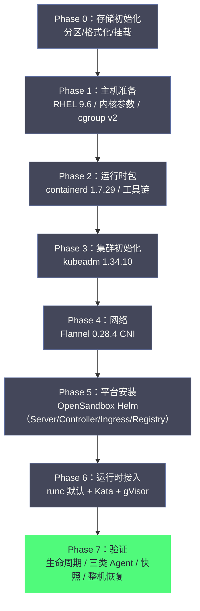

# 10 Agent 沙箱部署实战——从单机 PoC 到测试集群

**摘要：**

前 9 篇建立了完整的理论框架（隔离技术 + 平台架构），本文开始"动手"：完整还原 OpenSandbox 沙箱平台从单机 PoC 到测试集群的真实部署过程。文章以素材的 47 步部署记录为骨架，分三层展开：基础设施层（物理机评估、RHEL 9.6 基线、存储分区、containerd、kubeadm、Flannel 的完整安装链）；平台层（OpenSandbox Helm 安装：Server/Controller/Ingress Gateway/Snapshot Registry 四组件、runc/gVisor/Kata 三运行时接入、Console）；验收层（单机 PoC 的验证清单、测试集群的 Gate 0-9 分阶段验收体系——发布物冻结、Namespace 边界、Bootstrap、公共能力、载荷联调、容量治理）。文章同时完整收录了部署过程的真实踩坑清单（Issue-021 Helm 配置不生效、CLI 假成功、180 秒创建超时、Runtime 切换需 rollout restart、Registry HTTP 单点等）与"API/CR/Pod 三层对照"排障法，并以"部署决策先行、证据链验证贯穿"为主线——形态与基线决定部署的形态，每个配置变更都要用实际行为验证，12 个坑由此还原为一个"声明与事实脱节"的模型。文章在文末附上 2026-10 核实的部署工具链时效性更新（官方 Chart 依赖序演进、Server 持久化 PostgreSQL 化、Kubernetes 版本支持线）。核心认知：**沙箱平台的部署不是"一次 Helm install"，而是"基础设施→平台→运行时→验收"的四段式工程——单机 PoC 验证功能、测试集群验证治理、Gate 验收把"以为能用"变成"验证过能用"**。

---

## 第 1 章 部署前的决策：形态与基线

### 1.1 三种部署形态

沙箱平台的部署，是从一句 `helm install` 开始的，还是从一连串决策开始的？素材给出的答案是后者：47 步部署记录里，真正消耗时间与心力的不是敲击命令，而是命令之前的形态选择、基线评估与资源测算——这三件事想清楚了，命令不过是把决策翻译成机器可执行的形式。反过来，决策没想清楚就动手，命令敲得再熟练，也只是把错误原样放大到整个集群。

部署 OpenSandbox 类沙箱平台，先要回答"为什么部署、验证什么"——三种形态的目标、投入与产出完全不同：

| 形态 | 目标 | 投入 | 产出 |
| :--- | :--- | :--- | :--- |
| **单机 PoC** | 验证"平台能用"（生命周期/三类 Agent/运行时切换） | 1 台物理机/高配 VM | 功能证据链 + 性能基准数据 |
| **测试集群** | 验证"治理能用"（HA/配额/发布流程/多 Agent） | 1 控制面 + ≥3 Worker | 生产化差距清单 |
| **生产集群** | 承载真实流量 | 双控制面 + 隔离节点池 | 稳定服务 |

三个形态不是同一份工作的三个规模档位，而是三个目标不同的工程：单机 PoC 回答"平台能不能用"，测试集群回答"治理能不能用"，生产集群回答"稳定能不能持续"。素材的形态决策（Phase3-08/Phase4-00）把这条边界划得很清楚：PoC 用单物理机（10.2.177.37，Dell R740），测试集群复用已有 DomeOS 集群控制面（ID 153）外加新建独占资源包。**"复用控制面、隔离数据面"是资源受限时的标准打法**——控制面共享是为了省成本，Worker 独占是为了保隔离。

这个打法的道理可以类比为合租办公室：前台、会议室、水电线路（控制面）可以共用，但工位与办公桌（数据面）必须各自独立——否则你的文件会被隔壁翻动，你的工位会被临时占用。落到沙箱平台上，共享数据面的后果非常具体：WarmPool 预热出的池子可能与生产负载争抢节点，配额（Quota）在共享节点上失效，残留沙箱（第 4 章会反复出现的"残留 0"纪律）会污染他人的调度视图。控制面组件即使偶尔抖动，影响的也只是创建/删除路径的延迟；数据面一旦被污染，影响的是每个沙箱的隔离与计费边界，修复成本要高一个数量级。所以"控制面共享、数据面隔离"不是省钱的小聪明，而是把故障域与成本域分开的架构决策——部署形态的每一次选择，本质上都是在划定"哪里可以妥协、哪里不能妥协"。

### 1.2 硬件与 OS 基线

形态定了，接下来要回答"用什么机器、什么系统"——素材 Phase1-08/09 的评估结论：

| 维度 | 推荐基线 | 理由 |
| :--- | :--- | :--- |
| **OS** | RHEL 9.x 优先 | cgroup v2、内核 ≥4.18、gVisor 兼容性好 |
| **兼容闸门** | RHEL 8.7（最低） | 老集群迁移的兼容底线 |
| **硬件** | 物理机优先（KVM/EPT 可用） | Kata/MicroVM 需要 VT-x；CVM 嵌套需过门禁（[[04 KVM 与硬件虚拟化——MicroVM 隔离的硬件基石]]） |
| **内存** | ≥64GB（PoC）/ 按容量模型 | 三运行时基准显示 Kata 空闲 397MiB/槽 |
| **存储** | imagefs 与 kubelet 分开（SSD） | 镜像拉取与容器写层互不干扰 |

几个基线的理由值得展开。OS 优先 RHEL 9.x，是因为 cgroup v2 从 RHEL 9 起成为默认——cgroup v1 的碎片化层级在沙箱的 CPU/内存/IO 控制上埋了太多坑（[[02 Linux 隔离原语——namespace、cgroups、seccomp 与 capabilities 的安全地基]] 有完整机制），而内核 ≥4.18 是 gVisor/Kata 的兼容底线；兼容闸门设在 RHEL 8.7，则是为老集群迁移留的退路——基线不是一个点，而是一条"推荐值 + 最低值"的带。硬件优先物理机，是因为 KVM/EPT 可用性在物理机上最干净：Kata/MicroVM 需要 VT-x，而在 VM 里跑 VM（嵌套虚拟化）要先过 [[04 KVM 与硬件虚拟化——MicroVM 隔离的硬件基石]] 的门禁，PoC 阶段不应该把时间耗在验证嵌套门禁上。

素材 PoC 机的完整画像：Dell R740、32C/64T/251GiB、8×600GB SAS、1Gbps 活动接口、RHEL 9.6（内核 5.14.0-570）、SELinux 当时 Disabled、cgroup v1→v2（部署时确认）。这台机器在投入部署之前完成了一整轮能力评估——KVM 可用性（`/dev/kvm` 是否存在与权限、嵌套门禁预检）、存储布局（8 块 SAS 盘的分区与挂载规划）、网络带宽（1Gbps 活动接口实测）——**评估文档是部署的第一份交付物**。

"先评估后部署"这条纪律，反例更能说明问题：跳过评估直接开工，cgroup v1 的机器会让 SystemdCgroup 配置静默失效，没有 `/dev/kvm` 的机器会让 Kata 安装到最后一刻才报错，带宽不足的机器要等大镜像并发拉取时才暴露问题——这三类问题的共同点是"事后补救代价极大"。评估这件事很像施工前的勘察：地质报告没做就开挖，挖到岩层才知道地基预算不够。勘察花掉的时间，与返工花掉的时间相比，通常只是一个零头。

### 1.3 网络与存储的专项准备

机器与系统的基线之外，还有两个容易被低估的专项准备——网络与存储：

网络专项：

| 检查项 | 内容 | 不做的后果 |
| :--- | :--- | :--- |
| **节点互通** | 控制面与 Worker 的端口互通（kubeadm 需要 6443/10250 等） | 集群初始化失败 |
| **镜像拉取路径** | 内网 Registry 可达性（**内网仓库是离线部署的前提**，素材脚本 03 的第一步） | 镜像拉取超时 |
| **带宽预算** | 大镜像（2.6GB code-interpreter）× 并发拉取 | 拉取风暴拖垮网络 |
| **DNS** | 集群 DNS 与外部 DNS 的解析边界 | 沙箱内域名解析异常 |

网络这项检查，素材专门验证了"1Gbps 活动接口"，原因在于**网络是部署中最难事后补救的维度**——机器到位后发现带宽不足，只能换机器；而端口互通、DNS 解析这类问题尚可用防火墙规则、CoreDNS 配置补救。带宽预算是另一个容易算错的点：2.6GB 的 code-interpreter 镜像，如果 10 个 Worker 并发拉取就是 26GB 的瞬时流量，1Gbps 接口的传输时间大约 3 分半——把它当成"部署时一次性成本"会低估，当成"每次镜像更新的常态成本"才接近真相。

存储专项：除了 2.2 节的 containerd/kubelet 分区，还要规划快照 Registry 的存储。每个快照是一份完整的 rootfs OCI 镜像，素材 PoC 中 Registry 用 HostPath 落在本地磁盘，因此**快照容量 = 沙箱 rootfs 大小 × 快照数量**——这是容量模型最容易漏算的一项。2.6GB 的 rootfs 存 20 份快照就是 52GB 的磁盘占用，而很多人只按"镜像缓存"的规模估存储，等到快照批量创建才发现磁盘爆满。另一个隐含约束是 HostPath 的单节点性：Registry 在哪个节点，快照恢复就只能在哪个节点就近完成——PoC 阶段可以接受，测试集群阶段就要开始规划共享存储（PVC）或独立 Registry 节点。

### 1.4 最小资源模型

部署前最后要算清的一笔账，是资源模型：

| 形态 | 控制面 | Worker | 说明 |
| :--- | :--- | :--- | :--- |
| 最小 PoC | 1 ×（4C/8G） | 2 ×（8C/16G） | 控制面与 Worker 分离（不共置） |
| 单机 PoC（素材） | 共置（32C/251GiB） | 同机 | 资源充足时单机即可 |
| 推荐生产（素材） | Server 2 + Ingress 2 + Controller 2 | ≥3 节点 | 双副本 + 故障域 |

"推荐生产"这行值得细读：Server 2 副本（1C/4G request）+ Controller 2 副本 + Worker ≥3——**控制面组件按"副本数"规划，Worker 按"故障域"规划**。控制面的规划单位是副本，因为控制面组件的负载模式是"请求数驱动"（生命周期 API 的 QPS），而 Worker 的规划单位是故障域，因为 ≥3 节点才能保证单节点故障不丢多数派（etcd 与调度的共识语义都依赖这一点）。两组规划单位不同，算出的资源形态自然不同——**资源模型的产出是"部署前就要算清的账"，不是部署中现算**。

反例同样清楚：有人把资源模型留到部署中现算，结果是控制面 request 定太低（API 高峰被打爆）、Worker 定太少（镜像缓存放不下）、快照容量根本没进预算——每个问题都要靠扩容或重装来还债。素材把 Server 的 request 定在 1C/4G 是有意为之：request 是调度保证的下限，不是实际消耗的上限；账要在部署前算清，实际水位靠监控在部署后校准，两者不矛盾。

---

## 第 2 章 单机 PoC：47 步完整部署

### 2.1 部署全景

决策与基线就绪后，进入单机 PoC 的执行阶段。素材 Phase3-00 记录了完整的 47 步，按阶段组织（本文给出阶段骨架，完整命令以官方文档 + 素材手册为准）：



8 个 Phase 的划分不是随意的——每个 Phase 的边界就是一个验收门。Phase 0 完成存储初始化、Phase 1 确认主机基线、Phase 2 装好运行时包，任何一个 Phase 的产物不合格（分区失败、cgroup 未切 v2、containerd 起不来），后面的 Phase 就没有继续的必要。把部署拆成"可验证的里程碑"，是比"一口气装完再验证"稳妥得多的节奏：前者让故障在最小范围内暴露，后者把所有故障积压到最后一刻一起爆发。47 步的粒度本身也是一种取舍——步太粗，一步错不知道错在哪；步太细，脚本与文档的维护成本高到不可持续。素材选的粒度是"一步一个可验证结果"。

### 2.2 基础设施层（Phase 0-4）

存储初始化（素材的磁盘布局）：

```
/dev/sdd6 → /data/containerd-disk（containerd 数据，ext4，514G 可用）
/dev/sdg6 → /data/kubelet-disk（kubelet 数据，ext4，514G 可用）
```

为什么分开：containerd 的镜像层与 kubelet 的容器写层分开——任一爆满不互相拖累（镜像拉取风暴不阻塞容器写层）。这是单机部署中最容易被跳过的"小事"，但生产事故的常见根因：镜像缓存写满同一块盘，所有容器的写层一起报 `no space left`，连排查日志都写不进去。分离之后，镜像缓存爆满最多影响新沙箱的创建，不影响运行中沙箱的写层。

containerd 配置要点（1.7.29，CRI v1）：
- `SystemdCgroup = true`（与 kubelet 的 cgroup driver 一致——**不一致会导致节点 NotReady**）；
- 后续接入 Kata/gVisor 时在 config.toml 注册 runtime 插件（[[02 Linux 隔离原语——namespace、cgroups、seccomp 与 capabilities 的安全地基]] 的七跳链路第 5 跳）。

这里补一句选型背景：素材用 containerd 而不是 Docker，并不是随手一选。Kubernetes 自 1.24 起移除了 dockershim，CRI 直连（containerd/CRI-O）成为唯一路径；而沙箱平台对运行时插件的注册需求（config.toml 里声明 `kata-qemu-runtime-rs`、`runsc` 的 handler）恰恰是 CRI 层的原生能力。`SystemdCgroup` 这条看起来是配置项，实际上是 cgroup driver 一致性问题的闸门：kubelet 用 systemd driver，containerd 若用 cgroupfs driver，两者对同一批 Pod 的 cgroup 路径认知不同，节点直接 NotReady——症状隐蔽，kubelet 的报错日志往往排在最后一行。

kubeadm 初始化（1.34.10）：
- Pod CIDR 172.29.0.0/16、Service CIDR 172.28.0.0/16（与 Flannel 配置一致）；
- 单节点部署需移除控制面污点（taint）让 Worker 负载可调度。

CIDR 是"一处声明、三处一致"的典型：kubeadm init 的 Pod CIDR、Flannel 的 manifest 网络段、Service CIDR 三者必须互不冲突且声明一致——声明不一致的后果是 Pod 网络不通，且报错信息散布在各层日志里，极难定位。素材把这两段地址在部署前就写好、三处引用同一份变量，正是为了消除这一类"人工改三处、漏改一处"的低级错误。

Flannel 0.28.4：overlay 网络（VXLAN 后端）——**注意 Flannel 不执行 NetworkPolicy**（[[08 OpenSandbox 数据面——execd 与 egress 的盒内世界]] 的策略真伪问题）：PoC 阶段可接受，生产必须换 Calico/Cilium 或先做真伪实验。这句话值得再强调一次：Flannel 只解决"Pod 之间能不能通"，不解决"谁能通、谁不能通"——它的职责止于数据面连通性，策略面是一片空白。单机 PoC 里所有沙箱都在同一台机器、同一个 overlay 上，连通性够用；一旦进入多租户场景，Flannel 的空白就会变成安全漏洞，这正是第 5 章转化清单里"网络"一行的由来。

### 2.3 平台层（Phase 5-6）

OpenSandbox 组件清单（素材 PoC 版本）：

| 组件 | 版本 | 端口 | 说明 |
| :--- | :--- | :--- | :--- |
| **Server** | 0.2.2 | 30080 (NodePort) | Lifecycle API；Snapshot 元数据 pod-local SQLite |
| **Controller** | 0.2.0 | - | BatchSandbox CRD 调谐 |
| **Ingress Gateway** | 1.0.10 | 30081 | 动态路由，签名 Header |
| **Snapshot Registry** | registry:2.8.3 | 30500 | HTTP，NodePort，HostPath（POC-004 妥协） |
| **Console** | 0.2.3-rc.3 | 30082 | React + BFF（pause/resume 显式开启） |
| **execd** | v1.0.21 | 动态 | 沙箱内守护进程（随沙箱注入） |
| **egress** | v1.1.5 | - | 网络策略 sidecar |

Helm 安装的关键参数（素材 PoC）：
- `secure_runtime` 配置决定默认运行时（runc 默认；切 Kata/gVisor 走此处）；
- Registry 地址（镜像拉取源）；
- API Key（平台凭据——PoC 用共享 Key，POC-005 妥协）。

运行时接入（Phase 6）：
- runc：默认，零配置；
- Kata 3.31.0：Helm chart 安装 + containerd 注册 `kata-qemu-runtime-rs` handler + RuntimeClass 创建 + 节点标签（七跳链路的四层一致性）；
- gVisor：runsc release-20260810.0 + containerd 注册 + RuntimeClass——**注意 platform 选择**（裸金属 kvm、VM 里 systrap，[[03 隔离边界的光谱——从共享内核到 MicroVM 的四档技术路线]] 的门禁二）。

运行时接入的顺序本身有讲究：先 runc 打通全链路，再加 Kata，再加 gVisor——隔离强度逐档递增，每一档的接入都复用了前一档验证过的链路。Kata 的四层一致性（Server 配置 → CR → RuntimeClass → containerd handler）是接入最容易断的地方：任何一层不一致，症状都统一表现为"Pod 创建失败"，但每一层的报错位置和排查方法完全不同——这一主题在第 3 章坑 8 会展开。gVisor 的 platform 选择则是一个典型的"环境决定配置"：裸金属上 kvm platform 走 KVM 硬件加速，VM 里没有 VT-x 直通就该显式切 systrap（纯软件 trap 拦截），默认值不总是对的，显式声明才是对的。

### 2.4 部署的脚本化：素材的 24 个脚本

素材 PoC 的部署不是"手敲命令"，而是沉淀为 24 个可复现脚本（`poc/scripts/01-24`）——**脚本化是部署工程化的第一标志**：

| 脚本段 | 内容 | 教训 |
| :--- | :--- | :--- |
| 01-02 | 存储初始化 + 主机准备 | 环境前置可一键复现 |
| 03-04 | 仓库配置 + runtime/k8s 包安装 | 内网仓库（yum 源）是离线部署的前提 |
| 05-07 | kubeadm 初始化 + Flannel + K8s 冒烟 | **每步都有冒烟验证**（k8s-smoke） |
| 08-10 | Helm 准备 + OpenSandbox 安装 + 生命周期冒烟 | 09a 是 auth-fix（**认证修复补丁**——真实部署必然有补丁） |
| 11 | TTL 过期验证 | 生命周期治理的实测 |
| 12-16 | Kata 安装/冒烟/切换/生命周期 | 13a 是 postcheck（**安装后的自查脚本**） |
| 17-18 | 重启前后检查 + 重启后负载冒烟 | **整机恢复验证**（2.4 节） |
| 19-24 | Snapshot 注册/API/Console 部署 | 能力补全的后期阶段 |

脚本化带来的三个好处：**可复现**（换台机器能重放）、**可审计**（部署即证据）、**可演进**（新环境部署 = 改参数重放）。脚本的命名也透露了纪律：09a 是 auth-fix、13a 是 postcheck——补丁与自查以独立脚本的形式成为版本的一部分，而不是口头经验。**素材的"auth-fix"与"postcheck"脚本说明一个现实：真实部署必然有补丁与自查——脚本化让补丁成为版本的一部分，而不是口头经验**。

脚本化的边界同样值得想清楚：哪些步骤应该脚本化，哪些应该保留为人工判断？素材的经验是"幂等的机械步骤全脚本化，需要决策的步骤留人工"——脚本里不写"如果 X 就 Y"的模糊逻辑，只写确定性的操作；判断点则留在人手里，譬如 Gate 通过与否、版本升级与否，脚本只负责把判断所需的证据摆到桌面上。这也解释了为什么每个脚本段后面都跟着冒烟验证：脚本的职责不是"跑完"，而是"跑完且证明结果正确"。

### 2.5 快照注册与 Console 部署（Phase 7-8）

素材脚本 19-24 覆盖了平台能力的后期补全阶段：

快照注册（19-20）：
- Snapshot Registry 注册到平台（Registry 地址/凭据配置）；
- 快照 API 冒烟：创建快照 → 查询记录 → 从快照恢复；
- 注意 GAP-003/004 的影响：元数据在 pod-local SQLite（单副本 Server 才可查）、删除不回收 blob——Lab 级能力，文档注明边界。

快照这一项的"文档注明边界"不是推卸责任，而是产品语义的诚实：pod-local SQLite 意味着快照元数据跟 Server Pod 走，Server 重启或换副本，元数据就"搬家"了；删除不回收 blob 意味着 Registry 的磁盘只增不减——这两个限制让快照在 PoC 阶段只能算 Lab 级能力。第 5 章会讲到 2026 年上游如何用 PostgreSQL 持久化来解决元数据单点（时效性更新），但在素材的时间点上，正确的做法就是把边界写清楚，而不是假装它不存在。

Console 部署（21-23）：Console 经历 rc2→rc3 两次部署迭代（素材脚本 21/22 是不同版本的部署，23 是 pause/resume 显式开启的验证）——版本迭代是 Console 的常态，部署脚本要参数化版本号。Console 这类"跟着平台迭代"的组件，如果部署脚本把版本号写死，每次升级都要改脚本；参数化之后，升级就是"改一个参数重放"。

API 参考沉淀（24）：API 完整列表与调用参考归档（素材 Phase3-07 的 65 个操作）——**"API 参考文档"是平台交接的第一份资产**（CLI 缺 Snapshot/Pool 命令组时，API 参考是唯一的操作依据）。这一条在排障章节还会出现：CLI 覆盖不到的路径，只能靠 API 手工调用验证，65 个操作的全集清单就是"平台能力边界"的索引。

### 2.6 平台升级路径

部署完成不等于一劳永逸——OpenSandbox 迭代快（素材 PoC 期 Console 就有 rc2→rc3），升级路径要提前设计：

| 升级对象 | 方式 | 注意事项 |
| :--- | :--- | :--- |
| **Server/Controller** | Helm upgrade | **发布物冻结**（digest 锁定）；升级后验证 CRD 兼容（DEF-005 的教训） |
| **execd** | 注入版本变化 | 新沙箱生效（旧沙箱保持旧版本）——**execd 升级不破坏运行中沙箱** |
| **Runtime（Kata/gVisor）** | containerd 注册 + RuntimeClass | 四层一致性重验（第 02 篇） |
| **镜像** | Registry 推送 | **镜像更新 → 新池预热 → 切流**（第 09 篇 的池运维经验三） |

升级的三个原则：**先验证后切换**（测试集群先升级验证再动 PoC/生产）、**可回滚**（Helm 历史版本 + 发布物冻结保证回退路径）、**验证即归档**（升级后的冒烟结果归档——"升级成功"要有证据，不是感觉）。

对照 2026-10 上游的官方部署文档，这条升级路径与官方现在的做法可以相互印证：官方文档明确 Server 的 Deployment 使用 `Recreate` 策略，升级时先停旧实例再起新实例，会有一个短暂的 API 中断窗口——这从上游侧印证了素材踩过的"Helm upgrade 不自动滚动重启"（坑 1）：配置变更与版本升级的生效路径必须显式验证，不能假设。官方文档同时说明 Server 默认单副本，通用多副本 HA 尚不支持，唯一的例外是"PostgreSQL 持久化 + Kubernetes runtime"组合下可以开双副本处理公开快照——这条边界我们在第 5 章展开。

### 2.7 验证清单（Phase 7）

素材 Phase3-01 的 PoC 验收入口清单：

| 验证域 | 通过标准 |
| :--- | :--- |
| **生命周期 API** | 创建/查询/续期/删除全链路，残留 0 |
| **Snapshot** | 快照创建/恢复闭环（Lab 级） |
| **Kata 运行时** | 隔离证据链（guest 内核/QEMU 进程/RuntimeClass 注入） |
| **Console** | 登录 + 沙箱操作（pause/resume 显式开启） |
| **三类 Agent** | OpenCode/Hermes/LangChain 创建→任务→回收 |
| **整机恢复** | 重启后平台自恢复（数据面/控制面状态） |

**"整机恢复"是最容易漏的验证**——平台部署完成不等于可运维，**重启即崩溃的部署是最常见的"假成功"**。素材的脚本 17-18 专门做了重启前后检查与重启后负载冒烟：重启是运维里最普通也最残酷的测试，任何"只挂在内存里"的状态、任何没落盘的配置，重启一次就现形。单机 PoC 阶段花一小时验证整机恢复，比生产环境凌晨三点被重启事故叫醒要划算得多。

### 2.8 部署顺序的演进：素材四组件与官方 Chart 依赖序

2026-10 笔者核对了官方部署文档（open-sandbox.ai/deployment），发现上游的部署模型相比素材的 PoC 版本（Server/Controller/Ingress/Registry 四组件）已经演进为一个更细分的 Chart 依赖序：

| 顺序 | 官方 Chart | 职责 | 与素材四组件的对照 |
| :--- | :--- | :--- | :--- |
| 1 | **base** | `sandbox.opensandbox.io` 与 `sandbox.fast.io` CRD + RBAC | 素材由 Helm 隐式创建（无独立 Chart） |
| 2 | **opensandbox-controller** | 调谐 BatchSandbox/Pool/SandboxSnapshot | Controller 0.2.0 |
| 3 | **fast-sandbox**（可选） | Firecracker 运行时（`sandbox.fast.io`），FastPath gRPC 端点 | 素材未装（Kata/gVisor 路径） |
| 4 | **ingress-gateway** | 沙箱流量路由 | Ingress Gateway 1.0.10 |
| 5 | **opensandbox-server** | 生命周期 REST API | Server 0.2.2 |
| 6 | **opensandbox-node-agent**（可选） | 节点级沙箱数据采集（DaemonSet） | 素材未装 |

这个演进里有两个值得注意的变化。其一是**ingress-gateway 从可选变成了 K8s 部署的必装件**：官方文档明确"沙箱 Pod 在 Kubernetes 上是 ClusterIP-only，客户端流量必须经网关路由"——这与素材 PoC 里 Gateway 承担动态路由、签名 Header 的职责一致，但官方现在把"必须装网关"写进了前提，避免部署者漏掉这一层。其二是新增了 fast-sandbox（Firecracker）运行时：官方在 runc/gVisor/Kata 之外又提供了一条 MicroVM 路径，与 [[05 VMM 解剖——Firecracker、Cloud Hypervisor 与 Kata 的虚拟机监视器家族]] 讲的 Firecracker 家族呼应。官方还提供 umbrella chart（all-in-one），一次安装按正确顺序拉起全部组件；独立 Chart 则按 base → controller → fast-sandbox* → ingress-gateway → server → optional 的顺序逐个安装。素材的"四组件 + 24 脚本"与官方现在的"六 Chart + 依赖序"放在一起看，恰好构成一组对照：**部署模型在演进，但"先 CRD/RBAC、再控制面、再网关、再 Server"的依赖本质没有变**——变的只是把依赖关系从"脚本约定"提升成了"Chart 声明"。

---

## 第 3 章 踩坑清单：素材实测的 12 个坑

### 3.0 坑的分类学：先看根因，再记症状

12 个坑如果只当清单背，换个环境就失效；先看根因再记症状，才能迁移。把 12 个坑归一下类，会发现四条清晰的根因线：配置类的坑（坑 1-3）根因是"声明与生效的脱节"——配置改了但生效路径没走完；API 语义类的坑（坑 4-6）根因是"返回与终态的脱节"——接口说成功不等于状态到终态；运行时类的坑（坑 7-9）根因是"声明与注册的脱节"——多层的运行时声明只要有一层不一致就失败；安全运维类的坑（坑 10-12）根因是"PoC 妥协与生产要求的差距"——单副本、共享 Key、直露端口都是省事换来的风险。四条根因线的共同底层，正是 3.0 节末尾 warning 要说的"配置声明与运行事实的脱节"——把 12 个坑还原成一个模型，排查时才能举一反三。

### 3.1 配置类

**坑 1：Helm 配置不生效（Issue-021）**。通过 Helm 修改 `secure_runtime` 配置后，**必须手动 `rollout restart deployment/opensandbox-server`** 才生效——Helm upgrade 不自动触发滚动重启。**教训：配置变更的生效路径要验证，不能假设**。这里有个反直觉的细节：Helm 的 values 变更明明"成功"了（release 状态是 deployed），但容器里跑的仍是旧配置——release 成功与配置生效是两件事，前者只代表"模板渲染并应用了"，后者要等 Pod 重启才成立。

**坑 2：containerd 与 kubelet 的 cgroup driver 不一致**。SystemdCgroup 必须显式配置——不一致导致节点 NotReady，症状隐蔽（kubelet 报错日志在最后）。

**坑 3：Flannel 与 kubeadm 的 CIDR 不一致**。Pod CIDR 声明不一致导致 Pod 网络不通——**CIDR 是"一处声明、三处一致"**（kubeadm init、Flannel manifest、Service CIDR 不冲突）。

### 3.2 API 语义类

**坑 4：CLI 假成功（DEF-001）**。`osb sandbox pause` 返回 ok 不等于最终成功——**必须轮询到 Paused 终态**（[[07 OpenSandbox 架构深度解析——协议优先与六责任面]] 的 202 语义）。这类坑的隐蔽性在于：CLI 的 ok 是"请求已被受理"的意思，不是"操作已完成"的意思；把受理当完成，就会在沙箱还在 draining 时就去做下一步操作，拿到一个中间态的结果。

**坑 5：创建 180 秒超时 504**。创建坏镜像时 API 挂起约 180 秒返回 504，sandbox_id 只在错误 message 中（正则提取）。客户端超时设置必须大于 180 秒，否则"平台还在等，客户端已放弃"。这个坑的连带问题是 sandbox_id 的获取：正常路径里 sandbox_id 在响应体里，超时路径里它被塞进错误 message——客户端要写两套解析逻辑，缺一套就"创建失败了却不知道是谁失败"。

**坑 6：202 的"同步完成"语义**。202 返回时 Pod 已 Running——重复调用 create 会创建重复沙箱（把 202 当异步受理的后果）。把 202 当异步受理、于是客户端做了"轮询直到完成再继续"，结果轮询期间又发了一次 create——两个沙箱都建出来了。202 的语义精确说是"同步等待到 Pod 就绪"：202 返回的那一刻，资源已经就绪，后续的 Controller 对账（配额记账、事件上报、TTL 调度）可能还在进行，但创建本身已完成。

### 3.3 运行时类

**坑 7：Runtime 切换的生效路径**。`secure_runtime` 是 Server 级配置——切换后不仅 rollout restart，还要验证新创建的沙箱确实用了新运行时（隔离证据链，第 02 篇 5.3 节）。

**坑 8：Kata 的四层一致性**。RuntimeClass handler 与 containerd 插件名不一致 → Pod 创建失败；节点标签缺失 → Pod 一直 Pending——**四层任何一层断，症状都是"创建失败"，排查顺序固定**（Server 配置→CR→RuntimeClass→containerd）。

**坑 9：gVisor 的 platform 选择**。默认 platform 在 VM 环境可能错误——显式设置 systrap（CVM 场景），裸金属用 kvm（[[03 隔离边界的光谱——从共享内核到 MicroVM 的四档技术路线]] 门禁二）。

### 3.4 安全与运维类

**坑 10：Registry 单点 HTTP**。Snapshot Registry 单副本 + HTTP + NodePort（POC-004）——**快照功能依赖 Registry，Registry 挂了快照全挂**。生产必须企业 TLS Registry + 多副本。

**坑 11：共享平台 Key**。PoC 用共享 Key——**MCP 打穿后父 Agent 能枚举全部沙箱**（[[14 沙箱安全体系——三层防护、短期凭据与多租户]] 的凭据治理）。

**坑 12：NodePort 直露**。直接暴露 HTTP NodePort（POC-007）——**生产入口必须 Gateway + SSO**。

> [!warning] 生产避坑
> 12 个坑的共同规律：**"配置声明"与"运行事实"的脱节**——Helm 配置了但没重启、CLI 返回了但没完成、RuntimeClass 声明了但 containerd 没注册。**对抗脱节的唯一方法是"证据链验证"**：每个配置变更都要用"实际行为"验证（新沙箱的运行时、Paused 状态、Pod 的 runtimeClassName）——**素材把这条纪律贯彻到了每个验收项**。

### 3.5 环境问题台账（素材 4 项）

素材差距台账中的 4 个环境问题（区别于平台缺陷——环境问题源于基础设施）：

| 问题 | 本质 | 处理 |
| :--- | :--- | :--- |
| **SELinux 当时 Disabled** | 基线未达生产要求（生产要求 Enforcing） | 生产环境启用 SELinux 并重跑验证 |
| **cgroup v1 → v2** | 部署前基线确认不充分 | 部署时确认并固化基线 |
| **Registry HTTP 单点** | 快照链路的单点依赖 | 企业 TLS Registry（生产） |
| **CNI 策略未证实** | Flannel 不执行 NetworkPolicy | 真伪实验（第 08 篇 4.4 节） |

环境问题与平台缺陷的区分价值：处理路径不同——平台缺陷等上游/绕行，环境问题必须自己修（基础设施是自己的责任）。台账分类的准确性直接决定问题能否被消除。SELinux 从 Disabled 到 Enforcing 尤其要警惕：它不是改一个配置开关，而是容器运行时在 Enforcing 下的行为会变（文件上下文、进程域约束），必须重跑一遍运行时接入与三类 Agent 的验证，而不是改完配置就算数。

### 3.6 排障的日志路径

素材排障实践的日志分层（按"从外到内"的顺序）：

```
第 1 层：客户端日志（SDK/CLI 报错原文）
第 2 层：Server 日志（kubectl logs deployment/opensandbox-server）
第 3 层：Controller 日志（kubectl logs deployment/opensandbox-controller）
第 4 层：Pod 事件与状态（kubectl describe pod <sandbox-pod>）
第 5 层：CRI 层（crictl ps/日志、containerd 日志）
第 6 层：运行时层（runc/runsc/kata shim 日志、QEMU 进程）
```

日志路径的规则：**先看"离问题最近的证据"，再向外扩展**——创建失败先看 Server（创建路径归它），运行异常先看 Pod 事件，再下探 CRI/运行时。**不要一开始就翻运行时日志**——那是最后一层，信息密度最低、噪音最大。这个顺序很像处理报警的接警台：先确认"哪里报的警、报警说什么"，再决定要不要派警力去现场，而不是一上来就翻每个警员的执勤记录。

素材的三个日志纪律：
1. 时间对齐：跨层排查时用同一时间窗口（`--since`），避免"不同时间的日志拼出错误结论"；
2. request_id 贯穿：Server 的请求 ID 是跨层关联的锚点（GAP-001 未实现时，request_id 手工关联）；
3. 证据归档：每次事故的日志片段归档到排障记录——**"同一坑不踩第二次"靠的是证据库，不是记忆力**。

时间对齐这条纪律常被低估：排障时容易把"Server 今天 10:00 的报错"与"Pod 昨天 22:00 的事件"拼在一起，得出一条根本不存在的因果链。request_id 则是分布式排障的通用锚点——素材在 request_id 未贯穿所有层（GAP-001）的时候用手工关联补齐，说明了锚点缺失时的代价：每跨一层都要靠时间戳和路径去猜关联，效率低一个数量级。

### 3.7 从坑到预防：把 12 个坑翻译成 12 个验证动作

踩坑清单的价值不在于"背下来"，而在于把每个坑翻译成一个"部署时必须执行"的验证动作，让坑在下一次部署中无法复现：

| 坑 | 对应的验证动作 |
| :--- | :--- |
| 坑 1 Helm 配置不生效 | 配置变更后 rollout restart，并 `kubectl get pod` 确认新 Pod 起来 |
| 坑 2 cgroup driver 不一致 | 部署前校验 kubelet 与 containerd 的 cgroup driver 一致 |
| 坑 3 CIDR 不一致 | 部署前核对三处 CIDR 声明（一个变量多处引用） |
| 坑 4 CLI 假成功 | 所有异步操作轮询到终态（Paused/Terminated） |
| 坑 5 180 秒超时 | 客户端超时 > 180s；解析错误 message 里的 sandbox_id |
| 坑 6 202 重复创建 | create 后不再重复调用；把 202 当"已就绪"而非"已受理" |
| 坑 7 Runtime 切换 | 切换后创建新沙箱并验证 runtimeClassName/隔离证据链 |
| 坑 8 Kata 四层一致性 | 四层（Server→CR→RuntimeClass→containerd）逐一核对 |
| 坑 9 gVisor platform | 按环境显式声明 platform（裸金属 kvm / VM systrap） |
| 坑 10 Registry 单点 | 快照链路演练：停掉 Registry 观察降级行为 |
| 坑 11 共享 Key | 凭据按租户/按 Agent 隔离；短期凭据轮换 |
| 坑 12 NodePort 直露 | 入口收敛到 Gateway + SSO；关闭直露端口 |

这张表是 3.0 节分类学的落点：**12 个坑不是 12 条孤立经验，而是"声明与事实脱节"这一个模型在 12 个具体环节的投影**——每个验证动作的本质，都是把"声明"与"事实"对齐一次。

---

## 第 4 章 测试集群：Gate 0-9 分阶段验收

### 4.1 为什么分 Gate

测试集群（Phase4）不是"把 PoC 换个地方再装一遍"——它的目标是验证"治理能用"（HA、发布流程、配额、多租户边界）。素材设计了 Gate 0-9 的分阶段验收：每个 Gate 有明确的通过标准、排障入口与回退方法，任何 Gate 不过就停在该阶段，不前进。

分 Gate 的三个理由：
1. 故障域隔离：每个 Gate 只引入一类风险（网络问题在 Gate 0 暴露，不会污染 Gate 4 的验证）；
2. 证据链完整：每步通过都有记录（"发布物冻结"是 Gate 1 的核心——**部署用的 Chart/镜像/digest/Secret 先冻结再安装**，事后可复现）；
3. 回退可控：每个 Gate 定义了回退方法（失败时回到哪个状态、怎么回）。

分 Gate 的过程很像登山分段扎营：每到一个营地就补给、确认、记录，再决定是否继续——而不是一口气冲顶，冲不动了才发现前面全是悬崖。Gate 之间不是孤立的，它们构成一条依赖链：Gate 0 的环境不干净，Gate 2 的调度边界就测不准；Gate 3 的 Bootstrap 没过，Gate 4 的公共能力就无从谈起。每个 Gate 只引入一类风险，失败时能精确到"这一关暴露的是哪类问题"，这正是故障域隔离的意义。

### 4.2 Gate 0-9 详解

| Gate | 内容 | 通过标准（示例） | 回退方法 |
| :--- | :--- | :--- | :--- |
| **0：集群准入** | 节点、权限、磁盘、CNI、Registry、观测 | 节点 Ready、磁盘容量达标、观测链路通 | 修环境，不前进 |
| **1：发布物冻结** | Chart、镜像、digest、Secret 锁定 | 发布物清单齐全且可复现 | 修正清单 |
| **2：Namespace 与调度边界** | 命名空间、节点选择器、污点 | 沙箱只能调度到指定节点池 | 修调度配置 |
| **3：Bootstrap + Runtime** | CRD/ClusterRole + Deployment/Service | 组件全部 Ready | Helm 回滚 |
| **4：公共能力** | 生命周期、execd、Gateway、SSO、策略、观测 | 全能力验证通过 | 逐项回退 |
| **5：载荷联调** | 三类 Agent/MCP | 创建→任务→回收闭环 | 修镜像/适配 |
| **6：容量与治理** | 配额、并发、N-1 | 配额生效、并发达标、N-1 通过 | 调整配额 |
| **7-9：稳定性/安全/交接** | 持续运行、安全基线、文档交接 | 24-72h 稳定、审计可用、文档齐全 | 补充验证 |

Gate 的哲学：**每个 Gate 的通过标准都是"可验证的事实"，不是"看起来正常"**——"观测链路通"要有具体指标可查，"配额生效"要有超限拒绝的证据。**素材的 Gate 设计是"验收驱动部署"的典范**。把"看起来正常"翻译成"可验证的事实"，需要为每个标准指定证据形态：观测链路通的证据是告警规则能触发、指标能查到；配额生效的证据是超限请求被拒绝的 429/4xx 记录；调度边界的证据是沙箱 Pod 的 nodeName 全部落在指定节点池。**"看起来正常"是最危险的说法——它把验证责任推给了观察者的印象**。

### 4.3 部署实录：2026-08-12

素材 Phase4-05 记录了测试集群的首次实际部署：

| 项 | 结果 |
| :--- | :--- |
| **集群** | DomeOS panther-dev（ID 153），Kubernetes 1.28.2 |
| **节点** | 3×8C/15.5GiB（agent-manager）+ 3×4C/7.64GiB（test-lqh）+ 新建独占资源包 |
| **Profile** | Core HA（双副本，Snapshot/Pause 关闭） |
| **运行时** | 仅 runc（不装 Kata/gVisor——"runc Profile 先行"决策，第 03 篇 7.4 节） |
| **结果** | Server/Controller 双副本 Ready；三类 Agent 验收通过；**残留 0** |

"仅 runc"的决策值得细品：测试集群的目标是验证"治理"（HA/发布/配额），不是"隔离"（那是 PoC 已验证的）——**每个环境只验证它的目标，是资源效率与故障隔离的统一**。测试集群刻意不开 Kata/gVisor，是为了让治理验证不被运行时问题干扰——如果双副本 HA 验证失败，失败原因应该被精确归因到控制面，而不是被"某个 runtime 装错了"混淆。素材在这个集群上把 Server/Controller 跑成双副本，Core HA Profile 关闭了快照与暂停（那两个能力在素材时间点还是 Lab 级，见 2.5 节）——Profile 的取舍本身也是"每环境只验证目标"的延续。

另一个值得注意的细节是版本代差：DomeOS 托管集群是 Kubernetes 1.28.2，而单机 PoC 自建的是 kubeadm 1.34.10——托管集群的版本通常滞后社区 1-2 个大版本，这是企业现实，不是失误。它带来一个工程含义：同一套 OpenSandbox 要在两个版本代差明显的集群上跑通，Chart 的兼容面就要覆盖这条版本带（素材实测跑通了）；而 2026-10 的版本线上，1.34 已进入 EOL 倒计时（详见 6.3 时效性更新），升级规划要提前排期。

### 4.4 Gate 验收的证据归档

Gate 验收的产出不只是"通过/不通过"——每一关的通过证据要归档（素材 Phase4-05 的"执行与审计记录"就是模板）：

| 证据类型 | 内容 | 归档形式 |
| :--- | :--- | :--- |
| **发布物清单** | Chart/镜像/digest/Secret 的锁定版本 | 冻结清单文件 |
| **部署日志** | 安装命令与输出 | 脚本输出归档 |
| **验证结果** | 每个 Gate 的通过标准证据 | 检查表 + 截图/输出 |
| **异常记录** | 遇到的问题与解法 | 踩坑台账（3 章的来源） |
| **回滚记录** | 回退动作与结果 | 回滚脚本/命令 |

证据归档的三个用途：审计（部署合规可查）、复现（新环境部署的输入）、复盘（生产事故时追溯"这个配置是哪来的"）。**"部署即证据"与"配置即代码"是同一纪律的两面**——没有归档的部署，等于没有部署记录。回滚记录尤其容易被跳过：多数人记录成功路径，不记录回退路径，等真需要回滚时才发现"当初怎么回退的，没人记得"。素材把回滚脚本与回滚命令纳入归档，等于把"退路"也变成了可复现的资产。

### 4.5 测试集群的日常运维节奏

测试集群不是"部署完就完事"——素材 Phase4-01/03 隐含的日常运维节奏：

| 节奏 | 内容 | 目的 |
| :--- | :--- | :--- |
| **每日** | 集群健康巡检（节点/组件/残留沙箱） | 及早发现漂移（"残留 0"纪律的日常化） |
| **每周** | 容量审计（池利用率/镜像缓存/Registry 增长） | 防容量事故（碎片与 blob 增长） |
| **每变更** | 重跑 Gate 4/5（公共能力 + 载荷联调） | 变更回归（镜像/配置/版本升级后） |
| **每迭代** | 差距台账更新（GAP/DEF 状态） | 生产化路线图的活数据 |

"残留 0"的日常化：测试集群每天检查"API/CR/Pod 三层是否残留"——**残留不是"偶尔发生"而是"每天要查"**（TTL 调度、finalizer 缺陷、脚本中断都会制造残留）。残留的成因值得拆一下：TTL 调度是"到点删"，如果 TTL 没设或者设错，沙箱就永远活着；finalizer 是"删除前清理"，如果 finalizer 卡住（依赖的资源删不掉），CR 就永远停在 Terminating；脚本中断则是最朴素的成因——创建了沙箱，脚本在中途退出，没人回收。三成因对应三处检查点：TTL 配置、finalizer 状态、脚本的异常退出处理。运维节奏的本质：把验收纪律变成日常习惯。

### 4.6 API/CR/Pod 三层对照排障法

素材 Phase3-10 的"七课教学"（API→CR→Pod→CRI→Agent→MCP→子沙箱）沉淀的排障法：任何沙箱异常，按三层对照定位：

```
第 1 层：API 层 —— 请求返回什么？（202/504/4xx）
第 2 层：CR 层 —— CR 状态是什么？（phase/ready/conditions）
第 3 层：Pod 层 —— Pod 细节是什么？（Running/Pending/CrashLoop/ImagePullBackOff）

对照规则：
  API 成功 + CR Ready + Pod Running  → 问题在数据面（execd 等）
  API 成功 + CR Pending              → 问题在调度（资源/污点/选择器）
  API 失败 + CR 不存在               → 问题在 Server（校验/回滚）
  Pod Running + 服务不可达           → 问题在网络（CNI/egress/Endpoint）
```

三层对照的价值：把"平台黑盒"拆成"三个可查的事实层"——**每层都有独立的证据来源（API 响应/CR 状态/Pod 事件），交叉对照即可定位**。这是本专栏推荐的沙箱排障第一方法。这个方法在机制上依赖第 09 篇讲过的"CR 是事实层"：声明式编排把期望状态持久化在 CR 里，所以 CR 的状态可以独立于 API 的返回去查证——API 说成功，但 CR 停在 Pending，两者对照，矛盾立刻暴露。三种组合各对应一条因果链：API 成功而 CR Pending，说明请求进了编排但调度没完成，去查资源/污点/选择器；API 失败而 CR 不存在，说明请求在 Server 的校验或回滚层就被拦下，去查 Server 日志；Pod Running 而服务不可达，说明创建链路全通但数据面路由断了，去查 CNI/egress/Endpoint。

三层对照很像三份证词交叉核对：API 说、CR 说、Pod 说，三份说法对不上的那一层，就是故障点。只查一层就下结论，等于只听一个证人的话就断案——譬如只看到 API 504 就认定 Server 故障，实际上 Server 是在等一个永远 Pending 的 CR 超时。**排障的成本不在"看哪里"，而在"不看哪里"——三层对照的价值正是给出一个系统性的"不看哪里"的清单**。

---

## 第 5 章 从 PoC 到集群的差异

### 5.1 架构差异

| 维度 | 单机 PoC | 测试集群 |
| :--- | :--- | :--- |
| 控制面 | 单副本 | 双副本（HA） |
| 存储 | 本地磁盘 | 集群存储（PVC） |
| 网络 | NodePort 直露 | Gateway + 策略 |
| 发布 | 手工/脚本 | 发布物冻结 + Gate 验收 |
| 观测 | 无/弱 | 接入统一观测 |
| 凭据 | 共享 Key | 收敛中（POC-005 消除） |

差异的本质：PoC 回答"能不能用"，集群回答"能不能持续用"——**HA、可复现、可观测、可治理是"持续"的四个支柱**，每一个都需要独立投入。四个支柱缺一个，"持续"就塌一角：没有 HA，控制面挂一次业务就断一次；没有可复现，发布物不可追溯，出问题无法还原；没有可观测，故障发生时两眼一抹黑；没有可治理，配额与多租户边界形同虚设。从 PoC 到集群的迁移，本质上就是把这四根柱子一根根立起来的过程。

一个容易被忽视的差异：故障模拟。PoC 阶段几乎不做故障模拟（环境太宝贵），测试集群开始引入——节点重启（素材脚本 17-18 的重启前后检查）、组件 Kill（Server 单副本停掉看行为）、Registry 不可达（快照链路降级表现）。**故障模拟是"治理能用"的试金石：没有模拟过故障的 HA，是纸面 HA**。测试集群的 Gate 7-9（稳定性/安全）应该包含固定的故障演练清单，且每次演练都要产出"故障后行为记录"——**"集群在故障下的行为"是比"集群在正常时的表现"更重要的运维资产**。故障模拟的设计有三个问题要回答：注入什么故障（节点/组件/网络/存储）、观察什么信号（恢复时间/是否丢状态/告警是否触发）、演练多久一次（固定频率 + 变更后必演）。

### 5.2 从测试集群到生产的转化清单

素材 Phase5-10 的"从测试集群到生产"给出了转化清单的骨架（T 级与 P 级，[[15 生产化深水区——十个盲区与行业共识]] 展开），本文先给摘要版：

| 转化项 | 测试集群状态 | 生产要求 |
| :--- | :--- | :--- |
| **节点** | 共享集群的资源包 | 独立节点池（物理故障域 ≥3） |
| **运行时** | 仅 runc | 三 Profile（runc/gVisor/Kata）独立域名 |
| **网络** | Flannel（不执行策略） | 先做策略真伪实验，再写租户隔离 |
| **Registry** | HTTP 单副本 | 企业 TLS Registry + 快照 blob GC |
| **凭据** | 共享平台 Key | 短期凭据 + 租户绑定（第 14 篇） |
| **入口** | NodePort | Gateway + SSO |
| **观测** | 基础接入 | SLO + 告警 + 审计链路 |
| **发布** | Gate 验收 | 版本化发布 + 升级回滚演练 |

转化的三个原则：其一，**每项转化都要有"触发条件"**（如 gVisor 灰度以兼容性验证通过为条件，Kata 以嵌套门禁为条件）；其二，转化顺序按风险排序（凭据/入口类安全项优先，性能类优化殿后）；其三，转化即验证（每项转化完成后重跑 Gate 4/5 验证）。

触发条件这条值得多说两句：转化不是"想转就转"，而是"条件满足才转"。素材把 gVisor 的灰度条件定在"兼容性验证通过"、Kata 定在"嵌套门禁通过"——把触发条件写清楚，转化就变成可预期的工程，而不是一次赌运气的发布。反过来，没有触发条件的转化，最容易被"顺便升级"带偏：一次镜像更新顺便把 runtime 也换了，出了事故根本不知道是哪一步引起的。

### 5.3 生产 Worker 的资源需求清单（素材交付物）

素材的集群资源需求文档给出了生产 Worker 的完整清单（比 PoC 的"8C/16G"细一个数量级）：

| 项 | 要求 | 理由 |
| :--- | :--- | :--- |
| **imagefs** | 每 Worker 400GiB+ SSD | 镜像缓存（2.6GB 级镜像 × 多版本）+ 快照临时空间 |
| **OS** | RHEL 9.6、cgroup v2、SELinux Enforcing、swap off、chrony | 生产基线（SELinux 从 Disabled 转 Enforcing 是必须项） |
| **网络** | 25G 网络 | 大镜像拉取 + 批量交付的带宽需求 |
| **虚拟化** | KVM 透传（Kata 节点） | 第 04 篇 的嵌套门禁 |
| **故障域** | ≥3 个物理故障域 | 单故障域不丢多数派 |
| **身份** | 独立资源包/租户隔离 | 多租户边界（第 14 篇） |

清单的使用：生产资源申请直接引用此清单——**"按清单申请"比"按感觉申请"更容易获批**（每一行都有理由，每一行都可审计）。清单里 imagefs 的 400GiB+ 不是拍脑袋：2.6GB 级镜像 × 多版本（三类 Agent × 版本迭代）× 快照临时空间，几项一乘就过了 400GiB；网络从 PoC 的 1Gbps 跳到 25G，是因为"大镜像拉取 + 批量交付"的带宽需求在并发场景下是乘法关系——这些数字都从第 1 章的容量公式与第 12 篇的基准数据里来，可溯源。

### 5.4 妥协项清单与生产化差距

素材 Phase3-11 的台账（11 PoC 妥协 + 7 DEF + 16 GAP + 4 环境问题）是"从集群到生产"的路线图原料：

| 类别 | 数量 | 处理原则 |
| :--- | :--- | :--- |
| PoC 妥协 | 11 | 生产化逐项消除（单副本→双副本、HTTP→TLS、共享 Key→短期凭据） |
| 产品缺陷 | 7 | 等上游/绕行/打补丁（轮询终态绕行 DEF-001 等） |
| 能力缺口 | 16 | 排入自研路线图（WarmPool SLI、快照 HA、凭据治理） |
| 环境问题 | 4 | 基础设施补齐（Registry TLS、CNI 升级、观测接入） |

台账的使用：**每一项都要有"归属"（上游/自研/绕行）与"截止"（哪个阶段消除）**——无归属的项会在生产事故中现身（[[15 生产化深水区——十个盲区与行业共识]] 的 T/P 路线）。

对照 2026-10 上游动态，台账里的两个条目恰好有可更新的注脚。其一是 pod-local SQLite 的元数据单点（GAP-003）：官方部署文档现在支持 `[store] type = "postgresql"` 的 Server 持久化配置，在"PostgreSQL + Kubernetes runtime"组合下允许开双副本处理公开快照——快照元数据从"跟 Server Pod 走"变成了"落在独立数据库"，单点问题有了官方路径；但文档同时明确"通用多副本 Server HA 仍不支持""SQLite 与 Docker 快照执行不支持多活拓扑"——边界的另一侧依旧存在，这是"上游在演进，边界也在精确定义"的典型。其二是 凭据治理（POC-005/坑 11）：官方 1.2.0-rc 引入了 Credential Vault（OSEP-0022），egress sidecar 持有按主体持久化的凭据保险库并支持 pause/resume 迁移，配 pool 级固定的 MITM CA——从凭据粒度的产品层面回应了"共享平台 Key 被打穿"那类问题。台账的意义正在于此：**它不是一份静态的遗憾清单，而是一份动态的跟踪表——上游每发一个版本，都要回来核对哪些 DEF/GAP 被官方消掉了，哪些还留在自研路线图上**。

---

## 第 6 章 总结、时效性更新与下一篇导读

### 6.1 本文核心要点

1. **四段式工程**：基础设施→平台→运行时→验收——部署不是"一次 Helm install"
2. **形态决策先行**：单机 PoC 验证功能、测试集群验证治理、生产验证稳定——每个环境只验证它的目标
3. **基线纪律**：RHEL 9.x 优先、存储分区（containerd/kubelet 分离）、评估文档是部署的第一份交付物
4. **12 个真实踩坑**：配置声明与运行事实的脱节是最大敌人——证据链验证是唯一解药
5. **Gate 0-9 验收体系**：发布物冻结、可复现、可回退——"验收驱动部署"
6. **三层对照排障法**：API/CR/Pod 三层交叉定位——沙箱排障的第一方法
7. **妥协项台账**：11 POC + 7 DEF + 16 GAP——每项有归属与截止才是路线图

### 6.2 从零到可用的时间线参考

综合素材各阶段记录，给出"从零到可用"的参考时间线（人力 1-2 人）：

| 阶段 | 时长（参考） | 里程碑 |
| :--- | :--- | :--- |
| **环境评估** | 1-2 天 | 机器画像 + OS 基线 + 资源模型文档 |
| **基础设施部署** | 1-2 天 | 存储/containerd/kubeadm/Flannel 冒烟 |
| **平台安装** | 1 天 | OpenSandbox 四组件 + 生命周期冒烟 |
| **运行时接入** | 1-2 天 | Kata/gVisor 安装 + 隔离证据链 |
| **Agent 适配** | 2-3 天 | 三类 Agent 镜像化（第 11 篇） |
| **性能基准** | 1-2 天 | 三运行时基准 + WarmPool 验证（第 12 篇） |
| **差距台账** | 1 天 | POC/DEF/GAP/环境四类清单 |
| **测试集群** | 3-5 天 | Gate 0-9 分阶段验收 |

**总计约 2 周**——这是"从零到测试集群可用"的现实量级（素材的实际节奏）。时间线的两个缓冲点：运行时接入（坑最多）与 Agent 适配（无标准）——排期时这两个阶段各加 50% 余量。

### 6.3 时效性更新：2026-10 部署工具链核实

本节内容是笔者 2026-10 通过官方公开资料核实的时效性更新，全部事实可在文末参考资料中溯源；**素材的 PoC 实测数字（47 步、24 脚本、12 坑、Gate 0-9 等）均为历史事实，保持不变**。

OpenSandbox 发布线与版本演进：项目已完成从 0.2.x 到 1.x 的版本线切换——2026-08-26 发布 server 0.2.3 与 execd 1.1.0，2026-09-21 发布 OpenSandbox 1.1.0，2026-10-09 发布 1.1.1（本文核实时的最新稳定版），2026-10-21 发布 1.2.0-rc.2（Credential Vault OSEP-0022 端到端落地、NetworkRule 端口级规则、`lifecycle.renewalPolicy`（OSEP-0009）替代旧的续期扩展键、诊断上下文 API）。项目仓库从 alibaba 组织迁移至 opensandbox-group，并作为 LF Projects 旗下项目运营。素材 PoC 所用 Server 0.2.2/Controller 0.2.0 属于 0.2.x 线，与当前 1.x 线差一个大版本，升级时需要按 2.6 节的"先验证后切换"原则走一遍。

部署模型的演进（详见 2.8 节）：官方 Kubernetes 部署指南给出新的 Chart 依赖序（base → opensandbox-controller → fast-sandbox* → ingress-gateway → opensandbox-server → optional），提供 umbrella chart 一键安装；ingress-gateway 在 K8s 部署中成为必装件（沙箱 Pod 仅 ClusterIP）；新增 fast-sandbox（Firecracker）运行时与 opensandbox-node-agent（DaemonSet）；Server 默认单副本，Deployment 使用 Recreate 策略（升级有短暂 API 中断）；API Key 成为 Server 启动的硬性要求（非交互容器无 Key 拒绝启动），凭据走 K8s Secret。

Server 持久化与快照元数据：官方新增 PostgreSQL 持久化（`[store] type = "postgresql"`），在"PostgreSQL + Kubernetes runtime"组合下可开双副本处理公开快照——为素材记录的 pod-local SQLite 单点（GAP-003）提供了官方路径；但通用多副本 Server HA 仍不支持，SQLite 与 Docker 快照执行不支持多活拓扑。

Kubernetes 版本支持线：按 kubernetes.io 官方发布页，2026-10 受支持的版本为 1.37/1.36/1.35（1.37 于 2026-08-26 发布，当前补丁 1.37.1；1.35 当前补丁 1.35.9，EOL 2027-02-28），而素材 PoC 使用的 kubeadm 1.34.10 所属的 1.34 线 EOL 为 2026-10-27——**正处于支持窗口的末尾，部署新环境应直接落在 1.35 及以上，存量 1.34 集群要排升级计划**。这与测试集群的 DomeOS 托管集群（1.28.2）形成对照：托管集群版本滞后是常态，但"版本带的两端都要能跑"是部署兼容性的真实要求。

### 6.4 术语速查

| 术语 | 口径 |
| :--- | :--- |
| **四段式** | 基础设施→平台→运行时→验收的部署顺序 |
| **发布物冻结** | 部署前锁定 Chart/镜像/digest/Secret（可复现性） |
| **Gate 0-9** | 测试集群的分阶段验收关卡 |
| **三层对照** | API/CR/Pod 三层证据交叉定位排障法 |
| **runc Profile 先行** | 测试集群只装 runc 的决策（先验证治理，后加隔离） |
| **POC 妥协** | PoC 阶段可接受的简化（单副本/HTTP/共享 Key） |
| **证据链验证** | 每个配置变更都用"实际行为"验证（对抗声明与事实脱节） |
| **残留 0** | API/CR/Pod 三层无残留沙箱的日常纪律 |

### 6.5 下一篇导读

平台部署完成、验收通过之后，下一个问题：**沙箱里跑什么？** [[11 三类 Agent 沙箱落地——OpenCode、Hermes 与 LangChain 镜像化实战]] 将完整还原三类真实 Agent 的镜像化与跑通路径——父沙箱保活、execd 配置注入、原生 Server 接口 vs PTY、MCP 创建子沙箱的完整链路（创建→执行→回收），以及"4950"这个验证数字背后的完整证据链。

> [!info] 专栏导航
> 本文是 [[00 专栏导览]] 的第 10 篇，工程实践开篇。07-09 篇建立 OpenSandbox 架构认知；本文完成部署；11 篇 Agent 落地；12 篇性能工程。13-15 篇进入生产化。

---

## 参考文献

1. 素材调研. Phase3-00 实施总记录（47 步）、Phase3-01 PoC 验收手册、Phase3-04 runc 切换、Phase3-10 七课教学、Phase3-11 差距台账、Phase4-02/03 Gate 验收手册、Phase4-05 部署实录
2. 素材调研. Phase1-08 PoC 资源与 OS 基线、Phase1-09 单机节点评估、Phase1-11 生产化形态与资源模型
3. Kubernetes 官方文档. kubeadm/containerd 配置
4. OpenSandbox 官方文档. 部署章节
5. 素材调研. Phase5-10 从测试集群到生产、交付物-集群资源需求
6. 素材脚本. poc/scripts/01-24（部署脚本化参考）
7. OpenSandbox 官方部署文档. "Kubernetes Deployment"（Chart 依赖序、umbrella chart、ingress-gateway 必装、API Key 与 Secret、PostgreSQL 持久化、Server 单副本与 Recreate 策略、egress 资源、Controller 指标、卸载说明）. https://open-sandbox.ai/deployment/
8. OpenSandbox GitHub Releases. 1.1.0（2026-09-21）、1.1.1（2026-10-09）、1.2.0-rc.2（2026-10-21）、server 0.2.3 与 components/execd 1.1.0（2026-08-26）. https://github.com/opensandbox-group/OpenSandbox/releases
9. OpenSandbox Helm Chart（opensandbox 0.2.2，App v0.2.2）README 与 Release 安装说明. https://github.com/opensandbox-group/OpenSandbox
10. Kubernetes 官方发布页. 1.37（2026-08-26 发布，当前补丁 1.37.1）、1.36（1.36.5）、1.35（1.35.9，EOL 2027-02-28）、1.34（EOL 2026-10-27）. https://kubernetes.io/releases/
11. Kubernetes 官方博客. "Kubernetes v1.37: Garhwal"（2026-08-26）. https://kubernetes.io/blog/2026/08/26/kubernetes-v1-37-release/

---

> [!note] 思考题
> 1. **单机 PoC 的边界**：素材的单机 PoC 在 32C/251GiB 物理机上完成。如果只有一台 8C/16G 的 VM，PoC 应该砍掉哪些验证项？提示：考虑"三类 Agent 全跑"与"三运行时全装"的内存成本（Kata 空闲 397MiB/槽），以及"整机恢复"验证在 VM 上的意义。
> 2. **Gate 的粒度**：素材用 Gate 0-9 分阶段验收。对于一个 3 人团队的小项目，9 个 Gate 是否过重？你会合并哪些 Gate？提示：Gate 的粒度应该与"变更频率 × 故障成本"匹配——小团队低频率可以合并，大团队高频率需要细化。
> 3. **脚本化的程度**：素材把部署沉淀为 24 个脚本。脚本化的边界在哪里——哪些步骤应该脚本化，哪些应该保留为"人工判断"？提示：考虑"幂等性"（重放安全）与"判断点"（需要人决策的步骤，如 Gate 通过与否）。
> 4. **部署模型的演进**：官方把部署模型从"四组件 + 脚本约定"演进为"六 Chart + 依赖序声明"。如果让你维护一份自研沙箱平台的部署，你会选择哪种形态？提示：脚本约定的成本在维护，Chart 声明的成本在模板抽象，团队的 Kubernetes 熟练度决定选择。
> 5. **PostgreSQL 化之后**：快照元数据从 pod-local SQLite 迁到 PostgreSQL，解决了单副本才可查的限制。它是否解决了"Server 多副本 HA"的全部问题？提示：官方文档明确"通用多副本 Server HA 仍不支持"——多活拓扑还受哪些运行时/存储条件约束？

---

## 修改记录

- 2026-08-15：专栏创建，本文基于素材部署记录与验收手册整合创作
- 2026-10-24：扩写达标（部署决策深化、踩坑分类学、证据链验证、时效性更新），并核实官方部署文档与 Kubernetes 版本线

## 附录：部署检查单速查

```
□ 机器评估（KVM/存储/带宽）     □ 发布物冻结（Chart/镜像/digest/Secret）
□ OS 基线（RHEL 9.6/cgroup v2）  □ Namespace 与调度边界
□ 存储分区（containerd/kubelet） □ Bootstrap + Runtime（双副本）
□ containerd（SystemdCgroup）    □ 公共能力（生命周期/execd/Gateway/SSO）
□ kubeadm + Flannel（CIDR 一致） □ 载荷联调（三类 Agent/MCP）
□ OpenSandbox Helm 安装          □ 容量与治理（配额/并发/N-1）
□ 运行时接入（Kata/gVisor）      □ 残留 0 检查（三层）
□ 证据链验证（隔离证据）         □ 证据归档（部署即证据）
```