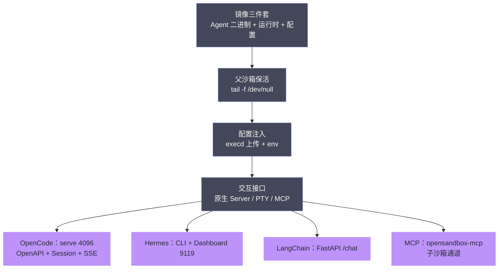
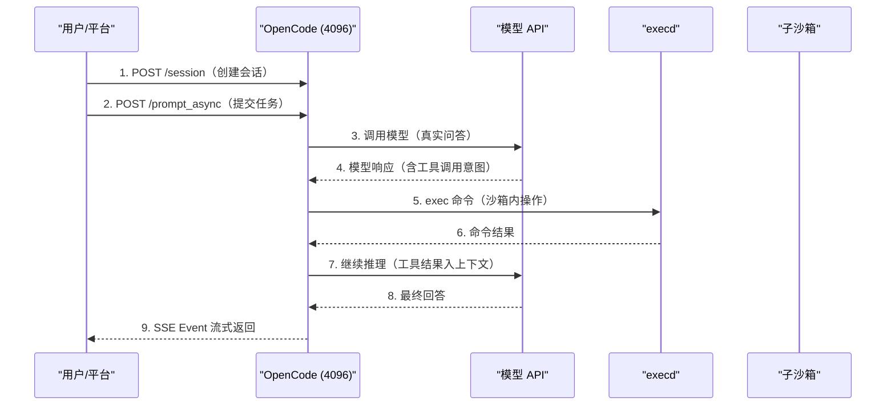
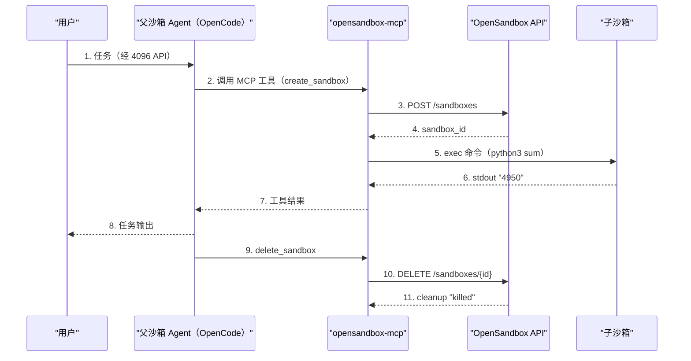

# 11 三类 Agent 沙箱落地——OpenCode、Hermes 与 LangChain 镜像化实战

**摘要：**

[[06 Agent 沙箱平台分层——六层模型与三条产品路线]] 指出第 5 层（Agent 适配）是开源生态最大缺口——本文用三类真实 Agent（OpenCode 1.18.15、Hermes 0.19.0、LangChain 1.3.14 定制服务）的镜像化实战，完整填上这个缺口。文章首先给出 Agent 沙箱化的通用模式：**镜像设计**（Agent 二进制 + 运行时 + 配置三件套）、**父沙箱保活**（`tail -f /dev/null` 让容器活到 Agent 接管）、**配置注入**（execd 上传而非镜像内置）、**交互接口选择**（原生 Server API 优先、PTY 仅作兼容通道）；然后逐类拆解三个 Agent 的落地差异——OpenCode 的 `serve` 模式（4096 端口，OpenAPI 3.1 + Session/SSE Event API）如何把"终端型 Agent"变成"可编程服务"；Hermes 的三面交互（CLI/Dashboard/serve）与 MCP 凭据显式传递的坑；LangChain 定制服务的 FastAPI + MCP runner 双通道；再深入"父 Agent → MCP → 子沙箱"的完整链路（七课教学：API→CR→Pod→CRI→Agent→MCP→子沙箱），以及 `python3 -c 'print(sum(range(1,100)))'` 返回 4950 这条验证链背后的证据纪律（stdout 正确 + cleanup killed + 残留 0）；最后给出共享平台凭据被 MCP 打穿的真实教训与适配层可复用资产清单。核心认知：**Agent 适配层没有标准，但有模式——"保活 + 注入 + 原生接口 + 结构化验证"四件套可以覆盖绝大多数 Agent；适配的质量决定平台的可观测性与可恢复性，而凭据粒度的错误会在一夜之间把适配层变成攻击面**。文末另附 2026-10 核实的时效性更新：OpenCode 1.x/2.x 双线状态、Hermes v0.22.5 与 OpenAI 兼容 API、LangChain 沙箱生态、distroless 与 E2B 镜像化行业实践，逐一对照 PoC 基线并标注演进。

---

## 第 1 章 Agent 沙箱化的本质

### 1.1 三个问题

把一个 Agent 放进沙箱，本质上要回答三个问题：

| 问题 | 内容 | 对应工程动作 |
| :--- | :--- | :--- |
| **怎么进去** | Agent 二进制、运行时依赖、配置如何进入沙箱 | 镜像化（第 2 章） |
| **怎么活着** | 沙箱容器启动后，Agent 进程如何接管 | 父沙箱保活（第 2 章） |
| **怎么交互** | 外部如何调用 Agent 的能力（对话/任务/会话） | 接口选择（第 3-5 章） |

**三个问题的答案没有标准**——每个 Agent 的启动方式、配置格式、交互协议都不同（[[06 Agent 沙箱平台分层——六层模型与三条产品路线]] 2.5 节的"为什么是最大缺口"）。但素材用三类 Agent 的实践证明了：**没有标准，但有模式**。

三个问题的顺序不是随意的，它暗合了"先安身、再立命、后交流"的次序：不解决"怎么进去"，后两个问题无从谈起——二进制进不了沙箱，谈何活着与交互；不解决"怎么活着"，第三个问题只得到一个"活着但随时会死"的黑盒——交互到一半 Agent 崩溃，会话随之蒸发；不解决"怎么交互"，前面两步的全部投入都沉淀在"一个谁也够不到的沙箱"里。反事实地看，三者的失败代价也不对称：缺"怎么进去"是**完全不可用**，缺"怎么活着"是**可用但不可靠**，缺"怎么交互"是**可靠但不可用**——修复合价逐级上升，因为越靠后的环节越接近平台的价值面。笔者在素材三类 Agent 的适配中反复体会到：镜像与保活是"体力活"（模式固定、改了就能跑），接口选择才是"脑力活"（要读懂每个 Agent 的协议形态，判断结构化接口在哪里）。

另一个容易被忽视的点是：这三个问题不仅适用于 Agent，也适用于任何"把应用请进沙箱"的场景（第 10 篇 的 Gate 5 载荷联调把三类 Agent 当作平台的验收载荷，正是同一件事）。Agent 的特殊之处在于它的**会话性**——普通应用是"请求-响应"的短暂互动，Agent 是"任务-会话"的长期运行：模型在思考、工具在调用、上下文在累积，中途任何一环断裂，会话的连续性就没了。会话性把"怎么活着"从"进程别退出"升级为"状态别丢"，把"怎么交互"从"接口能调通"升级为"结构化可续接"。

### 1.2 适配层的验收标准：三个"能"

第 5 层适配"算不算完成"，用三个"能"验收（素材三类 Agent 的共同标准）：

| 标准 | 内容 | 反例 |
| :--- | :--- | :--- |
| **能跑** | Agent 在沙箱内启动、真实模型问答通过 | 只验证了"进程起来了"没验证"模型能答" |
| **能控** | 外部能创建/停止/回收沙箱，生命周期完整 | Agent 跑了但删不掉（进程残留） |
| **能观** | 交互是结构化的（会话/消息/事件可查） | 只有 PTY 字节流，无从审计 |

**"能观"最容易漏**——很多适配"能跑能控"但接口是 PTY（什么都查不到）。**验收顺序：先能跑（功能），再能控（生命周期），最后能观（结构化）**——能观是最高标准，也是平台价值的体现。

三个"能"各自对应一类工程机制，这也是它们顺序固定的原因。"能跑"对应**启动路径正确**：镜像、保活、配置注入、模型端点四件事同时成立，Agent 才可能答出第一句话——任何一件是坏的，症状都表现为"Agent 起不来"，但根因分散在镜像层、编排层、注入层与网络层，排查顺序正是第 1.3 节"流水线"的顺序。"能控"对应**生命周期闭环**：创建、续期、暂停、回收四类操作走 API，其中"回收干净"（残留 0）是素材投入最多验证的环节——沙箱创建是平台主动动作，回收却要依赖 execd、Controller、finalizer 一整条链路的配合，任何一环失灵都会留下僵尸。"能观"对应**结构化接口**：会话、消息、事件以对象形态暴露，平台才能把它们变成可查询、可审计、可恢复的状态（[[13 Agent 状态与存储——六类状态的正确拆分]] 的"Agent Session"状态才有可靠来源）。

### 1.3 第 5 层适配的工程分解

素材的实践把第 5 层分解为四个可复用组件：



**四个组件与六层模型的关系**：镜像三件套与保活属于"把 Agent 放进容器"（第 4/5 层交界），配置注入走 execd 通道（第 3 层），交互接口是"Agent 业务 API 的暴露"（第 5 层的核心）。**适配层不是"一个组件"，而是"一条流水线"**——每个 Agent 的适配工作 = 走完这条流水线。

把"流水线"这个说法再往下拆一层：四个组件之间有明确的先后依赖——镜像先行（没镜像谈何保活）、保活先行于注入（保活进程就绪，配置才有落点）、注入先行于接口（配置不对，接口起来也答不了话）。这条依赖链同时就是排障链：适配完成后出问题，按"镜像 → 保活 → 注入 → 接口"的顺序逐段定位，任何一段的异常只影响它下游的环节——素材的适配脚本正是按这个顺序组织，回归脚本（第 8.1 节）能一键重放，靠的正是把每段都做成"可独立验证"的检查点。借用工厂车间的比喻：镜像设计是"原料供应"，保活是"厂房常开"，配置注入是"工单下发"，接口选择是"交付窗口"——任何一处故障都让产品停在半路，而流水线的价值在于每次都能精确指出"停在哪一站"。

---

## 第 2 章 通用适配模式：四件套

### 2.1 镜像设计：三件套

素材三类 Agent 镜像的共性结构：

```
镜像内容（以 OpenCode 为例）：
├── Agent 二进制：opencode 1.18.15
├── 运行时：Node.js 运行时 + 系统依赖（git/curl 等）
├── 配置：模型端点/Key 占位（实际值运行时注入）
└── 附加：opensandbox-mcp（MCP Server 二进制）
```

**三个设计决策**：

**决策一：配置不在镜像里**。模型 API Key、平台 API Key 等敏感配置**不进镜像**（镜像会被复制/审计/泄露）——运行时通过 execd 上传配置或 env 注入。**"配置与镜像分离"是镜像供应链安全的底线**。

**决策二：Agent 版本锁定**。镜像 tag 带版本（`opencode:1.18.15-osb1.1.0`——Agent 版本 + 适配版本双标记）——**镜像的可复现性 = 版本的双重锁定**（Agent 升级与适配层升级互不干扰）。

**决策三：MCP 预置**。镜像内预置 opensandbox-mcp——**Agent 的子沙箱能力开箱即用**（不需要运行时再装）。

镜像三件套的"套"字值得展开——它提示镜像不是"一个二进制塞进容器"，而是有结构的分层资产。以 OpenCode 镜像为例，它的层次可以还原为：

```dockerfile
# 示意：镜像的三层结构（新增讲解用，非素材原文，素材结构见上文目录树）
FROM node:22-slim AS runtime        # 第 1 层：运行时基座（Node.js + 系统依赖 git/curl）
COPY --from=build /opencode /usr/local/bin/opencode   # 第 2 层：Agent 二进制（版本锁定）
COPY opensandbox-mcp /opt/opensandbox-mcp/bin/        # 第 3 层：MCP 预置（子沙箱开箱即用）
COPY entrypoint.sh /entrypoint.sh
ENTRYPOINT ["/entrypoint.sh"]       # vector 形式：不经 shell 中转，与平台注入叠加
```

三个设计决策与这层结构互为表里：配置不进镜像，所以镜像里只有"占位"与"运行时注入点"，镜像本身不携带任何会话级秘密，可以被安全地推送到共享 Registry、被镜像扫描器审计、被复制到多个节点（第 10 篇 的 Registry 与快照链路）；版本双锁定落在第 2 层，Agent 升级只重建这一层，适配层（opensandbox-mcp、entrypoint）保持稳定，反之亦然——**分层让"升级"从"重建整个镜像"退化为"重建一层"**；MCP 预置落在第 3 层，把"子沙箱能力"与 Agent 本体绑在一起交付，避免运行时再装配的版本漂移。

镜像大小的工程含义也藏在分层里：镜像体积直接决定**拉取时延**与**快照容量**（第 10 篇 的快照容量公式：rootfs 大小 × 快照数量），并间接影响 WarmPool 预热速度与节点磁盘占用（[[12 沙箱性能工程——Runtime 基准与 WarmPool 容量管理]]）。"极简镜像"因此成为行业实践的一个方向——但极简到什么程度，取决于沙箱平台对镜像的"可执行性"要求，这一点在第 9.5 节 的 distroless 与 E2B 对照里会看到，它不是一个"越小越好"的单调问题，而是一个"攻击面 vs 平台能力"的权衡。

### 2.2 父沙箱保活：`tail -f /dev/null`

Agent 沙箱的一个微妙问题：**沙箱容器的主进程是什么？**

- 如果主进程是 Agent 本体：Agent 退出（任务结束/崩溃）→ 容器退出 → 沙箱消亡——**无法在 Agent 退出后做清理/审计/恢复**；
- 素材的方案：**主进程是 `tail -f /dev/null`（保活进程），Agent 由 execd/配置注入启动**——沙箱的"生死"与 Agent 的"生死"解耦。

**保活的价值**：
1. **Agent 可重启**：Agent 崩溃后，沙箱还在，可以重启 Agent（故障恢复路径）；
2. **清理可执行**：Agent 退出后，沙箱内的残留（进程/文件）可以审计与清理；
3. **多进程共存**：保活进程 + execd + Agent 服务可以同时存在（Agent 的 Web 服务与 CLI 进程共存）。

**保活的代价**：容器"假活"（主进程活着但业务已死）——**平台必须用"业务探活"（Agent API 健康检查）而非"进程探活"**。

保活的机制位置要放在平台注入的完整拓扑里看（[[08 OpenSandbox 数据面——execd 与 egress 的盒内世界]] 2.3 节的 PID 1 拓扑）：平台的 bootstrap.sh 替换镜像 entrypoint 并做 PID 1，镜像内的保活进程是 bootstrap 的子进程，Agent 服务又是保活进程的"兄弟"或"子进程"——

```
PID 1（平台注入）: bootstrap.sh
└── 保活进程（镜像 entrypoint）: tail -f /dev/null
    └── Agent 服务进程: opencode web / hermes / uvicorn（配置注入后拉起）
```

这个叠加结构回答了一个经常被问到的"为什么 tail -f /dev/null 不做 PID 1"的问题：`tail -f /dev/null` 不回收僵尸、不转发信号，让它做 PID 1 等于把第 08 篇 的"完整回收"契约交给一个不负责任的进程——**保活只解决"容器不死"，回收与信号仍归平台注入的 bootstrap**。镜像内的保活进程作为子进程存活，沙箱删除时 SIGKILL bootstrap，整棵进程树被带走，"残留 0"的纪律依然成立；反过来，镜像若把 `tail -f /dev/null` 直接写成 ENTRYPOINT 而不配合平台注入，就会破坏这个拓扑——这正是"Agent 镜像必须走平台注入"（第 08 篇 2.3 节）的又一个例证。

"假活"问题则指向另一个机制缺口：保活进程把容器的"生存信号"从"业务健康"偷换成了"进程存在"，平台侧的探活必须跟着换——**探活的判定对象从进程转移到 Agent API**（OpenCode 的 4096 健康端点、Hermes 的 9119、LangChain 的 /chat 探活）。这个转移的代价是每个 Agent 要定义自己的"业务健康语义"，恰好是第 5 层适配的一部分；但它换来的是"Agent 卡死（进程活着、循环不响应）"这类故障能被平台发现——这类故障在"进程探活"下是无解的，因为进程确实活着。

### 2.3 配置注入：execd 上传

配置进入沙箱的路径（素材实践）：

```
1. 沙箱创建时（或创建后），平台把配置写入沙箱文件系统
   —— 经 execd 的 File API 上传（第 08 篇）
2. 配置落盘到 Agent 约定位置（如 ~/.config/opencode/）
3. Agent 启动时读取

或经 env 注入：
   创建请求的 env 字段 → 沙箱环境变量 → Agent 进程可见
```

**为什么经 execd 上传而非镜像内置**：配置含敏感信息（模型 Key）且随会话变化（不同用户不同 Key）——**运行时注入让"一个镜像服务所有会话"**。**注意 env 注入的可见性**：env 在 `/proc/<pid>/environ` 可见（沙箱内其他进程可读）——高安全场景优先文件注入 + 权限收紧。

配置注入在机制上有两个细节值得展开。其一，**注入的时机与 Agent 启动是串联的**：execd 上传完成 → 配置落盘 → Agent 启动读取——时序上"配置就绪"必须先于"Agent 就绪"，如果注入与启动并行，Agent 可能读到空配置并缓存下来，之后配置再落地也不生效。素材的启动编排把"execd 上传配置"排在"启动 Agent"之前，正是为了消除这个竞态。其二，**env 注入与文件注入的可见性不对称**：env 一经注入就挂在进程环境上，沙箱内任意进程都可以读 `/proc/<pid>/environ` 抄走 Key；文件注入则可以配合权限收紧（chmod 600、专属目录）把可读范围缩到"Agent 进程 + 沙箱内高权限进程"。第 9.3/9.4 节 会看到，2026 年的行业演进把凭据送达方式升级为"凭据不落沙箱"（Credential Vault、Auth Proxy），但"文件注入 + 权限收紧"在无 vault 的平台上仍是相对优的选择。

### 2.4 适配的失败模式：素材实践中的反面清单

素材在适配过程中遇到（或预见）的失败模式，按"四件套"归类：

| 失败模式 | 表现 | 对策 |
| :--- | :--- | :--- |
| **镜像配置写死** | Key 打进镜像 → 镜像泄露即凭据泄露 | 配置运行时注入（2.3 节） |
| **无保活** | Agent 崩溃 → 沙箱消亡 → 无法排查 | 保活 + 业务探活分离 |
| **配置注入失败** | Agent 启动读不到配置 → 行为异常 | 注入后验证（Agent 健康检查） |
| **PTY 万能主义** | 全部走 PTY → 可观测性归零 | 原生接口优先（2.5 节） |
| **凭据隐式继承** | MCP 子进程拿不到 Key → 链路断 | 显式传递（4.3 节） |
| **版本漂移** | Agent 升级后适配失效（API 变化） | 镜像版本双锁定 + 回归脚本 |
| **残留沙箱** | 子沙箱删除失败 → 僵尸堆积 | 残留 0 断言（6.2 节） |

**失败模式的共同规律**：**大部分适配失败不是"Agent 的问题"，而是"适配层假设的错误"**——假设配置在镜像里、假设 env 会继承、假设 PTY 够用——**适配工作的本质是"把假设变成验证"**。

这条共同规律值得再拧紧一层：失败模式的"假设"几乎都来自"用普通应用的思维适配 Agent"。普通应用把配置打进镜像，Agent 的配置却随会话变化；普通应用的进程死了容器就死了（语义正确），Agent 却需要在进程死后保留现场；普通应用用 stdin/stdout 交互就够了，Agent 的会话却需要结构化续接。**三类失败（配置、保活、接口）恰好对应三个"普通应用思维"的移植**——把假设列成清单（第 8.2 节），逐项改成"显式验证"，适配的可靠性就从"运气"变成"结构"。其中"版本漂移"是唯一无法靠适配层单方面消除的——Agent 上游升级不通知任何人，只有把"回归脚本"做成固定交付物（第 8.1 节），靠"每次升级后重跑验证"兜住。

### 2.5 交互接口选择：原生 Server 优先，PTY 兜底

素材 Phase1-13 的核心结论：**Agent 交互优先原生 Server 接口，不应默认通过 PTY 模拟键盘**。理由：

| 维度 | 原生 Server API | PTY 终端 |
| :--- | :--- | :--- |
| **语义** | 结构化（Session/Message/Event） | 字节流（终端输出） |
| **可观测** | 会话状态/工具调用可查 | 只有"屏幕上的字" |
| **可恢复** | 会话可续接 | 无法重建屏幕状态 |
| **审计** | 消息/动作可记录 | 只能记录原始字节 |
| **适配成本** | 需要对接 API | 零对接（万能） |

**"PTY 是万能但愚蠢的接口"**——它适配一切 Agent（任何 CLI 都有终端），但把一切语义都抹平了。**素材的接口策略：优先原生（能结构化就结构化），PTY 仅作兼容通道**。

"语义被抹平"在机制上有一个准确的解释：PTY 传输的是**终端字节流**——ANSI 转义序列、光标移动、回显控制混杂在输出里，会话的"结构化信息"在字节流里没有表达位置，消费方只能靠终端仿真事后推断（[[08 OpenSandbox 数据面——execd 与 egress 的盒内世界]] 3.5 节 的 PTY 对照）。原生 Server API 则把这些信息以对象形态给出：Session 是会话、Message 是消息、Event 是事件——**平台拿到的是"数据"而不是"屏幕"，这是可观测性、可恢复性、可审计性三者的共同前提**。两者的取舍可以类比为"柜台人工服务"与"自助终端"：人工服务（PTY）什么业务都能办，但每笔都要人去理解、转译，过程不可留存；自助终端（API）只支持预定格式的业务，但每一笔都有电子记录、可重放——**当业务量级大到需要自动化时，"格式固定"反而成了优点**。

---

## 第 3 章 OpenCode 落地：终端型 Agent 的服务化

### 3.1 镜像与启动

```
镜像：10.2.177.37:30500/agent-poc/opencode:1.18.15-osb1.1.0

启动编排（父沙箱内）：
1. 主进程：tail -f /dev/null（保活）
2. execd 上传配置（模型端点/Key）
3. 启动：opencode web --port 4096（Server 模式）
```

启动编排的三步在机制上各司其职：第 1 步确立"容器生死与 Agent 生死解耦"的基线，第 2 步消除"配置就绪"与"Agent 启动"的竞态，第 3 步才真正把 Agent 以服务形态拉起来。OpenCode 的启动命令值得留意：素材用的是 `opencode web --port 4096`——`web`/`serve` 一族命令会同时启动一个监听 4096 端口的 Server 与一个客户端界面，适配层取的是它"服务器面"（headless 的 Server 能力）。这里的工程含义是：**终端型 Agent 的"终端"是给用户用的，不是给平台用的——平台要的是它的程序化面**，所以适配的第一步就是确认"这个 Agent 有没有 headless 服务模式"，没有才退回 PTY。4096 是默认端口，固定端口让 Endpoint 解析与网关路由有了稳定目标。

### 3.2 opencode serve：4096 端口的可编程面

OpenCode 的 `serve`/`web` 模式把它从"终端 TUI"变成"HTTP 服务"：

| 能力 | 内容 |
| :--- | :--- |
| **端口** | 4096（默认） |
| **API 形态** | OpenAPI 3.1 规范 |
| **会话** | `/session`（创建/查询会话） |
| **消息** | `/prompt_async`（异步提交提示） |
| **事件** | SSE Event API（流式输出/工具调用事件） |

**为什么这是"终端型 Agent 服务化"的关键**：模型交互从"终端字节流"变成"结构化 API"——**平台可以拿到会话状态、消息记录、流式输出**，[[13 Agent 状态与存储——六类状态的正确拆分]] 的"Agent Session"状态有了可靠来源。

把"终端型 Agent 服务化"再展开一层，可以看到这个转换改变了三个环节的语义。**第一是交互方向**：TUI 模式下用户向终端输入、从终端读输出，交互对象是"屏幕"；serve 模式下外部程序向 HTTP 端点提交提示、从 SSE 流读事件，交互对象是"API"——前者是人与机器的对话，后者是程序与程序的对话，只有后者能被平台编排。**第二是状态可寻址**：TUI 的会话状态活在终端进程的内存里，进程一死全丢；serve 的会话状态经由 `/session` 可创建、可查询、可续接，状态从"进程内私有"变成"可寻址资源"——这是第 1.1 节"会话性"的落地。**第三是流式事件的结构化**：模型输出的"打字机效果"在 serve 里是 SSE 事件流，工具调用意图、流式 token、完成信号都以事件类型区分——这是第 1.2 节"能观"的直接来源。

### 3.3 完整交互时序：从用户到 Agent 到模型

OpenCode 在沙箱中的一次真实任务交互（素材验证路径）：



**时序的三个要点**：

1. **第 3/7 步是"真实模型问答"**——素材验收标准明确要求"真实模型问答通过"（不是 mock），因为模型行为（工具调用格式、流式输出）是适配的隐性依赖；
2. **第 5/6 步是"沙箱内执行"**——命令走 execd（第 08 篇 的控制通道），**Agent 的"手"与沙箱的"边界"在此交汇**；
3. **第 9 步 SSE 流式**——用户感知的"打字机效果"来自 SSE——**流式是 Agent 产品的体验基线**（execd 的 SSE 通道 与此同源）。

为什么"真实模型问答"是验收硬标准而不是可选加分项？因为模型是 Agent 链路里唯一"非确定性"的环节：工具调用的 JSON 格式、流式输出的分块节奏、甚至模型对同一个任务的回答路径，都随模型版本与供应商变化。只 mock 模型的返回，验证通过的是"平台侧代码没问题"，却绕过了"OpenCode 与模型协作时工具调用链路是否通畅"这一层——而后者正是 Agent 适配里最容易在升级后断裂的隐性依赖（模型改了工具调用格式，适配层没跟上，症状是"Agent 答非所问"而不是"接口报错"）。**mock 验证的是平台，真实问答验证的是 Agent**——素材把两者都做，是适配验证的完整闭环。

### 3.4 验证链：4950 与残留 0

素材的完整验证（OpenCode 父沙箱 → MCP 子沙箱）：

```
1. 创建父沙箱（opencode 镜像）
2. 通过 opencode 4096 API 发起任务
3. Agent 经 MCP 创建子沙箱
4. 子沙箱执行：python3 -c 'print(sum(range(1,100)))'
5. 验证：stdout == "4950" ✅
6. 删除子沙箱
7. 验证：cleanup 输出 "killed"，残留 0（API/CR/Pod）✅
```

**"4950"不是随便选的数字**——`sum(range(1,100))` 的确定性输出让验证可精确断言；**"cleanup killed + 残留 0"验证的是回收链路**（子沙箱删除后无僵尸）。**验证链的三个断言（输出正确/回收完成/残留为零）对应 Agent 链路的三个环节（执行正确/生命周期完整/治理干净）**。

验证数字的选择本身是一门"验证设计"的功课：为什么不用 `echo hello` 或 `ls`？因为那条验证链要穿透的不只是一次命令执行，而是"父 Agent → MCP → 创建子沙箱 → execd 执行 → 返回结果 → 回收"整条链路——命令本身必须**确定性**（任何环境跑结果都一样）、**跨语言无关**（python3 是沙箱内最通用的解释器之一）、**结果可预读**（4950 是人脑可验算的）。`sum(range(1,100))` 满足全部三条：它是 1 到 99 的和，任何环境的 Python 都会给出同一答案。相比"进程起来了"这种存在性验证，"stdout == 4950"是**值验证**——它同时证明命令被执行了、输出被正确传输了、结果被正确解析了，一步验证三个环节。而"cleanup killed + 残留 0"验证的是"删得掉"：cleanup 输出 killed 说明运行时确实终止了进程，残留 0 说明 API 记录、CR 对象、Pod 三层都没有留下僵尸——**"能创建"不算完，"能删干净"才算闭环**。

---

## 第 4 章 Hermes 落地：内部 Agent 平台的三面交互

### 4.1 镜像与启动

```
镜像：10.2.177.37:30500/agent-poc/hermes:0.19.0-osb1.1.0

启动编排：
1. 主进程：tail -f /dev/null（保活）
2. execd 上传配置
3. 启动 Dashboard：端口 9119（WebSocket/PTY 交互）
```

Hermes 与 OpenCode 的镜像结构同构（二进制 + Python 运行时生态 + 配置占位 + opensandbox-mcp），但启动编排的第 3 步暴露了差异：Hermes 的主服务是 9119 端口的 Dashboard——WebSocket/PTY 形态的交互界面。这带来一个与 OpenCode 不同的适配问题：**Hermes 的"默认交互面"是给人用的（Dashboard），平台的程序化对接需要另找接口**。素材的调研（Phase1-12）发现 Hermes 不止一个面——"不止一个面"的现象本身，就是"平台型 Agent"与"终端型 Agent"的典型差异：终端型 Agent 的服务化路径是"把唯一的面变成 API"，平台型 Agent 的工作是"在多个面里选出平台该对接的那个"。

### 4.2 三面交互

素材 Phase1-12 的调研（Hermes 0.19.0）揭示了三面交互形态：

| 交互面 | 端口/形态 | 用途 |
| :--- | :--- | :--- |
| **Dashboard** | 9119（WebSocket/PTY） | 人工交互（浏览器界面） |
| **CLI** | 命令行 | 脚本化/无头场景 |
| **serve** | 面向无头集成 | 平台对接（**Hermes 不能简单描述为 OpenAI-compatible API**——素材原话） |
| **gateway** | 连接消息平台 | 消息平台接入（IM 场景） |

**"不能简单描述为 OpenAI-compatible API"**的工程含义：对接 Hermes 不能假设"OpenAI 兼容就能直接用"——**每个 Agent 的 API 形态都要实测**。

"不能简单描述为 OpenAI-compatible API"这句话在 0.19.0 的时间点上是一个事实判断，它提醒适配者三件事。其一是**兼容的边界**：OpenAI 兼容只是"接口长得像"，请求字段、流式格式、工具调用协议的细节差异会让"长得像"的接口在真实调用时行为不同——素材的实测验证正是为了把"长得像"升级为"用起来对"。其二是**面的多样性**：四个面服务于四个不同的调用者，平台对接要选"与平台职责匹配的面"——平台要的是会话与任务的程序化接口，不是把浏览器界面搬进来。其三是**版本漂移的高发区**：每个面都可能独立演进，一个升级了另一个没跟上，适配层可能"这周能跑、下周崩"。

### 4.3 MCP 配置的坑：凭据显式传递

素材 Phase3-05 记录的 Hermes MCP 配置问题：**MCP 配置需显式传递 `OPEN_SANDBOX_API_KEY`**——stdio MCP 子进程不会"继承"父进程的环境变量语义，必须显式 env 传入：

```bash
# 错误：MCP 子进程拿不到 Key（隐式继承不可靠）
# 正确：显式传递
OPEN_SANDBOX_API_KEY=xxx opensandbox-mcp --transport stdio
```

**这个坑的普遍性**：任何"子进程 + 环境变量"的模式都有此类问题——**凭据传递的显式化是适配层的通用纪律**（[[14 沙箱安全体系——三层防护、短期凭据与多租户]] 的凭据治理与此呼应）。

这个坑的机制值得拆清楚，因为它常被误读为"Unix 环境变量不继承"——实际上 Unix 的 exec 语义里子进程默认继承父进程环境，问题出在**启动路径**上：MCP Server 通常不是由 Agent 进程直接 exec 出来的，而是由 Agent 的 MCP 客户端按配置文件（command + args）拉起——这条路径只传配置里写的字段，不保证传递父进程的环境变量；更隐蔽的是，Agent 出于安全考虑可能主动清理环境，把 `OPEN_SANDBOX_API_KEY` 这种"非 Agent 自己的变量"剥掉。所以"显式传递"是对"启动路径不确定"这一事实的兜底：**在启动命令里显式带上 env，等于把"这个 Key 必须给到 MCP 子进程"写进了启动契约**。这个坑适用于任何"Agent 拉起工具进程"的模式——工具进程拿不到凭据，链路就在半路断掉，且断得无声无息。

### 4.4 与 OpenSandbox 的边界

素材 Phase1-12 的边界结论：**"OpenSandbox 不负责理解用户问答"**——Hermes 负责对话/任务（业务语义），OpenSandbox 负责沙箱生命周期（Endpoint/生命周期）——**这正是 [[08 OpenSandbox 数据面——execd 与 egress 的盒内世界]] "execd 只提供控制通道"边界在 Agent 层的延伸**。集成时：Hermes 通过 OpenSandbox API 创建/操作沙箱，OpenSandbox 不介入 Hermes 的对话逻辑。

这条边界在架构上的意义，类比一座大楼的"物业"与"住户"：物业（OpenSandbox）管水电、门禁、保洁；住户（Hermes）决定屋里怎么住——对话逻辑、任务编排、记忆管理。物业不管住户的家务，住户也无需懂物业的管线图，两者通过"报修单"对接。边界一旦模糊，两个系统就耦合在一起，各自都无法独立演进。素材的实践把这条边界落成了一句可执行的口诀：**Hermes 管"说什么"，OpenSandbox 管"在哪跑"**，集成只在这条缝上传递"任务与沙箱"两类对象。

---

## 第 5 章 LangChain 落地：自定义服务的双通道

### 5.1 镜像与启动

```
镜像：10.2.177.37:30500/agent-poc/langchain-custom:1.3.14-osb1.1.0-mcp1

启动编排：
1. entrypoint 直接启动 Uvicorn（无需保活——服务本身就是主进程）
   agent_server:APP --host 0.0.0.0 --port 8080
2. MCP runner 预置在 /opt/opensandbox-mcp/bin/python mcp_runner.py
```

**与 OpenCode/Hermes 的差异**：LangChain 定制服务是"服务型 Agent"——**entrypoint 直接是服务，不需要保活**（服务进程就是主进程，服务退出 = 沙箱退出，语义正确）。**"保活"只在"主进程不是业务"时需要**——适配模式要按 Agent 形态裁剪，不是照搬。

"不需要保活"不是图省事，而是**生命周期语义的正确选择**：当主进程本身就是业务（Uvicorn 承载 /chat），进程退出就意味着业务终止，"容器随业务退出"反而是最诚实的语义——平台侧回收时杀掉主进程即可，没有"业务死了容器还活着"的假活状态需要处理。对比第 3/4 章：OpenCode/Hermes 的 Agent 服务是"业务的一部分"，主进程 `tail -f /dev/null` 保活是为了给 Agent 崩溃留恢复现场，保活是必需的；LangChain 定制服务把整个业务收敛到一个进程里，保活反而会引入"假活"。**同一个四件套，第三件（保活）按形态取用**——适配模式是"参数化"的，形态决定参数取值。

### 5.2 自定义 /chat API

LangChain 定制的 HTTP `/chat` API 是"最小 Agent 服务"的参考实现：

```
POST /chat {"message": "..."} → {"response": "..."}
```

**对平台的意义**：这类"薄服务"是第 5 层适配的"最简形态"——**验证平台"能不能托管任意 HTTP 服务"的探针**（如果连最简服务都托管不了，适配层就没有讨论基础）。

"薄服务"的验证价值在于它的**最小性**：`POST /chat` 没有会话状态、没有 SSE 流式、没有工具调用——它把"Agent 适配"的复杂度剥到只剩"平台托管一个 HTTP 服务"这一件事。这个探针在两类场景里有明确用途：其一，**平台能力诊断**——新平台（或新部署）上线后，先用薄服务跑通"镜像 → 保活（不需要）→ 配置注入 → Endpoint 访问 → 回收"的最小闭环，再上复杂 Agent；其二，**回归基线**——薄服务是回归脚本的"最低公共用例"，任何平台/镜像升级后先跑它，通过再跑三类 Agent。薄服务之于适配层，好比体检时的"基础生命体征"——任何指标异常都说明"先别谈别的"。

### 5.3 三类 Agent 的适配差异对照

把三类 Agent 的适配决策并排对比，可以看到"模式相同、参数不同"的完整图景：

| 维度 | OpenCode | Hermes | LangChain 定制 |
| :--- | :--- | :--- | :--- |
| **形态** | 终端型（TUI）→ 服务化 | 平台型（多面交互） | 服务型（天生 HTTP） |
| **保活** | 需要（tail -f） | 需要（tail -f） | **不需要**（entrypoint 即服务） |
| **主接口** | serve 4096（OpenAPI/SSE） | Dashboard 9119 + CLI | 自定义 /chat |
| **MCP** | stdio 预置 | stdio + **Key 显式传递** | mcp_runner.py 子进程 |
| **适配难点** | 接口服务化 | 多面交互的语义边界 | 无（最简形态） |
| **验证** | 4950 链路 | 4950 链路 | 4950 链路 |

**"4950 链路"三类共用**——**验证的通用性是适配模式的通用性的证明**：虽然接口各不相同，但"创建→执行→回收"的验证骨架完全一致。

这张对照表可以读出三层信息。第一层是**模式层**：四件套（镜像/保活/注入/接口）在三类 Agent 上全部适用，只是"保活"这一件在服务型上取反——模式是稳定的骨架。第二层是**形态层**：三个 Agent 的"适配难点"各不相同，且难点恰好落在形态上——终端型难在"把唯一的面服务化"、平台型难在"在多个面里选对"、服务型没有难点（它本来就是服务）。第三层是**验证层**：最难的部分各不相同，验证却共用同一骨架——这说明"验证"不是适配的附属品，而是适配的**度量标准**：接口可以千差万别，但"能跑、能控、能观"的验收口径必须统一，否则三个 Agent 的适配结果无法横向比较。

### 5.4 MCP 子进程

LangChain 镜像的 MCP 是独立的 `mcp_runner.py` 子进程——**与 OpenCode/Hermes 的 MCP 形态一致**：镜像预置 opensandbox-mcp，Agent 代码调用 MCP 工具 → 创建/操作子沙箱。**三类 Agent 的 MCP 链路共用同一套子沙箱能力**——MCP 是适配层里"最标准化"的部分（协议由 MCP 定义，Agent 只需要调用）。

MCP 是适配层里"最标准化"的部分，这个判断的机制基础是协议分工：MCP（Model Context Protocol）把"工具发现"与"工具调用"定义成统一协议，Agent 侧只需按协议实现客户端、opensandbox-mcp 侧按协议实现服务端——**协议把"平台能力"包装成"Agent 通用工具"**，三类 Agent 不需要各自理解 OpenSandbox 的 API，只需要各自理解 MCP。这解释了为什么第 7 章 的"父 Agent → MCP → 子沙箱"链路在三类 Agent 上完全同构：父 Agent 的语言（Node/Python）不同、接口（4096/9119//chat）不同，但 MCP 这一跳的协议相同，子沙箱能力因此可以被三个 Agent 无差别复用。**标准化的价值在这里体现得最直接：平台只需要维护一个 opensandbox-mcp，就同时服务了所有支持 MCP 的 Agent**。

---

## 第 6 章 三类 Agent 的沙箱需求差异

第 3-5 章 逐类拆解了三类 Agent 的落地，本章把三个案例放在同一张需求地图上，回答"差异为什么存在、差异落在哪里、平台如何应对差异"。这是第 5.3 节 对照表背后的机制层：**适配模式的参数化，根因是三类 Agent 的沙箱需求不同**。

### 6.1 三条轴：形态、生命周期语义、资源画像

三类 Agent 的差异可以收敛到三条轴，每条轴都直接决定第 2 章"四件套"里某一件的取值：

| 轴 | OpenCode（终端型） | Hermes（平台型） | LangChain 定制（服务型） |
| :--- | :--- | :--- | :--- |
| **形态轴** | 交互以终端为原生面，服务化是"改造" | 多面并存，平台要选面 | 天生 HTTP 服务 |
| **生命周期轴** | 任务驱动，会话随任务开合 | 常驻会话，跨平台持续 | 服务常驻，随容器生灭 |
| **资源轴** | Node.js/Bun 运行时，镜像数百 MB | Python 生态，依赖多、镜像更大 | 轻量 Python 服务 |
| **四件套映射** | 保活必需、接口=服务化 | 保活必需、接口=选面 | 保活取反、接口=原生 |

三条轴不是并列的三种"口味"，而是有因果关系的三层：**形态轴决定生命周期轴**——终端型 Agent 的"终端"默认是临时的，平台型 Agent 的"平台"默认是常驻的（多个渠道持续接入），服务型的"服务"语义本身就是常驻；**生命周期轴决定资源轴**——常驻会话意味着镜像里要有完整的运行时生态与依赖，临时任务则可以把镜像做得更薄。平台应对差异的方式，是让四件套的"取值"跟随形态——**需求差异最终落到四件套的参数上，这是"没有标准但有模式"的完整表达**。

### 6.2 生命周期语义差异：保活、探活与 TTL 的映射

三类 Agent 的生命周期语义不同，"沙箱什么时候该死"的答案也不同，这直接映射到第 2.2 节 的保活/探活设计：

| 生命周期语义 | 沙箱的"死亡条件" | 保活/探活设计 |
| :--- | :--- | :--- |
| **任务型**（OpenCode 单任务） | 任务完成或超时 | 保活 + 业务探活驱动的自动回收（任务结束探活失败 → TTL 回收） |
| **会话型**（Hermes 跨平台会话） | 会话结束或长期空闲 | 保活 + 会话级空闲检测（消息平台活跃度作为探活信号） |
| **常驻服务型**（LangChain 定制） | 服务退出 | 无需保活，进程探活即业务探活（2.2 节取反） |

"沙箱什么时候该死"是平台设计里最容易被忽略、却直接决定成本与安全的问题：任务型沙箱留着不回收，僵尸堆积（第 2.4 节 的"残留沙箱"失败模式）；会话型沙箱回收过早，跨平台会话的连续性断裂（第 1.1 节 的会话性）；常驻服务型沙箱回收条件最朴素，服务退出即回收。素材的 TTL 设计按三类语义分别定值，正是把"生命周期语义差异"翻译成"回收策略差异"。这里的关键不是给三类各设一个 TTL 数字，而是**确立"业务信号"作为回收依据**：任务型的业务信号是任务终态（Agent API 探活失败）、会话型是空闲时长、服务型是进程存在——**探活对象跟着业务信号走，而不是统一用"进程活着"**，这是第 2.2 节"业务探活 vs 进程探活"在三类 Agent 上的完整展开。

### 6.3 资源画像差异：镜像、容量与冷启动

三类 Agent 的资源画像差异，决定了它们在镜像体积、WarmPool 容量、冷启动上的不同位置：

| 资源画像 | OpenCode | Hermes | LangChain 定制 |
| :--- | :--- | :--- | :--- |
| **运行时** | Node.js/Bun | Python 生态（依赖多） | Python（轻量依赖） |
| **镜像体积** | 数百 MB 级 | 更大（依赖树+模型配置） | 最小（薄服务） |
| **对容量模型的影响** | 快照容量 = rootfs × 快照数 | 同左，基数更大 | 同左，基数最小 |
| **冷启动** | 中等 | 慢（解释器+依赖初始化） | 快（薄进程） |

资源画像差异的工程含义不在"谁的镜像大"，而在**容量模型的输入不同**：第 10 篇 的快照容量公式（rootfs 大小 × 快照数量）与 [[12 沙箱性能工程——Runtime 基准与 WarmPool 容量管理]] 的 WarmPool 容量模型，输入都是镜像体积——镜像大，同节点可容纳的 WarmPool 槽位就少。**适配层看似只关心"能不能跑"，实际还悄悄决定了"能跑多少"**——镜像体积通过容量模型进入平台的成本结构，这是适配决策向上游传导的第一条路径；第二条路径是 WarmPool 的镜像缓存：镜像预置让大镜像的拉取成本提前支付。

### 6.4 故障模型差异：重启、多面冗余与语义正确

三类 Agent 的故障模型不同，"平台在 Agent 挂了之后能做什么"也不同：

| 故障模型 | 故障形态 | 平台可恢复动作 |
| :--- | :--- | :--- |
| **终端型** | 会话进程崩溃 | 保活兜底：沙箱还在，重启 Agent、续接会话（如果状态可寻址） |
| **平台型** | 某交互面故障 | 多面冗余：Dashboard 挂了 CLI 仍可用，平台切面恢复 |
| **服务型** | 服务进程退出 | 语义正确：沙箱随之回收，重建即恢复（无状态薄服务） |

故障模型差异直接决定第 2.2 节"保活价值"的三条是否成立：保活第一条价值（Agent 可重启）只在**会话可续接**时才有意义——OpenCode 的会话经 `/session` 可寻址，重启后可续接；Hermes 的多面交互提供天然的故障冗余；LangChain 薄服务无状态，重启=重建，保活的"恢复现场"价值趋近于零——这从故障侧再次解释了为什么服务型不需要保活。**反例**：如果把任务型 Agent 当常驻服务型对待（不保活），Agent 崩溃时沙箱直接消亡，崩溃现场全部丢失，排障只能靠运气；如果把服务型当任务型对待（强行保活），则引入"假活"状态，平台要额外做业务探活才能区分"活着但没业务"。**故障模型是保活决策的最终裁判**——不是"哪个形态需要保活"，而是"故障后平台需要什么恢复能力"决定保活与否。

---

## 第 7 章 MCP 子沙箱链路：七课教学

### 7.1 七课的教学路径

素材 Phase3-10 的"从 OpenCode 父沙箱到 MCP 子沙箱"七课教学，本质是从上到下的"分层穿透"：

```
第 1 课：API 层 —— 创建父沙箱的 API 调用
第 2 课：CR 层 —— 请求变成了什么 CR（BatchSandbox）
第 3 课：Pod 层 —— CR 变成了什么 Pod
第 4 课：CRI 层 —— Pod 里的容器如何被运行时创建
第 5 课：Agent 层 —— 容器里的 Agent 如何启动/保活/注入配置
第 6 课：MCP 层 —— Agent 如何通过 MCP 调用平台能力
第 7 课：子沙箱层 —— 父 Agent 创建子沙箱执行命令并回收
```

**七课的设计意图**：**每一课都回答"上一层的东西在下一层长什么样"**——API 请求 → CR → Pod → 容器 → 进程 → 工具调用 → 新沙箱。**学完七课，Agent 链路的每一跳都有证据可查**（这就是"三层对照"排障法（[[10 Agent 沙箱部署实战——从单机 PoC 到测试集群]]）的完整版）。

七课的每一课都对应一类"证据"：第 1 课的证据是 API 响应、第 2 课是 CR 状态（BatchSandbox 的 phase/conditions）、第 3 课是 Pod 事件（Running/Pending/ImagePullBackOff）、第 4 课是 CRI 层（crictl 的运行时 handler）、第 5 课是进程树（bootstrap → 保活 → Agent 服务的 PID 拓扑）、第 6 课是 MCP 工具调用日志、第 7 课是子沙箱的创建/执行/回收记录。**七课=七个证据采集点**：链路任一处断裂，故障出现在哪一课，证据就在那一课采集——这是第 10 篇"三层对照"排障法在 Agent 适配场景的完整延伸，把"三层"扩成了"七层"，让"父 Agent 建子沙箱"这条最长的链路每一跳都可定位。

### 7.2 父→子沙箱的完整时序



**链路的三层验证**（素材的断言纪律）：
1. **执行正确**：stdout == 4950；
2. **生命周期完整**：删除请求返回、cleanup 输出 killed；
3. **治理干净**：残留 0（API/CR/Pod 三层查询为空）。

这条时序里最值得注意的机制点是第 5/6 步的**命令直达**：MCP 拿到 sandbox_id 后，对子沙箱的命令执行直接走 execd，不经由父 Agent——子沙箱的"执行面"与父 Agent 的"会话面"完全分开，父 Agent 只经 MCP 拿工具结果。这个机制安排同时服务于两件事：其一是**性能**——命令执行不必绕回父 Agent 的会话；其二是**安全**——子沙箱的命令通道不经过父 Agent 的进程，父 Agent 被注入后也无法直接操纵子沙箱的执行。第 7.3 节 的"脑手分离"在时序图上的落点正是第 2/9 步：父 Agent 的"脑"只做两件事——调用工具（创建）、调用工具（删除），中间的"手"（执行）由 execd 在子沙箱内完成。

### 7.3 子沙箱的安全语义：为什么"子"是安全的

父 Agent 创建子沙箱，安全上要回答"子沙箱与父沙箱的关系"：

| 维度 | 子沙箱的设计 | 安全含义 |
| :--- | :--- | :--- |
| **隔离** | 子沙箱是独立 Pod（独立 namespace/运行时） | 子沙箱失控不波及父沙箱 |
| **凭据** | 子沙箱不继承父沙箱凭据（除非显式注入） | 父被攻破 ≠ 子被攻破（最小化） |
| **生命周期** | 子沙箱独立 TTL/回收 | 子沙箱僵尸不影响父 |
| **网络** | 子沙箱独立网络策略 | 父子网络默认隔离 |

**"父 Agent 创建子沙箱"的架构价值**（素材 Phase7 会议的产品决策——"脑手分离"）：**Agent 作为"脑"，危险命令和代码优先在临时子 Sandbox 执行**——父沙箱只跑 Agent 本体（轻量），子沙箱跑不可信执行（隔离）——**"脑"与"手"的分离把"Agent 被注入后能造成的破坏"限制在"一次子沙箱执行"的量级**。

**反例**：如果 Agent 直接在父沙箱执行所有命令（不建子沙箱），父沙箱被注入 = 全部上下文（模型 Key、会话、配置）暴露——**子沙箱是"执行隔离"的产品化表达**。

"脑手分离"的安全价值需要和"一次子沙箱执行"这个量级一起理解：父沙箱被注入后，攻击者能做的不是"控制整个平台"，而是"在 Agent 允许调用的工具范围内、对一个临时子沙箱发起一次调用"——子沙箱没有父沙箱的会话上下文（模型 Key、历史消息、平台凭据），资源独立，一次执行结束即回收。**破坏半径被压缩到"一次隔离的执行"**，而不是"整个 Agent 的上下文"。这条防线不是免费的：父 Agent 每次调用子沙箱都要付出创建/回收的延迟，Agent 需要被设计成"默认把不可信操作丢给子沙箱"而不是"图省事在本地执行"——**产品决策（Phase7 会议）把这个"默认"确立了下来**，因为默认值决定行为分布的形态。

### 7.4 共享凭据的隐患：平台总 Key 被打穿

素材 Phase5-09 记录了这条链路的反面教训：**平台总 Key 经 MCP 传给父 Agent 后，父 OpenCode 能枚举全部沙箱**——凭据粒度错误让"父 Agent"变成"平台管理员"。

**攻击路径**：
```
平台总 Key → 父沙箱 env → MCP Server → create/list/delete 任意沙箱
```

**教训**：**MCP 是"Agent 的工具通道"，也是"凭据的放大器"**——传给 Agent 的凭据能力 = Agent 可滥用的能力上限。**凭据必须按租户/用户/任务签发（短期凭据），平台总 Key 只留 Bootstrap**（[[14 沙箱安全体系——三层防护、短期凭据与多租户]] 的三张身份票）。

"凭据的放大器"这个说法在机制上指两层放大。第一层是**范围放大**：平台总 Key 原本是平台组件间的内部凭据，权限语义是"平台管理员"——把它塞进沙箱，等于把管理员的权限缩小到"一个 Agent 进程"的粒度后交给可能被注入的代码，而 MCP 工具恰好把这些权限暴露成了"可编程调用"，攻击者不需要理解平台 API，只需要让 Agent 依次调用三个工具。第二层是**时效放大**：总 Key 通常长期有效，一次泄露 = 长期有效，配合"短期凭据"的缺失，攻破一次父沙箱就等于拿到无限期的管理权限。行业对这两个放大器的回应方向一致：凭据按主体（租户/用户/任务）签发、按生命周期轮换、尽量不落沙箱（第 9.3 节 的 Credential Vault、第 9.4 节 的 Auth Proxy 都是"凭据不落沙箱"的不同实现）——**把"传给 Agent 的凭据"与"Agent 可滥用的能力"之间的等号，换成"按任务签发的短期凭据"这个不等号**。

---

## 第 8 章 适配层的可复用资产

### 8.1 镜像模板与回归脚本

素材沉淀的可复用资产（Phase3-09/Phase4-06）：

| 资产 | 内容 | 复用方式 |
| :--- | :--- | :--- |
| **镜像模板** | opencode/hermes/langchain-custom 三镜像 | 新 Agent 适配时复制改参数 |
| **自动化回归** | 三类 Agent 的创建→任务→回收脚本 | 每次平台/镜像升级后重跑 |
| **验证断言** | 4950 输出 + cleanup killed + 残留 0 | 任何 Agent 适配的通用断言 |
| **MCP 配置参考** | opensandbox-mcp 的 stdio 启动方式 | 新 Agent 的 MCP 接入参考 |

**"适配一次、回归永远"**：Agent 适配的产出不只是"能跑"，而是"能反复验证能跑"——**回归脚本是适配层的交付物之一**。

"能反复验证能跑"把回归脚本抬到了与镜像同级的交付物地位，其机制理由是**适配的失效几乎不产生告警**：Agent 升级后接口变了，症状可能是"模型问答偶尔失败"而不是"接口报错"——没有回归脚本，这类漂移要靠用户投诉才被发现。回归脚本的三类触发点对应三类漂移源：平台升级（Server/execd/egress 行为变化）、镜像升级（Agent 版本变化）、运行时变化（runc/gVisor/Kata 切换）。**"变更即触发"**（生产化建议接 CI）把这三种触发点统一成一个动作：任何变更后自动重跑"创建→任务→回收"闭环——**适配的可靠性从此不依赖人的记忆，而依赖脚本的存在**。

### 8.2 新 Agent 适配的检查清单

综合全文，新 Agent 适配的完整检查清单（供平台团队复用）：

```
□ 镜像三件套：Agent 二进制 + 运行时 + 配置（版本双锁定）
□ 敏感配置：不进镜像（运行时注入）
□ 启动形态决策：保活（服务型不需要）或直启（entrypoint 即服务）
□ 交互接口：原生 Server 优先（结构化），PTY 兜底（兼容）
□ 健康检查：业务探活（非进程探活）
□ 凭据注入：显式传递（env 或文件），粒度按租户/任务
□ MCP 接入：opensandbox-mcp stdio 启动 + Key 显式传递
□ 子沙箱链路：创建→执行→回收闭环验证
□ 断言三件套：输出正确 + cleanup killed + 残留 0
□ 回归脚本：平台/镜像升级后一键重跑
□ 测试集群验收：治理环境下重跑（HA/配额/发布流程）
```

**清单的使用**：新 Agent 适配立项时逐项打勾——**每一项都是素材踩过的坑的总结**，打勾过程就是避坑过程。

清单的十一条不是平行的，它内部有一条逻辑主线：前两条是**镜像供应链**（配置不进镜像、版本双锁定），第三条到第五条是**启动形态**（保活决策、接口选择、探活对象），第六、七条是**凭据与工具通道**（显式传递、MCP 接入），第八到第十一条是**验证闭环**。这条主线与第 2 章"四件套"一一对应，验证（8-11）则是四件套的验收层。**清单是四件套的"可执行形态"**——对新 Agent 适配，不需要重新发明适配方法论，只需要逐项回答清单上的问题，答案就是适配方案。

### 8.3 测试集群验收：三类 Agent 的最终确认

素材 Phase4-06 在测试集群（DomeOS，runc Profile）完成了三类 Agent 的验收——**同样的验证在"治理环境"重跑一遍**：

| 验收项 | 结果 |
| :--- | :--- |
| OpenCode 1.18.15 | ✅ 创建→任务→回收闭环 |
| Hermes 0.19.0 | ✅ 同上 |
| LangChain custom | ✅ 同上 |
| 残留 | 0（API/CR/Pod 全清） |

**"在测试集群重跑"的意义**：PoC 验证"能不能跑"，集群验证"**在治理环境下能不能跑**"（HA 双副本、配额、发布流程下的行为一致）——**环境变了，验证必须重来**。

**回归的自动化**：三类 Agent 的回归脚本建议纳入 CI 触发——平台/镜像/运行时任何变更都自动重跑"创建→任务→回收"闭环——**回归不是"有空跑一次"，而是"变更即触发"**（素材的回归脚本是手工触发，生产化建议接 CI）。

"环境变了，验证必须重来"的机制理由是治理环境的差异会暴露 PoC 环境不存在的故障类：HA 双副本下 Server 故障转移是否打断 Agent 会话、配额在并发创建子沙箱时是否如实拒绝、发布流程（镜像 tag 不可变）是否与版本双锁定冲突、多租户边界下凭据注入是否按租户隔离——这些在单机 PoC 里要么不存在（单副本、无配额、共享 Key）要么被妥协（第 10 篇 的 PoC 妥协清单），只在治理环境才成为"必须回答的问题"。**PoC 的验证回答"适配对不对"，集群的验证回答"适配在约束下还对不对"**——约束（HA/配额/发布/多租户）是治理环境的全部内容，而约束恰恰是 Agent 适配最容易被忽略的隐性前提。

---

## 第 9 章 截至 2026 年 10 月的演进

第 1-8 章 的全部结论建立在素材 PoC 基线之上（OpenCode 1.18.15、Hermes 0.19.0、LangChain 1.3.14 定制服务）。本章用 web 核实的公开资料标注三类 Agent 与镜像化行业实践到 2026 年 10 月的现状，逐项对照「PoC 基线 → 2026-10」；凡未检索到公开信息的方面，笔者如实标注，不以猜测充数。**素材的 PoC 实测数字（版本号、端口、4950 验证、残留 0 等）均为历史事实，保持不变**。

### 9.1 版本轨迹总览

| Agent | PoC 基线（素材实测） | 截至 2026-10 | 关键变化 |
| :--- | :--- | :--- | :--- |
| **OpenCode** | 1.18.15 | 1.x 收束于 1.19.4（2026-10-22）；2.x 为主发布线（2.1.4，2026-10-23） | 1.x 停更防误升级；2.0 单后台服务架构、API 重建 |
| **Hermes Agent** | 0.19.0 | v0.22.5（2026-10-22） | v0.4.0 起新增 OpenAI-compatible API server；`hermes mcp serve` |
| **LangChain 定制** | 1.3.14 定制服务 | Deep Agents sandbox 后端 + LangSmith Sandboxes 生态 | 沙箱成为框架级抽象（execute 工具 + 多种后端） |

三条总体观察：其一，**三类 Agent 全部处于活跃维护**——第 8 章 的"回归脚本"纪律由此更显必要；其二，**接口形态在演进，适配四件套没变**——OpenCode 的 serve 模式延续、Hermes 补上 OpenAI 兼容面、LangChain 把沙箱抽象成框架概念，但"镜像/保活/注入/接口"的骨架依旧成立；其三，**安全方向一致收敛到"凭据不落沙箱"**——Credential Vault、Auth Proxy、显式凭据传递三个项目从不同位置走向同一个结论，第 7.4 节 的"凭据放大器"问题被正面回应。

### 9.2 OpenCode：1.x 收束与 2.x 单后台服务架构

**1.x 线**：OpenCode 1.x 在 PoC 基线 1.18.15 之后迭代到 1.19.4（2026-10-22，升级内置 Bun 运行时至 1.4.4，含 Brotli/TLS/HTTP 等安全修复）；1.19.1 下线会话分享（Session sharing 停止服务）；1.19.2 起官方明确 **1.x 安装不会被自动升级到 2.x**，2.x 升级成为显式的 `opencode upgrade --major` 选择——**1.x 线进入了"维护收束"状态**。

**2.x 主线**：OpenCode 2.0 于 2026-07 进入公开测试，2026-10-12 正式宣布为主发布线，截至 2026-10-23 最新 2.1.4。2.0 的架构核心是**单后台服务**：TUI、Web、Desktop 三个界面不再各自启动一个 Agent 进程，而是共同连接机器上的一个后台服务进程（`opencode service status/start/stop/restart` 管理），脚本经 `@opencode/client` SDK 或 `opencode api` 驱动该服务——**"Agent 作为常驻后台服务"成为默认形态**。

**对本文 3.2 节的对照**：`opencode serve` 的文档仍以 4096 为默认端口、仍暴露 OpenAPI 3.1 规范，并新增了 `OPENCODE_SERVER_PASSWORD` 服务认证——**"把终端型 Agent 变成 HTTP 服务"的核心模式在 2.x 继续成立**；但 1.x 的 server API 已被重建（官方明确 "The 1.x server API is gone"），会话/消息端点路径变化，1.x 插件不加载——**对适配层的含义是：接口形态的骨架稳定，端点细节要按 2.x 文档重对**，这正是第 2.4 节"版本漂移"失败模式 + 第 8.1 节"回归脚本"纪律的现成案例：升级到 2.x 后，4950 验证链必须重跑，任何"以为还能用"的假设都要用实际调用验证。

### 9.3 Hermes：活跃维护与 OpenAI 兼容 API

**版本与维护状态**：Hermes Agent 保持活跃发版，截至 2026-10-22 的最新稳定版为 **v0.22.5**（自 v0.22.4 以来合入约 81 个 PR、231 个非合并提交）；同期合入的能力包括 `hermes mcp serve`、`hermes import-agent`（从 OpenClaw 等其他 Agent 迁移）、可插拔委派后端、实验性 webhook 模式 MCP 事件客户端等——**项目处于高频演进期，第 4 章 的"接口形态要实测"判断在演进期格外适用**。

**OpenAI 兼容 API**：v0.4.0（2026-03-23）新增了 **OpenAI-compatible API server**——以 `/v1/chat/completions` 暴露对话能力。这直接刷新了第 4.2 节 的判断：**"Hermes 不能简单描述为 OpenAI-compatible API"在 0.19.0 时点成立，2026-03 之后 Hermes 主动提供了一个 OpenAI 兼容面**——适配层可以先按 OpenAI 兼容接入、再验证 Hermes 特有行为——但第 4.2 节的纪律仍然有效：**兼容面是"入口长得像"，Hermes 特有行为（会话记忆、技能、委派）仍要按 Hermes 自己的 API 对接**。

**执行后端**：Hermes 官方文档描述五种执行后端——Local（宿主机直跑）、Docker（隔离容器跑代码）、SSH（远程服务器）、Singularity（HPC 容器）、Modal（无服务器执行）——**"Agent 在隔离容器/远程环境里执行"在 Hermes 内部就是一等公民能力**：Agent 的执行隔离不是可选项，而是 Agent 平台自带的架构维度。

### 9.4 LangChain：沙箱生态的框架级抽象

**Deep Agents sandbox 后端**：LangChain 官方文档把"沙箱"上升为 Deep Agents 的框架级抽象——沙箱后端（sandbox backend）为 Agent 提供文件系统工具加一个 `execute` 工具（在沙箱内执行任意 shell 命令），并明确两种架构模式：**Agent in sandbox**（Agent 整体跑在沙箱里）与按工具粒度拆分——前一种正是本文第 2 章"父沙箱保活"模式的框架化表达，后一种则是第 7 章"子沙箱执行"的框架化表达。**LangChain 把沙箱从"集成选项"变成了"框架原语"**，这与第 6 章"三类 Agent 沙箱需求差异"的判断一致：沙箱不是某个 Agent 的特性，而是 Agent 架构的通用维度。

**Sandbox integrations**：LangChain 的沙箱集成列表里可以看到 **OpenSandboxBackend**——即 LangChain 生态直接提供了对接 OpenSandbox 的沙箱后端，与 [[06 Agent 沙箱平台分层——六层模型与三条产品路线]] 的产品路线呼应：**沙箱平台通过后端抽象进入主流 Agent 框架，第 5 层适配从"手工对接"走向"框架原生"**。同一列表还有十余家后端。

**LangSmith Sandboxes**：LangChain 官方的 LangSmith 沙箱产品进一步展示了镜像化的行业实践形态：**microVM 隔离**（Agent 在沙箱内拥有 root，可装包、跑 Docker，宿主不受影响）、**亚秒级启动**（预热让 p50 低于 0.98s）、**BYO image**（Docker 镜像定义依赖/CPU/内存）、**Auth Proxy**（凭据注入出站请求，秘密不落沙箱）、**快照与 fork**、**双 TTL**——**"预热 + 镜像自定义 + 凭据代理 + 快照/TTL"几乎就是本专栏 09/10/11/14 篇结论的产品化剪影**。

### 9.5 镜像化的行业实践：distroless 与官方沙箱镜像

**distroless（极简镜像）**：GoogleContainerTools/distroless 是"最小镜像"实践的代表——镜像只含应用与运行时依赖，不含 shell、包管理器与任何发行版工具；最小的 `static-debian13` 约 2 MiB，收益是提高 CVE 扫描信噪比、缩小凭据来源（provenance）范围。**与本专栏镜像化实践的接口点有二**：其一，**无 shell 意味着 ENTRYPOINT 必须用 vector 形式**——而第 2.2 节的保活编排、第 08 篇 的 bootstrap 注入都依赖 shell 执行启动脚本，**"极简镜像"与"平台注入"存在结构性张力**：镜像越薄，平台注入编排的立足点越少；其二，**极简的收益（更小攻击面、更快拉取、更省快照容量）与代价（无法现场调试、注入编排受限）要在沙箱场景里重新权衡**——"Agent 沙箱是否值得为极简放弃调试与注入弹性"是选型问题，不是"越小越好"的单调问题。

**官方沙箱镜像的反向约束（E2B）**：与 distroless 形成对照的是 E2B 的 base image 规范——E2B 从 `/etc/os-release` 识别发行版，**并明确不支持 scratch、distroless、纯 NixOS 镜像**（无法识别发行版、缺少模板构建所需的最小包集），官方提供 python/node/bun 等预置 base 镜像（如 `e2bdev/base` 约 453 MB）。**E2B 的"拒绝 distroless"与 Google 的"拥抱 distroless"是同一枚硬币的两面**：沙箱平台需要"可定制、可注入、可执行 shell/包管理"的镜像作为运行时基底，普通应用部署则追求"最小攻击面"的静态镜像——**镜像极简化的收益（攻击面）与沙箱平台的注入需求（可执行性）必须放在一起权衡**。对第 2.1 节"镜像三件套"的启示是：**"运行时"一层在极简与可注入之间有个谱系**——全量发行版 → 精简基座（node:slim 类）→ distroless → scratch，Agent 适配按平台注入要求与安全等级在谱系上选位。

### 9.6 演进对本文结论的修正与强化

把 PoC 基线与 2026 年 10 月的现状对照，本文的核心结论需要两处修正、三处强化：

**修正一（Hermes 的接口判断）**：第 4.2 节"不能简单描述为 OpenAI-compatible API"是 0.19.0 时点的事实；2026-03 起 Hermes 主动提供 OpenAI 兼容面（v0.4.0 的 `/v1/chat/completions`）——**"接入要先实测"的纪律不变，"入口长得像 OpenAI"的假设从不可靠变为可先试**。

**修正二（OpenCode 的接口细节）**：第 3.2 节 的 serve 4096 + OpenAPI 3.1 + Session/SSE 骨架在 2.x 延续，但 1.x server API 已重建——**"端口与模式稳定、端点细节要重对"，适配层需按 2.x 文档回归**。

**强化一（四件套模式的稳定性）**：OpenCode 双线发布、Hermes 高频发版、LangChain 沙箱抽象化，一年内的演进没有改变"镜像/保活/注入/接口"的适配骨架——**"没有标准但有模式"被上游演进反复验证**。

**强化二（凭据治理的方向一致性）**：Credential Vault（凭据不落沙箱）、Auth Proxy（凭据注入出站请求）、Hermes 的显式凭据传递，三个项目收敛到同一结论——**第 7.4 节"凭据粒度错误把适配层变成攻击面"的教训成为行业共识**。

**强化三（镜像设计的权衡维度）**：distroless 与 E2B 的反向约束说明镜像设计不是"越小越好"，而是"攻击面 vs 注入可执行性"的权衡——**第 2.1 节"镜像三件套"需要加入"极简-可注入"这个选位维度**。

**未检索到公开变更的方面**：其一，OpenCode 1.18.15 的 serve 模式与 2.x 的具体行为差异未逐端点实测；其二，Hermes 0.19.0 的三面在 v0.22.5 的准确映射未逐项核对；其三，LangChain 1.3.14 定制服务的迁移路径未见官方说明——**这三处均以文末官方参考资料为准**。

---

## 第 10 章 总结与下一篇导读

### 10.1 本文核心要点

1. **三个问题**：怎么进去（镜像）、怎么活着（保活）、怎么交互（接口）——第 5 层适配的工程分解
2. **四件套模式**：镜像 + 保活 + 配置注入 + 原生接口优先——没有标准但有模式
3. **OpenCode 服务化**：`serve` 4096 端口把终端型 Agent 变成可编程服务（Session/Message/SSE）——结构化接口是可观测性的前提
4. **Hermes 三面交互**：Dashboard/CLI/serve/gateway——接口形态要实测（2026 年已补 OpenAI 兼容面）
5. **MCP 凭据显式传递**：stdio 子进程不继承 env 语义——显式化是凭据传递的通用纪律
6. **父→子沙箱链路**：七课教学 + 4950/cleanup/残留 0 三层断言——执行正确、生命周期完整、治理干净
7. **平台总 Key 打穿的教训**：MCP 是凭据放大器——凭据粒度按租户/用户/任务签发
8. **三类 Agent 需求差异**：形态/生命周期/资源三条轴决定四件套的参数——保活按故障模型取用或取反
9. **适配模式被演进验证**：OpenCode 1.x/2.x 切换、Hermes OpenAI 兼容面、LangChain 沙箱框架化——四件套骨架一年内不变，接口细节按版本回归

### 10.2 术语速查

| 术语 | 口径 |
| :--- | :--- |
| **保活** | `tail -f /dev/null` 让沙箱主进程与 Agent 进程解耦 |
| **serve 模式** | Agent 以 HTTP 服务形态运行（如 opencode 4096） |
| **MCP 子沙箱** | Agent 经 MCP 创建/操作子沙箱的链路 |
| **4950 验证** | 确定性输出断言（sum(range(1,100))） |
| **残留 0** | 删除后 API/CR/Pod 三层无残留的验收纪律 |
| **平台总 Key** | 共享平台级凭据（生产必须替换为短期凭据） |
| **脑手分离** | 父 Agent 只做"脑"（调用工具），危险执行放临时子沙箱（"手"） |
| **Auth Proxy** | 凭据注入出站请求、秘密不落沙箱运行时的行业实践（LangSmith） |

### 10.3 思考题

> [!note] 思考题
> 1. **保活的边界**：`tail -f /dev/null` 保活让"沙箱生死"与"Agent 生死"解耦。如果平台需要"Agent 退出即沙箱回收"（任务型场景），怎么在保活模式下实现？提示：考虑业务探活（Agent API 健康检查）驱动的自动回收，与"保活 + TTL"组合的两种路径。
>
> 2. **原生接口的成本**：OpenCode 的 serve 4096 是"终端型 Agent 服务化"的范例，但并非所有 Agent 都有 Server 模式。对只有 TUI 的 Agent（无 headless API），适配的取舍是什么？提示：考虑"PTY + 屏幕解析"（脆弱）vs "给 Agent 打补丁暴露 API"（侵入）vs "弃用该 Agent"（务实）。
>
> 3. **凭据粒度的设计**：平台总 Key 被打穿后（7.4 节），你会怎么设计 MCP 的凭据传递？提示：参考"三张身份票"（第 14 篇）——人/控制面/工作负载三分离，MCP 工具的沙箱范围按任务签发。
>
> 4. **生命周期语义的落地**：任务型、会话型、常驻服务型三类生命周期语义（第 6.2 节），在同一个平台上如何用统一的 TTL/探活机制表达？提示：考虑"业务信号"作为回收依据（任务终态/空闲时长/进程存在），以及统一机制与逐类定制之间的取舍。

### 10.4 下一篇导读

Agent 跑通了，下一个问题：**跑得怎么样、能扛多大流量？** [[12 沙箱性能工程——Runtime 基准与 WarmPool 容量管理]] 将给出三运行时同机基准的完整方法论与数据（启动/内存/负载三维）、WarmPool 命中与耗尽模型、Pod Overhead 调度记账缺口（GAP-011）与容量规划公式——**把"能跑"升级为"扛得住"**。

> [!info] 专栏导航
> 本文是 [[00 专栏导览]] 的第 11 篇。10 篇部署、本文 Agent 落地、12 篇性能——工程实践三部曲。13-15 篇进入生产化（状态/安全/盲区）。

---

## 参考文献

1. 素材调研. Phase3-09 三类 Agent 自动化回归、Phase3-10 七课教学、Phase3-05 Agent MCP 子沙箱、Phase4-06 测试集群验收
2. 素材调研. Phase1-12 OpenSandbox 与 Hermes 交互链路、Phase1-13 OpenCode 在 Sandbox 中的交互接入、Phase5-09 短期凭据多租户
3. OpenCode 官方文档. Server 模式（4096 端口）
4. Hermes 官方文档. Dashboard/serve/gateway 三面交互
5. MCP 规范. https://modelcontextprotocol.io
6. 素材交付物. Phase7 周末接续-上午会议结论（脑手分离产品决策）
7. OpenCode 官方文档. Server（`opencode serve`，默认端口 4096，OpenAPI 3.1，`OPENCODE_SERVER_PASSWORD` 认证）. https://opencode.ai/docs/server/
8. OpenCode Changelog. v1.19.4（2026-10-22）、v1.19.2（1.x 线收束、不自动升 2.x）、v1.19.1（会话分享下线）. https://dev.opencode.ai/changelog
9. The New Stack. "OpenCode 2.0 puts its terminal, desktop, and web apps on one shared service"（2026-10-12，单后台服务架构、"1.x server API is gone"）. https://thenewstack.io/opencode-2-shared-service/
10. OpenCode 2.0 文档. API 参考（`POST /api/session/{sessionID}/prompt`）与 Troubleshooting（`opencode service`/`opencode api`）. https://opencode.ai/v2/docs/api
11. GitHub. NousResearch/hermes-agent Releases. v0.22.5（2026-10-22，81 PR 合入、`hermes mcp serve`、OpenClaw 迁移）、v0.4.0（2026-03-23，OpenAI-compatible API server `/v1/chat/completions` 与 `/api/jobs`）. https://github.com/nousresearch/hermes-agent/releases
12. GitHub. NousResearch/hermes-agent README（五执行后端：Local/Docker/SSH/Singularity/Modal）. https://github.com/nousresearch/hermes-agent
13. MarkTechPost. "Nous Research Releases 'Hermes Agent' to Fix AI Forgetfulness with Multi-Level Memory and Dedicated Remote Terminal Access Support"（2026-02-26）. https://www.marktechpost.com/2026/02/26/nous-research-releases-hermes-agent-to-fix-ai-forgetfulness-with-multi-level-memory-and-dedicated-remote-terminal-access-support/
14. LangChain 官方文档. Sandboxes（Deep Agents：sandbox backend 的 `execute` 工具、Agent in sandbox 两种架构模式）. https://docs.langchain.com/oss/python/deepagents/sandboxes
15. LangChain 官方文档. Sandbox integrations（含 OpenSandboxBackend）. https://docs.langchain.com/oss/python/integrations/sandboxes
16. LangSmith 官方页. AI Sandboxes: Secure Runtime for Agent Code（microVM、预热 p50 < 0.98s、BYO image、Auth Proxy、快照/fork、双 TTL）. https://www.langchain.com/langsmith/sandboxes
17. GoogleContainerTools/distroless. README（static-debian13 约 2 MiB、无 shell、vector 形式 ENTRYPOINT）. https://github.com/GoogleContainerTools/distroless
18. E2B 官方文档. Base image（`/etc/os-release` 识别发行版、不支持 scratch/distroless/NixOS、`e2bdev/base`）. https://docs.e2b.dev/template/base-image

---

## 修改记录

- 2026-08-15：专栏创建，本文基于素材三类 Agent 实战记录整合创作
- 2026-10-24：扩写达标（保留全部实测素材与对比表），新增第 6 章「三类 Agent 的沙箱需求差异」（形态/生命周期/资源/故障四条轴）、镜像化机制深化（分层构建、PID 拓扑、凭据注入机制）、第 9 章「截至 2026 年 10 月的演进」（OpenCode 1.x/2.x、Hermes v0.22.5、LangChain 沙箱生态、distroless 与 E2B 镜像化行业实践，来源为官方文档与 release 核实），补充术语与思考题