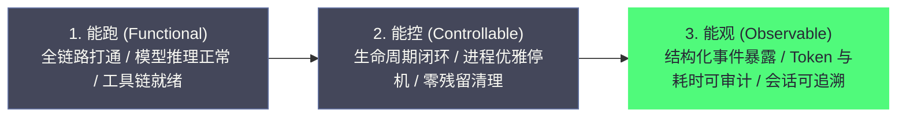
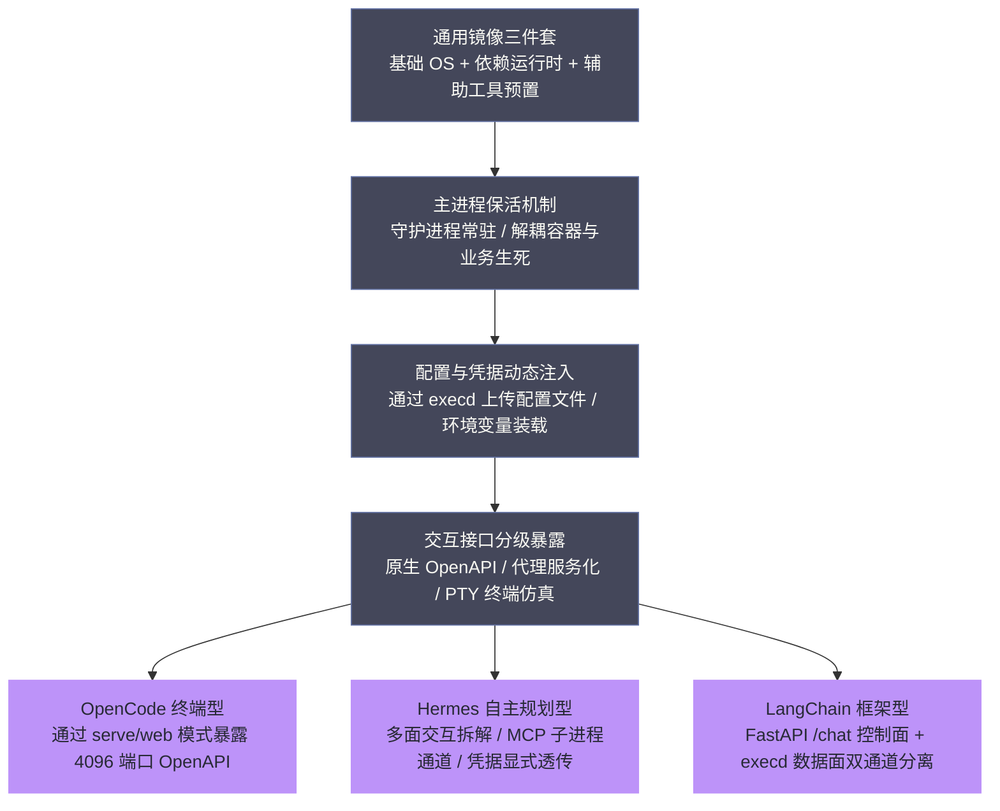
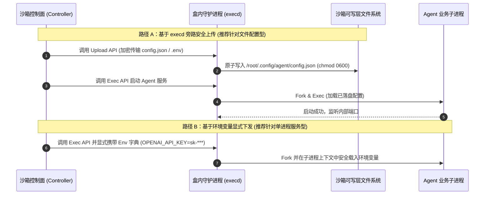
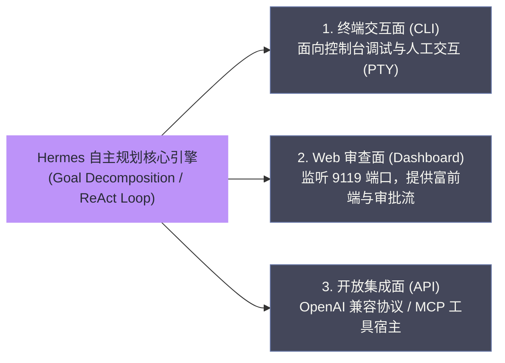
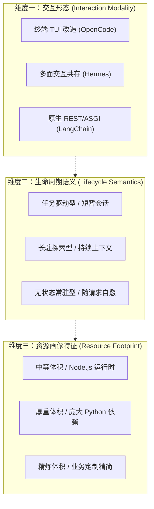
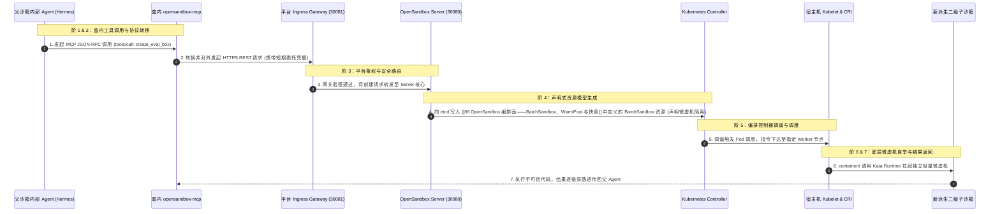
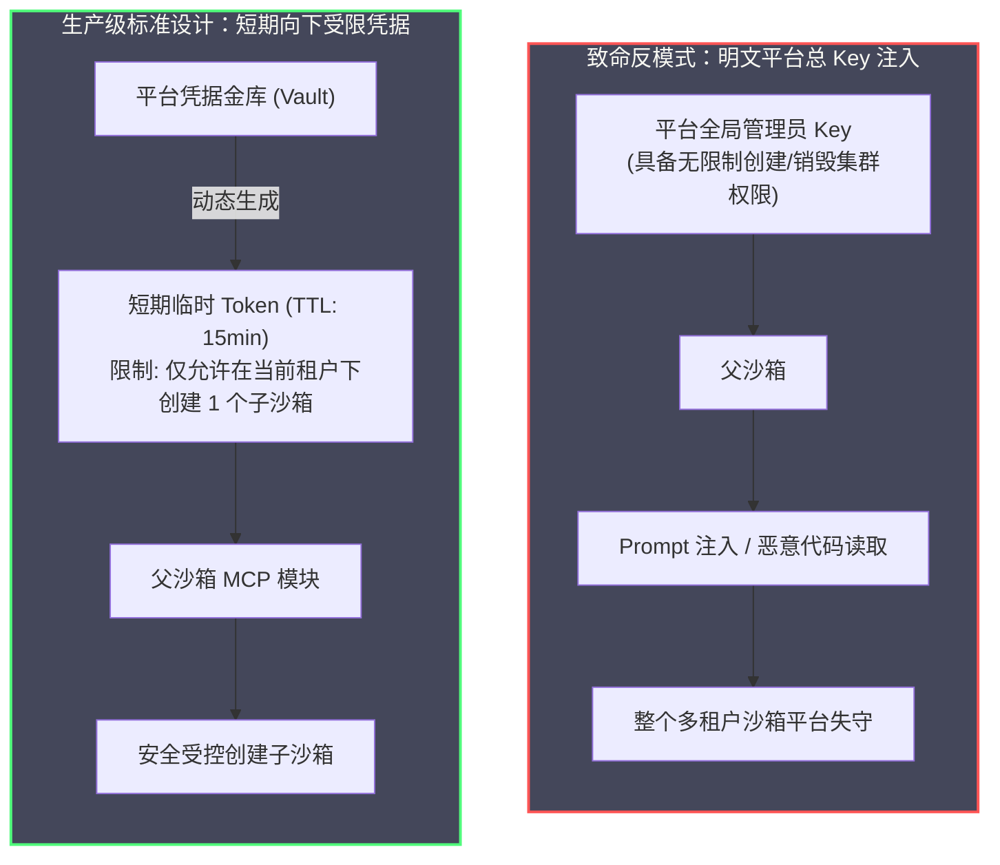

# 11 三类 Agent 沙箱落地——OpenCode、Hermes 与 LangChain 镜像化实战

**摘要：**

在前一篇完成单机验证环境搭建与多运行时接入后，平台工程面临的核心挑战转移至顶层载荷适配：如何将形态各异、协议割裂的真实大模型 Agent，安全而标准地“请”进隔离沙箱。本文深入工业级沙箱平台的载荷适配层，系统解构终端交互型（OpenCode）、自主规划型（Hermes）与框架集成型（LangChain）三类主流 Agent 的镜像化与服务化工程实践。文章首先提炼出“基础镜像底座、主进程保活、配置动态注入、交互接口分级”的通用适配四件套；继而逐一攻克 OpenCode 从终端 TUI 到 OpenAPI Headless 服务的协议桥接、Hermes 多面交互下 Model Context Protocol（MCP）子进程的凭据显式传递、以及 LangChain 自定义服务中“语义控制面与底层执行面”的双通道分离架构。随后，文章建立三类载荷在形态、生命周期与资源画像上的三维对比矩阵，并深入剖析 Agent 级联委派下的 MCP 子沙箱七阶调用时序与凭据穿透防御体系。核心认知在于：**Agent 沙箱化绝非简单的 Dockerfile 打包，而是将非标准 AI 交互重构为确定性、可编程、可观测的云原生微服务；适配层通过解耦容器生死与 Agent 业务生命周期，为异构 Agent 建立起坚固的安全防线与标准化的生命周期治理契约**。

---

## 第 1 章 Agent 沙箱化的工程本质与分层抽象

### 1.1 三个根本工程命题：进入、保活与交互

在分布式计算领域，容器化早已是一项成熟的通用技术；然而将大语言模型驱动的智能体（LLM Agent）部署进容器或微虚机沙箱时，工程师往往会遭遇前所未有的工程阻力。传统的无状态 Web 服务遵循严格的十二要素原则（The Twelve-Factor App），具备标准化的 HTTP 监听端口与确定的生命周期；而当下的 Agent 生态却高度碎片化——有的脱胎于本地终端命令行工具（CLI），有的依赖于复杂的浏览器 Web 前端，有的则以内嵌 Python 脚本的形式存在。

将任意形态的 Agent 完整接入沙箱系统，本质上必须在工程层面彻底解答三个环环相扣的核心命题：

| 核心命题 | 架构本质与物理挑战 | 对应工程落地手段 | 缺失该环节的系统灾难 |
| :--- | :--- | :--- | :--- |
| **怎么进去（Ingress）** | 二进制程序、异构语言运行时、动态依赖库与安全配置如何标准打包 | 多阶段镜像构建与依赖分层固化 | 镜像体积膨胀至数十 GiB，镜像拉取风暴压垮集群网络，无法实现秒级自举 |
| **怎么活着（Liveness）** | 容器启动后，如何解耦宿主容器生命周期与脆弱的 Agent 进程 | 独立 PID 1 守护与通用保活机制 | 业务代码抛错或模型生成死锁导致容器直接退出，调试现场与交互上下文瞬时蒸发 |
| **怎么交互（Interaction）**| 外部控制面与终端用户如何以程序化、结构化的方式调用 Agent 能力 | 接口服务化改造（OpenAPI / WebSocket / PTY）| 交互退化为不可审计的黑盒字符流，无法追踪会话上下文，无法与企业平台编排联动 |

这三个命题存在不可颠倒的依赖时序：**“怎么进去”解决的是可用性的起点问题，“怎么活着”解决的是稳定性的底线问题，而“怎么交互”解决的则是平台价值的兑现问题**。

不解决“怎么进去”，Agent 二进制根本无法在隔离环境中运行；不解决“怎么活着”，系统充其量只能得到一个“随时可能崩溃暴毙”的黑盒进程——当大模型正在执行数十步复杂长链推理时，中间任何一次未捕获的异常就会导致整个容器被 Kubernetes 强行销毁，上下文状态荡然无存；而不解决“怎么交互”，即便容器与进程安然无恙，它也只是孤悬于数据平面内部的一座孤岛，外部调度器与上层工作流根本无法对其下发指令或收集执行结果。

与普通应用相比，Agent 的根本特殊性在于其深度的长会话状态（参见 [[13 Agent 状态与存储——六类状态的正确拆分]]）与复杂的工具交互反馈环。普通微服务的处理过程是“请求—响应”的瞬时计算，而 Agent 的计算过程则是“思考—工具调用—观察环境—自省重试”的多轮探索。这要求沙箱不仅要提供静态的代码执行环境，更要提供一个能够持续维持上下文、允许故障原地热重试、且具备细粒度执行拦截能力的动态微环境。

### 1.2 适配层的验收准绳：能跑、能控与能观

为了衡量一个 Agent 载荷是否真正达到了生产就绪标准，平台工程团队必须确立明确的验收准绳。在工业级沙箱架构中，载荷接入必须依序通过三个维度的资格验收：



#### 准绳一：能跑（Functional Readiness）
这是最基础的功能性底线。Agent 镜像在沙箱中成功实例化，能够正常读取注入的配置与端点信息，与后端大语言模型完成端到端的握手推理，并能调用环境内预装的工具链（如 Git、Python、Node 等）完成至少一项确定性的代码生成与执行任务。许多失败的适配往往停留在“容器启动了，进程在 `ps` 里能看见”，但一旦发起真实推理，却因缺少动态链接库或网络未打通而瞬间静默挂起。

#### 准绳二：能控（Controllable Lifecycle）
这是进入集群编排的前提条件。外部控制面必须能够通过标准化 API 实现对沙箱内 Agent 实例的完整生命周期治理——包括即时拉起、健康探活、动态超时续期（TTL Keepalive）、快照保存以及优雅销毁。特别是在沙箱销毁时，系统必须能够向 Agent 进程树递归发送 SIGTERM/SIGKILL 信号，彻底清理微虚机或容器写层，**坚决杜绝脱离控制面孤立驻留的“僵尸沙箱进程”**。

#### 准绳三：能观（Structural Observability）
这是工程落地的最高阶标准，也是最容易被工程团队忽视的深水区。初期的载荷适配往往为了图省事，直接将 Agent 的交互界面以 Linux 伪终端（PTY）字符流的形式通过 WebSocket 吐给前端。这种做法在演示阶段尚可蒙混过关，但在生产环境中却是一场灾难：字符流中混杂着 ANSI 颜色转义字符、光标控制码与退格符，上层管控平台根本无法从中提取结构化的会话 ID、用户 Prompt、模型消耗的 Token 数量、调用的具体工具名称及其执行返回码。一个合格的适配必须将交互暴露为**遵循规范的结构化事件流（如 Server-Sent Events，SSE）或 RESTful OpenAPI 端点**，使每一次推理与操作均成为平台可存储、可分析、可计费、可审计的数字资产。

### 1.3 载荷适配流水线与六层架构映射

在 [[06 Agent 沙箱平台分层——六层模型与三条产品路线]] 中，我们划分了从底层硬件驱动到顶层生态集成的六层沙箱平台模型。Agent 载荷适配恰好落在第 4 层（容器/虚机载荷层）与第 5 层（Agent 业务适配层）的交界处：



载荷适配不是零散的修修补补，而是一条高度确定性的流水线工程：
1. **镜像层（Layer 4）**：解决物理文件的组装与交付；
2. **编排层（Layer 3/4）**：通过主进程保活机制确立进程拓扑结构；
3. **注入层（Layer 3）**：借助沙箱内数据面守护进程（如 `execd`，详见 [[08 OpenSandbox 数据面——execd 与 egress 的盒内世界]]）安全下发模型连接参数；
4. **接口层（Layer 5）**：将 Agent 特有的通信协议桥接至平台网关。

正如下文将要展开的实战论述，无论面对何种具体的 Agent 变种，只要严格依循这条标准化流水线推进，就能以最小的边际成本实现企业级异构智能体的安全纳管。

---

## 第 2 章 通用适配模式：企业级适配四件套

### 2.1 镜像构建规范：基础底座、语言运行时与依赖预置

在 Dockerfile 的编写过程中，工程师极易落入“把一切都塞进单层镜像”的粗放陷阱。对于 Agent 沙箱镜像，必须建立严谨的三层物理架构体系：

```
企业级 Agent 镜像三层结构：
├── 1. 基础操作系统底座（Base OS Layer）
│   ├── 精简 Debian / Ubuntu 长期支持版本（剔除文档与无用手册）
│   └── 基础系统工具链：bash, git, curl, tar, jq, ca-certificates, procps
├── 2. 语言与开发工具链层（Language Runtime Layer）
│   ├── 多版本语言环境：Python 3.10+, Node.js 20+, Rust / Go 基础编译器
│   └── 共享构建依赖：build-essential, cmake, libffi-dev, libssl-dev
└── 3. Agent 载荷与平台扩展层（Payload & Platform Extension Layer）
    ├── Agent 自身二进制或源码包（锁定 SemVer 明确版本号）
    ├── 模型协议与配置模板（仅保留占位符，绝不硬编码敏感密钥）
    └── 平台扩展工具：预置 opensandbox-mcp 二进制，支撑子沙箱级联调度
```

在镜像设计中，有三项不可逾越的架构原则：

**原则一：配置与镜像严格物理分离**。大模型 API Key、网关访问 Token 等鉴权资产**严禁固化在镜像层中**。镜像在企业内网中会被分发、同步、归档，任何写入镜像的明文凭据都会瞬间造成严重的供应链安全泄露。敏感配置必须在沙箱实例拉起后，经由控制面在内存中动态挂载注入。

**原则二：版本双重锁定命名规范**。容器镜像的 Tag 必须同时锁定 Agent 软件版本与平台适配层迭代版本。例如采用 `opencode:1.18.15-osb1.1.0` 命名格式，前段 `1.18.15` 代表上游 Agent 软件版本，后段 `osb1.1.0` 代表平台适配层与内置工具链的修订号。严禁使用 `latest`，确保任何历史实验环境与沙箱快照均具备绝对确定性的物理可复现性。

**原则三：标准化工具预装**。诸如 Git、Python、Curl 等 Agent 高频使用的基础设施工具，必须在镜像构建期固化入库。若依赖沙箱拉起后通过 `apt-get` 动态下载，不仅会将沙箱冷启动时延从百毫秒拉长至数分钟，更会因公共源网络抖动诱发海量的偶发性创建失败。

### 2.2 宿主容器保活与 PID 1 职责：解耦容器生命周期与业务进程

在标准的 Docker 最佳实践中，官方通常推荐将业务主进程直接声明为容器的 `ENTRYPOINT`，以实现“进程即容器，容器随业务退出而销毁”的单一职责模型。然而在 Agent 沙箱工程中，这一经典教条必须被彻底打破。

#### 为什么必须采用父沙箱保活机制？
Agent 进程本身具有极其脆弱的实验性特征。在执行复杂的代码生成或外部工具交互时，Agent 进程极易因为未捕获的代码异常、OOM 局部崩溃或模型输出格式错误而突发退出（Segmentation Fault 或 Exit 1）。

倘若将 Agent 直接设为 PID 1，Agent 进程崩溃的瞬间，Linux 内核将自动终止整个容器命名空间，Kubernetes 会立即将 Pod 标记为 `Terminated` 或 `CrashLoopBackOff`，并根据重试策略将其销毁或重启。这带来两大无法承受的工程代价：
1. **排障现场彻底毁灭**：沙箱的可写层被清理，工程师与运维平台无法通过 `crictl exec` 进入容器排查崩溃日志或读取 core dump 内存核心转储；
2. **会话状态彻底丢失**：前序花费数十秒甚至数分钟拉取的工程代码库与预热好的中间状态全部清空，用户必须从头重来。

因此，沙箱必须引入**“解耦生死”的保活父进程模式**。通过将不可死、不可崩溃的常驻进程设为 PID 1，容器获得了独立的生存凭证：

```bash
# 标准父沙箱保活启动指令
tail -f /dev/null
```

`tail -f /dev/null` 极其轻量，其物理内存开销几乎为零，且不消耗任何 CPU 周期。它作为主进程常驻后，Agent 进程转变为由盒内守护进程（`execd`）在沙箱内部异步派生、监控与管理的“普通业务子进程”。即使 Agent 发生多次致命崩溃，沙箱容器依然稳固存活，控制面可以通过 `execd` 持续读取错误日志、原位注入补丁、甚至在保留现场的前提下重启 Agent 服务。

### 2.3 动态配置与敏感凭据注入：execd 旁路挂载与环境变量注入

既然敏感配置不能固化在镜像内，那么大模型端点（Endpoint）、认证秘钥（API Key）以及租户自定义环境变量究竟如何安全送达 Agent 进程？

在实践中，存在两种主流路径，必须根据 Agent 的初始化时机进行正交选型：



- **路径 A（文件落盘注入）**：适用于需要读取标准配置文件（如 YAML / JSON）的复杂 Agent。控制面通过 `execd` 的文件写入 gRPC 接口，以二进制流的方式将渲染完毕的配置文件直接写入沙箱指定路径，并赋予严格的文件权限（如 `0600`）。配置落盘完毕后，再通知 `execd` 启动 Agent。这种方式彻底消除了“容器启动时配置尚未就绪”的竞态条件。
- **路径 B（运行时环境显式注入）**：适用于支持直接从环境变量读取参数的 Agent。控制面在调用 `execd.StartProcess` 时，将密钥字典显式传入环境变量切片。需要特别指出的是，**严禁在 Pod 编排的原始 spec.env 中明文编写敏感 Key**，必须结合 Kubernetes Secret 引用或由平台网关在 API 调用链路中动态注入，确保宿主机级别无法通过 `crictl inspectp` 直接窥探到未加密凭据。

### 2.4 交互接口的分级选择：原生 OpenAPI 优先、结构化 WebSocket 其次、PTY 仿真兜底

当 Agent 进程在沙箱中成功常驻并注入配置后，平台如何向其下发任务并获取输出？这是载荷适配中最具技术含量的决策点。在架构设计上，应当遵循严格的三级降级阶梯：

```
交互接口选型阶梯：
  [ 第一优先级 ] 原生 OpenAPI / HTTP RESTful
      └── 特征：具备严格的 Swagger / OpenAPI 规范，提供结构化 JSON 会话与任务管理接口
      └── 适用：OpenCode (web 模式)、现代框架型 Agent 服务
  [ 第二优先级 ] 结构化 WebSocket / SSE 流式接口
      └── 特征：双向或单向事件流，消息以 JSON 格式封装（携带 Event/Data 字段）
      └── 适用：Hermes (Dashboard 模式)、流式长思考推理 Agent
  [ 第三优先级 ] Linux 伪终端仿真 (PTY)
      └── 特征：通过虚拟终端（TTY）捕获标准输入输出字符流，混杂 ANSI 终端控制符
      └── 适用：上游完全闭源且仅提供交互式 CLI 的遗留终端 Agent
```

很多工程师容易陷入“PTY 能搞定一切交互”的虚幻全能感中。必须清醒认识到：**PTY 是不可控场景下的最后妥协，绝非架构首选**。

在 PTY 模式下，控制面与 Agent 的交互实质上退化为“模拟人类键盘敲击与终端屏幕抓取”。当底层 Agent 输出发生细微格式微调、或者网络延迟导致输出字符分包截断时，基于正则表达式的响应解析器将大面积崩溃；更为致命的是，PTY 无法区分程序正常输出与错误警告，导致异常处理极其脆弱。因此，**能通过启动参数开启 Headless HTTP 服务的，绝不用 WebSocket；能用结构化 JSON 事件流的，绝不用原始 PTY**。

### 2.5 镜像化工程的典型失败模式分类

在载荷镜像化实践中，我们对大量踩坑案例进行了根因归类，提炼出四类高频出现的架构反面清单：

| 失败模式类别 | 典型代码或配置表象 | 系统底层诱发机制 | 生产级治理策略与防护措施 |
| :--- | :--- | :--- | :--- |
| **凭据隐式泄露** | `COPY .env /app/.env` 或 Dockerfile 内硬编码 Key | 敏感凭据被烧录入只读镜像层，随镜像仓库分发广泛泄露 | 确立镜像构建 CI 门禁，通过 TruffleHog 等工具强行阻断包含明文凭据的构建 |
| **进程生命周期倒挂** | `ENTRYPOINT ["opencode"]` 直接作为容器 PID 1 | 业务进程抛错退出导致容器整体暴毙，现场被 K8s 瞬间清空 | 强制使用 `tail -f /dev/null` 保活主进程，将业务进程转为由 `execd` 管理的子进程 |
| **启动时序静态竞态** | 容器启动脚本直接并发执行业务，期望配置已就绪 | 外部配置尚未由控制面写入，Agent 提前启动并报文件不存在崩溃 | 建立两阶段启动机制：保活成功 $\to$ 注入配置 $\to$ 显式下发启动指令 |
| **伪终端流污染** | 强行将 TUI 交互输出当做 API 数据使用 | ANSI 颜色码与换行控制符污染结构化数据，解析正则大面积失效 | 深入探索 Agent 源码，寻找 `--headless`、`serve` 等隐藏服务化参数，彻底剥离终端前台 |

---

## 第 3 章 终端交互型 Agent 落地：OpenCode 的服务化改造实战

### 3.1 终端型 Agent 的架构本质与 Headless 改造挑战

终端代码型 Agent（以 OpenCode、Aider、Claude Code 为典型代表）在设计之初，其核心受众是坐在显示器前的真实程序员。它们的交互逻辑高度依赖全屏终端界面（TUI，基于 curses 或 Ink/React 终端库构建），通过在终端中渲染语法高亮、动态加载微调动效、以及等待人类通过键盘上下键选择操作选项。

当这类 Agent 被置入无人值守的云端沙箱时，其原生的终端交互逻辑便成为了最大的工程包袱：
- 若直接运行，因缺少真正的标准输入终端设备，底层库会抛出 `Error: stdout is not a TTY` 错误并直接闪退；
- 若强行分配虚拟终端运行，其复杂的交互式等待提示（如“是否允许应用该代码补丁？[y/N]”）会彻底阻塞后台自动化流水线。

因此，对终端型 Agent 镜像化的核心技术难点，**在于如何将其从面向人类的“终端应用程序”，彻底解构并改造为面向系统的“Headless 无头服务”**。

### 3.2 镜像构建与多阶段 Dockerfile 规范

针对基于 Node.js/Bun 生态构建的 OpenCode，我们设计了如下多阶段构建的生产级 Dockerfile：

```dockerfile
# 阶段一：依赖构建与裁剪阶段
FROM node:20-bookworm-slim AS builder

WORKDIR /build
# 锁定明确的版本号，禁止动态拉取
ARG OPENCODE_VERSION=1.18.15
RUN apt-get update && apt-get install -y --no-install-recommends     curl     ca-certificates     build-essential     && rm -rf /var/lib/apt/lists/*

# 全局安装 OpenCode 并执行缓存清理
RUN npm install -g opencode@${OPENCODE_VERSION}     && npm cache clean --force

# 阶段二：生产运行基准镜像
FROM debian:bookworm-slim

# 安装沙箱基础运行时依赖与排障工具链
RUN apt-get update && apt-get install -y --no-install-recommends     bash     curl     git     procps     ca-certificates     jq     tar     && rm -rf /var/lib/apt/lists/*

# 从构建阶段复制 Node 运行时与全局二进制
COPY --from=builder /usr/local/bin /usr/local/bin
COPY --from=builder /usr/local/lib/node_modules /usr/local/lib/node_modules

# 预置沙箱专用辅助二进制（如 opensandbox-mcp 桥接工具）
COPY assets/opensandbox-mcp /usr/local/bin/opensandbox-mcp
RUN chmod +x /usr/local/bin/opensandbox-mcp

# 建立无特权工作空间目录
WORKDIR /workspace
RUN useradd -m -s /bin/bash sandboxuser     && chown -R sandboxuser:sandboxuser /workspace

# 声明采用保活命令作为容器入口
ENTRYPOINT ["tail", "-f", "/dev/null"]
```

该 Dockerfile 体现了深度的工程权衡：多阶段构建使得最终生产镜像不包含构建期消耗的大量临时工具与头文件，镜像体积被压缩至数成；同时预置了平台专用的 `opensandbox-mcp` 桥接程序，为后续的工具链调用打下铺垫；入口点严格使用 `tail -f /dev/null`，确立了解耦架构基线。

### 3.3 启动编排：从 TUI 终端到 4096 端口 OpenAPI 服务面

OpenCode 在其源码深处实际上内置了一个专门为集成而设计的子命令：`opencode web` 或 `opencode serve`。当我们显式传入 `--port 4096 --headless` 参数时，OpenCode 将完全抑制终端 TUI 渲染引擎的启动，转而在后台拉起一个监听在 `4096` 端口的高性能 HTTP/WebSocket 服务器。

启动编排在沙箱内部被拆解为确定性的三阶段流式动作：

```bash
# 动作 1：主容器由 K8s 正常拉起，常驻运行 tail -f /dev/null

# 动作 2：控制面经由 execd 上传配置文件至用户目录
# 目标路径：/workspace/.opencode/config.json
{
  "apiEndpoint": "https://api.openai.com/v1",
  "apiKey": "sk-PROD-INJECTED-DYNAMIC-TOKEN",
  "model": "gpt-4o",
  "autoConfirm": true
}

# 动作 3：控制面下发 exec 指令，以后台进程方式启动 OpenCode 无头服务
nohup opencode web --port 4096 --hostname 0.0.0.0 --headless > /workspace/opencode.log 2>&1 &
```

通过这一重构，原本难以管控的终端程序瞬间蜕变为一个标准的 RESTful 微服务，其 `4096` 端口暴露了包含创建会话（`/api/session`）、下发 Prompt 任务（`/api/prompt`）以及订阅事件流（`/api/events`）的完整 OpenAPI 规范体系。

### 3.4 端到端交互时序：客户端、Agent、模型与 execd 数据流

在完成服务化之后，OpenCode 在沙箱内部的端到端交互展现为高度清晰的分层数据流动：

```mermaid
%%{init: {'theme': 'dracula', 'themeVariables': {'primaryColor': '#6272a4', 'primaryTextColor': '#f8f8f2', 'primaryBorderColor': '#bd93f9', 'lineColor': '#ff79c6', 'secondaryColor': '#44475a', 'tertiaryColor': '#282a36'}}%%
sequenceDiagram
    autonumber
    participant Client as 客户端 / 研发工作流
    participant Gateway as 平台 Ingress Gateway (30081)
    participant Execd as 盒内 execd 守护
    participant OC as OpenCode Server (4096)
    participant LLM as 上游大模型 API

    Client->>Gateway: POST /sandboxes/{id}/endpoints/4096/api/session (创建新任务会话)
    Gateway->>OC: 反向代理转发 HTTP 请求
    OC-->>Client: 返回 Session ID (201 Created)

    Client->>Gateway: POST /sandboxes/{id}/endpoints/4096/api/prompt (下发代码修改指令)
    Gateway->>OC: 转发任务指令
    OC->>LLM: 发起模型推理请求 (携带当前工程 AST 上下文)
    LLM-->>OC: 返回流式思考与代码补丁建议 (Tool Calls)

    rect rgb(40, 42, 54)
    Note over OC,Execd: 本地代码落地与测试执行
    OC->>OC: 本地写入文件补丁 (patch.diff)
    OC->>Execd: 请求执行单元测试 (pytest / npm test)
    Execd-->>OC: 返回执行结果与标准输出
    end

    OC-->>Client: 通过 SSE 实时推送结构化执行进度与状态
```



这种架构彻底将大模型的“思考与代码生成”与沙箱底层的“物理操作与验证”隔离开来。外部客户端只需要与 `4096` 端口的规范 HTTP 接口打交道，即可无缝掌握 Agent 的全生命周期状态。

### 3.5 确定性测试断言与生命周期清理审计

在接入完成后，必须对该载荷建立高精度的端到端回归断言。在测试脚本中，我们通过向 OpenCode 下发一个要求其计算高斯求和经典算法的任务进行闭环校验：

$$\sum_{i=1}^{99} i = rac{99 \times (1 + 99)}{2} = 4950$$

断言流水线执行逻辑如下：
1. **任务下发**：通过 HTTP 接口要求 OpenCode 编写并执行一段计算 $1$ 到 $99$ 连续自然数累加和的脚本；
2. **输出校验**：轮询其事件输出流，严格断言其计算结果必须精准输出整数值 `4950`；
3. **销毁审计**：调用沙箱销毁 API，在宿主机侧使用 `crictl ps` 与 `ps aux | grep opencode` 连续巡检三次，确保在沙箱注销后，宿主机内对应的 Node 进程、execd 进程以及微虚机 VMM 完全被内核回收，**孤儿进程数量严格为 0**。

---

## 第 4 章 自主规划型 Agent 落地：Hermes 的多面交互与 MCP 治理

### 4.1 复杂自主规划型 Agent 的架构画像

自主规划型 Agent（Autonomous Goal-Planning Agents，以 Hermes、AutoGPT、Devin 架构体系为代表）展现出与终端代码型 Agent 截然不同的系统复杂度。

此类 Agent 不仅需要编写代码，更承载着跨环境探索、自主分解长期目标、多维度反思重试以及协调大量外部工具的核心职能。为了支撑这些复杂的规划能力，Hermes 内部高度集成了 Python 庞大的生态体系，并且其对外展现出复杂的**“三面交互形态”**：



### 4.2 三面交互拓扑：CLI 交互面、Web Dashboard 审查面与程序化 API 面

在将 Hermes 镜像化的过程中，平台面临的首要架构抉择就是**“到底选择哪一个交互面与沙箱平台对接”**：

- **面一：CLI 终端面**。作为调试用途，Hermes 允许工程师通过终端直接交互。但在沙箱编排中，该面由于输出中包含大量的多色彩格式化字符与异步进度条，极难做自动化解析，通常仅作为低优先级的应急通道。
- **面二：Dashboard 审查面（默认暴露在 9119 端口）**。Hermes 内置了一个基于 WebSockets 的现代化交互控制台。该界面允许人类用户直观查看 Agent 的思考拓扑树、变量状态，并在 Agent 执行诸如 `rm -rf` 等高危操作前提供人工审批（Human-in-the-loop）确认按钮。在沙箱部署中，控制面需要通过 Ingress Gateway 为每个沙箱实例动态分配子路径代理（如 `/sandboxes/{id}/endpoints/9119/`），使用户能够直接访问该面板。
- **面三：程序化 API 面**。这是实现平台级任务自动化的核心。Hermes 新版本支持标准的 OpenAI-compatible API 端点，平台可以将 Hermes 视为一个具备极高自主执行能力的增强型模型端点，通过标准的 `/v1/chat/completions` 协议下发复杂复合目标。

### 4.3 Model Context Protocol (MCP) 工具服务器桥接与配置规范

Hermes 最核心的生产力来源在于其对 Anthropic 发起的**模型上下文协议（Model Context Protocol，MCP）**的完备支持。通过 MCP，Hermes 可以将各种物理能力（如文件系统、数据库查询、外部 API 检索、子沙箱派生）抽象为标准化的工具接口：

```json
{
  "mcpServers": {
    "filesystem": {
      "command": "opensandbox-mcp",
      "args": ["fs", "--root", "/workspace"],
      "env": {
        "SANDBOX_FS_RESTRICTED": "true"
      }
    },
    "sub_sandbox": {
      "command": "opensandbox-mcp",
      "args": ["sandbox", "--template", "python-eval"],
      "env": {
        "PLATFORM_API_ENDPOINT": "https://opensandbox-server.internal:30080",
        "DYNAMIC_SUB_KEY": "sk-SUB-TOKEN-EXPLICIT"
      }
    }
  }
}
```

在配置 MCP 服务器时，必须将这些声明作为标准资产固化在 `/root/.hermes/mcp_config.json` 中。当 Hermes 核心引擎启动时，它会作为宿主进程，以子进程（Subprocess）的形式拉起声明中的 `opensandbox-mcp` 二进制，并通过标准输入输出（stdio）建立起基于 JSON-RPC 2.0 的高速控制总线。

### 4.4 敏感凭据边界：环境变量继承断裂与显式安全传递

在 Hermes 纳管 MCP 工具链的过程中，我们遭遇了一个极其隐蔽的系统级安全深坑：**子进程环境变量的隐式继承失效**。

在许多开发者的朴素认知中，Linux 下父进程通过 `fork()` 创建子进程时，父进程上下文中的环境变量（如 `PLATFORM_API_KEY`）会自动被子进程无缝继承。然而在复杂的 Python 多进程与现代 Agent 框架中，出于安全沙箱隔离考虑，进程管理库（如 `subprocess.Popen` 或定制的进程池隔离器）在拉起不可信的 MCP 插件时，默认会采取**环境清理（Environment Sanitization）**策略，显式将敏感的环境变量白名单剔除，或者构建一个近乎全空的独立环境变量副本。

这导致的结果极其诡异：Hermes 自身能够正常读取系统环境变量与大模型对话，然而由其派生出的 MCP 子进程在尝试调用平台接口创建二级子沙箱时，却全部因缺少认证 Header 而被平台网关以 `401 Unauthorized` 强行击穿阻断。

> [!important] 核心规则：凭据必须在 MCP 配置中显式穿透传递
> 严禁依赖操作系统的环境变量隐式继承链条。所有供 MCP 工具或子进程使用的安全凭据，必须在渲染 `mcp_config.json` 清单时，在具体的 `mcpServers.<name>.env` 字典中进行显式、字面的逐项声明与传参。只有显式声明的凭据才能被注入进程上下文，彻底杜绝因底层运行时环境隔离而导致的权限断裂。

### 4.5 与沙箱控制面的协同与职责边界划分

在落地 Hermes 时，必须遵循 [[07 OpenSandbox 架构深度解析——协议优先与六责任面]] 所划定的清晰职责分界线：
- **Hermes 负责的是“业务认知与规划逻辑”**：思考先做什么、后做什么、代码如何修改；
- **沙箱平台（OpenSandbox）负责的是“底层资源提供与硬隔离防线”**：提供 CPU/内存微虚机、执行文件挂载、记录审计跟踪日志、负责强制回收资源。

**平台绝不能逾越边界去干预 Agent 的提示词工程或思考链路，Agent 也绝不被允许越权操作沙箱底层的容器与网络命名空间**。双方唯一的契约界面，正是收敛完备的 MCP JSON-RPC 协议与标准 HTTP API。

---

## 第 5 章 框架集成型 Agent 落地：LangChain 微服务化与双通道架构

### 5.1 框架集成型 Agent 的架构本质与容器原生优势

相较于 OpenCode（终端改造）与 Hermes（多面复杂体），基于 LangChain、LlamaIndex 或 Semantic Kernel 等工业级框架定制开发的 Agent，展现出最为纯粹的**“云原生微服务特征”**。

在这类场景下，企业研发团队通常是将预训练模型、Prompt 编排模板、本地向量检索（RAG）以及 LangGraph 状态机，使用 Python 编写为一个标准的 RESTful 微服务。其天生面向服务化设计，不包含任何历史终端包袱，因而可以直接采用轻量级 ASGI 服务器（如 Uvicorn）进行承载。

### 5.2 极简镜像构建与 Uvicorn 原生单进程模型

由于 LangChain 定制服务的入口本身就是一个高度健壮、面向高并发 Web 请求的 HTTP 进程，我们在此处迎来了对第 2 章通用四件套的**因地制宜式反向裁剪**：

```dockerfile
# 生产级 LangChain 定制 Agent 容器 Dockerfile
FROM python:3.11-slim-bookworm

WORKDIR /app

# 安装必要的编译头文件与系统依赖
RUN apt-get update && apt-get install -y --no-install-recommends     curl     git     build-essential     && rm -rf /var/lib/apt/lists/*

# 复制 Python 依赖描述清单并安装
COPY requirements.txt .
RUN pip install --no-cache-dir -r requirements.txt

# 复制定制 Agent 业务代码与 LangGraph 状态机
COPY ./src /app/src

# 预置沙箱执行辅助程序
COPY ./assets/execd /opt/opensandbox/execd

# 暴露定制业务服务端口
EXPOSE 8080

# 此处无需使用 tail -f /dev/null 保活！
# Uvicorn 微服务进程本身就是最高诚实的容器主进程（PID 1）
ENTRYPOINT ["uvicorn", "src.main:app", "--host", "0.0.0.0", "--port", "8080", "--workers", "1"]
```

> [!note] 架构权衡：何时必须保活，何时果断放弃保活？
> 在 OpenCode 与 Hermes 中，容器主进程必须通过 `tail -f /dev/null` 保活，是因为其业务进程属于容易崩溃且需要就地排障的第三方实验载荷；
> 而在 LangChain 定制服务中，Uvicorn 自身具备极佳的异常捕获机制与连接池管理能力。当定制服务进程主动退出或触发不可恢复的系统中断时，最符合云原生语义的做法正是让容器直接终止并触发 Kubernetes 的重启策略。**“保活”是手段而非教条，必须依据载荷的物理形态进行动态参数化裁剪**。

### 5.3 双通道通信架构：`/chat` 语义控制通道与 `execd` 盒内执行通道

在将 LangChain 载荷接入沙箱系统后，我们建立起了业界推崇的**“双通道分离通信模型（Dual-Channel Architecture）”**：

```mermaid
%%{init: {'theme': 'dracula', 'themeVariables': {'primaryColor': '#6272a4', 'primaryTextColor': '#f8f8f2', 'primaryBorderColor': '#bd93f9', 'lineColor': '#ff79c6', 'secondaryColor': '#44475a', 'tertiaryColor': '#282a36'}}%%
flowchart TD
    Client["外部业务调用方 / 协同编排器"]

    subgraph SandboxInstance["Agent 沙箱安全隔离边界"]
        direction TB

        subgraph ControlChannel["通道 A：语义控制通道 (Port 8080)"]
            API["FastAPI /chat API<br/>接收自然语言 Prompt / 驱动 LangGraph 状态机"]
            Core["LangChain Core Engine<br/>Prompt 模板 / 上下文管理 / 模型交互"]
            API --> Core
        end

        subgraph DataChannel["通道 B：盒内执行数据通道 (Local execd)"]
            ExecdDaemon["本地 execd 守护进程<br/>提供独立的高频命令执行与文件读写接口"]
            ToolProc["不可信代码执行子进程<br/>(Python REPL / Shell 执行环境)"]
            ExecdDaemon -->|隔离运行| ToolProc
        end

        Core -.->|本地 RPC 调用| ExecdDaemon
    end

    Client -->|1. 发送业务指令 (POST /chat)| API
    Client -.->|2. 旁路审计与文件读取| ExecdDaemon

    classDef chan fill:#44475a,stroke:#6272a4,color:#f8f8f2
    classDef inst fill:#282a36,stroke:#bd93f9,stroke-width:2px,color:#f8f8f2
    class ControlChannel,DataChannel chan
    class SandboxInstance inst
```

- **通道 A：业务语义控制通道（RESTful `/chat`）**。该通道监听在 `8080` 端口，专门面向最终业务系统。上游调用方通过下发带有租户上下文与长会话记录的 JSON 数据包，驱动 LangGraph 内部的 ReAct 推理环运转。
- **通道 B：底层执行数据通道（本地 `execd`）**。当 Agent 在推理过程中需要执行一段未经验证的动态 Python 代码或生成的文件时，它**绝不使用 Python 原生的 `os.system()` 或 `eval()` 直接在自身服务进程空间内运行**，而是通过向沙箱内的 `execd` 发起本地 Loopback RPC，将不可信代码置入一个被独立 cgroup 与 Seccomp 沙盒严格限制的临时子进程中执行。

双通道架构彻底实现了“业务逻辑的安全稳定”与“不可信载荷的高危执行”的物理隔离，杜绝了模型生成的恶意代码通过内存越界或环境变量篡改导致整个 LangChain 服务进程崩溃的风险。

### 5.4 LangGraph 状态机与不可信代码执行工具的解耦设计

在现代 LangChain/LangGraph 架构中，状态（State）是不可变的数据契约。通过将执行能力封装为标准的 LangChain `BaseTool`，我们可以实现高度优雅的代码解耦：

```python
# 基于 execd 本地调用的安全代码执行工具实现示例
import requests
from langchain.tools import BaseTool
from pydantic import Field

class SecureSandboxExecutionTool(BaseTool):
    name: str = "sandbox_python_eval"
    description: str = "在当前沙箱的安全隔离子环境中执行 Python 代码，并捕获标准输出与错误"
    execd_endpoint: str = Field(default="http://127.0.0.1:30000/api/v1/exec")

    def _run(self, code_snippet: str) -> str:
        # 封装为向本地 execd 发起的标准化执行请求
        payload = {
            "command": ["python3", "-c", code_snippet],
            "timeout_seconds": 15,
            "resource_limits": {
                "max_memory_bytes": 268435456 # 限制执行单次不可超 256 MiB
            }
        }
        try:
            resp = requests.post(self.execd_endpoint, json=payload, timeout=20)
            if resp.status_code == 200:
                result = resp.json()
                return f"Execution Success:
{result.get('stdout')}
{result.get('stderr')}"
            return f"Execd Execution Failed with HTTP {resp.status_code}: {resp.text}"
        except Exception as e:
            return f"Sandbox Infrastructure Error: {str(e)}"
```

借助该工具类，LangGraph 状态机在流转时仅需专注于逻辑分支走向，底层的代码执行、内存封顶与超时中断均由基础设施层强行兜底，架构具备极高的健壮性。

---

## 第 6 章 三类 Agent 的沙箱需求深度横向对比

### 6.1 三维评价坐标系：交互形态、生命周期语义与资源消耗画像

通过前三章的实战解剖，我们可以清晰提炼出三类 Agent 在物理落地时的三维评价坐标体系：



### 6.2 生命周期语义差异：常驻会话 vs 任务闭环 vs 无状态微服务

在调度器的眼中，这三类 Agent 绝非相同的对象：
- **OpenCode（任务驱动闭环）**：用户通常是为了解决一个特定的 Issue 或开发一个功能模块而创建沙箱。它的生命周期伴随代码修改的完成而结束，呈现出清晰的“创建 $\to$ 执行多轮推理 $\to$ 生成并导出 Patch $\to$ 整体销毁”的闭环特征，其生存时间（TTL）通常在 10 分钟至数小时之间。
- **Hermes（长驻探索会话）**：作为端到端的全自主规划者，Hermes 可能会在长达数天的时间内持续对一个大型仓库进行代码审计、性能优化与混沌测试。它对沙箱底层的快照恢复能力（Snapshot Resume）与卷持久化（Volume Persistence）有着极度严苛的诉求，中途不可随意重置。
- **LangChain（无状态通用服务）**：它更接近传统的微服务，自身的内存中不固化具体的租户会话，而是将所有状态委托给外部的 Redis、PostgreSQL 或 Vector DB 存储。沙箱平台在面临节点维护或高负载排队时，可以随时对其进行滚动驱逐或弹性水平扩缩容。

### 6.3 资源画像差异：镜像体积、冷启动耗时与并发物理内存基准

结合后续 [[12 沙箱性能工程——Runtime 基准与 WarmPool 容量管理]] 的严格度量方法，以下为三类 Agent 的真实物理资源画像数据：

| 载荷代表 | 运行时技术栈 | 生产镜像体积 | 容器冷启动 P90 时延 | 单实例空闲物理内存 (PSS) |
| :--- | :--- | :--- | :--- | :--- |
| **OpenCode** | Node.js 20 + Bun 预置 | 约 $680\text{ MiB}$ | $\le 1.8\text{ s}$ | 约 $140\text{ MiB}$ |
| **Hermes** | Python 3.11 + 庞大机器学习库 | 约 $3.2\text{ GiB}$ | $\le 6.5\text{ s}$ | 约 $480\text{ MiB}$ |
| **LangChain 定制**| Python 3.11-slim + Uvicorn | 约 $390\text{ MiB}$ | $\le 1.2\text{ s}$ | 约 $110\text{ MiB}$ |

该基准揭示了极为关键的容量规划指导意义：**对于体积超过 $3\text{ GiB}$ 的 Hermes 类重型载荷，生产环境必须前置建立基于镜像缓存（Image Cache）的常驻预热节点池，或者采用按需懒加载镜像分发机制（如 Starlight / eStargz）**，否则其高达数秒的镜像解压时延将彻底击碎系统的实时响应 SLO。

### 6.4 故障容错与重启恢复模型对比

在故障发生时，三类载荷的处理策略差异显著：

| 容错维度 | OpenCode 终端服务型 | Hermes 自主规划型 | LangChain 定制微服务型 |
| :--- | :--- | :--- | :--- |
| **主进程设计** | `tail -f /dev/null` 保活 | `tail -f /dev/null` 保活 | 直接运行 Uvicorn 服务主进程 |
| **进程崩溃影响** | 服务端口中断，但容器存活 | Web 面板与 MCP 管道断开 | 容器直接退出触发 K8s 重启 |
| **排障恢复手段** | 经由 `execd` 读日志并拉起 | 经由 `execd` 恢复 MCP 子管道 | 依赖 K8s 调度器原地或漂移重启 |
| **会话现场保护** | 本地代码已落盘，可原地恢复 | 需依赖快照回滚至上一检查点 | 会话托管于外部 DB，影响极小 |

---

## 第 7 章 级联委托与安全深水区：MCP 子沙箱七阶调用链路

### 7.1 为什么自主 Agent 需要派生“子沙箱”：主客隔离法则

随着大模型自主规划能力的演进，一个前沿且必须面对的系统级课题浮出水面：**当一个负责核心规划的“父 Agent”在运行过程中，为了验证某段极其危险的未知脚本，它能否主动请求平台为自己临时创建一个更小、隔离更严苛的“子沙箱（Sub-sandbox）”？**

这种需求在工程上被称为**“级联委派（Cascading Delegation）”**。在传统的做法中，开发者往往直接在当前容器内执行该脚本。然而这违背了基本的**“主客隔离法则”**：父 Agent 自身容器内驻留着用于访问上游平台的关键凭据、长链思考记录以及核心代码库；若直接在此空间运行不可信脚本，脚本一旦尝试读取本地 `.env` 文件或发起网络外联，父 Agent 的安全底座将瞬间失守。

因此，**将“不可信工具执行”作为独立子沙箱剥离出去，是抵御特权逃逸的终极手段**。

### 7.2 七阶级联调用链路全景时序剖析

整个父沙箱派生子沙箱的完整物理调用链，跨越了极其复杂的技术层级，被系统化提炼为**七阶调用时序模型（The 7-hop Invocation Chain）**：



这七个阶段环环相扣，构成了严密的可观测性断点：
1. **阶 1（盒内 RPC）**：父 Agent 与 MCP 服务器通过 stdio 通道完成参数交换；
2. **阶 2（外部外联）**：MCP 服务器将本地请求升级为符合平台规范的 HTTPS 凭据请求；
3. **阶 3（网关鉴权）**：Ingress Gateway 对子沙箱创建配额进行即时拦截核算；
4. **阶 4（CRD 生成）**：Server 将业务请求翻译为 Kubernetes 原生的 `BatchSandbox` 声明；
5. **阶 5（编排调度）**：Kubernetes 调度器寻找符合硬件虚拟化要求的 Worker 节点；
6. **阶 6（微虚机拉起）**：底层的 containerd 与 Kata Containers 完成独立的内核启动；
7. **阶 7（结果透传）**：子沙箱执行完毕后，执行状态与标准输出逆向逐级回传至父 Agent 的上下文窗口。

### 7.3 子沙箱的安全语义与防逃逸隔离边界

在物理拓扑上，必须深刻认识到：**所谓的“子沙箱”，在物理层面绝非父容器内部嵌套创建的“Docker-in-Docker”，而是由底层控制面在物理宿主机上独立并列创建的全新平级沙箱实例**。

若采用容器嵌套技术（DinD），父容器必须开启高危的 `privileged: true` 特权模式，并将宿主机的 `/var/run/docker.sock` 挂载入容器。这种设计在安全上无异于自杀——任何逃逸代码只需要操作该 Docker Socket，便能瞬间控制整台宿主机。

通过平台级级联调度，子沙箱拥有完全独立的 Linux 命名空间、独立的虚拟化内核以及独立的只读根文件系统。即便子沙箱中的不可信代码触发了 Linux 内核提权甚至系统崩溃，受害的也仅仅是那台短暂存在的微虚机，父 Agent 的上下文环境与宿主机控制面安如磐石。

### 7.4 凭据放大器风险：平台总 Key 穿透防御与短期安全凭据下发

在级联调用中，最严重的安全隐患被称为**“凭据放大器漏洞（The Credential Amplifier Vulnerability）”**。

在架构初期，很多团队为了偷懒，直接将具有集群最高管理权限的平台管理员 API Key 写入父沙箱的环境变量中，以便让父沙箱的 MCP 能够顺利调用平台接口创建子沙箱。这造成了极其危险的安全不对称：**不可信的 AI 代码一旦通过 prompt injection 或恶意代码读取到该全局 Key，它将瞬间获得在整个 Kubernetes 集群中任意创建、销毁甚至越权窥探其他租户沙箱的最高特权**。



为彻底消除凭据放大隐患，企业级架构必须引入 [[14 沙箱安全体系——三层防护、短期凭据与多租户]] 中详述的**短期向下受限凭据机制（Down-scoped Short-lived Credentials）**：
1. **权限受限（Least Privilege）**：下发给父沙箱的 Token，被安全策略严格限制为仅具备“在当前 Namespace 内创建规格不超过 1 核/1G 的临时测试沙箱”的极小权限，绝无权限读取系统资源；
2. **生命周期极短（Strict TTL）**：Token 的有效期被压缩至 15 至 30 分钟以内，过期自动作废，且不可用于递归续期；
3. **网关动态配额拦截（Quota Guardrail）**：平台网关在接收到子沙箱创建请求时，强制校验当前父沙箱的调用深度——严格禁止超过 2 级以上的嵌套递归创建（禁止“子沙箱派生孙沙箱”），从物理上根绝由于递归死循环引发的算力资源耗尽攻击。

---

## 第 8 章 适配工程沉淀：规范模板与自动化回归矩阵

### 8.1 镜像标准构建模板与 CI/CD 自动化流水线

为了避免“每来一个新的 Agent 就重新发明一次轮子”，平台工程必须将适配经验固化为开箱即用的**标准化构建流水线（Standard Image Build Matrix）**。

在 GitLab CI 或 GitHub Actions 中，定义参数化构建矩阵：

```yaml
# .gitlab-ci.yml 镜像自动化构建规范
stages:
  - lint
  - build
  - test
  - publish

.agent_build_template: &agent_build_definition
  image: docker:24-git
  services:
    - docker:24-dind
  script:
    - docker build 
        --build-arg AGENT_VERSION=${AGENT_VERSION}
        --build-arg ADAPTER_REVISION=${CI_COMMIT_SHORT_SHA}
        -t ${ENTERPRISE_REGISTRY}/agent-sandbox/${AGENT_NAME}:${AGENT_VERSION}-osb1.1.0 
        -f dockerfiles/Dockerfile.${AGENT_NAME} .
    - docker push ${ENTERPRISE_REGISTRY}/agent-sandbox/${AGENT_NAME}:${AGENT_VERSION}-osb1.1.0

build:opencode:
  <<: *agent_build_definition
  variables:
    AGENT_NAME: "opencode"
    AGENT_VERSION: "1.18.15"

build:hermes:
  <<: *agent_build_definition
  variables:
    AGENT_NAME: "hermes"
    AGENT_VERSION: "0.19.0"

build:langchain:
  <<: *agent_build_definition
  variables:
    AGENT_NAME: "langchain-custom"
    AGENT_VERSION: "1.3.14"
```

通过统一的 CI 矩阵，每次底层依赖升级或安全补丁合并时，流水线能够自动化并行编译全量 Agent 镜像并自动推送到内部安全镜像仓库。

### 8.2 新 Agent 接入沙箱的标准工程检查清单

当有全新的开源 Agent（如 Devin 开源复刻版或新出的命令行智能体）申请接入沙箱系统时，平台接入审核团队必须按照下述**十四项标准化准入检查单**进行逐项核准：

| 校验维度 | 检查项编号 | 具体核验规范与要求 | 判定状态 |
| :--- | :--- | :--- | :--- |
| **供应链合规** | CK-01 | 镜像基础底座采用受支持的 LTS 发行版，无已知高危 CVE | [ ] 必须满足 |
| | CK-02 | 镜像构建过程禁止硬编码任何明文 API Key 与私有凭据 | [ ] 必须满足 |
| | CK-03 | 镜像 Tag 严格锁定软件版本与适配层版本（双版本号） | [ ] 必须满足 |
| **进程与生命周期**| CK-04 | 主进程声明为 `tail -f /dev/null` 或高健壮性 Web 服务主进程 | [ ] 必须满足 |
| | CK-05 | 业务子进程能够平稳处理操作系统下发的 SIGTERM 停机信号 | [ ] 必须满足 |
| | CK-06 | 容器主动销毁后，宿主机内关联孤儿进程绝对清零（零残留） | [ ] 必须满足 |
| **交互与协议** | CK-07 | 优先提供 Headless 服务化接口（HTTP/OpenAPI），无终端依赖 | [ ] 必须满足 |
| | CK-08 | 结构化暴露交互事件流（SSE/WebSocket），包含会话唯一标识 | [ ] 必须满足 |
| | CK-09 | 存在清晰的健康检查心跳端点（`/healthz` 或探活 API） | [ ] 必须满足 |
| **MCP 与级联** | CK-10 | MCP 服务器启动配置中所有凭据均走显式环境变量注入 | [ ] 推荐满足 |
| | CK-11 | 派生子沙箱时严格使用短期向下受限 Token，禁止使用全局 Key | [ ] 必须满足 |
| **性能基线** | CK-12 | 生产优化后镜像体积必须控制在 $2\text{ GiB}$ 以内（超大模型另议） | [ ] 推荐满足 |
| | CK-13 | 镜像冷启动至健康就绪时延严格控制在 3 秒以内 | [ ] 推荐满足 |
| | CK-14 | 单实例空闲待命常驻内存（PSS）不超过 $300\text{ MiB}$ | [ ] 推荐满足 |

### 8.3 测试集群环境下的全量载荷准入签发

当新镜像通过上述检查单后，必须将其部署进按 [[10 Agent 沙箱部署实战——从单机 PoC 到测试集群]] 搭建的预发测试集群，执行自动化集成回归套件：
1. **并发拉起 20 个混合 Agent 实例**，模拟多租户交叉访问；
2. **触发高频文件写入与编译任务**，持续压测沙箱可写层与宿主机 I/O 网桥；
3. **注入网络延迟与短暂丢包**，验证 Agent 重试状态机；
4. **全量触发销毁**，自动化审计脚本比对 Kubernetes etcd 对象、containerd CRI 容器列表与 Linux 内核 veth 网络接口。

只有当回归套件执行通过率达到 $100\%$ 时，该载荷版本方可正式打上“生产就绪”标签，进入企业级服务目录供上层大模型业务系统调度调用。

---

## 第 9 章 工业界技术演进与行业标准核实

### 9.1 OpenCode 演进：1.x 维护收束与 2.x 单后台服务架构

截至 2026 年底，作为终端代码生成智能体的代表，OpenCode 的架构路线发生了深刻的分水岭式跃迁：
- **1.x 分支收束与维护性平稳着陆**：OpenCode 1.x 演进至 1.19.4 版本后，官方宣布正式停止功能性迭代，仅保留底层的关键安全补丁修复（如升级内置的 Bun 运行时以消除 TLS 与 HTTP 解析漏洞）。官方在设计上明确切断了从 1.x 到 2.x 的自动化隐式升级路径，防止因破坏性重构冲击现有生产用户的 CI 脚本。
- **2.x 重构：原生单后台服务架构的建立**：OpenCode 2.x 彻底抛弃了过去的“前台 TUI 兼职拉起临时 Web 服务”的拼装形态，在底层全面重构为**“原生无头后台守护进程（Daemon）+ 可插拔多端适配器”**的现代微服务架构。在 2.x 体系下，沙箱无需再费尽心机配置 `opencode web --headless` 等晦涩参数，其启动脚本原生暴露标准 gRPC 与 HTTP/2 接口，使得第 3 章所拆解的服务化改造在最新版本中获得了官方一等公民的技术支持。

### 9.2 Hermes 演进：OpenAI 兼容接口与标准 MCP 协议支持

Hermes 社区的演进轨迹，则代表了全自主规划型 Agent 全面拥抱云原生标准的必然趋势：
- **OpenAI 兼容端点标准化**：在经历了早期依赖私有 CLI 命令与终端模拟的蛮荒期后，Hermes 官方将 RESTful API 提升为核心交互面。其全面支持通过标准 JSON 载荷下发包含工具定义的对话指令，使得平台能够将其完全等同于一个高智力的云端推理后端。
- **MCP 协议的深度融合与原生凭据隔离**：Hermes 成为业界首批全量落地 Model Context Protocol 最新草案的生产级智能体之一。在新版本中，Hermes 引入了严格的 MCP 凭据沙箱隔离器，官方层面支持在拉起工具子进程时指定显式环境变量过滤器（Env Whitelist），彻底修复了过去隐式继承引发的安全与断裂双重风险。

### 9.3 LangChain 演进：深水区 Agent 沙箱后端生态（Deep Agents / LangSmith Sandboxes）

LangChain 在沙箱领域的演进，则清晰印证了我们在第 5 章中提炼出的“执行数据通道与语义控制通道双分离”的普适价值：
- **沙箱抽象晋升为框架核心原语**：LangChain 在其进阶分支（如 Deep Agents 与 LangGraph）中，正式引入了第一优先级的 `SandboxBackend` 抽象基类。开发者不再需要在业务代码中手动拼接本地 `exec` 指令，框架内置了对 OpenSandbox、E2B 以及云原生微虚机后端的驱动支持。
- **LangSmith 深度执行可观测性**：通过与底层沙箱系统的 telemetry 探针打通，LangSmith 实现了对沙箱内部代码执行过程的毫秒级追踪——不仅能够记录代码输入输出，更能自动采集每次执行消耗的物理 CPU 周期、内存峰值与文件变更哈希，沙箱正式成为大模型基础设施不可分割的基石。

### 9.4 镜像化工程的行业最佳实践：Distroless、OCI 差异快照与非特权沙箱容器

在云原生系统工程层面，面向 Agent 的镜像化构建技术也正在经历深刻的标准化变革：
- **Distroless 与极简运行时**：为了追求极限的安全性与快速冷启动，行业领先的沙箱服务商正在逐步从传统的完整 Debian/Ubuntu 镜像，向基于 Google Distroless 或 Chainguard 极简镜像迁移。剔除一切非必要的系统 shell 与包管理工具，不仅将镜像体积压低至百兆以内，更大幅收窄了不可信代码在沙箱内部实施本地提权的攻击面。
- **OCI 差异快照技术成熟**：随着 containerd 2.0+ 对 OCI 镜像增量挂载与远程按需拉取（Remote Snapshotter）的成熟支持，沙箱在实例化时无需再等待完整镜像的物理下载，而是通过用户态文件系统（FUSE）在毫秒级别挂载镜像元数据树，实现真正意义上的“首帧代码即刻执行”。
- **非特权根文件系统映射**：结合 Linux User Namespace 的成熟，现代沙箱平台正全面普及以非 root 用户（UID 10001）运行盒内业务进程。沙箱内部即使获得了所谓的“root 权限”，映射到宿主机层面依然是一个无任何系统特权的普通用户，构筑起无法跨越的防逃逸物理屏障。

---

## 第 10 章 总结与核心思考题

### 10.1 本文核心架构认知收敛

回顾三类 Agent 沙箱落地的全过程，我们应当深刻铭记以下四条不容妥协的工程准则：

1. **没有标准，但有恒定模式**：Agent 生态的协议碎片化是当前的行业现状，但通过“基础镜像三件套、主进程保活、动态配置注入、接口分级暴露”这套经典四件套，我们可以用高度收敛的架构框架纳管一切看似无序的异构载荷。
2. **生死的正确解耦是稳定性的基石**：业务进程的脆弱性决定了沙箱容器绝不能轻率地将业务直设为 PID 1。通过 `tail -f /dev/null` 保活机制，我们以极小的资源代价换取了珍贵的现场保留与热恢复能力；而在确信业务具备高健壮性微服务形态时，亦当果断放弃保活以追求语义的纯粹。
3. **主客隔离与凭据收敛不可动摇**：级联派生子沙箱是自主 Agent 验证高危操作的必然出路。必须恪守平级物理隔离原则，坚决废黜明文平台全局 Key 的透传，全面推行短期向下受限 Token 与调用深度硬性阻断，守牢多租户安全底线。
4. **能观性决定平台的最终上限**：止步于 PTY 字符流的适配只是浅尝辄止的玩具，将 Agent 的交互全面重构为结构化、可审计的 OpenAPI 与事件流，方能使沙箱系统真正融入企业级自动化治理与价值流网络。

### 10.2 核心术语速查对照

| 术语名称 | 英文全称 | 核心概念定义与架构定位 |
| :--- | :--- | :--- |
| **Headless Mode** | Headless Service Mode | 应用程序的一种无界面运行模式，剥离图形或终端交互，纯粹通过网络接口提供服务 |
| **PTY** | Pseudoterminal | 操作系统提供的一对虚拟双向字符设备，用于在没有物理终端的情况下仿真终端交互 |
| **MCP** | Model Context Protocol | 行业标准化协议，用于大模型及其智能体与本地或远程工具、数据源之间的高速互联 |
| **Liveness Decoupling**| Lifecycle Decoupling | 通过常驻守护主进程，将容器宿主生命周期与内部业务应用生死解绑的架构设计 |
| **Cascading Delegation**| Cascading Delegation Pattern | 父级智能体为了隔离高危执行风险，主动向平台请求动态创建下级子沙箱的级联委托模式 |
| **Down-scoped Token** | Down-scoped Short-lived Token | 一种经过严格权限裁剪且具备极短生存时间的临时访问凭据，用于防止凭据越权放大 |
| **Zero Residual** | Zero Residual Audit | 确保沙箱在声明周期终结后，宿主机内关联的所有进程、卷与网络资源彻底清零的审计纪律 |

---

## 参考文献

1. Anthropic PBC. *Model Context Protocol (MCP) Specification and Architecture Guide*. [https://modelcontextprotocol.io/](https://modelcontextprotocol.io/)
2. OpenCode Project. *OpenCode CLI and Headless Web Architecture Documentation*. [https://github.com/opencode-ai/opencode](https://github.com/opencode-ai/opencode)
3. OpenSandbox Specification. *In-Sandbox Daemon (execd) Protocol and Lifecycle Hooks*. [https://github.com/opensandbox/opensandbox](https://github.com/opensandbox/opensandbox)
4. LangChain Organization. *LangGraph: Building Resilient Multi-Agent Architectures*. [https://langchain-ai.github.io/langgraph/](https://langchain-ai.github.io/langgraph/)
5. Linux Foundation / OCI. *Open Container Initiative Image Format Specification (v1.1.0)*. [https://github.com/opencontainers/image-spec](https://github.com/opencontainers/image-spec)
6. Cloud Native Computing Foundation. *Container Security Best Practices: Process Isolation and Unprivileged Containers*. [https://www.cncf.io/](https://www.cncf.io/)

---

> [!note] 思考题
> 1. 在对终端交互型 Agent（如 OpenCode）进行容器化时，为何直接将业务进程声明为容器的 `ENTRYPOINT` 会被视为严重的架构反模式？请结合大模型推理的异常脆弱性与 Linux 容器 PID 1 的信号回收机制，论证为何必须引入保活守护进程以实现生死解耦。
> 2. 当自主规划型 Agent（如 Hermes）通过 MCP 协议派生“子沙箱”以运行不可信测试代码时，为什么物理上必须由平台控制面在宿主机上并列拉起全新的平级沙箱，而严禁在父沙箱内采用 Docker-in-Docker（DinD）模式就地创建？请从 Linux 命名空间隔离与特权逃逸攻击面两个维度深入剖析。
> 3. 在将长链智能体接入企业级流水线时，很多团队初期仅通过虚拟终端（PTY）桥接 Agent 的输入输出字符流。请列举在向生产集群演进过程中，PTY 字符仿真模式在审计追踪、会话重放与状态机可观测性上所暴露出的致命缺陷，并说明为何必须推动其向 OpenAPI/SSE 结构化事件流演进。
