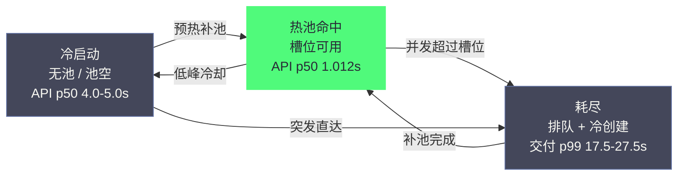

# 12 沙箱性能工程——Runtime 基准与 WarmPool 容量管理

**摘要：**

[[11 三类 Agent 沙箱落地——OpenCode、Hermes 与 LangChain 镜像化实战]] 让 Agent 跑了起来，本文回答性能问题：**跑得多快、占多少资源、能扛多大流量**。文章以素材在真实物理机（Dell R740，RHEL 9.6，Kubernetes 1.34.10）上的同机基准为骨架，展开沙箱性能工程的四个层面：**基准方法论**（同机/同口径/同负载、负载设计与统计分辨率、PSS 口径边界）；**三运行时数据解读**（启动 p50 2.5s/3.0s/4.0s、空闲 PSS 28.8/127.2/392.7MiB、触页/小文件/进程并发的负载差异与基准盲区）；**WarmPool 性能模型**（冷启动 4-5s → 热池命中 1.0s/首命令 2.2s → 并发 50 交付 p99 5.6s → 耗尽 5→50 时 p99 回到 17.5-27.5s——"池化换到的是命中尾延迟，不是无限容量"，并补排队论视角）；**容量规划与调度记账**（GAP-011：gVisor/Kata 的空闲内存调度器完全没计入，overhead 必须按"镜像族×运行时×节点机型"实测；容量模型覆盖节点/池/Registry 三维与敏感性分析）。文末新章用 2026 年行业公开数据复核全篇结论（E2B/Modal/Daytona 官方口径与独立测量的差异、Firecracker 官方规格与快照恢复实测、agent-sandbox 编排基准）。核心认知：**沙箱性能工程的第一原则是"数据必须绑定测量场景"——没有同机对照的性能数字等于营销话术；第二原则是"容量模型必须计入隔离代价"——高档位运行时的内存开销会静默改写你的节点密度，不重算容量模型就会在耗尽事故中付出代价**。

---

## 第 1 章 性能问题的三个层面

### 1.1 创建、运行与容量

在动手测任何数据之前，先要回答一个更基础的问题：沙箱的性能问题到底分几类。初看这像是在问"车跑多快"，但沙箱是一条从请求到结果的完整链路——平台调度、运行时启动、盒内执行、资源占用各自贡献一段延迟，也各自受不同变量支配。笔者把素材 PoC 与测试集群里的教训归纳为一句话：**混淆性能层面的代价，比性能本身不达标更昂贵**——它会让排障者把"运行慢"修成"创建慢"，把"容量不够"诊断成"代码变慢"。

沙箱性能问题分三个层面，混淆任何一个都会得出错误结论：

| 层面 | 问题 | 关键指标 | 素材数据 |
| :--- | :--- | :--- | :--- |
| **创建性能** | 沙箱多久能开始干活 | 冷启动/热池命中延迟 | 冷 4-5s / 热 1.0s API、2.2s 首命令 |
| **运行性能** | 沙箱内负载跑多快 | 负载耗时（相对原生） | CPU 无差、I/O 慢 4-5 倍（Kata） |
| **容量性能** | 节点/集群能扛多少 | 空闲 PSS、每节点密度 | runc 28.8 / gVisor 127.2 / Kata 392.7 MiB |

**三层面的关联**：创建性能决定"体验"（用户等多久），运行性能决定"效率"（任务跑多久），容量性能决定"成本"（同样硬件扛多少）——**选型的争论（runc vs gVisor vs Kata）本质是三个层面的权衡**（[[03 隔离边界的光谱——从共享内核到 MicroVM 的四档技术路线]] 的三角框架）。

把三个层面放到一条真实时间线上看更直观。一次 Agent 会话的完整旅程是：请求到达平台（创建性能起点）→ 认领/创建沙箱 → execd 就绪（首命令可用）→ 盒内执行任务（运行性能）→ 沙箱回收（容量性能的释放）。素材里热池命中 1.012s 与首命令 2.2s 之间的 1.2 秒，就是"创建性能已完成、运行性能尚未开始"的间隙——由 execd 通道建立与首条命令的进程启动构成，是平台层公共成本，与隔离档位无关。这条时间线对排障的意义在 6.4 节再展开：**先定位延迟落在哪一段，再决定查哪一层**。

### 1.2 性能目标的设定：先定 SLO 再测数据

性能工程的第一步不是测数据，而是**定目标**——没有目标的测量无法决策：

| 指标 | 目标示例 | 依据 |
| :--- | :--- | :--- |
| **沙箱交付** | 热池命中 p50 ≤ 3s | 用户体验（等待可接受阈值） |
| **任务执行** | 相对原生开销 ≤ 30% | 业务容忍度（负载画像） |
| **节点密度** | 单节点 ≥ N 沙箱 | 成本模型（单位沙箱成本） |
| **耗尽恢复** | 补池 p99 ≤ 2min | 业务连续性 |

**目标与测量是闭环**：先定目标 → 再测基线（现状 vs 目标）→ 差距驱动优化（池化/overhead/扩容）→ 重测验证。**素材的"热池命中 1.0s/2.2s"是结果，"为什么定这个目标"（用户等待可接受）才是决策的起点**——没有目标的基准报告是"数据堆砌"，有了目标才是"工程决策"。

**SLO 的设定必须可分解、可倒灌**。业务侧给的往往是软目标——譬如"用户别等太久"，落到工程侧要变成可测的三层 SLO：创建层（热池命中 p50 ≤ 3s）、运行层（相对原生开销 ≤ 30%）、容量层（单节点密度 ≥ N）。每一层 SLO 再向下分解成组件预算：3 秒的命中延迟 = 路由 200ms + 鉴权 100ms + 认领 300ms + execd 探活 500ms + 余量 1.9s。预算的意义在于给"达标/不达标"一个归因坐标——p50 超标时先看哪个组件吃了预算，而不是笼统地"平台变慢了"。素材 PoC 早期的教训是测试集群没有 SLO、只记"启动大概四五秒"，结果任何优化都无法判断是否真的变好——**没有目标的测量，数据再多也推不出决策**；1.3 节讲外部数据不可信，这里补上另一面：内部数据没有目标挂靠，同样不够用。

### 1.3 为什么官方数据不够用

性能决策不能依赖官方文档数据，三个原因：

**原因一：版本漂移**。官方的 125ms/5MiB（Firecracker）是特定版本、特定配置下的数字——平台版本、内核版本、镜像版本一变，数据全变。

**原因二：场景错配**。官方数据面向"演示场景"（最小配置、空负载），Agent 沙箱是"真实负载"（大镜像、模型调用、并发）——**官方数据无法回答"我的 2.6GB 镜像 + 50 并发"的问题**。

**原因三：口径混乱**。"启动时间"可以是 API 延迟、容器就绪、首命令可用——**不同口径的数字相差数倍**（素材的 4.0s 冷启动 API vs 2.5s 容器就绪就是同一环境的口径差）。

口径混乱的杀伤力在 2026 年的公开数据里俯拾皆是——同一个 E2B，官方文档写"约 150ms 冷启动"，ColdTally 连续基准（2026-10）测出"创建到首命令返回"中位数 252ms，daily.dev 的跨平台对比则给出 717ms 创建、662ms 恢复；同一个 Modal，官方说"亚秒级"，ColdTally 测 484ms，daily.dev 测 2437ms。差异全部来自时钟位置、停止点、规格形状与分位数的不同——第 8 章会把这场"数字罗生门"完整解剖。这里只需先记住结论：**读到任何性能数字，先问三个标注（场景/口径/环境），再问版本与日期**。

> [!info] 核心概念：性能数字必须带三个标注
> 任何性能数字必须带三个标注才有效：**场景**（冷/热/并发）、**口径**（p50/p99/均值、API/就绪/首命令）、**环境**（硬件/内核/镜像/版本）。不带标注的性能数字等同于营销话术——**本专栏所有数据表都注明来源场景，读者引用时请保留标注**。

---

## 第 2 章 基准设计：方法论

### 2.1 同机对照的三个条件

素材 Phase3-13 的基准可信，因为它满足三个"同"：

| 条件 | 内容 | 违反的后果 |
| :--- | :--- | :--- |
| **同机** | 同一物理机、同一 K8s 集群、同一镜像 | 硬件差异污染数据 |
| **同口径** | p50/p99 分位数、宿主 PSS 内存口径 | 数字不可比 |
| **同负载** | 同样的任务脚本、同样的执行方式 | 负载差异掩盖运行时差异 |

**"同机"的最强形式是"同节点交替测"**——三运行时在同一节点上依次测试（而非三个节点各测各的）——**节点间差异（CPU 型号、内存频率、磁盘性能）在交替测中被消除**。

为什么"交替测"而不是"三个节点各测各的"？两个机制层面的理由。其一是硬件动态行为：CPU 频率不是常数——睿频（Turbo Boost）随负载与温度浮动、内存带宽随邻居访问模式波动、NVMe 写入放大随碎片变化，都在分钟级尺度上漂移；分三台机器跑，任何一台的状态差异都会被误读成运行时差异。其二是统计配对（Paired Comparison）的价值：同节点交替测把"机器"变量从差异里消除，剩下的差异只可能来自运行时或测量噪声，显著性判断不再受机器间方差污染。违反"同机"的代价有现实版本：测试集群曾用两台 CPU 代际不同的 Worker 做对照，gVisor 在旧机器上慢约 30%，一度被误判为版本问题——事后查实是睿频上限与内存通道的差异。**同机对照消除的不是"全部差异"，而是"不该由对比承担的差异"**。

### 2.2 四类负载的设计：覆盖 Agent 工作负载特征

素材选择了四类负载，分别对应 Agent 的典型工作特征：

| 负载 | 内容 | 对应 Agent 场景 |
| :--- | :--- | :--- |
| **CPU 哈希** | 纯计算密集（哈希循环） | 模型推理后的代码执行、数据处理 |
| **512MiB 内存触页** | 大内存分配与触页 | 大对象分配、数据集加载 |
| **5000 小文件创建** | I/O 密集（文件元数据） | 构建产物、缓存写入、代码生成 |
| **200 进程并发** | 进程创建密集 | Agent fork 子任务、并行工具调用 |

**负载设计的两个原则**：其一，**负载必须来自"实际工作负载的特征"**（不是随便选个 benchmark 套件）——"Agent 实际会做什么"决定测什么；其二，**负载要有"基线可比性"**（runc 是零点，第 03 篇 2.4 节的"对照基线"角色）——没有基线的数据无法解读。

负载的强度标定同样有讲究，它决定测出来的数字是否有区分度。512MiB 的触页量要选得"大于页缓存、小于节点内存"——太大直接 OOM 混入无关失败，太小全部命中页缓存、测不出缺页路径；5000 个小文件对应"一个中等构建任务的产物数量级"；200 个并发进程略高于单核能同时驻留的线程数，确保负载压在进程创建路径上而不是排队等 CPU。**标定负载强度的原则是让"被测路径"成为瓶颈、让"非被测路径"不成为瓶颈**。

负载设计的边界同样要说清楚——**这四类负载覆盖了 Coding Agent 的计算/I/O/进程特征，但没有覆盖全部**：没有网络负载（gVisor netstack 差异测不到）、没有大文件顺序读写（快照恢复与数据集加载）、没有 GPU 负载、没有并发多沙箱的资源争抢。缺测意味着基准结论有适用范围："CPU 无差"不能外推到网络密集型 Agent（第 03 篇 4.4 节的 netstack 分析补上了这块）；"Kata 慢 4 倍"只对 5000 个小文件这个量级成立。第 3.7 节集中讨论盲区，这里先记住：**负载覆盖是威胁模型的一部分，测什么由"Agent 实际会做什么"决定**。

### 2.3 基准执行的工程细节

基准"测出来"的过程本身有五个工程细节（素材实践），忽略任何一个都会让数据失真：

| 细节 | 内容 | 失真的后果 |
| :--- | :--- | :--- |
| **顺序交替** | runc→gVisor→Kata 交替测（而非一轮跑完） | 环境漂移（缓存/温度/邻居负载）被误读为运行时差异 |
| **重复次数** | 每组负载 N 次取分位数（N≥20） | 单次测量噪声污染结论 |
| **预热排除** | 首轮数据丢弃（镜像缓存/运行时预热） | 首轮偏慢污染 p50 |
| **隔离干扰** | 测 A 时停掉 B 的沙箱（同节点混跑干扰） | 资源争抢被误读为运行时差异 |
| **数据记录** | 原始数据落盘（不只记结论） | 无法复核与重算 |

**"数据落盘"尤其重要**——结论可能被推翻（换口径/换算法），原始数据是唯一可回溯的依据。**素材的基准数据以表格形式沉淀在调研文档中，原始记录可追溯——这是性能工程的第一交付物**。

两个容易被忽略的操作细节，素材实践里有明确教训。其一是**计时端**：API 侧计时与客户端计时之间隔着网络往返、DNS、TLS，同一轮测试两个口径可以差出一倍——第 8 章的独立数据里，同一批创建服务端 p50 102ms、笔记本侧 175ms（withruntime 实测）。基准报告必须写清计时端，否则"2.5s 启动"是平台说的还是用户说的都分不清。其二是**版本快照**：每轮基准都要记录内核版本、运行时版本、镜像 digest、Kubernetes 版本——素材的季度回归（3.4 节）能定位"悄悄变慢"，靠的就是每轮版本快照可比。**没有版本快照的基准数据，只能证明"当年测过"，不能证明"现在成立"**。

### 2.4 指标口径：p50/p99 与 PSS

**分位数选择**：p50 代表"典型体验"（多数请求），p99 代表"尾延迟"（最差体验）——**性能决策看 p99，容量决策看 p50**（[[09 OpenSandbox 编排面——BatchSandbox、WarmPool 与快照]] 的命中/耗尽数据同时报告 p50/p99 的原因）。

**PSS（Proportional Set Size）**：按共享比例分摊后的进程内存——**沙箱的内存开销必须用宿主 PSS 口径**（RSS 会重复计算共享页，VmSize 会虚高）。素材的"空闲 PSS"是"沙箱创建后无负载时"的宿主侧内存——**这是容量规划的最小单元**。

三个内存口径的区别用一个小例子说清。假设一个 512MiB 的进程与另一个进程共享 256MiB 的共享库页，每页恰好被两个进程引用：RSS（Resident Set Size）把共享页在两个进程里各记一遍，总量 768MiB 被记成 1024MiB；USS（Unique Set Size）只记独占页，加总 512MiB，漏掉真实占用；PSS 把共享页按引用数分摊（各记 128MiB），合计 768MiB，恰好等于真实总量。**沙箱场景必须用宿主侧 PSS 的第二个理由**：沙箱不是单个进程，而是"进程组 + 运行时进程 + 网络组件"的集合——runc 的 28.8MiB 是 shim、pause 容器与 cgroup 记账的合计，gVisor 的 127.2MiB 跨 Sentry、Gofer 与 netstack，Kata 的 392.7MiB 横跨 QEMU、vCPU 线程与 Guest 内核；按 cgroup 内 RSS 口径，这些宿主侧进程一个都记不进去，容量规划会系统性低估。

### 2.5 对照基线的设计与陷阱

素材的全部对比都以 runc 为零点——"相对 runc 1.2x/1.6x"、"4.4x/13.6x"这些倍数，本质是**把 runc 当测量标尺**。倍数设计有两个好处：其一，抹平"环境常量"——镜像拉取、K8s 链路固定成本在三个运行时里等量出现，一比就消掉了，剩下纯运行时差异；其二，可以跨环境粗比较——本节的 28.8MiB 与第 8 章的 6.9MB 虽然绝对值不同，但"runc 最低、gVisor 中等、Kata 最高"的相对序一致。

但标尺本身会漂移。runc 升级、内核版本变化、镜像常驻变大都会让零点移动——**相对倍数对"零点漂移"完全无感，读者看到的 1.2x 可能隐藏着两个运行时都在变慢的事实**。这正是素材每次基准必须重测 runc 的原因：相对结论依赖基线的实时性，基线过期，倍数失效。另一个陷阱是"用倍数做跨来源对比"——第 03 篇 6.5 节的基准边界纪律同样生效：不同测量场景的倍数可以互相印证方向，但不能互相做算术。

---

## 第 3 章 三运行时基准数据与解读

### 3.1 启动性能

| 指标 | runc | gVisor | Kata |
| :--- | :--- | :--- | :--- |
| 启动到可用 p50 | 2.515s | 3.015s | 4.016s |
| 相对 runc | 1.0x | 1.2x | 1.6x |

**解读**：
1. **绝对差距小于相对差距的表象**——2.5s→4.0s 的 1.5s 差距里包含 K8s 链路固定成本（镜像、调度、CR 对账），**纯运行时启动差异更小**（runc 毫秒级、Kata 秒级 VM 引导）；
2. **"启动到可用"的口径是"首命令可用"**（含 execd 就绪）——比"容器就绪"更贴近用户体验；
3. **预热池抹平差距**（4.1 节）——冷启动差异只影响"池打空"场景。

冷启动的"4-5s API p50"不是运行时单独贡献的，把它拆开看，才能明白 2.5s→4.0s 的 1.5s 差距为什么"比表象小"。一次冷创建的全链路是：镜像就绪（未缓存时拉取占大头）→ Pod 调度与 CR 对账 → containerd 调起 shim → 运行时启动（runc 毫秒级 fork；gVisor 拉起 Sentry，数百毫秒级；Kata 走 VM 引导，秒级）→ execd 自启与探活 → API 返回。**镜像、调度、execd 三段是三个运行时的公共成本，只有"运行时启动"一段是差异来源**——1.5s 差距里真正属于运行时的，可能只有几百毫秒到一秒。素材验证这一点的做法是绕过 K8s 链路直接测纯运行时启动（containerd ctr run 或 runsc/kata-runtime 直跑）——**"测纯运行时"与"测全链路"是两个口径，前者回答选型，后者回答体验**，报告里必须写清。

### 3.2 内存开销：最显著的差距

| 指标 | runc | gVisor | Kata |
| :--- | :--- | :--- | :--- |
| 空闲宿主 PSS | 28.8 MiB | 127.2 MiB | 392.7 MiB |
| 相对 runc | 1.0x | 4.4x | 13.6x |

**解读**：
1. **gVisor 的 127MiB 是 Sentry + Gofer + 网络栈的常驻成本**（第 03 篇 4.5 节的结构性成本）；
2. **Kata 的 393MiB 是 Guest 内核 + VM 元数据 + QEMU 进程**——VM 的"票价"；
3. **密度换算**：256GiB 节点（按 80% 可用 ≈ 205GiB）——runc 约 7300 槽、gVisor 约 1650 槽、Kata 约 530 槽——**高档位的密度劣势是数量级的**。

内存差距是三组数据里最值得逐项拆解的。runc 的 28.8MiB 是平台层常驻的底线——containerd shim、网络插件、cgroup 记账，衡量"任何沙箱都躲不掉的服务成本"。gVisor 的 127.2MiB 由 Sentry 承担大头：Sentry 是常驻的用户态内核，Go 运行时与堆、进程表、内存管理结构、netstack 都住在里面，Gofer 与平台线程再各占一份（第 03 篇 4.5 节的结构性成本）；这个数不随负载下降，因为 Sentry 一启动就全额分配。Kata 的 392.7MiB 是"VM 的票价"：Guest 内核与驱动、rootfs 页缓存、virtio 队列与设备模型、QEMU 进程代码段与堆，加上 vsock 通道——几项加总即是实测的 393MiB 量级。

3.2 节第 3 点的密度换算是**纯 PSS 口径**——只算空闲内存、把沙箱 requests 当零的密度上限。真实容量必须把 requests 加进来：**单槽实际占用 = 沙箱 requests + 空闲 PSS**。256GiB 节点按 80% 可用 ≈ 205GiB，requests 取 512MiB 时：runc 每槽约 530MiB → 约 387 个；gVisor 约 639MiB → 约 321 个；Kata 约 905MiB → 约 226 个。注意一个反直觉结论：**requests 越接近 PSS 的量级，PSS 占比越大**——同样 overhead，1C/2G 小规格比 4C/16G 大规格敏感得多，Kata 的 393MiB 在 512MiB requests 规格下占掉四成多配额，这解释了高档位为何通常配合大规格使用。第 6.3 节的容量演练用的就是这套公式。

### 3.3 负载性能：隔离档位对运行的影响

| 负载 | runc | gVisor | Kata | 解读 |
| :--- | :--- | :--- | :--- | :--- |
| CPU 哈希（p50） | ~10.3s | ~10.3s | ~10.3s | **纯计算无差异**（不经过隔离层） |
| 512MiB 触页 | 0.150s | 0.849s | 0.967s | gVisor/Kata 慢 5-6 倍（页错误路径更长） |
| 5000 小文件 | 0.599s | 0.609s | 2.364s | Kata 慢 4 倍（virtio-blk + Guest FS 栈） |
| 200 进程并发 | 0.128s | 0.622s | 0.625s | gVisor/Kata 慢约 5 倍（进程创建路径） |

**三组负载的三个结论**：

**结论一：CPU 密集负载几乎不受隔离影响**——模型推理后的计算、数据处理可以放心跑任何档位。

**结论二：I/O 与进程密集负载的代价集中在"路径长度"**——gVisor 的触页慢（Sentry 内存管理路径）、Kata 的小文件慢（virtio 与 Guest 文件系统栈）、两者进程创建都慢（fork 路径经过隔离层）——**"路径长的操作"就是高档位慢的操作**。

**结论三：负载画像决定选型**——如果 Agent 任务以"计算 + 少量 I/O"为主（典型 Coding Agent），gVisor 的开销可接受；如果任务以"大量小文件 + 频繁进程"为主（构建型任务），Kata 的代价显著。

三条负载差异的机制各有各的路径。触页的 5-6 倍差距来自页错误路径长度：runc 的缺页由宿主内核直接处理；gVisor 的缺页先进 Sentry 的内存管理逻辑再落到宿主分配器，多了一整层用户态软件；Kata 的缺页先经 Guest 内核、再经 EPT 翻译到宿主，路径最长——0.849s 与 0.967s 的差距恰与"两层软件 vs 两层内核"对应。5000 小文件的差异分叉在两个运行时身上：gVisor 的 0.609s 与 runc 的 0.599s 几乎持平，因为 LISAFS 以文件描述符为操作对象，把元数据操作的 RPC 往返压到接近原生（第 03 篇 4.3 节）；Kata 的 2.364s 被 virtio-blk 队列往返与 Guest 文件系统栈吃掉四倍——**小文件场景里，用户态内核的间接层反而比 VM 的设备模拟便宜**。进程并发的 5 倍差距来自创建路径：runc 的 fork/exec 直达内核；gVisor 要经 Sentry 的调度器与信号模型；Kata 要 Guest 内核与 vCPU 参与——0.622s 与 0.625s 的接近说明两种隔离层在"进程创建"上路径长度相当。

### 3.4 基准的复现与更新节奏

基准不是"测一次管三年"——它需要随环境演进而更新：

| 触发条件 | 更新内容 | 理由 |
| :--- | :--- | :--- |
| **运行时升级** | 重测该运行时全量数据 | 版本差异可能显著（Kata 4.0 单二进制等） |
| **内核升级** | 重测启动与内存 | gVisor 依赖内核版本（第 03 篇 门禁一） |
| **镜像族变化** | 重测 overhead 与负载 | overhead 按镜像族实测（5.2 节） |
| **机型变化** | 新机型全量重测 | 硬件差异（CPU 代际/内存带宽）无法外推 |
| **季度节奏** | 全量回归（即使无变更） | 环境漂移的检测（"悄悄变慢"的发现） |

**"季度回归"的深层价值**：性能退化往往不是"某次变更"而是"环境漂移"（邻居负载、存储磨损、缓存策略）——**定期全量回归是"没变更也变慢"的唯一发现手段**。

更新节奏里最容易犯的错是"只重测出问题的运行时"。素材的经验是**全量重测**——环境漂移（内核补丁、镜像基础层更新、节点固件）会同时影响三个运行时，只重测一个会把"环境变了"误判成"这个运行时变了"。另一个实操细节：每轮回归的版本快照（2.3 节）要与数据同表记录，季度对比先对齐版本再比数字——素材把 Phase3-13 首轮与后续回归归档在同一目录，任何一轮变化都能回溯到对应版本。

### 3.5 "性能换隔离"的量化框架

把三组数据合成一个决策框架：

```
选型代价 = 启动代价（冷启动差 1.5s，池化后可抹平）
         + 内存代价（密度差 4.4x/13.6x，容量模型重算）
         + 负载代价（I/O/进程慢 4-6 倍，按负载画像评估）
         + 隔离收益（逃逸难度：原语 < Sentry < hypervisor）

决策：隔离收益 > 三代价之和 → 高档位；否则低档位
```

**框架的使用**：不是"Kata 好"或"runc 好"，而是"**你的负载画像 + 容量预算 + 威胁等级**"三个输入代入框架——素材的"runc 先行 + gVisor 灰度 + Kata 门禁"（第 03 篇 7.4 节）就是这个框架的实践。

框架的三个输入里，最容易偷懒的是负载画像。**负载画像不是"感觉 Agent 偏计算"，而是从真实任务日志里统计出来的分布**：把历史任务按"系统调用构成、I/O 量、进程创建数、运行时长"打标，落在计算/触页/小文件/进程四个桶里看占比。素材测试集群的做法是先用 runc Profile 跑一周真实 Agent 流量，从监控抽画像，再拿去套选型代价公式——**没有画像的选型代价计算，等于拿别人的体检报告给自己开药**。画像还会随 Agent 版本漂移：引入新工具后 I/O 占比显著变化，选型结论需要重算，回到 3.4 节的"变更触发重测"纪律。

### 3.6 基准数据的统计分辨率

数据表摆出来之后，紧接着的问题是：哪些差异是结论，哪些差异是噪声？判断标准有两条——**差异幅度必须远超测量噪声，且必须有机制解释**，缺一不可。

用素材数据举例。CPU 哈希三者同为 ~10.3s，差异在噪声以内（不到 1%），机制上也讲得通（纯算术指令不经过隔离层），结论是"无差"。512MiB 触页 runc 0.150s vs gVisor 0.849s，差 5.7 倍，远超单轮测量抖动，机制上也有页错误路径解释——这是结论。但热池命中"首命令"2.224/2.246/2.270s 之间那 46ms 的差异，幅度只有 2%，且没有机制能说明"为什么 Kata 比 runc 慢 46ms"（命中路径不经隔离层）——**这是噪声，不是结论**，报告标注"三运行时一致"是诚实的写法。

统计上还有一个易被忽视的点：**p99 需要的样本量远大于 p50**。p50 几十个样本就能稳定，p99 要估计到 ±20% 以内通常需要几百个样本——素材每组负载 N≥20 只够 p50 的稳定估计；耗尽实验（5→50）的 p99（17.5-27.5s）是单次观测值，不如说是"耗尽代价的量级锚点"，报告中把两种精度分开写更负责任。

### 3.7 基准的盲区与边界

承认基准的边界，比假装基准完备更接近工程。素材这轮基准有四个明确盲区，引用结论时必须知道它们没被测过。

其一，**网络吞吐**。四类负载全是本地操作，gVisor netstack 与宿主内核栈的差异（第 03 篇 4.4 节：短连接有用户态处理开销、高吞吐缺少内核优化）没有被覆盖——网络密集型 Agent 不能套用"CPU 无差"的结论。其二，**大文件顺序读写**。5000 小文件测的是元数据路径，快照恢复、数据集加载是顺序读场景，virtio-blk 与 LISAFS 在大块传输上的表现需要单独测。其三，**GPU 与专用硬件**。Kata 的 GPU 直通只在 QEMU hypervisor 下可用（第 03 篇 5.1 节），gVisor 的 GPU 沙箱是 Modal 的企业选项——带 GPU 的任务不在本轮基准范围内。其四，**并发多沙箱的资源争抢**。同机对照一次只跑一个沙箱，真实平台是几十上百个沙箱共享节点，内存带宽、页表竞争、TLB 抖动只在并发下显现。这四个盲区是范围选择而非疏漏：**基准回答"隔离档位的固有代价"，并发争抢与网络属于"平台容量"与"运行时网络"的单独课题**——前者是第 6 章，后者是第 03 篇 4.4 节。

---

## 第 4 章 WarmPool 性能模型

### 4.1 三态模型：冷、热、耗尽

WarmPool 的性能用三态描述（素材 Phase3-14/15）：

| 状态 | 触发 | API p50 | 到首命令 p50 | 交付 p99 |
| :--- | :--- | :--- | :--- | :--- |
| **冷启动** | 无池/池空 | 4.0-5.0s | — | — |
| **热池命中** | 有可用槽位 | **1.012s** | **2.2s** | 并发 50 时 ~5.6s |
| **耗尽** | 槽位不足（5→50） | — | — | **17.5-27.5s**（回到冷启动量级） |

**三态的工程含义**：
1. **热池命中时三运行时 API 延迟完全相同（1.012s）**——池化抹平隔离档位的启动差异（第 03 篇 6.4 节）；
2. **耗尽时差距重新出现**（runc 17.5s vs Kata 27.5s）——**池打空后，高档位的启动代价以"耗尽尾延迟"的形式回归**；
3. **并发 50 命中不劣化**（~5.6s）——**池容量充足时，吞吐是线性的**。

把三态放进"水库"的比喻里更好记：池是蓄水池，热池命中是闸门全开直接放水（1 秒级），冷启动是从上游重新蓄水（4-5 秒级），耗尽是水位见底、下游排队等上游来水（17-27 秒级）。技术限定在于，蓄水（预热）是要花钱的——每个槽位的 PSS 内存持续占着，所以低水位/高水位的调度（4.4 节）本质是"用蓄水成本换放水速度"。三态迁移可以画成一张状态机：



这张图的工程含义在第 6.2 节兑现：命中率、排队时延、补池时延三个 SLI 分别探测冷启动、耗尽、恢复三个箭头——**SLI 是这张状态机的仪表盘**。

### 4.2 命中与耗尽的延迟分布解读

```
热池命中（p50 1.0s）的构成：
  请求路由 + 鉴权 + 分配器认领 + execd 探活 + 响应

耗尽（p99 17-27s）的构成：
  冷创建全链路（镜像拉取 + Pod 调度 + 运行时启动 + execd 就绪）
  + 队列等待（多个请求抢新创建的槽位）
```

**"耗尽尾延迟"的真相**：耗尽不是"慢一点"而是"回到冷启动"——**池化消除的是"重复创建"的成本，不是"创建"的成本**。容量规划必须把"耗尽时延 = 冷启动时延"写进预期（业务方要知道"池打空时用户要等 17-27 秒"）。

命中路径的每一项都还有压缩空间，这是平台优化时的路线图：请求路由（Ingress 转发，可换更薄的路由层）、鉴权（Token 校验，可加缓存短路）、allocator 认领（内存态 vs CR 对账，素材是内存态，快）、execd 探活（可与认领并行）。耗尽路径则相反，每一项都是"结构性时延"：镜像拉取取决于镜像大小与存储介质（2.6GB 的 code-interpreter 与 busybox 差一个数量级）、调度取决于集群规模、运行时启动取决于隔离档位（4.1 节的 17.5s vs 27.5s 差距就在这里）。**命中的优化空间在平台层，耗尽的优化空间在供应链层**——前者调代码，后者调镜像体积、缓存与预热策略。

"耗尽窗口"是容量规划里必须写进文档的数字：从池空到补满的窗口内，到达的请求全部走"排队 + 冷创建"。窗口长度 = 告警时延 + 补池触发时延 + 补池完成时延（冷创建 4-5s 起步）+ 队列消化时延。素材的 5→50 耗尽实验测的是"窗口内的单请求代价"（p99 17.5-27.5s），窗口本身的长短取决于 6.2 节的补池 SLI——**两个数字分开写，业务方才能同时回答"打空一次多痛"与"多久能恢复"**。

### 4.3 容量公式

素材与推导的容量规划公式：

```
池槽位数 ≥ 峰值并发 × 目标命中率
  例：峰值 200 并发、目标命中率 95% → 槽位数 ≥ 190

池内存预算 = 槽位数 × 单槽空闲 PSS
  例：190 槽 × Kata 397MiB ≈ 73.6GiB（仅池的常驻）
      190 槽 × runc 18MiB ≈ 3.4GiB

耗尽行为预期：耗尽时延 = 冷启动时延（写进文档）
```

**注意单槽 PSS 的差异**：素材的"空闲槽位 PSS"（runc 18.09 / gVisor 111.84 / Kata 396.88 MiB）与"沙箱空闲 PSS"（28.8/127.2/392.7）口径略不同（槽位不含部分平台开销）——**容量规划用槽位口径**（池的账本），**节点规划用沙箱口径**（密度账本）。

基础公式"槽位 ≥ 峰值并发 × 目标命中率"隐含一个强假设：峰值并发是已知常数。真实世界的到达是随机过程，把池当作服务台系统（M/M/c 队列，c 为槽位数）看更接近本质：请求按泊松流到达（速率 λ），槽位认领与执行构成服务时间（速率 μ），排队论给出两个关键量——**请求到达时全部槽位占满（落入耗尽）的概率**，以及**等待时间的期望**。用 Erlang-C 公式（爱尔兰 C 公式，话务工程经典结果）可算：槽位数从"恰好等于峰值并发"涨到 1.1 倍，耗尽概率下降一个量级以上；从 0.9 倍涨到 1.0 倍改善最大——**容量曲线的边际收益在"接近 1.0"处最陡，这正是经验公式背后的数学**。素材的 95% 目标（190 槽）对应"每 20 个请求有一个落进排队"，99.9% 目标（200 槽）对应"每千个请求一个"——槽位只差 5%，概率差 50 倍。

但比"槽位差 5%"更值得优化的是**峰值估计的误差**。峰值估计偏小 20%（200 估成 160），按 95% 目标配 152 槽，真实峰值到达时命中率从 95% 掉到 76%——**峰值估计的 20% 误差，吃掉 38 个槽位的余量**。容量规划的第一敏感参数不是槽位数，而是峰值估计的校准：用 6.2 节的命中率 SLI 反推真实峰值（命中率持续低于目标 → 峰值估计偏小）。这条结论与 6.5 节的敏感性分析互相咬合。

### 4.4 预热与冷却的运维节奏

池不是"一直满"——预热/冷却的节奏要与业务周期对齐（[[09 OpenSandbox 编排面——BatchSandbox、WarmPool 与快照]] 3.7 节的池运维经验一展开版）：

| 时段 | 池策略 | 理由 |
| :--- | :--- | :--- |
| **业务高峰前** | 提前预热到高水位 | 峰值并发来临时池已就绪 |
| **业务高峰中** | 保持高水位 + 监控耗尽 SLI | 突发（如评测批量提交）可能打空 |
| **业务低谷** | 冷却到低水位 | 空闲槽位是纯成本（持有内存） |
| **发布期间** | 新池预热 + 旧池排干 | 不可变版本策略（第 09 篇 3.6 节） |

**预热成本的量化**：预热不是免费的——预热 = 提前占用资源。**"低水位"的设计目标**：覆盖"预测内的波动"（低水位），把"预测外的突发"交给耗尽 SLI 兜底（告警 + 补池）——**容量策略的本质是"预测覆盖 + 失控告警"的组合**。

预热节奏的另一个细节是**冷池（Cold Pool）**：行业里已出现"低水位也不建、需要时从快照恢复"的第三态——GKE 的 standby-capacity 用挂起态 VM 补充池（Google Cloud Blog 2026-05），Daytona 也有"从快照模板恢复"的路径（第 8 章给出数字）。冷池的账：恢复比冷创建快（省镜像拉取与运行时启动）、比热池命中慢——把"低水位的持有成本"换成"恢复时的中等延迟"，适合"低谷期偶发请求"的形状。素材 0.2.x 的 Pool 没有冷池语义，这是与行业现状的一个具体差距。

### 4.5 多池策略：按租户与档位分池

单池无法覆盖全部场景——素材生产方案的多池策略（结合 Phase5-01 的三 Profile 与 Phase1-11 的租户规划）：

| 池维度 | 分池依据 | 示例 |
| :--- | :--- | :--- |
| **按档位** | 隔离强度（runc/gVisor/Kata） | 三 Profile 三池（独立域名） |
| **按租户** | 租户隔离与配额 | 租户 A 池 / 租户 B 池 |
| **按镜像** | 镜像族（避免互相污染缓存） | code-interpreter 池 / opencode 池 |
| **按规格** | 资源规格（1C/2G vs 2C/4G） | 轻任务池 / 重任务池 |

**多池的成本**：池数量 × 每池低水位 = 常驻内存总量——**池越多，浪费越多**（碎片与低水位叠加）。**多池的收益**：租户隔离（配额独立）、档位隔离（运行时独立）、故障隔离（单池故障不波及其他）。

**平衡原则**：**先按"必须隔离"的维度分池（租户/档位），再按"可以合并"的维度合并（镜像/规格）**——必须隔离的维度是安全与合规（不可妥协），可以合并的维度是成本（可优化）。

多池的另一个隐形成本是**每池的策略独立运维**：scale/update/recycle 三策略是池级别的（第 09 篇 3.4 节），池一多，更新窗口、回收策略、预热节奏各自为政——"Pool 当不可变版本"的纪律在单池上勉强可行，多池下必须靠发布流水线统一编排。**分池的粒度上限不是技术约束，是运维复杂度约束**：池数量超过运维能并行照顾的上限，维度红利就开始被管理成本吃掉。

### 4.6 碎片与多维度池

素材的碎片教训：**不同 Runtime/镜像/规格的槽位不能互借**——池按（Runtime × 镜像 × 规格 × 安全域）分组，组间不互借：

```
碎片示例：
  池 A：runc × code-interpreter × 1C/2G —— 10 槽
  池 B：Kata × opencode × 2C/4G —— 10 槽
  请求：runc × code-interpreter × 1C/2G（池 A 满，池 B 空 8 槽）
  → 请求排队等池 A（池 B 的空槽不可用）→ 碎片

碎片率 = 1 -（可被请求使用的槽位 / 总槽位）
```

**碎片管理**：维度越多碎片越严重——**合并低利用率池（牺牲粒度换利用率）与按流量画像分池（保粒度）之间的平衡是容量管理的日常功课**。SLI 里的"碎片率"就是为此设计（6.2 节）。

碎片问题在 2026 年的托管平台里是公开的工程话题——Daytona 的 warm pool 文档明确写着：认领必须与池在快照、region、CPU/内存/磁盘规格、默认用户、环境变量、卷上**完全匹配**，任一不匹配即跳过池走冷创建（官方 troubleshooting 文档）。这与素材"不同 Runtime/镜像/规格的槽位不能互借"是同一个物理规律——**碎片的本质是"池的规格维度 × 请求的规格维度"的错配，任何平台都躲不开，只能靠分池策略与 SLI 管理它**。agent-sandbox 的隔离档位路由提案（PR #1267）甚至把"池选择 + 溢出语义"做成 admission webhook：`overflow: allow` 允许跨档位 fallback（宁可快一点的 gVisor 也不等 13 秒的 Kata 冷启动），`deny` 则死守隔离保证——**溢出语义本身就是对碎片与耗尽的回应**。

### 4.7 耗尽恢复的端到端时间

耗尽不是一次事件，而是一段可拆解的事件链，恢复时间等于各段时延之和：

```
t0 耗尽发生（槽位告急）→ 命中率 SLI 触发告警
t1 补池决策（人工 or 自动）→ 触发新槽位创建
t2 新槽位就绪（冷创建 4-5s 起步）→ 槽位入池
t3 队列消化（排队请求逐个认领新槽位）
恢复完成
```

四段时延里，t2 是结构性下限（冷创建决定），t1 与 t3 是工程可控项——t1 靠自动补池（把"告警后等人看板"变成"告警即触发"），t3 靠队列的公平性与认领并发度。补池还有"风暴"风险：一次性补满 N 个槽位等于同时发起 N 次冷创建，节点 CPU、内存、存储瞬时被拉满，可能触发新一轮驱逐——**渐进补池（先补一批、稳定后再补下一批）比一次补满更安全**，代价是恢复时间拉长。

行业数据给这条链提供了量级锚点（两组数据的细节在 8.3 节展开）。结论一句话：**耗尽恢复是事件驱动的工程，不是容量承诺——把恢复时间写进预期、把自动补池做成默认、把渐进补池做成规范**。

---

## 第 5 章 调度记账：Pod Overhead 缺口

### 5.1 GAP-011：调度器的盲区

素材 Phase5-02 记录的 GAP-011：**gVisor 空闲 PSS 约 127.2MiB，但 K8s 调度器按普通容器口径计算节点容量——调度账本与真实开销脱节**。

```
错误的账本：
  节点容量 205GiB ÷ 沙箱 requests（如 512MiB）= 400 个沙箱 → 调度器认为能放 400

真实的账本（gVisor）：
  400 × 512MiB（requests）+ 400 × 127MiB（Sentry 常驻）= 250GiB > 205GiB
  → 节点实际过载，OOM 风险系统性低估
```

**为什么调度器不计入**：RuntimeClass 的 `overhead` 字段是"可选"的——OpenSandbox 0.2.x 创建 Pod 时未正确配置 overhead（素材 GAP-011 的根因）——**"K8s 提供了机制"与"平台使用了机制"是两件事**。

调度记账的机制细节值得再钻一层：kubelet 算节点 allocatable 时先扣掉 system-reserved、kube-reserved 与驱逐阈值；调度器按 Pod 的 requests 逐 Pod 扣减。RuntimeClass 的 overhead 字段（podFixed + 每容器 overhead）会让调度器"多扣"一块，kubelet 也把它计入驱逐判断——**配置了 overhead，节点能塞的沙箱数立刻下降**。素材 0.2.x 的问题在于创建 Pod 时没有正确挂 RuntimeClass（或 RuntimeClass 没写 overhead），调度器按"裸 requests"记账——账本记 400，真实世界是 400×512MiB + 400×127MiB，超额部分在节点内存里现形。**调度器不是不提供机制，而是机制需要一个使用它的平台**——"K8s 提供了机制"与"平台使用了机制"是两件事，值得每轮迭代重读一遍。

### 5.2 overhead 的实测方法

素材的方法论：**overhead 必须按"镜像族 × 运行时 × 节点机型"实测**，不能用一个数套所有场景：

```
实测步骤：
1. 选定组合：镜像族（code-interpreter/opencode/...）× 运行时（gVisor/Kata）× 机型
2. 创建沙箱（空负载），测宿主 PSS
3. 减去镜像本身的常驻（同镜像 runc 的 PSS）→ 得到运行时 overhead
4. 重复 N 次取分位数 → 写入 RuntimeClass.overhead

为什么不能用一个数：
  - 不同镜像的常驻不同（Node 应用 vs Python 解释器）
  - 不同机型的页表/内核结构开销不同
  - overhead 是"运行时本身的开销"，随镜像体积变化
```

**Kata 的占位陷阱**：素材 PoC 曾用 `250m/160Mi` 占位——**占位 overhead 会让调度器"以为"算清了，实际偏差巨大**（Kata 实测 393MiB vs 占位 160MiB）——**"占位"比"不配"更危险**（假精确让人放松警惕）。

实测方法还有一个测量口径的坑：**"镜像本身常驻"与"运行时 overhead"要分清楚**。同镜像下 runc 的 PSS 是镜像基线（各语言运行时常驻多少），gVisor/Kata 的 PSS 减去基线才是运行时 overhead——素材里"沙箱空闲 PSS"与"池空闲槽位 PSS"两组数字的差异（runc 差 10.7MiB、gVisor 差 15.4MiB）就来自口径切分：槽位口径去掉了部分平台层进程的常驻。**两组口径各有用途（4.3 节），但不能混用**——容量规划时用错口径，误差直接进入账本。

### 5.3 overhead 的验证闭环

配置 overhead 之后不是"完事"——需要验证闭环（素材 GAP-011 的教训：配置了不等于生效了）：

```
闭环三步：
1. 配置前：记录"调度器账本"（kubectl describe node 的 allocatable 变化）
2. 配置后：创建 N 个沙箱，实测宿主 PSS 总和
3. 对比：调度器账本 ≈ 实测总和？
   - 是 → overhead 生效 ✅
   - 否 → 检查 RuntimeClass 是否被 Pod 引用（四层一致性，第 02 篇）
```

**验证的工具**：`kubectl describe node` 看 allocatable（overhead 会减少可分配内存）、`kubectl get pod -o yaml` 看 runtimeClassName、宿主侧 `ps`/cgroup 看真实 PSS。**"配置生效"的唯一证据是"调度账本与真实世界对齐"**——不是 YAML 写对了，而是数字对上了。

验证闭环里最容易踩的坑是**"配置了但 Pod 没引用"**：RuntimeClass 配好了 overhead，但 Pod 的 runtimeClassName 没写、或写的是另一个同名不同值的 RuntimeClass——overhead 静默不生效。素材 GAP-011 的复盘里，四层一致性（RuntimeClass → handler → containerd 插件 → 节点标签）就是为这个坑设计的检查清单（第 02 篇）。所以闭环第二步"创建 N 个沙箱实测 PSS 总和"不可省略：**它验证的不是 YAML 语法，而是"账本与真实世界对齐"这个事实**。

### 5.4 RuntimeClass.overhead 的正确配置

```yaml
# 正确的 RuntimeClass 配置（示例）
apiVersion: node.k8s.io/v1
kind: RuntimeClass
metadata:
  name: kata-qemu-runtime-rs
handler: kata-qemu-runtime-rs
overhead:
  podFixed:
    cpu: "250m"        # 实测值（示例）
    memory: "393Mi"    # 实测值（Kata 空闲 PSS 口径）
scheduling:
  nodeSelector:
    runtime: kata      # 节点标签（四层一致性）
```

**配置后的效果**：调度器把 overhead 计入节点容量——**"能放多少沙箱"的账本与真实世界对齐**。**验证方法**：配置后重跑容量基准，确认"调度器账本 ≈ 实测 PSS 总和"。

配置时有两个官方口径细节容易写错。其一是 **podFixed 与容器级 overhead 的关系**：RuntimeClass.overhead 由 podFixed 与每个容器的 overhead 两部分组成，单容器 Pod 两者都算，多容器 Pod 的总 overhead = podFixed + Σ 各容器 overhead——素材示例里的 `393Mi` 放在 podFixed 下，对应"单容器 + 平台固定开销"的口径。其二是 **overhead 的生效面**：既进调度器的 allocatable 记账，也进 kubelet 的驱逐计算——配置后"能塞几个"与"什么时候驱逐"同时变化，验证时两个面都要看。外部对照：GKE Sandbox 的 MicroVM 档（Kata + Cloud Hypervisor）官方固定收取每 Pod 250mCPU + 130MiB——低于素材 Kata 实测的 393MiB，因为官方值是面向最小镜像的保守下限，而实测含镜像常驻与机型差异。**差异本身再次说明：用别人的固定值还是自己的实测值，取决于镜像与机型多接近他们的假设**。

### 5.5 overhead 的动态性与反例

overhead 不是一次测量管到永远，它有三个动态维度。其一，**镜像族漂移**：镜像升级引入更重的运行时，常驻变大，旧 overhead 变成低估——"镜像族×运行时×机型"矩阵里任何一格变了都要重测。其二，**运行时版本**：Kata 4.0 的 Rust runtime-rs 把内存占用列为高密度部署的关键指标（第 03 篇 5.1 节），gVisor 周更意味着每轮升级都可能改变 Sentry 常驻——**运行时升级清单里必须有一项"重测 overhead"**。其三，**路径差异**：快照恢复出来的沙箱（内存映射页）与冷创建的沙箱内存画像不同，含快照的平台要分别测。

反例同样要说清：overhead 永远是个近似值，救不了"三类系统性低估"——页缓存不回收、cgroup 层级记账遗漏（宿主侧进程挂在 Pod 的 cgroup 外）、requests 与真实使用长期背离。**overhead 把"调度账本"修正到接近真实，但容量模型本身还要留安全边际**——边际留多少，是第 6.5 节敏感性分析的回答。

---

## 第 6 章 容量规划与 SLI

### 6.1 三维容量模型

沙箱平台的容量是三维的（漏掉任何一维都会在事故中暴露）：

| 维度 | 内容 | 典型事故 |
| :--- | :--- | :--- |
| **节点容量** | CPU/内存/磁盘（overhead 修正后） | 节点 OOM（GAP-011 未修） |
| **池容量** | 槽位数 × 单槽 PSS + 碎片 | 池耗尽尾延迟（4.1 节） |
| **Registry 容量** | 镜像 + 快照 blob 存储 | 快照 blob 不回收（GAP-004）撑爆存储 |

**Registry 容量最易漏**：镜像缓存（2.6GB × 多版本）+ 快照 blob（每快照一个完整 rootfs）——**素材的"每 Worker 400GiB+ imagefs"与"快照 blob GC"（第 10 篇 5.3 节）都是这个维度的对策**。

三个维度不是并列的账本，而是有供给链关系：Registry 供给节点（镜像与快照落到节点磁盘），节点供给池（槽位占节点内存），池供给交付（命中率与耗尽时延）。**一个维度的容量事故会沿链路传导**——快照 blob 撑爆 Registry（GAP-004）会拖垮镜像拉取，镜像拉取变慢让冷启动变慢，冷启动变慢让耗尽窗口变长。节点维度的细节：**预留比例（80% 可用）不是拍脑袋**，要覆盖系统组件、平台 Pod、驱逐阈值与突发余量——素材按 12GiB/15.5GiB 预留（约 22%），与"80% 可用"的经验值互相印证。

### 6.2 SLI 设计：WarmPool 的四个指标

素材 GAP-013 指出"WarmPool 缺少生产级命中率/耗尽 SLI"——补全的四个指标：

| SLI | 定义 | 告警建议 |
| :--- | :--- | :--- |
| **命中率** | 命中请求 / 总请求 | <90% 告警（池容量不足） |
| **耗尽排队时延** | 请求等待槽位的 p99 | >5s 告警（池打空） |
| **补池时延** | 槽位不足到补满的时间 | >2min 告警（补池慢） |
| **碎片率** | 1 - 可用槽位/总槽位 | >30% 告警（维度过多） |

**四个指标的关系**：命中率看"容量够不够"，排队时延看"打空多痛"，补池时延看"恢复多快"，碎片率看"浪费多少"——**四个指标合起来才是池的完整健康画像**。

四个指标的告警阈值（90% / 5s / 2min / 30%）不是拍脑袋，来源是三个业务约束的换算：**命中率阈值由"能接受的耗尽频率"决定**——每 10 个请求允许 1 个落进冷路径，对应 90%；**排队时延阈值由"用户的等待容忍度"决定**——超过 5 秒用户开始流失，而这个 5 秒恰好落在冷创建（4-5s）与热池命中（1s）之间；**补池阈值由"耗尽窗口的可接受长度"决定**——2 分钟对应"补池完成 + 队列消化"的端到端预算；**碎片率阈值由"多花多少钱能忍"决定**——30% 碎片意味着每 10 个槽位有 3 个闲置，再高就该合并池。**SLI 的价值不在阈值本身，而在"阈值背后有业务换算"**——抄来的阈值没有换算过程，告警就失去了归因能力。

### 6.3 容量规划案例：素材测试集群

用素材测试集群（第 10 篇 4.3 节）做一次容量规划演练（runc Profile、三类 Agent、目标 50 并发）：

```
输入：
  节点池：3 × 8C/15.5GiB（agent-manager）
  可用内存 ≈ 3 × 12GiB = 36GiB（预留系统/平台开销）
  目标：50 并发 Agent 会话（runc）
  镜像：code-interpreter（2.6GB 缓存 × 3 节点）

计算：
  单槽内存（空闲槽位 PSS）= runc 18MiB / gVisor 112MiB / Kata 397MiB
  沙箱 requests = 512MiB（示例）
  runc：50 × (512MiB + 18MiB) ≈ 26.5GiB ≤ 36GiB ✅（余量 9.5GiB）
  gVisor：50 × (512MiB + 112MiB) ≈ 30.5GiB ≤ 36GiB ✅（余量 5.5GiB，临界）
  Kata：50 × (512MiB + 397MiB) ≈ 44.4GiB > 36GiB ❌ → 需要扩容或降并发
  镜像缓存：2.6GB × 2 版本 × 3 节点 = 15.6GB（磁盘维度）✅
  Registry 快照（未开）：0（Core HA Profile 关快照）✅

敏感性：并发升到 60 时——
  runc：60 × 530MiB ≈ 31.1GiB ✅ 仍可行
  gVisor：60 × 624MiB ≈ 36.6GiB ❌ 超限
  Kata：超限更远
```

**演练的结论**：**同一并发目标，runc 可行而 Kata 不可行**——这就是"容量模型必须计入隔离代价"的完整演示。**每次"换运行时"的决策，都必须重跑这张表**（overhead 按镜像族×运行时×机型实测，5.2 节）。

把三档并排算完，演练还多给了一个读数：**同一波并发波动（50→60），低档位有缓冲、高档位直接翻车**——runc 的余量能扛到 69 并发，gVisor 在 59 并发触顶，Kata 从 50 开始就不成立。这解释了"先 runc 承载日常流量、高档位留给高价值场景"（第 03 篇 7.4 节）不只是一个安全决策，也是一个容量决策：**档位越高，容量决策的容错空间越窄，越需要敏感性分析兜底**。

### 6.4 性能退化的诊断路径

沙箱平台"变慢"的诊断顺序（素材经验）：

```
第 1 步：分层定位 —— 是创建慢、运行慢还是整体慢？
  - 创建慢 → 池命中率/排队时延（SLI 数据）
  - 运行慢 → 节点负载/运行时 overhead/镜像版本
  - 整体慢 → 控制面（Server 负载/数据库）

第 2 步：时间对齐 —— 变慢从什么时候开始？那时发生了什么变更？
  - 发布（镜像/平台版本）
  - 扩容/缩容（节点/池）
  - 数据增长（Registry/状态库）

第 3 步：对照基线 —— 现在的数据 vs 基准期的数据
  - 没有基线的"变慢"无法量化（第 1 章的方法论价值）
```

**"没有基线的性能排查是猜谜"**——**基准数据的第二大用途（第一是选型）就是排障的对照系**。

诊断路径里还有两个常见误判要点名。其一是**把运行慢误判成创建慢**：命中率正常、排队时延正常，但任务整体变慢——此时查池没有意义，该查节点负载（邻居沙箱争抢）、镜像版本（依赖更新导致变慢）与运行时版本。其二是**把整体慢误判成单层慢**：控制面慢（Server 处理能力、数据库锁）会同时拉长创建与命中路径，分层定位会给出"都慢"的信号——素材的经验是**先看 SLI 面板的三条曲线是否同步上翘**：同步上翘指向控制面，单一曲线异常指向对应层。

### 6.5 容量模型的敏感性分析

容量模型的输入全是估计值，输出却要被当成承诺用——所以必须回答"输入偏了会怎样"。把 6.3 节的演练参数逐个做扰动，看结论翻转点：

| 参数 | 基准值 | 偏小 20% | 偏大 20% | 结论翻转点 |
| :--- | :--- | :--- | :--- | :--- |
| **峰值并发估计** | 50 | 实际 60：runc 仍可行，gVisor 超限 | 实际 40：全部可行 | gVisor 的可行边界在约 59 并发 |
| **单槽 PSS** | 18/112/397 MiB | 镜像常驻增 20% | 镜像常驻减 20% | runc 对 PSS 最不敏感 |
| **可用内存** | 36GiB | 35GiB | 37GiB | 全部不变 |
| **命中率目标** | 95% | 90%：槽位 171 | 99.9%：槽位 200 | 95%→99.9% 只差 10 槽，排队概率差约 50 倍 |

读数有三条。其一，**峰值并发是唯一能把结论从"可行"翻到"不可行"的参数**——gVisor 在 50 并发可行、59 并发翻车，而 PSS 与预留的扰动都在安全边际内；容量模型的维护重点不是反复精修 PSS，而是**持续校准峰值估计**（用 6.2 节的命中率 SLI 反推）。其二，**档位越高、敏感度越高**：Kata 离 36GiB 只剩 8.4GiB 余量，"峰值多估 9 个"就翻车，而 runc 能扛到 69 并发——**高档位的容量决策必须配更宽的缓冲**。其三，**命中率目标对槽位数的影响远小于峰值估计**（95%→99.9% 只差 10 槽，峰值估计偏小 20% 要吃回 38 槽）——**先校准输入，再放大输出**。

---

## 第 7 章 总结与下一篇导读

### 7.1 本文核心要点

1. **三个层面**：创建（体验）/运行（效率）/容量（成本）——混淆任何一个都得错结论
2. **数据三标注**：场景/口径/环境——不带标注的性能数字是营销话术
3. **同机对照三条件**：同机/同口径/同负载——素材基准可信的基础
4. **数据解读**：CPU 无差、内存差 4.4x/13.6x、I/O 与进程慢 4-6 倍——"路径长的操作就是高档位慢的操作"
5. **WarmPool 三态**：命中 1.0s/2.2s（三运行时一致）→ 并发 50 线性 → 耗尽 17-27s 回到冷启动——"换到的是命中尾延迟，不是无限容量"
6. **GAP-011 的教训**：调度账本与真实开销脱节——overhead 按"镜像族×运行时×机型"实测，占位 overhead 比不配更危险
7. **三维容量 + 四 SLI**：节点/池/Registry 三维，命中率/排队/补池/碎片四指标——完整健康画像
8. **性能工程的闭环**：定 SLO → 测基线 → 差距驱动优化 → 重测验证——"数据堆砌"与"工程决策"的区别在于有没有目标与闭环
9. **统计分辨率**：差异远超噪声 + 有机制解释才是结论——46ms 的首命令差是噪声，5.7 倍触页差是结论；p50 是估计、p99 是量级
10. **敏感性**：峰值并发估计是最敏感参数（偏 20% 吃回 38 槽），档位越高缓冲越宽——先校准输入，再放大输出

### 7.2 术语速查

| 术语 | 口径 |
| :--- | :--- |
| **PSS** | Proportional Set Size，按共享比例分摊的进程内存 |
| **三态模型** | 冷启动/热池命中/耗尽三种交付状态 |
| **overhead** | RuntimeClass 声明的运行时额外开销（调度记账） |
| **碎片率** | 不同规格池槽位不可互借导致的容量浪费 |
| **命中率** | 池命中请求 / 总请求（SLI） |
| **耗尽尾延迟** | 池打空后交付延迟回到冷启动量级 |
| **耗尽窗口** | 池空到补满期间，请求全部走"排队 + 冷创建"的时间段 |
| **Erlang-C（爱尔兰 C 公式）** | 排队论中计算"全部服务台占满概率"的公式 |
| **负载画像** | 任务的计算/I/O/进程特征分布（选型输入） |

**性能工程的最终检验**：把本文所有原则浓缩为一句可执行的话——**"用同机对照的数据回答选型，用三态模型管理池，用实测 overhead 对齐调度账本，用四 SLI 盯住健康"**。做到这四件事，沙箱平台的性能就从"玄学"变成了"工程"。

**性能文档的形态**：性能工程的交付物不是"报告"，而是"三件套"——**基准数据表（带三标注）**、**容量模型（公式 + 参数来源）**、**SLI 面板（指标 + 告警规则）**——三件套齐备，性能工程才算闭环（新成员接手时，三件套就是完整的性能上下文）。

### 7.3 下一篇导读

性能摸清了，工程实践收官。**从下一篇开始进入生产化**：[[13 Agent 状态与存储——六类状态的正确拆分]] 回答"沙箱里的数据归谁管"——六类状态的四本账模型、pause 到底保存了什么、RWO/RWX/对象存储的选型——**性能决定"跑得多快"，状态决定"跑完还剩什么"**。

> [!info] 专栏导航
> 本文是 [[00 专栏导览]] 的第 12 篇，工程实践收官。10 部署、11 Agent、12 性能。13-15 篇生产化（状态/安全/盲区）——专栏的最后三篇。

---

## 第 8 章 时效性更新：2026 年行业数据核实

本文初稿完成于 2026 年 8 月，素材数据与当时的公开资料为骨架；行文至 2026 年 10 月，行业里已经积累了一批可复核的公开性能数据。本章用它们做一次"对表"——把本文的方法论与结论放到第三方测量、官方规格与社区基准里过一遍，回答三个问题：厂商数字为什么打架、运行时性能现状与本文数据是否一致、编排面（WarmPool）的行业基准是否印证三态模型。所有数字均可溯源到本章末尾的参考文献。

### 8.1 厂商口径 vs 独立测量：同一产品的三个数字

2026 年下半年，至少四份互相独立的来源给出过沙箱启动时间，口径各不相同：

| 平台 | 官方/厂商口径 | ColdTally 独立测量（2026-10，创建到首命令，p50） | daily.dev 独立对比（创建耗时） | 其他测量 |
| :--- | :--- | :--- | :--- | :--- |
| **E2B** | 约 150ms（官方文档） | 252ms | 717ms（恢复 662ms） | sandbox-comparison 测 515ms |
| **Modal** | 亚秒级（官方文档） | 484ms | 2437ms（快照启动 2347ms） | sandbox-comparison 测 1512ms |
| **Daytona** | 90ms 以内（官方文档）；官方基准 71ms 创建 + 67ms 执行 + 59ms 清理 | 1072ms | 742ms（恢复 1254ms） | 第三方实测约 95ms |

把这份表拆开看，差异的四个来源恰好是 withruntime 总结的四个维度。其一是**时钟位置**：官方多在服务端计时，独立测量从客户端算，隔着网络往返、DNS 与 TLS——withruntime 同批 100 次创建，服务端 p50 102ms、笔记本侧 175ms。其二是**停止点**：停在"running"还是"首命令返回"差别巨大——同一批数据里两个点是 102ms 与 221ms。其三是**规格形状**：有热备的默认规格与无热备的定制规格是两个世界——同一产品，默认规格 102ms、无热备的 2vCPU/2GiB 规格走快照恢复要 398ms。其四是**分位数**：中位数与 p95 通常差 2-3 倍（p50 102ms、p95 220ms、p99 262ms）。**这些数字没有一个是"错的"，它们回答的是不同问题**——1.3 节与第 2 章的三标注方法论在这里被独立验证了一遍：不带场景、口径、环境与日期的公开数字，无法用于选型决策。

### 8.2 运行时层面的 2026 现状

**Firecracker 官方规格（SPECIFICATION.md，2026 现行）**给出了比 NSDI'20 论文更细的数字：VMM 进程启动 ≤8 CPU ms（墙上时钟 6-60ms、典型约 12ms）；1 vCPU/128MiB + tuned 内核下 VMM 内存开销 ≤5MiB；InstanceStart 到 /sbin/init ≤125ms；纯计算性能 >95% 等效裸机。这些数字与素材的 2.5-4.0s 启动不矛盾——前者是纯 VMM 启动、后者是平台全链路，隔着两个数量级，正是 3.1 节"测纯运行时与测全链路"区分的实证。

**快照恢复路径**把微 VM 启动推到更快。PandaStack（Firecracker 沙箱云，2026-06 生产数据，n=50）的快照恢复实测 p50 49ms、p99 64ms——模板首次冷启动（约 3 秒）固化成快照，之后每次创建走恢复而非冷引导。这与 E2B 的恢复 662ms、Modal 的快照启动 2347ms 一起说明：**2026 年的托管平台已经把"启动快"做成了"从快照恢复快"**——池化与快照是同一思路的两条实现（第 09 篇 3.1 节）。裸 Firecracker 冷启动独立测试（ayush6624/sandbox-benchmark，FC v1.15.0）给出 p50 19.16ms，并发 5→200 时 p50 从 20ms 退化到 327ms、全部 <500ms，内存（约 120 个 512MiB 微 VM）才是实际瓶颈——**单机每秒可创建的微 VM 上限由内存带宽而非 CPU 决定**，印证了本文"容量性能看 PSS"的视角。

**同镜像多运行时对照**（copyleftdev/micro-containers，同一 3MB distroless 镜像）给出与素材同构、量级完全不同的数据：冷启动 runc 约 20ms / gVisor 约 50ms / Kata+QEMU 约 500ms / Kata+Firecracker 约 125ms；内存 6.9MB / 约 18MB / 约 52MB / 约 28MB；而稳态请求延迟三运行时 p50 全部 <1ms。这份数据最值得记住的结论是"隔离边界的代价在冷启动与内存，不在吞吐"——**与本文 3.3 节"CPU 无差"互相印证**；Kata 4.0 的 Rust runtime-rs 路线（第 03 篇 5.1 节）也有影子：Kata 的冷启动代价主要来自 VMM 与 Guest 引导，hypervisor 换成 Firecracker 就能把 500ms 压到 125ms。

**gVisor 与 Kata 的现状**。gVisor 官方性能指南仍把开销分为"结构性成本"（Sentry 存在、Go 语言、Gofer 间接层）与"实现成本"（网络栈、部分 syscall）——本文 3.2 节的 127.2MiB 常驻正是结构性成本的一部分；Modal 用 gVisor + CRIU 内存快照把冷启动"减半以上"，说明用户态内核的快照恢复路径是 2026 年主流方向。Kata 侧独立数据（fast-sandbox，单节点 Kind 集群）给出 RuntimeReady 均值：runc 76ms / gVisor 644ms / Kata+CH 1360ms / Kata+QEMU 2126ms，相对序与素材一致；嵌套虚拟化下 Kata 恶化明显（Kata+Firecracker p95 从裸机 623ms 涨到嵌套 5575ms）——**第 04 篇"嵌套虚拟化生产门禁"的结论在 2026 年依然是硬约束**。

### 8.3 编排面（WarmPool）的行业基准

WarmPool 的三态模型在 2026 年拿到了 SIG 社区的独立验证。agent-sandbox 的 PR #1262（2026-07）为三运行时补上了 WarmPool 基准，两个读数与素材高度同构：

- **热池认领延迟三运行时一致（约 0.32s）**——"命中即收敛"在 SIG 生态里复现（素材 1.012s，结构相同、绝对值不同）；
- **冷启动急剧分化**：runc 约 0.32s / gVisor 约 1.1s / Kata 8-13s——"耗尽即回归冷启动"且高档位回归更痛，在两个生态里同时成立。

差异也要如实说：SIG 基准的 Kata 冷启动 8-13s 比素材的 4.0-5.0s 高一截，来源有三个——SIG 用最小镜像（不含镜像拉取大头，反而放大运行时差异）、口径是 claim→running（不含 execd 与 API 层）、且可能跑在嵌套虚拟化环境。**方向一致、量级因环境而异**，这正是 6.5 节"基准边界纪律"的标准读法。

GKE Agent Sandbox 的官方数据（Google Cloud Blog，2026-05）把池化做到了更大规模：**每集群每秒 300 个沙箱、90% 分配在 200ms 内**，HPA 按 `agent_sandbox_claim_creation_total` 自动扩池，standby-capacity 用挂起态 VM 做低成本冷池（4.4 节的冷池在这里是产品特性）；roadmap 还在推进"认领延迟 200ms → 100ms → 50ms"与"控制器每秒 1000+ claims"。PR #1454 记录的回归（3700 槽大池 + 3600 并发突发，p99 从阈值 500ms 涨到 851ms，根因是 informer 缓存滞后引入的固定 200ms 重排队）则提醒：**池越大，控制面细节越会成为命中时延的隐藏项**。Daytona 的 warm pool 文档（4.6 节已引用）用"exact match 否则跳过池"把碎片做成了显式产品规则，至此三态模型、碎片、补池、溢出语义都在 2026 年公开资料里找到了对应物。

### 8.4 对本文结论的复核

把第 8 章的数据放回第 1-7 章的结论上逐条核对：

| 本文结论 | 2026 年行业数据 | 复核结果 |
| :--- | :--- | :--- |
| 热池命中时三运行时收敛 | SIG PR #1262：warm claim ~0.32s 三运行时一致 | ✅ 印证（结构同构） |
| 耗尽时回到冷启动量级 | SIG PR #1262：cold runc 0.32s / Kata 8-13s | ✅ 方向印证，量级因环境而异 |
| 隔离档位代价在冷启动与内存 | copyleftdev：runc 20ms/6.9MB → Kata 500ms/52MB，"代价不在吞吐" | ✅ 印证 |
| CPU 密集负载不受隔离影响 | copyleftdev：稳态请求 p50 三运行时均 <1ms | ✅ 印证 |
| overhead 必须实测而非抄固定值 | GKE 固定 130MiB vs 素材 Kata 实测 393MiB | ✅ 印证（官方值偏保守） |
| 池化/快照抹平启动差异 | E2B 快照 662ms、Modal 快照 2347ms、PandaStack 恢复 49ms | ✅ 印证（快照成为标配） |
| 碎片不可避免 | Daytona exact match 规则、SIG overflow 语义 | ✅ 印证 |

没有一条被推翻，差异全部可归因到环境与口径——这本身就是一个方法论结论：**一套带着三标注的基准方法，两年后依然能用来解释行业新数据；不带标注的数字，两周后就成了一堆不可比较的传闻**。

### 8.5 数字考古的纪律

最后把核实过程沉淀成一条可执行纪律——引用任何公开性能数字前问四个问题：**何时测的**（日期与版本）、**在哪测的**（硬件与集群）、**怎么测的**（时钟位置、停止点、规格形状）、**给的是哪个统计量**（p50/p95/p99/最优值）。withruntime 有句话说得直接："没有日期和版本号的基准是谣言"。本文第 2 章的三标注是这句话的中文工程版，第 8 章是它的执行记录——**官方口径与独立测量都要看，相对序比绝对值可靠，标注对齐之后才能做算术**。沙箱性能工程从"玄学"到"工程"的最后一公里，就是把这些纪律写进团队的基准与容量文档。

---

## 参考文献

1. 素材调研. Phase3-13 三种 Runtime 企业级基准、Phase3-14 WarmPool 使用与性能验证、Phase3-15 WarmPool 策略
2. 素材调研. Phase5-02 RuntimeClass 与 Pod Overhead、Phase5-06 WarmPool 耗尽
3. Kubernetes 文档. RuntimeClass overhead. https://kubernetes.io/zh-cn/docs/concepts/scheduling-eviction/pod-overhead/
4. 素材交付物. 集群资源需求文档
5. gVisor 官方性能文档（结构性成本/实现成本分类）. https://gvisor.dev/docs/architecture_guide/performance/
6. Firecracker NSDI'20 论文（150 microVM/s 参考）. Agache et al.
7. 素材调研. Phase1-03 隔离边界对比（CRI 链路与启动构成）
8. Firecracker. "SPECIFICATION.md"（VMM 启动 ≤8 CPU ms、内存 ≤5MiB、InstanceStart→/sbin/init ≤125ms、纯计算 >95% 裸机）. https://github.com/firecracker-microvm/firecracker/blob/main/SPECIFICATION.md
9. ColdTally. "Startup times"（2026-10-22：E2B 252ms / Modal 484ms / Daytona 1072ms 中位数，p95 370/545/2967ms）. https://coldtally.com/startup-times/
10. Runtime Blog. "Sandbox cold start benchmarks: what the published numbers leave out"（2026-10-16，厂商口径汇总与时钟位置/停止点/规格/分位数四维框架）. https://withruntime.com/blog/compare-sandbox-cold-start-benchmarks
11. daily.dev. "Comparing AI agent sandbox platforms: E2B, Modal, Daytona and more"（E2B 717ms create/662ms resume、Modal 2437ms、Daytona 742ms/1254ms）. https://daily.dev/posts/comparing-ai-agent-sandbox-platforms-e2b-modal-daytona-and-more-i5anjtog0
12. kubernetes-sigs/agent-sandbox. "PR #1262：runtime-class-aware warm pool benchmarks"（warm claim ~0.32s 一致、cold runc 0.32s / gVisor 1.1s / Kata 8-13s）. https://github.com/kubernetes-sigs/agent-sandbox/pull/1262
13. kubernetes-sigs/agent-sandbox. "PR #1267：isolation-tier routing proposal"（overflow 语义）. https://github.com/kubernetes-sigs/agent-sandbox/pull/1267
14. kubernetes-sigs/agent-sandbox. "PR #1454：SandboxClaim latency regression"（3700 槽池 3600 并发 p99 851ms）. https://github.com/kubernetes-sigs/agent-sandbox/pull/1454
15. Google Cloud Blog / Amin Vahdat. "GKE Agent Sandbox"（300 sandboxes/sec、90% 分配 <200ms，2026-05）. https://cloud.google.com/blog/products/containers-kubernetes/bringing-you-agent-sandbox-on-gke-and-agent-substrate
16. copyleftdev. "micro-containers：同镜像五运行时对照"（runc ~20ms/6.9MB、gVisor ~50ms/~18MB、Kata+QEMU ~500ms/~52MB、Kata+Firecracker ~125ms/~28MB，稳态 p50 <1ms）. https://github.com/copyleftdev/micro-containers
17. ayush6624. "sandbox-benchmark：Firecracker 冷启动 p50 19.16ms 与并发退化曲线"（FC v1.15.0，Ryzen 7 7700）. https://github.com/ayush6624/sandbox-benchmark
18. Modal Blog. "Memory snapshots: Checkpoint/restore for sub-second startup"（CRIU + gVisor runsc，冷启动减半以上）. https://modal.com/blog/mem-snapshots
19. PandaStack Docs. "Snapshot & Restore / Performance"（快照恢复 p50 49ms / p99 64ms，n=50 生产）. https://docs.pandastack.ai/docs/internals/snapshot-restore/
20. Daytona Docs. "Creating a Sandbox / Troubleshooting"（sub-90ms、warm claim exact match 规则、官方基准 71ms 创建）. https://www.daytona.io/dotfiles/introducing-daytona-cloud-the-agent-native-infrastructure
21. opensandbox-group/fast-sandbox. "Performance Guide"（RuntimeReady：runc 76ms / gVisor 644ms / Kata+CH 1360ms / Kata+QEMU 2126ms；嵌套虚拟化 p95 对比）. https://deepwiki.com/opensandbox-group/fast-sandbox/7.4-performance-guide
22. sandbox-comparison. "Sandbox Provider Benchmark Report"（2026-01：E2B cold 515ms、Modal 1512ms、Daytona 753ms）. https://sandbox-comparison.pages.dev/

---

## 修改记录

- 2026-08-15：专栏创建，本文基于素材三运行时基准与 WarmPool 实测整合创作
- 2026-10-22：扩写达标（基准方法论深化、排队论与敏感性分析、第 8 章时效性更新），补充 2026 年行业公开性能数据核实（Firecracker 官方规格、ColdTally/daily.dev/withruntime 独立测量、agent-sandbox PR #1262/#1267/#1454、GKE/Daytona/E2B/Modal 官方口径）

## 附录：关键数据速查表（素材实测，0.2.x 基线）

| 指标 | runc | gVisor | Kata |
| :--- | :--- | :--- | :--- |
| 启动 p50 | 2.515s | 3.015s | 4.016s |
| 空闲 PSS | 28.8MiB | 127.2MiB | 392.7MiB |
| 池空闲槽位 PSS | 18.09MiB | 111.84MiB | 396.88MiB |
| 热池命中 API p50 | 1.012s | 1.012s | 1.012s |
| 热池命中首命令 p50 | 2.224s | 2.246s | 2.270s |
| 并发 50 交付 p99 | 5.728s | 5.603s | 5.651s |
| 耗尽 5→50 交付 p99 | 17.490s | 18.614s | 27.494s |
| CPU 哈希 p50 | ~10.3s | ~10.3s | ~10.3s |
| 512MiB 触页 | 0.150s | 0.849s | 0.967s |
| 5000 小文件 | 0.599s | 0.609s | 2.364s |
| 200 进程并发 | 0.128s | 0.622s | 0.625s |

> 场景标注：RHEL 9.6 / Kubernetes 1.34.10 / Dell R740 同机对照 / 0.2.x 版本基线 / 引用时保留标注
>
> 补充说明：表中"热池命中"数据在三种运行时下数值一致（1.012s），这是预热池抹平启动差异的直接证据（[[09 OpenSandbox 编排面——BatchSandbox、WarmPool 与快照]] 3.4 节）；"耗尽"数据的解读必须结合冷启动基线——耗尽时延 ≈ 冷启动时延（[[03 隔离边界的光谱——从共享内核到 MicroVM 的四档技术路线]] 6.4 节）。

---

> [!note] 思考题
> 1. **基准的负载设计**：素材的四类负载（CPU/触页/小文件/进程）覆盖了 Coding Agent 特征。如果平台要托管"GUI Agent"（浏览器自动化）或"RL 训练"负载，基准应该加什么负载？提示：考虑浏览器渲染（内存与 GPU）、训练数据 I/O（大文件顺序读）、分布式通信（网络吞吐）——正是 3.7 节四个盲区里的后三个。
>
> 2. **命中率的商业决策**：目标命中率 95% 意味着 5% 的请求吃耗尽尾延迟（17-27s）。如果业务方要求 99.9% 命中率，容量成本上升多少？提示：用 4.3 的公式算——190 槽（95%）vs 200 槽（99.9%）的差距看似小，但"峰值并发"的估计误差才是大头——你更该优化的是"峰值估计"还是"池容量"？6.5 节的敏感性表给了一部分答案。
>
> 3. **overhead 的粒度**：素材建议 overhead 按"镜像族×运行时×机型"实测。如果平台有 20 个镜像、3 个运行时、3 种机型（180 组合），全量实测成本过高。你会怎么抽样？提示：考虑"分桶"（按镜像大小分 3 档）、"代表采样"（每桶测 1 个代表）、"增量维护"（新镜像入桶时测一次）。
>
> 4. **敏感性分析的手算**：6.3 节演练里，如果 code-interpreter 镜像升级让常驻内存翻倍（单槽 PSS 从 18MiB 变 36MiB），峰值 60 并发时 runc 还可行吗？gVisor 呢？提示：用 6.5 的表格反推——单槽 PSS 的敏感度在哪个档位最高，以及为什么。
>
> 5. **跨平台基准的设计**：第 8 章的三组外部数字（E2B 150/252/717ms）说明官方与独立测量的差异巨大。如果让你设计一个"跨平台可比"的沙箱启动 benchmark，你会统一哪些约定？提示：参考 withruntime 的四维框架（时钟位置/停止点/规格/分位数）与本文的三标注——注意你无法控制其他平台的测量方式，还要想清楚"不可比时怎么声明"。
