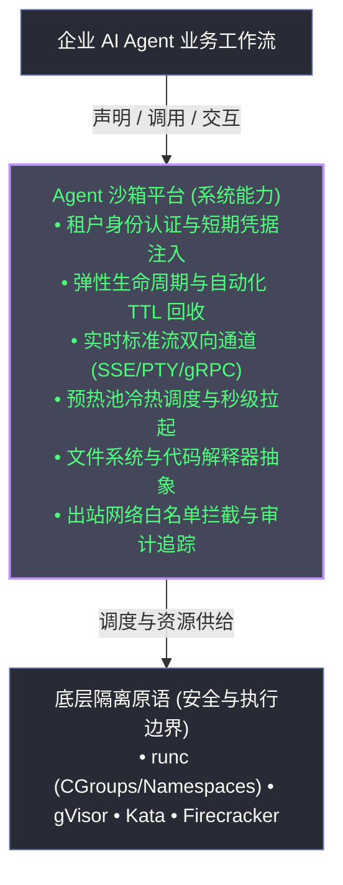
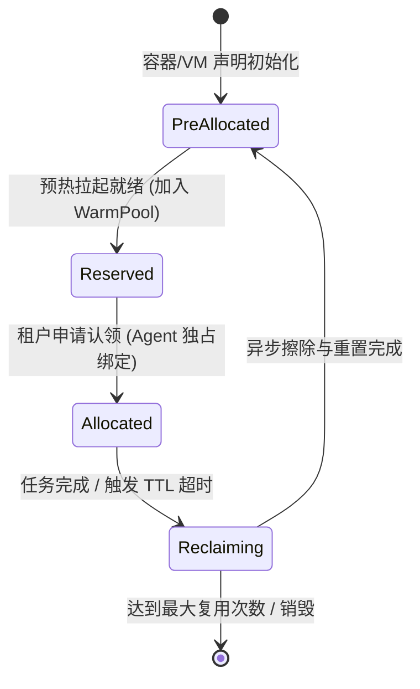
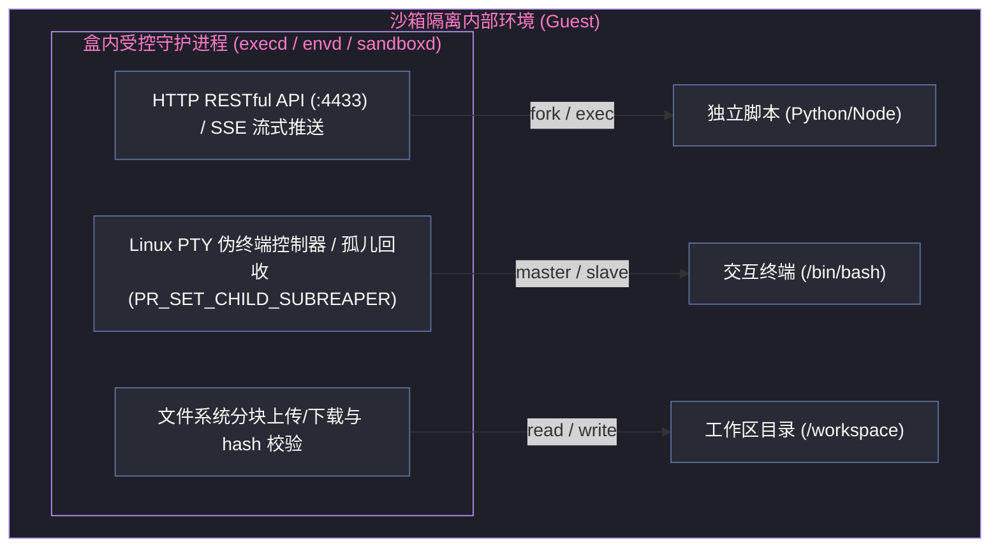

# 06 Agent 沙箱平台分层——六层模型与三条产品路线

**摘要：**

前 5 篇完成了隔离技术底座的系统构建——深入剖析了威胁模型、Linux 隔离原语、四档隔离光谱、KVM 硬件底层以及 VMM 家族。本文正式开启平台与协议篇的架构跃迁：**从单一维度的“隔离边界画在哪”跨越到生产工程级的“沙箱平台怎么建”**。首先，本文提出并系统解构工业级 Agent 沙箱的**六层分层模型**（L1 产品生命周期控制面、L2 容器与虚拟机编排层、L3 盒内执行数据面、L4 隔离运行时、L5 Agent 适配层、L6 API 与协议层），厘清各层的核心职责、数据流向与系统接口，并从流量隔离与故障域切分视角确立“控制面与数据面绝对解耦”的基石架构原则；其次，本文横向深度剖析当前行业的三大主流产品路线——以 E2B 为代表的云托管派（Firecracker 底座与数据面开放演进）、以 kubernetes-sigs/agent-sandbox 与 OpenKruise Agents 为代表的云原生编排标准派（SandboxSet 与 PoolAutoscaler 声明式对账体系）、以 OpenSandbox 与 Daytona 为代表的企业自建产品派（OpenAPI 契约驱动与多引擎可插拔），并给出量化的三维选型对比表与多分支决策树；再次，总结提炼六大行业基石共识与三大尚未收敛的开放战场（Agent 适配缺失、状态语义割裂、内存级快照竞争）；最后，给出分层覆盖矩阵与平台演进八步法。本文的核心认知在于：**Agent 沙箱不仅是某种容器运行时或微虚拟机的同义词，而是一整套涵盖弹性编排、长连接交互与安全治理的系统级平台；第 5 层 Agent 适配层仍是开源生态最大的断层缺口，任何企业自建体系都必须为其预留清晰的适配边界与工程预算**。

---

## 第 1 章 从“隔离边界”到“系统平台”：视角切换与架构动因

### 1.1 概念定义与核心边界：什么是 Agent 沙箱平台

在讨论单机层面的隔离技术时，关注的核心往往是内核级的安全分界线：Linux 内核的命名空间（namespaces）能否完全隔绝文件系统、网络协议栈与进程视图；控制组（cgroups）能否有效掐死内存泄漏与 CPU 抢占；seccomp 系统调用过滤规则能否拦截非法提权指令；gVisor 用户态独立内核能否有效屏蔽宿主机 syscall；抑或是 AWS Firecracker 与 Kata Containers 如何依托硬件虚拟化（KVM）实现微虚拟机（MicroVM）级别的强隔离。这些技术回答的本质问题只有一个：**如何确保在同一台宿主服务器上，一段不受信任的代码在执行时无法发生逃逸、窥探或破坏宿主机及邻居租户的资源**。

然而，在面对高度自主、具备多轮推理与动态代码执行能力的现代 AI Agent 时，仅仅依靠底层的单机隔离技术，无异于“空有防爆水泥，却无整座建筑”。

**Agent 沙箱平台的本质，是将底层的单机隔离技术封装并转化为具备企业级 SLA、支持弹性扩展与安全治理的产品级服务能力**。它不是某种单机虚拟化技术的换皮，而是一套贯通生命周期管控、长连接双向数据通信、高并发调度、安全鉴权与生态适配的分布式系统工程。



可以用物业与建筑材料的比喻来理解二者的定位：隔离原语是钢筋、水泥与防火门，决定了房间隔断的物理防爆级别；沙箱平台则是现代化的物业管理体系，负责住户门禁认证、水电气配额抄表、突发险情处置、垃圾自动回收以及房门钥匙的动态分发。无论钢筋多么结实，没有物业管理的公寓楼必然在短时间内陷入污水横流、门户洞开、僵尸住户霸占的混乱状态；反之，物业管理系统无论设计多么精妙，若采用了偷工减料的伪隔离材料，一次恶意穿透就能引发整栋大楼的坍塌。

### 1.2 为什么必须平台化：解决三大业务鸿沟

当隔离技术试图对接真实 Agent 应用时，必然面临三个单机隔离原语本身无法解决的核心鸿沟：

#### 1.2.1 生命周期与资源伸缩鸿沟
自主 Agent 在解决复杂推理任务时，其执行环境的生命周期表现出极端的非确定性。一次简单的自然语言数据处理，可能只需要执行一段 3 秒钟的 Python 脚本；而一个软件开发 Agent（如自主修复代码 Bug、构建大型 Monorepo 仓库并运行完整单元测试套件）则可能持续占用沙箱长达数小时。
- **孤儿与僵尸沙箱泛滥**：当上层大模型因为网络抖动、Token 超出上限或推理死循环而发生异常断开时，底层的物理容器或虚拟机并不会自动得知“业务任务已经终结”。如果没有平台层引入的心跳探测、租赁续期与强制 TTL（Time-To-Live）回收机制，宿主机节点在运行数天之后就会被成千上万个无人认领的僵尸进程与残留容器占满，导致系统彻底瘫痪。
- **并发风暴与调度延迟**：大规模业务场景下，数十个 Agent 可能会在同一秒内被触发启动。如果每次都通过底层驱动从零拉起 MicroVM 或拉取数十 GB 的重型依赖镜像，数秒至数十秒的冷启动延迟将直接摧毁交互式 Agent 的响应体验。必须依靠平台级的容量规划与预热池（WarmPool）调度，才能实现“毫秒级供给”（预热池的完整对账机制将在 [[09 OpenSandbox 编排面——BatchSandbox、WarmPool 与快照]] 深入拆解）。

#### 1.2.2 多模态长连接交互协议鸿沟
底层的单机隔离技术（如运行一个 `docker run` 命令）通常只面向传统的批处理作业，关注进程退出的退出码（exit code）。然而，Agent 与沙箱之间的交互是高度多模态、流式且富状态的：
- **流式标准 I/O 交互**：Agent 在沙箱中执行长耗时的编译构建命令时，需要实时消费 stdout 与 stderr 字节流以动态推断下一步决策，而非傻等全量命令结束；在代码生成场景中，一旦模型检测到输出出现了致命错误，还需要能够随时向正在执行的进程发送 `SIGINT` 或 `SIGTERM` 信号强行打断。
- **终端会话与伪终端（PTY）仿真**：许多高级 Agent 需要驱动交互式 CLI 工具（如 `vim`、`npm init`、交互式 `git rebase`），这要求沙箱不仅能运行命令，还能模拟 Linux PTY 终端设备，并妥善处理终端窗口尺寸调整（Window Resize）、ANSI 转义序列及终端行缓冲。
- **双向文件吞吐与端口反向映射**：Agent 需要随时向沙箱内写入代码工程、拉取生成的数据报表，甚至在沙箱内部启动一个轻量 Web 服务（如 8080 端口的前端应用）供多模态视觉 Agent 进行端到端的页面截图与点击测试。单机隔离原语不提供这些网络拓扑穿透与文件管道抽象，必须由平台层予以标准化封装。

#### 1.2.3 多租户安全与合规治理鸿沟
隔离原语仅能在主机内核维度防止进程跨越界限，但在企业级多租户业务场景下，合规与审计需求无处不在：
- **短期动态凭据注入**：沙箱内部的代码执行可能需要拉取企业私有 Git 仓库，或者访问受限的内网数据库。如果直接将静态企业 Token 写入沙箱的环境变量，恶意生成的 Agent 代码随时可能通过网络向外部攻击者泄露此 Token。平台层必须充当凭据中介，动态签发分钟级短期凭据，并在沙箱生命周期结束时立即吊销。
- **出站网络行为白名单管控（Egress Control）**：运行不受信任第三方代码的沙箱必须处于严格的网络囚笼之中。平台必须具备对沙箱所有发出的 HTTP/DNS/TCP 流量进行实时嗅探、域名白名单拦截与审计留痕的能力，坚决阻止沙箱成为外部 DDOS 攻击的傀儡机，或访问云厂商本地元数据服务（如 `169.254.169.254`）窃取节点权限。

### 1.3 反事实推演：缺少平台层会遭遇什么灾难

通过反事实推演，可以更深刻地看清“只有隔离原语而无系统平台”时的工程灾难：

- **反事实场景 A：单机脚本驱动导致磁盘与资源池击穿**
  某团队初期为了快速上线 Agent 功能，采用自写的 Python 脚本调用 `docker run` 在一组裸机上启动容器执行代码。上线首周，由于上游推理引擎偶尔超时主动断开连接，每天遗留超过 2000 个未正常退出的无主容器。更致命的是，代码中执行的 `pip install` 与编译中间文件持续堆积在 `/var/lib/docker/overlay2`，五天后宿主机磁盘利用率达到 100%，触发 Docker Daemon 级联卡死，所有在线服务全量崩溃。
- **反事实场景 B：长连接流式 I/O 导致 API 网关连接耗尽**
  某平台将控制面管理 API 与数据面执行通道混为一谈，所有沙箱内部打印的命令日志均通过控制面唯一的 Web 网关向客户端转发。当某个 Agent 执行了无终止条件的死循环输出（如连续打印数千万行日志）时，控制面网关的内部工作线程与网络套接字在数秒内被这几个恶意的长连接流全量耗尽。正常的沙箱生命周期查询与创建请求全部遭遇 504 Gateway Timeout，系统进入大面积假死状态。
- **反事实场景 C：客户端与特定运行时深度绑定导致演进锁死**
  早期团队在 Agent 代码中直接调用底层特定的 MicroVM 管理套件命令行。随着安全合规政策收紧，基础设施团队要求将部分受信任务迁移到轻量容器以节省算力，而将高危任务升级为 gVisor 沙箱。由于缺乏统一的抽象协议层，上层所有的 Agent 提示词、工具封装与状态检测逻辑必须全部推倒重构，技术债务耗费数人月。

### 1.4 平台的成本结构：控制面与数据面的非均质演进

在沙箱系统的长期建设中，平台层的研发与运维成本通常呈现出显著的**非均质特性**。控制面成本与数据面成本遵循完全不同的增长数学模型：

| 平台层级 | 成本量级 | 核心成本动因 | 资源扩展模式 |
| :--- | :--- | :--- | :--- |
| **L1 产品控制面** | 较高（初期投入） | 状态机一致性保障、多租户配额计算、鉴权网关可靠性 | 与“租户总数”及“API 请求频率”成阶梯式增长，偏重 CPU 与内存事务处理 |
| **L2 编排对账层** | 中等（云原生复用） | CRD 版本演进、控制器对账延迟治理、预热池排队分配 | 依托 Kubernetes 控制平面，受 etcd 存储上限与 Informer 缓存同步约束 |
| **L3 执行数据面** | 持续高昂（随业务线性滚动）| 双向数据管道网络吞吐、流式内存缓冲、长连接维持、Guest 进程收割 | 与“并发活跃沙箱数”及“I/O 活跃度”严格线性挂钩，直接消耗物理带宽与算力 |
| **L5 Agent 适配层** | 持续线性累加 | 各 Agent 框架（Claude Code、OpenCode 等）环境依赖固化与网关定制 | 边际成本固定，每支持一类异构 Agent 框架需投入固定的工程适配工时 |

这种非均质的成本结构揭示了一个重要的工程规律：**在系统初始化阶段，研发团队的首要任务是通过成熟的开源底座与标准化协议抽象，将控制面与编排层的建设成本压到最低；而在业务放量阶段，架构优化的重心必须迅速转移到执行数据面的吞吐优化、流控整形以及 Agent 适配层的规模化复用上**。

### 1.5 平台层与底层隔离的分工与解耦深度

平台层与底层隔离底座的分工必须做到“职责界限极其分明”：**隔离层专注于提供坚固、不可穿透的执行边界，而平台层专注于围墙内外的资源供给、通道打通与合规治理**。

二者的解耦深度在工业级实现中通常分为三个递进层次：
- **契约解耦（Contract Decoupling）**：顶层面向 Agent 的 API 契约与执行规范，对底层到底使用 runc、gVisor、Kata 还是 Firecracker 完全无感知。相同的创建、执行、传流协议可以在任意底层技术上无缝流转。
- **声明解耦（Declarative Decoupling）**：在 Kubernetes 编排层，沙箱的定义不直接绑定特定的容器运行时参数，而是通过抽象的隔离规格标识（如引用 `RuntimeClass`）进行间接绑定。基础设施管理员调整节点上的底层运行时，无需对上层业务的 YAML 声明做任何侵入式修改。
- **进程解耦（Process Decoupling）**：盒内的执行守护进程（如 execd）与宿主机底层的容器引擎（containerd/dockerd）在进程空间完全解耦。盒内守护进程作为沙箱内部的顶层服务运行，仅依赖标准的 Linux POSIX 系统接口，使得数据面协议可以轻松跨平台运行在任何基于 Linux 的容器、虚拟机或物理机上。

---

## 第 2 章 六层模型逐层深挖（The Six-Layer Architecture）

为了精准指导 Agent 沙箱的架构设计、职责切分与系统选型，本专栏提炼出工业级 Agent 沙箱平台的**六层模型（Six-Layer Architecture）**。从顶层的统一 API 契约到底层的物理硬件隔离，每一层均承担独立且明确的系统职责。

```
%%{init: {'theme': 'dracula'}}%%
graph TD
    L6["第 6 层：API 与协议层 (API / Protocol)<br/>- 统一 OpenAPI 契约 / E2B 兼容协议 / 状态机映射"]
    L1["第 1 层：产品生命周期控制面 (Lifecycle Control Plane)<br/>- 租户配额 / TTL 回收 / 凭据管理 / 模板注册"]
    L2["第 2 层：容器与虚拟机编排层 (Orchestration Plane)<br/>- K8s CRD (SandboxSet/BatchSandbox) / Controller 对账 / WarmPool"]
    L5["第 5 层：Agent 适配层 (Agent Adaptation)<br/>- 镜像化运行时 / 提示词与工具链注入 / MCP 网关 / 原生 Server 包装"]
    L3["第 3 层：盒内执行层与数据面 (Execution / Data Plane)<br/>- execd/envd 守护进程 / PTY 终端通道 / SSE 实时推流 / 文件 I/O"]
    L4["第 4 层：隔离运行时 (Isolation Runtime)<br/>- runc / gVisor (runsc) / Kata Containers / Firecracker MicroVM"]

    L6 --> L1
    L1 --> L2
    L2 --> L4
    L5 -.-> L3
    L3 --> L4

    style L6 fill:#6272a4,stroke:#f8f8f2,stroke-width:2px,color:#fff
    style L1 fill:#bd93f9,stroke:#f8f8f2,stroke-width:2px,color:#fff
    style L2 fill:#ff79c6,stroke:#f8f8f2,stroke-width:2px,color:#fff
    style L5 fill:#ffb86c,stroke:#f8f8f2,stroke-width:2px,color:#282a36
    style L3 fill:#50fa7b,stroke:#f8f8f2,stroke-width:2px,color:#282a36
    style L4 fill:#8be9fd,stroke:#f8f8f2,stroke-width:2px,color:#282a36
```

### 2.1 第 1 层：产品控制面（Lifecycle Control Plane）

**核心职责**：沙箱的“业务管理与调度总指挥部”，直接对接上游业务平台，负责租户权限鉴权、资源配额审计、生命周期流转、强制 TTL 回收以及安全凭据的统一注入。

| 核心模块 | 机制与功能说明 | 典型工业级实现 |
| :--- | :--- | :--- |
| **生命周期管理 API** | 提供创建（Create）、查询（Get/List）、暂停（Pause）、恢复（Resume）、更新（Update）与销毁（Delete）的原子接口 | OpenSandbox Server (FastAPI)、E2B Orchestrator |
| **多租户与配额计算** | 基于企业组织、项目或用户维度，计算 CPU/内存/磁盘限额，并施加最大并发沙箱数的排队限流 | 自建 API 网关集成、OpenPolicyAgent / Casbin |
| **TTL 自动化回收** | 监控沙箱最后一次交互时间，超时未活动时自动触发级联清理，杜绝算力与存储泄露 | 基于分布式延迟队列或定时对账任务调度 |
| **模板与资产管理** | 维护可用的环境镜像列表、基础目录挂载配置与初始工作区模板 | 模板配置中心、OCI 镜像仓库元数据索引 |
| **短期凭据签发与托管** | 在沙箱拉起时动态生成短期访问密钥，并注入至数据面安全代理，实现凭据不出沙箱 | Credential Vault、HashiCorp Vault、SPIRE |

**架构深水区：控制面状态存储的三条演进路线**
控制面的状态管理架构直接决定了平台的高可用性（HA）与并发伸缩上限：
1. **本地实例轻量存储（Pod-Local SQLite）**：
   将沙箱元数据直接写入控制面 Pod 的本地磁盘 SQLite 数据库中。这种设计在开发阶段极简，没有任何外部组件依赖；但在生产环境中，一旦控制面部署为多副本以实现高可用，由于副本之间不共享本地磁盘，通过负载均衡器轮询的查询请求将有一半概率遭遇 404 Not Found（裂脑现象，正如 [[15 生产化深水区——十个盲区与行业共识]] 中剖析的“共享状态不等于副本数”盲区）。
2. **中心化高可用关系型数据库（PostgreSQL/MySQL）**：
   将所有的沙箱状态、租户配额、快照元数据沉淀至外部的分布式关系型数据库中。控制面 API Server 完全变为无状态的微服务，支持任意多副本弹性伸缩。通过数据库事务机制可以有效解决并发认领沙箱时的竞态冲突。这是绝大多数企业自建平台的标准架构选择。
3. **完全依托 Kubernetes etcd（CRD 状态中心）**：
   控制面完全不引入外部数据库，而是将沙箱生命周期全部映射为 Kubernetes Custom Resource（CR），直接将 etcd 作为唯一的权威状态源。这种设计的优势在于架构高度统一且具备天然的云原生审计能力；但缺点在于，etcd 面向低频强一致元数据设计，如果上万个沙箱高频更新心跳状态，将对整个 Kubernetes 集群的基础设施稳定性带来严重冲击。

### 2.2 第 2 层：Kubernetes 编排层（Orchestration）

**核心职责**：将沙箱的物理实体在底层集群中进行声明式建模，依托 Kubernetes 强大的控制对账循环（Control Loop），完成异构物理节点上的资源供给、调度容灾与预热池维护。

```
%%{init: {'theme': 'dracula'}}%%
sequenceDiagram
    autonumber
    participant Client as 上层控制面 / SDK
    participant API as K8s API Server
    participant Controller as Sandbox Controller
    participant Pool as WarmPool Manager
    participant Kubelet as Node Kubelet / CRI

    Client->>API: 提交 SandboxClaim / BatchSandbox CR
    API-->>Controller: 触发 Reconcile 事件
    alt 预热池命中 (Cache Hit)
        Controller->>Pool: 申请空闲预热实例
        Pool-->>Controller: 绑定就绪 Pod / MicroVM (耗时 < 150ms)
        Controller->>API: 更新 CR 状态为 Ready
    else 冷启动创建 (Cache Miss)
        Controller->>API: 声明生成新底层 Pod 规格
        API->>Kubelet: 调度并拉起容器/MicroVM (耗时 2-15s)
        Kubelet-->>API: 汇报 Pod Ready 状态
        Controller->>API: 更新 CR 状态为 Ready
    end
    API-->>Client: 返回沙箱连接凭据与访问端点
```

在现代云原生沙箱体系中，编排层正在经历从简单包装向高度专业化扩展的演进：
- **声明式对账的优势与开销**：
  在编排层，用户只需要声明“我需要一个 2C4G、配备 Python 3.11 镜像的沙箱”。底层的 Controller 会持续对比现实状态与期望状态，自动完成底层的重试与拉起。然而，声明式对账在面对极致延迟时存在固有的妥协：从 CR 写入到 API Server、经由 Informer 广播给 Controller、再到 Controller 发起调度，这一套完整的事件传播链路存在数十至上百毫秒的编排开销。
- **两大主流 CRD 体系对比**：
  1. **kubernetes-sigs/agent-sandbox**：
     由 Kubernetes 社区官方 SIG Apps 组织孵化的通用规范。其核心抽象包括 `Sandbox`（代表长运行、有稳定网络身份与持久卷挂载的单容器或单虚拟机环境）、`SandboxTemplate`（跨租户共享的环境规格模板）、`SandboxClaim`（用户认领请求）与 `SandboxWarmPool`（预热池控制器）。在 v1.0.0 版本中，SIG 正式将版本锁定至 `agents.x-k8s.io/v1beta1`，并移除了历史的高开销转换 Webhook，性能大幅提升。
  2. **OpenKruise Agents 扩展体系**：
     针对超大规模生产环境下传统 Deployment/StatefulSet 在批量高频拉起沙箱时的性能瓶颈，OpenKruise 引入了 `SandboxSet` 与 `PoolAutoscaler`。`SandboxSet` 原生支持 Pod 的原地容器规格调整（In-Place Update）与确定性网络 IP 复用，使得沙箱在重置时无需完全销毁底层 Pod；而 `PoolAutoscaler` 则引入排队论动态水位算法，依据历史创建速率与当前任务积压深度，对预热池实施精细化秒级扩缩容。


#### 2.2.3 深入 OpenKruise Agents：SandboxSet 状态机与 PoolAutoscaler 排队论模型
在生产级大规模落地中，传统的 Kubernetes 原生工作负载（如 Deployment、StatefulSet）直接用于管理沙箱时会遭遇三大结构性瓶颈：
1. **顺序与对账开销**：StatefulSet 默认采用串行对账与序号绑定，在瞬间并发申请数百个沙箱时产生严重的调度等待排队；
2. **Pod 销毁重造成本**：标准 Pod 的销毁与重建需要重新走完整的调度拓扑、CRI 镜像解压与 CNI 网络分配，难以支撑沙箱秒级快速重置；
3. **缺乏精细的预热池生命周期表达**：标准 Pod 只有 Pending、Running、Failed 等简单状态，无法表达“沙箱已被预热但尚未被租户认领”或“沙箱已被释放正在等待异步擦除”的精细中间态。

OpenKruise Agents 通过引入专职的 `SandboxSet` CRD，构建了针对 Agent 特征的专属生命周期状态机：

在容量调度层面，`PoolAutoscaler` 并非简单基于传统的 CPU/内存利用率进行水平伸缩，而是基于**排队论（Queuing Theory）中的 $M/M/c/K$ 模型**进行容量动态推导。设沙箱申请到达率服从泊松分布，平均到达率为 $\lambda$（个/秒），沙箱冷启动耗时为 $T_{	ext{cold}}$（秒），业务容忍的最大排队等待时间为 $	au$。为保障在突发流量洪峰下系统不发生击穿，预热池的目标动态安全水位 $S_{	ext{target}}$ 满足：
$$S_{	ext{target}} = \lceil \lambda 	imes T_{	ext{cold}} + Z_{lpha} \sqrt{\lambda 	imes T_{	ext{cold}}} 
ceil$$
其中 $Z_{lpha}$ 为对应服务等级协议（SLA）置信度（如 99.9% 概率不发生冷启动排队）的标准正态分布分位数。该算法使平台在业务波谷期自动收缩池容以节约物理内存，而在业务高频交互期精准维持最小安全水位。

### 2.3 第 3 层：执行层与盒内数据面（Execution / Data Plane）

**核心职责**：驻留在沙箱隔离环境内部的守护进程（Daemon）及相关配套网络代理，向下直接操作 Guest 系统的内核进程与文件，向上为外部客户端提供流式、受控的双向操作通道。



执行层承担着极其细致且底层的系统操作：
1. **命令受控执行（Command Execution）**：
   通过 `fork` 和 `execve` 在隔离命名空间内派生工作进程，配置标准输入/输出的匿名管道。支持通过 Server-Sent Events（SSE）或双向 gRPC 流，将命令的执行输出以毫秒级延迟向外部实时推送。
2. **Linux PTY（伪终端）控制**：
   利用 `openpty` 系统调用分配 master/slave 虚拟终端设备对，在 slave 侧执行用户的交互式 Shell，并在 master 侧捕获原始字节流，向外部客户端提供完全兼容 VT100/ANSI 标准的终端会话。
3. **进程树收割与防泄漏（Subreaper / PID 1 职责）**：
   在 Linux 系统中，如果沙箱内执行的 Python 脚本通过后台派生（如 `subprocess.Popen`）拉起子进程后自己意外崩溃，这些子进程就会变成孤儿进程。如果没有专门的机制，孤儿进程将挂载到 PID 1 导致沙箱退出时产生大量僵尸进程。盒内守护进程必须通过调用 `prctl(PR_SET_CHILD_SUBREAPER, 1)` 将自己声明为子进程收割者，负责处理 `SIGCHLD` 信号并调用 `waitpid` 清理所有退出的孙子进程。
4. **受控文件系统 I/O（Filesystem Operations）**：
   提供对沙箱内文件的高性能读取、写入、目录结构递归遍历以及大文件分块流式上传与下载，并内嵌 SHA-256 校验保障数据传输一致性。
5. **服务端口暴露与安全反向代理（Endpoint Exposition）**：
   监测沙箱内部动态启动的监听服务，并配合外部数据面网关（如 Ingress 或 Envoy），实现将沙箱内部端口安全暴露给授权的外部系统访问。

**执行层的黄金原则**：**执行层必须始终提供纯粹的“受控通道能力”，绝不可越权承担“Agent 业务语义”**。执行层只关心执行命令成功与否、字节流是否完整，绝不干预 Agent 的提示词结构、会话历史管理或任务拆解。一旦底层守护进程开始介入具体的业务逻辑，必然会导致平台随着上层 Agent 框架的快速迭代而频繁破坏稳定性。


#### 2.3.2 盒内 execd 架构设计：Go/Gin、进程组与非阻塞流控
作为驻留在沙箱隔离环境内部的关键数据面组件，以 OpenSandbox 的 `execd` 为代表的守护进程在工程设计上有着极其严格的技术约束：
- **微型常驻底噪与静态链接**：execd 通常使用 Go 语言开发，通过静态编译（`CGO_ENABLED=0`）生成单一二进制文件，运行时内存常驻占用控制在 15MB 以内，避免挤占 Agent 自身有限的算力资源。
- **孤儿进程收割与进程组生命周期管理**：在执行不受信任的脚本时，脚本可能在后台启动派生进程树（如后台守护进程、子线程池）。execd 在启动前调用 `syscall.Setpgid(0, 0)` 将工作进程分配至独立的 Linux 进程组（Process Group）。当任务被用户取消或触发超时时，execd 不仅向根进程发送信号，而是通过 `syscall.Kill(-pgid, syscall.SIGKILL)` 向整个负进程组广播信号，配合 `prctl(PR_SET_CHILD_SUBREAPER, 1)` 彻底消灭所有脱离终端的孤儿悬挂进程。
- **SSE 流式传输中的细粒度流控与背压（Backpressure）**：
  当工作进程以极高速度向 stdout 狂吐数据（例如编译过程中的海量日志）时，直接全量读取写入 HTTP 缓冲区极易引发 execd 自身发生 OOM（Out Of Memory）。工业级 execd 必须在标准输出管道与 SSE 发送端之间设计固定大小的环形缓冲区（Ring Buffer）与滑动窗口流量控制。当外部网络消费端由于网络延迟未能及时读取时，环形缓冲区满将自动暂停从管道读取，进而利用操作系统的内核管道缓冲区机制对 Guest 内部的工作进程施加自然的“反向背压”，阻止进程无限膨胀。

### 2.4 第 4 层：隔离运行时（Isolation Runtime）

**核心职责**：软硬件隔离的真正执行底座，承载并运行沙箱实例。

正如专栏前 5 篇所论述，该层技术涵盖从基于 Linux 内核共享的容器（runc），到用户态内核拦截（gVisor runsc），再到基于虚拟化扩展的 MicroVM（Kata Containers、AWS Firecracker）。

在平台工程落地中，第 4 层的核心难点往往不在于单机运行时的配置，而在于**四层链路配置的一致性保障**：
```
L1 控制面配置 (指定 Profile: gvisor-secure)
    ──> L2 K8s CR 声明 (spec.runtimeClassName: gvisor)
        ──> K8s 集群全局 RuntimeClass 对象定义 (handler: runsc)
            ──> 节点 containerd/CRI 插件注册 (io.containerd.runsc.v1 配置及二进制路径)
```
上述链条上的任何一环发生配置脱节，都会导致沙箱要么调度失败卡死在 Pending 状态，要么“静默降级”为不受保护的默认 runc 运行，从而引发重大安全破口。因此，生产级沙箱平台必须具备全链路档位巡检与核验证据链机制。

### 2.5 第 5 层：Agent 适配层（Agent Adaptation）——开源最大缺口

**核心职责**：将一个通用的“空白操作系统环境”，转化为特定 AI Agent 能够直接运行、自主感知并完成任务的“专业工作区”。

当前开源沙箱生态中最严重的结构性断层恰恰位于此层：
- **基础设施视角**：基础设施工程师认为，只要提供了一个开机即可 SSH 访问的 Ubuntu 基础镜像，且有一个能执行 bash 命令的 HTTP 接口，沙箱的交付就已经完成。
- **AI Agent 视角**：Agent 无法在一个完全空白的机器中直接工作。它需要预先配置好的编程语言运行时（Python、Node.js、Rust）、预置的私有 Git 凭据与拉取好的工程仓库代码、预配置的大模型 API Endpoint 代理，甚至需要能够直接对接 Model Context Protocol（MCP）服务端点。

```
+───────────────────────────────────────────────────────────────────────────────+
|                           第 5 层：Agent 适配层工程矩阵                        |
+───────────────────────────────────┬───────────────────────────────────────────+
| 适配维度                          | 工程任务与实现细节                        |
+───────────────────────────────────┼───────────────────────────────────────────+
| 1. 镜像构建与环境工程             | 构建包含特定编译器、库依赖及安全证书的基础（镜像化落地实践参见 [[11 三类 Agent 沙箱落地——OpenCode、Hermes 与 LangChain 镜像化实战]]） |
|                                   | 镜像；分层缓存构建以最小化启动拉取耗时   |
+───────────────────────────────────┼───────────────────────────────────────────+
| 2. 交互接口封装                   | 在 PTY 原始终端流与原生 HTTP 结构化 API   |
|                                   | 之间建立适配网关，优先暴露结构化事件流     |
+───────────────────────────────────┼───────────────────────────────────────────+
| 3. MCP (Model Context Protocol)  | 将沙箱内部的工具集（文件操作、SQL 执行、  |
|    协议集成                       | 网页检索）封装为标准 MCP Server 暴露给模型|
+───────────────────────────────────┼───────────────────────────────────────────+
| 4. 敏感凭据注入与安全代理         | 避免直接将静态 API Key 写入环境变量，通过 |
|                                   | 本地轻量代理服务实现透明动态签名          |
+───────────────────────────────────┴───────────────────────────────────────────+
```

**为什么原生 Server 接口远优于纯 PTY 伪终端**：
许多早期团队试图仅靠为 Agent 分配一个 PTY 交互式 bash 会话来完成所有工作。这种做法极易踩坑：PTY 本质是面向人机交互设计的原始字符流，包含了大量的 ANSI 颜色转义字符、行缓冲回显与终端控制序列。当 Agent 试图从 PTY 输出中提取工具调用的执行状态与返回值时，必须依赖复杂的正则表达式进行启发式清洗，极其脆弱且不可靠。而原生 HTTP/gRPC Server 接口能够原生回传包含状态码、结构化 JSON、独立 stdout 与 stderr 的事件流，是生产级可观测性与精准推理的唯一正确选择。

### 2.6 第 6 层：API 与协议层（API / Protocol）

**核心职责**：定义整个沙箱平台面向外部生态（SDK、CLI、开发框架、上层工作流平台）的标准 OpenAPI 契约与通信范式。

该层在设计上需要重点厘清两个工业级标准：
1. **E2B 兼容性协议成为事实标准**：
   随着 E2B 在全球开发者社区与主流 Agent 框架（如 LangChain、AutoGPT、LlamaIndex 等）中获得极其广泛的 SDK 级支持，实现对 E2B RESTful 接口（如 `/sandboxes`、`/sandboxes/{id}/commands` 等）的语义兼容，已经成为新兴沙箱平台降低生态接入壁垒的首选策略。
2. **状态语义的黄金铁律**：
   在长周期的 Agent 执行模型中，**HTTP 返回码仅代表“请求已成功投递并在传输层接纳”，沙箱实际的权威状态必须依赖平台的生命周期状态机（Lifecycle State）与多维度条件（Conditions）进行权威判定**。例如，创建沙箱返回 `202 Accepted` 仅意味着编排调度任务已入队，必须通过轮询或 WebSocket/SSE 监听状态变更，直到 `Ready=True` 且各健康探针全部上报通过，方可发起后续计算。

---

## 第 3 章 关键架构原则：控制面与数据面绝对解耦

六层模型背后贯穿始终的最高架构准则，即**控制面（Control Plane）与数据面（Data Plane）的物理与逻辑切开**。

```
%%{init: {'theme': 'dracula'}}%%
flowchart LR
    subgraph ControlPlane["控制面 (Control Plane) - 轻量、幂等、高可用"]
        direction TB
        C1["API Gateway / Auth"] --> C2["Lifecycle Server"]
        C2 --> C3["Metadata Database (PG)"]
        C2 --> C4["K8s APIServer / Controller"]
    end

    subgraph DataPlane["数据面 (Data Plane) - 高吞吐、低延迟、流式"]
        direction TB
        D1["Ingress / Data Proxy"] --> D2["execd Sidecar (Agent Box 1)"]
        D1 --> D3["execd Sidecar (Agent Box 2)"]
        D1 --> D4["execd Sidecar (Agent Box N)"]
    end

    Client["Agent Client / Workflow Engine"] -->|"管理调用 (POST /sandboxes)"| ControlPlane
    Client -->|"执行流 (POST /exec + SSE stream)"| DataPlane
    ControlPlane -.->|"编排拉起与路由下发"| DataPlane

    style ControlPlane fill:#282a36,stroke:#bd93f9,stroke-width:2px,color:#fff
    style DataPlane fill:#282a36,stroke:#50fa7b,stroke-width:2px,color:#fff
    style Client fill:#44475a,stroke:#f8f8f2,stroke-width:2px,color:#fff
```

### 3.1 为什么必须切开：三大架构动因

1. **流量特征与性能隔离**：
   控制面的请求是典型的事务型短请求（创建、删除、查询列表、修改配额），对延迟抖动敏感，要求极高的可用性；数据面则是典型的高并发、长时间连接、大吞吐流式 I/O（运行测试输出、持续终端打字、传输构建产物包）。如果两者共用进程或网关，数据面的长连接阻塞会迅速打满网络线程池，导致关键控制面指令（如紧急下线、超时销毁）无法送达。
2. **故障域强隔离（Fault Domain Isolation）**：
   在优秀的沙箱平台中，**控制面的临时崩溃或灰度重启，绝不应该影响已经在数据面平稳运行的沙箱实例**。正在沙箱内执行耗时 20 分钟编译测试的 Agent，应当可以继续保持与盒内 execd 的数据流交互；待控制面实例重启对账完成后，通过 Controller 自动重新收敛状态。反之，某个沙箱内部的恶意死循环 I/O 耗尽带宽，也仅被限制在自身的数据面路径中，无法击穿集群控制面。
3. **架构演进周期解耦**：
   数据面守护进程（如 execd）的演进往往随着内核适配、流控算法调优与特定架构指令集优化而快速演进；而控制面则深度绑定企业的权限体系、计费系统与工单审批逻辑。两者的解耦能够允许数据面与控制面分别设立独立的版本发布周期与灰度验证流水线。

### 3.2 一次交互的六层完整生命周期旅程

为了清晰呈现各层协同机制，以下还原一个前端 Agent 发起“创建沙箱并执行一段 Python 代码”的完整全链路旅程：

```
%%{init: {'theme': 'dracula'}}%%
sequenceDiagram
    autonumber
    participant Agent as Agent Client / SDK
    participant L6 as L6: API / Protocol
    participant L1 as L1: Control Plane
    participant L2 as L2: K8s Orchestration
    participant L4 as L4: Isolation Runtime
    participant L3 as L3: Exec Data Plane
    participant L5 as L5: Agent Adapter

    Agent->>L6: POST /api/v1/sandboxes (指定模板与配额)
    L6->>L1: 鉴权通过，校验租户 Quota 与限流规则
    L1->>L2: 派发创建声明 (创建 SandboxClaim 对象)
    L2->>L2: WarmPool 预热池匹配检查
    alt 预热命中
        L2-->>L1: 返回已就绪实例规格与 Pod 实例 IP
    else 预热未命中
        L2->>L4: 声明新 Pod，通过 RuntimeClass (如 runsc) 指向 gVisor
        L4-->>L2: 完成内核隔离与容器挂载，上报 Running
    end
    L1-->>L6: 生成访问凭据与 Data Gateway 端点
    L6-->>Agent: 202 Accepted / 200 OK (返回 SandboxID & Data URL)
    
    Note over Agent,L3: ── 切换至数据面独立交互 ──
    Agent->>L3: POST /sandboxes/{id}/commands (payload: python main.py)
    L3->>L5: 加载已挂载的工作区目录与环境变量
    L3->>L4: 在隔离 namespace 内通过 fork/exec 启动 python 解释器
    L4-->>L3: 输出第一行 stdout 字节流
    L3-->>Agent: 通过 SSE (Server-Sent Events) 即时流式回传输出事件
    L4-->>L3: 进程终止，退出码 exitCode: 0
    L3-->>Agent: 发送事件完成帧 (finish_event)
```

---

## 第 4 章 三条主流产品路线深度横向对比

在当今 Agent 沙箱的工程实践中，根据基础设施掌控度、团队定位与业务需求的不同，行业主要演化出三条各具特色的核心路线。

### 4.1 云托管派：E2B 为代表的无服务器沙箱

E2B 是 Agent 执行领域的明星级云托管产品。其底层完全围绕 AWS Firecracker MicroVM 构建，依托高度优化的裸金属调度集群，对外提供极简的 SDK 与高并发弹性。

- **核心架构优势**：
  - **极致冷启动与极低开销**：利用定制精简内核与针对 MicroVM 的深度预热算法，能够实现 200ms 内创建并交付硬件级安全隔离的 MicroVM。
  - **SDK 高度成熟，生态壁垒强大**：官方深度适配 Python、TypeScript SDK，成为多数 AI Agent 框架执行不可信代码的开箱即用首选。
  - **前沿安全与数据面解耦演进**：近年来 E2B 演进迅猛，推出了可在客户私有环境部署的 **E2B Embed**、支持沙箱跑在客户自身公有云账户的 **BYOC（Bring Your Own Cloud）**，以及实现敏感凭据不注入沙箱内部的 **E2B Secrets** 架构。
- **边界与局限**：
  - **控制面强依赖外部公有云**：即使使用 BYOC，其核心控制大脑仍由云厂商托管，对于拥有极严格金融、电信或军工级数据不出境合规要求的企业，在采购上面临审查挑战。
  - **深度定制与非标硬件受限**：难以直接利用企业内部私有存储卷（如特定的 Ceph/NFS 集群）、本地专有 GPU 拓扑或内网特殊服务网格。

### 4.2 编排标准派：kubernetes-sigs/agent-sandbox 与 OpenKruise Agents

编排标准派的核心主张是**坚决依托 Kubernetes 云原生生态，将沙箱建模为一等公民的声明式 API 与控制器标准**。该派别目前呈现出两大核心标杆：

#### 4.2.1 kubernetes-sigs/agent-sandbox
由 Google 牵头并在 CNCF SIG Apps 孵化的上游标准方案。
- **设计精髓**：
  - 构建了 `Sandbox`、`SandboxTemplate`、`SandboxClaim` 与 `SandboxWarmPool` 的声明式模型。
  - 在 v1.0.0 彻底废弃所有 Alpha 兼容代码，全面确立稳定在 `agents.x-k8s.io/v1beta1`。
  - **向下延伸标准化**：提出 **KEP-539.2**，定义了沙箱盒内标准化运行时守护进程 `sandboxd`（进程管理基于 gRPC `ProcessService`，文件管理基于 REST `FilesystemService`），力图将“盒内执行标准”也纳为云原生规范。
- **局限**：作为标准化规范，其主要定义了第 2 层与部分第 3 层的抽象，并不提供现成开箱即用的 Web 运营控制台、租户配额账单管理体系及第 5 层的 Agent 业务集成。

#### 4.2.2 OpenKruise Agents（CNCF 扩展体系）
阿里巴巴开源并在 CNCF 托管的 OpenKruise 体系中针对 Agent 场景拓展的沙箱负载引擎。
- **设计精髓**：
  - 聚焦超大规模企业落地痛点，针对标准 StatefulSet/Deployment 在极高频弹性创建、批量拉起时的调度性能不足，引入了 `SandboxSet` 与 `PoolAutoscaler`。
  - `SandboxSet` 原生支持批量容器原地规格升级、非线性缩容保障与模板差异化注入；`PoolAutoscaler` 则基于动态排队论水位算法，实时依据待执行 Agent 任务等待队列伸缩底座预热池，保障突发流量下的毫秒级交付。

### 4.3 企业产品派：OpenSandbox 与 Daytona

企业产品派致力于**在企业自有基础设施（公有云 VPC、私有物理机或现有 K8s 集群）上，交付一套完整覆盖控制面、编排对账、盒内守护进程与标准化协议的全栈软件系统**。

- **[[07 OpenSandbox 架构深度解析——协议优先与六责任面|OpenSandbox（阿里巴巴开源）]]**：
  - **协议优先（Protocol-First）**：以严格的 OpenAPI 契约定义控制面与盒内数据面协议，各语言 SDK 完全基于规范代码自动生成。
  - **双运行时引擎原生插拔**：同时支持 Docker（针对单机极简部署与轻量 PoC）与 Kubernetes（针对生产级规模部署）后端，并在底层原生解耦 `runc`、`gVisor`、`Kata` 等多种运行时。
  - **生产化套件持续强化**：引入了基于 Firecracker 的 Fast Sandbox 实现逐实例高性能隔离，支持将快照元数据沉淀至分布式 PostgreSQL，并提供专职的 Ingress/Egress 流量控制 Sidecar。
- **Daytona**：
  - 从云端开发环境（CDE）向 Agent 沙箱演进，提供强大的本地单机 CLI 到多集群受控实例的管理通道，对开发者调试体验极度友好，支持在物理虚拟机层面提供冷热快照还原。

### 4.4 三维对比全景总表

| 评估维度 | 云托管派（E2B） | 编排标准派（SIG / OpenKruise） | 企业自建产品派（OpenSandbox） |
| :--- | :--- | :--- | :--- |
| **产品形态** | Serverless 全托管 SaaS / BYOC | K8s 原生 CRD 与控制器规范 | 完整自托管开源沙箱平台 |
| **六层覆盖度** | 覆盖 L1、L3、L4、L6（托管） | 深度覆盖 L2、延伸探索 L3 | 全面覆盖 L1、L2、L3、L6（L4 插拔） |
| **核心隔离底座** | 深度定制 Firecracker MicroVM | 委托给底层 K8s RuntimeClass | 可插拔 runc / gVisor / Kata / Firecracker |
| **K8s 基础设施依赖** | 完全无需自建 K8s | 强依赖，必须以 K8s 为底座 | 支持 Docker 单机与 K8s 集群双模式 |
| **网络与数据主权** | 依赖外部云网络，私密合规门槛高 | 运行在私有集群，完全自主掌控 | 运行在私有集群，完全自主掌控 |
| **二次定制与开发深度** | 较低，受限于官方 API 暴露度 | 极高，需自主实现控制面与适配层 | 较高，契约标准且代码完全可控 |
| **冷启动性能实测** | 极快（普遍 ≤ 200ms） | 依赖预热池（命中 ≤ 150ms，冷启 2-8s）| 依赖预热池（命中 ≤ 200ms，冷启 1-5s）|
| **典型适用场景** | 中小型团队、SaaS Agent 快速试错 | 拥有强大 K8s 运维能力的云原生大厂 | 严苛合规、混合云部署的企业级私有平台 |

### 4.5 架构选型实操决策树

面对纷繁复杂的实际业务需求，可以通过以下四步判定法推导最契合团队现状的技术路线：

```
第一步：企业合规政策是否允许 Agent 代码及交互数据流向第三方托管 SaaS 云？
  ├─ 允许 ──> 团队是否具备专职的基础设施运维人员？
  │            ├─ 无专职运维 ──> 【首选：E2B 云托管 SaaS 方案】
  │            └─ 有专职运维但追求极快落地 ──> 【选用：E2B BYOC 方案】
  │
  └─ 不允许（必须在企业内部私有 VPC / 私有物理机落地）
        │
        ├─ 第二步：企业现有基础设施是否已经全面实现 Kubernetes 化？
        │    ├─ 否（仅有裸物理机或传统虚拟机环境）
        │    │    └─> 【选用：OpenSandbox Docker 引擎模式 或 Daytona】
        │    │
        │    └─ 是（拥有成熟的 Kubernetes 基础设施与网络拓扑）
        │         │
        │         ├─ 第三步：平台工程目标是统一业务形态还是自建深度 PaaS？
        │         │    ├─ 目标是快速提供成熟的 Agent 沙箱平台接口与 SDK
        │         │    │    └─> 【首选：OpenSandbox K8s 模式 (自建混合派)】
        │         │    │
        │         │    └─ 目标是融入企业自研统一控制面，需纯声明式标准
        │         │         └─> 【选用：SIG agent-sandbox + OpenKruise Agents 扩展】
        │         │
        └─────────┴─ 第四步：核算第 5 层预算
                     无论选择上述何种开源落地路线，均需为 Agent 适配层（L5）
                     预留专属研发资源，完成业务镜像固化与 MCP 适配！
```

---

## 第 5 章 行业基石共识与三大开放战场

经过全球科技公司与开源社区在 Agent 执行环境上的反复探索与生产实践，沙箱领域正在快速收敛出一批“不言自明”的通用架构准则，同时也暴露出亟待攻关的核心技术深水区。

### 5.1 行业六大基石共识

1. **控制面与数据面物理切开（Decoupled Planes）**：
   管理沙箱生命周期的事务型 API（创建、销毁、配额查询）必须与高吞吐、长时间连接的命令执行与日志数据流彻底隔离。控制面故障不得波及数据面正在运行的执行任务，数据面洪峰不得阻塞控制面管理通道。
2. **声明式对账优先于命令式脚本（Declarative over Imperative）**：
   在分布式集群中管理成千上万个短命沙箱，单次命令式的 API 调用极易因网络抖动造成孤儿资源泄漏。必须依托 Kubernetes 控制器式的期望状态持续对账机制，保障实例状态最终收敛。
3. **协议优先胜过框架深度绑定（Protocol-First Architecture）**：
   对外暴露标准化的 OpenAPI/RESTful/SSE 规范，使客户端 SDK 可以通过契约自动生成并解耦具体实现。平台内部运行时的升级或切换，对上层 Agent 业务代码完全透明。
4. **状态与计算彻底解耦（Externalized State）**：
   沙箱实例本身必须被视为随时可以销毁和重建的无状态瞬时算力容器；Agent 的对话历史、任务上下文、持久化代码与产物必须外置到外部数据库或持久化网络卷中，杜绝将业务状态绑定在单机本地。
5. **隔离运行时应当支持多档插拔（Pluggable Runtimes）**：
   单一隔离方案无法同时兼顾极致性能与绝对安全。生产级平台必须依托 RuntimeClass 实现多档运行时的统一调度：内部受信业务跑轻量容器，不可信第三方恶意代码强制调度至 MicroVM 或独立内核。
6. **默认安全阻断原则（Secure by Default）**：
   沙箱在创建之初，其出站网络必须默认阻断对内网敏感网段及云厂商元数据服务（`169.254.169.254`）的直接访问，且默认以非 root 用户权限运行，防范提权逃逸风险。

### 5.2 目的建设派 vs 企业共生派

在实际工程落地路线上，业界分化为鲜明的两大流派：
- **目的建设派（Purpose-Built Camp）**：
  以 E2B、Modal 为代表。主张从底层虚拟化监视器、精简内核、专用调度器到通信总线全面量身定制，彻底摆脱传统 Kubernetes 的复杂抽象。其追求的目标是极致的启动速度（< 100ms）、极致的内存底噪与单机超高部署密度。此乃商业化 Serverless 沙箱厂商的核心竞争力。
- **企业共生派（Enterprise Symbiotic Camp）**：
  以各大企业自研平台及 GKE Agent Sandbox 为代表。主张沙箱必须作为现有企业级 Kubernetes 基础设施上的标准工作负载而存在，全面复用企业已有的监控告警、服务网格（Istio）、存储插件（CSI）与网络策略（CNI）。虽然需要承受 K8s 固有的调度开销与控制器传播延迟，但其总体采购与二次运维成本最低。
- **融合趋势（企业混合派）**：
  如 OpenSandbox 所展现的路径，在控制面与编排面对齐云原生标准，全面融入企业 K8s 体系；而在节点内部通过轻量级的盒内守护进程（execd）与预热池优化，力求在复用企业基础设施的同时获得逼近目的建设派的执行体验。

### 5.3 尚未收敛的三大开放战场

尽管基本原则已达成共识，但在以下三个核心技术方向上，当前行业仍处于激烈探索与分歧之中：

```
+─────────────────────────────────────────────────────────────────────────────+
|                         沙箱领域三大尚未收敛的开放战场                      |
+─────────────────────────────────────────────────────────────────────────────+
|  1. Agent 适配层 (L5) 标准缺失                                              |
|     - 现实：MCP 仅统一了外部工具调用规范，未统一 Agent 自身如何被沙箱调度托管|
|     - 挑战：每个 Agent 框架的启动协议、凭据交互与进程模型各行其是          |
+─────────────────────────────────────────────────────────────────────────────+
|  2. 快照与持久化语义严重分化                                                |
|     - 现实：不同平台对“快照（Snapshot）”的实现层次存在巨大鸿沟              |
|     - 差异：有的仅为只读 rootfs 镜像提交，有的为工作区文件归档，有的为内存级|
+─────────────────────────────────────────────────────────────────────────────+
|  3. 内存级微秒微断点恢复 (MicroVM Checkpoint/Restore)                       |
|     - 现实：runsc C/R、CRIU 与 Firecracker 内存快照恢复存在跨节点硬件绑定约束|
|     - 挑战：Dirty Pages 增量捕获与文件描述符恢复在高并发生产环境极其脆弱    |
+─────────────────────────────────────────────────────────────────────────────+
```

---

## 第 6 章 选型方法论：分层覆盖矩阵与工业级演进路径

### 6.1 分层覆盖矩阵法

评估一款开源沙箱产品或规划自研架构时，绝不可笼统地评价其“优缺点”，而必须使用**分层覆盖矩阵（Layer Coverage Matrix）**将其能力精确拆解到六层模型中。

评估标记说明：
- `✅` **原生深度覆盖**：具备经过生产检验的成熟实现，开箱即用；
- `🔶` **部分覆盖或能力受限**：具备原型实现但缺少关键生产特性，或存在明显设计短板；
- `❌` **完全缺失**：平台本身不提供该层能力，必须由集成团队完全自建；
- `🔌` **可插拔标准抽象**：平台在此层定义了标准抽象插件契约，允许自由对接外部第三方引擎。

| 评估候选方案 | L1 控制面 | L2 K8s 编排 | L3 执行数据面 | L4 隔离运行时 | L5 Agent 适配 | L6 API 协议 |
| :--- | :---: | :---: | :---: | :---: | :---: | :---: |
| **OpenSandbox** | ✅ | ✅ | ✅ | 🔌 | ❌ | ✅ |
| **SIG agent-sandbox** | 🔶 | ✅ | 🔶 (sandboxd 推进中) | 🔌 | ❌ | ❌ |
| **OpenKruise Agents** | 🔶 | ✅ (SandboxSet) | ❌ | 🔌 | ❌ | ❌ |
| **E2B (开源部分/数据面)** | 🔶 | ❌ | ✅ | ✅ (Firecracker) | ❌ | ✅ |
| **典型企业自建组合** | 自研 API 网关 | 复用 OpenKruise/SIG | 复用 execd 守护 | 结合业务按需定档 | 内部工程专用镜像 | 兼顾 E2B 规范 |

**分层覆盖矩阵的应用法则**：
- **核心关注红标（❌）与黄标（🔶）而非绿标（✅）**：方案中出现的每一个 `❌` 都意味着团队必须投入实打实的工程人月去独立实现。
- **审查层与层之间的接口契约是否标准化**：如果某套组件声称覆盖 L2 编排，但其对外暴露的是非标准的私有二进制驱动而非 Kubernetes 原生 CRD，则向上对接 L1 控制面的适配成本将呈指数级增长。

### 6.2 工业级平台建设八步法

对于计划从零开始自建或集成企业级 Agent 沙箱平台的工程团队，推荐严格遵循以下由底向上、递进演进的八步建设节奏：

```
%%{init: {'theme': 'dracula'}}%%
graph TD
    S1["第一步：定义产品核心原语<br/>(确立沙箱生命周期最小模型与规格)"] --> S2["第二步：打通单实例受控执行数据面<br/>(完成盒内 execd 进程打通与 stdout 流式回传)"]
    S2 --> S3["第三步：控制面与数据面物理切开<br/>(建立独立 Gateway，隔离管理流量与长连接流)"]
    S3 --> S4["第四步：镜像与工作区模板自动化<br/>(建立标准基础镜像流与分层缓存加速体系)"]
    S4 --> S5["第五步：构建弹性预热池与 Ready 探针<br/>(引入 WarmPool，优化调度与冷启动延迟至 200ms（容量规划模型参见 [[12 沙箱性能工程——Runtime 基准与 WarmPool 容量管理]]）)"]
    S5 --> S6["第六步：引入多档安全隔离运行时<br/>(通过 RuntimeClass 对接 runc、gVisor 与 Kata)"]
    S6 --> S7["第七步：状态外置与短期安全凭据注入<br/>(配置 Egress 网络白名单拦截与动态 Token 签发)"]
    S7 --> S8["第八步：多集群高可用与配额治理<br/>(支持多集群调度、租户级精细化计费与冷热容灾)"]

    style S1 fill:#bd93f9,stroke:#f8f8f2,stroke-width:1px,color:#fff
    style S2 fill:#bd93f9,stroke:#f8f8f2,stroke-width:1px,color:#fff
    style S3 fill:#50fa7b,stroke:#f8f8f2,stroke-width:1px,color:#282a36
    style S4 fill:#50fa7b,stroke:#f8f8f2,stroke-width:1px,color:#282a36
    style S5 fill:#ff79c6,stroke:#f8f8f2,stroke-width:1px,color:#fff
    style S6 fill:#ff79c6,stroke:#f8f8f2,stroke-width:1px,color:#fff
    style S7 fill:#8be9fd,stroke:#f8f8f2,stroke-width:1px,color:#282a36
    style S8 fill:#8be9fd,stroke:#f8f8f2,stroke-width:1px,color:#282a36
```

---

## 第 7 章 总结与思考题

### 7.1 本文核心要点提炼

1. **从隔离原语到平台系统的跃迁**：底层的 Linux 原语与 MicroVM 仅回答“边界隔离画在哪”，而生产级沙箱平台负责解决“生命周期治理、高并发流式通信与多租户合规”三大业务鸿沟。
2. **六层架构模型的系统性划分**：工业级沙箱平台涵盖产品控制面（L1）、K8s 编排层（L2）、盒内执行层（L3）、隔离运行时（L4）、Agent 适配层（L5）与 API 协议层（L6），每一层均有明确的职责边界与契约解耦原则。
3. **控制面与数据面强隔离是第一原则**：短事务生命周期管理流量必须与长时间占用的大吞吐执行流在进程与网关层面彻底切分，以保障故障域隔离与性能隔离。
4. **Agent 适配层是最大的工程断层**：开源界在编排和运行时层面已有丰富积累，但如何将特定 Agent 优雅注入并暴露结构化原生事件流，仍是自建平台必须攻坚的自研重心。
5. **基于分层覆盖矩阵理性选型**：避免陷入唯性能论或唯技术潮流论，结合自身团队是否具备成熟 K8s 资产及数据安全合规要求，在云托管派、编排标准派与自建产品派之间做出权衡抉择。

### 7.2 关键术语速查表

| 核心术语 | 英文标识 | 工业级定义与边界 |
| :--- | :--- | :--- |
| **产品控制面** | Lifecycle Control Plane | 负责沙箱租户认证、额度控制、生命周期状态维护与审计的产品层服务 |
| **编排层** | Orchestration Plane | 依托 Kubernetes 控制循环实现沙箱实例弹性扩展与自愈的系统层 |
| **盒内守护进程** | execd / envd / sandboxd | 驻留在沙箱隔离环境内部、通过受控协议对外暴露命令与文件操作的 Daemon 进程 |
| **预热池** | WarmPool | 提前在集群中处于 Ready 状态的实例缓存池，用空间换时间以消除冷启动延迟 |
| **声明式对账** | Declarative Reconciliation | 控制器依据期望状态持续调整实际运行状态，取代脆弱的单次命令式调用 |
| **伪终端** | PTY (Pseudo-Terminal) | Linux 下模拟物理终端的软件抽象，支持 ANSI 转义字符但缺乏结构化语义 |
| **状态外置** | Externalized State | 沙箱无状态化设计理念，将运行中间产物持久化至中心存储以便随时漂移恢复 |


### 7.4 专栏篇章导读与后续衔接

本文建立了 Agent 沙箱的六层模型与三条产品路线全局视野。在后续的章节中，我们将沿着“企业产品派”的最佳开源实践展开深度解密：
- **[[07 OpenSandbox 架构深度解析——协议优先与六责任面]]**：全面剖析阿里开源 OpenSandbox 的六责任面微服务架构与真实 OpenAPI 契约体系；
- **[[08 OpenSandbox 数据面——execd 与 egress 的盒内世界]]**：深入沙箱内部微观世界，解析 Go/Gin 架构的 execd、PTY 终端设备映射与 Egress 出站网络白名单代理；
- **[[09 OpenSandbox 编排面——BatchSandbox、WarmPool 与快照]]**：揭秘大规模 Kubernetes 调度下的 BatchSandbox 批量对账、预热池排队论容量模型与快照存储演进。

### 7.3 思考题

> [!note] 思考题
> 1. 在高并发生产环境中，若某个沙箱内的 Agent 执行恶意代码引发死锁并持续产生高达 500MB/s 的日志输出，你的平台控制面和数据面架构如何协同防御，以避免集群中其他沙箱的交互被拖垮？
> 2. 为什么在沙箱内部交互中，强烈推荐优先使用包含 ExitCode 和流式事件的结构化 HTTP/gRPC 原生接口，而不是全量依赖 Linux PTY 伪终端？
> 3. 当业务需要同时兼容轻量秒级任务（要求 100ms 极速启动）和重量级复杂调试任务（要求持久保存 50GB 开发环境与系统快照）时，六层模型中的哪几层需要进行差异化设计？

---

## 参考文献

1. **OpenSandbox 官方仓库与架构规范**. GitHub. https://github.com/opensandbox-group/OpenSandbox
2. **E2B 官方技术架构与数据面开放指南**. E2B Dev. https://e2b.dev/docs
3. **Kubernetes SIG Apps Agent Sandbox 规范**. Kubernetes SIGs. https://github.com/kubernetes-sigs/agent-sandbox
4. **KEP-539.2: Runtime Standardization for Agent Sandbox**. Kubernetes Enhancement Proposals. https://github.com/kubernetes-sigs/agent-sandbox/tree/main/docs/keps/539.2-runtime-standardization
5. **OpenKruise 官方文档与云原生高级负载管理**. OpenKruise. https://openkruise.io/
6. **Firecracker: Lightweight MicroVMs for Serverless Computing**. AWS Open Source & NSDI. https://firecracker-microvm.github.io/
7. **gVisor Container Runtime Documentation**. Google. https://gvisor.dev/docs/
8. **Kata Containers Architecture & Design**. OpenInfra Foundation. https://katacontainers.io/
9. **Model Context Protocol (MCP) Specification**. Anthropic. https://modelcontextprotocol.io/
10. **OCI Runtime Specification (v1.2.0)**. Open Container Initiative. https://github.com/opencontainers/runtime-spec
