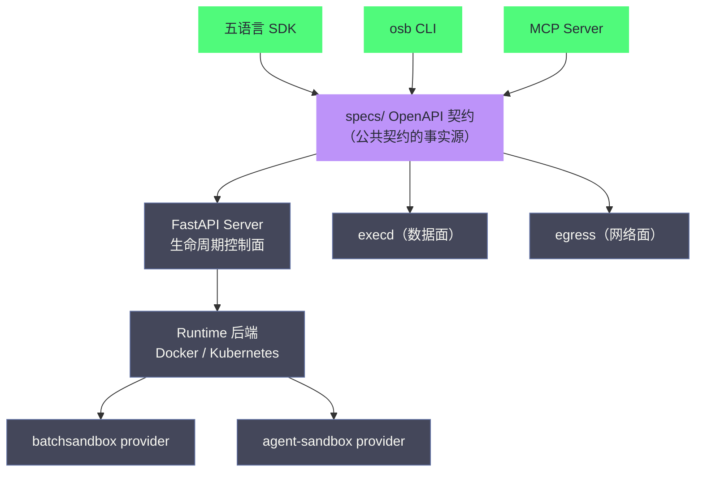
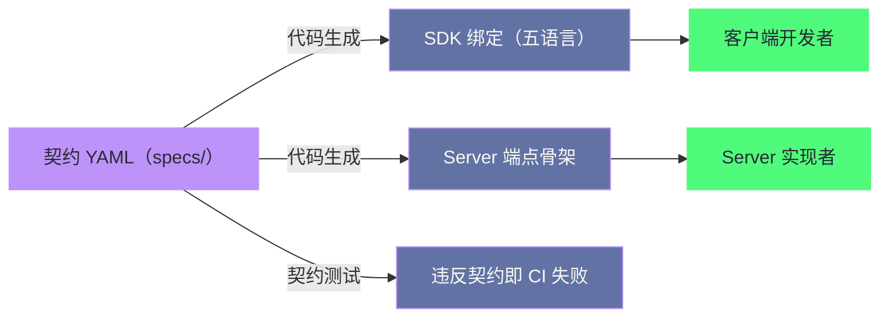

# 07 OpenSandbox 架构深度解析——协议优先与六责任面

**摘要：**

[[06 Agent 沙箱平台分层——六层模型与三条产品路线]] 把 OpenSandbox 定位为"企业产品派"的代表——覆盖六层模型中的第 1/2/3/6 层。本文深入它的架构内核：**协议优先（Protocol-First）设计哲学**与**六责任面（Six Surfaces）架构**。文章首先解释"为什么契约先于实现"——specs/ 目录下的 OpenAPI 契约是公共契约的事实源，SDK、CLI、Server 都依赖契约而非彼此；然后逐面拆解六责任面：Client 面（五语言 SDK/osb CLI/MCP Server）、Protocol 面（Lifecycle/Diagnostics/Execd/Egress 四契约）、生命周期控制面（FastAPI Server：鉴权、配置校验、状态持久化、委托运行时）、Runtime 后端（Docker 与 Kubernetes 双引擎，batchsandbox/agent-sandbox 双 workload provider）、数据面（execd + 用户负载 + volumes + egress sidecar）、网络与安全面（endpoint 解析、ingress gateway 路由、egress 策略）；随后深入控制面实现细节——创建请求的同步轮询语义（202/504 的真实含义）、状态所有权边界（CR 就绪前归 API Server、就绪后归 Controller）；再给出基于素材实测的评估（65 个 API 操作实测、44 个 CLI 命令实测、7 个产品缺陷、16 个能力缺口）与适用场景判断；最后新增一章"截至 2026 年 10 月的演进"，用 web 核实的新版本号（server 0.2.3、execd 1.1.0、egress 1.1.6/1.1.7、1.2.0 伞形发布候选版）、OSEP 提案进展（0012/0014/0016/0020/0022/0024）、Fast Sandbox 运行时与 Linux Foundation 治理变化逐项对照 PoC 基线。核心认知：**OpenSandbox 的架构价值不在"某个功能多强"，而在"契约分层让运行时替换、客户端扩展、平台演进成为可能"——协议优先是它对 Agent 沙箱行业的最大贡献，而 2026 年下半年的演进正在反复验证这条主线的承载力**。

---

## 第 1 章 OpenSandbox 的定位与设计哲学

### 1.1 项目背景

OpenSandbox 是阿里巴巴（Alibaba）开源的 AI 应用通用沙箱平台——2024 年 12 月底开源，后迁移至 opensandbox-group 组织维护，已列入 CNCF Landscape 的调度与编排分类（Scheduling & Orchestration）。官方定位：**"A general-purpose sandbox platform for AI applications"**——通用、面向 AI 应用、平台化。

它的能力矩阵（截至 2026 年中）：

| 能力域 | 内容 |
| :--- | :--- |
| **客户端** | 五语言 SDK（Python/JS/Go/Java 等）、osb CLI、MCP Server |
| **协议** | Sandbox Protocol（specs/ OpenAPI 契约） |
| **控制面** | FastAPI Server（鉴权/校验/状态/委托） |
| **运行时** | Docker（本地/单机）、Kubernetes（生产） |
| **数据面** | execd 守护进程、code-interpreter、volumes、egress sidecar |
| **安全面** | endpoint 解析、ingress gateway、egress 策略、资源限制、安全运行时 |

**素材 PoC 实测版本**：Server 0.2.2、Controller 0.2.0、Ingress Gateway 1.0.10、execd v1.0.21、egress v1.1.5、Console 0.2.3-rc.3——本文的架构描述基于这个版本基线（OpenSandbox 迭代较快，读者以官方 docs 为准）。

这里补一句素材以外的观察：从 2024 年 12 月底开源到 2026 年 10 月，项目走过了"alibaba 仓库开源 → 迁入 opensandbox-group 组织 → 进入 CNCF Landscape → 成为 Linux Foundation 项目"的社区化路径（第 7 章 7.6 节给出核实的治理现状）。**对一个以协议为公共资产的平台，社区化不是附加项而是必要条件**——契约的价值随采用者数量增长，而采用者只愿意信任治理透明的项目。

### 1.2 协议优先：为什么"契约先于实现"

OpenSandbox 最核心的设计决策是**协议优先**——先定义协议（specs/），再实现 Server，再实现 SDK/CLI。InfoQ 分享中陶宇田的阐述给出了完整逻辑链：

**第一环：模型能力提升后，runtime 成为系统瓶颈**。当 Agent 可以自主规划、调用工具、持续工作时，执行环境的交付效率（创建慢、并发低、无法回收）反过来限制模型能力的发挥——**runtime 的问题本质是"交互语义"的问题：不同客户端、不同运行时之间缺乏统一契约**。

**第二环：契约统一交互语义**。OpenSandbox 在 specs/ 下用 OpenAPI 定义"沙箱交互语义"：怎么创建沙箱、怎么执行命令、怎么管理文件、怎么暴露端口、怎么控制出站。**SDK 与 Server 都依赖契约而非彼此**——任何一端的变化不波及其他端。

**第三环：契约让运行时可替换**。下层 runtime（Docker/K8s）被契约抽象——"今天可以用 Docker，也可以换成 K8s，甚至未来自定义更强的 runtime"（InfoQ 原话）。**契约是"运行时替换"能成立的架构前提**：素材 PoC 在统一 API 下把运行时从 runc 换成 Kata，正是这个设计的验证；2026 年下半年的 Fast Sandbox（第 7 章 7.4 节）则把"可替换"从"同一个 K8s provider 内换隔离档位"推进到"换整个运行时平面"。



**"契约即代码"的工程表达**：所有公共契约定义在 specs/ 目录下，SDK 从契约生成绑定代码，Server 按契约实现端点——**契约的变更流程就是一次 PR**，任何违反契约的实现都会被代码生成与测试拦截。这个工程闭环让"协议优先"不只是口号。

值得把"契约即代码"再拆一层，因为它是协议优先与"接口优先"（code-first）的本质分野。接口优先是"先写 Server 代码，再导出 OpenAPI 文档"——文档是实现的影子，实现一变、影子就变，SDK 与 Server 的耦合没有真正断开；协议优先是"先写契约 YAML，再分别生成两端"——**契约是唯一的事实源，实现是契约的下游**。两者在工程上差一个词：接口优先的契约是"描述"（description），协议优先的契约是"规定"（specification）。描述跟着实现走，规定约束着实现走，这就是为什么协议优先需要一套变更门禁（OSEP 提案）而接口优先不需要——**规定是要守的，描述只需更新**。



**为什么选 OpenAPI 而非 gRPC/Protobuf**：契约要同时服务五语言 SDK、CLI、MCP 与浏览器侧调试，REST + OpenAPI 在"通用性"（任何语言都有 HTTP 客户端）与"人类可读性"（Swagger UI 即文档）上是最低门槛的公共语言；gRPC 在性能与强类型上更优，但会让"浏览器直连调试"与"curl 排障"这类轻量入口失去位置。**协议优先关心的是"最大公约数的契约"，不是"最强性能的契约"**——这也是它面向 Agent 生态而非单一高性能客户端的姿态。代价是执行面（execd 的 27 个操作）也要走 REST 的请求/响应语义，流式输出靠 SSE 补齐（第 08 篇详述）。

### 1.3 协议优先的代价与反例

协议优先不是免费的——它的四个代价需要清醒认识：

**代价一：契约演进成本**。契约一旦发布并被多端依赖，修改就是破坏性变更——OSEP 提案流程（类似 Kubernetes 的 KEP）因此成为必要。素材记录"5 个已合并 main 未发版"的社区现状，正是契约演进节奏与发布节奏错位的实例：**用 main 分支的契约做集成，可能遇到 release 未包含的行为**。

契约演进的机制层面，OpenSandbox 走的是典型的"增量优先、破坏性变更走门禁"路线：新增能力以新字段、新操作、新契约文件的方式叠加（譬如 diagnostics 上下文 API、NetworkRule 端口级规则都是加法）；对既有字段的语义收敛则走 OSEP 并保留迁移窗口（2026 年 10 月 lifecycle.renewalPolicy 取代 opaque 的 renew extensions key 即是实例，见 7.2 节）。**契约的"可演进性"靠的不是"不改"，而是"改得可追踪"**——每次改动对应一次 PR、一个 OSEP、一个 migration 说明，多端依赖才有升级的路径。代价是：这个流程本身有行政成本，小修小改也要走提案，社区体量不足时流程会显得笨重。

**代价二：实现滞后风险**。契约定义了能力，实现可能没跟上——素材实测发现 Diagnostics API 未实现（GAP-001）、CLI 缺 Snapshot/Pool 命令组、OSEP-0006 停留在 implementable。**契约面 ≠ 实现面**——评估时必须以实测（调用 API/跑命令）为准，不能以文档为准。这一点在 2026 年 10 月依然成立：OSEP 索引里 OSEP-0006（控制台）仍是 implementable、OSEP-0007（Fast Sandbox）仍是 provisional，而实现已经走到合并适配层（第 7 章）。**提案状态是意图，不是交付物**。

**代价三：过度抽象风险**。契约抽象了运行时差异，但"抽象泄漏"不可避免——Docker runtime 与 K8s runtime 的行为差异（如 pause/resume 语义、网络模型）会在边界处透出。素材 PoC 的"暂停/恢复与快照：同一个状态名下面是不同机器"（[[09 OpenSandbox 编排面——BatchSandbox、WarmPool 与快照]]）正是抽象泄漏的实例。2026 年的 Fast Sandbox 给这个代价又加了一个注脚：内存级暂停/恢复只在特定路径（QEMU VMState，runc 沙箱 opt-in）提供，**同一个 pause 动词在三条运行时路径下的语义仍然不同**——抽象层把"名字"统一了，把"语义"留给各实现自证。

**代价四：契约即承诺，读与写不对称**。读契约的成本几乎为零（看文档、调 API），写契约的成本却极高（要保证五语言 SDK、Server、CLI 全部同步）——**一次契约变更的"执行成本"被乘上了端数**，把"改一个函数"放大成"改契约 + 改生成 + 改实现 + 改测试 + 改文档"。评估者要算的不是"协议多好"，而是"端数×迭代速度"是否撑得起契约维护成本。

**反例（协议优先不适用的情况）**：单一固定运行时、无多客户端需求、纯内部工具的沙箱——协议层是负担而非资产。**协议优先的价值随"端数 × 运行时数"增长**——端越多、运行时越多样，契约的杠杆越大。

### 1.4 与 E2B/SIG 的坐标（衔接第 06 篇）

| 维度 | E2B | SIG agent-sandbox | OpenSandbox |
| :--- | :--- | :--- | :--- |
| **契约形态** | 闭源 API | CRD（K8s 声明式） | OpenAPI（specs/ 开源） |
| **控制面** | 托管 Orchestrator | 无（自建） | FastAPI Server |
| **执行层** | envd | 无 | execd |
| **协议开放度** | 不可自建 | 标准开放 | 开放 + 可扩展 |

**OpenSandbox 的独特位置**：它是三条路线中唯一"**协议开源 + 控制面可自托管 + 执行层内置**"的组合——SIG 有标准但缺控制面/执行层，E2B 有完整产品但闭源托管。这个位置解释了它为什么成为企业自建的主候选（[[06 Agent 沙箱平台分层——六层模型与三条产品路线]] 的选型复盘）。

把这个位置再往 2026 年 10 月延伸一步：E2B 的"API 语义事实标准"地位与 OpenSandbox 的"开源契约"正在互相咬合而非互相替代——OpenSandbox 在协议层参考 E2B 语义（第 06 篇的"E2B 兼容"观察），而 E2B 生态的客户端要自托管时，OpenSandbox 是少数"契约开源、实现可替换"的落点。**协议优先的行业意义，正在于它让"换平台"从"重写客户端"变成"换实现"**——这恰好是第 06 篇"协议层参考 E2B、编排层贴近 SIG、隔离层按档选"生态策略的底层支撑。

---

## 第 2 章 六责任面架构

### 2.1 总览

官方架构文档把 OpenSandbox 组织为六个责任面（Six Surfaces），每个面只做一件事，通过明确定义的契约连接：

| 责任面 | 内容 | 依赖 |
| :--- | :--- | :--- |
| **1. Client Surface** | SDK、osb CLI、MCP Server | 依赖公共契约 |
| **2. Protocol Surface** | specs/ 下的 OpenAPI 契约 | 无依赖（事实源） |
| **3. Lifecycle Control Plane** | FastAPI Server：鉴权/校验/持久化/委托 | 依赖契约 + 运行时 |
| **4. Runtime Backends** | Docker、Kubernetes（workload provider） | 依赖控制面委托 |
| **5. Sandbox Data Plane** | 用户负载容器 + execd + volumes + egress sidecar | 依赖运行时创建 |
| **6. Network & Security Plane** | endpoint 解析、ingress 路由、egress 策略、资源限制 | 依赖数据面 |

**拆分意图**（官方文档原意）：SDK 和工具依赖公共契约；Server 拥有生命周期编排；Runtime provider 拥有平台特定的资源创建；execd/egress 拥有沙箱网络与文件系统命名空间内的操作。**任何一层的实现变更都不会波及其他层**——这是六责任面与六层模型（[[06 Agent 沙箱平台分层——六层模型与三条产品路线]]）的关系：六层模型是"需求维度"的划分，六责任面是"实现模块"的划分。

要读懂六责任面，更好的入口是先看流量再回看模块。2026 年 10 月的官方架构文档把交互归纳为三条路径：**生命周期管理路径**（应用、Agent、运维者把创建/续期/暂停/恢复/删除等请求发给 FastAPI 生命周期 Server，Server 持久化元数据并委托运行时）；**执行与服务访问路径**（命令、文件、PTY、Jupyter 执行、访问用户工作负载服务时，客户端绕过生命周期编排、直连解析出的 endpoint——经宿主机/Pod 地址、Server 代理或 ingress gateway）；**出站控制路径**（沙箱到外部 API、模型服务、Web 服务的出站流量经 egress 过滤，支持 DNS/nftables 策略与可选的 Credential Vault 注入）。**六责任面就是这三条路径的实现载体**：生命周期路径落在第 3/4 面，执行路径落在第 1/2/5 面，出站路径落在第 6 面。三路径视角与本文第 2.8 节"进与出是两条独立路径"的结论互相印证，且补上了第三条——**管理路径与前两者在物理上也要切开**（控制面故障不阻塞执行与出站，第 06 篇的"控制面与数据面切开"）。

用一个生活比喻固定这个结构：六责任面像医院的分科——内科只做诊断、外科只做手术、检验科只出报告，病人（沙箱请求）在科室之间流转，各科室通过"病历"（契约）交接，谁也不替别的科室干活。**分科的代价是病人要挂号多次（跨面协调有开销），收益是任何一个科室改革都不影响其他科室运转（可独立演进）**——沙箱平台的"科室"越多，接口越贵，但演化越自由。

### 2.2 Client 面：三种客户端形态

**SDK**：五语言绑定（Python/JavaScript/Go/Java 等），全部由 specs/ 契约生成——不同语言的语法糖不同，但沙箱语义一致。对 Agent 应用开发者，SDK 是首选接入方式（`from opensandbox import Sandbox` 级别的体验）。

SDK 由契约生成意味着一个重要的对称性：**各语言 SDK 的"能力边界"由契约统一决定，不由各语言维护者的主观取舍决定**——Python SDK 有的操作，Java SDK 也有，因为两端都从同一份 YAML 生成。正面结果是客户端行为可预期（切换语言不重学语义）；反面是"契约生成"替代不了"语言惯用法适配"——异步风格（Python async/await 与 Go goroutine 的差异）、错误类型、流式消费方式仍要逐语言打磨。**契约解决"做什么"，语言适配解决"怎么写得顺手"**，两件事都不能省。

**osb CLI**：运维与调试的主工具。素材 Phase3-06 对 CLI 做了 44 个命令的完整实测：覆盖 Sandbox 生命周期（create/list/get/pause/resume/delete/update）、execd 能力（exec/upload/download/fs）、Endpoint、Snapshot、Pool 等命令组。**实测发现：Snapshot/Pool 命令组缺失**——CLI 的覆盖落后于 API（GAP 类问题），这意味着 CLI 不能作为全部能力的操作入口，部分能力只能走 API。

**MCP Server**：opensandbox-mcp 把 Sandbox API 封装为 MCP 工具——Agent 通过 MCP 协议直接创建/操作子沙箱（[[11 三类 Agent 沙箱落地——OpenCode、Hermes 与 LangChain 镜像化实战]] 的"父 Agent → MCP → 子沙箱"链路）。**注意 MCP Server 的定位**：它是"Sandbox SDK/API 的工具适配层"，不是"用户与所有 Agent 对话的统一协议"（素材源码走读的边界结论）。

三种客户端形态的共存不是堆功能，而是覆盖三个不同角色：**SDK 服务"应用开发者"（写代码的人），CLI 服务"运维者"（调环境的人），MCP 服务"Agent 本身"（消费工具的人）**——三者依赖同一契约，才保证同一沙箱在三个入口下看到同一语义。如果三端各写各的接口，平台就退化成三个互不相认的产品。

### 2.3 六责任面与六层模型的映射

两个"六"容易混淆，给出明确映射：

| 六层模型（需求维度，第 06 篇） | 六责任面（实现模块，本文） |
| :--- | :--- |
| 第 1 层：产品控制面 | 3. Lifecycle Control Plane |
| 第 2 层：K8s 编排层 | 4. Runtime Backends（K8s provider） |
| 第 3 层：执行层 | 5. Sandbox Data Plane（execd） |
| 第 4 层：隔离运行时 | 4. Runtime Backends（RuntimeClass 接入） |
| 第 5 层：Agent 适配层 | **无对应面（缺口）** |
| 第 6 层：API 与协议层 | 1. Client + 2. Protocol |

**两个关键观察**：其一，**第 5 层在六责任面中无对应**——OpenSandbox 明确把 Agent 适配留给外部（镜像/entrypoint 由用户提供，execd 只提供控制通道），这是"边界清晰"而非"遗漏"；其二，**第 2/4 层共用一个责任面**（Runtime Backends）——编排与隔离在实现上耦合于"runtime service"，这正是"Runtime 是 Server 实例级配置"（GAP-010）的实现根源。

如果六层模型是"需求蓝图"（这个平台在需求维度上缺什么、有什么），六责任面就是"施工队划分"（代码仓库里谁负责哪一块）。蓝图上标着"要有执行能力"（第 3 层），施工队里就有一个 execd 团队；蓝图标着"第 5 层 Agent 适配"，施工队里却没有对应模块——**因为第 5 层的需求方不是平台而是 Agent 生态**，没有标准可依的适配无从"分派施工"。这张映射表的真正用途是排障与立项时的"追责表"：需求缺了找蓝图，实现出问题找施工队——两边对不上号的地方（第 5 层无对应、第 2/4 层共面）就是架构决策要讨论的地方。

### 2.4 Protocol 面：四契约

specs/ 下的四个 OpenAPI 契约（素材实测操作数）：

| 契约 | 文件 | 操作数（实测） | 职责 |
| :--- | :--- | :--- | :--- |
| **Lifecycle API** | sandbox-lifecycle.yml | 33 | 沙箱 CRUD、快照、端点解析、续期 |
| **Diagnostics API** | diagnostic-api.yml | — | 日志、事件、运维诊断（**GAP-001：stable 版本未实现**） |
| **Execd API** | execd-api.yaml | 27 | 沙箱内命令执行、文件管理、代码执行 |
| **Egress API** | egress-api.yaml | 3 | 出站策略的动态管理 |

**契约总数 65 个操作**——这是"沙箱平台"的完整 API 面。对比：只覆盖编排的 SIG 方案 API 面几乎为零（全靠 CRD），只覆盖执行层的方案只有 execd 类 API——**OpenSandbox 的 65 个操作是其"完整平台"定位的直接体现**。

65 这个数字的分布本身值得读一遍：Lifecycle 33 个占了一半——**沙箱平台的"操作重心"在生命周期管理，不在执行**。这印证了第 06 篇的判断：执行层（execd）只提供控制通道，而平台层的绝大部分工作（创建、续期、暂停、快照、端点、回收）都落在控制面契约上。执行语义（27 个 execd 操作）与网络语义（3 个 egress 操作）加起来不到一半，**"管理比执行贵"是沙箱平台的普遍结构**——自研平台时预算要向控制面倾斜，而不是纠结执行层的命令集。

四契约的分工边界也值得记住：Lifecycle 管"沙箱的生死与身份"，Execd 管"沙箱内的动作"，Egress 管"沙箱与外界的出站约定"，Diagnostics 管"沙箱的证词"——**四个契约对应四种不同的信任等级**：生命周期与执行是"平台对沙箱的支配权"，egress 是"沙箱对外部的约束权"，diagnostics 是"平台对行为的举证权"。GAP-001（diagnostics 未实现）意味着 0.2.x 的"举证权"缺失——审计只能靠外部日志绕行（第 08 篇 7.2 节）。

### 2.5 生命周期控制面：FastAPI Server

Server 是控制面的实现——FastAPI 应用，职责四件：

1. **鉴权**：API Key 认证（素材 PoC 使用共享平台级 Key，生产化需短期凭据，[[14 沙箱安全体系——三层防护、短期凭据与多租户]]）；
2. **配置校验**：请求的模板/镜像/资源/运行时声明校验；
3. **状态持久化**：Server 管理的记录（沙箱元数据、快照记录——**pod-local SQLite，双副本 404 问题**）；
4. **委托运行时**：把生命周期工作委托给配置的 runtime service（Docker/K8s）。

这四件职责的分工逻辑值得展开：**鉴权与校验是"入口守卫"，持久化是"记忆"，委托是"执行力"**——Server 自己不创建容器、不执行命令，它只决定"该不该做、记住做过什么、让谁去做"。这个"决定与执行分离"正是控制面与数据面切开的控制面侧表达（第 06 篇 2.7 节）。FastAPI 作为实现载体有两个顺手的理由：其一，异步原生的请求处理天然适配"创建请求内同步轮询 Pod 就绪"的等待语义（第 3 章）；其二，FastAPI 自动生成 OpenAPI 文档，**文档与契约同源，Server 端点的漂移在开发期就被暴露**——这又回到 1.2 节"契约即代码"：控制面实现者拿到契约生成骨架，想偏离契约反而要刻意为之。

**Server 与 Kubernetes 的集成路径**（官方文档）：K8s client 初始化、informer 支持、镜像请求→工作负载创建、snapshotId 启动解析、模板合并（BatchSandbox/agent-sandbox manifests）、imagePullSecret 传递、资源限制与 GPU 翻译为扩展资源、RuntimeClass 集成、volumes/egress sidecar/安全端点注解、endpoint 解析、pause/resume 委托、诊断文本——**Server 是"K8s 能力的产品化包装层"**。

把集成路径拆成 Server 侧的处理清单（便于排障时对照）：

| 处理项 | Server 动作 | 排障入口 |
| :--- | :--- | :--- |
| 镜像请求 | 校验镜像名/摘要 → 生成 Pod 模板 | 镜像不存在 → 504 回滚（180s 等待） |
| snapshotId 启动 | 解析快照记录 → 可恢复镜像 | Snapshot 记录在 pod-local SQLite |
| 模板合并 | 合并用户请求与模板默认值 | 合并冲突 → 4xx 校验错误 |
| imagePullSecret | 按请求传递拉镜像凭据 | 拉取失败 → Pod ImagePullBackOff |
| GPU 翻译 | 资源请求 → 扩展资源（nvidia.com/gpu） | 节点无 GPU 扩展资源 → 调度失败 |
| RuntimeClass | 声明安全运行时 | 四层不一致 → 静默降级（第 02 篇） |
| volumes/egress | 注入卷声明与 sidecar | sidecar 异常 → 沙箱网络策略失效 |
| endpoint 解析 | 直接读 workload 数据或网关配置 | DEF-003 路由 Header 无效 |
| pause/resume | 委托给 provider | 202 ≠ 完成，需轮询终态 |

**这张表的使用方法**：沙箱创建/运行异常时，按处理项逐个对照——"哪个环节的 Server 动作与你观察到的现象对应"，快速定位故障面。

### 2.6 Runtime 后端：Docker 与 Kubernetes 双引擎

**Docker runtime**：本地与单机部署——`opensandbox server --runtime docker` 级别的体验，用于开发调试与轻量使用。

**Kubernetes runtime**：生产部署。workload provider 机制让 K8s 后端支持两种 CRD 体系：

| provider | 说明 |
| :--- | :--- |
| **batchsandbox**（默认） | OpenSandbox 自研 Controller 与 BatchSandbox/Pool/SandboxSnapshot CRD——高吞吐、池化（[[09 OpenSandbox 编排面——BatchSandbox、WarmPool 与快照]]） |
| **agent-sandbox** | 兼容 kubernetes-sigs/agent-sandbox 的 Sandbox CRD——生态标准对接 |

**双 provider 的战略意义**：OpenSandbox 不做"独占标准"，而是**同时拥抱自研高性能 CRD 与社区标准 CRD**——素材 PoC 默认走 batchsandbox，但保留 agent-sandbox provider 作为标准兼容路径。这是"协议优先"哲学的延伸：**契约层以上不绑定任何编排实现**。

两个引擎的能力差异要对齐认知，因为它们会在边界处泄漏（1.3 节代价三）：Docker runtime 的沙箱语义是"本机容器"——无 K8s 调度、无 RuntimeClass 四层链路、无 WarmPool，pause/resume 与快照走的是 Docker 侧实现；Kubernetes runtime 才有 provider、Pool、CRD 对账这些编排语义。**"同一个 API 下面两台机器"不仅在编排面成立（第 09 篇的状态语义），在引擎层面同样成立**——"本地 Docker 验证通过"不能直接外推为"生产 K8s 行为一致"，引擎差异是生产化验证清单的必查项。

### 2.7 数据面：execd + 用户负载 + volumes + egress sidecar

数据面（第 08 篇完整展开）——此处只给责任面定位：

- **用户负载容器**：镜像定义的 Agent/应用本体；
- **execd**：注入的 Go 守护进程（命令/文件/PTY/指标/SSE）——**"沙箱内操作"的执行者**；
- **volumes**：持久卷（工作目录、Workspace）；
- **egress sidecar**：出站策略的执行者。

数据面四个成员的责任边界是"谁拥有沙箱内的什么"：**execd 拥有"动作"，用户负载拥有"业务"，volumes 拥有"留存的文件"，egress 拥有"与外界的约定"**。把 egress 独立成 sidecar 而不是塞进 execd，是刻意的：execd 的职责是"沙箱内执行"，出站管控是"沙箱网络边界"——两者一个面向"进程"，一个面向"网络命名空间"，生命周期不同（egress 要随 Pod 网络一起起停、要在沙箱内应用之前就绪）、失败语义不同（execd 挂了沙箱内无法执行，egress 挂了沙箱应当 fail-closed 断网）。**责任面按"故障域"而非"技术栈"划分**，这是六责任面设计里最容易被忽略的一条原则。

### 2.8 网络与安全面

| 能力 | 机制 | 素材验证 |
| :--- | :--- | :--- |
| **endpoint 解析** | 沙箱内服务的地址解析（如何找到沙箱端口） | Endpoint API 实测 |
| **server proxy** | Server 侧代理流量到沙箱内服务 | DEF-003：返回无效路由 Header（缺陷） |
| **ingress gateway** | K8s 网关动态路由（签名 Header） | Gateway 1.0.10 实测 |
| **egress 策略** | 出站白名单/拒绝规则 | Egress API 3 操作实测 |
| **资源限制** | Pod limits + RuntimeClass | 配额实测 |
| **安全运行时** | RuntimeClass 接入 gVisor/Kata | 三运行时切换实验 |

**网络面的设计要点**：流量进沙箱走"统一入口抽象"——Agent 在沙箱内启动服务后，通过统一的 ingress 层触达（InfoQ 的"统一入口访问抽象"）；流量出沙箱走 egress 管控——**进与出是两条独立路径**，分别由 gateway 与 egress sidecar 负责（[[08 OpenSandbox 数据面——execd 与 egress 的盒内世界]]）。

进与出分开的本质是信任模型不同：**入站是"谁可以到沙箱来"（身份问题），出站是"沙箱可以到谁那里去"（边界问题）**——身份问题要鉴权（签名 Header、endpoint 沙箱级保密），边界问题要枚举（白名单、默认拒绝）。把两者混在一个组件里，要么入站鉴权被出站策略的粒度拖累，要么出站枚举被入站身份的逻辑干扰。三层边界叠加（第 08 篇 5.3 节：查询鉴权 → 网关鉴权 → 应用鉴权）与出站默认拒绝（内网/云元数据/公网非白名单）构成了沙箱网络面的完整模型——**进得去多少取决于身份，出得去多少取决于策略，两条规则独立演进**。

---

## 第 3 章 控制面源码级走读：创建请求的一生

### 3.1 请求路径：从 HTTP 到 Pod

素材 Phase6 源码走读（Lesson 1）的结论，完整还原一次创建请求的路径：

```
1. HTTP POST /sandboxes（FastAPI 路由）
2. KubernetesSandboxService 校验请求（镜像/资源/运行时）
3. 创建 BatchSandbox CR（声明期望状态）
4. 在 HTTP 请求内同步轮询：CR 就绪 + Pod Running + IP
5a. 等到 → 返回 202 + sandbox_id + endpoint
5b. 等不到（约 180 秒）→ 返回 504，并主动删除 CR 回滚
```

**三个关键发现**：

**发现一：202 表示"同步完成"，不是"异步受理"**。OpenSandbox 的 202 语义是"provisioning completed synchronously"——请求返回时 Pod 已经 Running。这与直觉（202 = Accepted 异步）相反——**调用方必须按"202 = 已完成"理解，否则会重复创建**。

**发现二：失败路径会自动回滚**。镜像不存在时，等待约 180 秒后返回 504，**且 API 主动删除已创建的 CR**——"创建失败不留垃圾"是设计意图，但 sandbox_id 只出现在错误 message 里（客户端难以关联）。素材的调用铁律由此而来："HTTP 码只表示'话送到了没有'，权威是 Lifecycle state + conditions"。

**发现三：状态所有权有明确边界**。**CR 就绪前，成败归 API Server**（它等、它放弃、它回滚）；**CR 就绪后，phase 归 Controller**（生命周期由 Controller 对账）。这个边界是排障的第一依据：创建失败查 Server 日志，运行中异常查 Controller/CR 状态。

这个"在柜台等叫号"的设计值得用反事实推演一遍：OpenSandbox 选择"同步等待 Pod 就绪再返回"，相当于银行柜员把你这笔业务办完才喊下一号——**好处是"成功/失败"在离开柜台前就定了性，回滚归属清晰（Server 自己等、自己放弃、自己清场）；代价是排队的人（HTTP 请求）占着柜台（连接）最多 180 秒**。如果改成"取号后去逛街"（立即返回 202 + 客户端自行轮询），省了柜台占用，但"号作废了"（创建失败被回收）这件事没人有义务通知你——回滚归属从 Server 转移到调用方，每个客户端都要自己实现"失败探测 + 重试 + 清理"三件套。**同步语义把复杂性收进 Server，异步语义把复杂性摊给每个调用方**——素材的 PoC 实测证明这个取舍在 0.2.x 是自洽的，但它确实把"创建请求最坏要挂 180 秒"的延迟风险暴露给了调用方（第 06 篇 2.7 节的反例讨论）。

### 3.2 源码路径：路由 → Service → CR → 轮询

素材源码走读（Phase6-02，Lesson 1）给出了具体的代码路径，这里用伪代码还原骨架（帮助读者建立"代码→行为"的对应，非逐行引用）：

```python
# 伪代码：创建沙箱的 Server 侧路径（基于源码走读还原）
@app.post("/sandboxes")
async def create_sandbox(req: CreateRequest, ...):
    # 1. 鉴权与请求校验（API Key、模板/镜像/资源合法性）
    validate(req)

    # 2. 委托 KubernetesSandboxService
    result = await k8s_sandbox_service.create(req)
    if result.error:
        # 3a. 失败：等待超时（约 180s）→ 504 + 主动删除 CR 回滚
        rollback_cr(result.cr_name)
        return 504, {"error": result.error}   # sandbox_id 只在 message 里
    # 3b. 成功：Pod Running + IP 已获取 → 202（同步完成）
    return 202, {"sandbox_id": result.id, "endpoint": result.endpoint}
```

**三个值得注意的实现细节**：

1. **轮询发生在 HTTP 请求内**（`await` 等待 Pod Ready）——所以"202 返回时 Pod 已 Running"；也所以失败时请求挂起约 180 秒（客户端超时设置必须大于此值）；
2. **回滚是 Server 主动行为**——失败不留 CR 残留，但**回滚动作本身没有通知机制**（客户端只能从 504 推断）；
3. **sandbox_id 出现在错误 message 而非结构化字段**——自动化脚本解析错误时需要正则提取（素材实测记录）。

**对集成方的操作建议**：创建请求的客户端必须处理三种结局——202（成功，含 id）、504（超时回滚，可重试）、4xx（校验失败，修正请求）——**不要假设"非 2xx 就是失败可重试"**，504 的重试与 4xx 的重试语义完全不同。

把三种结局的差异再说透：504 是"资源已清理的失败"——重试是安全的，不会留下重复资源；4xx 是"请求本身不合法"——重试只会得到同样的 4xx，正确的动作是改请求；还有一种模糊地带是"超时了但 Server 还没删完 CR"（回滚是异步清理）——此刻重试可能与清理中的资源撞车。**集成方要做的不是"统一重试"，而是给三种结局分别写分支**：504 分支（等待后重试）、4xx 分支（修请求）、以及一个"504 后短暂等待再重试"的防撞车节流。素材 PoC 的调用铁律"权威是 Lifecycle state + conditions"正是为这类模糊地带准备的——**以终态为准，不以 HTTP 码为准**。

### 3.3 状态语义的工程后果

| 现象 | 语义 | 工程后果 |
| :--- | :--- | :--- |
| 创建 API 返回 202 | 同步完成，Pod 已 Running | 客户端无需轮询（但要准备 504 分支） |
| 创建失败返回 504 | 超时回滚，资源已清理 | 客户端应重试而非排查残留 |
| CLI 显示 pause ok | 请求被接受，非完成 | **必须轮询到 Paused 状态**（DEF-001） |
| 运行中 CR phase=Succeed | 稳态命名，非 Job 成功 | 不能据此判断"任务完成" |

**"202 语义"与"状态所有权"是本专栏 [[15 生产化深水区——十个盲区与行业共识]]"十个盲区"之首的直接素材**——控制面契约的语义歧义是生产事故的温床。

这张表的四行其实是同一个原则的四个投影：**"接口返回"与"事实状态"是两回事，中间隔着"对账异步性"**——202 是"创建请求的接口返回"，Pod Running 是"创建的事实状态"，两者在同步语义下重合，但 CLI 的 pause ok 与 Paused 终态之间、CR phase 与任务完成之间，隔的就是 Controller 对账的异步时间差。**凡是异步系统，"完成信号"必须收敛到唯一的事实源**（对 OpenSandbox 是 Lifecycle state + conditions），接口返回只是信号的中转站。

---

## 第 4 章 客户端生态与交互面

### 4.1 osb CLI：44 个命令的实测地图

素材 Phase3-06 对 osb CLI 的实测覆盖（按命令组）：

| 命令组 | 覆盖 | 实测发现 |
| :--- | :--- | :--- |
| **sandbox**（生命周期） | create/list/get/pause/resume/delete/update/... | 完整 |
| **exec**（执行） | exec/upload/download/fs 等 | 完整 |
| **endpoint** | 端口与访问 | 完整 |
| **snapshot** | 快照 | **命令组缺失**（GAP） |
| **pool** | 预热池 | **命令组缺失**（GAP） |
| **misc** | 配置/健康/版本 | 完整 |

**CLI 与 API 的覆盖差**是重要信号：**平台能力的"操作面"分裂**（CLI 缺能力 → 运维只能写脚本调 API）——评估平台时要把"CLI 覆盖度"列入检查项。

CLI 在沙箱平台里不是一个"锦上添花"的组件，它承担三个不可替代的角色：**其一，运维脚本的事实入口**——批量清理、巡检、故障恢复都写成 CLI 命令串，CLI 缺能力意味着这些自动化只能用裸 API 拼；**其二，排障时的"最小复现语言"**——"用 `osb sandbox create` 复现问题"比"贴一段 SDK 代码"更短，社区交流的默认语汇是 CLI；**其三，契约的"人读视图"**——`osb --help` 罗列的正是契约操作集，CLI 覆盖差本质上暴露的是"契约面与工具面的异步"。对评估者而言，"CLI 缺 Snapshot/Pool"这件事本身不是致命的（能力还在 API），但它预示了一个评估纪律：**文档、CLI、API 三者的能力覆盖要分别核验，任何两者之间都可能存在落差**。

### 4.2 Console：Web UI 的现状与设计边界

素材 Phase1-14/Phase3-05 对 Developer Console 做了完整调研：

**现状**：官方 WebUI 未成熟——OSEP-0006（控制台设计提案）状态为 implementable 而非 implemented；社区 PR #835 是 React MVP，但 npm audit 报告 8 个漏洞；**结论：没有可随 Helm chart 直接部署的成熟官方 WebUI**。（截至 2026 年 10 月的 Console 进展见第 7 章 7.2/7.5 节——出现了可安装的 sandbox-console 包，但 OSEP-0006 状态未变，本文此处保留素材基线结论。）

**作者的设计结论**（Phase3-05）：
- 信息架构参考 CubeSandbox（平台管理视角）；
- 单 Sandbox 工作台参考 E2B（沙箱操作视角）；
- **安全边界在 BFF（Backend for Frontend）**——浏览器不直接碰 OpenSandbox API，BFF 层做鉴权/转发/审计；
- Console 作为**独立无状态管理面**部署（2 副本 + ClusterIP + HTTPS/SSO），**不打进 Server 镜像**。

**"Console 是独立组件"的设计原则**与六责任面一致：控制面的管理界面与运行时控制面解耦——**Console 挂了不影响沙箱运行**。

### 4.3 交互面最佳实践：来自素材的七条经验

素材 Phase1-13/14、Phase3-05/06/07 的交互面调研，沉淀为七条可复用的最佳实践：

1. **Agent 接入优先原生 Server 接口，PTY 作为兼容通道**——PTY 传终端字节流（非结构化），原生 API 传会话/消息/事件（结构化）——可观测性与可恢复性由结构化接口决定；
2. **CLI 与 API 的覆盖差要提前摸清**——osb CLI 缺 Snapshot/Pool 命令组，运维脚本不要假设 CLI 全覆盖；
3. **Console 必须独立部署**（2 副本 + ClusterIP + HTTPS/SSO），安全边界在 BFF——浏览器永不直连 OpenSandbox API；
4. **交互面的"能力分级"要文档化**——哪些能力 CLI 有、哪些只有 API、哪些只有 CRD——避免运维踩空；
5. **MCP 配置的凭据显式传递**——Hermes 类 Agent 需要 env 显式传 `OPEN_SANDBOX_API_KEY` 给 stdio MCP 子进程，隐式继承不可靠；
6. **Endpoint 语义要讲清楚**——Endpoint API 返回"访问地址与路由头"，解决"如何找到沙箱端口"，**不替代端口内应用自己的登录/Session/WebSocket 协议**；
7. **交互面版本化**——契约变更走 OSEP 提案流程，客户端升级要跟契约版本对齐（素材记录 19 个候选 Issue/PR 中 5 个已合并 main 未发版——**main 领先于 release 的常见陷阱**）。

七条经验的共同内核是一个"交互面分层"判断：**交互面的每一层（传输通道、协议语义、鉴权边界、版本节奏）都要显式设计，而不是"顺手能用就行"**——经验 1 是通道层、经验 2/4 是覆盖层（工具与契约的落差）、经验 3/5 是凭据层（浏览器与 MCP 子进程的凭据边界）、经验 6 是语义层（Endpoint 管路由不管应用）、经验 7 是时间层（版本与发布节奏）。**一个沙箱平台的"交互体验"，最终由这五个层的设计质量决定，而不由 UI 好不好看决定**。

### 4.4 Console 信息架构的完整结论

素材 Phase3-05 的 Console 产品调研产出了可复用的信息架构结论（即使不部署 OpenSandbox，设计自研 Console 时同样适用）：

**两级信息架构**：

| 层级 | 参考对象 | 内容 |
| :--- | :--- | :--- |
| **平台管理级** | CubeSandbox | 集群总览、沙箱列表、资源统计、运行时状态、配额管理 |
| **单沙箱工作台** | E2B | 沙箱详情、终端（PTY）、文件浏览器、命令历史、端点访问 |

**三个设计决策**：
1. **安全边界在 BFF**：浏览器 → BFF（鉴权/审计/转发）→ OpenSandbox API——浏览器永不持有平台 Key；
2. **管理面与运行面分离**：Console 是"无状态管理面"，沙箱运行不依赖它（Console 挂了，Agent 继续跑）；
3. **不做"全能面板"**：Snapshot/Pool 等运维能力放 CLI/API，Console 只承载高频操作——**控制界面也遵循最小能力原则**。

**技术选型参考**：React + BFF（素材 PR #835 是 React MVP，但 npm audit 8 漏洞——**前端供应链安全是 Console 自建时的必查项**）；部署为独立 Deployment（2 副本 + ClusterIP），接入 SSO 后经 Gateway 暴露。

三个设计决策里，第 3 条"最小能力原则"最反直觉也最重要：控制台天然会向"什么都能点"膨胀，但沙箱平台的运维能力（快照、池管理）属于低频高风险操作，放进控制台只会让误操作更容易发生——**把低频操作留在 CLI/API，等于给控制台上了一道"操作减速带"**，这个"摩擦"是有意的。BFF 与独立部署两条则是一体两面：**浏览器不碰平台 Key 是身份边界，管理面不碰运行面是故障边界**——两条边界都断了，Console 才会成为安全与可用性的双弱点。

### 4.5 SDK 使用示例：一个最小闭环

结合素材 PoC 的调用记录，给出 Python SDK 的最小闭环示例（展示"创建→执行→回收"的契约语义）：

```python
from opensandbox import SandboxClient

client = SandboxClient(api_key="...", base_url="https://osb.internal:30080")

# 1. 创建沙箱（同步语义：202 返回时 Pod 已 Running）
sb = client.sandboxes.create(
    image="10.2.177.37:30500/agent-poc/code-interpreter:v1.1.0",
    resources={"cpu": 1, "memory": "2Gi"},
)

# 2. 执行命令并读取输出（execd 通道）
result = sb.exec.run("python3 -c 'print(sum(range(1,100)))'")
assert result.stdout.strip() == "4950"   # 素材验证的输出

# 3. 文件上传/下载（execd 文件通道）
sb.files.upload("/tmp/input.txt", "workspace/input.txt")
content = sb.files.download("workspace/output.txt")

# 4. 删除并确认残留为 0（回收纪律）
sb.delete()
assert sb.list().count == 0   # API/CR/Pod 全清
```

**注意示例中的两个纪律**：其一，创建后直接执行——因为 202 是同步完成语义；其二，删除后验证残留——"残留 0"是素材 PoC 的验收硬指标（防僵尸沙箱）。**SDK 的体验质量 = 契约语义的清晰度**——如果 202 语义模糊，这段示例代码的每一步都会踩坑。

这个最小闭环同时是"契约完整性"的最小测试：创建（Lifecycle）、执行（Execd）、文件（Execd）、删除（Lifecycle）四步覆盖两个契约的四个代表性操作，**任何一步的语义漂移都会在这个闭环里现形**。素材 PoC 把"创建→执行→回收"作为验收手册的第一条（A 组生命周期、B 组数据面），正是这个道理——**平台评估不必跑全 65 个操作，跑通这个闭环就能暴露大部分语义问题**（202 语义、残留清理、执行通道、文件通道）。

### 4.6 SDK 与 MCP 的边界

素材源码走读强调的边界结论：**"MCP Server 是 Sandbox SDK/API 的工具适配层，不是用户与所有 Agent 对话的统一协议"**——MCP 只负责"把沙箱能力变成 Agent 可调用的工具"，Agent 之间的对话、会话、编排是 Agent 平台（第 5 层）的事。这个边界与 [[06 Agent 沙箱平台分层——六层模型与三条产品路线]] 的"执行层不提供业务语义"是同一原则的两处表达。

把这条边界再推进一步：MCP Server 是"第 6 层协议的一个适配出口"，它不改变第 6 层的任何契约——**Agent 通过 MCP 调用沙箱能力，与通过 SDK 调用沙箱能力，落在 Server 上的是同一批 API 调用**（MCP 只是换了一层"工具定义"的皮）。这意味着：其一，MCP 不提供 SDK 之外的任何新能力（它在工具定义层做映射，不是能力层做加法）；其二，MCP 的凭据语义继承 SDK 的凭据语义（经验 5 的显式传 key，正是因为 MCP stdio 子进程不继承父进程隐式环境）。**边界清晰的另一面是"不过度承诺"**——把 MCP 当"万能 Agent 协议"用的人，会在会话编排、跨 Agent 通信这些第 5 层能力上扑空。

---

## 第 5 章 评估：优势、不足与适用场景

### 5.1 优势（基于素材验证）

1. **协议优先与运行时可替换**——适合"先验证产品，再验证运行时"的实验顺序（runc→gVisor→Kata 切换实测通过）；
2. **完整平台面**——65 个 API 操作覆盖生命周期/执行/网络，五语言 SDK + CLI + MCP 齐备；
3. **K8s 原生**——BatchSandbox CRD + Controller + WarmPool，与 K8s 运维体系无缝；
4. **真实证据链**——素材完成了"父 Agent + 真实模型 + 外部交互入口 + MCP/API 子沙箱 + 命令执行 + 资源回收"的完整链路验证（[[10 Agent 沙箱部署实战——从单机 PoC 到测试集群]]）；
5. **生态开放**——CNCF Landscape 收录、双 provider（batchsandbox + sigs）、社区贡献通道存在（素材记录 19 个候选 Issue/PR，5 个已合并 main）。

这五条优势的排序有讲究：第 1 条是"架构属性"（设计决定），第 2-4 条是"能力属性"（功能与验证决定），第 5 条是"生态属性"（社区决定）。**对选型而言，架构属性决定"能不能演进"，能力属性决定"现在够不够用"，生态属性决定"值不值得押注"**——素材把 OpenSandbox 定为"第一阶段试点基线"，正是三条属性分别打分后的综合判断：架构满分、能力达标、生态在涨（2026 年下半年的社区数据见 7.6 节）。

### 5.2 不足（素材生产化差距台账摘要）

| 类别 | 数量 | 代表性项 |
| :--- | :--- | :--- |
| **产品缺陷（DEF）** | 7 | pause 假成功（DEF-001）、Proxy 无效路由 Header（DEF-003）、Pool CRD 与 Controller 不一致（DEF-005） |
| **能力缺口（GAP）** | 16 | Diagnostics 未实现（GAP-001）、Snapshot 元数据 pod-local SQLite（GAP-003）、删除不回收 Registry blob（GAP-004）、Runtime 是 Server 级全局配置（GAP-010）、WarmPool 无 SLI（GAP-013） |
| **PoC 妥协（POC）** | 11 | 单物理机、单副本、HTTP NodePort、共享凭据 |

**三个最影响生产化的结构性问题**：

**问题一：Runtime 是 Server 实例级配置**（GAP-010）——0.2.x 不能逐沙箱选择运行时，生产方案只能"三 Profile 三域名"（[[03 隔离边界的光谱——从共享内核到 MicroVM 的四档技术路线]] 的档位决策实录）。

**问题二：Snapshot 元数据的单点性**（GAP-003）——pod-local SQLite 让双副本 Server 的快照查询 404，"共享状态≠副本数"盲区的直接实例。

**问题三：平台总 Key 的放大面**（Phase5-09）——共享平台级 Key 经 MCP 打穿后，父 Agent 能枚举全部沙箱（[[14 沙箱安全体系——三层防护、短期凭据与多租户]] 的凭据治理）。

三个结构性问题分别命中三个维度：**问题一是"隔离粒度"（运行时选不了档位），问题二是"状态架构"（本地状态不可共享），问题三是"身份治理"（凭据粒度过粗）**——它们都不是"改个配置"能解决的，而是要动架构。这也是为什么素材的结论是"技术闭环通过、生产化差距要自己填"：差距台账的 34 项里，结构性问题的占比决定了自研投入的上限。（2026 年 10 月时这些问题的最新状态见第 7 章——QEMU VMState 与池耗尽 Condition 回应了 GAP-013 方向，Credential Vault 回应了问题三的方向，但逐沙箱运行时选择与 pod-local SQLite 仍未检索到公开修复。）

### 5.3 差距台账的使用方法：从评估到立项

34 项差距（7 DEF + 16 GAP + 11 POC）不是"劝退清单"，而是"立项清单"——素材的生产化路线（[[15 生产化深水区——十个盲区与行业共识]] 的 T0-T7/P0-P6）展示了台账的标准用法：

| 差距类型 | 处理策略 | 示例 |
| :--- | :--- | :--- |
| **DEF（产品缺陷）** | 等上游修复 / 绕行 / 打补丁 | DEF-001 轮询终态绕行；DEF-005 冻结 Pool 版本 |
| **GAP（能力缺口）** | 排入自研路线图 | GAP-010 三 Profile 方案；GAP-013 WarmPool SLI 自建 |
| **POC（PoC 妥协）** | 生产化时逐项消除 | POC-005 共享凭据 → 短期凭据；POC-007 NodePort → Gateway+SSO |
| **社区贡献点** | 反馈上游（素材记录 19 个候选 Issue/PR） | 5 个已合并 main——**贡献是降低 fork 维护成本的正路** |

**关键判断**：差距台账的价值不在"多"，而在"分类与归属"——**每一项都要有明确的处理策略与归属（上游/自研/绕行）**。没有归属的差距会在生产事故中突然现身。

把台账当"病历"来看最贴切：34 项差距不是"这个人病得很重"的判决书，而是"每项病挂哪个科、怎么治、谁来治"的治疗方案——DEF 是"门诊能处理的小病"（绕行或等上游），GAP 是"需要住院手术的慢病"（排入自研路线图），POC 是"出院后要改的生活习惯"（生产化时逐项消除）。**台账管理的核心动作是"复诊"**：每季度对照最新版本重新过一遍，看哪些 DEF 被上游修了、哪些 GAP 被实现补了、哪些 POC 被生产化消除了——2026 年 10 月版本与素材 0.2.x 基线的对照（第 7 章）就是一次复诊示范。

### 5.4 与同类开源方案的横向对比

素材 Phase3-08 的候选方案能力矩阵（PoC 阶段产出）给出了 OpenSandbox 在开源沙箱生态中的横向坐标：

| 维度 | OpenSandbox | CubeSandbox | sigs agent-sandbox | OpenKruise Agents |
| :--- | :--- | :--- | :--- | :--- |
| **协议面** | ✅ 65 API 操作 | ✅ 部分 | ❌ CRD 即接口 | ❌ |
| **控制面** | ✅ FastAPI | 🔶 CubeMaster | ❌ 自建 | 🔶 部分 |
| **K8s 编排** | ✅ BatchSandbox | 🔶 preview | ✅ Sandbox CRD | ✅ |
| **执行层** | ✅ execd | 🔶 部分 | ❌ | ❌ |
| **隔离运行时** | 🔌 可插拔 | ✅ KVM MicroVM | 🔌 可插拔 | 🔌 |
| **Agent 适配** | ❌ | ❌ | ❌ | 🔶 checkpoint |
| **开源状态** | ✅ CNCF Landscape | 🔶 部分开源 | ✅ SIG 标准 | ✅ CNCF |

**矩阵读出的三个结论**：

1. **OpenSandbox 是唯一"协议+控制面+执行层"三件套齐全的开源方案**——这正是它成为企业主候选的结构性原因；
2. **OpenKruise Agents 在第 5 层有独特位置**（checkpoint 特长）——它的"checkpoint 工作负载管理"能力与 OpenSandbox 的"执行沙箱"能力互补，素材调研将其列为"第 5 层适配的参考方向"之一；
3. **没有任何开源方案覆盖第 5 层**——再次验证"第 5 层自研"是所有路线的共同结论（[[06 Agent 沙箱平台分层——六层模型与三条产品路线]]）。

2026 年 10 月再看这张矩阵，有一个格子动了：OpenSandbox 的"隔离运行时"列从"🔌 可插拔（runc/gVisor/Kata）"延伸出第二条高性能路径（Fast Sandbox 的 Firecracker 模板，7.4 节）——**"运行时"从"档位可换"进化到"平面可换"**，而协议面、控制面、执行层三列不变。这反过来验证了矩阵法：**协议面列稳定是"协议优先"带来的可演进性，运行时列进化是"可插拔"承诺的兑现**。矩阵不是静止快照，而是每季度要重画的动态图（第 06 篇 5.1 节）。

### 5.5 适用场景判断

**适合**：企业自建 Agent 沙箱平台（K8s 原生环境）、需要运行时渐进升级（先 runc 后 gVisor/Kata）、需要完整协议面（SDK/CLI/MCP）的 Agent 平台建设。

**不适合**：无 K8s 的小规模场景（Docker runtime 可用但功能受限）、需要"开箱即用的生产级多租户/SSO/审计"（这些需自建）、需要内存级 checkpoint（OpenSandbox 快照是 rootfs 级）。

**素材结论**（周会汇报-2026-08-07）："把 OpenSandbox 确定为**第一阶段试点基线**，不是宣布它为最终生产标准"——状态：黄（技术闭环通过，身份/多租户/密钥治理/HA/容量未达生产标准）。**这个"黄灯"定位是评估任何开源沙箱平台的正确姿势：技术可行性已验证，生产化差距要自己填**。

"不适合"清单的三条值得逐条看它的反例边界：**"无 K8s 的小规模场景"**——不是不能用，而是 Docker runtime 的功能受限（无 Pool、无 provider、无 RuntimeClass 四层链路）会让平台的"生产能力"闲置；**"开箱即用多租户/SSO/审计"**——OpenSandbox 提供的是平台骨架，身份治理是集成方的事（2026 年 10 月 Credential Vault 出现后，凭据这块从"全自建"变成"半自建"，7.5 节）；**"内存级 checkpoint"**——rootfs 快照是环境级恢复，2026 年 QEMU VMState 给 runc 路径加了 opt-in 的内存级能力（7.3 节），但它仍不是 CRIU 式的通用内存级恢复。**适用场景判断要跟着版本走**——"不适合"清单的每一项都可能被某个版本局部改写。

---

## 第 6 章 总结与下一篇导读

### 6.1 本文核心要点

1. **协议优先**：specs/ 契约是事实源——SDK/CLI/Server 都依赖契约而非彼此，运行时替换由此成立
2. **六责任面**：Client/Protocol/Lifecycle/Backend/Data plane/Network & Security——每面只做一件事
3. **四契约 65 操作**：Lifecycle 33 + Execd 27 + Egress 3 + Diagnostics（未实现）——"完整平台"的 API 面
4. **控制面源码级语义**：202 = 同步完成、504 = 超时回滚、状态所有权在 CR 就绪时切换——调用铁律"HTTP 码 ≠ 终态"
5. **双 runtime + 双 provider**：Docker/K8s 后端、batchsandbox/agent-sandbox provider——不绑定编排实现
6. **评估定位**：技术闭环通过、生产化差距 34 项（7 DEF + 16 GAP + 11 POC）——"试点基线，非生产标准"
7. **演进仍在继续**：2026 年下半年（第 7 章）——伞形发布、OSEP 密集落地、Fast Sandbox、Linux Foundation 治理——协议优先主线经受住了持续验证

### 6.2 术语速查

| 术语 | 口径 |
| :--- | :--- |
| **specs/** | OpenSandbox 公共契约目录（OpenAPI 事实源） |
| **六责任面** | Client/Protocol/Lifecycle/Runtime/Data plane/Network 的实现模块划分 |
| **BatchSandbox** | OpenSandbox 自研 CRD（沙箱批量声明） |
| **workload provider** | K8s 后端的 CRD 体系选择（batchsandbox / agent-sandbox） |
| **pod-local SQLite** | Server 本地状态存储（双副本不可共享，GAP-003） |
| **状态所有权** | CR 就绪前归 API Server、就绪后归 Controller 的排障边界 |
| **OSEP** | OpenSandbox Enhancement Proposal（类似 KEP 的提案机制） |

### 6.3 思考题

> [!note] 思考题
> 1. **202 语义的设计权衡**：OpenSandbox 选择"同步等待 Pod 就绪再返回 202"，代价是失败时请求挂起 180 秒。如果改为"立即返回 202 + 客户端轮询终态"，会引入什么问题？提示：考虑"创建失败的回滚归属"——同步模式下 Server 负责回滚，异步模式下谁负责？
> 2. **协议优先的适用范围**：一个团队要自建沙箱平台，但只有单一运行时（Kata）和单一客户端（自研 Python 平台）。协议优先对他们是资产还是负担？提示：参考 1.3 的"协议价值随端数×运行时数增长"。
> 3. **六责任面与第 5 层**：OpenSandbox 明确把 Agent 适配留给外部（2.3 节）。如果 OpenSandbox 官方开始做"官方 Agent 镜像模板"，你认为这是补全缺口还是越界？提示：考虑"镜像模板"与"Agent 托管运行时"的边界——模板只是配置，托管则是把第 5 层吸进平台。

### 6.4 本专栏的素材证据清单

本文大量引用素材实测数据，为便于读者溯源，把证据集中列出（全部来自 agent-sandbox 项目 PoC 实证，非理论推演）：

| 证据 | 来源记录 | 本文引用位置 |
| :--- | :--- | :--- |
| 65 个 API 操作实测（Lifecycle 33/Execd 27/Egress 3） | Phase3-07 | 2.4 节 |
| 44 个 CLI 命令实测，Snapshot/Pool 缺失 | Phase3-06 | 4.1 节 |
| 创建 180s 超时 504 + 主动回滚 CR | Phase6-02 源码走读 | 3.1-3.2 节 |
| pause CLI 假成功（DEF-001） | Phase3-11 缺陷台账 | 3.3 节 |
| Proxy 无效路由 Header（DEF-003） | Phase3-11 | 2.8 节 |
| Snapshot 元数据 pod-local SQLite（GAP-003） | Phase5-01 | 5.2 节 |
| Runtime 是 Server 实例级配置（GAP-010） | Phase5-01 | 5.2 节 |
| 平台总 Key 被 MCP 打穿 | Phase5-09 | 5.2 节 |
| 19 个候选 Issue/PR，5 个合并 main | Phase3-12 | 5.1/1.3 节 |
| OSEP-0006 implementable、PR #835 8 漏洞 | Phase1-14 | 4.2 节 |
| 周会"黄灯"评估（试点基线非生产标准） | 交付物-周会汇报 | 5.5 节 |

**证据使用纪律**：素材数据基于 0.2.x 版本基线，OpenSandbox 迭代较快——**引用任何数据前先确认版本**（本专栏所有"实测"均指 0.2.x 基线）。第 7 章的数据是另一类证据：web 核实（官方文档/Release 笔记/OSEP 索引），不是实测，两者的可靠性等级不同。

### 6.5 下一篇导读

本文覆盖了控制面与协议面，但数据面还有一层"盒内世界"没有展开：**execd 如何注入沙箱？命令/文件/PTY 如何实现？egress sidecar 如何管控出站？Endpoint 如何让沙箱内服务被访问？** 下一篇 [[08 OpenSandbox 数据面——execd 与 egress 的盒内世界]] 深入"沙箱里面"的机制与安全边界。

> [!info] 专栏导航
> 本文是 [[00 专栏导览]] 的第 07 篇，OpenSandbox 三部曲之一。06 篇给出平台全景；本文解剖架构与控制面；08 篇数据面；09 篇编排面。三部曲完成后，10-12 篇进入部署与实战。

---

## 第 7 章 截至 2026 年 10 月的演进

> [!warning] 本章证据等级
> 本章全部数据来自 web 核实（GitHub Releases、官方 docs、OSEP 索引、开源治理文档），**不是素材实测**，与第 6.4 节的素材证据（0.2.x 实测）分属两个证据等级；凡未检索到公开变更的方面，如实标注，不臆测版本号。

本章回答一个问题：**素材 PoC 基线（2026 年中）之后，OpenSandbox 的架构发生了哪些可核实的演进？** 分六小节：版本与发布治理、OSEP 提案进展、控制面与数据面能力、Fast Sandbox 运行时、架构表述与文档、组织治理与社区——最后落在"演进对本文结论的影响"。

### 7.1 版本基线与发布治理

先给最硬的对照——各组件从 PoC 基线到 2026 年 10 月的版本变化（全部来自 GitHub Releases / Docker Hub 官方镜像 tag）：

| 组件 | PoC 基线（2026 年中） | 截至 2026-10 可核实的最新版本 | 关键变化（详见 7.3） |
| :--- | :--- | :--- | :--- |
| **Server** | 0.2.2 | 0.2.3（2026-08-26） | 生命周期钩子（OSEP-0020）、QEMU VMState 内存级暂停/恢复、池耗尽 Condition、egress sandbox-id 服务端注入（安全修复） |
| **Controller** | 0.2.0 | 未检索到独立新版本号 | 池耗尽 Condition、lifecycle 传输等 Controller 侧变更随 server 0.2.3 与伞形发布发布 |
| **Ingress Gateway** | 1.0.10 | 未检索到公开版本号变化 | 官方组件页仍为 Ingress（Go，header/URI 两种路由模式） |
| **execd** | v1.0.21 | v1.0.22（2026-08-13）、v1.1.0（2026-08-26） | 隔离会话后台任务、PTY 只读观察者、execd 作 PID 1（OSEP-0018）、launcher 硬化层、eBPF 审计变体 |
| **egress** | v1.1.5 | v1.1.6（2026-08-11）、v1.1.7（Docker Hub） | DNS/nftables 失败计数器、mitmproxy 11.0.2 修复 HTTP/2 吞吐 |
| **Console** | 0.2.3-rc.3 | PyPI sandbox-console v0.2.0（2026-07-27） | 沙箱管理/文件浏览器（Monaco）/命令运行器（SSE）/终端（xterm.js）/历史时间线 |
| **SDK/CLI** | 五语言基线 | Python 0.1.16、Java/Kotlin 1.0.19 等 | 弹性传输层（429/502/503 重试）、池容量背压（429）、启动并行解析；1.2.0 稳定版统一发版 |

比版本号更重要的变化是**发布治理**：OSEP-0016（Unified Umbrella Release Governance，统一伞形发布治理）于 2026-09-21 转为 implemented，随后出现 release-1.1.1 与 1.2.0-rc.1（2026-10-15）、1.2.0-rc.2（2026-10-21）连续候选版。**伞形发布（Umbrella Release）**把"组件镜像集 + SDK/CLI 包 + 文档"绑成一次可验收的发布单元——这正是对 1.3 节代价一（契约演进节奏与发布节奏错位）的流程级回应：素材记录的"5 个已合并 main 未发版"式陷阱，从"靠运气"变成"靠流程"。对集成方的含义：**升级节奏从"追各组件 tag"变成"追伞形版本"**，组件版本号的意义被弱化，发布候选版的 release notes（按 OSEP 编号组织）成为变更的第一信息来源。

### 7.2 OSEP 流程与代表性提案进展

OSEP 流程机制延续（Tekton TEP 启发的模板 + `oseps/init-osep.sh` 初始化 + status 生命周期 draft→provisional→implementable→implementing→implemented），截至 2026-10 的官方索引已列到 OSEP-0019，加上 Release 笔记中出现的 OSEP-0020/0022/0024，提案序列已超过 24 个。素材基线与 2026-10 的关键状态对照：

| OSEP | 主题 | 素材基线状态 | 截至 2026-10 |
| :--- | :--- | :--- | :--- |
| 0004 | 可插拔安全容器运行时 | 未记录 | implemented（2026-07-27） |
| 0005 | 客户端侧沙箱池 | 未记录 | implemented（2026-07-27） |
| 0006 | 开发者控制台 | implementable | **仍 implementable**（PR #835 开放中） |
| 0007 | Fast Sandbox 运行时 | 未记录 | provisional（适配层 PR 已合并，见 7.4） |
| 0008 | rootfs 快照暂停/恢复 | 素材引用其 Non-Goals | implementing（Non-Goals 框架延续） |
| 0009 | 访问自动续期 | 未记录 | implemented；1.2.0-rc.2 中 `lifecycle.renewalPolicy` 取代 opaque 的 renew extensions key |
| 0010 | OpenTelemetry 指标与日志 | 未记录 | implementing |
| 0012 | 凭据保险库与凭据代理（Credential Vault） | 未记录 | implemented（2026-06-23），成为文档一级章节 |
| 0014 | K8s 运行时多租户 | 未记录 | implemented（2026-07-27） |
| 0016 | 统一伞形发布治理 | 未记录 | implemented（2026-09-21） |
| 0018 | execd 作沙箱 init（PID 1） | 未记录 | 随 execd 1.1.0 落地 |
| 0020 | 生命周期钩子（preStart/periodic） | 未记录 | 随 server 0.2.3 落地 |
| 0022 | Fast Sandbox 凭据保险库 | 未记录 | 随 1.2.0-rc.2 落地 |
| 0024 | 自动暂停与访问唤醒（auto-pause / wake-on-access） | 未记录 | 随 1.2.0-rc.1 落地 |

这张表的读法不是"功能列表"，而是**"提案状态与实现状态的落差模型"的活样本**：0006 与 0007 停在 implementable/provisional 时，实现已经走到 PR 与适配层合并——**OSEP 状态反映的是"治理共识达成度"，不是"代码进度"**；0012 到 0022 说明**同一主题可以分裂成"经典路径提案"与"fast 路径提案"**（Credential Vault 在经典路径是 0012，fast 路径是 0022）——契约面按运行时路径拆提案，是"契约是规定而非描述"在治理层的体现。最相关的是 0009：`renewalPolicy` 取代 opaque 的 renew extensions key，正是 1.2 节"契约即代码"的正面实例——**把不透明的扩展字段收敛为正式契约字段，是契约演进最常见也最健康的动作**。

### 7.3 控制面与数据面的关键能力变化

**server 0.2.3（2026-08-26）** 的三个变化最值得对照本文结论：

其一，**QEMU VMState 暂停/恢复（runc 沙箱，opt-in）**——通过 QMP migration 捕获客户机内存/vCPU/设备状态，rootfs 与压缩 VMState 作为两张 OCI 镜像、以不可变 SHA-256 digest 为键分开存储；支持池化 BatchSandbox 的 pause、脱离（detachment）与独立恢复，保留客户机内存、可写盘、boot ID 与计数器连续性；rootfs-only 快照保持向后兼容。**这是对第 09 篇"内存级 checkpoint 是竞争前沿"判断的直接回应**：文件级快照仍是默认，内存级成为 runc 路径的可选能力，且以"双镜像 + digest 键"的方式与既有快照模型兼容——**演进选择了"加档位"而非"改语义"**，这正是协议优先对"同一个状态名下面是不同机器"问题的处理方式：语义不变，实现分档。

其二，**池耗尽可机读**——Controller 发布 `PoolAllocationPending`/`PoolCapacityExhausted` Condition，Server 等待受 `kubernetes.pool_acquisition_timeout_seconds`（默认 30s）约束，SDK 层把耗尽表达为 HTTP 429 + `KUBERNETES::POOL_CAPACITY_EXHAUSTED` + Retry-After。**这回应素材的 GAP-013（WarmPool 无 SLI）与第 09 篇的耗尽模型**：耗尽不再只能靠"等待超时后猜"，而是有明确的语义码与重试信号——池容量管理从"事后观测"变成"请求期可控"。

其三，**安全修复**：`OPENSANDBOX_EGRESS_SANDBOX_ID` 改为 Server 注入并在请求 env 中拒绝（用户传入即 400）——**把"沙箱归属"从用户可伪造的 env 变量改为平台控制的注入值**，这是第 14 篇"短期凭据与身份"主题在 egress 侧的落地。

**execd 1.0.22 / 1.1.0（2026-08）** 的变化集中在数据面的"会话与审计"：

- **隔离会话（isolated sessions）后台任务**：`run` 接受 `background: true` 返回句柄，新增 `runs/{runId}` 状态与日志端点，运行中的后台任务阻止空闲 GC——第 08 篇"同步异步双通道"原则的工程化。
- **PTY 只读观察者**（`?mode=viewer`）：多个客户端可旁观一个 PTY 会话（重放 + 实时输出 + 背压隔离），独占持有者不受影响。
- **attach(sessionId)**：五语言 SDK 从裸 id 重建会话句柄——Worker 重启后会话可续，直接服务"可恢复性"（第 11 篇的会话恢复主题）。
- **execd 作 PID 1（OSEP-0018）**：`EXECD_INIT=1` opt-in，managedProcess 抽象统一所有启动路径，信号转发（TERM/HUP/USR1/USR2/WINCH）、entrypoint 退出码传播、Pool 路径 subreaper 兜底——**这是第 08 篇 PID 1 拓扑的官方化**：bootstrap.sh 不再是唯一选择，execd 自身可以当 reaper。
- **硬化层（opensandbox-launcher）**：env 清理→KEEPCAPS→bounding set 裁剪→no_new_privs→身份降级→seccomp→execve，可选 landlock 文件系统白名单，所有层 fail-open 降级——**把第 02 篇的"安全原语链"打包进一个启动助手**。
- **execd-ebpf 观测变体**：CGO + cilium/ebpf，CO-RE，钩住 exec/connect/privilege，作用域限定沙箱 cgroup，输出旋转 JSONL 审计——**这是 GAP-001（Diagnostics 未实现、审计链路不完整）的一个数据面侧回应**：审计不依赖平台级 Diagnostics API，而是沙箱内自证。

**egress 1.1.6（2026-08-11）**：DNS 解析与 nftables 更新的失败计数器（含"动态 allow-set 更新失败导致策略静默丢流量"的可观测化）；mitmproxy 11.0.2 修复 HTTP/2 吞吐——一个 216 MiB 响应从 0.61 MiB/s 提升到 24.43 MiB/s（接近直连路径）。**这是第 08 篇"策略真伪"主题的延伸**：策略引擎自身的健康开始被观测，而不只是"策略是否写对"。

### 7.4 Fast Sandbox：运行时面的新坐标

2026 年下半年最重要的架构性变化是 **Fast Sandbox**（OSEP-0007，状态仍为 provisional，但适配层已实质合并）。它是一套独立的运行时平面（opensandbox-group/fast-sandbox 仓库），以"运行时后端"的身份接入 OpenSandbox：

- **形态**：template-backed **Firecracker microVM**，置于预热好的 **Fastlet Pod** 内；创建热路径上移除 K8s 调度器、watch 传播与 kubelet。
- **性能**：官方 README 口径——Firecracker 预热创建 **64ms P50（串行）/ 125.4ms P99（10 并发）**，且支持内存 + 磁盘状态保留的 pause/resume。对比素材实测的 BatchSandbox 热池命中 API p50 ~1.0s，**快了一个数量级**——注意两者口径不同（Fast Sandbox 是"创建"延迟，素材是"API 全链路"），但量级差异仍然成立。
- **路由**：**不加新 API**——不是新 runtime.type；`runtime.type="kubernetes"` 下 `CompositeSandboxService` 按 `templateId` 把请求路由到 `FastSandboxService`，`fsb-` 前缀 ID 的后续操作同样分派到该服务；镜像/快照请求仍走经典 K8s workload providers。
- **控制协议**：Server/Ingress 与 FastPath v2 走 gRPC；FastPath→Fastlet 是 JSON over HTTP（`/api/v2/fastlet/*`）；持久状态在 `sandbox.fast.io` CR（LIST/WATCH 读取）。
- **组件拓扑**：FastPath（gRPC 控制面，内存态恒定时间放置）、Reconcilers（无 leader election，CR 重放）、Fastlet（预热的宿主 Pod，多沙箱共享网络域与 egress/DNS）、节点 Runtime agent（Firecracker 生命周期）、DART（节点间 P2P 制品分发）、共享 egress 进程（多沙箱出站策略，fail-closed）、Template builder（OCI 镜像转 golden image，execd 烘焙入内）、Janitor（清理孤儿资源）。

用"高铁进站闸机"来固定它的位置：经典路径是"买票（创建请求）→ 候车（调度/等待）→ 上车（容器启动）"，Fast Sandbox 把"车"（Firecracker 微VM）提前停在站台（Fastlet 预热），闸机（FastPath 路由）一开直接落座——**64ms 级冷启动的代价是"车次"（模板）必须提前确定**：运行时形状在模板构建期固定，请求只表达意图，不再表达配置。

对本文的三点关联：其一，**"运行时替换"从"同一契约下的 Docker/K8s 换档位"扩展到"经典 provider / Fast Sandbox 换平面"**——协议优先的杠杆继续加长，且 Fast Sandbox"不加新 API"（模板创建与 fsb- 前缀复用既有生命周期契约）是对协议优先最干净的背书：**新运行时到来时，契约可以完全不变**。其二，**execd 的注入哲学出现分支**：经典路径运行时注入（initContainer + 共享卷，第 08 篇），Fast Sandbox 路径构建期烘焙（Template builder 把 execd 打进 golden image）——前者保留"execd 版本与镜像解耦"的灵活性，后者换取毫秒级冷启动的形状固定。其三，**快慢双轨并存是"因地制宜"而非"路线斗争"**：毫秒级冷启动的负载走 fast 路径，镜像自由/快照/逐沙箱策略的负载走经典路径——**同一契约下两条性能曲线，选型从"选平台"变成"选路径"**。

诚实标注：OSEP-0007 仍是 provisional，Fast Sandbox 的性能数据来自官方 README（预热镜像前提下），并非笔者实测；适配层（PR #1559 等 create/status 映射）与独立仓库的成熟度仍需生产级验证。

### 7.5 架构表述、协议与文档变化

- **三路径视角**：官方架构文档仍以"六个责任面"组织（与本文第 2 章一致），但明确给出三路径叙事——生命周期（管理）、执行与服务访问、出站控制——六责任面是三路径的实现载体（2.1 节已引入）。**文档从"模块视角"补上"流量视角"，引导读者按"请求怎么走"理解架构**。
- **组件清单微调**：Ingress 明确为"HTTP/WebSocket 反向代理，header 或 URI 两种路由模式"；数据面新增 Node Agent（OSEP-0019，节点级沙箱采集）；网络新增 Auto-Pause & Wake-on-Access（OSEP-0024）与 Experimental HTTP/2 文档。
- **协议面**：四契约框架延续；specs/ 的演化集中在"把不透明扩展字段收敛为正式契约字段"（0009 的 renewalPolicy）、诊断上下文 API、NetworkRule 端口级规则（经典路径端到端生效，fast 路径 fail-closed 拒绝）。操作总数是否变化未逐条核实，**以最新 specs/ 为准**。
- **SDK 语言面**：官方清单更新为 Python / Java(Kotlin) / JavaScript(TypeScript) / C#(.NET) / Go 五套——**C#/.NET 为新增，Go 由"规划中"转为已发布**，外加 CLI 与 MCP；1.2.0 稳定版时 SDK/CLI 包统一发版。
- **Credential Vault 成为文档一级章节**（OSEP-0012/0022）：让 Agent 调用外部服务而不把真实凭据暴露给沙箱工作负载——**这直接回应素材"平台总 Key 被 MCP 打穿"的教训与第 14 篇"短期凭据"的方向**：凭据代理从"自建项目"变成"官方能力"。
- **镜像分发**：官方镜像发布到三个仓库（Docker Hub / GHCR / 阿里云 ACR），Cosign keyless 签名 + 出处证明，生产建议按 digest 钉版本——**第 10 篇部署实践要求的"镜像可验证性"成为官方流程**。

### 7.6 组织治理与社区活跃度

- **项目归属**：官方首页口径为 **"Open source · Apache 2.0 · Linux Foundation Project, contributed by Alibaba"**——项目进入 Linux Foundation 项目序列。本系列前文所记"蚂蚁开源"与官方口径不符，笔者已在 1.1 节一并更正为"阿里巴巴开源"（InfoQ 官方分享与既有参考文献 7 均持同一口径）。
- **治理文档公开化**：GOVERNANCE.md（开放开发、兼容性意识、安全优先、组件级所有权 + 跨项目问责、文档与实现对齐）与 ROADMAP.md（OTel 可观测 implementing、Agent 沙箱内审计链 planned、稳定 v1 仍非目标、维护者容量足够前不搞重型 release-train 治理）。**ROADMAP 明确"不为稳定 v1 而宣布 v1"**——这是对 1.3 节"契约即承诺"的自律：语义未成熟前，承诺级别不升级。
- **社区规模**：仓库约 1.6 万 star、1400+ fork、160+ open issues（2026-10 检索口径）；CNCF Landscape 仍收录于 Scheduling & Orchestration（调度与编排）分类。
- **未检索到公开变更的方面**（如实标注，不臆测）：Controller 0.2.0 之后的独立版本号、Ingress Gateway 1.0.10 之后的版本号、官方 Console 随 Helm chart 的集成发布——三者均未检索到可靠公开变更。

### 7.7 演进对本文结论的影响

把第 5 章的评估与 2026-10 现状逐项对照：

**仍然成立**：协议优先哲学（Fast Sandbox"不加新 API"是最好背书）；六责任面组织方式（官方文档延续）；202/504 同步语义与状态所有权边界（未检索到语义变更）；"契约面≠实现面"（0006 仍 implementable、0007 仍 provisional 而实现已推进）；CLI 覆盖差与"main 领先 release"的陷阱形态（伞形发布治理正在压缩其发生频率，但并未消灭）。

**需要更新**：Console 从"没有可部署 WebUI"变为"存在 PyPI sandbox-console v0.2.0 与开放中的 PR #835"（OSEP-0006 状态未变，结论从"没有"改为"有社区路径、无官方稳定版"）；内存级暂停/恢复从"竞争前沿"变为"runc 路径 opt-in 能力"（QEMU VMState）；池耗尽从"只能等超时"变为"429 + Condition 可机读"（GAP-013 方向被回应）；凭据治理从"自建短期凭据"变为"Credential Vault 官方能力"（问题三方向被回应）；SDK 语言面扩到五套（含 C#/.NET）；运行时选型从"换档位"升级为"选平面"（经典 K8s / Fast Sandbox）。

**未检索到公开修复**：逐沙箱运行时选择（GAP-010）、Snapshot 元数据 pod-local SQLite（GAP-003）、删除不回收 Registry blob（GAP-004）——三个结构性问题仍在台账上。

**落点**：OpenSandbox 的迭代节奏恰恰印证了本文的核心判断——**"协议优先的价值随端数×运行时数增长"**：两条运行时路径、五套 SDK、统一的契约面，让"运行时替换"从口号变成可验收的发布单元。但对评估者，本文的纪律在 2026 年 10 月依然有效：**以实测（调用 API/跑命令）为准，不以文档为准**——OSEP 状态、Release 笔记、文档三者之间的落差，正是下一次评估要实测的对象。笔者的判断没有改变：OpenSandbox 的架构价值不押在某个具体功能上，而押在契约分层让替换成为可能的那个结构上——**只要这个结构在，版本怎么迭代，评估的坐标系就不必变**。

---

## 参考文献

1. OpenSandbox 官方架构文档. https://open-sandbox.ai/zh/overview/architecture
2. InfoQ. "OpenSandbox：重新思考 Agent 时代的 Runtime." https://www.infoq.cn/article/ZTpvXKGjyzpNUaS9Gp3b
3. 素材调研. Phase1-07 OpenSandbox 总体架构、Phase1-14 交互面、Phase3-06 CLI 实测、Phase3-07 API 实测、Phase5-08 控制面契约、Phase6 源码走读
4. 素材交付物. 周会汇报-2026-08-07、PoC 妥协项与生产化差距台账
5. GitHub. opensandbox-group/OpenSandbox. https://github.com/opensandbox-group/OpenSandbox
6. 素材调研. Phase3-08 候选方案能力矩阵、Phase3-11 差距台账、Phase3-12 社区反馈台账
7. "OpenSandbox 深度拆解：阿里开源的通用沙箱基础设施." https://chenxutan.com/d/5584.html
8. OpenSandbox 官方文档（架构 / 组件 / OSEP / Fast Sandbox 集成）. https://open-sandbox.ai/architecture/、https://open-sandbox.ai/components/、https://open-sandbox.ai/community/oseps、https://open-sandbox.ai/architecture/fast-sandbox/
9. OpenSandbox GitHub Releases（server 0.2.3、execd 1.0.22/1.1.0、egress 1.1.6、1.2.0-rc.1/rc.2）. https://github.com/opensandbox-group/OpenSandbox/releases
10. opensandbox-group/fast-sandbox（Fast Sandbox 运行时平面）. https://github.com/opensandbox-group/fast-sandbox
11. OSEP-0007 Fast Sandbox Runtime Support. https://github.com/opensandbox-group/OpenSandbox/blob/main/oseps/0007-fast-sandbox-runtime-support.md
12. OpenSandbox Governance 与 Roadmap（GOVERNANCE.md / ROADMAP.md）. https://github.com/opensandbox-group/OpenSandbox/blob/main/GOVERNANCE.md
13. sandbox-console（PyPI）. https://pypi.org/project/sandbox-console/
14. OpenSandbox 官方首页（Linux Foundation Project 口径）. https://open-sandbox.ai/

---

## 修改记录

- 2026-10-24：时效性更新与扩写——新增第 7 章「截至 2026 年 10 月的演进」（web 核实 GitHub Releases / 官方 docs / OSEP 索引 / 开源治理文档）；修正项目归属表述（蚂蚁→阿里巴巴，与官方口径及既有参考文献 7 一致）；重排第 2 章重复小节编号（原 2.4/2.5/2.6/2.7 顺延为 2.5-2.8）
- 2026-08-15：专栏创建，本文基于素材源码走读（Phase6）、控制面契约调研（Phase5-08）与官方架构文档整合创作