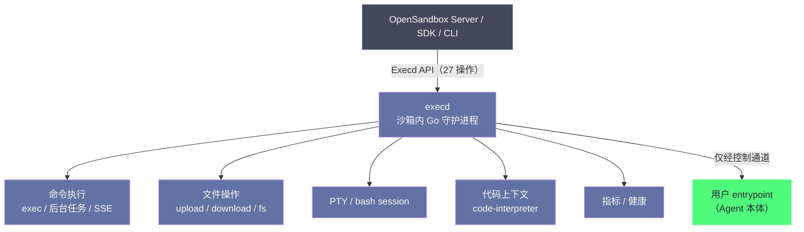
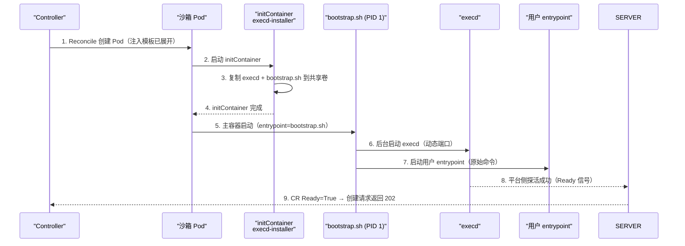

# 08 OpenSandbox 数据面——execd 与 egress 的盒内世界

**摘要：**

[[07 OpenSandbox 架构深度解析——协议优先与六责任面]] 解剖了 OpenSandbox 的控制面与协议面，本文深入剩下的"盒内世界"——数据面（Sandbox Data Plane）与网络面（Network & Security Plane）。文章首先解释"为什么沙箱内必须有守护进程"（行业共识第三条：盒内守护进程是平台能力落地的基础），以及 execd 的职责边界（提供控制通道，不提供业务语义）；然后基于源码走读拆解 execd 的注入机制——**execd-installer initContainer 复制二进制到共享目录，主容器经 bootstrap.sh 启动 execd 与用户 entrypoint，bootstrap 以 PID 1 身份保证沙箱退出时完整回收**；随后逐项展开 execd 的 27 个 API 操作（命令执行/文件操作/PTY/代码上下文/指标），egress sidecar 的出站管控机制与"策略真伪"问题（CNI 不执行 NetworkPolicy 的教训与对照实验方法论），Endpoint/server proxy/ingress gateway 三条"沙箱内服务对外可达"的路径；最后明确 execd 的三个"不做"（不替代 Agent 业务 API、不负责状态持久化、不负责凭据）。文末补一章"截至 2026 年 10 月的演进"，用官方 release 与文档核实 execd v1.0.22（init 模式与生命周期钩子）、egress v1.1.6（可观测性与 Credential Vault 凭据金库）、Fast Sandbox 新承载形态，逐一对照 PoC 基线与现状的差异。核心认知：**数据面是"沙箱内操作"的执行者，它的设计质量决定平台的可用性下限——但它的边界纪律（只做控制通道）决定平台的架构上限**。

---

## 第 1 章 数据面的定位：沙箱的"手"

### 1.1 为什么沙箱内必须有守护进程

行业共识第三条（[[06 Agent 沙箱平台分层——六层模型与三条产品路线]] 的六层共识）说：**盒内守护进程是平台能力落地的基础**。为什么不能由平台在宿主机侧直接操作沙箱内的命令/文件？笔者在素材 PoC 里反复被问到这个"朴素的问题"，它的答案恰好是数据面存在的全部理由。

**原因一：沙箱的隔离语义**。沙箱内的进程视图、文件系统、网络栈都是独立的 namespace（[[02 Linux 隔离原语——namespace、cgroups、seccomp 与 capabilities 的安全地基]]）——宿主机侧进程要操作沙箱内资源，要么 setns 进入沙箱 namespace（侵入性强、权限要求高），要么让沙箱内自己有一个"代言人"。setns 不是不能做，Kubernetes 的 exec 通道本质上就是这样实现的，但它的代价是平台进程必须具备宿主机级的高权限，而且在多租户环境下，"谁有资格 setns 进哪个沙箱"本身就成了一个比沙箱隔离更复杂的权限矩阵。

**原因二：平台的通用性**。平台不知道沙箱里跑的是什么（Python 解释器？Node？Agent 本体？）——需要一个"平台自己的进程"在沙箱内提供标准接口。**execd 就是这个代言人**：平台侧通过 execd 的 API 与沙箱内世界交互，不依赖沙箱内应用的类型。execd 之于沙箱，好比大使馆之于驻在国——平台不能随时出入沙箱（那是"主权"问题），于是派驻一个"自己人"，事务经由使馆办理，接口单一、立场可控；当然 execd 并无外交豁免，它的权限上限只是"沙箱内的高权限"，逃逸沙箱仍需独立的提权步骤（第 7 章展开）。

**原因三：安全边界**。如果平台从宿主机直接操作沙箱（如通过 docker exec 类通道），平台的权限模型会与沙箱的隔离模型纠缠不清；**通过盒内守护进程，平台对沙箱的操作全部收敛到"守护进程的 API"**——审计点单一、权限模型清晰。反事实地看：假设没有这个代言人，平台侧对沙箱的每一次操作都要走"宿主机 → 进沙箱 namespace → 执行"的长链路，任何一环出错都说不清是平台的问题还是沙箱的问题，而有了 execd，排查范围立刻收窄到"execd 的 API 是否按预期工作"。

### 1.2 execd 的职责边界：控制通道 vs 业务语义

这是本专栏反复强调的边界，在 execd 处给出最终定义：

| 维度 | execd 做（控制通道） | execd 不做（业务语义） |
| :--- | :--- | :--- |
| 命令 | 执行命令、返回 stdout/stderr | 不解释命令的业务含义 |
| 文件 | 上传/下载/读写 | 不理解文件是代码还是数据 |
| 终端 | 提供 PTY 会话 | 不理解会话的语义 |
| 进程 | 管理后台任务 | 不理解任务的目标 |
| Agent | — | **不替代 Agent 的对话/任务/会话 API** |

**为什么这个边界如此重要**（素材源码走读的原话结论）：**"Agent 程序来自镜像、entrypoint 和配置，execd 只提供控制通道"**——如果 execd 试图理解 Agent 语义，平台就会变成"什么都管、什么都管不好"的怪兽：每个 Agent 的语义都要适配（第 5 层的活）、Agent 升级导致 execd 也要升级（耦合爆炸）。**边界纪律是平台可演进的前提**。

这里可以借用银行柜台的例子：柜员只办理"存款、取款、转账"这类标准化业务，不为客户做理财规划（那是理财顾问的职责）。execd 就是沙箱里的柜员——它受理"执行命令、读写文件、开终端"这些标准动作，至于这些动作背后的业务意图（Agent 在规划一次旅行、在跑一批评测），execd 既不关心也不应该关心。一旦柜员开始做顾问的活，客户（Agent 平台）就不知道该找谁了；同理，一旦 execd 开始理解业务语义，平台层就无法在不改 execd 的前提下演进业务能力。

### 1.3 数据面的性能特征：延迟预算

数据面的性能直接决定 Agent 的"操作手感"——素材 PoC 的 WarmPool 数据给出了延迟预算的分解（[[09 OpenSandbox 编排面——BatchSandbox、WarmPool 与快照]] 详述）：

| 环节 | 热池命中 p50 | 说明 |
| :--- | :--- | :--- |
| API 创建（热池命中） | ~1.0s | 控制面开销 |
| **到首命令可用** | ~2.2s | 控制面 + 数据面（execd 就绪） |
| 单条命令执行 | 百毫秒级 | 数据面开销（网络往返 + execd 处理） |

**"到首命令"与"API 创建"的差值（~1.2s）就是数据面就绪的延迟预算**——execd 启动、探活、路由就绪都在这 1.2 秒内。数据面优化的方向（execd 启动加速、探活前置、路由预热）都服务于压缩这个差值。

这 1.2 秒可以继续拆细：execd 二进制加载与 Go 运行时初始化（毫秒级，无解释器冷启动）、Gin 监听（亚毫秒级）、平台侧探活往返（几十到数百毫秒）、路由与 endpoint 就绪。占比最大的一头往往是"探活 + 路由"而非"进程启动"——素材的实践因此是探活前置、路由预热，而非纠结二进制本身还能快多少。

**性能设计的两个原则**：其一，**execd 的启动路径必须短**（Go 单二进制 + 无外部依赖的意义）；其二，**数据面与控制面并行就绪**（execd 不等待 Server 的确认——反向依赖会串行化启动路径）。第二条原则可以类比值机柜台的场景：旅客（控制面）办完手续并不需要等行李车（数据面）同步抵达才能登机，两条线并行，登机口在各自就绪后即可放行；如果反向依赖，任何一方的慢都会叠加成两倍的等待。

### 1.4 数据面与控制面的关系

数据面（execd/egress）与控制面（Server/Controller）的关系可以总结为三点：

1. **生命周期上**：控制面创建沙箱 Pod，数据面随 Pod 启动（execd 注入）——**控制面管"生"，数据面管"活"**；
2. **路径上**：控制面走管理路径（Server API/CR），数据面走执行路径（execd API/egress 策略）——**两条路径独立，控制面故障不阻塞数据面**；
3. **状态上**：控制面持有元数据（沙箱记录），数据面持有运行态（进程/文件/网络）——**"状态四本账"（[[13 Agent 状态与存储——六类状态的正确拆分]]）从这里开始分家**。

换一个观察角度，可以把 OpenSandbox 的交互路径概括为三条：生命周期管理（Lifecycle，创建/续期/暂停/删除，走 Server）、执行与服务访问（Execution & Service Access，命令/文件/PTY/端口，走 execd 与 endpoint 解析）、出站管控（Outbound，白名单与凭据注入，走 egress）。**控制面与服务访问、出站管控分别走不同的路径，彼此不互相阻塞**——这条"路径独立性"是数据面可用性的第一保证：即便 Server 短暂不可用，沙箱内的 Agent 仍在正常执行命令、正常访问网络，用户在操作手感上几乎无感。本文后续各章依次展开这三条路径在"盒内"的实现。

---

## 第 2 章 execd 架构与注入机制

### 2.1 execd 是什么

execd 是运行在沙箱内的 Go 守护进程（基于 Gin 框架的 HTTP 服务），版本基线 v1.0.21（素材 PoC）。它是"沙箱内操作"的统一入口：



**为什么用 Go**：与 [[03 隔离边界的光谱——从共享内核到 MicroVM 的四档技术路线]] 的动机一致——内存安全 + 单二进制部署（沙箱内注入一个静态二进制，无运行时依赖）。**单二进制是注入机制能成立的前提**：initContainer 只需要复制一个文件。反过来想：如果 execd 用 Python 实现，沙箱里就得先有解释器，而"沙箱里可能没有解释器"恰恰是平台要解决的第一个不确定性——等于把不确定性又请了回来。Gin 则保证了路由与中间件的成熟生态（鉴权、超时、流式响应的基础件），与 execd"小而全"的定位匹配。

### 2.2 注入机制：initContainer + 共享目录 + bootstrap

execd 如何进入沙箱？（素材 Phase6 源码走读的机制还原）：

```
镜像构建时（用户侧）：
  用户镜像中预置 execd-installer（或平台构建时注入）

Pod 启动时（平台侧）：
  1. execd-installer（initContainer）运行
     → 把 execd 二进制 + bootstrap.sh 复制到共享 emptyDir 卷
  2. 主容器启动，entrypoint 被替换为 bootstrap.sh
  3. bootstrap.sh：
     a. 启动 execd（后台守护）
     b. 启动用户原始 entrypoint（Agent 本体）
```

**三个设计要点**：

**要点一：共享卷是唯一的注入通道**。initContainer 与主容器通过 emptyDir 共享卷传递二进制——不需要镜像重建，平台可以在运行时决定注入版本（**execd 版本与镜像解耦**）。emptyDir 的语义值得留意：它是"随 Pod 生命周期存在"的临时卷，Pod 重建即清空，因此每次创建沙箱都会走一遍注入流程——这保证了 execd 版本总是由平台"本次注入"决定，不会被镜像里的旧版本悄悄带回来。

**要点二：entrypoint 被替换**。主容器的 entrypoint 不是用户定义的，而是 bootstrap.sh——**用户"原始 entrypoint"被保存并作为参数传给 bootstrap**。这是平台"劫持"容器启动的机制，也是"PID 1 拓扑"的来源。反事实地看：如果不替换 entrypoint，用户进程直接做 PID 1，那么"execd 谁启动"就变成了用户镜像的自觉，平台将失去对数据面就绪时机的控制——替换 entrypoint 的本质，是把"何时启动 execd、以何种顺序启动"从用户手里收回到平台手里。

**要点三：execd 不在镜像里**。用户镜像只预置 installer（或由平台注入），execd 本体由平台在创建时注入——**沙箱的执行能力由平台控制，不由镜像决定**。这条要点的工程价值在升级场景中最明显：execd 有安全修复时，平台只需发布新版本并在注入时换上，无需推动所有 Agent 镜像重建；若 execd 打进镜像，一次安全修复就是一次全量镜像发布，节奏完全不同。

### 2.3 PID 1 进程拓扑：bootstrap → execd + 用户进程

注入后的进程树：

```
PID 1: bootstrap.sh
├── execd（守护进程，监听动态端口）
└── 用户 entrypoint（Agent 本体）
    └── 用户进程的子进程（任务/子命令）
```

**为什么 bootstrap 必须是 PID 1**（[[02 Linux 隔离原语——namespace、cgroups、seccomp 与 capabilities 的安全地基]] 的 PID 1 职责）：PID 1 承担两个特殊职责——**回收僵尸进程**与**信号分发**。bootstrap 做 PID 1 保证：

1. **完整回收**：沙箱删除时，K8s 向 PID 1 发 SIGTERM/SIGKILL，bootstrap 的退出会带走整个进程树（execd + 用户进程 + 子进程）——"残留 0"验收的底层机制；
2. **信号正确性**：Agent 进程收到 SIGTERM 时能优雅退出（bootstrap 转发信号）——如果 Agent 直接做 PID 1 而不处理信号，会出现"沙箱删了、进程还活着"的僵尸。

把 PID 1 的职责再拆开看：僵尸回收依赖"父进程 wait 子进程"这一基本动作，子进程退出后若无人 wait，它的进程描述符就留在进程表里；bootstrap 作为所有进程的父进程，天然承担了这个 wait 的义务。信号分发则要求 PID 1 对 SIGTERM/SIGINT 做显式转发（容器 runtimes 默认向 PID 1 发送信号），bootstrap 需要把收到的信号转给 execd 与用户进程，而不是自己默默退出把信号吞掉。这两个机制合在一起，构成了"沙箱删除即整体消失"的契约。

**反例**（不这样会怎样）：如果用户 entrypoint 直接做 PID 1（常见于"图省事"的镜像），Agent 进程不回收子进程、不处理信号——长期运行后僵尸堆积、沙箱删除后进程残留。**这是"Agent 镜像必须走平台注入"的硬理由**。笔者在素材 Phase3-01 的验收里反复核对进程树，原因正在于此："残留 0"不是靠运气，而是靠"谁做 PID 1"这个结构性决定。

### 2.4 完整启动时序

把注入机制放回 Pod 生命周期的完整时序中（素材 PoC 部署与源码走读的合成）：



**时序中的两个关键点**：

1. **第 3 步是"注入"的唯一时机**——initContainer 完成前，主容器不会启动（K8s 语义保证）；共享卷是二者的桥梁；
2. **第 6/7 步的父子关系决定回收**——bootstrap 同时是 execd 与用户进程的父进程——**沙箱删除时 SIGKILL bootstrap，整棵树被带走**。

**故障定位**：沙箱创建后 execd 不可用，按时序排查——initContainer 是否完成（Pod 事件）→ bootstrap 是否启动（日志）→ execd 是否监听（探活）→ 用户 entrypoint 是否冲突（端口/资源）——**时序即排障清单**。把这四步展开成"症状 → 嫌疑 → 检查点"的对应，排查时会更顺手：

| 症状 | 嫌疑环节 | 检查点 |
| :--- | :--- | :--- |
| Pod 事件显示 initContainer 失败 | 注入卷、installer 镜像 | 共享卷是否挂载成功、installer 是否可执行 |
| 主容器启动即退出 | bootstrap 脚本 | bootstrap 日志、entrypoint 参数是否完整传下去 |
| execd 无响应但进程存在 | execd 监听端口 | 端口是否被用户进程占用、探活地址是否对 |
| 探活通过但命令超时 | execd 处理路径 | Server 侧路由、endpoint 解析结果 |

### 2.5 注入机制的边界：平台能改什么、不能改什么

| 能改（平台控制） | 不能改（镜像/用户控制） |
| :--- | :--- |
| execd 版本（注入时决定） | Agent 二进制与版本 |
| 启动编排（bootstrap 逻辑） | Agent 的配置与凭据（由用户注入） |
| 控制通道（命令/文件 API） | Agent 的业务逻辑与行为 |

**这个边界的意义**：平台可以升级 execd（控制通道能力），但不能"替 Agent 决定怎么工作"——**平台升级不会破坏 Agent 行为，Agent 升级不需要平台配合**。这是第 1.2 节边界纪律的工程化表达。值得补充的是"能改"一侧也并非无限：平台改 bootstrap 编排时，必须保持"用户 entrypoint 仍能拿到原始参数"这一契约，否则 Agent 的启动参数会被平台悄悄改掉——注入机制的能力与责任是对等的，平台接管了启动顺序，就要承担"不改变用户意图"的义务。

---

## 第 3 章 execd 能力面：27 个操作

### 3.1 能力总表

素材 Phase3-07 实测的 Execd API 操作（27 个），按能力域分组：

| 能力域 | 操作（实测） | 典型场景 |
| :--- | :--- | :--- |
| **命令执行** | exec 同步执行、后台命令、命令日志、SSE 流式输出 | Agent 执行 python/shell、长任务跟踪 |
| **文件操作** | 上传、下载、目录列表、读写、删除 | 输入文件注入、产物提取 |
| **终端** | bash session 创建/输入/输出、PTY 控制 | 交互式调试、终端型 Agent |
| **代码上下文** | 代码解释器相关操作 | code-interpreter 镜像场景 |
| **指标与健康** | 健康检查、指标查询 | 平台探活、监控 |

27 这个数字是素材在 PoC 时点对契约的实测结果，它回答的问题是"execd 至少提供哪些操作"。五个能力域互不重叠，每个域对应一类"沙箱内操作"：命令解决"跑什么"，文件解决"传什么"，终端解决"交互"，代码上下文解决"有状态编程"，指标解决"状态如何被观察"。第 8 章会看到，这五个域的骨架在 2026 年的契约演进中仍然成立，只是每个域都长出了新操作。

### 3.2 命令执行：exec 与 SSE 流式

**同步 exec**：`POST /exec` 执行命令并等待完成，返回 stdout/stderr/exit code——素材验证的典型用法是子沙箱执行 `python3 -c 'print(sum(range(1,100)))'` 返回 4950。

**流式输出（SSE）**：长命令的输出通过 Server-Sent Events 流式返回——Agent 场景的"实时观察任务进度"依赖此通道。素材 PoC Case 3 验证了 execd 命令 + SSE + 文件的完整链路。

为什么选 SSE 而不是 WebSocket？SSE 是单向的（服务端 → 客户端）、基于普通 HTTP、自带断线重连；WebSocket 双向，但连接管理、心跳、代理兼容都更复杂。**命令输出本质是单向流**——客户端只"读结果"，要打断走独立的 interrupt 通道即可，SSE 以最小的复杂度覆盖了核心需求，这正是"流式优先"原则在传输层上的体现。代价是流中断线后客户端要自己决定"重连续读还是放弃"，长命令的断连处理因此成为已知坑（第 7.5 节）。

**后台任务**：长任务以后台方式启动，通过任务 ID 查询日志/状态——**"命令的异步化"是 Agent 长任务的基础能力**（模型思考数分钟、命令跑数小时的场景）。后台任务的完整节奏是"启动即返回 → 轮询状态 → 读取日志 → 等待终态"，它把"命令执行"从一次同步调用拆成了"提交 + 查询"两个动作——这与第 3.4 节的"同步异步双通道"原则是同一件事的两种说法。

### 3.3 文件操作：Agent 的"输入输出管道"

文件能力是 Agent 工作流的关键闭环：

| 方向 | 操作 | 场景 |
| :--- | :--- | :--- |
| **进沙箱** | upload | 用户上传输入文件、配置注入 |
| **出沙箱** | download | 任务产物、生成的代码/文档 |
| **沙箱内** | ls/read/write/rm | Agent 读写工作目录 |

**文件通道的安全注意**：上传/下载经过 execd 的 API——**路径校验是安全关键**（防止 `../` 逃逸出沙箱工作目录）。素材未披露具体校验实现，但"文件 API 的路径规范化"应列入自研/集成时的安全检查项。

路径校验的难点在于"规范化之后仍然要防逃逸"：`a/../b`、`a//b`、符号链接指向工作目录之外，这些写法在规范化后都可能指向预期之外的路径；更隐蔽的是 TOCTOU（Time-Of-Check-To-Time-Of-Use）——校验通过之后、文件操作发生之前，路径指向的对象可能被替换成符号链接。沙箱内的文件 API 相当于"打开了工作目录的边界"，任何一条逃逸路径都是给攻击者递出去的文件系统权限，因此自研数据面时，路径校验必须放在"内核语义"（realpath 解析后的最终路径）而不是"字符串形态"上做。execd 的优势在于它本身就在沙箱内、与用户进程同级，逃逸到工作目录之外的危害被沙箱边界兜住一部分；但倘若 execd 的写权限恰好覆盖了挂载的卷（volumes），逃逸路径就升级成了跨卷访问，这个问题在集成时必须确认。

### 3.4 能力设计的三条原则

从 27 个操作反推 execd 的能力设计原则，对自研数据面同样适用：

**原则一：能力正交**。命令、文件、终端、代码、指标五类能力互不依赖——客户端可以只用命令能力（简单任务），也可以全用（完整 Agent）。**正交能力 = 可组合能力**。这个原则好比工具箱的摆放：扳手是扳手、螺丝刀是螺丝刀，用扳手不需要先拿起螺丝刀；正因为每件工具独立，才能按需组合成"传脚本 → 执行 → 取结果"的工作流。若能力强耦合（譬如"执行命令必须先建终端"），客户端就要为每种组合学习前置条件，组合的灵活性随之消失。

**原则二：同步异步双通道**。同一能力提供同步（exec 等待完成）与异步（后台任务 + 日志查询）两种语义——**短命令同步、长任务异步**是 Agent 场景的基本节奏（模型思考期间命令在跑）。电话与留言信箱的类比在这里适用：短事直接通话（同步 exec 拿结果），长事留言后回拨查询（后台任务 + 状态轮询）——两者的选择依据是"对方要多久才能给答案"，而不是技术偏好。

**原则三：流式优先**。输出走 SSE 流式而非一次性返回——长输出的"首字节延迟"与"内存占用"都依赖流式。**"流式优先"在 execd 的每个能力域都成立**（命令输出、文件传输、终端回显）。一次性返回的内存模型是"整个输出先堆在内存里再交付"，流式则是"边产生边交付"——对动辄数 MB 的命令输出，两者在峰值内存上可以差一个数量级。

**反例**（破坏原则的后果）：如果能力间强耦合（如"执行命令必须先建终端"），客户端逻辑会复杂化；如果只有同步语义，长任务会挂死 API；如果输出一次性返回，大输出会撑爆内存——**三条原则是数据面可用性的底线**。

### 3.5 PTY 与 bash session

PTY（伪终端）提供交互式终端会话——`bash session` 创建后，客户端可以持续输入/读取输出（WebSocket 类通道）。**PTY 的定位**：交互式调试与"终端型 Agent"（如 OpenCode 的 TUI 模式）的兼容通道；但对"结构化 Agent 交互"，**原生 Server API 优于 PTY**（[[11 三类 Agent 沙箱落地——OpenCode、Hermes 与 LangChain 镜像化实战]] 的接口选择原则：PTY 传终端字节流，语义丢失）。

PTY 与普通管道（pipe）的关键差异值得说透：PTY 提供行编辑（line discipline）、作业控制（Ctrl+C 信号）、回显（echo）等终端语义——这正是交互式工具（vim、交互式 REPL、TUI）能工作的前提；普通管道只有字节流，没有这些语义。但 PTY 的代价是"终端控制字符混进输出"：ANSI 转义序列、光标移动指令都出现在字节流里，消费方如果不做终端仿真，看到的是一堆 `\x1b[...` 序列。**"PTY 传终端字节流，语义丢失"说的就是这个**——会话的"结构化信息"（这条消息是用户的、还是工具返回的、还是系统提示）在字节流里没有表达位置，只能靠终端仿真器事后推断。两种通道的取舍可以概括成一张对照：

| 维度 | 原生 Server API | PTY 通道 |
| :--- | :--- | :--- |
| 数据结构 | 会话/消息/事件（结构化） | 终端字节流（非结构化） |
| 可观测性 | 可直接审计 | 需解析 ANSI 序列 |
| 会话恢复 | 按会话重建 | 需重放字节流 |
| 适用 | 结构化 Agent 交互 | TUI/交互式调试 |

---

## 第 4 章 egress：出站管控

### 4.1 为什么出站管控是硬需求

回到 [[01 Agent 沙箱全景——威胁模型、六层技术栈与逻辑演进]] 的攻击链：第 4 步"网络外传"是数据窃取的出口——**没有出站管控的沙箱，等于给窃取的数据开了免签通道**。出站管控的目标不是"禁止所有网络"（Agent 需要访问模型 API、拉取依赖），而是"**只允许白名单内的出站**"：

| 出站目标 | 默认策略 | 理由 |
| :--- | :--- | :--- |
| 模型 API（LLM 端点） | 白名单允许 | Agent 工作的必要通道 |
| 包管理仓库（pypi/npm） | 白名单允许 | 依赖安装的必要通道 |
| 企业内部服务 | 按需白名单 | 业务需要 |
| 内网非白名单地址 | **默认拒绝** | 防止横向渗透（攻击链第 3 步） |
| 云元数据地址（169.254.169.254） | **默认拒绝** | 防凭据窃取（经典攻击路径） |
| 公网任意地址 | **默认拒绝** | 防数据外传（攻击链第 4 步） |

把出站管控想象成大楼的门禁系统：目标不是把每扇门都焊死（那样楼里就没人能出门办事了），而是在每个出口装闸机，凭白名单卡放行。模型 API 是"长期通行证"，包仓库是"访客通行证"，内网非白名单与云元数据地址则是"防火门常闭"——其中 169.254.169.254 尤其值得强调，云厂商的实例元数据服务（IMDS）就挂在链路本地地址上，沙箱内的恶意代码访问它即可尝试窃取实例角色凭据，这是云上环境最经典的横向提权路径，默认拒绝是底线而非可选项。

**粒度光谱**是设计出站策略时最先要回答的问题：按 IP 白名单（粗，无域名语义）、按 FQDN 域名（业务语义清晰）、按端口（服务级）、按应用层（HTTP 路径/方法，最细）。粒度越细，策略越贴合业务，但实现复杂度与性能代价也越高——第 4.3 节把这层光谱映射到实现手段上。

### 4.2 egress sidecar 架构

OpenSandbox 的 egress 以 sidecar 形态注入沙箱 Pod：

```
沙箱 Pod
├── 主容器（用户负载 + execd）
└── egress sidecar（网络管控）
     └── 拦截/放行出站流量（按策略）
```

**sidecar 的工作方式**：利用沙箱的独立网络 namespace（[[02 Linux 隔离原语——namespace、cgroups、seccomp 与 capabilities 的安全地基]] 的"Egress 控制前提"），sidecar 在 namespace 内实施策略——通过 iptables/eBPF 类机制把出站流量引到 sidecar 裁决，白名单放行、其余拒绝。

sidecar 与主容器共享网络 namespace 是这件事成立的前提：所有出站流量都经过同一套网络协议栈，sidecar 才能"站在门口"逐包裁决，应用无需任何配置也绕不开它。egress 的一般执行链可以概括为三层：**L1 域名裁决**（DNS 层，白名单域名正常解析、拒绝域名返回 NXDOMAIN）、**L2 包过滤**（网络层，按解析出的地址/端口做白名单放行，其余默认拒绝）、**L3 应用层代理**（可选，对 HTTPS 流量做透明拦截与内容级控制）。三层各司其职：L1 提供业务语义（"允许 api.openai.com"），L2 提供强制力（解析出来的 IP 也被白名单约束，避免 DNS 重绑定绕过），L3 提供最细粒度（HTTP 路径/方法/鉴权头）。实践中的难点在 L1 与 L2 的配合——域名解析出的 IP 是动态的，策略要么按"已解析地址 + 租约"放行，要么回到 IP 白名单的粗粒度，第 8 章会看到 OpenSandbox 在 dns+nft 模式下如何处理这个租约问题。

**Egress API（3 个操作）**：素材实测 Egress 契约只有 3 个操作——策略的查看与设置。**注意"策略是 Server 级还是沙箱级"**：素材 PoC 发现 poolRef + networkPolicy 组合当前互斥（[[09 OpenSandbox 编排面——BatchSandbox、WarmPool 与快照]]），首期采用"逐沙箱创建换取独立 Egress Policy"。

### 4.3 出站管控的实现手段对比

egress 的实现有四个层级的选择（从内核到用户态），各自的粒度与代价不同：

| 手段 | 粒度 | 优点 | 缺点 | 典型场景 |
| :--- | :--- | :--- | :--- | :--- |
| **iptables/nftables** | IP/端口 | 内核原生、成熟 | 无域名语义、规则复杂 | 简单 IP 白名单 |
| **eBPF（Cilium 类）** | IP/端口/协议（可扩展） | 高性能、可编程 | 内核版本要求、运维复杂度 | 生产级策略引擎 |
| **DNS 代理（FQDN 白名单）** | 域名 | 业务语义清晰（allow api.openai.com） | 需要 DNS 可见性（**Cilium FQDN 需同时允许 Pod 访问集群 DNS，用 rules.dns 让 DNS proxy 看见应答**） | 白名单域名场景 |
| **应用层代理** | HTTP/协议 | 最细粒度（路径/方法） | 性能开销、非透明 | 高安全场景 |

**素材的实践结论**：网络策略的"真伪"要先验证（4.4 节），实现手段按威胁等级选择——低风险用 IP 白名单（iptables），中高风险用 FQDN 白名单（Cilium 类）——**"默认拒绝内网、元数据地址和非白名单出口"是素材生产方案的出站基线**。

四个层级的本质差别在"谁来决定放行"：iptables/nftables 由运维写规则，eBPF 由程序动态编程，DNS 代理由域名解析动态学习，应用层代理由业务语义裁决。层级越靠上，策略与业务越对齐，但引入的"解释层"也越多——DNS 代理要信任 DNS 应答的完整性（被污染的应答会把流量带向错误方向），应用层代理要处理 TLS 解密（证书信任、性能开销）。因此实践中常见的是组合：DNS 代理负责语义，包过滤负责强制，应用层代理按需叠加——**没有单一手段同时满足粒度与透明的全部要求，组合与分层的取舍是 egress 设计的核心**。

### 4.4 策略真伪问题：写了 NetworkPolicy 不等于有隔离

素材 Phase5-05 的调研提出了一个尖锐问题：**"写了 NetworkPolicy 不等于有隔离——Flannel 默认不执行"**。这是 K8s 生态的经典陷阱：

| CNI | 是否执行 NetworkPolicy |
| :--- | :--- |
| Calico | ✅ 完整执行 |
| Cilium | ✅ 完整执行（含 FQDN 策略） |
| Flannel | ❌ **不执行**（纯 overlay，无策略引擎） |
| Weave | 🔶 部分 |

**素材的教训**：测试集群的 CNI 类型、是否执行 NetworkPolicy 仍列为未决项——**在确认 CNI 执行策略之前，任何"我们配置了网络隔离"的声明都是无效的**。

NetworkPolicy 是一条"声明"，而声明要变成"事实"，中间隔着 CNI 的策略引擎：Flannel 只做 overlay 转发，没有实现 NetworkPolicy 的控制器，声明写上去就被无视。类似的"假阳性"还有几种：策略只拦了 Pod 间流量、没拦节点出口（Service 网段逃逸）、或者策略生效但存在默认放行的兜底规则（default allow 覆盖了 deny）。**"写了策略"与"策略生效"之间永远隔着一次验证**。

**验收方法：最小对照实验**（素材 Phase5-05 的完整方案）：

```
第 1 步：基线放行 —— 不写任何策略，确认沙箱间可互通（验证环境正常）
第 2 步：default-deny —— 写全拒绝策略，确认沙箱间不可互通（验证策略生效）
第 3 步：精确允许 —— 只允许白名单，确认白名单通、非白名单不通
第 4 步：删除恢复 —— 删策略，确认回到基线（验证策略可回滚）
第 5 步：换 Runtime 重放 —— 换 gVisor/Kata 后重放 1-4（验证隔离档位不影响策略）
```

**这五步的价值**：把"我们以为的隔离"变成"验证过的隔离"——素材把该实验列为生产化的 T 级任务（[[15 生产化深水区——十个盲区与行业共识]]）。五步各自堵住一类错误：第 1 步排除"环境本来就不同"的干扰，第 2 步验证策略引擎确实在执行，第 3 步验证白名单语义，第 4 步验证可回滚性，第 5 步验证隔离档位（runc/gVisor/Kata）不改变网络面行为——任何一步失败都意味着"隔离声明"与"隔离事实"之间还有缺口。

### 4.5 egress 策略的粒度与 WarmPool 的互斥问题

素材 PoC（Phase1-11/Phase3-15）发现了一个影响生产设计的事实：**poolRef（预热池认领）与 networkPolicy（独立网络策略）当前互斥**——使用预热池的沙箱不能获得独立 egress 策略，独立策略要求逐沙箱创建。

**为什么互斥**：池化沙箱是"批量交付的通用实例"（策略由池模板统一声明），逐沙箱创建才有"按请求定制策略"的机会——**池的"通用性"与策略的"个性化"在设计上冲突**。

**素材的取舍**：首期采用"逐沙箱创建换取独立 Egress Policy"——**安全优先于性能**（池化的性能收益（命中 1s）可以用其他手段补偿，egress 策略的缺失则无法补偿）。这个取舍的普适性：**当池化与策略冲突时，先保策略——因为 egress 是攻击链第 4 步的唯一防线，而池化只是性能优化**。

**对选型的启示**：评估沙箱平台时，"池化与策略是否可共存"是一个关键问题——不能共存意味着"高吞吐"与"细粒度管控"不可兼得，容量模型与安全模型必须分开设计（[[12 沙箱性能工程——Runtime 基准与 WarmPool 容量管理]]）。这里要分清的是，"逐沙箱创建"牺牲的只是热池命中时的延迟收益，安全模型（每条出站流量都有策略裁决）没有打折——安全优先的代价落在性能上，而不是落在隔离强度上，这个方向不能搞反。

---

## 第 5 章 Endpoint 与 server proxy：沙箱内服务的对外通道

### 5.1 Endpoint：回答"沙箱的端口在哪里"

沙箱内启动服务后（如 Agent 的 WebUI、模型服务），外部如何访问？Endpoint API 回答这个问题：**返回访问地址与路由头**（endpoint 解析机制）。

**与端口内应用的关系**（素材源码走读的边界结论）：**"Endpoint API 返回访问地址和路由头，解决'如何找到沙箱端口'，不替代端口内应用自己的登录、Session 或 WebSocket 协议"**——Endpoint 是"路由层"能力，应用层协议（认证/会话）是应用自己的事。

Endpoint 的解析结果本质上是一个"能力凭证"：它把"沙箱 id + 端口"翻译成"可访问的地址 + 路由头"，客户端拿着这个结果才能发起访问——**Endpoint 查询本身就是一次鉴权动作**，不知道沙箱 id 的客户端连"端口在哪"都查不到，这是沙箱级保密的第一道闸；但路由层的能力不自动延伸为应用层的身份，平台"管路由、应用管身份"的分工在第 5.3 节继续展开。

### 5.2 server proxy 与 ingress gateway 两条路径

| 路径 | 机制 | 适用 | 已知问题 |
| :--- | :--- | :--- | :--- |
| **server proxy** | Server 侧代理流量到沙箱内端口 | 简单场景 | DEF-003：返回无效路由 Header（素材实测） |
| **ingress gateway** | K8s 网关动态路由（签名 Header 鉴权） | 生产场景 | 需要 Gateway 组件（1.0.10） |
| **直接地址** | 直连 Pod/NodePort | PoC 妥协 | **POC-007：跳过网关层，无鉴权** |

**素材 PoC 的实践**：PoC 期直接暴露 HTTP NodePort（POC-007 妥协），生产化要求 Gateway + SSO（[[14 沙箱安全体系——三层防护、短期凭据与多租户]] 的入口治理）。

三条路径的差异在于"谁来做路由裁决"：server proxy 把路由逻辑放进控制面（简单，但控制面成为流量路径的一部分，且素材实测 DEF-003 的无效路由 Header 问题让这条路径不稳定）；ingress gateway 把路由下沉到网关层（生产级，签名 Header 鉴权，但引入 Gateway 组件与密钥管理）；直接地址则完全不设防（只能用于 PoC）。**路径的选择本质上是"路由鉴权放在哪一层"的选择**——越靠近入口（gateway），控制面越干净，暴露面越小；越靠近应用（直连），实现越简单，风险越高。

### 5.3 端口暴露的完整路径：从沙箱内服务到外部客户端

把 Endpoint、server proxy、ingress gateway 串成完整路径：

```
外部客户端（用户/Agent 平台）
  → ① 请求 Endpoint API（向 Server 查询"沙箱 X 的端口 4096 怎么访问"）
  → ② 获得访问地址 + 路由头（endpoint 解析结果）
  → ③ 按地址访问（经 ingress gateway 或 server proxy）
  → ④ 网关路由到沙箱 Pod 的指定端口
  → ⑤ 到达沙箱内服务（如 OpenCode 的 4096 Server）
```

**路径上的三个安全边界**：

1. **① 的鉴权**：Endpoint 查询需要平台凭据——**不知道沙箱 id 的客户端无法查到端口**（沙箱级保密）；
2. **③ 的网关鉴权**：ingress gateway 用签名 Header 验证请求来源——**不是任何外部流量都能进沙箱**；
3. **⑤ 的应用鉴权**：到达沙箱内服务后，服务自己的登录/Session 生效——**平台管路由，应用管身份**。

**三层边界的叠加**构成了"沙箱内服务对外可达"的安全模型：路由层（平台控制）+ 身份层（应用控制）。**任何一层的缺失都会导致暴露**——素材 PoC 的 NodePort 直接暴露（POC-007）就是"跳过网关层"的反例。

三层边界可以类比酒店的门禁体系：① 是前台登记（没有房号信息，前台不告诉你分机号），③ 是走廊保安（没有房卡的访客进不了楼层），⑤ 是房间门锁（进了房间，保险柜仍然由客人自己锁着）。三层各管一段，任何一段失守都意味着"外人进了不该进的楼层"——但只有最后一层（应用鉴权）失守时，损失才直接落在数据上，前两层的价值在于把"谁有机会接近应用鉴权"这个集合缩到最小。

### 5.4 安全注意：Endpoint 的暴露面

Endpoint 暴露是双刃剑：能力上它让"沙箱内服务可被访问"（Agent WebUI 场景必需），风险上它是**沙箱的入站面**——未鉴权的 Endpoint 等于给攻击者留门。生产化要求：

1. 入站只允许 Gateway（禁止直连 Pod/NodePort）；
2. 签名 Header 鉴权（Gateway 与 Server 共享密钥）；
3. Endpoint 级审计（谁访问了哪个沙箱的哪个端口）。

把入站与出站放在一起看，沙箱其实有两张"脸"：入站面（Endpoint/gateway，决定谁能进来）与出站面（egress，决定谁能出去）。**入站面的漏洞让攻击者"进得来"，出站面的漏洞让数据"出得去"——两者的加固必须同步推进**。只堵出站不堵入站，攻击者仍可能借未鉴权的 Endpoint 进入沙箱执行操作；只堵入站不堵出站，窃取的数据仍有外传通道。素材的安全体系把两层分别交给 gateway 与 egress sidecar，正是"进与出是两条独立路径"（第 1.4 节）在安全模型上的映射。

---

## 第 6 章 产品边界：execd 的三个"不做"

### 6.1 不替代 Agent 业务 API

最核心的边界：execd 提供命令/文件/PTY，**不提供对话/任务/会话 API**——Agent 的业务能力由 Agent 自己的服务暴露（OpenCode 的 4096 Server、Hermes 的 9119 Dashboard）。平台侧要拿到 Agent 的会话状态，必须走"第 5 层适配"（Agent 原生 API 对接），不是 execd。

这个"不做"的背后是两层理由：其一，**会话语义属于 Agent**——对话状态、任务进度、消息结构是 Agent 程序的私有协议，平台没有权利也没有义务替 Agent 定义；其二，**execd 的生命周期短于 Agent 的会话**——沙箱可以重建，execd 随之重生，而会话若想跨沙箱延续，必须由 Agent 侧（或第 5 层适配）把它外置，这与第 6.2 节的"不负责状态持久化"是同一枚硬币的两面。反例见 6.3 的"PTY 当结构化接口用"。

### 6.2 不负责状态持久化

execd 不保存任何跨沙箱状态——沙箱删除，execd 随之销毁（它的"状态"只有运行中的进程/文件）。**持久状态（Workspace/Session/快照）归平台层**（[[13 Agent 状态与存储——六类状态的正确拆分]] 的"四本账"）。这个"不负责"是刻意的：execd 无状态，平台才能任意替换沙箱实例。

无状态的工程价值在故障场景中最直观：execd 崩溃或沙箱被删，重建一个即可，不需要"恢复 execd 内部状态"这一步——凡是依赖 execd 记忆的东西（如跨沙箱的会话、未落盘的产物），重建后都不存在，这正是四本账要把"运行时对象"与"用户 Workspace/Agent Session"分开的根因。**把状态放在平台层而不是数据面，换来的是数据面的可替换性**：运行时对象（进程/文件）随沙箱走，Workspace/Session 随平台走，两者一旦混在一起，替换沙箱就等于丢状态。

### 6.3 边界违反的代价：两个真实反例

"三个不做"不是教条——素材中的两个反例说明了违反边界的代价：

**反例一：平台总 Key 被 MCP 打穿**（Phase5-09）。平台把"平台级 Key"传给沙箱内的 MCP Server（Agent 用它创建子沙箱）——结果是**父 Agent 能枚举全部沙箱**（凭据越过了"沙箱级保密"边界）。教训：**凭据的注入粒度必须与沙箱绑定**（短期凭据，[[14 沙箱安全体系——三层防护、短期凭据与多租户]]），共享凭据就是共享边界。

**反例二：PTY 当结构化接口用**（Phase1-13）。把 Agent 的交互全部走 PTY（终端字节流），平台拿不到会话/消息/事件结构——可观测性、会话恢复、审计全部失效。教训：**数据面只提供"通道"，结构化语义必须走 Agent 原生 API**（第 5 层适配）。

**两个反例的共同点**：都是"让数据面/凭据层承担了不属于自己的职责"——**边界纪律的违反，通常以"图省事"开始，以"安全事故/架构返工"结束**。补一句：两个反例的"方向"相反——反例一是"给了数据面不该有的权力"（平台级凭据进沙箱），反例二是"让数据面做了不该做的事"（PTY 冒充结构化接口）——边界纪律要同时守住"不越权"与"不越位"两个方向。

### 6.4 不负责凭据

execd 不持有凭据——模型 API Key、平台 Key 由用户/平台在启动时注入（env/Secret），execd 只传递命令。**凭据的生命周期与沙箱绑定**（沙箱删除即销毁）还是与用户绑定（跨沙箱复用），是平台策略问题（[[14 沙箱安全体系——三层防护、短期凭据与多租户]] 的短期凭据），不是 execd 的职责。

"不负责凭据"与 6.1/6.2 的不同在于：execd 不持凭据是"被动的事实"，但平台如何把凭据送进沙箱却是"主动的设计"。env/Secret 注入有一个绕不开的副作用——**凭据一旦进入沙箱环境变量，就进入了沙箱内任意进程的可读范围**，恶意代码（或被提示注入劫持的 Agent）可以读环境变量把 Key 抄走。这个副作用在 2026 年的演进中催生了 Credential Vault（第 8.3 节）——凭据的"送达方式"从"写进沙箱"改为"留在 egress 侧车、按需注入出站请求"，execd 依旧不持凭据，但"凭据不落沙箱"成了新一层的安全常态。第 6.4 节的结论（凭据不是 execd 的职责）在演进后依然成立，只是平台的凭据交付方式升级了。

---

## 第 7 章 数据面的安全、审计与已知坑

### 7.1 execd 自身的权限

execd 运行在沙箱内（与用户负载同 namespace）——**它的权限模型是"沙箱内的高权限，沙箱外的零权限"**：

- 沙箱内：能执行命令、读写文件（与用户进程同级或略高）；
- 沙箱外：无任何宿主机权限（随 Pod 销毁）。

**安全推论**：execd 被攻破 = 攻击者获得"沙箱内高权限"——但逃逸沙箱仍需第 2 步（提权/逃逸），execd 的攻破不改变逃逸难度。**真正的风险是"execd 的 API 被未授权调用"**：如果沙箱内其他进程能调用 execd 的 API（未鉴权），攻击者可以借 execd 做平台级操作——**execd API 的沙箱内鉴权（只允许平台侧流量到达）是安全关键**（素材未披露细节，自研/集成时必查）。

execd 的权限画像可以概括为"盒内皇帝、盒外平民"——它在沙箱内的权力与用户进程相当甚至更高（能管理进程树），但在沙箱外没有立足之地。这个画像决定了威胁模型的重心不在"execd 越权"，而在"execd 的接口被冒用"：execd 的 API 一旦被沙箱内进程直接调用，攻击者等于拿到了一条"绕过应用、直达执行原语"的通道。素材 PoC 未披露 execd API 的沙箱内鉴权细节，但这是集成方必须确认的第一项——对照第 8.2 节，2026 年的 execd 已引入 token 鉴权与身份验证门，问题正被上游重视。

### 7.2 审计：命令记录的完整性

数据面的审计价值：**每条命令、每次文件操作都应可追溯**——这是"行为审计"层（三层防护的第三层，[[14 沙箱安全体系——三层防护、短期凭据与多租户]]）的数据来源。素材记录的差距：**Diagnostics API（日志/事件）stable 版本未实现（GAP-001）**——审计链路不完整是 0.2.x 的生产化短板，需要自建"外部日志证据链"（删除前把 Event/request_id/sandbox_id 打到外部日志）。

审计的完整性有两个层面：**内容完整**（每条命令都记）与**不可篡改**（记录本身不能被沙箱内进程抹掉）。execd 若把审计日志写在沙箱内，沙箱内的高权限进程就能删日志——所以审计记录必须"外发"（打到平台侧或外部日志系统），这也是 GAP-001 绕行方案的思路：删除前把关键事件打到外部日志，宁可多记不可漏记。第 8.2 节会看到，Diagnostics 的 context API 在 2026 年已进入 server/SDK/CLI，审计链路的补全正在路上，但"外部日志证据链"作为双保险仍然必要。

### 7.3 数据面的可观测性：命令即数据

数据面的审计与可观测有一体两面：**每一条命令、每一次文件操作，既是审计证据，也是运行数据**。生产化建议把 execd 的操作日志接入统一观测体系：

| 观测对象 | 指标 | 告警建议 |
| :--- | :--- | :--- |
| 命令执行 | 执行频率、成功率、耗时分布 | 异常高频命令、失败率突增 |
| 文件操作 | 上传/下载大小、路径分布 | 大文件外传（下载突增） |
| egress 策略 | 拒绝次数、命中白名单次数 | 拒绝突增（疑似外传尝试） |
| execd 健康 | 探活失败率、重启次数 | 探活失败（沙箱失联） |

**"命令即数据"的工程含义**：数据面日志不能只存不分析——**拒绝次数与失败率是攻击链第 3/4 步的最早信号**（[[14 沙箱安全体系——三层防护、短期凭据与多租户]] 的行为审计层）。素材 GAP-001（Diagnostics 未实现）的绕行方案正是"外部日志证据链"——**在平台补齐前，把 execd 日志外发到 Loki 类系统是必做项**。

"拒绝突增"这条告警尤其值得展开：egress 策略的拒绝次数在正常运行时应当接近于零（白名单外的访问不该发生），一旦出现突增，说明沙箱内有进程在尝试访问非白名单地址——这正是攻击链第 3 步（横向渗透）或第 4 步（数据外传）的前奏。**"正常的拒绝应该是零"这个基线，让拒绝计数成为高信噪比的攻击信号**；但前提是拒绝事件本身可观测——如果策略引擎把流量"静默丢弃"而不计数，这条信号就不存在，第 8.3 节会看到 egress v1.1.6 补上的正是这类计数器。

### 7.4 数据面验收清单

把本章内容转成可执行的验收清单（素材 PoC Case 3 与验收手册的扩展版）：

| 验收项 | 方法 | 通过标准 |
| :--- | :--- | :--- |
| **execd 注入** | 创建沙箱后查进程树 | bootstrap 为 PID 1，execd 与用户进程为其子进程 |
| **命令执行** | exec 同步命令 | stdout/stderr/exit code 正确 |
| **流式输出** | 长命令 SSE | 输出分块到达，非一次性 |
| **后台任务** | 启动长任务 + 查日志 | 任务可独立查询状态 |
| **文件闭环** | upload → 沙箱内读 → download | 内容一致 |
| **PTY 会话** | 创建 bash session | 输入输出往返正常 |
| **egress 白名单** | 允许域名可通、非白名单被拒 | 对照实验五步通过 |
| **Endpoint** | 查询 + 访问沙箱内服务 | 路由正确（注意 DEF-003 绕行） |
| **回收** | 删除沙箱后检查 | 进程树全清、API/CR/Pod 残留 0 |

**清单的使用**：接入新镜像/新运行时/新版本平台时全部重跑——**数据面是"每次变更都要回归"的层**，因为它的行为直接暴露给 Agent 工作负载。

**回归的自动化建议**：数据面验收清单适合脚本化（素材的 Case 3 已给出雏形）——**"一键重跑数据面验收"应成为平台 CI 的一环**：命令/文件/PTY/egress/Endpoint/回收六个域各一个断言脚本，任何发布（平台/运行时/镜像）触发全量重跑——**数据面回归的"变更即触发"与 第 11 篇 的 Agent 回归是同一纪律**。

### 7.5 已知缺陷与坑（素材实测）

| 缺陷 | 现象 | 绕行 |
| :--- | :--- | :--- |
| DEF-003 | Server Proxy endpoint 返回无效路由 Header | 用 ingress gateway 路径 |
| pause 假成功 | CLI 显示 ok 早于真实完成 | 轮询到 Paused 终态 |
| 命令超时语义 | 长命令的 SSE 断连处理 | 用后台任务 + 日志查询 |
| PTY 与结构化接口混用 | 终端字节流丢失会话语义 | 优先原生 Server API |

这四条的共同点值得点破：**它们都不是"功能缺失"，而是"语义与直觉不符"**——无效路由 Header 让客户端按文档拿到的地址不可用，pause 假成功让用户以为操作已完成，SSE 断连让长命令的输出去向不明，PTY 混用让平台以为拿到了结构化数据。**数据面的坑大多不是"不工作"，而是"工作的方式与预期不一致"**——因此验收清单（7.4 节）的每一项都定义了"符合预期的表现"，把隐含语义显式化。

---

## 第 8 章 截至 2026 年 10 月的演进

第 1-7 章的全部结论建立在素材 PoC 基线之上（Server 0.2.2 / execd v1.0.21 / egress v1.1.5）。本章用官方 release 与文档核实数据面自 PoC 以来到 2026 年 10 月的演进，逐项标注「PoC 基线 → 2026 年 10 月」的差异；凡未检索到公开变更的方面，笔者如实标注，不以猜测充数。

### 8.1 版本轨迹：从 PoC 基线到 1.2.0-rc.2

| 组件 | PoC 基线（素材实测） | 截至 2026-10 最新 | 关键变化 |
| :--- | :--- | :--- | :--- |
| **Server** | 0.2.2 | 0.2.3（2026-08-26）；1.2.0-rc.2（2026-10-21） | egress 归属变量服务端注入、生命周期钩子传输、QEMU VMState 快照 |
| **execd** | v1.0.21 | v1.0.22（2026-08-13） | init 模式硬化、生命周期钩子、fail-closed 门、后台运行/PTY viewer |
| **egress** | v1.1.5 | v1.1.6（2026-08-11） | 失败计数器、HTTP/2 吞吐修复、DNS 租约续期 |
| **运行时后端** | Docker / Kubernetes | + Fast Sandbox（Firecracker MicroVM） | 模板化 MicroVM 沙箱，Execd 协议不变 |

三条值得先说的总体观察：其一，**execd 与 egress 的职责边界在演进中保持稳定**——新增的都是"能力"与"安全装置"，不是职责扩张；其二，**安全加固是 2026 年的主线**（服务端注入归属变量、fail-closed 门、凭据金库、依赖 CVE 修复），与第 14 篇的三层防护方向完全一致；其三，**数据面的承载形态变多了**（K8s initContainer、Docker 预置、Fast Sandbox 模板内置），但 execd/egress 的对外契约保持不变——这是六责任面"实现变更不波及其他层"的直接验证。

### 8.2 execd 的演进：init 模式、生命周期钩子与新 API

**演进一：execd-as-init 模式（OSEP-0018）**。PoC 基线的 PID 1 拓扑是"bootstrap.sh 做 PID 1"（第 2.3 节）；2026 年 execd v1.0.22 引入了第二种拓扑——**execd 自己作为沙箱 init（PID 1）**，并以 pre-exec 硬化下限（env strip、bounding set、no_new_privs、身份降级、ambient caps、seccomp）加固启动路径。两种模式并存：execd-as-init 下，execd 保持 PID 1 并把用户 entrypoint 作为受监督子进程启动；bootstrap 模式下，bootstrap 在 execd 报告生命周期启动完成后启动 entrypoint。**这等于把第 2.3 节的"PID 1 职责"从 bootstrap 转移给了 execd 本体**——回收与信号分发的义务不变，承担者多了一个可选项，镜像可以按自己的结构选择。

**演进二：生命周期钩子（OSEP-0020，preStart/periodic）**。创建请求新增 `lifecycle` 字段：`preStart`（阻塞型，至多一个，execd 监听就绪后、用户 entrypoint 启动前执行，失败或超时会阻止 entrypoint 启动）与 `periodic`（非阻塞型，可多个，按调度周期执行）。配置经保留环境变量 `OPEN_SANDBOX_LIFECYCLE` 由 Server 传给 execd，并持久化在 `$HOME/.execd/lifecycle.toml`。官方文档明确说明 **hooks 是受信任的初始化/维护代码，不是安全边界**——这与第 6 章的边界纪律一脉相承：钩子扩展的是"启动编排"能力，不改变"execd 只做控制通道"的定位。preStart 超时上限从 300 秒放宽到 3 小时（服务端策略），周期性钩子保持 300 秒。

**演进三：fail-closed 工作负载生命周期门（安全）**。execd v1.0.22 引入一个原生门：**沙箱命令在 execd 验证工作负载身份之前保持阻塞，若生命周期记账丢失则终止会话**——这是"宁可失败不可裸奔"的典型 fail-closed 语义，直接回应了第 7.1 节"execd API 被未授权调用"的担忧。同批安全修复还包括：配置类环境变量（`EXECD_ACCESS_TOKEN`、`JUPYTER_*`、`EXECD_ISOLATION_CONFIG`）总是从 bwrap 隔离会话中剥离（即使被 allow-list 也不放行）；私有网络会话（`share_net: false`）在无法 bind-pin NetNS/UserNS 时启动即失败并返回可重试的 503。

**演进四：新 API 与新能力域**。execd 契约在 PoC 基线 27 个操作之外长出多组新操作：**后台运行**（`run` 接受 `background: true`，返回 JSON 句柄，新增 `runs/{runId}` 状态与 `.../logs` 日志轮询端点，在途运行会阻塞空闲回收——第 3.2 节"后台任务"的正式化）；**PTY viewer**（`?mode=viewer` 让多个客户端以只读方式观看一个运行中的 PTY 会话，支持回放与实时输出——第 3.5 节"终端"能力的协作扩展）；**attach(sessionId)**（五个 SDK 从裸会话 id 重建完整会话句柄，服务 worker 重启后的会话恢复）；**uid_mode 探测**（独立探测 setpriv/userns 可用性，不可用时返回 503 而非整体失败）。此外契约新增 **IsolatedExecution**（按会话做 namespace 隔离的执行 + 文件系统代理）与 **FilesystemIdentity**（显式执行身份下的文件操作）两个能力域——**execd API 的操作总数已明确超过 PoC 基线的 27 个，但笔者未重新枚举（未经实测的口径不能冒充实测数字），读者以官方 execd-api.yaml 为准**。官方参考实现中 execd 默认监听 44772 端口，与 PoC 观察到的动态端口并存（端口由 endpoint 解析分发，不构成契约差异）。

**演进五：依赖 CVE 修复与稳定性修复**。execd v1.0.22 将 grpc 升至 v1.82.1（修复 xDS RBAC 与 HTTP/2 漏洞）、`golang.org/x/crypto` 升至 v0.52.0（修复 13 个 SSH 相关公告，含多个 critical）、`golang.org/x/net` 升至 v0.55.0（HTML 解析器 DoS）——此前第三方 Trivy 扫描曾对 v1.0.21 报出多个高危依赖漏洞，v1.0.22 集中关闭。稳定性侧，SSE 流损坏（ping goroutine 竞态与代理错误泄漏，曾造成约 64% 的夜间 e2e 失败率）、Jupyter 慢消费者死锁、无 bash 镜像下的 `sh` 回退（PTY/bash-session 的 dash/ash 兼容）均已修复。

### 8.3 egress 的演进：可观测性、凭据金库与端口级策略

**演进一：失败可观测（egress v1.1.6）**。新增 `egress.dns.query.failed_total{reason}` 与 `egress.nftables.updates.failed_total{operation}` 两类计数器——其中"动态 allow-set 更新失败导致策略允许的流量被静默丢弃"这个案例，正是第 7.3 节"拒绝突增"信号的反向补充：**策略引擎的失败也要可观测，否则 fail-closed 变成"静默丢流量"**。同版还修复了 mitmproxy 11.0.2 的 HTTP/2 吞吐（216 MiB 响应从 0.61 MiB/s 恢复到 24.43 MiB/s，接近直连路径）与 DNS 租约问题（dns+nft 模式下，DNS 学习到的 IP 在活跃 TCP 连接期间续租，不再因 6 分钟固定租约在约 370 秒处断开长连接）。

**演进二：egress 归属变量服务端注入（Server 0.2.3，破坏性变更）**。`OPENSANDBOX_EGRESS_SANDBOX_ID` 改为**由 Server 无条件注入**（Docker 与 Kubernetes 两个运行时均如此），并从环境变量 allow-list 中移除——请求若在 env 里传该变量直接返回 400。这一变更消除了"沙箱内进程伪造 egress 归属"的可能：**egress 记录的归属（哪个沙箱产生了这次出站）此前可被请求侧伪造，现在由服务端锁定**。对第 7.2 节的审计完整性而言，这是"归属不可篡改"的上游保障。

**演进三：Credential Vault 凭据金库（OSEP-0022，1.2.0-rc.2）**——这是 2026 年数据面最大的一处架构演进。凭据金库由 egress sidecar 持有：**真实凭据由宿主机侧 SDK 写入 sidecar，沙箱进程只拿到伪造（fake/empty）的值**；当沙箱内工具（Claude Code、Git、curl、包管理器、模型 API 客户端）向白名单目标发起 HTTPS 请求时，sidecar 以透明 MITM 方式匹配 binding（scheme/host/port/method/path 精确匹配，多个 binding 匹配即 fail-closed），在出站请求上注入鉴权头。凭据永不出现在沙箱环境变量、命令行、文件系统与日志中；vault 状态经 sidecar 内本地 Unix socket 服务，沙箱工作负载无法经 server proxy 路径读取。约束包括：binding 目标必须被 egress 策略显式覆盖（默认 deny 强烈建议）、MITM CA 按池固定（egress 重启不再轮换信任锚）、Server 暴露 `POST|GET|PATCH|DELETE /v1/sandboxes/{id}/credential-vault` 路由（凭据值不出现在任何公开读接口）。**这条演进直接回应了第 6.4 节"env/Secret 注入后凭据进入沙箱任意进程可读范围"的隐患**——凭据的送达方式从"写进沙箱"变成"留在门口、按需注入"，execd 依旧不持凭据，但凭据暴露面整体缩小。对应地，Egress API 在 3 个操作之外新增了 `/credential-vault` 端点族。

**演进四：网络策略的粒度与强制力升级**。`NetworkRule` 新增**端口级规则**（classic profile 端到端打通：spec、sidecar nftables、Server 校验、五个 SDK；fast sandbox 在 fastlet nft 路径就绪前对端口规则 fail-closed 拒绝）；同时引入**平台层叠加规则**（`deny.always` / `allow.always` 用户策略无法覆盖）+ **运维侧 TCP 端口下限**（`reachable.ports.cap`，任何用户策略都无法打开下限以下的端口）。策略形态上，`defaultAction: allow` 从 0.2.2 起弃用并告警，默认策略收敛到 deny 语义。fast sandbox 场景下，已记录的策略成为 egress-held 状态（relay CRUD + 持久化 + pause/resume 快照迁移），与凭据金库采用同一"侧车持有"模式。

**演进五：fail-closed 启动**。官方文档明确：**egress 若无法安装强制执行（如无法安装 nftables 规则），sidecar 直接退出，绝不以 no-op 模式运行**——这与此前"静默放行"的隐患彻底切割，把第 4 章的"策略真伪"问题提升到了实现层面：策略要么强制生效，要么服务不可用。

### 8.4 数据面承载形态的演进：Fast Sandbox 与三形态注入

2026 年 OpenSandbox 引入新的运行时后端 **Fast Sandbox**：在预热的 Fastlet Pod 内提供模板化的 Firecracker MicroVM 沙箱，把 per-sandbox 的 Kubernetes 调度、watch 传播与 kubelet 路径移出创建热路径。对数据面而言，关键事实有三：

其一，**execd 的协议不变**。官方集成文档明确"OpenSandbox 可在保持公开 SDK 与 Execd 协议不变的前提下使用 Fast Sandbox 作为运行时后端"——第 2 章的注入机制在 Fast Sandbox 中变成"模板镜像内置（baked-in）"，于是注入形态从 PoC 的 initContainer 一种扩为三种：**K8s initContainer（生产主路径）、Docker 预置（staged binary）、Fast Sandbox 模板内置**。注入通道变了，execd 的对外契约与职责边界没变。

其二，**egress 的承载从"每沙箱 sidecar"变成"每 Fastlet 共享进程"**。Fast Sandbox 的 egress 以 Fastlet Pod 级共享进程形态存在（Fastlet 提供私有网络与 NAT 出站），而 classic profile 仍是 per-sandbox sidecar——**同一套 egress 职责，两种承载形态**，策略语义（FQDN/nftables/凭据注入）保持一致。

其三，**数据面抽象的价值被验证**。第 1.4 节的三条路径（生命周期/执行/出站）在 Fast Sandbox 下依然成立：生命周期经 FastPath（gRPC 控制面）路由，执行仍走 execd，出站仍走 egress——运行时换了，契约没换。**这正是第 07 篇"契约分层让运行时替换成为可能"在数据面的落点**：execd/egress 是"平台能力"而非"某运行时专属实现"，才能随承载形态自由迁移。

### 8.5 演进对本文结论的修正与强化

把 PoC 基线与 2026 年 10 月的现状对照，本文的核心结论需要三处修正、两处强化：

**修正一（PID 1 拓扑）**：第 2.3 节的"bootstrap 做 PID 1"是 PoC 基线的经典形态，2026 年新增 execd-as-init 第二形态——**"谁做 PID 1"从单一答案变成二选一**，但"PID 1 承担回收与信号分发"的职责判断不变（8.2 演进一）。

**修正二（凭据交付方式）**：第 6.4 节"凭据由用户/平台 env/Secret 注入"是 PoC 基线事实；2026 年的 Credential Vault 把凭据交付改为"egress 侧车持有、按需注入"——**execd 不持凭据的结论不变，平台的凭据送达方式升级**（8.3 演进三）。

**修正三（Egress API 操作数）**：第 4.2 节"Egress 契约 3 个操作"是 PoC 实测；2026 年新增 credential-vault 端点族——**基线数字不改，能力面扩大**（8.3 演进三）。

**强化一（边界纪律）**：2026 年 execd 新增的钩子、fail-closed 门、凭据金库，没有一项越过"控制通道"边界——**第 1.2 节/第 6 章的边界判断被一年内的演进反复验证**。

**强化二（策略真伪）**：fail-closed 启动、服务端归属注入、失败计数器，都是第 4.4 节"策略真伪"问题在实现层的正面回应——**"验证过的隔离"从方法论变成了平台自带的行为**。

**未检索到公开变更的方面**：其一，OpenSandbox 项目自身（非依赖）未检索到公开 CVE 公告——GitHub 安全页显示通过 Private Vulnerability Reporting 接收报告，本次核实仅确认依赖 CVE 的修复合入；其二，GAP-001（Diagnostics 完整实现）的具体状态未检索到明确声明，仅确认 diagnostics context API 已进入 Server/五个 SDK/CLI，**完整实现程度以官方文档为准**；其三，execd 的具体操作总数笔者未重新枚举（避免未经实测的口径），读者以官方 execd-api.yaml 为准。

---

## 第 9 章 总结与下一篇导读

### 9.1 本文核心要点

1. **盒内守护进程是平台能力落地的基础**（行业共识第三条）——execd 是"沙箱内操作"的统一代言人
2. **注入机制三件套**：initContainer 复制 + 共享卷传递 + bootstrap 启动——execd 版本与镜像解耦，平台控制执行能力
3. **PID 1 拓扑**：bootstrap 做 PID 1 保证完整回收与信号正确——"残留 0"验收的底层机制（2026 年新增 execd-as-init 第二形态）
4. **execd 能力面**：27 个操作覆盖命令/文件/PTY/代码/指标——数据面的完整工具箱（2026 年新增后台运行/PTY viewer/隔离执行等操作，总数超基线）
5. **egress 的硬需求**：出站白名单是攻击链第 4 步的唯一防线——"默认拒绝内网/元数据/公网"
6. **策略真伪问题**：Flannel 不执行 NetworkPolicy——"写了策略"不等于"有隔离"，五步对照实验是验收方法（2026 年演进为 fail-closed 启动 + 失败计数器）
7. **三个"不做"**：不替代 Agent API、不负责持久化、不负责凭据——边界纪律决定平台可演进性（凭据交付 2026 年升级为 egress 侧车 Credential Vault）
8. **数据面验收清单**：命令/文件/PTY/egress/Endpoint/回收六域断言——"变更即触发"的回归纪律（7.4 节）
9. **2026 年演进主线**：安全加固（服务端归属注入、fail-closed 门、依赖 CVE 修复）+ 能力扩展（生命周期钩子、端口级规则）+ 承载形态多样化（Fast Sandbox）——execd/egress 的职责边界全程未变

### 9.2 术语速查

| 术语 | 口径 |
| :--- | :--- |
| **execd** | 沙箱内 Go 守护进程（Gin HTTP），命令/文件/PTY 的统一入口 |
| **bootstrap.sh** | 注入的启动脚本，做 PID 1，启动 execd + 用户 entrypoint |
| **execd-installer** | initContainer，把 execd 复制进共享卷 |
| **egress sidecar** | 沙箱 Pod 内的出站管控组件（策略裁决） |
| **Endpoint** | 沙箱内服务的地址解析（找到端口 + 路由头） |
| **SSE** | Server-Sent Events，命令流式输出的通道 |
| **策略真伪实验** | 验证 CNI 是否真实执行 NetworkPolicy 的五步对照实验 |
| **execd-as-init** | execd 自身做 PID 1 的第二进程拓扑（OSEP-0018，2026） |
| **生命周期钩子** | preStart/periodic，execd 在 entrypoint 启动前后执行的声明式命令（OSEP-0020，2026） |
| **Credential Vault** | egress 侧车持有的凭据金库，按 binding 向出站请求注入鉴权头（OSEP-0022，2026） |
| **dns+nft** | egress 的 DNS 代理 + nftables 双层强制模式（默认 deny） |

### 9.3 思考题

> [!note] 思考题
> 1. **注入机制的设计权衡**：execd 通过"initContainer + 共享卷 + bootstrap 替换 entrypoint"注入。如果改为"镜像构建时直接打进 execd"，会失去什么？提示：考虑 execd 版本升级的节奏（镜像重建 vs 运行时注入）与"平台控制执行能力"的原则；2026 年的 Fast Sandbox 模板内置形态（8.4 节）把"打进镜像"变成受控路径后，这个权衡发生了什么变化？
>
> 2. **PID 1 的替代方案**：bootstrap 做 PID 1 是"完整回收"的保证。如果用户镜像坚持自己的 entrypoint 做 PID 1（不配合平台），平台有哪些兜底手段？提示：考虑 K8s 的 preStop 钩子、进程组的 SIGKILL、以及"平台拒绝该镜像"的准入策略；execd-as-init 模式（8.2 节）为什么能成为第二选项？
>
> 3. **egress 与池化的取舍**：素材选择"逐沙箱创建换取独立 Egress Policy"。如果未来平台支持"池模板声明策略"，你认为这个能力应该怎么设计？提示：考虑"池的维度"（按策略分池？按租户分池？）与"策略继承"（认领时覆盖还是合并？）；2026 年 fast sandbox 的"策略成为 egress-held 状态"（8.3 节）是否解开了这个结？
>
> 4. **凭据金库的边界**：Credential Vault 把真实凭据留在 egress 侧车、沙箱内只留 fake 值。这套机制在什么场景下会失效？提示：考虑非 HTTPS 出站、上游服务回显请求头、以及"binding 必须被 egress 策略覆盖"的约束——第 6.4 节"凭据不是 execd 职责"的判断在新机制下还成立吗？

### 9.4 下一篇导读

数据面讲完，OpenSandbox 三部曲只剩最后一篇：**编排面**。[[09 OpenSandbox 编排面——BatchSandbox、WarmPool 与快照]] 将深入 BatchSandbox/Pool/SandboxSnapshot 三 CRD、WarmPool 预热池的机制与性能（命中 1s/耗尽 17-27s）、pause/resume 与快照的真实语义（rootfs OCI 镜像而非内存）——**"沙箱怎么被声明、怎么被批量交付、状态怎么被保存"是三部曲的收官问题**。

> [!info] 专栏导航
> 本文是 [[00 专栏导览]] 的第 08 篇，OpenSandbox 三部曲之二。07 篇架构与控制面；本文数据面；09 篇编排面收官。此后 10-12 篇进入部署与实战，13-15 篇生产化。

---

## 参考文献

1. 素材调研. Phase6 源码走读（execd bootstrap/注入机制/PID 1 拓扑）、Phase3-01 PoC 验收手册（Case 3 execd 链路）、Phase3-07 Execd API 实测、Phase5-05 网络策略真伪
2. OpenSandbox 官方架构文档. https://open-sandbox.ai/zh/overview/architecture
3. 素材调研. Phase5-07 状态四本账、Phase1-13 OpenCode 原生 Server 接口
4. GitHub. opensandbox-group/OpenSandbox（execd 目录）. https://github.com/opensandbox-group/OpenSandbox
5. GitHub. components/execd v1.0.22 Release Notes（2026-08-13）. https://github.com/opensandbox-group/OpenSandbox/releases/tag/docker/execd/v1.0.22
6. GitHub. components/egress v1.1.6 Release Notes（2026-08-11）. https://github.com/opensandbox-group/OpenSandbox/releases/tag/docker/egress/v1.1.6
7. GitHub. server v0.2.3 Release Notes（2026-08-26）. https://github.com/opensandbox-group/OpenSandbox/releases/tag/server/v0.2.3
8. GitHub. OpenSandbox 1.2.0-rc.2 Release Notes（2026-10-21）. https://github.com/opensandbox-group/OpenSandbox/releases
9. OpenSandbox. Lifecycle Hooks 指南（OSEP-0020）. https://open-sandbox.ai/guides/lifecycle-hooks
10. OpenSandbox. Execd（数据面）. https://open-sandbox.ai/architecture/data-plane/execd
11. OpenSandbox. Egress（网络）. https://open-sandbox.ai/architecture/network/egress
12. OpenSandbox. Fast Sandbox 架构. https://open-sandbox.ai/architecture/fast-sandbox/
13. GitHub. docs/credential-vault.md 与 OSEP-0012/OSEP-0022（Credential Vault）. https://github.com/opensandbox-group/OpenSandbox
14. GitHub. PR #1250（x/crypto/x/net CVE 修复）、#1381（egress 归属变量服务端注入）、#1388（fail-closed 生命周期门）、#1456（后台运行）、#1420（PTY viewer）. https://github.com/opensandbox-group/OpenSandbox

---

## 修改记录

- 2026-08-15：专栏创建，本文基于素材源码走读与数据面实测整合创作
- 2026-10-24：扩写至达标篇幅（保留全部实测素材），新增第 8 章「截至 2026 年 10 月的演进」（execd v1.0.22/egress v1.1.6/server 0.2.3/1.2.0-rc.2 与 Fast Sandbox，来源为官方 release 与文档），补充术语与思考题