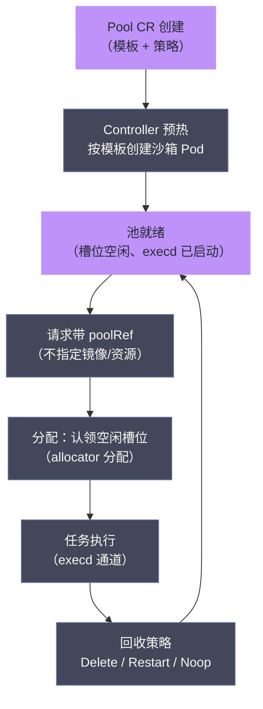

# 09 OpenSandbox 编排面——BatchSandbox、WarmPool 与快照

**摘要：**

[[08 OpenSandbox 数据面——execd 与 egress 的盒内世界]] 讲完了"沙箱里面"，本文收官 OpenSandbox 三部曲：**编排面**——沙箱"怎么被声明、怎么被批量交付、状态怎么被保存"。文章首先解释声明式编排的意义（CR 即事实层、Controller 持续对账）与编排面三件套（BatchSandbox/Pool/SandboxSnapshot 三 CRD）；然后深入 BatchSandbox 的设计（replicas 批量语义与 O(1) 对账、podTemplate、task 编排、与 sigs Sandbox CRD 的差异）；随后用素材实测数据完整拆解 WarmPool——命中 p50 1.0s/首命令 2.2s、并发 50 交付 p99 5.6s、耗尽 5→50 时 p99 回到 17.5-27.5s 冷启动量级——并给出"池化换到的是命中尾延迟，不是无限容量"的容量模型结论与 scale/update/recycle 三策略的实测行为；再解剖快照的真实语义（**pause 保存的是容器 rootfs 的 OCI 镜像，不是内存、不是对话、不是用户网盘**——OSEP-0008 的 Non-Goals 边界）与已知缺陷；随后给出编排面的生产化决策：Core HA Profile 与 Snapshot Lab Profile 的分治、双副本的真相（共享状态≠副本数）、与 sigs agent-sandbox 的 provider 关系；最后新增一章"截至 2026 年 10 月的演进"，以官方资料核实 OSEP-0008 落地、Umbrella Release 统一发布线、Pool 两级容量模型、官方批量基准与 OSEP-0015 草案。核心认知：**编排面是沙箱平台的"交付引擎"——它的性能决定用户体验（秒级交付），它的状态语义决定产品边界（快照能恢复什么），它的策略成熟度决定生产可行性（池与策略的冲突）**。

---

## 第 1 章 编排面定位：沙箱的"声明与交付"

### 1.1 为什么需要声明式编排

编排面（Orchestration）要回答的问题很朴素：一批沙箱该怎么声明、怎么交付、状态该怎么保存。Kubernetes 用十余年时间验证了一件事——把资源的期望状态（Desired State）写成声明，交给控制器持续对账，远比每次操作都手工发指令可靠；譬如 Deployment 掉了一个副本，ReplicaSet 会在几秒内把它补回来，中间没有任何人写一行补救代码。但沙箱不是普通的无状态工作负载，它有生命周期、有批量交付的压力、还有"把状态留下来以便恢复"的需求，声明式这套遗产搬到它身上，代价与边界都需要重新掂量。

对比命令式与声明式两种沙箱管理方式：

| 维度 | 命令式（调 API 创建） | 声明式（写 CR + Controller 对账） |
| :--- | :--- | :--- |
| **事实层** | API 返回值 | CR 对象（可审计、可回放） |
| **自愈** | 无（失败即失败） | 有（Controller 持续对账） |
| **批量** | 循环调 API | replicas 声明 |
| **一致性** | 依赖调用方逻辑 | 依赖 Controller 逻辑（统一） |
| **代价** | 实现简单 | Reconcile 延迟、CRD 演进成本 |

**声明式的三个核心价值**：**事实可审计**（CR 是"期望状态"的持久记录——出问题时先看 CR 再看日志）；**行为可自愈**（Pod 意外删除后 Controller 重建）；**批量可表达**（replicas=50 胜过 50 次 API 调用）。素材 PoC 的"API/CR/Pod 三层对照"排障法（[[10 Agent 沙箱部署实战——从单机 PoC 到测试集群]]）正是依赖"CR 是事实层"这个前提。

**声明式的代价**：Reconcile 延迟（从 CR 变更到 Pod 就绪有时间差，素材记录这是冷启动延迟的组成部分之一）；CRD schema 演进复杂（DEF-005：Helm 里的 Pool CRD 与 Controller 类型不一致——**声明式的 schema 版本管理是持续的工程负担**）。这两笔账都不是一次性成本：前者以"每次变更的等待时间"的形式持续存在，后者以"每个版本的迁移与冻结"的形式反复出现——押注声明式，等于接受了这两项长期支出，并用它们换回可审计、可自愈、可批量三项长期收益。

### 1.2 不这样会怎样：命令式编排的三个反例

先回答那个朴素问题反过来的一面：如果沙箱平台放弃声明式，退回"调 API 建一个是一个"的命令式，会发生什么？笔者从素材 PoC 与社区观察里提炼出三个典型失败场景，供选型时对照自省。

**场景一：状态散落在调用方，重启即失忆。** 命令式编排的事实层是 API 返回值，而返回值只活在调用方的进程里——脚本挂了、服务重建了、消息丢了，正在创建的沙箱和已经创建的沙箱清单都跟着丢，"还有几个没建完"只能从集群里现数。声明式的 CR 是集群里的一等对象，平台重启之后对账循环从头开始，期望状态还在那儿，缺失的副本会被自动补上。**差异的本质是"状态归谁所有"：命令式归调用方（会死），声明式归集群（会重生）**。

**场景二：批量就是循环加补丁。** 50 个沙箱意味着 50 次 API 调用、50 套超时与重试、50 份"谁成功了谁失败了"的回调处理；并行度一上来，限流、幂等、部分失败回滚全部要调用方自己写，而每一家调用方写出来的批量逻辑都不一样。声明式把这一整摊收敛成 replicas 声明与 Controller 的统一逻辑——调用方不再拥有批量语义，批量语义归平台所有，这恰恰是平台存在的意义之一。

**场景三：审计与回放无从谈起。** 命令式的"事实层"没人存就没人知道当初发生了什么，出了事故只能翻各家日志拼时间线；声明式的 CR 是持久记录，出问题先看 CR 再看日志，出了事故还能回放期望状态的变更轨迹。生产事故复盘里最贵的不是修复，是还原"到底声明过什么"——声明式让这一步从考古变成查账。

反例同样值得说。声明式不是免费的（1.1 节的代价），在三种场景下命令式反而更划算：其一，**单机 Docker runtime 的一次性实验**——建一个、跑一下、删掉，声明式是多余的仪式；其二，**纯内部工具沙箱**——没有并发批量、没有跨端客户端，协议层与编排层都是负担，这与 [[07 OpenSandbox 架构深度解析——协议优先与六责任面]] 1.3 节"协议优先不适用的情况"是同一判断；其三，**对单发交付延迟极度敏感且没有批量**的请求路径。判断的标尺不是"哪个更先进"，而是"状态是否需要跨进程留存、批量是否需要统一语义"——需要，声明式；不需要，命令式更轻。

### 1.3 编排面的范式：Operator 模式的完整应用

编排面是 Kubernetes Operator 模式（CRD + Controller）在沙箱场景的完整应用。**Operator 模式的三要素**在编排面各有着落：

| 要素 | 编排面的实现 | 沙箱场景的特殊性 |
| :--- | :--- | :--- |
| **CRD（期望状态声明）** | BatchSandbox/Pool/SandboxSnapshot | 沙箱的期望状态是"模板化"的（Pod 模板表达），比普通工作负载更抽象 |
| **Controller（对账循环）** | reconciler（scale/alloc/evict/update） | 对账对象是"一批沙箱"，需要分配器（allocator）与策略（strategy） |
| **Finalizer（清理钩子）** | 删除前的资源回收 | **沙箱删除的"残留 0"保证依赖 finalizer**（未清理完不删 CR） |

**沙箱场景的特殊性**：普通工作负载（Deployment）的对账是"Pod 数量对齐"，沙箱编排的对账是"**分配语义**"（哪个请求认领哪个槽位）+ "**生命周期语义**"（TTL/回收/快照）——**分配器（allocator）与策略（strategy）是沙箱 Controller 区别于普通 Controller 的核心**（素材源码走读中 allocator 与 strategy 是独立模块）。

笔者把对账循环（Reconcile Loop）的工程品质归纳为三件事。其一是**幂等性（Idempotency）**——同一份期望状态被 Requeue 一百次，结果必须与执行一次相同，这是"对账"能持续跑而不出乱子的前提；其二是**限流与去重**——workqueue 会合并同一对象的多次变更、限制同一对象的并发 Reconcile，防止热点对象被反复处理；其三是 **finalizer 的清理保证**——CR 挂着 finalizer 时，删除请求只打删除标记，Controller 把底层资源清完才摘除 finalizer、让 CR 真正消失，沙箱删除的"残留 0"靠的是这个钩子而不是操作者的自觉。这三件事里任何一件做砸，声明式都会退化成"声明了但不兑现"。

**对自研的启示**：如果自研编排面，Controller 的模块划分参考 OpenSandbox——reconciler（对账）/allocator（分配）/strategy（策略）/eviction（驱逐）四模块分离，**分配与策略不写死在对账循环里，是"可插拔策略"的工程前提**（PoolStrategy/TaskSchedulingStrategy 接口）。

### 1.4 编排面三件套

OpenSandbox 的 K8s runtime 通过三个自研 CRD 承载编排能力：

| CRD | 职责 | 关键字段/语义 |
| :--- | :--- | :--- |
| **BatchSandbox** | 沙箱的批量声明 | replicas（副本数）、podTemplate、extensions.poolRef（认领池）、task 编排 |
| **Pool** | 预热池 | 模板 + scaleStrategy + updateStrategy + recycleStrategy |
| **SandboxSnapshot** | 快照记录 | rootfs 可恢复镜像的元数据（pause/resume 的基础） |

**三件套的分工**：BatchSandbox 管"交付"（声明多少个沙箱）、Pool 管"预热"（提前备好资源）、SandboxSnapshot 管"保存"（状态如何留档）。**交付、预热、保存三个问题的解耦，是编排面设计的骨架**。

如果把编排面比作一间仓库，CR 就是货架旁边的台账，Controller 是夜班理货员——台账上写着"应该有几箱货"，理货员每隔一会儿巡一遍，货架少了就补、多了就收。但理货员不是魔术师：他对账有周期，补货要时间，这两点正好对应 Reconcile 延迟与冷启动时间，是后面性能讨论的地基。三件套则是仓库里的三本不同的账：一本管进货（BatchSandbox）、一本管备货（Pool）、一本管存档（SandboxSnapshot），三本账各记各的，互不串行。

---

## 第 2 章 BatchSandbox：批量声明

### 2.1 CRD 设计

BatchSandbox 的核心设计（基于官方 CRD 类型与素材源码走读）：

| 设计点 | 语义 | 工程意义 |
| :--- | :--- | :--- |
| **replicas** | 一次声明多个沙箱副本 | 批量评测/RL 训练/并发任务的表达 |
| **podTemplate** | 沙箱 Pod 的完整模板（镜像/资源/RuntimeClass） | 与 K8s 生态一致的模板语言 |
| **extensions.poolRef** | 从 Pool 认领预热的沙箱 | 快交付的声明式入口 |
| **task 编排** | 任务调度（task-scheduler + task-executor） | 批量任务的执行语义（内部 scheduler 把任务分配给沙箱 Pod） |
| **status** | phase/ready/conditions | 对账结果的事实层 |

**task 编排的特殊性**：OpenSandbox 的 Controller 内置了一个 task scheduler——批量任务（如评测）可以声明式地分发给多个沙箱执行（task-executor 运行在沙箱 Pod 内）。**这是"沙箱平台"向"批量计算平台"延伸的能力**——素材 PoC 未深度验证此能力（列为后续方向），但它是 OpenSandbox 与纯"会话沙箱"平台的差异化点。到 2026 年 10 月，这个方向已经长成一套完整的任务契约（taskTemplate、任务计数状态、preStart/postStop 钩子），第 6 章会专门对照。

### 2.2 对账循环：replicas 的批量语义

replicas 的批量语义，关键不在"一个字段写 50"，而在"Controller 以什么粒度对账"。普通工作负载控制器通常逐对象对账，BatchSandbox 的 reconciler 则把**一个 BatchSandbox 当作一次批量交付的声明**：期望 replicas=N，对账时对比现状，差值一次算清，创建或删除以步幅推进——创建路径是"先建齐再收敛"，删除路径是"按可用性预算逐步缩"，而不是 N 次独立的、互不知情的对象循环。

这个设计的收益在写入复杂度上看得最清楚。官方文档给出的对照：**声明 N 个沙箱，agent-sandbox 模式需要 5N 次写**（Claim、Sandbox、Pod update、两次 status update），BatchSandbox 模式只需要 3 次写（CR 创建、一次 annotation、一次 status）——批量语义把"N 次串行协调"压缩成"一次声明加几次对账写"，复杂度从 O(N) 降到 O(1)。第 2.5 节的 benchmark 差距，机制根源就在这里。

不妨这样想：单体声明像手抄员一份一份誊写文件，批量声明像印刷厂一次印一万份——快的不只是"写"这个动作，而是排版、校对、分发整条流水线都为一批服务。技术限定在于，批量对账的代价是"粒度粗"：批次里的单个沙箱出现异常，Controller 重建的对象是整个批次的差量，定位单点故障要靠 status 里的计数与 condition，而不是逐个对象的日志。

另一个值得注意的设计点：批量交付的"部分成功"是常态而不是异常——N 个副本里 3 个失败，对账循环下一轮自然重试那 3 个，幂等性（1.3 节）让"重试"变成"继续对账"而不是"重新开始"。调用方感知到的，只是最终 status 里 phase/conditions 的收敛。这也意味着调用方不能把"创建 API 返回成功"当成"N 个副本全部就绪"，就绪与否要看 CR 的聚合状态——这与 [[07 OpenSandbox 架构深度解析——协议优先与六责任面]] 的"HTTP 码 ≠ 终态"是同一纪律在批量场景的延伸。

### 2.3 与 sigs agent-sandbox Sandbox CRD 的差异

| 维度 | BatchSandbox（OpenSandbox） | Sandbox（SIG） |
| :--- | :--- | :--- |
| **核心语义** | 批量（replicas）+ 池化（poolRef） | 单体（单容器、稳定身份） |
| **稳定身份** | 无强保证（按副本管理） | **核心特性**（稳定 hostname/网络身份） |
| **持久存储** | volumeClaimTemplates（声明式） | volumeClaimTemplates（核心特性） |
| **任务编排** | 内置 scheduler + task-executor | 无 |
| **WarmPool** | Pool CRD（自研） | SandboxWarmPool（标准） |
| **快照** | SandboxSnapshot（rootfs 级） | Pod Snapshot（GKE 实现） |

**差异的本质**：SIG 的 Sandbox 是"有状态单体的声明"，BatchSandbox 是"批量沙箱的交付"——**前者为"一个稳定的工作环境"设计，后者为"一批执行单元"设计**。OpenSandbox 同时提供 agent-sandbox provider（用 SIG 的 CRD 跑单体场景），两套语义按需选择。这个差异不是优劣之分，而是适用场景之分：需要稳定身份（hostname、网络标识不变）的长驻开发环境，单体语义是特性；需要吞吐的批量评测与 RL 训练，批量语义才是特性——选错语义的代价，是拿单体语义跑批量时被 5N 次写拖垮，或拿批量语义跑长驻环境时发现身份漂移没法用。

### 2.4 创建路径回顾：声明式与同步语义的并存

[[07 OpenSandbox 架构深度解析——协议优先与六责任面]] 讲过创建请求的同步语义（202/504）——这里补上编排面的视角：**API 同步等待的是"CR 就绪 + Pod Running"，不是"Controller 完成全部对账"**。两者的边界：

```
API 返回 202 时：
  ✅ CR 已创建、Pod 已 Running、IP 已获取
  ⏳ Controller 的后续对账（配额记账、事件上报、TTL 调度）可能仍在进行
```

**工程后果**：202 返回后的"立即删除"是安全的（资源已就绪）；但"立即依赖 Controller 的记账结果"是不安全的（对账有延迟）——**调用方对"创建完成"的理解要精确到"Pod 就绪"，而非"全部对账完成"**。这个边界在批量场景会被放大：replicas=50 时，202 只承诺"声明已受理、首批就绪"，50 个副本全部就绪的判断必须以 CR 聚合状态为准，不能以一次 202 为准。

### 2.5 批量交付 benchmark：与 sigs 的对比

InfoQ 分享中给出了编排面最引人注目的数据：**双方都启用池化时，拉起 100 个 sandbox，OpenSandbox 的整体交付效率比 sigs agent-sandbox（调节过并发度后的最好成绩）高一个数量级**。

**为什么快一个数量级**（结合架构推断与分享内容的合成）：

| 因素 | OpenSandbox | sigs agent-sandbox |
| :--- | :--- | :--- |
| **CRD 语义** | replicas 批量声明（一次对账管 N 个） | Sandbox 单体声明（N 个沙箱 = N 次对账） |
| **池化路径** | Pool 认领（allocator 内存分配） | SandboxClaim 认领（CR 对账路径） |
| **控制路径** | 内存态 allocator（快） | 全声明式（稳但慢） |
| **交付思维** | "批量交付"（一批环境一起思考） | "单环境交付"（逐个创建） |

**"整个系统开始以批量交付的方式来思考，而不是不停地创建很多个单体环境——这个转变至关重要"**（InfoQ 分享原话）。**批量语义不是"循环的优化"，而是"思维模式的转变"**——replicas 声明让 Controller 可以批量分配、批量预热、批量对账，而循环调用只能串行或半并行。

官方文档在 2026 年给出了可复现的对照基准（双方启用池化、镜像已缓存、busybox 测试镜像）：交付 100 个沙箱，SIG agent-sandbox 在并发 1/10/50 下总耗时分别为 76.35s / 23.17s / 33.85s，BatchSandbox 为 0.92s，复杂度 O(N) 对 O(1)（官方 kubernetes/README 数据，本文 6.1 节标注来源）。注意这组数字把"高一个数量级"量化得更狠（约两个数量级），但测试镜像是最小的 busybox，真实场景里镜像拉取等常数项会拉近差距——**数量级的方向不变，幅度的判断要打折**。

**对选型的含义**：如果你的 Agent 平台有"批量评测/批量训练/并发任务"场景，编排面的批量语义是决定性差异——**"单会话沙箱"场景（用户逐个创建）感受不到这个差异，但"批量交付"场景（评测系统、RL 训练）会放大它**。

### 2.6 状态所有权（回顾与深化）

素材源码走读的状态所有权结论（[[07 OpenSandbox 架构深度解析——协议优先与六责任面]] 3.1 节）：**CR 就绪前成败归 API Server，就绪后 phase 归 Controller**。编排面的深化理解：

- **就绪前**：API Server 是"临时所有者"——它等、它放弃、它回滚（504 时主动删 CR）；
- **就绪后**：Controller 是"持续所有者"——Pod 崩溃它重建、TTL 到期它删除、策略变更它滚动；
- **所有权切换点**：Pod Running + IP 获取——**这个切换点是排障的分水岭**：创建失败查 Server，运行异常查 Controller/CR。

在批量场景下，这个分水岭依然清晰，但要多看一层聚合：单个副本的就绪切换点在 Pod，批次的就绪切换点在 CR 的聚合 status——排障时先分清"是个体问题还是批次问题"，再决定查哪一层。

---

## 第 3 章 WarmPool：预热池

### 3.1 行业参考：GKE Agent Sandbox 的 WarmPool 数据

OpenSandbox 的 Pool 不是孤例——GKE Agent Sandbox 的 SandboxWarmPool（[[06 Agent 沙箱平台分层——六层模型与三条产品路线]] 的 SIG 生态）提供了行业对照数据：

| 指标 | GKE Agent Sandbox（SIG 路线） | OpenSandbox Pool（素材实测） |
| :--- | :--- | :--- |
| **领取速率** | 每集群每秒 300 个 | 未公布（批量 benchmark 高一个数量级） |
| **分配延迟** | 90% ≤ 200ms | 热池命中 API p50 ~1.0s |
| **实现** | SandboxWarmPool CRD + GKE 托管 | Pool CRD + 自研 allocator |

**口径差异提醒**：GKE 的"200ms"是**分配延迟**（认领动作），OpenSandbox 的"1.0s"是 **API 全链路**（含路由/鉴权/execd 探活）——两者不可直接比较（[[03 隔离边界的光谱——从共享内核到 MicroVM 的四档技术路线]] 6.5 节的"基准边界"纪律）。**可比的结论是"预热池路线在两家都验证了亚秒到秒级的交付"**——行业共识第四条（快靠预热物认领）的实证。

### 3.2 为什么需要预热：冷启动延迟的分解

冷启动延迟（素材 PoC：API p50 4-5s）由四段构成：

| 段 | 内容 | 占比（量级） |
| :--- | :--- | :--- |
| **镜像拉取** | 镜像下载到节点 | 大镜像（2.6GB code-interpreter）占大头 |
| **沙箱创建** | Pod 调度 + 容器启动 | 秒级 |
| **execd 自启** | 数据面就绪（[[08 OpenSandbox 数据面——execd 与 egress 的盒内世界]]） | 亚秒级 |
| **CR reconcile 传播** | 声明式对账延迟 | 亚秒级 |

**预热的思路**：把"镜像拉取 + 沙箱创建 + execd 自启"提前到空闲时完成——用户请求到达时，只需要"认领"一个已就绪的沙箱。**行业共识第四条"快靠预热物认领"**（[[06 Agent 沙箱平台分层——六层模型与三条产品路线]]）：秒级交付的答案不是"更快地冷创建"，而是"提前创建好"。

预热池像火锅店的保温备菜柜——客人点菜时，后厨不是从洗菜切菜开始，而是从保温柜端出已备好的菜。技术限定很关键：保温柜里的菜按规格分格存放，客人点的菜不在柜里，就得退回"从洗菜开始"的冷启动路径——这正好预言了 3.6 节的碎片问题：备菜是按规格备的，规格对不上，备了也白备。

### 3.3 工作流程

Pool 的完整生命周期（素材 Phase3-14/15 实测）：



**认领语义**：请求通过 `extensions.poolRef` 引用池，**而不是指定 image/resourceLimits**——池的模板（镜像/资源/RuntimeClass）由 Pool CR 统一声明。**"按规格认领"而非"按请求创建"是池化的语义核心**。

认领动作在实现上是一条"分配契约"：allocator 从池里挑一个空闲槽位，把分配结果以 annotation 的形式写回 BatchSandbox（分配状态、poolRef、代数），槽位 Pod 打上池名与版本标签——分配结果进了 CR，就进了事实层，池侧与沙箱侧都读同一份记录，不会出现"池以为分配了、沙箱侧不知道"的裂脑。素材源码走读里 allocator 与 reconciler 分离，正是为了让这条契约可替换。

### 3.4 三策略：scale / update / recycle

素材 Phase3-15 实测了 Pool 的三个策略维度：

| 策略 | 控制什么 | 实测发现 | 生产建议 |
| :--- | :--- | :--- | :--- |
| **scaleStrategy** | 扩缩容行为（maxUnavailable 等） | 可用性预算需要限制扩缩步幅 | **maxUnavailable 建议 1**（避免缩容风暴） |
| **updateStrategy** | 模板更新时的滚动行为 | **实测未满足预期**（DEF-006：maxUnavailable 不能可靠保障可用容量） | 更新时人工盯池容量 |
| **recycleStrategy** | 任务结束后的槽位回收 | Delete（销毁重建）/Restart（同租户灰度）/Noop（禁用） | **跨租户唯一默认是 Delete**（防数据残留） |

**recycleStrategy 的深意**：任务结束后槽位如何处理，直接决定**跨租户数据隔离**——Restart 只适合"同租户灰度"（槽位内可能有上一任务的残留数据），**跨租户必须 Delete**（重建干净槽位）。DEF-007 记录：recycleStrategy=Restart 缺少 pods/exec RBAC（实现缺陷）——**策略的成熟度差异在生产中会直接暴露**。

三个策略共用同一个控制变量（maxUnavailable），但作用对象不同：scale 管"池的大小怎么变"，update 管"池的内容怎么换"，recycle 管"用过的槽位怎么处理"。素材实测的最大教训是 DEF-006——update 路径的 maxUnavailable 不能可靠保障可用容量，也就是说**更新期间的池容量是不可承诺的**，这直接催生了 3.7 节"Pool 当不可变版本"的生产纪律。

### 3.5 性能数据：命中、并发与耗尽

素材 Phase3-14 的 WarmPool 实测（runc/gVisor/Kata 三运行时）：

| 场景 | runc | gVisor | Kata |
| :--- | :--- | :--- | :--- |
| **冷启动 API p50** | 4.013s | 4.013s | 5.015s |
| **热池命中 API p50** | 1.012s | 1.012s | 1.012s |
| **热池命中到首命令 p50** | 2.224s | 2.246s | 2.270s |
| **并发 50 全部命中 p99** | 5.728s | 5.603s | 5.651s |
| **耗尽（5→50 突发）p99** | 17.490s | 18.614s | 27.494s |

**三个关键读数**：

1. **命中即收敛**：热池命中时三运行时 API 延迟完全相同（1.012s）——**池化抹平了隔离档位的启动差异**（[[03 隔离边界的光谱——从共享内核到 MicroVM 的四档技术路线]] 的 6.4 节）；
2. **并发 50 不劣化**：池容量充足时，50 并发交付 p99 仅 ~5.6s——**池的并发吞吐是线性扩展的**（前提是槽位够）；
3. **耗尽即打回原形**：5 个热槽吃 50 突发时，p99 回到冷启动量级（runc 17.5s / Kata 27.5s）——**池化换到的是命中时的尾延迟，不是无限容量**。

第三个数是最容易被忽略的生产信号：池只有在"槽位 ≥ 峰值并发"时才兑现其承诺，任何把池当成"无限容量"的容量规划，都会在突发到来时收获这个打回原形的数字。

### 3.6 耗尽模型与容量管理

**核心结论**（素材 Phase5-06 的原话）：**"WarmPool 换到的是命中时的尾延迟，不是无限容量"**。容量管理由此而来：

```
池容量规划公式（经验）：
  池槽位数 ≥ 峰值并发 × 目标命中率
  池耗尽时延 = 冷启动时延（无捷径）

SLI 建议（GAP-013 的补全）：
  命中率（命中请求/总请求）
  耗尽排队时延（请求等待槽位的 p99）
  补池时延（槽位不足到补满的时间）
  碎片率（不可互借的槽位占比）
```

**碎片问题**（素材 Phase3-14）：**不同 Runtime/镜像/规格的槽位不能互借**——譬如 runc 池的空闲槽位不能给 Kata 请求用。池的"按规格分组"导致容量碎片：**池数量越多，碎片越严重**——容量规划要在"粒度细（按需分池）"与"碎片少（合并分池）"之间取平衡。在笔者看来，碎片率这个 SLI 存在的意义，就是让"池的规格分布 vs 请求的规格分布"的错配变成可量化的指标，而不是等到耗尽事故才被发现。

### 3.7 生产纪律：Pool 当不可变版本

素材 Phase5-06 给出的生产纪律：**把 Pool 当作不可变版本**——新模板 = 新 Pool 名 → 预热 → 切规格映射 → 抽干旧池 → 删除：

```
v1 模板变更时：
  1. 创建 Pool-v2（新模板）
  2. 预热 Pool-v2 到目标槽位
  3. 请求映射切到 poolRef=pool-v2
  4. 停止 Pool-v1 的补池（排干存量）
  5. 存量清空后删除 Pool-v1
```

**为什么不能原地更新**：DEF-005（CRD schema 落后于 Controller）与 DEF-006（updateStrategy 不可靠）意味着**原地更新可能产生"声明与实现不一致"的池**——不可变版本把风险从"运行时"移到"发布流程"（发布流程可控，运行时不可控）。这条纪律的底层逻辑是"把不可靠的运行时迁移让位给可靠的发布编排"——与其赌 update 策略的可用容量承诺，不如让新旧池并存、用流量切换完成迁移。

### 3.8 池的运维实践：素材的五条经验

素材 Phase3-14/15 与 Phase5-06 的池运维实践，沉淀为五条可执行经验：

**经验一：预热节奏与业务周期对齐**。池的预热不是"一直满"——空闲池是纯成本（每个槽位持有内存/CPU）。按业务周期（工作日的 Agent 高峰、批处理的定时任务）设计"低水位/高水位"调度。

**经验二：耗尽演练必须做**。素材的 5→50 耗尽实验是"在出事之前知道出事是什么样"——**耗尽后的 p99 数据（17.5-27.5s）要写进容量文档**，让业务方对"池打空"有预期，而不是事发时惊讶。

**经验三：池与镜像供应链联动**。镜像更新 → 新池预热 → 切流——**镜像 digest 变化会静默失效旧池的模板引用**（池模板锁定 digest），发布流程必须包含"池重建"步骤。

**经验四：碎片监控**。池的数量与规格维度越多，碎片越严重——定期审计"池的规格分布 vs 请求的规格分布"，合并低利用率池。

**经验五：池的故障域**。池槽位要跨节点分布（反亲和）——**单个节点故障不能打空整个池**（素材生产方案的"Worker≥3 节点"与此相关）。

### 3.9 池化的边界与反例

池化不是无条件的银弹，三种场景下它反而是负资产。其一，**低频个性化请求**：池按规格分组，每个规格都是一条独立的容量线——如果请求的镜像/资源组合几乎不重复，池就会退化成"为每个规格备一个槽位"，碎片率直奔天花板，预热的收益被碎片成本吃掉（呼应 3.6 节的碎片公式）。其二，**超大镜像**：每个槽位预热都要拉一次完整镜像（素材里 2.6GB 的 code-interpreter 镜像拉取占冷启动大头），池深越大，镜像拉取的总成本越高——大镜像场景要么接受"浅池 + 高命中率"，要么先用快照把依赖固化成更小的启动镜像。其三，**强租户隔离**：recycleStrategy 的 Restart 只是"同租户灰度"的手段，跨租户必须 Delete 重建——如果租户对"上一任务残留"零容忍，且槽位复用的审查成本高，池省下的时间会被隔离审计的耗时抵消。

还有一个认知反例必须点破：**池不是状态容器**。有人会把池当成"预热的沙箱顺便存点东西"，但槽位是会被回收、重建、跨任务复用的，任何放进槽位的东西都可能在 Delete 策略下消失——池只预热"可复现的环境"，不保存"不可复现的状态"，后者是第 4 章快照与 [[13 Agent 状态与存储——六类状态的正确拆分]] 的职责。

---

## 第 4 章 快照与 pause/resume

### 4.1 快照的真实语义：rootfs 的 OCI 镜像

**最重要的概念澄清**（素材 Phase5-07 的核心结论）：**OpenSandbox 的 pause 保存的是容器 rootfs 的 OCI 镜像，不是内存、不是对话、不是用户网盘**。

| 能力 | pause/resume 覆盖？ | 说明 |
| :--- | :--- | :--- |
| 文件系统状态 | ✅ | rootfs 提交为 OCI 镜像 |
| 进程内存 | ❌ | 不保存内存（OSEP-0008 Non-Goals） |
| 打开的套接字/连接 | ❌ | 不保存 |
| CPU 寄存器 | ❌ | 不保存 |
| Agent 会话/对话 | ❌ | 那是 Agent Session 的事（四本账） |
| 用户网盘/Workspace | ❌ | 那是 Workspace 服务的事（四本账） |

**"同一个状态名下面是不同机器"**（素材交付物-01 的原话）：用户以为 pause/resume 是"虚拟机休眠/唤醒"（内存级），实际是"rootfs 提交/重建"（文件级）——**语义落差是快照功能最大的产品化风险**（用户会在"resume 后会话没了"时骂平台）。

rootfs 快照像给房间拍一张照片——家具摆位、墙面涂鸦都在照片里，但照片复原不了房间里正在进行的对话；内存级 checkpoint 则像录像加现场存档，连进行到一半的动作都能接着演。技术限定：照片式恢复兼容性好、成本低，但"恢复的只是环境，不是现场"——产品文档里"暂停/恢复"的措辞，必须按照片的逻辑写，不能按录像的逻辑写。

### 4.2 OSEP-0008 的边界（Non-Goals）

OSEP-0008 明确定义了快照的 Non-Goals（不做的事）：

| Non-Goal | 说明 |
| :--- | :--- |
| 不保留内存 | 无内存级 checkpoint（非 CRIU） |
| 不保留打开的套接字 | 网络连接不随快照保存 |
| 不保留 CPU 寄存器 | 无指令级恢复 |
| v1 每 sandbox 只留一份 snapshot | 无多版本快照 |
| 不支持 replicas>1 | 批量沙箱不做快照 |

**"每沙箱一份快照"与"不支持 replicas>1"**是容量约束的表达——快照是"贵"操作（rootfs 提交 + Registry 存储），批量场景的成本不可控。**理解 Non-Goals 的价值**：快照能力的定位是"环境状态的恢复"（代码/文件在），不是"运行状态的恢复"（进程/会话在）——**设计依赖快照的产品功能时，按文件级语义设计**。这两条 Non-Goal 到 2026 年 10 月依然成立（官方 pause-resume 指南仍限定单副本），是后文 6.4 节复核的基准。

### 4.3 快照流程与状态机

素材与官方文档还原的快照（pause）流程：


**四个实现要点**：

1. **commit Job 与源 Pod 同节点**——rootfs 提交需要访问 Pod 的本地存储，跨节点不可行（调度约束）；
2. **凭证走 Secret**——Registry 推拉凭据经 K8s Secret 注入 Job，不进 CR 明文；
3. **公开 ID 保持不变**——resume 后的沙箱对客户端保持同一身份（会话连续性的最小保证）；
4. **元数据在 pod-local SQLite**（GAP-003）——双副本 Server 的快照查询会 404。

快照不是一条"按下就完成"的命令，而是一段有中间态的状态机。对外，沙箱在 **Running → Pausing → Paused → Resuming → Running** 之间迁移，任何一步失败落到 **Failed**（reason/message 说明原因）；对内，SandboxSnapshot 经历 **Pending → Committing → Succeed / Failed**。Lifecycle API 只暴露粗粒度状态，快照提交的细节要查 SandboxSnapshot CR 本身——这个"内外两层状态"的设计，与 2.4 节"202 是同步完成、不是全部对账完成"是同一条纪律的两个表达：**API 状态是给调用方的，CR 状态是给排障者的**。

持久性边界要单独强调：rootfs 只有在快照达到 Succeed、镜像确实推进了 Registry 之后才算落盘——请求被接受、或快照停在 Pending/Committing，都不构成持久性保证。譬如进程被 OOM-kill、Pod 被驱逐、节点失联，这些"异常终止"都不会自动触发快照；image-committer 能直接读 containerd 里已停止容器的场景，官方文档明言那是"尽力而为的运维恢复路径，不是受支持的持久性契约"。

### 4.4 已知问题

| 缺陷 | 现象 | 影响 |
| :--- | :--- | :--- |
| **GAP-003** | Snapshot 元数据 pod-local SQLite | 双副本 Server 下快照查询 404（"共享状态≠副本数"） |
| **GAP-004** | 删除 Snapshot 不回收 OCI Registry blob | Registry 存储持续增长（孤儿 blob） |
| **DEF-001** | pause CLI 显示成功早于真实完成 | 必须轮询到 Paused 终态 |
| **无内存 checkpoint** | resume 后进程/会话不恢复 | 产品语义必须按文件级设计 |

**生产化对策**：Core HA Profile 默认关 Snapshot（双副本 Server 在"无状态 API"意义上成立）；Snapshot Lab Profile 用受控窗口（必要时单 Server）；Registry blob 回收自建 GC 任务（[[15 生产化深水区——十个盲区与行业共识]] 的 T/P 路线）。

### 4.5 快照的使用场景与反例

按"rootfs 级"语义，快照的适用与不适用场景：

**适用**：
1. **环境模板沉淀**：Agent 任务完成后，把"装好了依赖的环境"沉淀为可复用快照——后续任务从快照启动，跳过依赖安装；
2. **故障恢复的"环境层"**：沙箱崩溃后从快照重建——**代码/文件在，会话重建**（配合 Session 外置可接受）；
3. **审计留档**：任务的"执行环境快照"留档（跑过什么代码的环境是可追溯的）。

**不适用（反例）**：
1. **会话续接**：用户以为"暂停后继续对话"——rootfs 快照做不到（对话在 Agent Session，不在 rootfs）——**这是语义落差最大的反例**（4.1 节）；
2. **长任务断点恢复**：模型跑了 2 小时的任务，pause 后 resume——**内存/进程状态丢失，任务白跑**；
3. **高频快照**：每任务一快照——Registry 存储爆炸 + commit Job 开销（OSEP-0008 的"每沙箱一份"约束）。

**判断口诀**：**快照适合"环境"不适合"运行"**——凡是"环境级恢复"的需求（依赖/文件/配置在即可），rootfs 快照足够；凡是"运行级恢复"的需求（进程/会话/连接在），rootfs 快照不够，需要 CRIU 类方案或状态外置（[[13 Agent 状态与存储——六类状态的正确拆分]] 的"四本账"：会话状态归 Session 服务，快照只承担"环境"账）。

### 4.6 与 CRIU/内存级 checkpoint 的差异

| 维度 | OpenSandbox 快照（rootfs） | CRIU 类（内存级） | gVisor C/R（runsc） |
| :--- | :--- | :--- | :--- |
| 保存内容 | 文件系统 | 内存+寄存器+FD | 内存+寄存器（gVisor 支持） |
| 恢复速度 | 秒级（重建 Pod） | 毫秒级（原地恢复） | 快照启动（Modal 实测 2347ms） |
| 兼容性 | 全兼容（OCI 标准） | CRIU 依赖应用配合 | gVisor 生态内 |
| 适用 | 环境恢复（代码/文件） | 进程级恢复（长任务） | 函数级恢复 |

**判断**：rootfs 快照是"工程上最稳"的方案（OCI 标准、全兼容），但产品语义最弱；CRIU 类最强但约束最多（[[03 隔离边界的光谱——从共享内核到 MicroVM 的四档技术路线]]）。**素材的行业判断："休眠/checkpoint 成为竞争点"**——谁能把内存级恢复的代价降到可接受，谁就拿到"会话秒续"的体验优势。截至 2026 年中，rootfs 级仍是主流，内存级是竞争前沿；到 2026 年 10 月，OpenSandbox 给出了一个可选的内存级形态（qemu-v1），第 6.4 节展开。

---

## 第 5 章 编排面的生产化

### 5.1 双 Profile 分治

素材 Phase4 的测试集群设计把编排面拆成两个 Profile——**用"分治"消化"能力不成熟"**：

| Profile | 配置 | 目的 |
| :--- | :--- | :--- |
| **Core HA Profile** | Server/Controller 双副本、**Snapshot/Pause 关闭** | 在"无状态 API"意义上验证高可用 |
| **Snapshot Lab Profile** | 快照开启、企业 TLS Registry、必要时单 Server | 在"受控窗口"内验证快照能力 |

**分治的逻辑**：快照的 pod-local SQLite 元数据（GAP-003）使"双副本 + 快照"不可兼得——**与其追求"全能力 HA"，不如明确"哪些能力可以 HA、哪些只能 Lab"**。这个"能力 × 可用性矩阵"是编排面生产化的核心决策框架：

| 能力 | Core HA | Lab | 理由 |
| :--- | :---: | :---: | :--- |
| 生命周期 API | ✅ | ✅ | 无状态（元数据可重建） |
| WarmPool | ✅ | ✅ | 池状态可由 Controller 重建 |
| Snapshot | ❌ | ✅ | pod-local SQLite 不可共享 |
| Pause/Resume | ❌ | ✅ | 依赖快照 |

分治的价值在于把"平台整体 HA"这个模糊目标，翻译成"逐能力决策"的清晰矩阵——每一行都问"这个能力在双副本下能不能自愈"，不能的进 Lab、能的进 Core，而不是一口咬定"平台是 HA 的"或"平台不是 HA 的"。

### 5.2 双副本的真相：共享状态≠副本数

素材 Phase5-01 的"十个盲区"之二：**"共享状态≠副本数"**——Server 双副本只解决"无状态 API"的可用性；任何 pod-local 状态（SQLite、本地文件）在双副本下都是"裂脑候选"。**HA 的正确度量是"状态的可共享性"，不是副本数量**：

```
错误的 HA 判断：Server 2/2 Running = 高可用 ✅
正确的 HA 判断：
  - 无状态 API（创建/查询/删除）→ 双副本 ✅
  - 有状态能力（快照查询）→ 单点 ❌（404 或裂脑）
```

**工程推论**：编排面生产化的第一步不是"加副本"，而是"**盘点哪些能力有本地状态**"——本地状态能力的 HA 只有两条路：状态外置（SQLite→外部 DB）或能力降级（Lab 单点）。

这像酒店前台的接待：双前台只解决"任何时候都有人值班"（无状态 API 的可用性），解决不了"值班的人查不到房客档案"（档案在单点的柜子里，SQLite 在单副本 Server 上）。把"两个前台"当成"档案也备份了一份"，是双副本 HA 最常见的误判——到 2026 年 10 月，快照元数据仍是 SQLite 存储（6.4 节复核），这个误判的代价依然存在。

### 5.3 与 sigs agent-sandbox 的 provider 关系

回顾 [[07 OpenSandbox 架构深度解析——协议优先与六责任面]] 的双 provider：batchsandbox（默认）与 agent-sandbox。编排面的视角补两个事实：

1. **两套 CRD 的并存是"策略"而非"妥协"**——OpenSandbox 不赌单一路线：自研 CRD 追求性能（批量交付高一个数量级），SIG 兼容追求生态（标准锚点）；
2. **迁移成本**：从 batchsandbox 切 agent-sandbox provider 意味着 CRD 语义变化（稳定身份 vs 批量交付）——**provider 切换是"应用语义变更"，不是"配置变更"**（集成方要重新设计工作负载声明）。

### 5.4 容量与治理

编排面的生产化还涉及容量与治理（素材 Gate 6 验收项）：

| 治理项 | 内容 | 素材实践 |
| :--- | :--- | :--- |
| **配额** | 租户/用户的沙箱数量与资源上限 | Namespace 配额 + 平台层配额 |
| **并发** | 单池/单租户的并发交付上限 | 池容量规划（3.6 节） |
| **N-1 兼容** | 升级时新旧版本并存 | 发布物冻结（Chart/镜像/digest/Secret） |
| **TTL** | 沙箱到期回收 | TTL 调度（防僵尸） |
| **删除证据链** | 删除操作的审计留痕 | 删除前把 Event/request_id/sandbox_id 打外部日志（GAP-001 绕行） |

**治理的实现层次**：配额与并发在"平台层 + K8s 层"双轨实施（平台层管业务语义，K8s 层管资源强制）；TTL 与删除证据链在"Controller 层"实施（对账循环的一部分）。**治理能力的分层原则**：业务语义（谁能用多少）靠近控制面，资源强制（超限即拒绝）靠近 K8s——**两层都配才是治理，只配一层是半治理**。

### 5.5 编排面排障速查

编排面故障按"层"定位（与 [[07 OpenSandbox 架构深度解析——协议优先与六责任面]] 的状态所有权衔接）：

| 症状 | 排查层 | 检查点 |
| :--- | :--- | :--- |
| 创建请求超时 504 | API Server | Server 日志（等待/放弃/回滚路径）、CR 是否残留 |
| CR 创建了但 Pod 不出现 | Controller | Controller 日志、RBAC（CRD 权限）、Webhook |
| Pod Pending | 调度器 | 资源不足、RuntimeClass 节点选择器、污点 |
| Pod 出现但 execd 不可用 | 数据面 | initContainer 是否完成、bootstrap 日志 |
| 池请求一直不分配 | Pool allocator | 池容量、碎片（无匹配槽位）、poolRef 引用错误 |
| pause 显示 ok 但状态不变 | 快照链路 | commit Job 状态（**同节点约束**）、Registry 可达性 |
| resume 404 | 快照元数据 | **pod-local SQLite**（GAP-003：查到了另一个 Server 副本） |
| 删除后残留 | 回收链路 | TTL 调度、recycleStrategy 配置、finalizer |

**排障总原则**：**先看 CR 状态（事实层），再看 Controller 日志（行为层），最后看 Pod 细节（资源层）**——三层顺序不能反（素材"API/CR/Pod 三层对照"排障法）。

---

## 第 6 章 截至 2026 年 10 月的演进

本章是本文的时效性更新：以 OpenSandbox 官方仓库与文档（2026 年 10 月检索）核实编排面的现状，逐项标注"**PoC 基线 → 2026 年 10 月**"的差异。凡未检索到公开变更的项，如实标注，不臆测。

### 6.1 版本与发布节奏：从 per-component 到 Umbrella Release

本文的技术基线是素材 PoC 实测的版本组合：Server 0.2.2、Controller 0.2.0、Ingress Gateway 1.0.10（第 07 篇 1.1 节）。到 2026 年 10 月，编排面的版本与发布方式发生了两轮变化。

第一轮是 Controller 的常规迭代：controller Helm Chart 0.1.0 于 2026-03-03 发布，0.2.0 于 2026-05-15 发布（App 版本同步 0.2.0），素材实测的 0.2.0 正是这一版。

第二轮是发布治理的结构性变化：**统一发布线（Umbrella Release）**。OSEP-0016（Unified Umbrella Release Governance）于 2026-09-21 标记 implemented，同月发布 **1.1.0 稳定版**——从此一个平台版本同时覆盖 Server、组件镜像、Chart、CLI 与各语言 SDK，从单一 commit 切出并附签名 BOM；由于 1.0.0 已被历史版本占用，版本线从 1.1.0 起算，旧的 per-component tag 命名空间冻结。控制器从 5 月的 v0.2.0 直接跳进这条版本线，2026-10-21 已发布 1.2.0-rc.2（pre-release，主打 Credential Vault 在 fast sandbox 的落地）。

对编排面的影响，笔者概括为一句：**过去追踪"Controller 第几个版本"要看单独发布流，现在要看统一版本线上的某一次 cut**——升级语义从"每个组件自己选版本"变成"整条线一起对齐"，这恰好缓解了 DEF-005 那类"Chart 与 Controller 类型不一致"的版本漂移风险。这像把各站自行发车的支线列车改成统一时刻表的高铁：过去的版本矩阵里，各组件版本像各站各点的班次，对齐靠人工对表；统一发布线之后，整条线同车同点，跨组件对齐变成了发布机制的默认行为，漂移未必消失，但被收口到一个版本矩阵里。

### 6.2 三 CRD 与 Controller 的演进

**PoC 基线**：素材源码走读时的控制器是 batchsandbox 与 pool 两个 Controller 加 allocator/strategy 独立模块，SandboxSnapshot 是 0.2.x 时新增的组件。

**2026 年 10 月**：官方 operator 文档确认 Controller 运行**三个 reconciler**——BatchSandboxReconciler（管沙箱 Pod：直连模式扩缩、解析池分配、调度任务、执行 expireTime、驱动 pause/resume 交接）、PoolReconciler（管池 Pod：调度热 Pod 给等待沙箱、扩缩缓冲带、滚动模板更新、处理驱逐）、SandboxSnapshotReconciler（把快照 CR 变成同节点 commit Job 并记录镜像结果）。三个 reconciler 之间用两条契约解耦：**分配契约**（池侧在 BatchSandbox 上写 `alloc-status`/`alloc-release` annotation，Pod 打 `pool-name`/`pool-revision` 标签，endpoint 经 annotation 回流给 Server）与**任务派发契约**（BatchSandbox reconciler 内置 TaskScheduler，把任务派给沙箱 Pod 内的 task-executor）。

BatchSandbox 的字段面明显变宽（官方 spec 对照 PoC 基线）：

| 字段 | 语义 | 相对 PoC 基线 |
| :--- | :--- | :--- |
| `replicas` / `template` | 副本数 / Pod 模板 | 基线已有 |
| `poolRef` | 认领池（与 template 互斥） | 基线已有 |
| `shardPatches` | 单副本差异化补丁（镜像/env/资源） | **新增** |
| `taskTemplate` / `shardTaskPatches` | 任务模板与单副本变体 | **新增** |
| `taskResourcePolicyWhenCompleted` | 任务结束后资源 Retain/Release | **新增** |
| `expireTime` | 绝对过期时间，到期开始删除 | **新增（基线靠 TTL 调度）** |
| `pause` | pause/resume 意图（由 status.pauseObservedGeneration 确认） | 0.2.x 已有雏形 |

另一个值得注意的新能力是**自动选池**：BatchSandbox 可以不写 poolRef，由 Controller 用谓词插件（Predicate Plugin：容量/镜像/资源/节点选择器）过滤候选池，再用打分插件（默认 least-allocated）挑一个——"按规格认领"从"显式 poolRef"走向"声明式自动选池"，池与请求的匹配从人工映射变成策略决策。

### 6.3 Pool 容量模型的演进：两级水位与耗尽排队

**PoC 基线**：素材实测的池是"单层槽位计数"，耗尽时请求直接掉进冷启动路径（5→50 突发 p99 回到 17.5-27.5s），池耗尽没有显式的排队语义，只有容量文档里的预期管理。

**2026 年 10 月**：官方文档把池容量改成**两级模型**——**缓冲带（Buffer）**是"Running 且 Ready 的空闲 Pod"，数量被 `bufferMin`/`bufferMax` 框住，分配只从缓冲带里取；**池总量（Total Pool）**被 `poolMin`/`poolMax` 框住，正在启动的 Pod 计入总量但绝不计入缓冲带——"池永远不承诺它给不出的容量"。扩缩是**限步幅**的：每轮 reconcile 至多创建/删除 `maxUnavailable` 个 Pod，突发分配产生的是有节奏的爬坡，不是惊群。

耗尽路径也有了显式语义：没有可用槽位时，Controller 在等待的 BatchSandbox 上打 `PoolAllocationPending` condition（reason=`PoolCapacityExhausted`），**每 5 秒重查一次**，窗口内释放的槽位仍可满足请求；Server 在有界等待窗口后返回**可重试的 429**。我们把素材的耗尽读数拿过来对照，物理结论没有变——槽位排空后补池仍要冷启动时延（无捷径）；但平台的**排队语义**变了：请求从"硬等冷启动"变成"显式排队 + 可重试 429"，耗尽从"黑盒的慢"变成"可观测、可限流、可重试"的明确状态。对生产者的意义是：**耗尽不再是事故，而是可以设计进容量文档和限流策略的业务事件**。

**PoC 基线 → 2026 年 10 月**小结：两级容量模型补上了"缓冲带"这个显式概念（素材经验一的"低水位/高水位"有了官方字段）；耗尽排队补上了"打空池之后怎么办"的语义（素材经验二的演练结论变成了官方行为）。

### 6.4 快照的演进：OSEP-0008 落地与新的边界

**OSEP-0008 落地**：pause/resume 的 rootfs 快照能力随 **PR #668 于 2026-04-28 合并进 main**（SandboxSnapshot CRD + controller + nerdctl image-committer Job），提案文档 frontmatter 标记 implemented；OSEP 索引表仍标 implementing（2026-03-13 更新）——这是"文档状态滞后于实现"的实例，评估以代码与 release 为准。

**状态机与语义细化**（官方 pause-resume 指南，2026 年 10 月）：沙箱状态机为 Running → Pausing → Paused → Resuming → Running，异常落 Failed；快照内部为 Pending → Committing → Succeed / Failed。三个新增语义细节值得记录：其一，**resume 会重写模板镜像并清除 poolRef**——池化沙箱恢复后不再占池槽位，快照与池的交互有了明确边界；其二，**Pod 终止可以晚于 Paused 报告**，resume 请求可在这个窗口内提交，Controller 等旧 Pod 删除后再重建，带删除时间戳的 Pod 不再贡献新的失败条件；其三，**持久性契约**——rootfs 只在快照 Succeed 且镜像入 Registry 后落盘，异常终止（OOM/驱逐/节点失联）不自动快照，image-committer 直读已停止容器只是尽力而为的运维路径，不是受支持的契约。

**恢复内容边界**：rootfs 与模板环境变量 ✅；进程内存/运行进程 ❌（rootfs 模式）。但官方新增了一个**可选的内存级形态：QEMU-in-runc 模式**（快照 `format=qemu-v1`）——恢复 QEMU 进程与 Guest 内存，外圈进程重启，快照记录带不可变 config digest 与恢复兼容摘要。这是素材 4.6 节"内存级是竞争前沿"判断的第一个官方实现形态，但它是可选路径（依赖 QEMU 运行时），默认仍是 rootfs-v1。

**与 Credential Vault 的交互**（OSEP-0012 落地后）：凭据条目仅存于 egress sidecar 内存，**不随快照保存，resume 后需从可信控制面重新注入**——快照的 Non-Goals 边界又加了一条：凭据不是环境的一部分，是平台安全态的一部分。

**缺陷复核**：GAP-003（快照元数据 pod-local SQLite）——Server 侧快照管理仍是 SQLite 元数据存储（release 说明可见），**未检索到迁移外部数据库的公开变更**，"共享状态≠副本数"的命题依旧成立；GAP-004（删除快照不回收 Registry blob）——官方文档明确"镜像保留由 Registry 托管，删除 SandboxSnapshot 只删 commit/unpause Job、不删已推送的 OCI 镜像，需自行配置 Registry 保留/GC（snap-gen 标签）"，对应 Issue #1179 仍在，曾有修复尝试因推送前后 digest 不一致的 e2e 失败未落地——**GAP-004 到 2026 年 10 月仍是文档化的事实缺陷**。

**CLI 覆盖**：`osb snapshot create/get/list/delete` 命令组已补齐（PoC 时代"Snapshot/Pool 命令组缺失"被部分修复）；不过官方文档明言 **CLI 不提供 Client Pool 或 pool tracing 命令**，池相关工作流仍走 SDK/API——"CLI 覆盖度"这个检查项在评估 2026 版本时依然要查。

### 6.5 OSEP-0015：声明式快照接口的草案

OSEP-0015（Spec-Driven Pod Snapshot for Pause and Resume，**2026-06-27，状态 draft**）提出把快照的"动作"内联进 BatchSandbox 对账循环，其动机值得记录：其一，pause 作为独立 action CR + 独立 reconciler 有结构性成本——两个对象要保持一致（`spec.pause` 与旁路 action 对象）、SandboxSnapshotReconciler 要自己处理 finalizer/所有权/GC，沙箱自己的 reconciler 看不到也排不上这个动作；其二，快照后端是全局不可插拔的——registry 与推送凭据是 Controller 的启动 flag，无法按沙箱选"本地快 Registry 或远端持久桶"；其三，与 upstream 的 agent-sandbox 提案分叉——上游已改用 `spec.operatingMode` 枚举而不是布尔生命周期字段。

草案的设计要点：`BatchSandbox.spec.operatingMode` 枚举（**Running / Freeze / KeepFS / Hibernate**），KeepFS 是继承 OSEP-0008 的文件系统模式（已实现），Hibernate 是未来全量内存/进程模式（本版不实现）；快照后端用 `SandboxSnapshotClass`（集群级）与 `SandboxSnapshotClaim`/`SandboxSnapshotClaimTemplate`（命名空间级）表达，仿 **PVC → StorageClass 与 DRA ResourceClaimTemplate 模式**；`SandboxSnapshot` CR 不删除，但从"动作对象"降级为"**结果记录（Result Recording）**"，每次 pause 写一条结果并由 `status.snapshot` 引用；后端凭据不经过 API 或 K8s Secret，由节点/工作负载身份提供。

这是对本文第 4 章结论的一次印证：快照的边界问题（全局配置、对象一致性、与上游标准对齐）在草案里被逐一设计化——但注意它是 **draft，尚未合并**，代表演进方向而非现状。方向本身值得关注：**快照正在从"一个动作"走向"一类声明式资源"，与 PVC 的演化路径同构**——如果落地，编排面三件套会多出"快照声明"这个维度，BatchSandbox 会成为快照的生产者与消费者。

### 6.6 演进复核：站住的结论与未检索到公开变更的项

我们把第 1-5 章的核心结论放到 2026 年 10 月的现状下逐一复核：

**站住的结论**：
1. **池化换命中尾延迟，不换无限容量**——两级容量模型与耗尽排队（6.3 节）本质上仍是"命中时有缓冲、耗尽时排队/冷启"，物理时延无捷径；
2. **快照是文件级不是运行级**——OSEP-0008 的 Non-Goals 未变，官方 pause-resume 指南仍限单副本，默认形态仍是 rootfs-v1；
3. **共享状态≠副本数**——快照元数据仍是 SQLite，GAP-003 未变；
4. **编排面三件套的分工**（交付/预热/保存）——三个 reconciler 与三个 CRD 的对应关系比 PoC 时代更清晰，而非消失。

**被补强或修正的结论**：
1. 批量交付的差距有了官方基准量化（0.92s vs 23.17-76.35s，O(1) vs O(N)，2.5 节对照）；
2. 耗尽从"黑盒慢"变成"显式排队 + 可重试 429"（6.3 节）；
3. 内存级快照出现了官方实现形态（qemu-v1，可选，6.4 节），素材"内存级是竞争前沿"的判断有了落点；
4. CLI 的 snapshot 命令组补齐（6.4 节）。

**未检索到公开变更的项**（如实标注，读者以官方仓库为准）：
- GAP-003 的快照元数据外部数据库化——未检索到公开变更；
- GAP-004 的 Registry blob 回收修复——Issue #1179 仍在，未检索到已合入的修复；
- GAP-001（Diagnostics API 服务器端实现）——CLI 文档已出现 `osb diagnostics` 命令组，但服务器端实现细节未获公开信息确认，保守记为未核实；
- OSEP-0006（Developer Console）——索引表仍为 implementable，未检索到随 Chart 部署的成熟官方 WebUI 公开变更；
- OSEP-0007（Fast Sandbox Runtime）——索引表仍为 provisional，但 1.2.0-rc.2 的 Credential Vault 已落地 fast sandbox，说明该路线在实施中。

---

## 第 7 章 总结与下一篇导读

### 7.1 本文核心要点

1. **编排面三件套**：BatchSandbox（交付）、Pool（预热）、SandboxSnapshot（保存）——交付/预热/保存的解耦
2. **声明式编排的价值**：CR 是事实层、Controller 自愈、replicas 批量表达（O(1) 对账 vs 5N 次写）——代价是 Reconcile 延迟与 CRD 演进成本
3. **WarmPool 的真相**：命中即收敛（三运行时同为 1.0s API/2.2s 首命令）、并发线性扩展、**耗尽打回冷启动原形**——"换到的是命中尾延迟，不是无限容量"
4. **池的生产纪律**：不可变版本（新模板=新池→预热→切流→抽干→删除）、跨租户 recycle 唯一默认 Delete
5. **快照的真实语义**：rootfs OCI 镜像，不是内存/会话/网盘——OSEP-0008 Non-Goals 定义边界，产品功能按文件级语义设计
6. **双 Profile 分治**：Core HA（关快照）与 Snapshot Lab（开快照）——"能力×可用性矩阵"是编排面生产化的决策框架
7. **共享状态≠副本数**：HA 的正确度量是状态可共享性，不是副本数量
8. **截至 2026 年 10 月的演进**：OSEP-0008 落地、Umbrella Release（1.1.0/1.2.0-rc.2）、Pool 两级容量模型与耗尽排队、qemu-v1 可选内存级快照、OSEP-0015 草案——站住的三条结论与四项补强见 6.6 节

### 7.2 术语速查

| 术语 | 口径 |
| :--- | :--- |
| **BatchSandbox** | OpenSandbox 自研 CRD：批量沙箱声明（replicas/podTemplate/poolRef） |
| **Pool** | 预热池 CRD：模板 + scale/update/recycle 三策略 |
| **SandboxSnapshot** | 快照记录 CRD：rootfs 可恢复镜像元数据 |
| **poolRef** | 请求认领池的引用（不指定镜像/资源） |
| **recycleStrategy** | 任务结束后槽位回收策略（Delete/Restart/Noop） |
| **OSEP** | OpenSandbox Enhancement Proposal（能力提案） |
| **Core HA / Snapshot Lab** | 编排面的两个生产 Profile（关/开快照） |
| **碎片率** | 不同规格池槽位不可互借导致的容量浪费占比 |
| **Umbrella Release** | 统一发布线：一个平台版本覆盖全部组件（1.1.0 起） |
| **缓冲带（Buffer）** | 池中 Running 且 Ready 的空闲槽位（bufferMin/bufferMax 框定） |
| **operatingMode** | OSEP-0015 草案的沙箱持久模式枚举（Running/Freeze/KeepFS/Hibernate） |
| **SandboxSnapshotClass** | OSEP-0015 草案的集群级快照后端类（仿 StorageClass） |
| **PoolAllocationPending** | 池耗尽时打在 BatchSandbox 上的 condition（每 5s 重查） |

### 7.3 思考题

1. **批量语义 vs 单体语义**：OpenSandbox 的 BatchSandbox（批量）与 SIG 的 Sandbox（单体稳定身份）是两套语义。如果你的平台需要"每个用户一个长期稳定的开发环境"，选哪套？提示：考虑"稳定身份"（hostname/网络身份不变）对用户感知的影响，以及批量语义在"单用户单环境"场景下的浪费。

2. **池的容量公式**：假设峰值并发 200 个 Agent 会话、目标命中率 95%、Kata 运行时（空闲 397MiB/槽）。池的槽位数与内存预算怎么算？提示：公式"槽位数 ≥ 峰值并发 × 目标命中率" + 耗尽时延 = 冷启动时延的预期管理。

3. **快照语义的产品化**：如果你的平台向用户提供"暂停/恢复"功能（底层是 rootfs 快照），产品文档应该怎么写才能避免"resume 后会话没了"的投诉？提示：参考 4.1 的语义落差——"环境恢复"与"会话恢复"的措辞边界。

4. **演进判断**：OSEP-0015（draft）把 pause/resume 内联进 BatchSandbox、引入 operatingMode 与 SandboxSnapshotClass。假如它落地，编排面三件套的分工会怎样变化？提示：快照从"动作"变成"声明式资源"后，"保存"这一职责是并入 BatchSandbox 还是留在 SandboxSnapshot？

### 7.4 三部曲回顾：OpenSandbox 的完整心智模型

07/08/09 三篇构成 OpenSandbox 的完整心智模型，用一句话概括每篇：

- **第 07 篇（架构）**：协议优先——契约分层让运行时替换、客户端扩展、平台演进成为可能；
- **第 08 篇（数据面）**：边界纪律——execd 只做控制通道，不替代 Agent 业务语义；
- **第 09 篇（编排面）**：交付引擎——声明式交付 + 预热池 + 快照，性能与状态语义的双重战场。

**三篇的联动**：架构篇的"契约"是数据面与编排面的接口语言；数据面篇的"execd 就绪"是编排面"到首命令"延迟的组成部分；编排面篇的"池化"是数据面性能差异的抹平器。**三者互为前提，缺一则 OpenSandbox 的心智模型不完整**。

### 7.5 下一篇导读

OpenSandbox 三部曲（07 架构/08 数据面/09 编排面）收官。**从下一篇开始进入工程实践**：[[10 Agent 沙箱部署实战——从单机 PoC 到测试集群]] 将完整还原"47 步部署、Gate 0-9 验收、真实踩坑清单"——把三部曲的架构知识变成"能复现的部署手册"。

> [!info] 专栏导航
> 本文是 [[00 专栏导览]] 的第 09 篇，OpenSandbox 三部曲收官。07 架构与控制面、08 数据面、09 编排面。10-12 篇工程实践（部署/Agent 落地/性能），13-15 篇生产化（状态/安全/盲区）。

---

## 参考文献

1. 素材调研. Phase3-14 WarmPool 使用与性能验证、Phase3-15 WarmPool 策略、Phase5-06 WarmPool 耗尽、Phase5-07 状态四本账、Phase4 测试集群设计
2. OpenSandbox 官方文档. https://open-sandbox.ai/zh/overview/architecture（Kubernetes Runtime 与 BatchSandbox Controller 章节）
3. OSEP-0008（Pause and Resume via Rootfs Snapshot，frontmatter 标 implemented）. opensandbox-group/OpenSandbox，https://github.com/opensandbox-group/OpenSandbox/blob/main/oseps/0008-pause-resume-rootfs-snapshot.md
4. 素材调研. Phase6 源码走读（BatchSandbox reconciler/pool allocator/task scheduler）
5. InfoQ. "OpenSandbox：重新思考 Agent 时代的 Runtime."（批量交付 benchmark）
6. GKE Agent Sandbox 文档. https://cloud.google.com/kubernetes-engine/docs/concepts/agent-sandbox
7. Agent Sandbox（SIG Apps）API 文档. https://agent-sandbox.sigs.k8s.io/docs/api/
8. OpenSandbox Kubernetes Controller 文档（三个 reconciler、Pool 两级容量模型、耗尽排队）. https://open-sandbox.ai/kubernetes/ 与 https://github.com/opensandbox-group/OpenSandbox/blob/main/docs/architecture/control-plane/operator.md
9. OpenSandbox Kubernetes 性能对照（100 沙箱：SIG 76.35/23.17/33.85s vs BatchSandbox 0.92s；O(N) vs O(1)；5N vs 3 次写）. https://github.com/opensandbox-group/OpenSandbox/blob/main/kubernetes/README.md
10. OSEP 索引表与 OSEP-0015（draft）. https://github.com/opensandbox-group/OpenSandbox/blob/main/oseps/README.md 与 https://github.com/opensandbox-group/OpenSandbox/blob/main/oseps/0015-pod-snapshot.md
11. Pause & Resume 指南（状态机、持久性边界、QEMU-in-runc、resume 清除 poolRef、GAP-004 registry 保留说明）. https://github.com/opensandbox-group/OpenSandbox/blob/main/docs/guides/pause-resume.md
12. GitHub Releases（helm chart 0.1.0/0.2.0、1.1.0 Umbrella Release、1.2.0-rc.2）. https://github.com/opensandbox-group/OpenSandbox/releases
13. PR #668（OSEP-0008 实现，2026-04-28 合并）. https://github.com/opensandbox-group/OpenSandbox/pull/668
14. Issue #1179（Kubernetes 快照删除不回收 Registry 镜像）. https://github.com/opensandbox-group/OpenSandbox/issues/1179
15. Client Pool 指南（OSEP-0005，SDK 侧客户端池）. https://open-sandbox.ai/guides/client-pool
16. CLI 文档（osb snapshot 命令组；CLI 不提供 Client Pool 命令）. https://open-sandbox.ai/cli/

---

## 修改记录

- 2026-08-15：专栏创建，本文基于素材 WarmPool 实测、状态四本账调研与官方 CRD 文档整合创作
- 2026-10-24：时效性扩写——新增第 6 章「截至 2026 年 10 月的演进」（OSEP-0008 落地、Umbrella Release 版本线、Pool 两级容量模型与耗尽排队、qemu-v1 可选内存级快照、OSEP-0015 草案、官方批量基准），并补写"不这样会怎样"（1.2 节）、批量对账机制（2.2 节）、池化边界（3.9 节）、快照状态机与持久性（4.3 节）；素材实测数据全部原样保留，frontmatter 日期不变

## 术语补充（与第 06/07 篇术语表的衔接）

| 术语 | 口径 | 关联篇 |
| :--- | :--- | :--- |
| **四本账** | 运行时对象/用户 Workspace/Agent Session/暂停镜像——四类状态必须分开管理 | 第 13 篇 |
| **GAP-003** | Snapshot 元数据 pod-local SQLite（双副本 404） | 第 15 篇 |
| **GAP-004** | 删除 Snapshot 不回收 Registry blob | 第 15 篇 |
| **共享状态≠副本数** | 十个盲区之二：HA 的度量是状态可共享性 | 第 15 篇 |