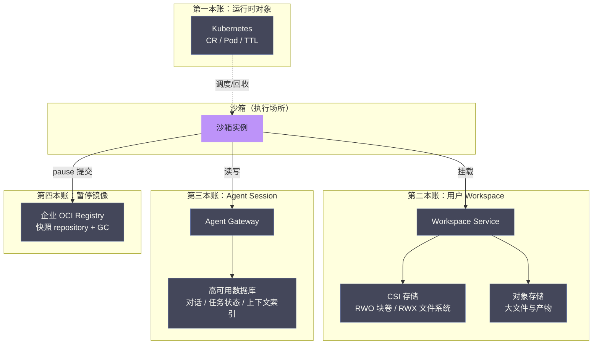

# 13 Agent 状态与存储——六类状态的正确拆分

**摘要：**

沙箱平台跑通之后，最容易被低估的生产化问题是**状态**：Agent 运行过程中产生的大量"数据"（进程内存、可写层、工作目录、Agent 自家库、会话、大制品）应该由谁存储、活多久、放哪里？素材 Phase5-07/12 与 Phase7-01 的调研给出了本专栏最重要的一个架构结论：**Agent 状态必须按"寿命与权威"拆分，任何"一把梭"的存储方案都会在规模化时崩塌**。文章首先给出六类状态的全景与分类判据（寿命从毫秒到永久）；然后深入"四本账"模型（运行时对象归 Kubernetes+TTL、用户 Workspace 归平台 Workspace Service+CSI、Agent Session 归 Agent Gateway/DB、暂停镜像归企业 Registry）——并解释为什么"同一个状态名下面是不同机器"（rootfs 快照 ≠ 内存 checkpoint ≠ 会话恢复）；随后给出每类状态的存储选型（RWO/RWX/对象存储三档——Ceph 三件套的完整对照）与一致性语义（运行态最终一致、账务态强一致）；再划清沙箱集群的职责边界与 P0 五项验证清单；最后用 2026 年可核实的公开资料复核整套模型（快照目录 PostgreSQL 化、会话状态服务、内存快照生产化、SIG 持久卷标准）。核心认知：**状态设计的本质是"给每类数据找到正确的寿命与权威归属"——把状态放错地方（如把会话存进沙箱可写层），等于把"架构决策"推迟成"事故决策"**。

---

## 第 1 章 状态的本质：六类状态与寿命

Agent 的状态到底有多少种？这个问题在沙箱平台跑通之后才真正变得要命——PoC 阶段一切状态都堆在沙箱里，删掉沙箱一切归零，"能跑"但"留不下"；一旦走上生产，进程内存、可写层、工作目录、Agent 自家库、会话、大制品这六类数据开始各说各话：寿命从毫秒到永久，权威从沙箱到平台各异。把它们一视同仁地塞进同一种存储会怎样？本章先给出六类状态的全景与判据，再回答这个反事实问题。素材 Phase5-12 的答案成为本专栏状态设计的出发点，就在于先把"状态"这个笼统的词拆成六个可以分别决策的对象——**拆开之前谈存储选型，都只是在不同口径之间打转**。

### 1.1 六类状态全景

素材 Phase5-12 把 Agent 运行中涉及的状态归为六类，每类的"寿命"与"权威"完全不同：

| # | 状态 | 内容 | 典型寿命 | 权威归属 |
| :--- | :--- | :--- | :--- | :--- |
| **1** | 进程内存 | 模型上下文、运行中变量 | 毫秒-分钟（随进程） | 无（不持久化） |
| **2** | 沙箱可写层 | 容器写层（临时文件/安装的包） | 分钟-小时（随沙箱） | 沙箱（随删随走） |
| **3** | 工作目录 | 用户代码、任务中间产物 | 小时-天（随任务） | Workspace 服务 |
| **4** | Agent 自家库 | Agent 配置、长期记忆、插件索引 | 天-月（跨会话） | Agent 平台 |
| **5** | 会话权威 | 对话记录、任务状态、上下文索引 | 天-月（跨沙箱） | Agent Gateway/DB |
| **6** | 大制品 | 数据集、模型文件、输出产物 | 月-永久 | 对象存储 |

这六类状态像厨房里六种保质期各异的食材：时蔬当日必须吃完，冻肉可以放半年，调料几乎不过期——把它们都塞进同一个冰箱，就会被最短保质期的那一格绑架：要么为了让时蔬保鲜而天天翻动整个冰箱，要么为了让调料不出味而让时蔬跟着变质。状态拆分要做的，就是先承认"它们的保质期和存放权根本不同"，再为每一格配独立的冷藏逻辑。

**六类状态的三个特征**：

**特征一：寿命跨度巨大**（毫秒到永久）——**"统一存储"在寿命维度上不可能**（永久数据放沙箱可写层 = 沙箱删除即丢失；临时数据放对象存储 = 存储成本爆炸）。这个特征最容易被"先跑通"的心态掩盖：PoC 里所有数据都活不过一次演示，寿命差异根本不显现；一旦开始接真实任务，三天前的会话、两个月的模型文件、随时会删的临时包开始争夺同一个存储的处置权，唯一的出路就是拆开。反例在社区里比比皆是：把 Agent 的长期记忆写进沙箱可写层的团队，无一例外在"沙箱被回收、记忆跟着消失"的事故里回头重做——**寿命判据的第一问是"数据没了行不行"，第二问才是"数据多久没一次"**。

**特征二：权威各不相同**——每类状态有一个"权威所有者"（谁负责它的读写与一致），**权威与物理位置分离是常态**（会话权威在 DB，但会话的"临时视图"在沙箱内）。权威维度的要点在于"谁说了算"：会话以 Agent Gateway/DB 为准、沙箱里那份只是副本，工作目录以 Workspace 服务为准、挂载进沙箱只是临时借用。权威与位置分离意味着**同一份逻辑状态可以同时存在于多个物理位置，但只有一个位置对"一致性"负责**——这是后面 5.3 节一致性语义的伏笔。

**特征三：最容易混淆的是 3/4/5**——工作目录（任务产物）、Agent 库（Agent 自己的）、会话（对话与任务状态）——**三者的寿命与权威都不同，混在一起是状态事故的头号根源**。三者混淆的典型形态：把会话记录以 JSON 文件形式写进工作目录（对话被当成任务产物管理，任务一归档对话就"失联"）；把 Agent 记忆塞进会话表（记忆跨 Agent 共享时找不到归属）；把 Agent 配置写进镜像（改配置就要重建镜像）。**判定口诀：跟着"谁用、多久、以什么形态"走——Agent 用、跨会话、结构化 → 自家库；任务用、随任务、文件化 → 工作目录；对话用、跨沙箱、强一致 → 会话权威**。

### 1.2 状态的访问模式：读写频率与一致性需求

除"寿命 × 权威"外，第三个分组维度是**访问模式（Access Pattern）**——六类状态的读写特征差异巨大：

| 状态 | 读写频率 | 一致性需求 | 访问路径 |
| :--- | :--- | :--- | :--- |
| 进程内存 | 极高（每 token 推理） | 严格（进程内） | 进程本地 |
| 沙箱可写层 | 高（包安装/临时文件） | 宽松（丢了无所谓） | 沙箱本地 |
| 工作目录 | 中（任务读写） | 中（任务内一致） | CSI 挂载 |
| Agent 自家库 | 低（启动/记忆加载） | 高（跨会话一致） | PVC/DB |
| 会话权威 | 中高（每次对话读写） | 严格（对话不丢不乱） | DB 事务 |
| 大制品 | 极低（写入一次、读 N 次） | 宽松（不可变为主） | 对象存储 |

**访问模式对选型的影响**：**"高频 + 严格一致"的状态必须靠近计算**（进程内存/会话 DB），**"低频 + 宽松"的状态可以远离**（大制品归档）——**把高频状态放远端存储（如会话走对象存储）是性能事故的根源；把低频状态放本地（如大制品进可写层）是容量事故的根源**。

访问模式还引出一个工程上很有用的中间概念——**数据温度**：热的（每轮推理都读写）进内存，温的（每任务读写）进挂载卷，冷的（写入一次、偶尔读）进对象存储。温度不是固定属性，同一份数据在不同阶段会降温：任务刚结束的工作目录是温的，归档三个月后变成冷的，对应的存储也应随之迁移——**"降温归档"应当是一条自动路径，而不是人工决定**，否则冷数据会常年占着热存储。

### 1.3 状态的演进：从单体到四本账的必然

状态拆分不是"理论洁癖"——它是平台演进的必然（素材的实践轨迹）：

```
阶段一（PoC）：状态全在沙箱里
  - 会话/文件/产物都在沙箱可写层
  - 沙箱一删，一切归零 → "能跑"但"什么也留不下"

阶段二（测试集群）：状态开始外置
  - Workspace 独立（挂载卷）
  - 会话进 Agent 平台（Gateway/DB）
  - 快照进 Registry → "四本账"的雏形

阶段三（生产）：状态治理
  - TTL/配额/GC/审计覆盖所有账本
  - 一致性需求显式化 → 四本账的完整形态
```

**演进动因**：**每个阶段都是上一个阶段的"丢数据事故"推动的**——PoC 丢一次会话、集群丢一次产物，就催生了外置与治理。**"先跑通再拆分"是合理的工程顺序，但"拆分"是必然终点——不要在 PoC 的"全在沙箱"里待太久**。这个顺序的反面同样值得警惕：在 PoC 阶段就全面铺开 TTL、配额、审计，治理成本会压垮验证本身——**演进节奏与成熟度匹配，才是"拆分的必然"成立的前提**。

### 1.4 为什么必须拆分：单一存储的失败模式

"把所有状态放一个地方"的失败模式（素材推演 + 业界教训）：

| 单一存储方案 | 失败模式 |
| :--- | :--- |
| **全放沙箱可写层** | 沙箱删除 → 会话/产物全丢；沙箱重建 → 状态不可恢复 |
| **全放工作目录** | 会话状态（对话）不是文件——强行文件化导致语义丢失 |
| **全放对象存储** | 每次读写走网络——性能灾难；临时数据永久化——成本灾难 |
| **全放数据库** | 大制品（GB 级）进 DB——DB 爆炸；沙箱内高频小写——DB 成为瓶颈 |

**拆分的判断标准**：**"寿命 × 权威 × 访问模式"三维分组**——寿命相近、权威相同、访问模式相似的数据放一起，否则拆开。**素材的"四本账"（第 2 章）就是按这个标准对六类状态做的第一层归并**。

四条失败模式的机制各有各的"爆点"，笔者逐一拆开看。全放对象存储的性能灾难不是一句抽象的"慢"，而是具体的三笔账：每次读写都经过网络往返（沙箱内毫秒级的内存访问变成跨网络的十毫秒到百毫秒级）；小对象（几 KB 的会话片段、临时文件）在对象存储上有显著的 PUT/GET 固定开销；对象存储没有 POSIX 语义（3.3 节详述），高频小写还得自己在应用层维护"写回缓存"，等于把一致性难题从存储层搬回应用层。全放数据库的瓶颈同样具体：GB 级大制品进 DB 撑爆单表与备份，而沙箱内的高频小写（每轮对话写一次状态）让 DB 成为串行瓶颈——**两种方向失败在不同端：前者死在容量，后者死在时延**。全放可写层与全放工作目录则死得最隐蔽：它们不是"性能崩"，而是"语义丢"——对话不是文件，把它序列化成文件的那一刻，索引、版本、并发合并这些"对话该有的能力"就全没了。

### 1.5 状态分类的判据：三维向量与决策顺序

把前四节的讨论收敛成可执行的方法，就是本节要给的**分类判据**。每个状态对象可以用一个三维向量刻画：**（寿命、权威、访问模式）**。拆分决策不是同时看三个维度，而是有固定顺序：

| 决策步骤 | 要回答的问题 | 得到的结论 |
| :--- | :--- | :--- |
| **第一问：权威** | 谁拥有这份数据、对一致性负责？ | 决定"账本"归属（归哪个服务管） |
| **第二问：寿命** | 该活多久？谁负责回收？ | 决定 TTL/归档/销毁策略 |
| **第三问：访问模式** | 怎么读写、多久读写一次？ | 决定存储语义（块/文件/对象/DB） |

为什么先权威后寿命再访问模式？因为权威决定"谁来做后面两个决策"——把决策权交给正确的所有者，寿命与访问模式才能得到持续维护；反过来先定存储再定归属，存储选型往往选错（譬如按"文件多"就把会话也塞进文件系统）。反例同样常见：只按寿命分组（把 Agent 记忆和会话都算"长期"放进同一个 DB），会忽略两者的权威不同（Agent 平台 vs Agent Gateway），跨系统耦合由此而生；只按访问模式分组（把工作目录和大制品都算"读多写少"），会忽略两者的寿命差异，归档策略互相污染。**判据的价值不在"标新"，而在把隐式的口径显式化——架构评审逐类过一遍三维度，比争论"状态算文件还是记录"高效得多**。

---

## 第 2 章 四本账模型

### 2.1 四本账详解

素材 Phase5-07 的"状态四本账"——六类状态归并为四本账（各自的账本、存储、寿命）：

| 账本 | 包含状态 | 存储 | 寿命 | 权威 |
| :--- | :--- | :--- | :--- | :--- |
| **一：运行时对象** | 沙箱 CR/Pod/容器/IP/TTL/RuntimeClass | Kubernetes + TTL 调度 | 分钟-小时 | 沙箱平台（Controller） |
| **二：用户 Workspace** | 工作目录、输入文件、产物 | 平台 Workspace Service + CSI（RWO/RWX） | 小时-天 | Workspace 服务 |
| **三：Agent Session** | 对话、任务状态、上下文索引 | Agent Gateway + 高可用 DB | 天-月 | Agent 平台 |
| **四：暂停镜像** | rootfs 快照（pause/resume 的产物） | 企业 OCI Registry | 天-月 | 平台（快照服务） |

**四本账的划分逻辑**：**"谁拥有、活多久、什么形态"三个维度各归一本**——K8s 对象归 K8s（平台管）、文件类归 Workspace（服务管）、对话类归 Session（Agent 平台管）、镜像类归 Registry（镜像供应链管）。

四本账像一间账房里的四本分账：流水账记当下（运行时对象）、库存账记物料（Workspace）、往来账记客户（Session）、固定资产账记厂房（暂停镜像）——把厂房的折旧记进流水账，月底结账必乱；把客户的赊欠记进库存账，对账时永远差一笔。值得一提的反例是"合并账本"的诱惑：有人建议把 Session 和暂停镜像合并成一本"Agent 状态账"，理由是两者都"跨沙箱存活"——但两者的形态（结构化记录 vs OCI 镜像）、消费方、治理机制（事务 vs GC）完全不同，合并只会让每笔操作都要兼容两套语义，复杂度不减反增。**账本划分的检验标准是"能否独立演进"：两本账需要同步变更才能工作，说明划错了；各改各的依然成立，说明划对了**。

### 2.2 pause 到底保存了什么：rootfs 语义的权威澄清

四本账中"暂停镜像"最容易误解——素材的原话结论：**"OpenSandbox pause 保存的是容器 rootfs 的 OCI 镜像，不是内存、不是对话、不是用户网盘"**。

| 用户以为的 pause | 实际的 pause |
| :--- | :--- |
| 虚拟机休眠（内存冻结） | rootfs 提交为 OCI 镜像 |
| resume 后会话继续 | resume 后**新 Pod + 新 execd**，进程/会话不恢复 |
| 网盘文件跟着走 | 网盘是 Workspace 的账（第二本），**不在快照里** |
| 打开的连接保持 | 连接全部断开 |

**"同一个状态名下面是不同机器"**（素材交付物-01 原话）——**产品语义与实现语义的落差是快照功能最大的产品化风险**：用户按"休眠/唤醒"理解 pause/resume，实现是"环境重建"——**文档与 UI 必须按"环境恢复"措辞，否则投诉与信任危机是必然的**（[[09 OpenSandbox 编排面——BatchSandbox、WarmPool 与快照]] 4.1 节）。

要理解"为什么实现只能是环境重建"，得先看清 rootfs 快照的机制。rootfs 提交本质上是把容器的可写层连同镜像基础层一起，按 OCI 规范打成一个新的镜像并推送进 Registry——这与 `docker commit` 属于同一族操作：快照的是"文件系统的最终形态"，不是"进程的运行瞬间"。进程内存快照（Checkpoint/Restore，典型实现是 CRIU）要冻结的是每个进程的内存映射、寄存器、文件描述符、信号状态，它要求内核配合暴露 `/proc` 下的进程细节，代价高、兼容性依赖应用配合（对照表见 [[09 OpenSandbox 编排面——BatchSandbox、WarmPool 与快照]] 4.6 节）。rootfs 方案绕开了这一切，换来的是"无论跑的是什么进程都能快照"的普适性，代价则是"快照不含运行现场"。这个取舍不是 OpenSandbox 一家独有，第 7 章会看到 E2B、Modal 在同一取舍上选择了不同的平衡点——**rootfs 快照是今天的基线，内存 checkpoint 是正在被商业化验证的明天**。

快照还有一层容易被忽略的一致性细节：**提交发生在容器仍在运行时**。镜像提交时刻的文件系统写入一致性，取决于容器进程是否在写相关路径——这与数据库快照的"冻结"（quiesce）问题同构：不冻结就有"快照到手的那一刻，文件可能写到一半"的窗口。OpenSandbox 官方文档也明言，image-committer 能直接读 containerd 里已停止容器的场景属于"尽力而为的运维恢复路径，不是受支持的持久性契约"——**对快照一致性的承诺必须写进 SLA，不能默认它等于数据库级的原子快照**。

### 2.3 快照与 Workspace 的关系：第四本账与第二本账的边界

快照（第四本账）与 Workspace（第二本账）都包含"文件"，边界容易混淆：

| 维度 | 快照（rootfs 镜像） | Workspace（工作目录） |
| :--- | :--- | :--- |
| **内容** | 整个 rootfs（系统+依赖+已装包） | 用户文件/代码/产物（不含系统） |
| **恢复** | 重建整个环境 | 挂载即用 |
| **成本** | 贵（完整镜像） | 便宜（按数据量） |
| **生命周期** | 显式快照操作 | 随任务（TTL/归档） |
| **典型用途** | 环境模板沉淀 | 日常任务工作区 |

**边界判断**：**"环境"归快照，"数据"归 Workspace**——装好的依赖、系统的状态是"环境"（快照）；用户代码、任务产物是"数据"（Workspace）。**实践中两者互补**：快照提供"环境重建"（省去重新装依赖），Workspace 提供"数据连续"（任务跨环境不丢文件）——**"快照 + Workspace"组合是环境与数据双恢复的完整方案**。

这条边界在真实任务里常有模糊地带，举两个反例。其一，"装了一半的依赖"算什么？pip 装到第 30 个包中断，这 30 个包在可写层里是"环境"还是"数据"？按"是否可复现"判：可复现（重新装一遍结果相同）是环境，不可复现（手工调过的配置、下载后被删的源包）是数据——前者随快照走，后者要进 Workspace。其二，pip/conda 的缓存目录放哪里？放可写层，沙箱删除后缓存全丢，下次任务重新下载；放 Workspace，缓存跨任务复用但占着工作区配额——**这是个真正的权衡，没有标准答案，但答案必须显式给出，而不是让缓存"恰好"落在哪个挂载点上决定**。

### 2.4 四本账的实施架构

把四本账落成架构图（素材 Phase7-01 会议结论 + 交付物-周会的综合）：



**架构的三个要点**：
1. **沙箱只挂三根线**：Workspace（文件）、Gateway（会话）、Registry（快照）——**沙箱是"消费方"，不是"持有方"**；
2. **四本账各自独立演进**：K8s 升级不影响 Workspace、DB 扩容不影响 Registry——**账本间无硬耦合**；
3. **沙箱可任意替换**：四本账外置后，"换一个沙箱实例"（重建/迁移/故障恢复）不丢任何数据——**状态外置是沙箱可替换性的前提**。

"各自独立演进"的另一面是**每本账的高可用语义各不相同**，不能一视同仁地讲"高可用"：第一本账的权威在 etcd（K8s 控制面自带多数派复制，沙箱平台只需要"别自己存一份 Pod 清单"）；第二本账的可用性取决于存储集群（Ceph/云盘自身的冗余）；第三本账依赖 DB 的主从与故障切换（会话写入必须落在事务日志里）；第四本账依赖 Registry 的复制与 GC。**"四本账"与"四种 HA 语义"是一一对应的——架构评审时逐本回答"这本账挂了会怎样、怎么恢复"，比笼统承诺"我们平台高可用"可靠得多**。反例恰是素材踩过的：第四本账的元数据存在 pod-local SQLite（GAP-003），Server 双副本却只有一份本地库，于是快照查询随机 404——**这是"共享状态≠副本数"的典型形态（[[15 生产化深水区——十个盲区与行业共识]] 盲区一），也是第 7 章 OpenSandbox 官方用 PostgreSQL 化直接回应的痛点**。

### 2.5 为什么"会话续接"必须靠第三本账

一个关键推论：**用户要的"会话续接"不能靠快照（第四本账），只能靠 Session（第三本账）+ Workspace（第二本账）的组合**：

```
会话续接的正确路径：
1. 沙箱 A 崩溃/删除
2. Session 账本：对话/任务状态/上下文索引完好（在 Agent Gateway/DB）
3. Workspace 账本：工作目录/产物完好（在 Workspace Service）
4. 创建沙箱 B（或从快照恢复环境）
5. Agent 在沙箱 B 中重新加载 Session + 挂载 Workspace
6. 用户感知：会话连续（对话在、文件在、环境重建）

错误路径（只靠快照）：
1. 沙箱 A pause → rootfs 镜像
2. resume → 新环境，但对话/任务状态不在（rootfs 没有对话）
3. 用户：会话没了 → 投诉
```

**"状态外置"（Session/Workspace 独立于沙箱）是会话连续性的唯一可靠实现**——**快照负责"环境"、Session 负责"对话"、Workspace 负责"文件"——三本账各司其职，缺一不可**。

会话续接的正确路径里还藏着两个工程细节。其一是**恢复的幂等性**：沙箱 B 加载 Session 的动作必须可重复执行——如果加载到一半进程崩溃，重试加载不能产生重复消息或重复任务状态（要求 Session 读取接口幂等或游标续读）。其二是**加载与挂载的时序**：先恢复 Session 再挂 Workspace 还是反过来，会影响 Agent 启动时能否立即读到工作区文件——实践上通常是"先挂载后加载"，让 Agent 启动脚本一开始就能访问工作目录。反例是"只外置 Workspace、不外置 Session"的中间态：文件在，对话丢，用户面对一堆文件却不知道任务进行到哪一步——**这是最接近"成功"的失败，因为它只差一本账**。

---

## 第 3 章 各状态的存储选型

### 3.1 六类状态的存储映射

素材 Phase5-12 与交付物-周会（Phase7-01）的存储需求与候选实现：

| 状态 | 候选存储 | 推荐 |
| :--- | :--- | :--- |
| 进程内存 | 无（不持久化） | — |
| 沙箱可写层 | 沙箱本地（Pod ephemeral） | 随沙箱，不治理 |
| 工作目录 | CSI RWO 块卷（单实例）/ RWX（多实例） | **Workspace Service 管理** |
| Agent 自家库 | 独立 PVC / 对象 / 数据库 | 按 Agent 适配 |
| 会话权威 | 高可用数据库 / Memory 服务 | **Session 服务独立部署** |
| 大制品 | S3 兼容对象存储 / 文件服务 | 对象存储 |

这张映射表可以看成 1.5 节判据的直接产物：六类状态各自过了"权威 → 寿命 → 访问模式"三问，落进不同的存储语义。映射的规则值得显式化——**"结构化的强一致记录进 DB，文件化的跨实例数据进文件系统，不可变的大块头进对象存储，绑定沙箱生命的临时物留本地"**——任何状态在这四条里找不到位置，先回头检查它是不是漏了权威归属。两张常被忽略的边界：Agent 自家库的"按 Agent 适配"意味着同一个平台上不同 Agent 的记忆形态可能不同，**存储选型应允许按 Agent 配置，而不是平台一刀切**；会话权威的"Memory 服务"是新兴候选（第 7 章 Letta 的实践），但无论用什么实现，**"独立于沙箱、独立于执行进程"这两条底线不变**。

### 3.2 工作目录：RWO vs RWX

工作目录是"文件类状态"的核心，RWO/RWX 的选择取决于访问模式：

| 维度 | RWO（块卷） | RWX（文件系统） |
| :--- | :--- | :--- |
| **挂载方式** | 单节点独占 | 多节点共享 |
| **适用** | 单实例 Agent 的工作目录 | 同一 Agent 多实例共享目录 |
| **性能** | 块设备直通（最佳） | 网络文件系统（有损耗） |
| **一致性** | 天然一致（单挂载） | 需要锁/协调（应用问题） |
| **Ceph 实现** | Ceph RBD | CephFS |

**"单实例用 RWO、多实例共享用 RWX"是基本盘**——但素材给出重要提醒：**"多实例共享 Workspace 用 RWX 或对象存储都可以，但 Session 粘滞和文件锁是应用问题"**——存储解决了"共享"的物理层，**"两个实例同时写一个文件"的应用层协调（锁/合并/冲突）是 Agent 平台自己的问题**（第 14 篇 的多租户与此同理：存储管隔离，应用管协作）。

RWO 与 RWX 的性能差不是玄学，而是两条 I/O 路径的机制差。RWO 块卷（Ceph 场景是 RBD）把块设备直接映射给单节点，读写走本地内核的设备栈，延迟接近裸盘；RWX 文件系统（CephFS）则要经过客户端内核模块与 MDS（元数据服务）的协商，目录操作和文件锁都多一跳网络，**"共享"的每一分收益都在为元数据与锁的协调买单**。反过来，RWO 的"单节点独占"在 K8s 里有硬约束：块卷通常不支持跨节点同时挂载，同一 PVC 被第二个 Pod 挂载会直接报错——**"单实例"不是一句建议，而是块卷的物理语义**。所以选型实际上是三选一：确定是单实例，用 RWO 拿最好性能；确定多实例共享，用 RWX 换共享能力；不确定，先按单实例设计（改 RWX 要换卷），把"多实例"当作显式需求而非假设。

### 3.3 大制品：对象存储的定位

大制品（数据集、模型文件、输出产物）的选型原则：

| 特征 | 对象存储（S3 兼容） | 文件系统（RWX） |
| :--- | :--- | :--- |
| 规模 | 无限扩展（EB 级） | 受集群存储限制 |
| 访问 | HTTP API（无 POSIX 语义） | POSIX（可直接读写） |
| 适用 | 大文件、产物、打包后的 Profile | 需要"目录即工作区"的场景 |
| 不适用 | **不天然等同 POSIX 工作目录**（素材原话） | 超大文件、冷数据 |

**"对象存储不天然等同 POSIX 工作目录"**是关键认知——很多团队把对象存储当"无限磁盘"用，结果应用到处是"下载→改→上传"的别扭代码。**正确定位：工作目录用文件系统（CSI），产物归档用对象存储——"工作"与"归档"分开**。

对象存储的语义边界值得细说。它提供的是对象级的读写接口：单个对象支持原子覆盖（PUT 整体替换），但不提供目录、不提供部分文件随机写、不提供文件锁——**"目录"在对象存储里只是 key 的前缀约定，不是真实结构**。一致性模型上，主流对象存储已普遍提供 read-after-write 强一致（2020 年后 AWS S3 明确宣布），但对于"先写 A 再写 B、读者要求看到 A 和 B 的同一版本"这类跨对象一致性，对象存储并不承诺——**这决定了"工作区"不能建立在对象存储上，而"归档集"可以**。容量侧，对象存储的扩展性（EB 级、按量付费）是文件系统比不了的，但代价是每次访问都走 HTTP——**把高频小读也塞进对象存储，等于让每次文件操作都付出网络往返**。定位一句话：**对象存储是"成果的仓库"，不是"工作的桌面"**。

### 3.4 Browser Profile 的特殊存储

GUI Agent（浏览器自动化）的 Profile 存储是状态设计的"特例"（素材交付物-周会的 Browser Profile 方案）：

| 方案 | 内容 | 优劣 |
| :--- | :--- | :--- |
| **加密对象包** | Profile（cookie/登录态/扩展）打包加密存对象存储 | 容量友好、可归档；**任务结束销毁**（安全） |
| **CSI 目录** | Profile 作为目录挂载 | 访问直接；容量随沙箱（不隔离） |

**素材的推荐**：加密对象包 + 任务结束销毁——**因为 Profile 含登录态（高敏感），"随任务销毁"比"持久保留"更安全**（登录态是凭据的一种，第 14 篇 的凭据治理同源）。**"特殊状态"的启示：状态设计的边界条件是安全敏感度——敏感状态宁可销毁不可久留**。

Profile 的特殊性在于它是"**凭据与状态的复合体**"：cookie、登录态、浏览器扩展共同描述了"一个已登录的浏览器"，它既是数据（需要被保存）又是凭据（一旦泄露可被冒用）。这决定了它的处理必须同时满足两组相反的需求——可复用（复用省去反复登录）与可销毁（泄露面随保留时长增长）。素材的"加密 + 任务结束销毁"正是这两组需求的平衡解。**安全敏感度应作为状态的第四维判据（与寿命、权威、访问模式并列）**：敏感状态先问"能不能不存"，再问"存多久"，最后才问"存哪里"——这个顺序与普通状态正好相反。

### 3.5 Ceph 三件套的完整对照

素材的 Ceph 选型（RWO 块卷 / RWX 文件系统 / 对象存储三件套）：

| 能力 | Ceph 组件 | 用途 | 素材判断 |
| :--- | :--- | :--- | :--- |
| **RWO 块卷** | RBD | 单实例工作目录 | ✅ 适合单实例挂载 |
| **RWX 文件系统** | CephFS | 多实例共享目录 | ✅ 适合多实例共享 |
| **对象存储** | RGW（S3 兼容） | 大文件、产物、Profile 打包 | ✅ 适合大文件与归档 |

**"一套 Ceph 三个语义"的价值**：存储层统一（一套集群），语义层分层（块/文件/对象各归其位）——**容量与运维统一，访问模式分离**。**选型提醒**：如果已有对象存储（如自建 MinIO/云 OSS），不必强上 Ceph RGW——**"对象存储已有就用已有的，块/文件按需补"比"全家桶"更务实**。

理解"一套 Ceph 三个语义"为什么成立，要看到 Ceph 的架构底色：它把一切数据都切成对象（RADOS）分布在 OSD 上，由 MON 维护集群状态，RBD、CephFS、RGW 是同一存储池之上的三种访问协议。**三种语义共享的是"分布与冗余"这份底子，差异的是"访问接口"这层皮**——这决定了两个工程结论：其一，三种语义的容量在同一池子里互相挤占，容量规划要算总账而不是三本独立账；其二，协议的成熟度不同（RBD 最老、RGW 次之、CephFS 的 MDS 是运维重点），**选型不只看"能不能提供语义"，还要看"团队的 Ceph 运维能力覆盖哪种协议"**。**三件套的"三"应当由需求凑齐，而不是由品牌凑齐**。

---

## 第 4 章 沙箱集群的职责边界

### 4.1 必须承担

沙箱集群**必须**承担的状态（它天然是最佳归属）：

| 状态 | 理由 |
| :--- | :--- |
| **运行时对象**（CR/Pod/容器） | 沙箱平台就是 K8s 的封装——CR/Pod 是平台的事实层 |
| **沙箱可写层** | 随沙箱创建/销毁的临时写层——生命周期与沙箱绑定 |
| **短期工作目录**（可选） | 任务级产物——RWO 挂载即可（不必须外置） |

"必须承担"的判据是**生命周期绑定**：状态的生命周期与沙箱实例严格重合（沙箱删它即删），且没有跨实例共享需求——这类状态外置是纯浪费。可写层是最干净的例子：包安装、临时文件的寿命就是沙箱的寿命，**给它配独立的持久化反而是负担**（多一层挂载、多一份配额、多一条 GC 路径）。运行时对象同理：CR/Pod 的事实层必须由 K8s 拥有，平台自己另存一份 Pod 清单反而是裂脑之源。

### 4.2 可以承担

沙箱集群**可以**承担但**要设计**的状态：

| 状态 | 承担方式 | 边界 |
| :--- | :--- | :--- |
| **工作目录（长期）** | Workspace Service + CSI | **Pod 不存在时也要可访问**（P0 验证项） |
| **Agent 自家库** | 独立 PVC（按 Agent 挂载） | 换沙箱实例时重新挂载 |

**"可以承担"的判别标准**：**状态能否在"沙箱实例消失"后存活**——能（存储独立于 Pod）就可以承担，不能（绑在 Pod 上）就必须外置。这个判别标准可以机制化成一句可执行的检验：**"删除 Pod，然后只通过平台 API 访问这份状态"——访问得通，算可以承担；访问不通，算必须外置**。两类的边界差异在于"谁提供访问"：工作目录由 Workspace Service 提供访问（Pod 只是挂载方），Agent 自家库由平台的数据服务提供访问（PVC 只是载体）——**承担方式的关键词是"由平台服务承载"，而不是"物理上还躺在某个卷里"**。

### 4.3 多实例共享的难点：存储之外的应用问题

素材明确提醒：**"多实例共享 Workspace 用 RWX 或对象存储都可以，但 Session 粘滞和文件锁是应用问题"**——存储解决了"物理共享"，应用层还有三个难点：

| 难点 | 内容 | 解法方向 |
| :--- | :--- | :--- |
| **Session 粘滞** | 同一会话的路由必须连续（第 5 个 P0 验证项） | 会话级路由表（Gateway 维护） |
| **文件锁** | 两实例同时写同一文件 | 应用层锁/版本合并（Agent 适配） |
| **并发冲突** | 多实例的中间状态互相覆盖 | 工作区版本化（Git 类语义） |

**"存储管物理、应用管协作"的边界**：平台提供"共享的能力"（RWX/对象），**"共享的正确性"（锁/粘滞/冲突）是 Agent 平台与 Agent 适配的责任**——**把并发正确性推给存储层（幻想"存储自动解决"）是状态设计的常见误判**。

三个难点里，Session 粘滞最容易被"共享存储"误导：以为工作目录共享了，多个实例就能同时服务一个会话——但会话的"连续性"依赖路由（同一会话的请求要落到同一实例），存储共享解决不了"下次请求找谁"的问题。文件锁则是最典型的"存储无法代劳"：RWX 提供的锁是"底层的、临时的"，不解决"两个 Agent 各改了一版文件怎么合并"的业务语义。**解法方向上的共同点是"把协调放到 Agent 平台层"**：路由表归 Gateway，版本语义归工作区服务（Git 类），锁与冲突策略归 Agent 适配层。

### 4.4 状态职责矩阵总表

把第 4 章的三个"承担"整合为一张职责矩阵（可直接用于架构评审）：

| 状态 | 沙箱集群职责 | 外部系统职责 | 决策依据 |
| :--- | :--- | :--- | :--- |
| 运行时对象 | **必须承担**（事实层） | — | 平台即 K8s 封装 |
| 可写层 | **必须承担**（随沙箱） | — | 生命周期绑定 |
| 短期工作目录 | 可以承担（RWO 挂载） | — | 任务级即可 |
| 长期工作目录 | 提供挂载能力 | **Workspace Service 管生命周期** | 独立于 Pod（P0-2） |
| Agent 自家库 | 提供 PVC | Agent 平台管数据 | 跨实例（P0-1） |
| 会话权威 | **绝不该承担** | Agent Gateway/DB | 非文件、跨沙箱（P0-4） |
| 大制品 | **绝不该承担** | 对象存储 | 容量与寿命（EB 级） |
| Browser Profile | 提供运行载体 | 加密对象包 + 任务销毁 | 敏感度（3.4 节） |

**矩阵的使用**：任何"把状态放沙箱"的架构提议，先查矩阵——**"绝不该承担"栏的状态进沙箱 = 架构评审直接打回**。矩阵还有一个隐含用途：**它同时是租户边界的初稿**——每行"外部系统职责"里的服务，就是该状态的租户隔离实施点（目录、会话、桶各自按租户隔离），**职责边界画在哪，租户隔离就做在哪**——这与第 14 篇 的多租户三道门禁是同一张图的两种画法。

### 4.5 绝不该承担

沙箱集群**绝不该**承担的状态（素材的明确结论）：

| 状态 | 不该承担的理由 | 正确归属 |
| :--- | :--- | :--- |
| **会话权威** | 会话是"对话+任务状态"——不是文件，沙箱管不了语义；且会话必须跨沙箱（沙箱只是执行载体） | Agent Gateway/DB |
| **大制品归档** | 沙箱存储容量有限（imagefs 400GiB 量级）——数据集/模型是 EB 级问题 | 对象存储 |
| **用户主存储** | "用户网盘"是产品级资产——不能随沙箱生命周期起伏 | Workspace 服务 |

**边界判断的一句话**：**"沙箱是执行场所，不是数据家园"**——所有"用户会在意它消失"的数据，都不该只存在于沙箱里。

**边界判断的最终检验**：问自己一个问题——"**如果这个沙箱下一秒被删除，用户会损失什么？**"——损失为"环境与临时文件"是正常的（可重建）；损失为"对话/产物/配置"就是状态设计错了（本应外置）。**这个问题的答案，就是状态设计的验收标准**。

"绝不该承担"的三类各自触犯了不同的原则：会话权威犯的是**语义错位**（沙箱只有文件语义，管不了对话的索引、版本与并发）；大制品犯的是**容量错位**（沙箱存储是给运行用的 400GiB 量级，数据集是 EB 级问题）；用户主存储犯的是**生命周期错位**（产品级资产的生命周期应以用户为单位，而不是以沙箱为单位）。**三类错位合起来，就是"沙箱不是数据家园"的全部含义**——把检验问题反过来用，还能当事故复盘工具：缺了哪本账，修复点就在哪。

---

## 第 5 章 状态的生命周期管理

### 5.1 TTL 与回收：第一本账的治理

运行时对象（第一本账）的生命周期治理：

| 机制 | 内容 | 素材实践 |
| :--- | :--- | :--- |
| **TTL** | 沙箱到期自动回收 | TTL 过期验证（脚本 11） |
| **配额** | 租户/用户的沙箱上限 | Gate 6 验收 |
| **回收验证** | 删除后残留检查 | "残留 0"纪律（三层查询） |
| **僵尸防护** | 保活进程的 TTL 兜底 | 业务探活 + TTL 双保险 |

**"残留 0"与 TTL 的关系**：TTL 防"忘记删"，残留检查防"删不干净"——**一个是预防，一个是检测，两者都需要**（第 10 篇 的运维节奏）。

TTL 的机制要点在于**"谁执行、以什么为准"**：K8s 原生的 TTL 控制器按创建时间计时，而沙箱平台的 TTL 往往要结合业务语义（"任务结束后的保留窗口"而非"创建后的固定时长"）——素材的"业务探活 + TTL 双保险"正是这个组合：探活决定"该不该还活着"，TTL 兜底"探活失灵也不会永活"。**TTL 是给"忘记"上的保险，不是给"该不该活"下的结论**。配额则与 TTL 互补：TTL 管"单个沙箱活多久"，配额管"一个租户能同时活几个"——前者管时间，后者管并发，缺一个都会让第一本账失控。反例是"只 TTL 不配额"：沙箱各自按时回收，但租户可以无限并发创建，节点资源被瞬时的创建洪峰打穿。

### 5.2 快照的容量治理：第四本账的账单

暂停镜像（第四本账）的容量问题（GAP-004 的完整影响）：

| 问题 | 表现 | 治理 |
| :--- | :--- | :--- |
| **blob 不回收** | 删除 Snapshot 不回收 Registry blob | 自建 GC 任务（对比 Snapshot 记录与 Registry blob） |
| **每快照一份 rootfs** | 快照 = 完整镜像（2.6GB 级） | 快照数量配额 + 寿命限制 |
| **多版本膨胀** | 反复 pause 产生多版本 | 每沙箱一份（OSEP-0008 约束）+ 覆盖策略 |

**快照容量公式**（第 12 篇的延伸）：**快照存储 = 快照数 × rootfs 大小**——2.6GB 镜像 × 100 快照 = 260GB——**"快照是贵操作"必须在配额与寿命上显式表达**。

blob 不回收的机制要看到 Registry 的存储模型才能根治：OCI Registry 的镜像由分层 blob 组成，blob 是**内容寻址（Content-Addressable）**的——同名同内容的 blob 只有一份，被多个镜像共享引用。删除一个快照记录，Registry 并不知道它引用的 blob 是否还被别的镜像引用，于是默认不删——**GC 的本质是"引用计数 + 无人引用的孤儿回收"**，而 OpenSandbox 当时缺的正是这条对账路径（GAP-004）。自建 GC 任务因此不是"清理小助手"，而是**第四本账的"对账机制"**：它把"记录层"与"存储层"拉齐，多出来的 blob 就是孤儿，可以安全回收。**任何"删除即回收"的直觉在内容寻址存储面前都不成立**——删除只是删了引用，物理空间的回收永远需要一次显式的对账。

### 5.3 状态一致性的边界：最终一致还是强一致

四本账分属不同系统，跨账本的一致性需求必须明确定义：

| 跨账本场景 | 一致性需求 | 实现 |
| :--- | :--- | :--- |
| 沙箱删除 + Workspace 保留 | **最终一致**（删除异步，Workspace 不随删） | 解耦生命周期（P0 验证项 2） |
| Session 更新 + 沙箱执行 | **最终一致**（执行结果异步回写 Session） | 事件流（Agent 适配） |
| 快照创建 + Registry 推送 | **强一致**（快照记录必须对应真实镜像） | 事务（先推送后记录） |
| 配额扣减 + 沙箱创建 | 强一致（超配额不能创建） | 平台控制面事务 |

**"不是所有状态都要强一致"**是状态设计的成熟标志——**运行态可以最终一致（沙箱删了 Workspace 慢慢归档），账务态必须强一致（配额/快照记录）**——**把一致性需求写进设计（而非默认最强），是避免过度工程与事故的双重保障**。

跨账本一致性落到实现，有三件具体的工具。其一是**幂等（Idempotent）**——跨账本的异步操作（执行结果回写 Session）在重试时必须不产生重复副作用，这是最终一致能成立的底线。其二是 **Outbox 模式**——Session 的写操作与"发布事件"打包进同一个本地事务，先落库再异步发布，避免"状态更新了、事件丢了"的裂口。其三是 **CAS（Compare-And-Swap）**——快照记录的终态写入用条件更新（"仅当当前状态仍为 Creating 时才写 Succeed"），两个并发操作只有一个人能成功——第 7 章会看到 OpenSandbox 官方正是用同样思路实现了双副本 Server 的并发快照协调。**三种工具的共性是"用记录层的机制保证跨系统的一致性"，而不是"相信各系统最终会自己对齐"**。

### 5.4 删除证据链：所有账本的审计底线

状态删除的审计（素材 Phase5-10 的"对象删除证据链"盲区）：

| 证据 | 内容 | 缺失的后果 |
| :--- | :--- | :--- |
| **删除前** | Event/request_id/sandbox_id 打到外部日志 | 删错了无法追溯 |
| **删除中** | 删除请求的完整记录 | 无法回答"谁删的、为什么删" |
| **删除后** | 残留检查结果归档 | 无法证明"删干净了" |

**"删除证据链"与 第 07 篇 的 202 语义是同一纪律的两面**：**HTTP 码不代表终态，删除完成要有证据**——**所有账本的删除都要有"证据链"意识**（Diagnostics API 未实现（GAP-001）时，外部日志是唯一路径）。

证据链的工程要点是**"证据要外置"**：平台自身的日志会随组件一起消失，删除证据必须打到平台之外，否则"最需要证据"的时刻恰是"证据和平台一起没了"的时刻。**删除证据链的本质是把"删除"也当成一次需要留痕的状态变更**——它有三个时间点（前/中/后），每个时间点留什么字段要预先定好（request_id 贯穿、sandbox_id 关联、残留归档）。**证据链与审计的关系：证据链解决"删得对不对、删得干不干净"，审计解决"谁删的、为什么删"——前者是后者的原料**。

---

## 第 6 章 下一阶段验证清单

### 6.1 P0 五项

素材 Phase7-01 会议结论的下一阶段验证清单（P0 五项）——**状态设计是否正确，用这五项实验验证**：

| P0 验证项 | 内容 | 验证的状态设计 |
| :--- | :--- | :--- |
| **1. Pod 删除/重建后内部状态保留** | Agent 进程消失后，其配置/记忆/索引是否还在 | Agent 自家库（第四类）的外置性 |
| **2. Pod 不存在时 Workspace 可访问** | 沙箱删了，工作目录还能 list/upload/download | Workspace（第二本账）的独立性 |
| **3. 同一 Agent 两个实例共享 Workspace** | 双实例并发挂载同一目录的行为 | RWX 选型 + 文件锁的应用问题 |
| **4. 同一会话跨实例路由连续** | 会话在沙箱 A 开始、沙箱 B 继续 | Session（第三本账）的路由粘滞 |
| **5. 主 Agent 经 MCP 创建子沙箱并回收** | 子沙箱链路的完整闭环 | 子沙箱的生命周期（第 11 篇） |

**五项验证的共性**：**全部验证"状态是否独立于沙箱实例"**——这是四本账模型的实验检验。**任何一项不过，对应的状态设计就要回炉**。

五项验证还有一个共同的方法论特征：**每项都只有一个被检验变量**——P0-1 只变"Pod 是否存在"，P0-2 只变"沙箱是否删除"，P0-3 只变"实例数量"——其余条件全部固定。这保证了"不过"能直接归因到某一本账的缺陷，而不是混在一堆变更里无法定位。反例是"验收大杂烩"：把五项捏成一个端到端演练，跑通了皆大欢喜，跑挂了只能知道"某个环节有问题"——**验证清单的意义恰恰在于把"整体能不能跑"拆成"每本账能不能独立活"**。

### 6.2 验证的工程安排

五项 P0 验证的实施安排（素材 Phase7 的后续计划推演）：

| 验证项 | 前置条件 | 验证方法 |
| :--- | :--- | :--- |
| P0-1（状态保留） | Agent 库外置完成 | 建 Agent → 删 Pod → 重建 → 查状态 |
| P0-2（Workspace 独立） | Workspace Service 就绪 | 删沙箱 → list/upload/download Workspace |
| P0-3（多实例共享） | RWX 存储就绪 | 双实例同时挂载 → 并发读写观察 |
| P0-4（会话路由） | Gateway 会话表就绪 | 会话 A 沙箱 → 切 B 沙箱 → 验证连续 |
| P0-5（子沙箱回收） | MCP 链路就绪 | 父 Agent 建子沙箱 → 执行 → 回收 → 残留 0 |

**验证的编排原则**：**五项有依赖序**（1/2 是基础，3/4 依赖 1/2，5 相对独立）——**按依赖序分批验证，每批完成后更新状态设计文档**。

"验证不是确认设计，而是修正设计"这句要落实，需要给每项验证预先写好**通过/失败的判定标准**——P0-1 的"状态保留"保留到什么程度算通过？P0-4 的"会话连续"从用户视角观察到什么现象算连续？**判定标准先行，验证才不会退化成"演示成功"**。验证结论的回写也值得约定：每项结束后把"过/不过/边界条件"追加进四本账模型文档，同时更新差距台账——**验证的价值一半在结果，一半在"结果进入了文档"**。

### 6.3 P1 项

| P1 验证项 | 内容 |
| :--- | :--- |
| Agent 异常退出后的恢复语义 | 崩溃后状态的一致性 |
| Snapshot 能恢复什么、不能恢复什么 | 快照边界的用户可见化 |
| DomeOS 可观测注入方式 | 观测体系的接入 |
| Agent 协议适配 | 第 5 层的扩展 |

**P0/P1 的排序逻辑**：P0 是"状态设计正确性"（不过则架构回炉），P1 是"体验与运维完善"（过则锦上添花）——**先正确，再完善**。这个排序的工程逻辑是：**正确性问题的代价是架构级返工（数据归属错了要迁移、要重建），完善性问题的代价是体验级修补——修复成本差一个数量级，优先级自然差一个数量级**。P1 里"Snapshot 能恢复什么"的验证尤其值得提前做：它不改变设计，但直接决定文档怎么写、预期怎么管——**快照边界的用户可见化，是 2.2 节"环境恢复措辞"的验证闭环**。

---

## 第 7 章 2026 年的行业状态存储实践：四本账的复核与演进

前面六章的四本账模型来自素材调研，其价值最终要靠行业实践来复核——好在本章写作时，2025-2026 年间的公开资料已经足够给出明确的对照：OpenSandbox 的快照目录 PostgreSQL 化、Letta 与 LangGraph 的会话状态服务、E2B 与 Modal 的快照产品、SIG 的持久卷标准，都有官方文档可查。**这些实践没有推翻四本账，而是从不同角度验证了它的每一条边界——把行业实践当作"对账的第三方证据"，是复核这套模型最省力的方式**。

### 7.1 快照目录的 PostgreSQL 化：GAP-003 的官方解法

先看与本文关系最直接的一条：OpenSandbox 官方文档（Snapshot Store Migration Guide，feature #1653）给出了快照目录（Snapshot Catalog）的可配置方案——**默认仍是本地 SQLite，但 PostgreSQL 已成为面向外部持久化的正式选项**。`[store]` 配置节里 `type = "sqlite"` 与 `type = "postgresql"` 二选一，生产环境用 `OPENSANDBOX_STORE_POSTGRESQL_DSN` 注入连接串；从 SQLite 切到 PostgreSQL 不会自动迁移旧记录，官方提供了 `opensandbox-server migrate-snapshots` 命令做显式迁移，命令支持 `--dry-run` 预览且可重复执行。

这个变化的分量要从本文的视角看：**素材踩过的 GAP-003（快照元数据 pod-local SQLite，Server 双副本下快照查询随机 404）被官方用"元数据账本集中化"正面回应了**。更值得细读的是官方对"多副本"语义的谨慎限定——文档原话的要点有三条：其一，**SQLite 部署保持单进程恢复语义，不构成通用多活保证**；其二，PostgreSQL + Kubernetes 组合下，支持两个 Server 副本协调"公共快照"的创建/恢复/删除，但**这不等同于控制面横向扩展，通用负载均衡的 HA 仍未承诺**；其三，两副本协调不靠租约与选主，而是靠两条既有不变量——**SandboxSnapshot CR 的确定性命名 + Kubernetes API 本身是串行化的可观察存储**：先观察后创建（确定性 CR 名让并发创建收敛为 409 并视为成功）、终态写入用 CAS（两副本同时写终态，条件更新保证只有一个生效）、崩溃副本遗留的非终态行由存活副本周期扫描接管（默认 15 秒）。

这条设计至少印证了本文两个论点。第一，"**共享状态≠副本数**"（[[15 生产化深水区——十个盲区与行业共识]] 盲区一）不是素材独有的教训，而是官方在存储层亲口承认的边界：**副本数是否等于高可用，取决于状态是否可共享**；官方用 PostgreSQL 换来的不是"更多副本"，而是"副本之间可以共享同一份元数据"。第二，5.3 节说的"用记录层机制保证跨系统一致性"在这里落地为**"确定性命名 + CAS + 周期扫描"三件套**——没有分布式锁、没有选主，只有"谁先到谁生效、冲突按 409 吸收、失败可扫描接管"。笔者注意到官方文档还保留了一句清醒的边界：**这个多活语义不提供跨 PostgreSQL、Kubernetes 与镜像仓库三者的 exactly-once 保证**——快照的"创建记录、提交镜像、推送 Registry"仍然是三个独立步骤，端到端的强一致仍需业务层兜底（与本文 2.2 节"快照一致性承诺要写进 SLA"的提醒一致）。

### 7.2 会话状态服务的公开实践：Letta 与 LangGraph

四本账的第三本（Agent Session：对话、任务状态、上下文索引）在 2025-2026 年有了两个可核实的行业范本——Letta 与 LangGraph 都把"会话状态"做成了**独立于执行进程的持久化服务**。

Letta 的核心抽象是 **Memory Blocks**：把 Agent 的上下文窗口拆成带标签、带大小上限的结构化块（persona/human/knowledge/scratchpad 等），每个块持久化在数据库里、有唯一的 block_id，Agent 可以通过内置工具自行读写——块的当前值在每次请求时被编译进上下文窗口。AWS 官方博客（"How Letta builds production-ready AI agents with Amazon Aurora PostgreSQL"）进一步披露了生产形态：**Letta 把记忆、工具、消息全部持久化在 PostgreSQL 的规范化表里，支持跨 Agent 查询、跨模型供应商迁移状态，并可在用户 VPC 内自托管**。

LangGraph 的 **Checkpointer** 则是框架层的对应物：它把图的运行时状态按"超级步（super-step）"打成检查点（Checkpoint），按 thread_id 组织成线程，支持人工介入、时间旅行回放与故障续跑；官方文档明确区分了后端——**SQLite 只适合演示与轻量项目，生产推荐 PostgresSaver，且 Agent Server 默认在 PostgreSQL 上持久化**。这条"SQLite 演示、PostgreSQL 生产"的阶梯与 OpenSandbox 的 `[store]` 演进方向一致：**会话状态的元数据账本，业界共识是从本地文件库走向集中式数据库**——因为只有集中式数据库能同时满足"跨进程存活"与"多副本共享"两个生产要求（对应 P0-1/P0-4）。

对四本账的复核意义在于：**"会话归 Session 服务、不归沙箱"这条边界被两个独立生态同时验证**——Letta 与 LangGraph 都把会话状态的读写放在执行进程之外。反例依然存在：把会话状态交给"进程内存 + 本地文件"的轻量方案，单 Agent 演示时毫无问题，一旦并发、多实例、故障恢复同时出现，就同时踩中"状态随进程消失"与"状态无法多副本共享"两个坑。

### 7.3 沙箱快照的生产案例：E2B 与 Modal

四本账的第四本（暂停镜像）与"快照到底存什么"在 2026 年有了比 rootfs 更丰富的生产形态——E2B 与 Modal 把快照做成了面向用户的产品能力，它们的取舍恰好补全了 2.2 节"rootfs 快照 ≠ 内存 checkpoint"的光谱。

E2B 的快照文档公开了三件事。其一，**快照默认同时包含文件系统与内存**：创建快照时沙箱会短暂暂停（期间 WebSocket/PTY/命令流等连接全部断开，客户端需处理重连），快照完成后原沙箱继续运行，快照可用来生成任意多个新沙箱（one-to-many）——这与 OpenSandbox pause/resume 的 one-to-one 语义形成对照：**"暂停"是同一沙箱的挂起恢复，"快照"是状态的分叉复制**。其二，E2B 提供了 `mode: 'filesystem'` 的文件系统专属快照：不存内存，恢复时从磁盘冷启动（RAM 与运行中进程不保留），换取"更小、更快、原沙箱不中断"——**这等于在"内存快照（全量）"与"rootfs 快照（文件系统）"之间开了一档可选的中间档**。有趣的是 E2B 的暂停沙箱"无限期保留、无 TTL、不会被自动删除"——这与 5.2 节"快照是贵操作、必须配额治理"的素材结论形成张力：**托管平台可以靠快照分级承担这份成本，自建平台则需要靠配额与 GC 显式管理**——两条路没有对错，但都要写进容量模型。

Modal 则把内存快照做成了降低冷启动的核心卖点。官方文档明言其内存快照基于 CRIU 技术，但**出于安全原因运行在 gVisor（runsc）之上，用的是 gVisor 自身的 Checkpoint/Restore 能力**（这一点与 [[09 OpenSandbox 编排面——BatchSandbox、WarmPool 与快照]] 4.6 节的对照表一致）——快照保存的是容器接受请求前那一刻的"文件系统变更 + 完整进程树"（含内存映射、文件描述符表、寄存器、环境变量、进程 ID），恢复时把新容器直接放进相同状态；初始化密集型函数从内存快照启动可快 3-10 倍。Modal 的快照还引入了**分级与留存策略**：Sandbox 支持文件系统快照、目录快照与内存快照三种，默认留存期分别为 30 天、30 天与 7 天（v1.5 起文件系统快照默认 30 天 TTL）——**留存策略（TTL）成为快照产品的内置参数，而不是运维人员事后补的治理项**，这与本文 5.2 节"快照寿命必须显式表达"的建议完全同向。

对四本账的复核意义：**E2B 与 Modal 证明"内存级快照"是商业可行的，但它并没有取代"会话外置"**——E2B 的快照恢复的是"沙箱在快照时刻的状态"，用户的对话记录依然活在平台侧的会话上下文里；Modal 的"进程树恢复"能续上运行中的 Python 程序，但产品的会话语义（对话、任务状态）同样由平台层维护。**换言之：内存快照补上了 rootfs 快照缺失的"运行态"一格，但会话那格（第三本账）依然归平台侧的状态服务**——四本账的边界在内存快照时代反而更清晰了。

### 7.4 SIG 层面的持久化演进：volumeClaimTemplates

最后看标准侧的动向：kubernetes-sigs/agent-sandbox 在 2026 年把持久化能力补进了 Sandbox API。Sandbox 的 `volumeClaimTemplates` 采用与 StatefulSet 相同的语义——**每个 Sandbox 实例按模板动态申请自己的 PVC，由控制器创建、挂载、管理**，官方列出的典型用途包括依赖缓存、状态保留与带状态预热池。2026 年 4 月合并的 PR #240 进一步把 `volumeClaimTemplates` 从 Sandbox 扩展到 SandboxTemplate，并让 SandboxWarmPool 在预热时就预创建 PVC——**预热池从"纯无状态环境"走向"带持久卷的环境"**。

这条演进对本文的意义有两层。其一，**它是"工作目录外置"在标准层的确认**：SIG 的标准选择是"每个沙箱按 StatefulSet 语义拥有自己的 PVC"，而不是"状态写进沙箱可写层"——**持久化的正确单元是卷（独立于 Pod 生命周期），而不是容器文件系统**，这恰是 4.2 节"可以承担 = 状态能跨 Pod 存活"的判据在标准层的一次兑现。其二，**它与四本账的分工并不冲突**：SIG 的 volumeClaimTemplates 解决的是"第二本账的物理承载"（每个沙箱一块独立卷），而"卷由谁管理、寿命归谁、跨沙箱如何共享"依然需要平台层的 Workspace Service 与存储选型（RWO/RWX/对象）来回答——**标准给出了"如何挂"的机制，平台仍然要回答"谁拥有、活多久、放哪里"**。

### 7.5 复核结论：四本账的验证与新边界

把前三节的证据放在一起，可给四本账模型下一个复核结论。**验证的部分**：六类状态的拆分判据未见被证伪的反例；"会话归独立状态服务"被 Letta、LangGraph 双生态证实；"快照必须显式治理"被 PostgreSQL 化与留存 TTL 从两侧印证；"存储管物理、应用管协作"在 E2B、SIG 都有对应。**演化的部分**：行业把"内存级快照"从 09 篇 4.6 节的对照表带进了生产（Modal 的 gVisor C/R、E2B 的全量快照），意味着"运行态恢复"这一格不再只有 CRIU 一种学术答案；快照的元数据账本（快照目录）被官方化地移向集中式数据库，意味着第四本账内部还要再分一层——**镜像 blob 归 Registry，快照元数据归集中式 DB**。**不变的边界**：无论快照能存到什么粒度，**对话与任务状态仍然归会话服务，用户文件仍然归 Workspace，大制品仍然归对象存储**——内存快照解决的是"运行现场"，不是"会话与外设"。

用一句话收束本章：**行业实践是四本账的"对账第三方"——模型的价值不在于每一条都被验证，而在于验证出现的偏差都能被模型的边界解释**。

---

## 第 8 章 总结与思考题

### 8.1 本文核心要点

1. **六类状态**：进程内存/可写层/工作目录/Agent 库/会话权威/大制品——寿命从毫秒到永久
2. **四本账**：运行时对象（K8s+TTL）/Workspace（CSI）/Session（Gateway+DB）/暂停镜像（Registry）——"谁拥有、活多久、什么形态"三维归并
3. **pause 的真相**：rootfs OCI 镜像，不是内存/对话/网盘——"同一个状态名下面是不同机器"
4. **会话续接的正确路径**：Session + Workspace 外置 + 环境重建——不靠快照
5. **存储选型**：RWO（单实例）/RWX（多实例）/对象存储（大制品）——"对象存储不天然等同 POSIX 工作目录"
6. **职责边界**：必须承担（运行时对象）/可以承担（外置工作目录）/绝不该承担（会话权威/大制品）——"沙箱是执行场所，不是数据家园"
7. **验证清单**：P0 五项验证"状态独立于沙箱实例"——四本账模型的实验检验
8. **一致性需求显式化**：运行态最终一致、账务态强一致——"不是所有状态都要强一致"是成熟标志
9. **行业复核（2026）**：快照目录 PostgreSQL 化（OpenSandbox）、会话状态服务公开实践（Letta/LangGraph）、内存快照生产化（E2B/Modal）、SIG 持久卷标准（volumeClaimTemplates）——四本账边界未被推翻，反被逐条印证

### 8.2 术语速查

| 术语 | 口径 |
| :--- | :--- |
| **四本账** | 运行时对象/Workspace/Session/暂停镜像四类状态账本 |
| **Workspace Service** | 管理用户工作目录的服务（独立于沙箱） |
| **会话权威** | 对话与任务状态的权威存储（Agent Gateway/DB） |
| **RWO / RWX** | 块卷单节点挂载 / 文件系统多节点共享 |
| **GAP-004** | 删除 Snapshot 不回收 Registry blob（快照容量治理） |
| **GAP-003** | Snapshot 元数据 pod-local SQLite（双副本 404）——2026 年官方以 PostgreSQL store 回应 |
| **状态外置** | 状态存储独立于沙箱实例（可跨沙箱存活） |
| **数据温度** | 按读写频率划分的热/温/冷状态（决定存储靠近还是远离计算） |
| **Checkpoint / Restore** | 内存级进程快照/恢复（CRIU、gVisor C/R）——与 rootfs 快照相对 |
| **快照目录（Snapshot Catalog）** | 快照元数据账本（SQLite/PostgreSQL 可配置） |

### 8.3 思考题

> [!note] 思考题
> 1. **四本账的边界案例**：一个 Agent 任务生成了 50GB 的中间数据，任务完成后要保留 30 天供后续分析。这属于哪本账？提示：考虑"数据量（大制品）"与"访问方式（后续任务要用 = 工作目录）"的冲突——50GB 挂 RWO 卷占容量，放对象存储丢 POSIX——你的取舍？
> 2. **快照与 Workspace 的组合**：如果平台提供"暂停"（rootfs 快照）与"会话续接"（Session+Workspace）两个功能，产品上怎么向用户解释区别？提示：参考 2.3 节的"环境 vs 数据"框架——"暂停恢复环境"与"续接对话"是两种不同的用户心智。
> 3. **一致性需求的判断**：素材建议"运行态最终一致、账务态强一致"。如果快照记录与 Registry blob 出现不一致（记录在、blob 被 GC 误删），你的恢复策略是什么？提示：考虑"记录为准回滚 blob"与"blob 为准修正记录"两条路径的成本差异。
> 4. **元数据账本的选型**：你的平台快照目录在 SQLite 与 PostgreSQL 之间选型，参考 OpenSandbox 的"SQLite 单进程恢复、PostgreSQL + K8s 才允许多副本"限定——什么规模下值得切 PostgreSQL？提示：先问"双副本 404 是否已在发生"，再问"快照操作的并发与恢复窗口是否可以接受"。
> 5. **内存快照与四本账**：如果平台引入 Modal 式的内存快照（能恢复运行中的进程），会话续接还需要 Session 服务吗？提示：内存快照恢复的是"沙箱的运行现场"，对话记录与跨沙箱路由依然在平台侧——验证"快照删了，对话是否还在"这个实验。

### 8.4 下一篇导读

状态管好了，下一个生产化主题是**安全**：[[14 沙箱安全体系——三层防护、短期凭据与多租户]] 将给出安全的总框架——隔离/资源约束/行为审计三层防护、平台总 Key 被打穿的教训与短期凭据三张身份票（SSO/控制面票/拉镜像票）、网络策略真伪实验、多租户三道门禁——**状态篇回答"数据归谁管"，安全篇回答"谁有权碰数据"**。

> [!info] 专栏导航
> 本文是 [[00 专栏导览]] 的第 13 篇，生产化开篇。14 篇安全、15 篇盲区与共识。专栏收官三篇。

---

## 参考文献

1. 素材调研. Phase5-07 状态四本账、Phase5-12 Agent 状态与存储、Phase7-01 上午会议结论（五类状态）
2. 素材交付物. 周会汇报-2026-08-07（存储需求与候选实现）
3. Ceph 文档. RBD/CephFS/RGW. https://docs.ceph.com
4. 素材调研. Phase5-10 从测试集群到生产（删除证据链）
5. Kubernetes 文档. PersistentVolume Access Modes
6. 素材调研. Phase5-06 WarmPool 耗尽（容量与状态的关联）
7. OpenSandbox. Snapshot Store Migration Guide（快照目录 SQLite→PostgreSQL 迁移，feature #1653）. https://open-sandbox.ai/reference/snapshot-store-migration
8. OpenSandbox. Server（控制面存储与"Scoped persistence, scoped HA"设计）. https://open-sandbox.ai/architecture/control-plane/server
9. OpenSandbox. server/configuration.md（`[store]` 配置节：SQLite/PostgreSQL、多活限定）. https://github.com/alibaba/OpenSandbox/blob/main/server/configuration.md
10. Letta. Memory Blocks（结构化持久化上下文）. https://docs.letta.com/v1-sdk/memory/memory-blocks/index.md
11. AWS Database Blog. How Letta builds production-ready AI agents with Amazon Aurora PostgreSQL. https://aws.amazon.com/blogs/database/how-letta-builds-production-ready-ai-agents-with-amazon-aurora-postgresql/
12. LangChain. Checkpointers（PostgresSaver 生产后端、SQLite 演示定位）. https://docs.langchain.com/oss/python/langgraph/checkpointers
13. E2B. Sandbox snapshots & Filesystem-only snapshots（one-to-many、连接断开、filesystem 模式）. https://docs.e2b.dev/sandbox/snapshots
14. Modal. Memory Snapshots / Sandbox Snapshots（gVisor C/R、留存 TTL）. https://modal.com/docs/guide/memory-snapshots.md
15. kubernetes-sigs/agent-sandbox. PR #240 Add volumeClaimTemplates support to SandboxTemplate（2026-04-27 合并）. https://github.com/kubernetes-sigs/agent-sandbox/pull/240

---

## 修改记录

- 2026-08-15：专栏创建，本文基于素材状态四本账与存储调研整合创作
- 2026-10-24：按专栏交付标准扩写至万字级（分类判据、一致性机制、职责边界机制化），新增第 7 章"2026 年行业状态存储实践"（OpenSandbox 快照目录 PostgreSQL 化、Letta/LangGraph 会话状态服务、E2B/Modal 快照案例、SIG volumeClaimTemplates），并以公开资料核实全部时效更新事实

## 附录：状态设计自查清单

```
□ 六类状态都有明确归属（四本账内或账本外）
□ 无"绝不该承担"状态进入沙箱（职责矩阵）
□ pause/resume 的产品文档按"环境恢复"措辞（非休眠/唤醒）
□ 会话续接路径 = Session + Workspace + 环境重建（不依赖快照）
□ 工作目录选型与访问模式匹配（单实例 RWO / 多实例 RWX）
□ 大制品走对象存储（不塞工作目录/可写层）
□ Browser Profile 加密 + 任务销毁
□ 一致性需求显式化（运行态最终一致 / 账务态强一致）
□ 快照容量公式进入容量模型（快照数 × rootfs 大小）
□ 删除证据链覆盖所有账本
□ P0 五项验证已排期
□ 快照元数据账本已评估（SQLite 单进程恢复 vs PostgreSQL 多副本语义）
```