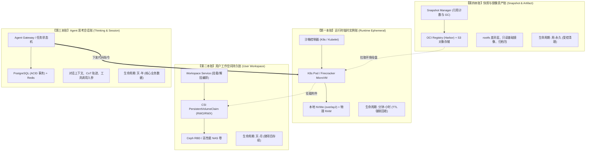
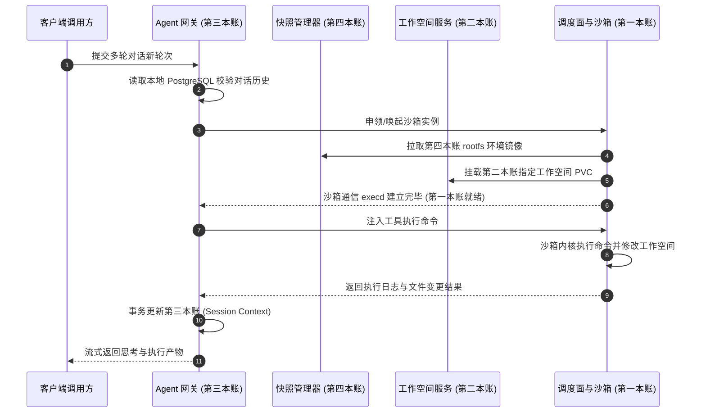
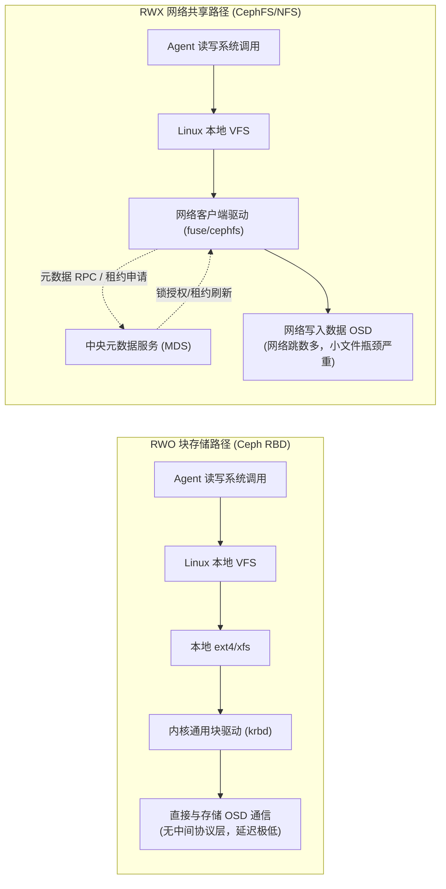
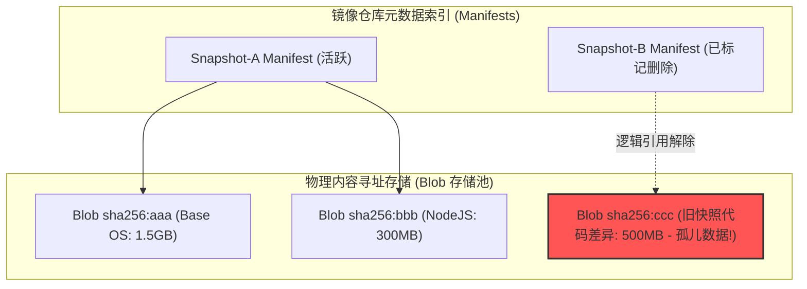
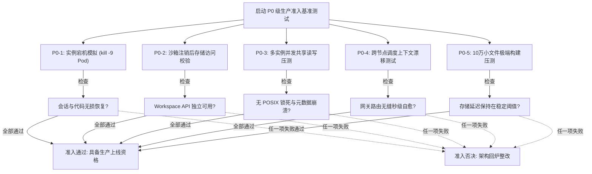

# 13 Agent 状态与存储——六类状态的正确拆分

**摘要：**

沙箱平台在工程原型阶段跑通之后，最容易被低估的生产化挑战是状态管理：Agent 运行过程中产生的海量数据（进程内存、容器写层、工作空间代码文件、模型与依赖缓存、会话控制上下文、大体积制品）应该由谁持久化、生命周期维持多久、底层存放于何处？行业大规模落地实践证明：Agent 状态必须严格按照“生命周期与数据权威”进行解耦拆分，任何试图使用单一存储引擎包揽全部状态的“一把梭”方案都会在规模化并发时彻底崩溃。本文首先深入剖析六类状态的全景模型与分类判据，解释其生命周期从毫秒级到永久性的本质差异；接着建立“四本账”治理模型，明晰运行时临时实例、用户持久空间、Agent 思考会话、快照存储的归属边界，并从内核机制层面对比容器可写层快照、CRIU 进程级 Checkpoint 与 MicroVM 页表内存快照的底层鸿沟；随后系统论证 RWO 块卷、RWX 共享文件系统与对象存储在 Agent 小文件高并发场景下的性能瓶颈与一致性选型；最后给出沙箱集群的责任边界、生产落地五项核心验证清单，以及业界开源前沿的最佳实践演进。

---

## 第 1 章 状态的本质：六类状态与寿命

### 1.1 什么是状态：六类状态全景剖析

在传统的微服务架构中，计算与存储分离是一条成熟的铁律：无状态的容器挂在负载均衡器后面横向伸缩，业务数据全部持久化到关系型数据库或分布式缓存中。然而，当 AI Agent 被引入系统后，这一假设被彻底打破。Agent 不仅仅是一段无状态的计算代码，它在推理、工具调用、环境调试、多轮交互中会持续产生极其繁杂的上下文与派生物。

如果不对这些数据进行精细化定义，工程团队往往会将“状态”视为一个笼统的概念，要么试图将所有文件挂载进持久卷，要么完全依赖容器的临时存储。为了建立科学的架构体系，必须将 Agent 运行时产生的数据拆解为生命周期与访问权威截然不同的六类状态：

| # | 状态类型 | 典型包含内容 | 典型生命周期 | 数据权威归属 | 核心存储介质 |
| :--- | :--- | :--- | :--- | :--- | :--- |
| **1** | **进程运行内存** | 解释器堆栈、局部变量、运行时上下文、未刷盘缓存 | 毫秒级至分钟级（随进程存亡） | 进程与沙箱内核 | 宿主机物理内存 / MicroVM vRAM |
| **2** | **容器可写层** | apt/pip 安装的临时依赖、/tmp 缓存、未挂载的运行时写层 | 分钟级至小时级（随容器销毁而抹除） | 沙箱运行时引擎 | 本地存储 overlay2 / tmpfs |
| **3** | **工作空间代码文件** | 用户仓库源码、代码改动、构建产物、测试用例 | 小时级至天级（跨沙箱重启保留） | 工作空间存储服务 | CSI 挂载卷（RWO 块卷 / RWX 共享卷） |
| **4** | **模型与依赖缓存** | 基础模型权重（HuggingFace 缓存）、pip/npm 共享包缓存 | 天级至月级（多沙箱跨实例共享只读） | 平台依赖中心 | 节点级本地只读缓存卷 / 分布式只读 RWX |
| **5** | **会话控制上下文** | 提示词历史、思考链（CoT）、工具调用轨迹、任务路由状态 | 天级至月级（跨沙箱、跨生命周期） | Agent 控制网关与状态服务 | 高可用分布式数据库（PostgreSQL / Redis） |
| **6** | **大体积制品** | 数据集打包、编译输出二进制、训练 Checkpoint、录屏视频 | 月级至永久归档 | 平台对象存储服务 | S3 兼容分布式对象存储（Ceph RGW / MinIO） |

这六类状态在生命周期、体积规模、I/O 吞吐以及故障恢复期望上存在巨大的代差。将它们混为一谈，是绝大多数 Agent 沙箱平台在走入生产深水区时遭遇灾难的根本原因。

```mermaid
%%{init: {'theme': 'dracula'}}%%
flowchart TD
    subgraph SandboxInstance["沙箱实例运行边界 (Pod / MicroVM)"]
        direction TB
        Mem["1. 进程运行内存<br/>(RAM: 毫秒-分钟)"]
        Writable["2. 容器可写层<br/>(overlay2: 分钟-小时)"]
    end

    subgraph StorageTier["持久化与协同存储层"]
        direction TB
        Workspace["3. 工作空间文件<br/>(CSI RWO/RWX: 小时-天)"]
        Cache["4. 依赖模型缓存<br/>(Shared ReadOnly: 天-月)"]
    end

    subgraph PlatformControlTier["平台控制与资产中心"]
        direction TB
        Session["5. 会话控制上下文<br/>(PostgreSQL/Redis: 天-月)"]
        Artifacts["6. 大体积制品归档<br/>(S3 对象存储: 月-永久)"]
    end

    SandboxInstance -.->|挂载读写| Workspace
    SandboxInstance -.->|只读加速| Cache
    SandboxInstance ==|执行通信| Session
    SandboxInstance -->|任务产物上传| Artifacts
```

### 1.2 为什么出现：生命周期与权威的客观分歧

在原型验证阶段（PoC），工程师通常使用最简化的方式启动 Agent：在单台宿主机上执行 `docker run`，Agent 所有的操作、工具执行、写出的代码、安装的 Python 依赖以及多轮对话记录，全部塞在同一个容器内部。只要这个容器不重启，系统表现似乎完美。

为什么一旦进入生产环境，这种单一存储结构就必然破裂？根本原因在于三个不可调和的客观分歧：

1. **生命周期维度的断层**：
   进程内存属于极度易失的介质，其存在意义是为了保障纳秒至微秒级的 CPU 指令执行；而用户的工作空间代码可能需要保留数天甚至数周，等待用户下一次登录审查；归档的测试报告与构建二进制制品则需要跨越数年以满足合规审计。如果试图用单一持久化卷承载全部数据，系统为了保存几兆字节的对话记录，就不得不维持整个几十吉字节的容器根文件系统，存储成本将呈指数级爆炸。

2. **数据所有权与信任域的分歧**：
   容器内部是由 LLM 生成的不可信代码所主导的非可信域（Untrusted Execution Domain）。如果将会话的核心上下文（对话历史、系统提示词、权限 Token、任务编排流转状态）保存在沙箱内部的文件系统或环境变量中，恶意代码只需一次越权读取即可窃取全部对话上下文甚至篡改任务执行指令。会话控制上下文的所有权必须归属于外部受信任的控制平面（Control Plane），而沙箱只能作为被调度的无状态计算工作节点。

3. **并发访问与伸缩拓扑的矛盾**：
   在自动化编程场景中，常常需要调度多个沙箱并行执行测试（如主 Agent 负责分发任务，三个 Worker 沙箱分别在 Python 3.10、3.11、3.12 环境下并行跑单元测试）。如果代码工作空间与容器实例强绑定，数据便无法跨节点漂移与多实例并发读写；反之，如果强行将高频随机读写的代码空间直接映射到底层高延迟的对象存储上，代码编译与依赖解析的 IOPS 将下降数个数量级。

### 1.3 不这样会怎样：单一存储架构的典型失败模式

为了深刻理解状态拆分的必要性，必须审视反事实推演：如果无视上述分歧，强行采用单一存储方案，系统会在哪些具体场景下崩塌？

#### 失败模式一：“沙箱即数据”的宿主暴毙与状态蒸发
团队未剥离工作空间与会话记录，完全依赖沙箱本地的容器可写层或宿主机匿名卷。当宿主机物理节点发生硬件故障、内网断连或 Kubernetes 触发节点驱逐（Node Eviction）时，Pod 被调度器强制终止并在新节点重建。此时，旧沙箱本地的可写层瞬间蒸发，用户正在调试了四个小时的复杂项目代码完全丢失，LLM 对之前执行过的环境变更一无所知。用户被迫从零重新执行任务，造成不可逆的生产事故与信任崩塌。

#### 失败模式二：滥用网络文件系统的元数据风暴
部分团队意识到文件必须持久化，于是采用一套全集群通用的 NFS 或分布式 POSIX 文件系统（如通用 RWX 卷），将每个沙箱的全部根目录甚至工作区一并挂载至网络存储。当 Agent 开始执行常见的前端项目构建（例如执行 `npm install`）或 Python 科学计算（安装包含数万个小文件的依赖环境）时，数以十万计的微小文件密集产生 `lookup`、`getattr`、`create` 系统调用。网络文件系统的元数据服务（MDS）瞬间被打满，网络 IOPS 耗尽，引发整个存储集群雪崩，殃及集群中所有正在运行的在线业务。

#### 失败模式三：快照机制与会话语义混淆引发的脑裂
团队试图通过对整个沙箱容器进行镜像快照（`docker commit` 或 CRIU 内存转储）来实现“Agent 会话挂起与恢复”。然而，当平台从快照恢复出一个新沙箱时，新沙箱被分配了全新的 IP 地址、全新的进程 ID 和未重连的网络套接字，而原外部控制网关仍在尝试向已销毁的旧实例下发指令。更灾难的是，由于快照将包含旧轮次数据的未完成脏文件一并还原，导致 Agent 执行逻辑产生状态幻觉，多轮对话历史出现严重的分叉与时空错乱。

### 1.4 如何落地：状态三维向量判据与分类决策树

要实现科学的状态治理，工程团队在面对任何一项新产生的数据时，必须严格执行三维向量分类决策法，而不是凭直觉猜测存放位置。三维向量包含三个维度：
$$ec{S} = (	ext{Authority}, 	ext{Lifetime}, 	ext{AccessPattern})$$

- **维度一：数据权威（Authority）**：回答“谁拥有这份数据、谁对数据最终一致性与正确性负责？”
  - 若权威属于编排与沙箱生命周期控制器，则归入调度元数据；
  - 若权威属于终端用户或代码仓库，则归入工作空间；
  - 若权威属于 Agent 推理决策引擎与工作流网关，则归入会话数据库；
  - 若权威属于容器运行时底座，则归入镜像仓库。
- **维度二：生命周期（Lifetime）**：回答“这份数据需要存活多久、触发销毁的条件是什么？”
  - 随单次工具调用或进程退出销毁 $
ightarrow$ 进程内存；
  - 随沙箱容器实例销毁 $
ightarrow$ 临时可写层；
  - 跨容器重启、随单次业务任务结束销毁 $
ightarrow$ 任务临时卷；
  - 跨多任务、随用户项目长期留存 $
ightarrow$ 持久持久卷（PV）；
  - 长期沉淀、永不随租户注销外丢失 $
ightarrow$ 对象存储冷归档。
- **维度三：访问模式（AccessPattern）**：回答“数据的 I/O 读写特征是什么？”
  - 高频微小读写、极端低时延（纳秒/微秒级） $
ightarrow$ 宿主机内存；
  - 高频随机 I/O、包含海量代码小文件（毫秒级） $
ightarrow$ 本地 SSD / 高性能 RWO 块存储；
  - 顺序大块吞吐、读多写少、只读共享（数十毫秒级） $
ightarrow$ 分布式对象存储。

```
[新数据进入系统]
       │
       ▼
【第一问：权威属于谁？】
  ├─ 外部 Agent 网关 / 决策流 ───────► 【会话控制上下文】 ──► 高可用 PostgreSQL / Redis
  ├─ 终端用户 / 代码工程 ──────────────► 【工作空间代码】 ────► CSI 挂载卷 (RWO / RWX)
  ├─ 平台公共基础设施 ────────────────► 【模型/包公共缓存】 ──► 只读共享挂载 / 镜像预置
  └─ 沙箱执行器自身
       │
       ▼
【第二问：需要活多久？】
  ├─ 超过沙箱生命周期 (任务/归档) ─────► 【大体积制品】 ──────► 分布式 S3 对象存储
  └─ 随沙箱生命周期绑定
       │
       ▼
【第三问：I/O 访问特征？】
  ├─ 亚毫秒内存寻址 / 寄存器 ─────────► 【进程内存】 ────────► 物理 RAM / vRAM (不持久化)
  └─ 临时写盘 / apt 包安装 ───────────► 【容器可写层】 ──────► overlay2 / tmpfs (随删即清)
```

### 1.5 边界与反例：特殊状态类型的认知误区

在实际工程落地中，有两个极具迷惑性的特殊状态往往会导致分类决策树失效：

#### 反例一：浏览器自动化（GUI Agent）的 Browser Profile
GUI Agent（例如驱动 Chromium 进行自动化操作的 Agent）在运行中会生成用户登录状态、Session Cookie、IndexedDB 以及浏览器扩展。
- **错误做法**：将整个 Chromium Profile 目录（通常几百兆且含大量小 SQLite 库）直接放进 RWX 网络挂载卷，导致浏览器启动时发生严重的 SQLite 文件锁冲突与极高读写延迟；或者直接随沙箱可写层丢弃，导致用户每轮对话都必须重新进行复杂的人机验证或短信登录。
- **正确边界**：Browser Profile 属于“**凭据与工作状态的复合体**”。其权威属于外部凭据中心与用户工作空间，生命周期随任务存在。最佳工程实践是在任务启动时，由外部凭据代理将 Profile 的加密压缩包解压注入沙箱的内存盘（tmpfs），任务执行完毕后由代理主动回写加密包至对象存储，并立即安全擦除沙箱本地副本。

#### 反例二：大语言模型推理权重的本地缓存
许多开源 Agent 框架（如集成本地 Embedding 模型或重排序模型的 Agent）会在启动时自动执行 `huggingface_hub.download`，将数吉字节的模型权重写进沙箱的 `~/.cache` 目录。
- **错误做法**：让沙箱各自写入自己的容器可写层（造成磁盘配额超限并极大拖慢冷启动），或将该目录放入用户的个人持久卷中（造成重复下载与存储浪费）。
- **正确边界**：模型权重属于“全局只读依赖缓存”。其权威属于平台运维侧，生命周期跨越所有租户。应通过 Kubernetes 节点的 `HostPath` 或平台集中管理的只读 PVC（ReadOnlyMany），将其预置于沙箱的基础只读层，对沙箱完全呈现为不可变的数据源。

---

## 第 2 章 四本账模型

### 2.1 四本账模型架构解析

通过六类状态的科学抽象，在分布式沙箱平台的工程实现中，必须将这六类状态收敛归并为**四本独立的系统账本**。每一本账本拥有独立的控制平面、独立的底层存储引擎、独立的生命周期管理策略以及独立的高可用拓扑：

| 账本名称 | 核心定位 | 涵盖状态 | 权威控制器 | 推荐底层存储实现 | 预期生命周期 |
| :--- | :--- | :--- | :--- | :--- | :--- |
| **第一本账：运行时临时实例账** | 承载不可信代码执行的易失计算环境 | 进程运行内存、容器可写层、临时套接字、临时挂载点 | Kubernetes Controller / Sandboxed VMM Manager | 节点本地内存、NVMe 本地盘（overlay2/tmpfs） | 分钟级至小时级（硬限 TTL 强制回收） |
| **第二本账：用户工作空间持久账** | 承载用户代码资产与业务生产要素 | 用户源码、中间编译结果、本地 Git 仓库、任务配置 | 独立 Workspace Service（工作空间管理控制器） | 分布式块存储（Ceph RBD / 云厂商云盘）或高性能 NAS | 天级至月级（随任务或项目生命周期留存） |
| **第三本账：Agent 思考会话账** | 承载任务编排逻辑、多轮对话与推理认知 | Prompt 上下文、思考过程、工具调用历史、状态机当前步 | Agent Gateway / State Orchestrator | 分布式事务数据库（PostgreSQL / Aurora）+ Redis | 天级至年级（企业业务系统核心数据） |
| **第四本账：快照与镜像资产账** | 承载环境版本固化、极速复现与调试分支 | 容器 rootfs 差异镜像、MicroVM 内存转储镜像、打包制品 | 镜像与快照分发服务（Snapshot Service） | 企业级 OCI Registry（Harbor）+ S3 对象存储 | 周级至永久（依赖引用计数与生命周期规则） |



四本账模型的精髓在于**绝对解耦**：任何一本账的介质故障、服务升级或结构重构，都不会对其他三本账造成连锁破坏。例如，Kubernetes 集群在进行大规模节点滚动更新时，第一本账被批量注销并在新节点唤起，由于工作空间挂载在第二本账，对话上下文保存在第三本账，基础镜像固化在第四本账，Agent 可以在毫秒级无缝续接任务，用户端甚至无法感知底层的宿主机发生了迁移。

### 2.2 核心辨析：同一个“状态”名下的异构实现本质

在大量涉及沙箱“暂停与恢复（Pause & Resume）”或“环境保存”的讨论中，存在着极具危害性的概念混淆。许多团队在技术方案中简单地写下“保存沙箱状态”，却未曾厘清容器可写层快照、CRIU 进程级 Checkpoint 与 MicroVM 页表内存快照的底层实现鸿沟。

这三种技术在底层原理、恢复时延、一致性边界和工程代价上完全不同：

| 维度 | 容器 rootfs 快照 (OCI Commit) | CRIU 进程级 Checkpoint | MicroVM 页表内存快照 (Firecracker / uffd) |
| :--- | :--- | :--- | :--- |
| **底层快照对象** | 文件系统可写层差异（overlay2 upperdir） | 进程树虚拟内存、寄存器、文件描述符、管道 | 客户机完整虚拟物理内存（Guest RAM）+ VCPU 寄存器 |
| **快照触发机制** | 扫描文件系统差异并打包为 tar/OCI 层 | `ptrace` 挂起进程树，解析 `/proc/$pid/` 内存映射写盘 | KVM 暂停 VCPU，利用 `KVM_GET_DIRTY_LOG` 或 userfaultfd 导出内存页 |
| **恢复时延** | 秒级（拉取镜像、解包、重新启动 init 进程） | 百毫秒至秒级（重新映射进程内存、重建句柄） | **毫秒级（5-30ms，结合 uffd 按需懒加载换页）** |
| **外部连接语义** | **全部丢失**。恢复后是全新进程，无网络连接 | **无法保持**。已建立的 TCP 连接在恢复时报 `ECONNRESET` | **无法自然保持**。客户机内核保留了连接状态，但外部交换机状态已失效 |
| **内核依赖限制** | 极低。只要兼容容器运行时规范即可 | 极高。恢复机器必须拥有高度一致的 Linux 内核版本及配置 | 较低。只要宿主机 CPU 指令集架构兼容即可（如 x86-64-v3） |
| **典型代表系统** | OpenSandbox、Docker、Kubernetes | Docker Checkpoint、Google gVisor Sentry C/R | AWS Lambda、Firecracker、E2B、Modal |



从上述机制对比可以看出，所谓“暂停与恢复”在容器体系下本质上是**环境重置与文件重构**，绝不能按“操作系统待机唤醒”来向业务方作出承诺。如果 Agent 在执行一段长期等待的异步任务，试图依赖 OCI rootfs 快照去恢复正在运行的 Python 进程，结果只能是进程彻底中断，且残留损坏的文件锁。只有在以 Firecracker 为代表的现代 MicroVM 架构中，配合 `userfaultfd` 内存页懒加载技术，才能在 30 毫秒内实现带有完整内存页表状态的快速唤醒。

### 2.3 快照与工作空间的界限：第四本账与第二本账的解耦

一个高频出现的架构缺陷是把“用户代码文件”一并打包进“容器环境快照”中。
例如：Agent 在沙箱中执行了 `git clone`，拉取了 2GB 的代码仓库，随后生成了代码补丁；此时平台触发了快照保存操作，将整个容器 rootfs 连同工作目录一起提交成了 OCI 镜像。

这种设计会导致极其严重的生产事故：
1. **镜像仓库容量灾难性膨胀**：快照镜像大小通常在 2GB 至 5GB 不等。若平台有 1000 个活跃 Agent，每次执行产生一个环境分支，每天将产生数 TB 的垃圾镜像。OCI Registry 的存储后端将迅速被无意义的代码文件打满。
2. **写放大与网络带宽击穿**：仅仅改动了一行 `main.py` 代码，却需要将整个包含系统库的数吉字节镜像层进行压缩、哈希计算、上传至镜像仓库；在新节点唤起时又必须重新下载与解包，导致节点网络接口常年处于饱和拥塞状态。
3. **版本回滚与协作断裂**：当多 Agent 需要协作开发同一个代码仓库时，或者用户需要通过 Web IDE 实时查看 Agent 编写的代码时，代码被封死在镜像内，外部系统无法获得文件的实时访问句柄。

正确的架构解耦方案必须贯彻：**环境归环境，资产归资产**。
容器镜像（第四本账）只保存操作系统基础底座、预装编译器（如 GCC、JDK、Python 运行时）以及不可变的静态依赖库；而用户的工作目录（第二本账，通常挂载在 `/workspace`）必须通过 CSI 独立挂载。当需要对环境打快照时，快照引擎在打包 rootfs 前必须显式过滤掉工作空间挂载点，只固化工具链的演进，确保快照的体积保持稳定，同时保证工作空间能够独立挂载给任意新环境。

### 2.4 会话续接的真相：为什么必须依赖第三本账

在用户端的产品体验中，“会话续接（Session Resume）”是最核心的心智诉求：用户合上笔记本电脑，三天后重新打开，希望继续之前的探讨，Agent 应当清楚记得上一轮对话的所有细节和历史产物。

许多架构师初入该领域时，直觉上认为这应该通过“保持沙箱不关机”或“快照恢复沙箱”来实现。这是一种极其昂贵且脆弱的设计。
- 如果保持沙箱不关机，物理节点的内存与 CPU 配额将被大量空闲的常驻容器霸占，集群的资源利用率将暴跌至不足 5%；
- 如果依靠快照恢复，上文已分析，快照无法恢复网络 Socket、外部连接凭据以及即时的思考逻辑。

会话连续性的真正基石必须完全由**第三本账（Agent 思考会话账）**单独提供：
1. **结构化持久化**：所有的 Prompt、系统提示词、用户提问、工具入参及出参、模型思考 Token 必须以结构化文档或 Append-Only 事务流的形式持久化在外部的高可用数据库（如 PostgreSQL 的 JSONB 字段或专用状态服务中）。
2. **状态机与执行位置解耦**：Agent 运行时的本质是一个确定性的状态机（State Machine）。状态机的前进依赖于上一状态的输出。
3. **冷启动重建**：当用户唤醒会话时，平台从第一本账分配一个完全干净、经过预热的崭新沙箱实例；挂载用户对应的第二本账（工作空间）；接着，Agent 网关从第三本账中拉出最近的上下文摘要，重新注入 Agent 上下文。Agent 立即获得了完整的记忆，同时沙箱环境处于最佳健康状态。

```
【错误路径：试图用第四本账承载会话连续性】
沙箱 A 执行中 ──► 触发 OCI commit ──► 生成 3GB 胖镜像 ──► 销毁沙箱 A
三天后用户续接 ──► 重新拉取 3GB 镜像 ──► 启动新沙箱 ──► 内存进程丢失、网络断开 ──► 报错！

【正确路径：四本账正交协作承载会话连续性】
沙箱 A 执行中 ──► 执行结果异步事务回写第三本账 (PostgreSQL) ──► 销毁沙箱 A (释放资源)
三天后用户续接 ──► 调度池秒级提供崭新沙箱 B (第一本账)
               ──► 动态挂载用户专属 PVC (第二本账)
               ──► 注入第三本账中提取的历史上下文 ──► 瞬时就绪，状态无缝续接！
```

---

## 第 3 章 各状态的存储选型与工程权衡

### 3.1 存储选型映射矩阵

理解了四本账后，必须将其映射到底层具体的存储技术栈中。在 Kubernetes 与现代云计算基础设施中，不存在放之四海皆准的存储介质。下表给出了六类状态、四本账与底层工业级存储选型的推荐对照：

| 状态类型 | 对应账本 | 推荐存储方案 | 核心技术选型 | 关键性能指标要求 |
| :--- | :--- | :--- | :--- | :--- |
| **进程运行内存** | 第一本账 | 节点物理 RAM / 虚拟化 vRAM | 宿主机 DDR4/DDR5，结合 hugepages | 内存带宽 > 100GB/s，访问时延 < 100ns |
| **容器可写层** | 第一本账 | 节点本地 NVMe SSD | Docker/Containerd overlay2，挂载 tmpfs | 随机写 IOPS > 50K，时延 < 1ms |
| **工作空间代码文件** | 第二本账 | 高性能块存储（单实例）或分布式 NAS | Ceph RBD (RWO) / AWS EBS gp3 / CephFS (RWX) | 混合小文件 IOPS > 10K，POSIX 完整支持 |
| **模型与依赖缓存** | 平台共用 | 节点级本地缓存盘 / 只读共享挂载 | Kubernetes HostPath / ReadOnlyMany NFS / JuiceFS | 顺序读带宽 > 1GB/s，本地命中率 > 95% |
| **会话控制上下文** | 第三本账 | 分布式关系型数据库 + 内存缓存 | Amazon Aurora / PostgreSQL (HA) + Redis Cluster | 事务写入时延 < 10ms，跨 AZ 强一致 (RPO=0) |
| **大体积制品** | 第四本账 | 分布式对象存储 | Ceph RGW / MinIO / AWS S3 | 存储容量 EB 级扩展，吞吐 > 10GB/s |

### 3.2 工作目录的深水区：RWO 块卷 vs RWX 共享文件系统

在第二本账（工作空间）的具体技术选型中，最具争议的核心决策在于采用 **RWO（ReadWriteOnce，单节点独占块卷）** 还是 **RWX（ReadWriteMany，多节点共享文件系统）**。

#### 1. RWO 块卷的技术剖析（Ceph RBD / AWS EBS）
RWO 模式下，底层存储系统将一个裸虚拟块设备（Block Device）直接格式化为 ext4 或 XFS 文件系统，并独占式挂载到单个 Kubernetes 节点上供单个沙箱使用。
- **核心优势**：I/O 栈极短，完全由本地 Linux 内核的通用块层和文件系统驱动直接处理。在处理 Agent 极高频创建、删除代码小文件（如 `git status`、`cargo build`、`node_modules` 解析）时，读写时延极低（通常在毫秒以内），IOPS 能够充分释放底层 SSD 阵列的能力。
- **致命约束**：**物理互斥性**。块设备不支持跨节点并发挂载。如果 Agent 沙箱发生故障漂移，Kubernetes 的 VolumeAttachment 控制器必须先在旧节点执行卸载（Detach），再在新节点执行附加（Attach）。一旦旧节点发生网络脑裂或未完全响应，卷解绑过程可能卡死数分钟（`VolumeInUse` 报错），严重拖慢故障自愈时延。

#### 2. RWX 共享文件系统的技术剖析（CephFS / NFS / SMB）
RWX 模式下，存储集群向所有宿主机节点暴露一个统一的网络文件系统命名空间，多个运行在不同节点的沙箱实例可以并发挂载同一个目录进行读写。
- **核心优势**：完全消除了节点漂移时的卷解绑等待；支持多沙箱协同工作场景（例如主 Agent 负责编写代码，多个 Worker Agent 并发挂载同一目录执行静态分析或安全扫描）。
- **致命隐患：小文件元数据风暴与网络文件锁**。在网络文件系统中，每一次文件元数据操作（`stat`、`open`、`unlink`）都必须跨越网络与元数据服务器（MDS）进行 RPC 通信，并获取分布式文件租约锁（Lease Lock）。当一个典型的现代化 Node.js 项目执行依赖安装，产生十万个几 KB 的依赖文件时，网络往返延迟叠加元数据锁争用，可能导致原本在本地 10 秒完成的构建，在 RWX 卷上长达 20 分钟甚至因客户端超时崩溃。



> [!important]
> **生产选型黄金铁律**：
> 除非有极其明确的“多沙箱同目录并发协作”业务需求，否则**永远优先为沙箱工作空间选择 RWO 高性能块存储**。将多 Agent 的协同模式从“共享底层文件系统”解耦为“基于 Git 远程分支或 RPC 协同”，是规避分布式文件系统灾难的最优工程选择。

### 3.3 大制品归档：对象存储的不可变定位

大体积制品（如几个吉字节的训练日志、核心转储文件 Core Dump、录屏音视频、模型 Checkpoint）必须强制从第二本账剥离，推送到以 S3 为代表的分布式对象存储中。

许多团队试图将对象存储直接挂载为沙箱内的文件目录（例如使用 `s3fs` 或 `goofys` 将 S3 Bucket 挂载为本地 POSIX 路径），这是极其严重的架构反模式：
1. **语义割裂**：对象存储是基于 RESTful HTTP 的键值体系，根本不存在真正的“目录”概念（目录只是包含 `/` 的对象键名），不支持文件的随机部分写（Random Write），不支持追加写（Append，除非特定分块上传），不支持文件原子重命名（Rename 在底层是整个对象的拷贝后删除）。
2. **锁机制缺失**：S3 协议完全没有 POSIX 锁与跨客户端协同机制，当 Agent 尝试用标准文件系统 API 修改 SQLite 数据库或锁定时，将直接返回 I/O 错误。

**规范落地方案**：必须严格遵循**“本地操作，显式上传（Fetch-Compute-Push）”**的生命周期设计。Agent 在沙箱中将制品写在本地工作空间或临时盘，任务结束前由系统守护进程或 Agent 运行时通过 SDK 显式调用 `PutObject` 异步上传至对象存储，随后清理本地暂存，以此保证计算与存储边界的绝对清晰。

### 3.4 Ceph 存储全家桶在沙箱中的完整映射

在许多私有云或自建数据中心的沙箱平台架构中，开源的 Ceph 凭借其统一存储能力成为了核心底座。然而，用好 Ceph 的关键在于正确对应其“三件套”能力：

| Ceph 子系统 | 接口协议 | 对应的 Agent 账本 | 性能特征与瓶颈点 | 生产配置建议 |
| :--- | :--- | :--- | :--- | :--- |
| **Ceph RBD** | 块接口（Kernel Driver `krbd`） | **第二本账：工作空间 (RWO)** | 极高性能，强顺序一致性；瓶颈在于宿主机卷 Attach/Detach 频率与网络互联 | 使用 NVMe SSD 作为 OSD 池，启用 `krbd` 原生驱动，禁用不必要快照自动同步 |
| **CephFS** | POSIX 分布式文件系统 | **平台共享只读模型缓存 / 工具集** | 目录树共享读写；瓶颈在于 MDS（元数据服务器）内存上限与高并发元数据更新 | 部署多活 MDS，开启客户端元数据缓存，**严禁将动态高频写的工作空间挂在 CephFS** |
| **Ceph RGW** | S3 / Swift 兼容对象接口 | **第四本账：大制品与镜像冷归档** | 海量扩展，高并发读吞吐；瓶颈在于 RGW 网关实例的网络带宽与签名负载 | 部署在独立的 HAProxy 后面进行负载均衡，针对大文件开启分块上传（Multipart） |

---

## 第 4 章 沙箱集群的职责边界

### 4.1 平台必须承担的核心职责

在明确了四本账后，沙箱编排集群（Kubernetes / 专用调度引擎）与外部数据中心之间的责任分工必须清晰界定。沙箱平台控制面必须无条件、百分之百承担以下职责：

1. **第一本账的绝对生命周期治理**：
   沙箱平台必须具备铁腕回收机制。无论是由于 Agent 执行超时、代码死循环、内存泄漏还是用户弃用，沙箱平台必须通过基于 TTL（Time-To-Live）的硬性调度器，在预设时间窗口触发时强行销毁容器实例。回收过程必须确保本地卷完整卸载、临时可写层物理擦除、cgroup 资源配额彻底归还节点。
2. **存储凭据与环境上下文的安全注入**：
   沙箱平台负责向沙箱实例透明、安全地注入当前任务所需的临时安全凭据（如访问 Workspace 的有限权限 Token），并在沙箱销毁时瞬间撤销凭据，防止不可信代码将存储凭据持久化后带出。
3. **卷挂载与解挂的原子性保障**：
   在容器创建与销毁阶段，沙箱控制器必须保证 CSI 存储卷的挂载与解绑具备严格的幂等性与超时保护，杜绝产生跨节点孤儿挂载卷（Orphan Volume）。

### 4.2 平台可以有条件承担的职责

在某些增强型沙箱平台中，为了提升开发者体验，平台可以选配承担以下职责，但必须明晰其代价值：

1. **工作空间的轻量级定时快照**：
   平台可以通过底层存储（如 Ceph RBD Snapshot 或云盘快照）提供任务关键节点的数据备份功能，供用户在代码被 Agent 彻底改崩时一键回滚。但这属于高级灾备功能，不应与常规运行路径串联。
2. **多租户预热依赖卷的只读共享分发**：
   平台可以预先将庞大的公共基础依赖（如大型通用 Python 运行环境）以只读只共享（ReadOnlyMany）的形式预挂载给新沙箱，从而将冷启动耗时从 30 秒压缩至 500 毫秒。但这要求依赖库本身完全稳定且不可被任何沙箱篡改。

### 4.3 平台绝不该承担的越界反模式

以下三类职责属于典型的“越界反模式”，任何试图让沙箱平台去承担这些职责的架构设计，最终都会陷入无法运维的泥潭：

```
                 【沙箱集群职责边界绝对红线】
┌─────────────────────────────────────────────────────────────┐
│ ❌ 绝对禁止：沙箱平台充当 Agent 会话状态的权威数据库          │
│    (试图在容器内维护聊天记录、记忆图谱、状态机流转)           │
├─────────────────────────────────────────────────────────────┤
│ ❌ 绝对禁止：沙箱本地存储承载海量未归档数据资产               │
│    (试图将沙箱的 local storage 当作企业数据仓库与网盘)       │
├─────────────────────────────────────────────────────────────┤
│ ❌ 绝对禁止：在存储层替应用程序解决并发冲突与锁竞争           │
│    (试图靠网络文件系统底层解决两个 Agent 同时写同一文件的逻辑冲突) │
└─────────────────────────────────────────────────────────────┘
```

1. **绝不该在沙箱内部充当会话状态的权威存储**：
   沙箱的文件系统永远只是执行环境，绝不能用来代替分布式数据库。将会话日志、用户配置存放在沙箱内部，直接违背了计算与控制分离的设计准则。
2. **绝不该在存储层替应用解决并发写入冲突**：
   当两个 Agent 实例需要同时协作修改同一个工作空间的文件时，很多架构师寄希望于底层网络存储提供某种神奇的“自动合并不冲突”机制。这是不可能的。底层的分布式锁只能防止底层文件元数据损坏，无法理解语义逻辑。代码层面的冲突必须在应用层通过基于 Git 的分支合并机制、CRDT（无冲突复制数据类型）或集中式任务调度编排去解决。

---

## 第 5 章 状态的生命周期管理与深度治理

### 5.1 TTL 机制与“残留为零”的回收纪律

第一本账（运行时临时实例）最大的天敌是**资源泄漏**。在生产环境中，由 Agent 生成的代码具有极大的随机性与不可预测性，死循环进程、僵尸进程（Zombie Processes）、未释放的网络文件句柄层出不穷。

为了保证集群的稳态运行，平台必须建立严格的“残留为零”回收纪律：
1. **硬限 TTL 计时器与探活双保险**：
   每个沙箱在创建时必须硬性绑定 TTL 倒计时（例如 30 分钟）。即使外部调用方出现网络断连或死锁，一旦到达 TTL 上限，宿主机守护进程必须触发 `SIGKILL` 强杀整个 cgroup 进程树。
2. **三层深度清理扫描**：
   回收不能止步于容器删除的 HTTP 返回码，必须在宿主机内核与基础设施层执行三层对账：
   - **进程级**：校验该沙箱对应的 cgroup 路径（`/sys/fs/cgroup/...`）是否彻底注销，避免残留逃逸的孤儿进程；
   - **文件级**：校验本地 NVMe 上的 `upperdir` 临时层是否完全从磁盘物理擦除，防止小文件堆积占满 inode；
   - **挂载级**：校验 `/proc/mounts` 下的 CSI 挂载点是否完全 umount，防止产生悬空挂载导致底层存储卷无法解绑。

### 5.2 第四本账的深渊：快照容量膨胀与 OCI Blob 垃圾回收 (GC)

在第四本账（快照与镜像）的实际运行中，一个最具隐蔽性的生产陷阱是**镜像仓库的存储膨胀与 Blob 引用悬空**。

#### 1. 快照容量数学模型与膨胀效应
如果平台支持沙箱在运行中生成快照，必须认识到快照的存储增长模型不是线性的，而是随用户量与调试轮次呈二次方甚至指数级跃升：
$$	ext{Storage}_{	ext{total}} = N_{	ext{users}} 	imes 	ext{AvgSnapshotsPerSession} 	imes 	ext{Size}_{	ext{layer}}$$
假设每个基础镜像 2GB，即使采用层差异存储，平均每次写层变动产生 300MB 的差异层。1000 个并发会话、平均每个会话产生 5 次快照，每日净增存储将超过 1.5TB。一个月将产生数十 TB 的镜像层文件。

#### 2. 内容寻址与 Blob 悬空泄漏的底层根源
主流的 OCI 镜像仓库（如 Harbor、Docker Registry v2）采用**内容寻址存储（Content-Addressable Storage, CAS）**模型。镜像由 Manifest（清单文件）和具体的 Layer Blob（通过 sha256 命名的二进制块）构成。多个不同的快照镜像可能引用相同的底层 Blob。
- **灾难流程**：当上层平台通过 API 删除了某个过期的快照镜像时，镜像仓库在默认情况下**仅仅删除了对应的 Manifest 索引，根本不会在物理磁盘上删除对应的 Layer Blob**！
- **不这样会怎样**：久而久之，镜像仓库后端存储被数以万计的“孤儿 Blob（Orphan Blobs）”彻底占满，最终触发磁盘写入只读锁定，导致整个集群无法再拉取或推送任何新镜像。



#### 3. 治理落地措施
平台必须建立**第四本账的主动引用计数与物理 GC 治理流程**：
- **两阶段标记-清除（Mark-and-Sweep）**：配置 Registry 定时（如每周非高峰期）执行只读锁定的物理垃圾回收，完整扫描当前存活的所有 Manifest 引用树，对无任何引用的孤立 Blob 进行物理 unlink；
- **快照配额与自动生命周期规则**：严格限制单个用户或任务最多保留的快照版本数量（如最多保留最近 3 个历史快照），对超过 7 天未被唤醒的临时快照镜像执行硬性下线。

### 5.3 跨账本的一致性边界：何时强一致，何时最终一致？

四本账在物理上由完全不同的存储系统（K8s etcd、Ceph、PostgreSQL、S3）分别承载，跨系统之间的状态流转不可能无代价地维持全局强一致性（ACID）。架构师必须在性能与正确性之间划出清晰的一致性边界：

| 业务场景 | 涉及账本 | 一致性要求 | 工程落地模式 |
| :--- | :--- | :--- | :--- |
| **沙箱销毁与工作空间保留** | 第一本账 $
ightarrow$ 第二本账 | **最终一致性** | 异步解耦。沙箱立即销毁，工作空间在后台排队卸载与归档 |
| **工具执行结果回写会话** | 第一本账 $
ightarrow$ 第三本账 | **最终一致性** | 基于事件流的事务发件箱模式（Transactional Outbox） |
| **快照生成与元数据目录登记** | 第一本账 $
ightarrow$ 第四本账 | **强一致性** | 必须采用两阶段确认：底层镜像完全推送到位后，才允许向元数据账本写入就绪标记 |
| **资源配额扣减与沙箱创建** | 平台账务 $
ightarrow$ 第一本账 | **强一致性** | 基于关系型数据库的原子 CAS（Compare-And-Swap）行锁 |

在 Agent 执行过程中，将中间思考步骤与工具输出写入第三本账，应坚决采用**异步最终一致性**。若每一次工具的标准输出打印都强制等待中心数据库完成跨地域的同步事务提交，沙箱中不可信代码的执行吞吐将受到严重抑制。反之，涉及配额计算、权限鉴定和快照可用性判定时，必须坚持**强一致性**，严防资源超卖与访问死锁。

### 5.4 删除证据链：状态消亡的可审计性

在面向企业级客户的生产化落地中，“如何证明一个沙箱及其状态被彻底销毁”是安全合规与审计的核心诉求。如果只在客户端返回一个 `HTTP 204 No Content`，但底层磁盘或网络隔离策略实际上因并发错误未被清理，将埋下巨大的安全漏洞。

生产级沙箱平台必须构建**端到端的删除证据链（Deletion Evidence Trail）**：
1. **删除意图记录（Pre-Deletion）**：收到销毁请求时，首先在外部审计日志中持久化记录：操作发起方身份、时间戳、目标沙箱唯一 ID、关联的工作空间 ID 与删除理由；
2. **执行注销追踪（In-Deletion）**：调度引擎向各个受管子系统并发下发注销指令，精确记录底层 CSI 卷解绑、容器运行时 cgroup 销毁、eBPF 网络隔离规则清除的详细原子耗时与返回载荷；
3. **物理残留扫描证据（Post-Deletion）**：销毁完成后，由独立的宿主机审计探针执行原地扫描，将“目标命名空间已注销、目标工作目录本地已无挂载点、内存占用清零”的硬件级检查事实，签名后写入不可篡改的审计追踪系统。

---

## 第 6 章 生产落地验证清单

在沙箱平台的存储架构设计完毕后，严禁未经严格检验直接推向生产环境。以下五项核心测试用例构成了最基础的准入检验门禁：

| 验证项编号 | 测试目标与验证项 | 验证的核心状态设计 | 失败判定标准与告警红线 |
| :--- | :--- | :--- | :--- |
| **P0-1** | **Pod 强杀重建后的状态完整性验证** | 第三本账（会话）与第二本账（工作空间）的外置性 | 强制 `kill -9` 沙箱主进程或删除 Pod，重建后 Agent 丢失上一轮对话记忆，或工作空间文件被恢复至初始模板 |
| **P0-2** | **沙箱离线状态下的工作空间独立读写** | 第二本账对第一本账的绝对生命周期解耦 | 销毁沙箱实例后，外部 Workspace API 无法正常列出、下载或打包用户工作空间内的代码资产 |
| **P0-3** | **同工作空间多实例并发挂载与锁竞争** | RWX 选型合理性与应用层并发保护机制 | 启动两个 Worker 沙箱同时挂载同一目录，底层文件系统发生元数据死锁导致 I/O 挂起超过 10 秒，或文件内容相互覆盖损坏 |
| **P0-4** | **跨节点会话漂移粘滞性验证** | 第三本账路由与 Agent Gateway 的无状态能力 | 沙箱 A 在物理节点 1 销毁，沙箱 B 在物理节点 2 启动，网关下发的后续指令因节点 IP 变更报 404 或上下文割裂 |
| **P0-5** | **长周期高频小文件构建写放大压力测试** | 存储选型在 Agent 真实编译负载下的抗压底线 | 在工作空间内连续执行 50 次完整的前端依赖安装与单元测试，底层存储 IOPS 持续处于 100% 饱和，或宿主机产生 `dentry` 内存泄漏 |



---

## 第 7 章 工业界前沿实践：四本账的演进与共识

### 7.1 快照元数据目录的 PostgreSQL 集中化演进

在开源沙箱技术的演进历史上，以阿里开源的 OpenSandbox 项目为例，其控制平面在早期架构中曾将快照的元数据（Snapshot Metadata）直接保存在控制面服务器 Pod 内部的本地嵌入式 SQLite 数据库中。

这种设计在单机演示环境下运行良好，但一旦进入生产多副本高可用部署，立刻暴露了致命缺陷：
- 客户端通过负载均衡器向 Server-A 发送创建快照请求，快照成功写入本地 SQLite 并推送到镜像仓库；
- 随后客户端向 Server-B 发送恢复快照请求，由于 Server-B 的本地 SQLite 根本没有这条元数据，直接向客户端返回 `404 Snapshot Not Found`！

这一痛点最终推动了工业界的重大架构重构：**快照元数据账本必须全面外置集中化**。在现代生产架构中，快照目录必须统一收敛至外部的高可用 PostgreSQL 数据库中，通过数据库行锁与 CAS（Compare-And-Swap）机制严格保证多副本控制器之间的状态强一致。这从开源演进层面直接印证了四本账中“控制元数据绝不能随计算节点碎片化”的客观规律。

### 7.2 会话状态服务的兴起：以 Letta 与 LangGraph 为代表的持久化记忆层

在会话控制（第三本账）的开源生态中，近年涌现出以 Letta（前 MemGPT 团队）与 LangChain LangGraph 为代表的专业会话状态管理架构。

这些前沿框架完全摒弃了依赖容器本地存储记忆的做法，提出了一套规范的“分层记忆块（Memory Blocks）”模型：
- **核心上下文（Core Context）**：存储当前任务的核心约束、用户人设画像与不可变指令，常驻在经过事务优化的关系型数据库核心表中，单次读取开销在毫秒级以内；
- **回想记忆（Recall Memory）**：将过去几百轮的所有工具调用历史、执行结果，以追加日志的形式写入分布式数据库，支持通过时序或向量检索动态召回；
- **持久归档（Archival Storage）**：大规模代码文档或大文本产物，则通过异步分块向量化存入向量数据库与对象存储。

这种专门构建的状态服务使得 Agent 的大脑（思考与记忆）与沙箱的躯体（命令执行容器）实现了完全的物理分离。

### 7.3 沙箱快照的极致性能追求：E2B 与 Modal 的技术突破

在追求沙箱启动与恢复时延的赛道上，专注于 AI 代码执行的商业平台 E2B 与云计算先驱 Modal 给出了不同的极致答卷：

- **E2B 的 Firecracker 内存分发体系**：
  E2B 摒弃了传统的 Docker 容器，完全基于 Firecracker MicroVM 构建沙箱。为了让 Agent 沙箱能够在百毫秒内具备完全加载好庞大 Python 库的执行能力，E2B 在母机预热阶段运行环境，然后通过 Linux 的 `KVM_GET_DIRTY_LOG` 捕获内存脏页，生成精简的只读模板内存镜像。新沙箱启动时，通过虚拟块设备与共享只读内存页的映射，实现了“单模板裂变为数千个沙箱、启动时延不足 150 毫秒”的工业奇迹。
- **Modal 的 gVisor 进程级内存 Checkpoint**：
  Modal 则另辟蹊径，深入定制了 Google gVisor 的用户态内核 Sentry。通过在 Sentry 内部实现深度优化的 Checkpoint/Restore 机制，Modal 能够直接在用户态冻结正在执行的 Python 解释器内存状态，将其持久化至极速共享存储。当有新的函数调用到达时，在全新的 Pod 中纳秒级重塑内存布局，实现了极高密度的进程级弹性伸缩。

### 7.4 Kubernetes SIG 官方标准的演进：volumeClaimTemplates 的深度整合

在云原生基础设施层面，Kubernetes 官方社区针对沙箱类工作负载的存储需求也在持续演进。
以 `kubernetes-sigs/agent-sandbox` 及相关社区控制器的演进为例，早期方案中沙箱模板（SandboxTemplate）缺乏灵活的存储卷声明能力，开发者不得不手动通过外部 Operator 去创建并关联 PVC。

现代社区规范正式引入了与 StatefulSet 类似的 `volumeClaimTemplates` 动态申领能力。控制器在根据模板弹性拉起 Agent 沙箱时，能够原子性地为每个独立的沙箱实例动态拨备独占的 RWO 块卷，并在沙箱生命周期结束时，根据配置的回收策略（Retain 还是 Delete）自动交接给后台存储垃圾回收器。这标志着云原生底层对 Agent 状态第二本账的编排支持已走向标准化成熟期。

---

## 第 8 章 总结与思考题

### 8.1 核心架构要点提炼

回顾全文，构建稳定、高性能、可伸缩的 Agent 沙箱存储体系，必须牢记以下核心要点：
1. **彻底摒弃单一存储幻想**：六类状态在生命周期（毫秒级至永久）与数据权威上存在本质分歧，混为一谈必然导致存储雪崩或数据丢失。
2. **严格落地“四本账”治理模型**：运行时临时实例（第一本账）必须强设 TTL 确保残留为零；工作空间（第二本账）优先选择高性能 RWO 块存储规避小文件元数据风暴；会话控制（第三本账）外置至高可用分布式数据库保障连续性；快照资产（第四本账）依托 OCI Registry 严格实施生命周期与物理垃圾回收。
3. **认清快照机制的物理边界**：容器 rootfs 快照恢复的是文件系统环境而非运行中进程，进程连续性必须依靠第三本账的状态机重建或基于 MicroVM 的内存页表级快照。
4. **恪守沙箱集群职责红线**：沙箱平台是不可信代码的临时执行场所，绝不是企业数据资产的最终归宿。

### 8.2 关键术语速查表

| 术语 | 英文全称 | 核心概念定义与在本文中的上下文 |
| :--- | :--- | :--- |
| **RWO** | ReadWriteOnce | Kubernetes 持久卷访问模式，表示该存储卷只能被单个宿主机节点独占挂载读写（典型如 Ceph RBD） |
| **RWX** | ReadWriteMany | Kubernetes 持久卷访问模式，表示该卷可被多个宿主机节点并发挂载读写（典型如 CephFS、NFS） |
| **CRIU** | Checkpoint/Restore in Userspace | Linux 用户态进程热迁移工具，通过收集 `/proc` 下的虚拟内存、寄存器与句柄实现进程冻结与还原 |
| **MicroVM** | Micro Virtual Machine | 轻量级微虚拟机（如 Firecracker），裁剪了无用虚拟硬件，启动时延几十毫秒，具备硬件级虚拟化强隔离 |
| **uffd** | userfaultfd | Linux 内核机制，允许用户态程序接管缺页异常，是实现 MicroVM 内存快照按需懒加载的核心支撑 |
| **CAS** | Content-Addressable Storage | 内容寻址存储（如 OCI Registry），以文件哈希作为唯一标识，天然支持分块去重，但删除需引用对账 |

### 8.3 深度思考题

1. **工作空间存储选型的极限边界**：你的平台在初期为 Agent 分配了 RWO 块卷（Ceph RBD），运行表现优异；但新业务要求主 Agent 编写代码的同时，另外两个代码审查 Agent 必须并发读取该目录并实时给出批注，此时你该如何在切换到 RWX 卷的性能衰退与保持 RWO 卷的架构隔离之间权衡？
2. **MicroVM 内存快照下的网络自愈**：如果采用 Firecracker 的内存快照技术在 30 毫秒内恢复了一个处于运行状态的 Python 进程，但该进程原先建立的外部数据库 TCP 连接早已超时断开，此时应用层该如何设计以避免进程在执行下一条 SQL 时崩溃？
3. **内容寻址存储的 GC 震荡**：镜像仓库在执行物理 Blob 垃圾回收（Mark-and-Sweep）时通常需要加锁或置于只读模式。在高并发创建沙箱快照的生产平台上，你将如何设计平滑的 GC 调度策略，以防止存储清理过程造成沙箱创建大面积超时？
4. **极小成本下的会话连续性验证**：在资源极其有限的边缘计算场景下，无法部署庞大的高可用 PostgreSQL 集群，此时第三本账（会话控制上下文）该如何优雅落地，才能既保证沙箱宕机时不丢会话，又不引入沉重的外部运维负担？

### 8.4 下一篇导读

在厘清了数据与状态应该“存放在何处”之后，下一个悬在所有架构师头顶的达摩克利斯之剑是：**谁有权触碰这些数据？运行在沙箱内的不可信代码如何防止恶意破坏？**

在接下来的 [[14 沙箱安全体系——三层防护、短期凭据与多租户]] 中，我们将全面建立三层纵深防御体系：从底层运行时隔离边界与 Linux 内核级拦截理念（LSM/eBPF/Landlock），到彻底杜绝 Master API Key 泄露的短效凭据代理架构，再到网络策略真伪验证与多租户逃逸攻防实战，彻底筑牢 Agent 运行时的安全防线。

---

## 参考文献

1. Kubernetes Documentation. Persistent Volumes & Access Modes (RWO/RWX/ROX Specification). https://kubernetes.io/docs/concepts/storage/persistent-volumes/
2. Ceph Storage Architecture and Best Practices. Red Hat Ceph Storage Documentation (RBD, CephFS and RGW). https://docs.ceph.com/en/latest/architecture/
3. OpenSandbox Architecture and Snapshot Store Migration Specification. Alibaba OpenSandbox Project Documentation. https://open-sandbox.ai/architecture/
4. Firecracker: Lightweight Virtualization for Serverless Applications. Agache, A. et al., 17th USENIX NSDI 2020. https://www.usenix.org/conference/nsdi20/presentation/agache
5. E2B Technical Whitepaper: Secure Sandboxes for AI Code Execution at Scale. E2B Development Documentation. https://docs.e2b.dev/sandbox/overview
6. Modal Memory Snapshots and Sentry Checkpoint Architecture. Modal Engineering Blog & Documentation. https://modal.com/docs/guide/memory-snapshots
7. Letta Architecture: Multi-Agent Stateful Orchestration & Structured Memory Blocks. Letta OSS Project Documentation. https://docs.letta.com/
8. LangGraph Persistence and Checkpointer Architecture. LangChain Technical Reference. https://docs.langchain.com/oss/python/langgraph/checkpointers
9. kubernetes-sigs/agent-sandbox. Add volumeClaimTemplates support to SandboxTemplate CRD (PR #240). https://github.com/kubernetes-sigs/agent-sandbox
10. Linux Kernel Documentation. userfaultfd - Userspace Page Fault Handling. https://www.kernel.org/doc/html/latest/admin-guide/mm/userfaultfd.html
11. CRIU (Checkpoint/Restore in Userspace) Architecture and Core Principles. CRIU Official Documentation. https://criu.org/Main_Page
12. OCI Image Format Specification. Open Container Initiative (OCI) Image Specification v1.1.0. https://github.com/opencontainers/image-spec

---

## 附录：状态设计自查清单

```
[ ] 1. 六类状态（内存、写层、工作空间、依赖缓存、会话、制品）在架构设计中均有独立落地点。
[ ] 2. 运行时沙箱实例（第一本账）已配置强制 TTL，宿主机 cgroup、tmpfs 及挂载点具备自动化残留扫描。
[ ] 3. 工作空间（第二本账）独立于沙箱容器镜像，优先采用 RWO 块卷，避免网络文件系统小文件元数据风暴。
[ ] 4. 会话上下文（第三本账）完全剥离至外部高可用关系型数据库，沙箱重建不影响对话与任务状态机流转。
[ ] 5. 容器环境快照（第四本账）严格过滤掉 /workspace 等动态数据挂载点，仅固化底层操作系统与工具链差异。
[ ] 6. OCI Registry 具备定期的孤儿 Blob 物理垃圾回收（GC）机制，并配置了快照镜像版本保留上限。
[ ] 7. 大体积计算制品（日志、二进制包、数据集）强制采用 Fetch-Compute-Push 模式异步推送到对象存储。
[ ] 8. 跨系统状态交互清晰区分了一致性边界：运行态采用最终一致性，账务与配额扣减坚持强一致性。
[ ] 9. 沙箱销毁全生命周期具备完整的审计追踪证据链（预检意图、注销执行、物理擦除现场）。
[ ] 10. 已通过 P0 级基准测试（强杀恢复、独立存储读写、并发文件竞争、跨节点漂移、10万小文件压测）。
```
