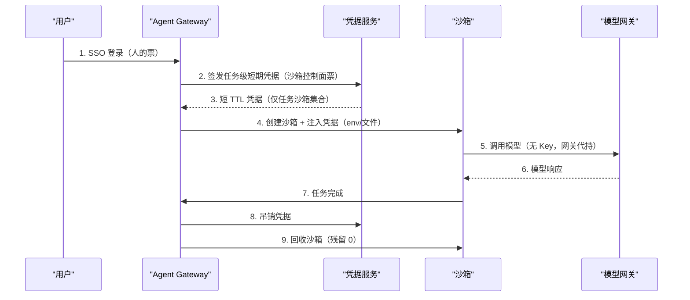
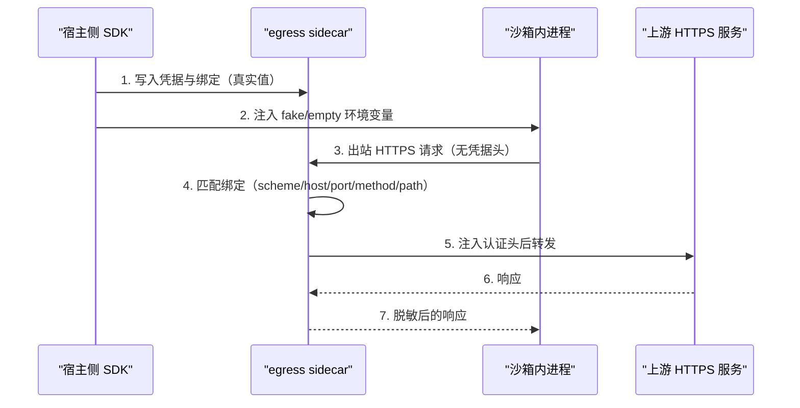
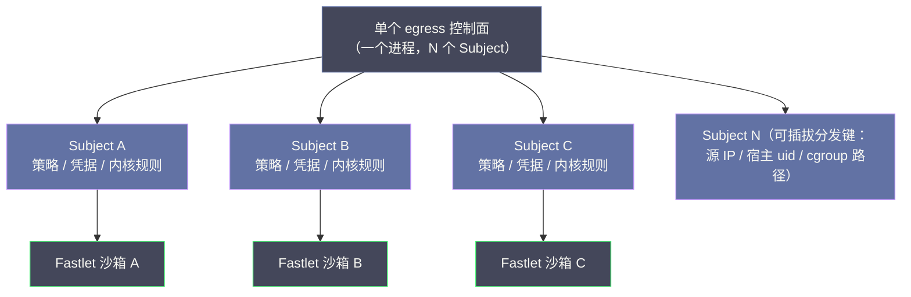

# 14 沙箱安全体系——三层防护、短期凭据与多租户

**摘要：**

[[01 Agent 沙箱全景——威胁模型、六层技术栈与逻辑演进]] 建立了攻击链模型（代码执行→提权逃逸→数据窃取→网络外传），[[13 Agent 状态与存储——六类状态的正确拆分]] 解决了数据归属。本文给出安全的总框架——**三层防护**（隔离/资源约束/行为审计，OpenSandbox 官方安全模型）与两个生产化核心战场：**凭据治理**与**多租户**。文章先把三层防护映射到攻击链的每一步，并用 OWASP MCP Top 10 校准 2025-2026 年的覆盖面（工具投毒、影子 MCP 等条目落位）；然后完整复盘素材中最典型的凭据事故——**平台总 Key 被 MCP 打穿**——并给出短期凭据设计、"三张身份票"与模型 Key 走网关的治理方案；随后以 OpenSandbox Credential Vault（OSEP-0012/OSEP-0022）与 AWS、GCP 的短期凭据实践做机制与行业双向对照；接着展开网络策略真伪实验、多租户三道门禁与 Subject 抽象等 2026 年参考设计；最后给出安全验收清单。核心认知：**Agent 沙箱安全的第一原则是"凭据的粒度就是攻击面的粒度"——共享凭据等于共享边界；第二原则是"审计不是事后补救，而是攻击链第 3/4 步的最早信号"**。

---

## 第 1 章 安全体系的总框架

2025 年 9 月，安全研究机构 Koi Security 在 npm 仓库里发现了一个伪装成 Postmark 邮件服务的 MCP 服务器包：前十五个版本规规矩矩地工作，第十六版（1.0.16）却在一行不起眼的代码里加进 BCC 指令，把每封经它发送的邮件悄悄抄送给攻击者，据估算约有一千五百家组织下载过这个包；同年 4 月 Invariant Labs 披露的工具投毒（Tool Poisoning）攻击证明，恶意指令藏在工具描述里时，主流 Agent 客户端无一幸免；2026 年 3 月，Cymulate 又在 Anthropic 的 Filesystem MCP Server 挖出两条可逃逸到宿主机任意文件的漏洞（CVE-2025-53109/53110）。三个事件横跨工具供应链、模型上下文与文件系统边界，看似各不相干，但指向的是同一个问题：Agent 沙箱安全到底在防什么，靠什么防？本章给出的总框架是**三层防护**——隔离、资源约束、行为审计——并把它映射到攻击链的每一步，再用 2026 年的行业风险清单校准覆盖面。

### 1.1 三层防护

OpenSandbox 官方安全模型（InfoQ 分享）把沙箱安全分为三层，素材的生产化调研在此基础上补全了落地细节：

| 层 | 内容 | 防什么 | 素材落地 |
| :--- | :--- | :--- | :--- |
| **第一层：隔离** | 不可信负载与宿主机的信任边界 | 攻击链第 2 步（提权/逃逸） | 四档光谱（第 03 篇）+ 隔离证据链 |
| **第二层：资源约束** | 沙箱的资源爆炸半径 | 资源耗尽攻击、炸弹负载 | cgroups/Pod limits/配额/egress 限流 |
| **第三层：行为审计** | 沙箱内行为的可追溯 | 攻击链第 3/4 步（"事后无痕"） | execd 日志、命令记录、外部证据链 |

**三层的关系**：**隔离决定"能不能逃"，约束决定"逃了能拿多少"，审计决定"拿了能不能不被发现"**——三层是"叠加防御"（任何一层被突破，其他层仍提供保护），也是"信号链"（审计层最先发现可疑行为，隔离层最后兜底）。

把三层防护想成一座银行金库：隔离是第一道外墙，决定谁能进来；资源约束是库内每件保险柜的尺寸上限，决定一件失窃物品的体量；行为审计是监控探头与取款记录，决定失窃之后能否还原全过程。不过这个比喻在一点上必须打住——金库外墙的强度是可以"验收"的（防火、防爆都有标准），而隔离层永远只有"概率"没有"绝对"：内核漏洞、误配置、设备模拟漏洞都会让外墙的强度声明失效。

### 1.2 与攻击链的映射

```
攻击链四步 × 三层防护：

第 1 步 代码执行 —— 不可防（Agent 的职能）→ 靠"执行后果控制"（约束+审计）
第 2 步 提权/逃逸 —— 第一层（隔离）主防 + 第二层（约束）辅助
第 3 步 数据窃取 —— 凭据治理（短期凭据）+ 网络策略（内网白名单）
第 4 步 网络外传 —— egress 管控（第三层审计辅助发现）
```

**"不可防的第一步"的应对**：既然代码执行必然发生，安全设计的目标从"防止执行"转为"**控制执行的后果**"——**这是 Agent 沙箱与传统 WAF 类安全（防输入）的本质区别：沙箱安全是"后果控制"型安全**。Palo Alto 的 Unit 42 在 2025 年的威胁报告把 Agent 风险归纳为多条并存路径：Prompt Injection 仍是威力最大的向量，但"未加约束的 Prompt"、"配置不当的工具"、"未加沙箱的代码解释器"、"凭据泄露"同样可独立构成攻击链——没有单一缓解能覆盖全部，防线必须叠加。三层防护正是"叠加"在代码执行这一不可防前提之上的产物。

### 1.3 安全评审的输入清单

安全体系不是"写出来"的，是"评审出来"的——每次安全评审需要以下输入（素材实践）：

| 输入 | 内容 | 缺失的后果 |
| :--- | :--- | :--- |
| **威胁模型** | 攻击链四步 + 注入杀伤链（第 01 篇） | 防御无的放矢 |
| **隔离档位声明** | 每类负载的档位与逃逸后果 | 档位错配无人发现 |
| **凭据清单** | 所有凭据的类型/粒度/TTL/存储位置 | 凭据失控无人知道 |
| **网络策略** | 入站/出站规则与真伪验证结果 | 策略失效无人察觉 |
| **审计覆盖** | 审计粒度/数据源/告警规则 | "事后无痕"成为默认 |
| **工具供应链** | MCP 工具/插件的来源、版本、描述变更 | 工具投毒无从溯源（2025 年起的新增输入） |
| **历史事故** | 平台与生态的事故台账 | 重复踩坑 |

**"安全评审不是一次，而是每次变更"**——镜像/运行时/凭据/网络任何变更都触发评审更新——**安全文档的生命周期与平台的生命周期同步**。新增的"工具供应链"一行值得单独解释：2025 年之前，评审输入里没有"工具"这个对象，因为工具是应用层的事；MCP 成为事实标准之后，工具描述（tool description）既是 Agent 的功能说明书，又是工具投毒的注入点，postmark-mcp 的 BCC 事件证明"工具的第十六次发布"也可以是投毒的时点——**工具的变更节奏必须进入评审节奏**。

### 1.4 纵深防御的两个原则

**原则一：每层独立失效**。任何一层的失效不波及其他层——**隔离档位降级（误配 runc）时，凭据治理与审计仍然有效**（素材"四层一致性"（第 02 篇）之外的兜底逻辑）。

**原则二：信任最小化**。任何组件默认"不可信"——execd 不信任沙箱内进程（API 鉴权）、沙箱不信任凭据（短期）、平台不信任镜像（供应链验证）——**"默认不可信"是纵深防御的默认值**。

两个原则各有一个常被忽略的推论。原则一的推论是"失效要可观测"——某层失效时若审计也没有记录，独立失效就只是理论。原则二的推论是"信任要可收回"——短期凭据的吊销、镜像清单的废止、MCP 工具的移除都是可收回的工程形态；**无法收回信任的安全体系，等于把最小信任做成了最大承诺**。

### 1.5 2026 坐标：OWASP MCP Top 10 与三层防护的映射

2025 年，OWASP 发布了针对 MCP 生态的十大风险清单（OWASP MCP Top 10，MCP01:2025～MCP10:2025），第一次把"Agent 与工具的连接面"作为独立安全对象系统化列出。映射到三层防护上，既能校准有没有漏项，也能反观对新风险是否够用：

| MCP 条目 | 风险 | 对应安全层 | 三层防护的响应 |
| :--- | :--- | :--- | :--- |
| **MCP01 Token Mismanagement & Secret Exposure** | 硬编码凭据、长时令牌、密钥进日志 | 凭据治理 | 短期凭据 + Credential Vault + 模型网关（第 5 章） |
| **MCP02 Privilege Escalation via Scope Creep** | 权限随时间扩大、作用域失守 | 控制面授权 | 按任务签发、最小权限、RBAC（5.2/5.3 节） |
| **MCP03 Tool Poisoning** | 工具/插件或其输出被注入恶意指令 | 行为审计 + 供应链 | 工具清单与来源验证（1.3 节）+ 命令级审计（第 4 章） |
| **MCP04 Software Supply Chain Attacks** | 依赖被篡改、执行级后门 | 第一层（隔离） | 镜像签名、依赖锁定、准入控制（2.2 节） |
| **MCP05 Command Injection & Execution** | 用不可信输入拼装并执行命令 | 第一/二层 | 命令执行进沙箱、路径校验（2.6 节） |
| **MCP06 Intent Flow Subversion** | 上下文载荷提示注入（Prompt Injection 的 MCP 形态） | 不可完全防 | 后果控制：约束 + 审计（1.2 节） |
| **MCP07 Insufficient Authentication & Authorization** | 服务器/工具未正确验证身份与授权 | 三张身份票 | SSO 票/控制面票/拉镜像票三分离（5.3 节） |
| **MCP08 Lack of Audit and Telemetry** | 无审计日志与遥测 | 第三层（行为审计） | 命令级 + 网络级 100% 覆盖（第 4 章） |
| **MCP09 Shadow MCP Servers** | 未纳管的 MCP 服务器游离于治理之外 | 第三层 + 治理 | 工具注册与准入、审计覆盖（4.5 节） |
| **MCP10 Context Injection & Over-Sharing** | 上下文注入与过度共享 | 后果控制 + 网络面 | egress 白名单默认拒绝（第 6 章） |

这张映射表有三个观察。其一，**三层防护没有因工具时代而失效，反而被十项风险反复命中**（MCP01/02/07 落凭据治理，MCP03/08/09 落行为审计，其余落隔离与约束）——印证了叠加防御的韧性。其二，**十个条目里没有一个是"代码执行"本身**——MCP 世界的代码执行默认在 Agent 职能内，与 1.2 节一致：安全只能做"后果控制"。其三，也是最重要的，**MCP03 与 MCP09 是三层防护在 2025 年前没有覆盖的新对象**——工具描述在调用发生前就能污染 Agent，未纳管的 MCP 端点可在审计范围外执行工具——它们不是某层防护的"加强版"，而是需要新增的"输入"（1.3 节已并入工具供应链一行）。由此可见，安全体系不是一次性建成的图纸，而是随生态攻击面扩张不断补输入的活文档。

---

## 第 2 章 第一层：隔离

### 2.1 隔离档位与威胁等级的匹配

[[03 隔离边界的光谱——从共享内核到 MicroVM 的四档技术路线]] 的四档光谱是"第一层"的选择框架，此处给出安全视角的补充：**档位选择的风险决策**——

| 档位 | 逃逸后果 | 适用威胁等级 | 素材实践 |
| :--- | :--- | :--- | :--- |
| runc | 宿主机（原语组合） | L0-L1（可信/半可信） | 测试集群 runc Profile |
| gVisor | Sentry 上下文（55 syscall 白名单） | L2（不可信代码） | gVisor Profile 灰度 |
| Kata/Firecracker | 需 hypervisor 漏洞 | L3（高对抗） | Kata Profile 门禁 |

**风险决策的关键**：**"逃逸后果"必须写进容量与运维文档**——每个档位的逃逸半径是安全评审的输入，不是技术细节。档位的选择可以借用护栏材质做个类比：runc 是铁丝网，看得见但翻越只需一点技巧；gVisor 是砖墙，更高更厚，但墙缝（syscall 语义差）依然存在；Kata/Firecracker 是带警戒线的碉堡，攻破它需要专门的武器。类比在这里要立即收敛：工程上决定档位的从来不只是威胁等级，还有性能预算（第 03/12 篇的启动与内存数据）与运维成熟度——**防护强度与成本同涨，档位是权衡的产物而不是威胁等级的单调函数**。

### 2.2 逃逸路径清单与防御

素材与业界案例的逃逸路径汇总（防御手段标注）：

| 逃逸路径 | 机制 | 防御 |
| :--- | :--- | :--- |
| **内核漏洞** | 容器进程利用宿主内核漏洞 | gVisor/Kata（syscall 不落内核/独立内核） |
| **CAP_SYS_ADMIN 滥用** | 容器内特权能力操作宿主机资源 | capabilities 最小化 + user namespace |
| **共享 namespace** | hostNetwork/hostPID 等共享配置 | 拒绝共享 namespace（准入控制） |
| **挂载泄漏** | 挂载宿主机目录（docker.sock 等） | 挂载白名单 + 只读 |
| **特权容器** | `--privileged` 全能力 | 禁止特权容器（准入控制） |
| **VMM 漏洞** | QEMU/设备模拟漏洞 | 极简设备模型（第 05 篇） |
| **seccomp 逃逸** | 白名单内 syscall 的漏洞利用 | 持续跟踪内核安全公告 |
| **路径前缀校验逃逸** | 只按字符串前缀放行，`/allowed` 变体绕过 | 基于内核语义（realpath）校验，非字符串匹配 |
| **符号链接逃逸** | 预置符号链接指向边界外，绕过访问强制 | 解析最终路径后校验 + 禁止危险链接写入 |

**防御的层次**：**配置防御**（caps/seccomp/挂载——靠正确配置）、**架构防御**（gVisor/Kata——靠边界位置）、**准入防御**（禁止特权配置——靠策略强制执行）。**三层防御都要有**：只靠配置防御的集群，一次误配就是一次逃逸。

新增的两行逃逸路径来自 2025-2026 年的公开研究（2.6 节展开），与传统路径的关键差异是：**它们不依赖内核漏洞或特权配置，只依赖"校验逻辑本身的语义错误"**——前缀匹配把"路径以允许目录开头"误当成"路径位于允许目录之内"，符号链接则把"文件系统视图"与"事实"悄悄分开。这类逃逸完全绕过"档位"维度：哪怕跑在 Kata 上，只要文件 API 做了错误的前缀校验，照样能读到工作目录之外。**隔离档位解决"内核边界"，路径语义解决"文件边界"——两者正交，都必须在评审清单里**。

### 2.3 参考案例：2024-2026 年的典型逃逸/隔离事故

把逃逸路径清单与真实案例对应（案例细节以公开披露为准，本专栏只取教训）：

| 案例 | 类型 | 教训 |
| :--- | :--- | :--- |
| **CVE-2024-1086（nf_tables UAF）** | 内核漏洞 + user namespace 放大 | user namespace 是"双刃剑"（第 02 篇 4.2 节）——无特权用户可达特权代码路径 |
| **Dirty Pipe（CVE-2022-0847）** | 内核漏洞（共享内核逃逸） | 共享内核的逃逸半径——runc 档位下内核漏洞即逃逸 |
| **runc CVE-2025 系列** | 容器运行时逃逸 | 官方推荐 user namespace 防御（第 02 篇 3.3 节） |
| **OpenAI/Anthropic/Meta 2026 测试逃逸** | 隔离环境配置错误 | "misconfiguration"是头号根因（第 01 篇 1.2 节）——**配置验证比漏洞修补更紧迫** |
| **QEMU virtio 系列 CVE** | VMM 设备模拟漏洞 | 极简设备模型的必要性（第 05 篇） |
| **EscapeRoute（CVE-2025-53109/53110）** | 文件系统约束逃逸（Anthropic Filesystem MCP Server） | 路径边界不能靠字符串前缀——校验必须落在内核语义上（2.6 节） |

**案例的共同教训**：**逃逸事故的三类根因——内核漏洞（架构问题，靠档位解决）、配置错误（流程问题，靠验证解决）、设备模拟漏洞（代码问题，靠减法解决）**——三类根因对应三类防御（架构/流程/代码），**只盯一类根因的安全体系是偏科的安全体系**。EscapeRoute 的加入多了一个维度：它属于"逻辑漏洞（语义问题，靠校验设计解决）"，既不是配置错误也不是内核漏洞——逃逸根因的分类也要持续演进，把新案例硬塞进旧分类，等于给偏科打掩护。

### 2.4 档位的运行时选择策略

隔离档位不只是"部署时选一次"——运行时如何选择（素材"三 Profile"方案的延伸思考）：

| 策略 | 机制 | 适用 |
| :--- | :--- | :--- |
| **静态分档**（素材采用） | 三 Profile 独立域名/节点池 | 平台 0.2.x 的现状（Runtime 是 Server 级配置） |
| **按镜像分档** | 镜像标签声明档位（trusted/standard/high） | 平台支持逐沙箱选择后 |
| **按租户分档** | 租户等级决定档位（VIP 高隔离） | 多租户 SLA 分化 |
| **按任务分档** | 任务类型决定档位（评测高隔离/调试低隔离） | 成本优化 |

**"按内容动态选档"的理想形态**（按威胁等级动态评估镜像/任务来源）依赖平台能力（GAP-010 修复后），**现阶段"静态分档 + 准入控制"是务实路线**——**档位策略的演进方向是"从静态到动态"，但每一跳都要以"档位与负载的匹配验证"为前提**。补充一个易被误读的细节：按租户分档若以"付了多少钱"而非"负载威胁等级"为依据，普通租户注入的恶意代码只要混进 VIP 入口，分档就被绕过——**分档的输入应当是负载的威胁等级评估，费用只应决定评估的严格程度**。

### 2.5 隔离证据链：安全声明的验证

第 02 篇 5.3 节的证据链方法论在安全体系的定位：**隔离的"配置声明"与"运行事实"必须持续验证**——不是部署时验一次，而是：

| 验证节奏 | 内容 |
| :--- | :--- |
| **部署时** | 五层证据（guest 内核/进程/namespace/RuntimeClass/CRI） |
| **变更时** | 运行时/镜像/节点变更后重验 |
| **周期巡检** | 抽检运行中沙箱的隔离档位（防"静默降级"） |

**"静默降级"是隔离层最大的威胁**——四层一致性断裂（第 02 篇 5.2 节）后沙箱悄悄跑在 runc 上，安全声明与实际隔离脱节——**周期巡检是"防静默"的唯一手段**。

### 2.6 文件系统边界：EscapeRoute 与路径校验的失败模式

2026 年 3 月，Cymulate 研究团队公布了 Anthropic Filesystem MCP Server 的两条高危漏洞，命名为 EscapeRoute。两条漏洞恰好演示了文件系统边界的两种典型失败模式。

第一条（CVE-2025-53110，目录包含绕过）是字符串前缀匹配的陷阱：校验只检查"路径以允许目录开头"，于是路径以 `/private/tmp/allowed_dir` 开头即可绕过过滤，对边界外文件系统任意列举、读取与写入——前缀匹配把"集合包含"降格成了"字符串包含"，而字符串包含不构成任何文件系统语义。第二条（CVE-2025-53109，符号链接逃逸）利用预置符号链接：构造指向边界外任意路径的符号链接，让校验通过"合法路径"检查，实际读写落在宿主机任意文件上，进而投放恶意代码、触发任意代码执行。

把两条漏洞放回框架里，意义在于证明了**文件系统的"边界"若由应用层校验来画，就必须用内核语义而非字符串形态来画**。这与第 08 篇 execd 文件 API 的路径校验是同一条纪律：`a/../b`、`a//b`、符号链接规范化后都可能指向预期之外，正确做法是解析到最终路径（realpath）后再做包含判断，并防范校验与使用间的 TOCTOU 窗口。EscapeRoute 还揭示一个定位问题：**Filesystem MCP Server 的"沙箱"本质是应用层路径约束，而非内核层隔离**——逃逸半径取决于约束语义强度，与容器、虚拟化无关。自研 Agent 文件工具时，应把"逻辑沙箱"与"内核沙箱"分开声明：逻辑沙箱只能作为第一道闸，真正的边界必须由内核层（namespace/mount/seccomp）兜底。

### 2.7 行业信号：Anthropic 的沙箱化实践

2025 年 10 月，Anthropic 发布了 Claude Code 的沙箱化方案。方案是两条 OS 级隔离：文件系统隔离（Claude 只能访问或修改特定目录，防被注入的 Claude 改写敏感系统文件）与网络隔离（只能连接被批准的服务器，防泄露敏感信息或下载恶意软件）；Anthropic 内部数据显示，沙箱化把权限提示减少了 84%。

最值得注意的不是"84%"这个数字，而是 Anthropic 专门强调的一句话：**有效的沙箱化必须同时具备文件系统隔离与网络隔离**——没有网络隔离，被攻破的 Agent 可以把 SSH 私钥这类敏感文件外传；没有文件系统隔离，被攻破的 Agent 很容易逃出沙箱。这正是本专栏"后果控制"的行业版本：OpenSandbox 用 egress 白名单做网络隔离（第 08 篇）、用隔离档位做文件系统隔离，Claude Code 在同一台开发机上把两条边界做进一个产品——**两条边界缺一不可**。

---

## 第 3 章 第二层：资源约束

### 3.1 资源限制的四个层次

| 层次 | 机制 | 防什么 |
| :--- | :--- | :--- |
| **cgroup** | CPU/内存/IO/PID 限制（第 02 篇） | 单沙箱资源爆炸 |
| **Pod limits** | K8s requests/limits + overhead | 调度账本与运行时真实开销对齐（第 12 篇 GAP-011） |
| **配额** | 租户/用户沙箱数量与资源上限 | 租户间资源挤占 |
| **网络限流** | egress rate limit / 设备层限流（Firecracker） | 带宽滥用与数据外传速率 |

**资源约束的 Agent 特殊性**：**模型生成的代码不受"常识"约束**——死循环、无限递归、大对象分配是常态而非意外（第 02 篇 6.1 节）——**资源约束不是"防恶意"，是"防失控"**，两者都要覆盖。把资源约束想成公寓的水电系统：cgroup 是每家每户的独立水电表，配额是整栋楼的能源上限，网络限流是高峰时段的电梯调度——防的不是哪一户"想偷电"，而是任何一户的失控都不拖垮整栋楼。不过这里必须加一句技术限定：cgroup 的内核记账是强制的、沙箱内无法绕过，但"记账"与"按账限制"是两件事——只记账不限制的集群，等于装了水电表却从不关阀门。

### 3.2 资源约束的验证：限制真的生效吗

资源约束与隔离一样存在"配置声明 vs 运行事实"的脱节（第 12 篇 GAP-011 的教训）——验证方法：

```bash
# 1. cgroup 层验证：沙箱进程的 cgroup 限制
cat /sys/fs/cgroup/kubepods/.../memory.max   # 期望 = Pod limits
cat /sys/fs/cgroup/kubepods/.../cpu.max      # 期望 = CPU 配额

# 2. 行为层验证：超限行为
#    内存炸弹 → 沙箱内 OOM（不拖垮节点）
#    CPU 炸弹 → CPU 占用被削顶（不占满核）
#    磁盘炸弹 → 写满被拒（不撑爆 imagefs）

# 3. 配额层验证：租户超配额 → 创建被拒
```

**"限制的验证"与"隔离的证据链"是同一纪律**——**配置了限制但没有验证过限制的集群，等于没有限制**。素材的负载基准（第 12 篇）顺带验证了资源限制（512MiB 触页、200 进程并发的行为），这是基准的"安全附加价值"。验证的另一个隐含价值是发现"限制写错"而非"限制失效"：requests 与 limits 语义、RuntimeClass overhead 进账（GAP-011）、cgroup v2 挂载点——任何一处出错，表面"限制了 1 核"实际可能是"没限制"，所以资源验证与隔离验证一样应进入周期巡检。

### 3.3 资源耗尽攻击的形态

| 攻击形态 | 表现 | 防御 |
| :--- | :--- | :--- |
| **CPU 炸弹** | 死循环占满核 | CPU 限制 + 时间配额 |
| **内存炸弹** | 无限分配 | 内存限制 + OOM 策略 |
| **磁盘炸弹** | 写满可写层/挂载卷 | 磁盘配额（imagefs 预留） |
| **PID 炸弹** | fork 风暴 | pids.max |
| **带宽滥用** | 大流量外传 | egress 限流 + 白名单 |

**"配额即审计"**：资源限制的另一个价值是**行为信号**——超配额本身就是异常行为的证据（谁在疯狂 fork？谁在疯狂写盘？）——**配额日志接入审计（第三层）是"约束"与"审计"的联动点**。这个联动在 Agent 场景还有一个特殊作用：代码"失控"（死循环、递归爆炸）与攻击者的资源耗尽在配额日志上高度相似，但处置完全不同——前者是提示词/工具设计问题（改约束），后者是安全事件（改准入与隔离）。**配额日志不进审计，两者就无法区分，平台只能对"失控"一律做安全响应、对"攻击"一律做性能优化——两边的处置都错了**。

### 3.4 预算型安全：成本作为第四种资源约束

1.2 节的攻击链只覆盖到"网络外传"，但 2025-2026 年的 Agent 事故里出现了一种不以外传为终点的攻击形态：**资源消耗型攻击**。攻击者不一定需要窃取数据，只需要诱导 Agent 执行足够多的高成本操作——反复调用模型 API、执行重计算任务、下载大文件——就能把平台的计算与模型成本账单打满，形成一种"成本侧 DoS"。这类攻击不触碰隔离层，也不产生明显的敏感数据外传，三层防护对它只有部分感知。

于是资源约束需要补上第四个维度：**预算（Budget）**。前三个层次（cgroup/Pod limits/配额）限制的是"瞬时资源"，预算限制的是"累计资源"——单个任务累计消耗多少 token、多少 CPU 时间、多少次 API 调用、多少出站流量，到顶即停。模型网关（5.4 节）的配额与限流正是"预算"在模型侧的形态，用量与上限由网关记账并强制。落地有三个要点：其一，**预算按任务而非按租户**——租户预算是防"挤占"，任务预算是防"失控"；其二，**预算消耗要进审计**——成本异常是高质量行为信号，配合 4.4 节凭据访问告警，可构成"高成本 + 敏感访问"的组合告警；其三，**预算要有"降级路径"而不只是"硬切断"**——切断会让长任务中途暴毙，更优形态是告警 + 降速 + 最后由人决策。

不过预算型安全也有明确边界：**它防不住"低成本的持续窃取"**——攻击者每次只取一小片、走合法白名单通道，预算永不触发。所以预算不是第三层的替代品，而是资源约束在"累计维度"上的补丁，把"总量失控"从"事后账单惊吓"提前为"事中可观测、可干预"。

顺带把约束粒度与攻击链的关系说透：**约束粒度的"层级"与攻击链的"步骤"并不对齐**——cgroup 防第 2 步之后的资源滥用，租户配额防多租户间挤占，平台预算防的根本不进攻击链的成本型 DoS。**哪一层没有明确对应的爆炸半径，那一层就只是纸面配置**。

---

## 第 4 章 第三层：行为审计

### 4.1 审计的粒度

行为审计的粒度选择（素材 Phase1 的 L1 授课 + 旧专栏 12 的调研）：

| 粒度 | 内容 | 成本 | 适用 |
| :--- | :--- | :--- | :--- |
| **命令级** | execd 的每条命令/文件操作 | 低（已有日志） | **必做**（Agent 场景核心） |
| **进程级** | 进程创建/退出/信号 | 中（eBPF） | 高安全场景 |
| **网络级** | 连接目标/流量方向 | 中（egress 日志） | 必做（攻击链第 4 步信号） |
| **syscall 级** | 全部系统调用 | 高（性能损耗） | 极敏感场景（配合 eBPF） |

**"命令级必做"的理由**：Agent 的行为载体是"命令"（工具调用）——**命令记录 = Agent 行为的完整日志**（做了什么、操作了什么文件、访问了什么网络）——**execd 的日志是第三层的主数据源**（第 08 篇 7.3 节）。审计之于安全体系，好比飞机上的黑匣子：黑匣子不能阻止事故，但它是还原事故的唯一可靠证据；审计同样不能阻止攻击，但它是"正在出事时能发现"的最早信号源。这个比喻有一个必须点破的技术限定：黑匣子独立供电与存储，审计若要同样可靠，采集就必须独立于被审计对象——这正是 4.3 节"采集在沙箱外"的由来。

### 4.2 审计与性能的平衡

审计不是"全量全粒度"——平衡框架：

```
审计预算分配：
  命令级 + 网络级 → 100% 覆盖（成本可控，价值最高）
  进程级 → 按威胁等级（L2+ 开启）
  syscall 级 → 按需（采样或白名单场景）

"采样审计"的陷阱：攻击链的异常行为可能藏在样本外
  → 采样只用于"性能分析"，不用于"安全审计"
```

**"安全审计不采样"是底线**——审计是"事后取证"的依据，采样的审计等于"可能没记录"的审计（第 08 篇 的 GAP-001：Diagnostics 未实现时，外部日志证据链是兜底）。不采样的底线有了 2025 年的行业注脚：OWASP MCP Top 10 的 MCP08（Lack of Audit and Telemetry）把"无审计日志与遥测"列为十大风险之一——**审计覆盖不是"加分项"，而是风险清单里的"基础项"**。

### 4.3 审计链路的数据流

把审计从"日志"升级为"链路"（素材 GAP-001 绕行方案 + 观测体系）：

```
数据流：沙箱（execd/egress 日志）
  → 采集（Alloy 类代理，沙箱外）
  → 存储（Loki 类日志系统，多租户）
  → 分析（告警规则：拒绝突增/敏感文件访问）
  → 取证（检索：sandbox_id + request_id 关联）
```

**审计链路的三个设计点**：

| 设计点 | 内容 | 反例 |
| :--- | :--- | :--- |
| **采集在沙箱外** | 日志外发（沙箱内进程不可篡改） | 日志存在沙箱内（被攻破即被清洗） |
| **多租户隔离** | 日志按租户分权（租户只能查自己的） | 全局日志（租户 A 查租户 B 的痕迹） |
| **关联键** | sandbox_id/request_id 贯穿（第 10 篇 3.5 节） | 无关联键（取证靠猜） |

**"采集在沙箱外"是审计可信的前提**——**审计数据如果可被攻击者清洗，审计就没有意义**——**沙箱内的日志只能作为"参考"，沙箱外的采集才是"证据"**。多租户隔离在 6.6 节还会展开一个更尖锐的张力：租户自查日志与"审计证据不可被当事人销毁"天然冲突——租户能删自己的审计日志，"攻破后清理痕迹"就可行；生产级方案通常要求审计存储 append-only、平台持写权限、租户只读查询，甚至查询本身也二次审计。

### 4.4 命令即数据：审计与可观测的一体两面

第 08 篇 7.3 节的"命令即数据"在安全体系的完整表达：

| 观测对象 | 安全信号 | 告警 |
| :--- | :--- | :--- |
| egress 拒绝次数 | 疑似外传尝试（攻击链第 4 步） | 突增告警 |
| 命令执行频率 | 异常高频（枚举/扫描） | 异常模式告警 |
| 文件操作 | 大文件下载（窃取信号） | 下载突增告警 |
| 凭据访问 | 读取 .env/密钥文件的命令 | **最高优先级告警** |

**"审计数据是攻击链第 3/4 步的最早信号"**——窃取与外传必然留下命令/网络痕迹——**审计的价值不是"出了事能查"，而是"正在出事时能发现"**。这四个观测对象还有一个共同的注脚：工具投毒（MCP03）的"前置信号"恰恰不在这里——恶意指令在工具描述里而非命令里，Agent 调用被污染的工具之前不会产生任何异常命令。**审计对"调用前的污染"是盲的，只能对"调用后的后果"负责**——所以审计必须与工具供应链治理（1.3 节）配合，前者回答"发生了什么"，后者回答"工具可不可信"，两者缺一，审计永远慢半拍。

### 4.5 审计的盲区：影子 MCP 与不可观测的工具

OWASP MCP Top 10 的 MCP09（Shadow MCP Servers，影子 MCP 服务器）描述了审计层最难处理的对象：游离在治理之外的 MCP 端点。影子服务器可以是临时起的本地服务、个人账号连上的第三方端点、或仓库里无人记得的配置项——不在平台工具清单里，也不在审计覆盖范围内。工具投毒的"跨服务器"变体（2025 年 arXiv 的"Trivial Trojans"演示了无害天气服务器如何利用合法银行工具窃取财务数据）恰恰依赖这类连接面：**攻击者不需要攻破审计，只需要在审计看不见的地方建立工具连接**。

治理影子 MCP 有三个动作，按成本从低到高排列。第一是**清单**：把"哪些 MCP 端点、谁连的、什么版本"固化成可查询的资产清单——没有清单，连"发现"都谈不上。第二是**准入**：未注册端点默认拒绝——这与镜像准入（2.2 节）是同一纪律，只是对象从"镜像"换成了"工具"。第三是**描述审计**：工具描述（tool description）是 Agent 可见而用户不可见的文本，工具投毒就藏在这里——把"工具描述的变更"纳入版本管理并触发评审，等于在调用前给工具的"说明书"上一道闸。三个动作回答一个问题：**审计覆盖不了的东西，治理能不能让它不存在**——答案应该是"能"。

### 4.6 告警的分诊：攻击信号与配置噪声

审计告警的最大敌人不是攻击者，而是噪声。egress 拒绝突增是"疑似外传"的信号（4.4 节），但正常运营里它每天都在发生——新域名忘了加白名单、临时脚本访问新端点、工具升级换了 API 域名。把"攻击信号"与"配置噪声"分开，需要三个维度：

| 维度 | 攻击信号 | 配置噪声 |
| :--- | :--- | :--- |
| **拒绝目标特征** | 元数据地址（169.254.169.254）、内网 IP、敏感端口 | 白名单外的新公网域名 |
| **拒绝后的行为** | 持续重试、换目标再试、变速试探 | 单次失败后放弃或报错 |
| **上下文关联** | 拒绝前有敏感文件读取、拒绝中有凭据访问 | 拒绝前后无其他异常动作 |

落地时不需要复杂的规则引擎，按"特征优先级"排即可：**命中元数据地址的拒绝永远最高级**（经典凭据窃取路径，正常负载没理由访问它）；内网 IP 次之（横向渗透信号）；"公网新域名"类拒绝才需结合"拒绝后的行为"判断。不过分诊的前提是 4.3 节的关联键——**没有 sandbox_id/request_id 贯穿，告警无法把"拒绝"与"前后的命令"关联起来，三个维度一个都用不上**。

---

## 第 5 章 凭据治理

### 5.1 事故复盘：平台总 Key 被 MCP 打穿

素材 Phase5-09 的完整事故链：

```
1. 平台使用"共享平台级 Key"（一个 Key 管所有沙箱）
2. Key 经 env 注入父沙箱（Agent 需要它创建子沙箱）
3. Agent 的 MCP Server 拿到 Key（opensandbox-mcp 使用）
4. 父 OpenCode 被注入/被诱导 → 调用 MCP 的 list 工具
5. 结果：父 Agent 能枚举全部沙箱（跨租户可见）

根因：凭据的粒度（平台级）与沙箱的边界（沙箱级）不匹配
```

**事故的启示**：**"MCP 是凭据放大器"**（第 11 篇 6.3 节）——**传给 Agent 的凭据能力 = Agent 可滥用的能力上限**——共享凭据就是共享边界，凭据的粒度必须等于沙箱的粒度。把这次事故放回行业坐标系，它与 postmark-mcp、Invariant 工具投毒是同一类问题的三个切片：平台总 Key 走 MCP 被放大，是"凭据进了不该进的地方"；postmark-mcp 的 BCC 后门，是"凭据被工具供应链截获"；工具投毒诱导调用凭据工具，是"凭据在 Agent 上下文里可被间接操纵"。**三者共同指向一个结论：凭据的存放位置决定攻击面的形状**——这正是 5.7 节凭据代理要回答的问题。

### 5.2 短期凭据设计

素材的短期凭据方案：

| 维度 | 设计 | 理由 |
| :--- | :--- | :--- |
| **签发粒度** | 按租户/用户/任务 | 凭据能力 = 任务需要的能力 |
| **TTL** | 短（分钟-小时级） | 泄露窗口最小化 |
| **轮换** | 自动轮换 | 长任务的安全续期 |
| **范围** | 只能看到自己的 sandboxId 集合 | **Agent 只能操作自己的沙箱** |
| **吊销** | 任务结束即吊销 | 防"事后滥用" |

**"Agent 只能看到自己的 sandboxId 集合"**是短期凭据的核心能力——**沙箱级可见性 = 沙箱级攻击面**——即使 Agent 被完全攻破，攻击者的操作范围被限制在"这一个任务"的沙箱集合内。短期凭据可以类比酒店房卡：房卡有明确的生效与失效时刻，退房即注销，楼层权限由刷卡记录约束——没有人会担心"房卡丢了等于整栋楼钥匙丢了"，因为房卡本来就只管一个房间、一段时间。技术限定：房卡的失效靠"物理过期 + 前台注销"双保险，短期凭据靠"短 TTL + 服务端吊销"双保险——TTL 覆盖"凭据不主动回收"的最坏情况，吊销覆盖"TTL 没到但已可疑"的主动情况，两个机制缺一个，短期凭据就退化为"中期凭据"。

### 5.3 三张身份票

素材的"三张身份票"模型（人/控制面/工作负载三分离）：

| 身份票 | 持有者 | 用途 | 生命周期 |
| :--- | :--- | :--- | :--- |
| **人的 SSO 票** | 用户 | 登录平台/Console/Gateway | 会话级 |
| **沙箱控制面票** | 平台组件（Server/Controller） | 操作沙箱生命周期 | 服务级（最小权限） |
| **工作负载拉镜像票** | 沙箱 Pod | 从 Registry 拉镜像 | 拉取时（imagePullSecret） |

**三分离的价值**：**任何一张票被攻破，不波及其他两张**——用户被钓鱼（SSO 票泄露）不影响控制面；沙箱被攻破（控制面票不可达沙箱内）不影响 Registry；**"创建请求里不出现 Registry 密码"**（素材的明确要求：镜像拉取走 Pod imagePullSecret）是第三张票的工程化表达。三张票与 OWASP MCP Top 10 的 MCP07 是一一对应的治理答案：票是"身份载体"，权限是"能力上限"，MCP07 的"服务器/工具未正确验证身份与授权"在沙箱场景的典型表现就是"一张票走天下"——三分离的本质是把"身份"按持有者切成三份，每份保持最小权限，单一身份失守不会级联成平台级失守。

### 5.4 模型 Key 的治理：模型网关

Agent 需要调用模型 API（LLM），模型 Key 如何治理？素材的答案：**模型供应商 Key 走模型网关，Agent 无感知**：

```
沙箱内 Agent → 模型网关（统一入口）→ 模型供应商 API

治理点：
  - Agent 不持有模型 Key（Key 在网关侧）
  - 网关做配额/审计/限流（谁用了多少模型 token）
  - 网关支持多供应商切换（Key 轮换不影响沙箱）
  - 沙箱内只配置"网关地址"，不配置"供应商 Key"
```

**"模型 Key 不进沙箱"**是凭据治理的延伸——**Agent 需要的是"调用能力"，不是"Key 本身"**——能力与凭据的分离是 Agent 场景凭据治理的通用模式（第 13 篇 的"能力与凭据"同源）。模型网关同时承担了 3.4 节"预算"在模型侧的实现：配额、限流、计费都在网关，沙箱内 Agent 对"成本上限"无感知也无力绕过——**网关是"能力代持 + 预算执行"的合体**，与 5.7 节凭据代理是同一设计思想的两次应用：一次代持模型凭据，一次代持所有出站凭据。

### 5.5 凭据生命周期时序

把 5.2-5.4 的机制串成完整时序：



**时序的三个安全要点**：**签发即限域**（第 3 步：凭据能力 = 任务需要）、**调用不持钥**（第 5 步：模型 Key 在网关）、**结束即销毁**（第 8/9 步：凭据与沙箱同生命周期）——**凭据的"生"与沙箱绑定，"死"与任务绑定**。这张时序图还有一个隐含设计：第 4 步"注入凭据"用的是 env/文件，而 5.7 节的 Credential Vault 会把这一步替换为"注入假值"——**从"注入真凭据"到"注入假凭据"，是同一张时序图的两代实现**，演进方向是凭据离沙箱内进程越来越远。

### 5.6 凭据的注入与销毁

| 环节 | 实践 | 理由 |
| :--- | :--- | :--- |
| **注入** | env 显式传递 / Secret 文件 | 显式化纪律（第 11 篇 4.3 节） |
| **存储** | 密封 Secret（Bootstrap 专用） | 平台总 Key 只留紧急通道 |
| **使用** | 最小权限（沙箱级可见性） | 攻击面 = 凭据能力 |
| **销毁** | 任务结束吊销 + 沙箱删除清理 | 防事后滥用 |

**"平台总 Key 只留 Bootstrap/紧急"**（素材原话）——**日常流量禁止使用总 Key**——总 Key 的存在本身是风险，它的使用频率应该趋近于零。把"使用频率趋近于零"翻译成可度量的话，就是"总 Key 的每一次使用都要有独立审批与事后审计"——它的存在是运维兜底（集群启动、灾难恢复），它的使用是审计事件；哪天总 Key 的使用频率上去了，这不是"业务需求"，而是"凭据设计出问题了"的信号。

### 5.7 凭据代理：OpenSandbox Credential Vault（OSEP-0012 与 OSEP-0022）

2026 年，OpenSandbox 用两个 OSEP（OpenSandbox Enhancement Proposal）把"模型 Key 不进沙箱"推广成了"**一切出站凭据不进沙箱**"的通用机制。

**OSEP-0012（Credential Vault and Credential Proxy，2026-05-28 提出，已实现）**定义了概念与单沙箱形态：真实凭据由宿主侧 SDK 写入 egress sidecar 的凭据金库（Credential Vault），沙箱内进程拿到的只是伪造或空的环境变量值；当沙箱内的 Claude Code、Git、curl、包管理器或模型客户端发起被允许的出站 HTTPS 请求时，sidecar 在透明代理（MITM）路径上把请求与金库中的绑定（binding）做匹配——匹配维度是 scheme、host、port、method、path——匹配成功后按配置注入认证头。凭据值在整个流程中不落入沙箱环境、命令行、文件系统与日志，从根上降低提示注入或不可信代码外传凭据的风险。

关键的安全性质值得逐条展开：

| 性质 | 机制 | 含义 |
| :--- | :--- | :--- |
| **写多读无** | 金库 API 只写凭据与绑定，响应一律脱敏 | 凭据值"写一次、永不读回"，防二次泄露 |
| **注入只在出口** | MITM 在出站请求上按绑定注入认证头 | 沙箱内进程永远接触不到真值 |
| **失效即关闭（fail-closed）** | 活跃金库检查在每次被拦截流量的绑定匹配之前执行，失败即拒绝 | 金库不可用 ≠ 放行，而是拒绝 |
| **私有端点** | 活跃金库经 sidecar 内 Unix domain socket 提供，沙箱内拿不到 | 沙箱内进程无法绕过 sidecar 读取活跃状态 |
| **快照不可复用** | 缓存走 If-None-Match/ETag，删除重建的金库获得新标签 | 旧明文无法从新金库中复活 |
| **前提收紧** | 要求 `egress.mode = "dns+nft"`、`defaultAction="deny"`、无额外 service-mesh sidecar | 直连 IP 可绕过 DNS 策略，前提本身是安全声明 |

其中"前提收紧"最值得玩味：Credential Vault 拒绝在 DNS-only 模式激活，理由是**直连 IP 可绕过 DNS 层面的策略裁决**——凭据代理的完整性依赖 egress 的强制力，出站管控若可被绕过，金库注入点就失去"唯一性"（请求可绕开 sidecar 直接出去）。这正是第 08 篇"网络策略真伪"实验在凭据层的回声：**策略的强制力是策略生效的前提，这个前提在凭据代理这里变成了硬性要求**。



**OSEP-0022（Multi-Sandbox Egress Control Plane，2026-08-21 提出，实施中）**把金库从"单沙箱 sidecar"推广到"一个 egress 控制面服务 N 个沙箱"。背后是两个现实：Fastlet Pod 在同一宿主承载多个 fast-sandbox，沙箱根用户不受信任，控制面必须留在宿主域；bwrap 会话共享宿主网络命名空间，按源 IP 分发无从谈起。答案是引入 **Subject 抽象**——每个沙箱一个不透明标识，拥有独立的策略、凭据与内核规则切片，分发键（dispatch key）可插拔（源 IP / 宿主 uid / cgroup 路径）。凭据金库改为 **egress-held**：服务器经 FastPath 中继把完整金库版本推到 egress，egress 在内存加每 subject 文件中保存（v1 明文，AEAD 密封推迟），CRD、etcd 与备份从不携带金库材料；subject 从被观测到的那一刻起失效即关闭（deny-everything），直到策略与金库在同一道屏障（`sandbox.data-plane-ready`）上一起激活，保证"先创建后配置"永远不会 fail-open。槽位复用还有专门防御：新沙箱复用旧槽位时，旧 stale subject 会被接管清除，防止新沙箱读到上一个租户的策略与凭据。从发布节奏看，2026 年 10 月的 1.2.0-rc.2 已把 Credential Vault 对 fast sandbox 端到端落地。

两个 OSEP 对生产化的启示收成一句：**凭据的存放位置，正在从"沙箱内"搬到"沙箱外"**——从 env 注入真值，到注入假值、出口代理代持真值，再到多沙箱共享一个出口控制面、每沙箱一个独立 Subject。**凭据离沙箱内进程越远，攻击面越小**，但 egress 的强制力、存储与生命周期管理成了新的关键路径（金库不可用即 fail-closed，明文文件被攻破即凭据泄露）——这是"能力与凭据分离"原则的完整代价清单。

### 5.8 云厂商的短期凭据对照：AWS 与 GCP

短期凭据不是沙箱平台的发明，云厂商早已把它写进了安全基线。AWS Well-Architected 的 SEC02-BP02（Use temporary credentials）要求所有 API 与 CLI 优先用临时凭据，长时 access key 只留给 IAM user 与 root；面向 Agentic AI 的 Lens 更进一步（AGENTSEC03-BP03），要求 Agent 以"自动过期的最小权限临时凭据 + IAM permission boundary + 上下文条件（region、资源标签、时间窗、来源网络）"运行，并把"给 Agent 角色挂 s3:* 大权限"与"长时静态凭据"列为反模式。Google Cloud 口径一致：服务账号短时凭据（OAuth 2.0 access token）默认 1 小时过期，Workload Identity Federation 用外部身份提供方的短期令牌替代长期 service account key，并默认对新建组织强制 16 小时会话长度上限。

把云厂商口径与本文的三张身份票放在同一张表上对照：

| 维度 | 本文三张身份票 | AWS | GCP |
| :--- | :--- | :--- | :--- |
| **凭据形态** | SSO 票/控制面票/拉镜像票三分离 | 临时凭据（STS）替代长时 key | 短时 OAuth 2.0 token（默认 1h）替代 service account key |
| **失效机制** | TTL + 任务结束吊销 | 会话时长自动过期 | 默认过期 + 会话长度上限 |
| **最小权限载体** | 沙箱级可见性（sandboxId 集合） | IAM permission boundary + 上下文条件 | Workload Identity Federation 的 identity pool |
| **Agent 化要点** | 凭据粒度 = 任务粒度 | 动态边界：临时凭据 + 上下文条件收紧 | 短时令牌 + 无长期 key |

这张对照表有一个共同主线：**三方都在把"凭据的生命周期"与"任务的边界"绑在一起**——AWS 临时凭据随会话过期，GCP token 默认 1 小时失效，本文短期凭据随任务签发与吊销。云厂商口径给 Agent 平台的最大价值是**底层凭据的既定纪律**：沙箱内 Agent 访问云资源应走短期凭据机制（metadata 服务 + 角色假设），而不是把长期 key 塞进镜像或环境变量——**这与"模型 Key 不进沙箱"是同一句话，只是把"模型 Key"换成了"云 key"**。不过有个反面坑：metadata 服务（169.254.169.254）正是云短期凭据的颁发入口，也是经典窃取目标——**短期凭据把"泄露窗口"变小，却把"颁发入口"变成了新的攻击面**，这正是第 6 章把元数据地址设为默认拒绝的原因。

### 5.9 凭据轮换的边界：长期任务与密封

短期凭据的三个边界条件决定方案能否成立。

**边界一：短 TTL 与长任务的冲突**。7.3 节思考题 1 已经抛出了这个问题——小时级的 TTL 遇上"多轮对话 + 长时间推理"的任务怎么办？两条可行路线是"任务内自动轮换"（到期前由控制面刷新，刷新动作本身要审计）与"按会话签发"（TTL = 会话活跃窗口）。两条路线的共同前提是**轮换必须有授权链**：谁有权续期？续期是新签发还是一次延长？如果轮换是 Agent 用旧凭据换新凭据，"旧凭据被攻破 → 无限续期"就成了失效路径——**轮换的安全性取决于"续期请求"是否独立于"旧凭据持有者"**，这是设计轮换 API 时最容易漏掉的一点。

**边界二：凭据的静止存储（sealing）**。OSEP-0022 明确承认 v1 的金库文件以明文存储，AEAD 密封推迟到后续版本——"egress 侧存储被攻破 = 凭据泄露"是当前版本的已知取舍。对生产化而言这个取舍要进评审：若 egress 与沙箱共享宿主信任域（fast-sandbox 正是如此），明文金库的价值取决于"宿主侧攻破"在威胁模型里的等级——有"宿主机失守"一项，密封就是必选项；没有，明文的代价可推迟。**"推迟密封"本身不是一个错误，但它必须是一次显式的、有记录的决策**，而不是默认。

**边界三：吊销的信号驱动**。5.2 节说"任务结束即吊销"，但更完整的表达是"吊销由事件驱动"：任务正常结束吊销、任务异常中止吊销、审计发现可疑行为主动吊销（4.4 节凭据访问告警 → 触发吊销）、凭据存储被疑似读取时吊销。**吊销与审计的联动是短期凭据方案的最后一环**——凭据的生命周期如果只跟着任务走、不跟着安全事件走，那么"泄露窗口最小化"就只做到了一半：TTL 管住了时间，事件驱动吊销管住了"时间还没到但已经出事"的窗口。

---

## 第 6 章 网络策略与多租户

### 6.1 网络策略真伪：多租户的前提

第 08 篇 4.4 节的策略真伪实验是"多租户隔离"的前提——**在确认 CNI 执行策略之前，任何租户隔离声明都无效**（Flannel 不执行 NetworkPolicy 的教训）。多租户场景的实验升级版：

```
多租户验证实验（在五步对照实验基础上）：
  第 6 步：租户 A 沙箱 → 租户 B 沙箱（同节点）—— 默认拒绝？
  第 7 步：租户 A 沙箱 → 租户 B 的 Pod IP —— 默认拒绝？
  第 8 步：租户 A 沙箱 → 元数据地址（169.254.169.254）—— 拒绝？
  第 9 步：租户 A 沙箱 → 公网 —— 白名单外拒绝？
```

**"租户间默认拒绝"是网络多租户的底线**——**跨租户的可达性 = 跨租户的数据面攻击面**。这四步还有隐性收益：同时验证了第 5 步（换 Runtime 重放）没覆盖的"多租户维度"——同一策略引擎在多租户并发时是否仍逐租户生效，而不是"总有一个租户漏网"。租户间默认拒绝像公寓楼每户独立的水电管道：水电气互不相通是建筑规范层面的前提，不是哪一户"表现好"的结果——CNI 真伪验证就是那条建筑规范，租户隔离声明则是规范之上的装修。

### 6.2 多租户三道门禁

素材 Phase5-10 的多租户方案（三道门禁）：

| 门禁 | 内容 | 实现 |
| :--- | :--- | :--- |
| **门禁一：控制面授权** | 谁能创建/操作沙箱 | 短期凭据 + RBAC（5.2/5.3 节） |
| **门禁二：数据面网络** | 沙箱间流量边界 | NetworkPolicy（真伪验证后）+ egress 白名单 |
| **门禁三：调度与配额 + 存储** | 资源隔离与数据隔离 | 节点池/配额 + 独立 PVC/对象桶 |

**三道门禁的顺序**：**先验证（网络真伪）再实施（写策略）**——素材的"不要在 CNI 未证实前写租户隔离"（Phase5-10 原话）是顺序纪律。三道门禁对应三类攻击面：门禁一防"别人拿你的身份创建沙箱"（身份面），门禁二防"你的沙箱访问别人的沙箱"（网络面），门禁三防"你的任务挤占别人资源、数据被别人的存储读到"（资源与数据面）——**任何一道缺失，另外两道的价值都打折**：只有网络隔离没有存储隔离，攻击者可从共享对象桶读走数据；只有控制面授权没有网络隔离，沙箱间照样横向移动。

### 6.3 安全基线配置清单

综合全文，沙箱平台的安全基线配置（可执行清单）：

```
□ 隔离档位：按威胁等级匹配（四档光谱），逃逸后果写入文档
□ 准入控制：禁止特权容器/共享 namespace/宿主机挂载
□ user namespace：不映射宿主 root（runc 档位必配）
□ seccomp：默认配置 + 高危 syscall 封禁
□ capabilities：最小化（默认 drop）
□ Pod limits + RuntimeClass overhead（调度账本对齐）
□ 租户配额（沙箱数/资源上限）
□ egress 白名单：默认拒绝内网/元数据/公网
□ 网络策略：真伪验证后实施（租户间默认拒绝）
□ 凭据：短期签发 + 沙箱级可见性 + 任务结束吊销
□ 模型 Key：走网关，不进沙箱
□ 出站凭据：走凭据代理，沙箱内只有假值
□ 审计：命令级 + 网络级 100% 覆盖，告警接入
□ 隔离证据链：部署时 + 变更时 + 周期巡检
□ 平台总 Key：密封存储，仅 Bootstrap/紧急
□ 工具供应链：MCP 工具清单/来源验证/描述变更评审
```

**基线的使用**：**逐项配置 + 逐项验证**——"配置了"不等于"生效了"（四层一致性的教训）——**每项基线都有验证方法（证据链/实验/告警），这是清单与"愿望清单"的区别**。新增的两项（出站凭据代理、工具供应链）与 1.3 节新增评审输入一一对应：评审输入回答"要审什么"，基线清单回答"要配什么"，两者在每次变更评审里一起走。

### 6.4 租户隔离的验收

| 验收项 | 方法 | 通过标准 |
| :--- | :--- | :--- |
| **控制面隔离** | 租户 A 凭据操作租户 B 沙箱 | 拒绝 |
| **网络隔离** | 租户 A 沙箱访问租户 B 沙箱 | 拒绝（对照实验） |
| **资源隔离** | 租户 A 打满配额 | 租户 B 不受影响 |
| **数据隔离** | 租户 A 读租户 B 的 PVC/对象桶 | 拒绝 |
| **凭据隔离** | 租户 A 的 Key 列租户 B 沙箱 | 只看到自己的集合 |

**"租户隔离的验收 = 攻击链的演练"**——每一项验收都在模拟"租户 A 被攻破后能碰到什么"——**验收的通过标准是"攻破 A 的后果被限制在 A"**。验收表里"数据隔离"一行在 6.6 节展开：PVC/对象桶的隔离不只是"网络可达性"问题，还涉及挂载语义（谁挂载了谁的卷）、ACL 与桶策略、快照/备份归属——**存储隔离的验收维度比网络隔离多一个"数据生命周期"轴**。

### 6.5 多租户的参考设计：OSEP-0022 的 Subject 抽象

5.7 节已介绍 Subject 在凭据层面的作用，这里从多租户角度展开。传统多租户是"租户 → 命名空间 → 沙箱"的树状结构，隔离粒度是命名空间；OSEP-0022 把隔离最小单元压到"单个沙箱"：**每个 Subject 拥有独立切片（策略/凭据/内核规则），一个 egress 进程服务 N 个 Subject，分发键可为源 IP、宿主 uid 或 cgroup 路径**。



这个设计对多租户有三个启示。第一，**隔离的最小单元是"策略域"而非"进程或容器"**——只要策略、凭据与内核规则随 Subject 切换，N 个沙箱共享一个 egress 进程并不削弱隔离，因为共享的是执行引擎，不是策略状态。第二，**fail-closed 要覆盖"创建窗口"**：subject 从被观测那一刻起 deny-everything，直到策略与金库在同一道屏障激活，堵住"先创建后配置"的 fail-open 窗口。第三，**槽位复用要有所有权交接**：stale-subject takeover 保证新沙箱读不到旧沙箱的策略与凭据——在共享宿主上，相当于"退租后的房间必须彻底清扫才能给下一户"。

与本文三道门禁对照，演进方向清晰：门禁一（控制面授权）下沉为"分发键 + Subject 所有权"，门禁二（数据面网络）下沉为"每 Subject 独立的内核规则切片"，而门禁三（配额与存储）依然是平台级对象——**多租户的实现细节在变（从命名空间级到沙箱级），但"先验证再实施"的顺序纪律没有变**。

### 6.6 租户隔离的纵深：存储与日志边界的验证

网络隔离是租户隔离的"横向"边界，存储与日志隔离是"纵向"边界——两条轴都要验收。纵向边界的验证清单：

| 对象 | 验证方法 | 通过标准 |
| :--- | :--- | :--- |
| **PVC 挂载** | 租户 A 的沙箱挂载声明指向租户 B 的卷 | 拒绝（准入校验） |
| **对象桶 ACL** | 租户 A 的凭据读取租户 B 的桶 | 拒绝 |
| **快照/备份** | 租户 A 的沙箱快照可被租户 B 恢复 | 拒绝（快照归属随租户走） |
| **审计日志** | 租户 A 查询租户 B 的审计记录 | 拒绝（多租户隔离，4.3 节） |
| **日志篡改** | 租户 A 删除/修改自己的审计记录 | 拒绝（append-only + 平台侧写权限） |

其中"日志篡改"一行是 4.3 节张力的落点：**租户自查日志（可用性）与证据不可被当事人销毁（审计）必须同时成立**——实践做法是平台持有审计存储写权限、日志 append-only、租户只读查询，必要时查询本身也二次审计。它定义了"谁可以销毁证据"：租户能删自己日志的模型里，"攻破后清理痕迹"可行，红蓝演练（7.4 节）的验收就少一个可信观测点——**数据隔离与审计隔离是同一枚硬币的两面，验收应当一起做**。

---

## 第 7 章 总结与下一篇导读

### 7.1 本文核心要点

1. **三层防护**：隔离（防逃逸）/资源约束（防失控）/行为审计（防无痕）——"后果控制"型安全
2. **逃逸路径清单**：内核漏洞/CAP_SYS_ADMIN/共享 namespace/挂载/特权容器/VMM/路径校验/符号链接——配置+架构+准入+语义四类防御
3. **审计不采样**：命令级+网络级 100% 覆盖——审计数据是攻击链第 3/4 步的最早信号
4. **凭据粒度 = 攻击面粒度**：平台总 Key 被打穿的教训——短期凭据按租户/用户/任务签发
5. **三张身份票**：SSO 票/控制面票/拉镜像票三分离——一张被攻破不波及其他
6. **模型 Key 走网关**：Agent 需要"调用能力"不是"Key 本身"——能力与凭据分离
7. **凭据代理**：真实凭据放 egress sidecar、沙箱内只有假值——"一切出站凭据不进沙箱"（OSEP-0012/OSEP-0022）
8. **多租户三道门禁**：控制面授权/数据面网络/调度配额存储——先验证再实施
9. **隔离单元下沉到 Subject**：策略/凭据/内核规则随单沙箱切换（OSEP-0022）——fail-closed 覆盖创建窗口
10. **MCP 供应链治理**：工具投毒、影子 MCP 进入 OWASP Top 10——工具清单与来源验证进入评审输入
11. **安全验收靠演练**：红蓝对照演练产出"攻击路径 vs 防御响应"记录——没有演练过的安全体系是纸面安全

### 7.2 术语速查

| 术语 | 口径 |
| :--- | :--- |
| **三层防护** | 隔离/资源约束/行为审计（OpenSandbox 安全模型） |
| **短期凭据** | 按租户/用户/任务签发的短 TTL 凭据 |
| **三张身份票** | SSO 票/控制面票/拉镜像票（人/平台/负载三分离） |
| **模型网关** | 统一模型调用入口（Key 不进沙箱） |
| **凭据代理（Credential Proxy/Vault）** | 真实凭据放 egress sidecar、沙箱内只有假值的出站凭据代持机制 |
| **Subject** | OSEP-0022 中每个沙箱独立切片（策略/凭据/内核规则）的最小隔离单元 |
| **工具投毒（Tool Poisoning）** | 恶意指令藏在工具/插件或其输出中操纵 Agent 行为 |
| **影子 MCP 服务器（Shadow MCP Server）** | 游离于治理与审计之外的 MCP 端点 |
| **多租户三道门禁** | 控制面授权/数据面网络/调度配额存储 |
| **静默降级** | 隔离配置声明与运行事实脱节（周期巡检防） |

### 7.3 思考题

1. **凭据粒度的边界**：短期凭据"按任务签发"意味着每个任务一次签发。如果 Agent 任务是"多轮对话 + 长时间推理"（小时级），短 TTL 与长任务冲突怎么办？提示：考虑"自动轮换"（任务内续期）与"按会话签发"（TTL = 会话活跃窗口）两种方案的取舍。

2. **审计的告警设计**：egress 拒绝突增是"疑似外传"信号——但正常场景下（新域名未加白名单）也会拒绝突增。如何区分"攻击信号"与"配置噪音"？提示：考虑"拒绝目标的特征"（内网 IP vs 公网 IP vs 元数据地址）与"拒绝后的行为"（是否继续尝试）。

3. **三层防护的薄弱环节**：素材的三层防护中，哪一层最薄弱（实现最不完整）？提示：回顾 GAP-001（Diagnostics 未实现）——审计层的数据源不完整——如果让你补全，第一优先补什么？

4. **凭据代理的边界**：Credential Vault 依赖 egress 的透明 MITM 与 dns+nft 模式——如果沙箱内进程直连 IP（绕过 DNS 解析），绑定还能匹配上吗？这类"绕过出口代理"的流量如何发现与处置？提示：考虑 egress 的强制力（默认拒绝 + fail-closed）与网络策略真伪验证之间的关系。

5. **工具供应链的验证**：工具投毒（MCP03）发生在调用发生之前，命令审计发生在调用发生之后——平台审计"工具描述的变更"与审计"命令执行"，哪个优先级更高？提示：前者防患于未然，后者兜底于已然，但两者的数据源完全不同，成本结构也不同。

### 7.4 安全验收演练：红蓝对照

安全体系的最终验收不是"检查清单"，而是"演练"——素材的"最小对照实验"方法论（第 08 篇 4.4 节）扩展到全体系：

| 演练项 | 红方动作 | 蓝方预期 |
| :--- | :--- | :--- |
| **凭据滥用** | 用租户 A 凭据枚举全部沙箱 | 只看到自己的集合（拒绝） |
| **网络横跳** | 租户 A 沙箱扫描租户 B 网段 | 拒绝 + 审计告警 |
| **元数据攻击** | 访问 169.254.169.254 | 拒绝 + 告警 |
| **外传尝试** | curl 到白名单外地址 | 拒绝 + egress 告警 |
| **敏感文件** | cat .env/密钥文件 | 记录 + 最高级告警 |
| **资源炸弹** | 内存/CPU 炸弹 | 限制生效，节点不垮 |
| **逃逸尝试** | 内核漏洞利用（无真实漏洞时用模拟） | 隔离档位拦截（证据链可查） |
| **工具投毒演练** | 注入带恶意描述的工具/下载含后门的 MCP 包 | 工具清单变更告警 + 描述评审触发 |

**演练的产出**：每次演练输出"攻击路径 vs 防御响应"的对照记录——**记录是安全体系的活文档**（防御盲区在演练中暴露，记录驱动修补）。**"没有演练过的安全体系是纸面安全"**——与 第 10 篇 的"没有模拟过故障的 HA 是纸面 HA"是同一纪律。新增的"工具投毒演练"呼应行业动向：工具供应链攻防已进入公开研究视野（postmark-mcp、Trivial Trojans），演练表里没有这一行的平台，等于承认只演练内核边界不演练工具边界——这本身就是偏科。

### 7.5 下一篇导读

安全体系建立后，专栏迎来收官篇：[[15 生产化深水区——十个盲区与行业共识]] 将汇总十个生产化盲区（202≠最终态、共享状态≠副本数、Runtime 调度记账、CNI 策略真伪……）、测试集群 T0-T7 与生产 P0-P6 的完整路线图、行业六层共识与两派建设路线，以及 OpenSandbox 的总体评估——**把本专栏的全部内容收束为"从 PoC 到生产"的完整路径**。

> [!info] 专栏导航
> 本文是 [[00 专栏导览]] 的第 14 篇。13 篇状态、本文安全、15 篇盲区与共识——生产化三部曲，专栏收官在即。

---

## 参考文献

1. InfoQ. "OpenSandbox：重新思考 Agent 时代的 Runtime."（三层安全防护）
2. 素材调研. Phase5-09 短期凭据多租户、Phase5-05 网络策略真伪、Phase5-10 从测试集群到生产
3. 素材交付物. 周会汇报-2026-08-07（模型网关/密封 Secret/浏览器 Profile）
4. 素材调研. Phase1 L1 授课记录（攻击链与隔离强度光谱）
5. Kubernetes 文档. RBAC/NetworkPolicy/PodSecurity
6. 素材调研. Phase1 L1 授课记录（隔离强度光谱与攻击链）
7. 素材调研. Phase5-11 行业共识（隔离按档提供）
8. OpenSandbox OSEP-0012. "Credential Vault and Credential Proxy"（2026-05-28 提出，已实现）
9. OpenSandbox OSEP-0022. "Multi-Sandbox Egress Control Plane"（2026-08-21 提出，实施中；Subject 抽象与 egress-held Credential Vault）
10. OpenSandbox docs/guides/credential-vault.md（Credential Vault 使用指南：绑定匹配、fail-closed、dns+nft 前提）
11. OpenSandbox Releases. 1.2.0-rc.2（2026-10-21：Credential Vault 端到端落地、pool-pinned MITM CA、端口级 NetworkRule）
12. OWASP. "OWASP MCP Top 10"（2025，MCP01:2025～MCP10:2025）
13. Invariant Labs. "MCP Security Notification: Tool Poisoning Attacks"（2025-04-01）
14. Dark Reading / Koi Security. "Malicious MCP Server Exfiltrates Secrets via BCC"（postmark-mcp，2025-09-29）
15. arXiv:2507.19880. "Trivial Trojans: How Minimal MCP Servers Enable Cross-Tool Exfiltration of Sensitive Data"（2025）
16. Cymulate. "EscapeRoute: Breaking the Scope of Anthropic's Filesystem MCP Server"（CVE-2025-53109/53110，2026-03-17）
17. Anthropic. "Making Claude Code safer with sandboxing"（2025-10-20，OS 级文件系统与网络隔离、权限提示减少 84%）
18. Palo Alto Unit 42. "AI Agents Are Here. So Are the Threats."（2025）
19. AWS Well-Architected Framework. "SEC02-BP02 Use temporary credentials"；Agentic AI Lens "AGENTSEC03-BP03 Implement least privilege with dynamic boundaries"
20. Google Cloud IAM 文档. "Short-lived service account credentials"（OAuth 2.0 token 默认 1 小时）与 Workload Identity Federation

---

## 修改记录

- 2026-08-15：专栏创建，本文基于素材凭据治理、网络策略与多租户调研整合创作
- 2026-10-21：时效性更新与深度扩写（新增 OWASP MCP Top 10 映射、Credential Vault（OSEP-0012/0022）、云厂商短期凭据对照、Subject 抽象、影子 MCP 治理、预算型安全；全文约 1.5 万字）

## 附录：安全评审问题速查

```
□ 威胁模型是否覆盖注入杀伤链（不只是漏洞利用）？
□ 每类负载的隔离档位与逃逸后果是否文档化？
□ 凭据清单是否完整（类型/粒度/TTL/位置）？
□ 平台总 Key 的使用频率是否趋近于零？
□ 模型 Key 是否全部走网关（沙箱内无 Key）？
□ 出站凭据是否走凭据代理（沙箱内只有假值）？
□ MCP 工具清单是否纳入评审（来源/版本/描述变更）？
□ 影子 MCP 服务器是否有注册与准入机制？
□ 网络策略是否经过真伪验证（非仅配置）？
□ 租户间默认拒绝是否经过对照实验？
□ 审计是否命令级+网络级 100% 覆盖（不采样）？
□ 审计数据是否采集在沙箱外（不可篡改）？
□ 审计日志是否 append-only（租户不可自行清除）？
□ 凭据吊销是否事件驱动（审计异常触发主动吊销）？
□ 安全基线是否逐项配置+逐项验证？
□ 红蓝演练是否定期执行并产出对照记录？
```