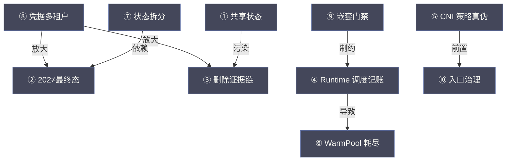
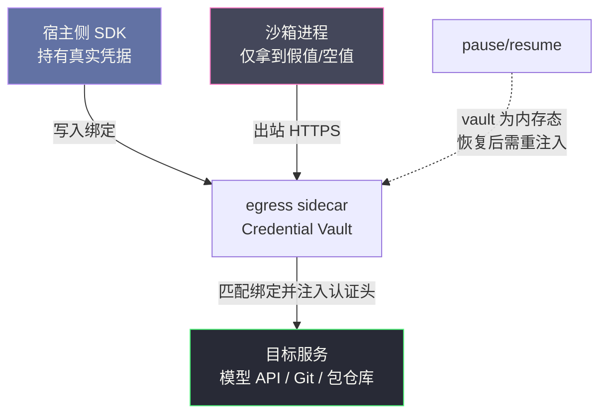
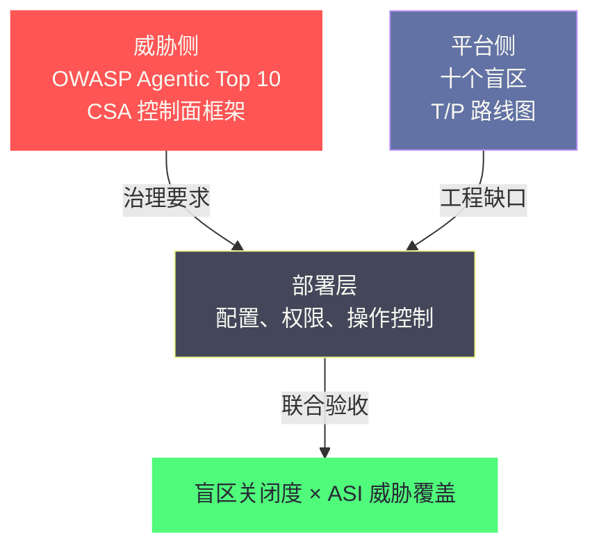

# 15 生产化深水区——十个盲区与行业共识

**摘要：**

本专栏的收官篇回答最后一个问题：**从"能用的测试集群"到"可靠的生产平台"，中间横着哪些坑？** 素材 Phase5-01 的调研给出了答案——**十个生产化盲区**：共享状态≠副本数、202≠最终态、对象删除证据链、Runtime 调度记账、CNI 策略真伪、状态拆分、WarmPool 耗尽、凭据多租户、嵌套虚拟化门禁、短期凭据与入口——每个盲区都是"文档不写、踩坑才知道"的隐性陷阱。文章逐一拆解十个盲区的现象、本质与对策（每个都关联本专栏对应篇的技术细节）；随后给出素材的完整生产路线图——测试集群 T0-T7（冻结事实、调度卫生、证据链、网络策略真伪、Gateway+Console、凭据收敛、观测 SLO、升级回滚）与生产并行 P0-P6（资源落地、软件基线、三 Profile 骨架、gVisor 窗口、Kata 门禁、状态与容量、身份审计）；再汇总行业共识（六层共识、目的建设派 vs 企业共生派、建设顺序八步——第 06 篇 的深化）；最后给出 OpenSandbox 的总体评估（优势/不足/落地建议与"黄灯"定位）。本次修订补充 2026 年时效更新：**OWASP Agentic Top 10 与 CSA 控制面框架从威胁侧验证了盲区清单，OpenSandbox 1.1.0（GA）与 Credential Vault 等平台演进从实现侧关闭了部分盲区**。核心认知：**生产化不是"补丁的集合"，而是"盲区的显式化"——把十个盲区变成十个验收门禁，生产化的进度就是盲区关闭的进度；而行业共识的意义在于：你踩的坑，别人已经踩过并写成了共识**。

---

## 第 1 章 生产化的本质：从 PoC 到生产的鸿沟

### 1.1 为什么 PoC 通过不等于生产可行

素材的周会汇报给出了一句精准的定位：**"技术闭环已在单节点 PoC 通过，但身份、多租户、密钥治理、高可用与容量模型尚未达到生产上线标准"——状态：黄**。

"黄灯"的构成——PoC 证明的与未证明的：

| PoC 已证明 | 生产未证明 |
| :--- | :--- |
| 平台能用（生命周期/三类 Agent/运行时切换） | 身份与多租户（凭据粒度/租户隔离） |
| 隔离可用（三运行时证据链） | 密钥治理（短期凭据/模型网关） |
| 性能有数据（基准/WarmPool） | 高可用（双副本的真实语义） |
| 链路完整（父 Agent→MCP→子沙箱） | 容量模型（耗尽/碎片/Registry） |

**"能用的系统"与"可靠的系统"的差距，就是十个盲区的总和**——生产化不是"再调调参数"，而是"把盲区变成显式设计"。

### 1.2 生产化的三个常见误区

在展开盲区之前，先破除三个导致"PoC 通过即盲目上线"的思维误区：

| 误区 | 表现 | 真相 |
| :--- | :--- | :--- |
| **"功能即生产"** | "三类 Agent 都跑通了，可以上线" | 功能闭环 ≠ 生产可靠——十个盲区一个没关 |
| **"副本即 HA"** | "Server 双副本了，高可用达成" | 共享状态≠副本数（盲区一）——本地状态是裂脑候选 |
| **"配置即安全"** | "NetworkPolicy 写了、Key 管起来了" | 配置声明 ≠ 运行事实——CNI 可能不执行、Key 可能被打穿（盲区五/八） |

**三个误区的共同根源**：**把"文档/配置/声明"当成了"事实"**——本专栏反复强调的"证据链"方法论（第 10 篇）正是对抗这三个误区的工具：**每个"我以为"都要有一个"我验证过"**。这里补一层机制：声明的生命周期与事实的生命周期从来不同步——配置写下去的那一刻它是事实，之后每一次变更、漂移、降级，声明都会与事实分道扬镳，而"验证"就是把两条线重新对齐的动作。2026 年 CSA 的 Agentic Secure Development Lifecycle（ASDL）框架把部署阶段的三个必要件（运行时隔离、最小权限、遥测）表述为"各自必要、单独不充分"——与这三个误区一一对应：缺任何一件，其余两件也救不回来，因为它们的失效方式不同、互相不能替代。

### 1.3 十个盲区的全景

素材 Phase5-01 的十个盲区，按"层"分组：

| 层 | 盲区 |
| :--- | :--- |
| **控制面** | ① 共享状态≠副本数、② 202≠最终态、③ 对象删除证据链 |
| **调度与容量** | ④ Runtime 调度记账、⑤ CNI 策略真伪、⑥ WarmPool 耗尽 |
| **状态与数据** | ⑦ 状态拆分、⑧ 凭据多租户 |
| **隔离与入口** | ⑨ 嵌套虚拟化门禁、⑩ 短期凭据与入口 |

**盲区的共性**：**全部是"配置声明与运行事实的脱节"或"能力语义的误解"**——不是代码 bug，而是认知盲区——**盲区的可怕之处在于：你不知道自己不知道**。

### 1.4 鸿沟的机制：存在性验证与未知性暴露

为什么十个盲区全是"踩坑才知道"，而不是"评审能发现"？笔者以为是验证范式的差异：**PoC 验证的是"存在性"，生产暴露的是"未知性"**。

PoC 的验收标准是"这条路通不通"——三类 Agent 能跑、隔离能验证、性能有基准，回答的都是"功能存在"。生产环境要回答的是另一类问题：并发与长尾下的行为、故障注入下的行为、对抗意图下的行为。而十个盲区的触发条件全部不在 happy path 上：202 语义要在"请求与完成分离"时才暴露，双副本 404 要在"恰好查到没同步的副本"时才暴露，CNI 真伪要在"写了策略却没有执行"时才暴露，WarmPool 耗尽要在"突发流量打空池子"时才暴露。PoC 的验收清单里没有这些条件，所以它们被系统性漏过。

打个比方，PoC 像探照灯，照见"前面有路"就够了；生产像显微镜，玻片上的细菌探照灯永远照不出来，只有把视野放大到故障那一格才会现形。十个盲区就是那批"放大才现形"的细菌，这也是"文档不写、踩坑才知道"的机制根源——写文档的人用的是探照灯视角，记录的是"功能怎么用"，不是"故障下会怎样"。

OWASP 在 2026-06 发布的《State of Agentic AI Security and Governance》v2.01 给出了同一个判断的另一面：信息安全（security）与功能安全（safety）在部署层不可分离——Agent 的边界、权限、操作控制全部落在部署团队手里，2026 年的真实事故（含多起编码 Agent 沙箱逃逸）绝大多数也发生在部署/配置层。威胁侧的实证与平台侧的盲区在同一个层汇合，这不是巧合，而是 Agent 沙箱这类"后果控制型系统"的必然：**它的安全与可靠性不在模型里，不在运行时里，而在部署这一层**。

生产化的本质因此不是"再调调参数"，而是把验证范式从"存在性"切换成"未知性暴露"——这正是第 3 章 T/P 路线图把每个阶段都配上"通过标准 + 证据归档 + 回退路径"三件套的原因。

---

## 第 2 章 十个盲区逐条拆解

### 2.1 盲区一：共享状态≠副本数

**现象**：Server 双副本 Running，但快照查询随机 404（查到了没有该记录的副本）。

**本质**：HA 的正确度量是"状态的可共享性"，不是副本数量——pod-local SQLite（GAP-003）让"双副本"只对无状态 API 成立（第 09 篇 5.2 节）。补一层机制：高可用语义分三档——无状态（副本数即可用性）、半状态（副本间需要一致性协议）、全状态（副本本身就是分区）——pod-local 快照元数据让平台从"半状态"跌进"全状态"，双副本不再是冗余，而是两个各持一半真相的分区，网络抖动就触发裂脑。

**对策**：Core Profile 关闭快照（双副本只承载无状态 API）；快照类能力放 Lab Profile（单 Server）；长期方案是状态外置（SQLite→外部 DB）。

**检查问题**：**"你的平台有哪些组件持有本地状态？它们的高可用语义是什么？"**——答不上来的状态就是裂脑候选。

**2026 更新**：OpenSandbox 在 1.1.0（2026-09 发布的首个统一版本线，官方视作 GA 声明）中为快照元数据引入了可选的 PostgreSQL 存储，带连接池与 CAS（Compare-And-Swap）语义，并提供 `migrate-snapshots` 命令把 SQLite 记录迁出、在 Kubernetes 上做多进程高可用协调——这正是官方在堵"pod-local 即裂脑候选"这条路。素材的 Core/Lab 分治是零成本的当下对策，PostgreSQL store 是平台给出的长期方向，两者的取舍取决于团队愿不愿意为快照元数据养一套数据库。

### 2.2 盲区二：202≠最终态

**现象**：创建请求返回 202 后立即查询，状态不符；pause 返回 ok 但沙箱还在跑。

**本质**：202 表示"同步完成"（Pod 已 Running），不是"异步受理"；CLI 的 ok 是"请求被接受"不是"操作完成"（第 07 篇 3.1-3.3 节）。机制上这是分布式系统里"受理与完成"的一对老概念——K8s 的控制器模式本来就是声明式异步 reconcile，API 返回只代表"意图被接受"，终态要以 conditions 为准；平台把异步语义包装成了同步观感，客户端就按同步去理解，落差必然发生。

**对策**：调用铁律——**"HTTP 码只表示'话送到了没有'，权威是 Lifecycle state + conditions"**；客户端轮询终态；超时设置大于 180 秒。

**检查问题**：**"你的客户端代码里，有多少地方把'请求成功'当成了'操作成功'？"**

**2026 更新**：2026 年平台自己对语义下手了——1.1.0 的 FastPath 后端（Fast Sandbox 的 gRPC 控制面）在快速沙箱上显式采用异步 202 语义，并以 UID fencing（唯一标识护栏）杜绝"请求与对象错配"，把"受理与完成分开"写进了协议。但协议再清楚，客户端铁律不变：轮询终态、超时放宽、把 conditions 当权威——平台能改协议，改不了"调用方把它当同步用"的习惯。

### 2.3 盲区三：对象删除证据链

**现象**：Diagnostics 501（GAP-001），删除失败的沙箱被秒删——**"谁删的、为什么删、删了什么"无从追溯**。

**本质**：平台内部无审计面，删除路径没有"证据链"意识（第 13 篇 5.3 节）。机制上，删除是不可逆操作，K8s 用 finalizer 与 OwnerReference 管理"删之前要做什么"，但"删的意图、删的执行、删的结果"三段记录需要平台显式外发，否则审计就是空话。

**对策**：外部日志证据链——删除前把 Event/request_id/sandbox_id 打到外部日志；删除后残留检查归档；平台补齐 Diagnostics 前，外部链路是唯一路径。

**检查问题**：**"删除一个沙箱，你能拿出几行日志证明'删对了、删干净了'？"**

**2026 更新**：1.1.0 实现了一个有作用域的诊断 API（Diagnostics），支持 `logs:container|all` 与 `events:runtime|lifecycle|all` 两类作用域，未知作用域返回 400 DIAGNOSTICS_SCOPE_UNSUPPORTED——它补上了 GAP-001 的部分缺口。但"谁删的、为什么删"仍要落到外部日志证据链上：平台给的诊断是能力，审计证据仍要靠自己的链路，两者是互补不是替代。

### 2.4 盲区四：Runtime 调度记账

**现象**：节点按 runc 口径算容量，实际跑着 gVisor/Kata——**内存账本系统性低估，OOM 风险潜伏**。

**本质**：GAP-011——gVisor 空闲 PSS 127.2MiB、Kata 392.7MiB，调度器完全没计入（第 12 篇 5.1 节）。机制上 K8s 的 RuntimeClass 本来就带 overhead 记账字段，但"配置了"与"算对了"是两回事——gVisor 的常驻内存是 Sentry 进程加 gofer 文件代理，Kata 是 shim 加 hypervisor 加 guest kernel 一整套，不实测就只能猜。

**对策**：overhead 按"镜像族×运行时×机型"实测（占位 overhead 比不配更危险）；配置后验证"调度账本≈实测 PSS 总和"。

**检查问题**：**"你的节点容量模型里，沙箱的真实内存开销是多少？你测过吗？"**

**2026 更新**：2026-09 的公开基准（bex.co）给了一个行业量级参照：gVisor 每沙箱约 18-50MB（Sentry 进程），Kata 在 QEMU 后端约 50-130MB（Firecracker 后端 5-30MB），Firecracker 微虚拟机约 5MB。量级随实现与版本漂移，但"镜像族×运行时×机型"实测的必要性不变；顺带一提，1.1.0 为 egress sidecar 开放了独立资源请求/限制（`[egress.resources]`）与 OTLP 指标导出，账本的一小块开始显式化——账本里"谁占了多少"的可见度在提高。

### 2.5 盲区五：CNI 策略真伪

**现象**：写了 NetworkPolicy，但 Flannel 不执行——**"我们配置了隔离"是假的**。

**本质**：CNI 类型决定策略执行能力（Calico/Cilium 执行、Flannel 不执行）（第 08 篇 4.4 节）。机制上，NetworkPolicy 的 API 在 Kubernetes 控制面，执行却完全落在 CNI 的数据面——Flannel 只做覆盖网络不做策略引擎，声明被写进 etcd 之后就没有下文了。

**对策**：五步对照实验（基线放行→default-deny→精确允许→删除恢复→换 Runtime 重放）；生产换 Calico/Cilium 或先验证再写策略。

**检查问题**：**"你的 CNI 是什么？你做过一次'策略生效'的对照实验吗？"**

**2026 更新**：2026 年这类"声明与事实脱节"从容器界蔓延到了 Agent 沙箱界——CSA 在 2026-09 披露的 DeepSeek Harness 逃逸（CVE-2026-82533，CVSS 9.4）根因是控制面认证信任了客户端提供的 Host 头，沙箱限制了文件系统这个通道，却默认信任了 loopback 网络这个通道。宣传的边界与对抗压力下实际成立的边界不一致，与"写了 NetworkPolicy 但 Flannel 不执行"是同一个病根，只是换了一个通道。这个案例提醒我们：真伪验证的对象不该只是网络策略，而是平台声明的每一条边界。

### 2.6 盲区六：状态拆分

**现象**：把 Workspace/Session/Snapshot 三套状态混在一起验收——**"暂停恢复"的语义混乱（rootfs vs 会话）**。

**本质**：状态按"寿命×权威×访问模式"拆分（第 13 篇 的四本账）——不拆分则"同一个状态名下面是不同机器"。机制上，pause 保存的是容器 rootfs 的 OCI 镜像，不是内存、不是对话、不是用户网盘——"暂停"是环境重建，"续接"是会话账本的事，两件事被同一个产品词盖住，验收时就无法分层。

**对策**：四本账分开验收（K8s 对象/Workspace/Session/暂停镜像）；P0 五项验证"状态独立于沙箱实例"。

**检查问题**：**"沙箱被删，用户会损失什么？"**——损失"对话/产物"就是拆分失败。

**2026 更新**：1.1.0 把"哪些运行时可以快照"从隐式变成了显式约束——对 gVisor（runsc）的快照请求在持久化前直接返回 409 SNAPSHOT::UNSUPPORTED_RUNTIME。拒绝比假装支持诚实，这与素材"同一个状态名下面是不同机器"的结论同向：**状态语义必须显式化，不能让用户靠踩坑去猜**。对支持快照的快速沙箱，FastPath 后端则引入了 checkpoint 恢复路径（详见 3.5 节）。

### 2.7 盲区七：WarmPool 耗尽

**现象**：5 个热槽吃 50 突发，交付 p99 回到冷启动量级（runc 17.5s / Kata 27.5s）——**"池化换到的是命中尾延迟，不是无限容量"**。

**本质**：池的容量是"提前创建的槽位"，耗尽即回到冷启动（第 09 篇 3.5 节）。机制上，池是"容量置换延迟"的缓存：命中率越高、池越大，冷启动越少被看到，但池的槽位数始终是上限，而突发流量是未知数——池大小与突发峰值的差，就是用户实际体验的真相。

**对策**：容量公式（槽位 ≥ 峰值并发 × 目标命中率）+ 四 SLI（命中率/耗尽排队/补池时延/碎片率）+ 耗尽演练（把 17-27s 写进业务预期）。

**检查问题**：**"池打空时用户体验是什么？这个数字写进文档了吗？"**

**2026 更新**：1.1.0 把"耗尽"从模糊的超时改成了显式的背压——池容量打满时返回 HTTP 429 KUBERNETES::POOL_CAPACITY_EXHAUSTED 并带 Retry-After，客户端终于能区分"还在等"与"池打空了"；kubernetes-sigs/agent-sandbox 的 2026 路线图也在做智能池选择（Smart Warmpool Selection）与自动挂起恢复（Auto Suspend/Resume），同一问题被整个行业正式承认。背压信号解决的是"可感知"，容量公式解决的仍是"不发生"，两者都要。

### 2.8 盲区八：凭据多租户

**现象**：平台总 Key 被 MCP 打穿，父 Agent 能枚举全部沙箱——**共享凭据等于共享边界**。

**本质**：凭据的粒度（平台级）与沙箱的边界（沙箱级）不匹配（第 14 篇 5.1 节）。机制上，传给 Agent 的凭据能力就是 Agent 可滥用的能力上限——凭据的粒度就是攻击面的粒度，凭据是"放大器"：它本身不制造盲区，但会让所有盲区的后果放大。

**对策**：短期凭据按租户/用户/任务签发，TTL 短、自动轮换；Agent 只能看到自己的 sandboxId 集合；平台总 Key 密封仅 Bootstrap。

**检查问题**：**"传给 Agent 的凭据，能做什么？这个能力与任务匹配吗？"**

**2026 更新**：2026 年行业给出了两层解法——其一，1.1.0 的 SDK 在直接数据面模式下不再把租户 API Key 转发给 execd/egress；其二，OpenSandbox 的 Credential Vault（OSEP-0022）把真实凭据写进 egress sidecar，沙箱内只拿到假值或空值，出站请求在边车处匹配绑定并注入认证头，1.2.0-rc 已为快速沙箱做到端到端（含 pause/resume 的 vault 转移）。E2B Secrets（2026-10）是同一思路的云托管版，Stripe 的 Agentic Provisioning Protocol（2026-06）则让 agent 不经人工就能申请作用域受限的凭据。OWASP 在 2026 版威胁清单里把这类问题列为 ASI03（身份与特权滥用）——凭据问题已经从"工程教训"升格为"行业级威胁条目"。

### 2.9 盲区九：嵌套虚拟化门禁

**现象**：裸金属 Kata 验证通过，就以为 CVM 嵌套也能用——**"177.37 裸金属 Kata 证据不能搬到 CVM 嵌套场景"**。

**本质**：嵌套虚拟化多出来的 L1 是门禁（厂商书面确认/性能对照/运维事件/24-72h 稳定性）（第 04 篇 5.4 节）。机制上，L0（宿主机）到 L1（CVM）再到 L2（Kata guest）每一层都叠加访存与中断开销，且嵌套层的性能受宿主 CPU 微架构影响——裸金属上的证据，换到嵌套环境后从"测量"变成了"猜测"。

**对策**：四道门禁全过才切高隔离流量；未过门禁前只做灰度；兜底 RHEL 9 裸金属 Worker。

**检查问题**：**"你的 Kata 节点是裸金属还是 VM？嵌套门禁过到哪一关了？"**

**2026 更新**：2026 年的证据综述没有给任何隔离基底发"封闭边界"的证书——Defensible Research 在 2026-09 系统审查后给出的结论是"没有一种隔离基底是封闭边界，每一类都有被证实的失败"；bex.co 的对比还给出了逃逸链差异（gVisor 要破 Sentry 再加宿主内核，Kata 要破 guest 内核再加 hypervisor，Firecracker 要破 guest 内核再加 KVM 与极简 VMM）。嵌套虚拟化多出的 L1 让这条链更长，四道门禁的必要性不减反增——隔离强度的证明没有捷径，只有逐层实测。

### 2.10 盲区十：短期凭据与入口

**现象**：PoC 直接暴露 HTTP NodePort（POC-007）、浏览器访问无 SSO——**入口即攻击面**。

**本质**：入口治理（Gateway+SSO）是生产化的底线配置，不是可选项（第 14 篇 6.2 节）。机制上，每个入口都是一个凭据获取点——攻击者不需要打穿沙箱，只要打通一个入口的认证，就能拿到后续所有操作的资格；入口数量与攻击面正相关，收敛入口就是收敛攻击面。

**对策**：生产入口必须 Gateway+SSO，禁止 NodePort；浏览器凭据 Vault 注入短时凭证。

**检查问题**：**"沙箱平台的入口有几个？每个入口的鉴权是什么？"**

**2026 更新**：2026 年入口鉴权成了行业标配——E2B 的公开沙箱 URL 可按沙箱要求访问令牌（per-sandbox access token），kubernetes-sigs/agent-sandbox 在 v1.0.0（2026-08）里为 sandbox-router 加了基于路径的路由与会话 Cookie 认证。收敛入口、每个入口都有鉴权，从素材的"底线配置"变成了全行业的默认基线——这反过来验证了盲区十的判断：入口治理不是某个平台的特色，而是生产化的通用前提。

> [!warning] 生产避坑
> 十个盲区的共同对策可以浓缩为一句话：**"把每个盲区变成验收门禁"**——生产化的进度不是"功能清单的完成度"，而是"盲区清单的关闭度"。素材的 T/P 路线图（第 3 章）正是这个逻辑的落地。

### 2.11 盲区之间的关联：不是十个独立问题

十个盲区不是孤立的——它们之间存在因果与放大关系，识别关联才能避免"修一个冒一个"：



**三类关联**：

1. **放大关系**：凭据失控（⑧）让其他盲区的后果放大——**凭据是"放大器"，修凭据等于给所有盲区降险**；
2. **前置关系**：CNI 真伪（⑤）是入口治理（⑩）与租户隔离的前置——**先验证再实施是顺序纪律**；
3. **因果关系**：调度记账（④）导致耗尽误判（⑥）——**账本错了，容量决策全错**。

**"盲区关联图"的使用**：排生产化优先级时，先修"放大者"（⑧）与"前置者"（⑤）——**优先级不是按盲区编号，而是按关联位置**。

### 2.12 盲区的发现方法论：如何找到"你自己的盲区"

素材的十个盲区是"踩坑 + 调研"的产物——对任何新平台，盲区发现有三条系统路径：

| 路径 | 方法 | 产出 |
| :--- | :--- | :--- |
| **故障注入** | 主动制造故障（删 Pod/停组件/断网络）观察平台行为 | "平台在故障下的真实行为"清单 |
| **文档对照** | 把文档承诺逐条实测（"202 语义""双副本 HA"） | "文档 vs 事实"差异表 |
| **同行评审** | 让未参与建设的人审架构（盲区是"内行看不见的"） | 外部视角的盲区候选 |

**三条路径的次序**：**先文档对照**（成本最低，素材的盲区一/二/三都是文档对照发现的——"文档说 HA，实测 404"）、**再故障注入**（盲区四/五/七需要故障才能暴露）、**最后同行评审**（盲区八/九/十的"组织盲区"只能靠外人）。

**"盲区台账"的形态**：每个盲区记录"现象/本质/对策/关闭标准"四要素——**与素材的 POC/DEF/GAP 台账同构**（第 07 篇 5.3 节）——**盲区台账是生产化的"作战地图"**。

### 2.13 十个盲区 × OWASP Agentic Top 10：威胁侧与平台侧的相互验证

OWASP 于 2025-12 发布《Top 10 for Agentic Applications 2026》（经全球专家评审），2026-06 又发布《State of Agentic AI Security and Governance》v2.01，核心判断是"威胁已经真实发生、并集中在部署层"。把十个盲区与这份威胁清单放在一起，能看到两个清单出发点不同、却在地图上大量交叠：

| 盲区 | OWASP Agentic Top 10 对应 | 映射强度 |
| :--- | :--- | :--- |
| ⑧ 凭据多租户 | ASI03 身份与特权滥用（Identity & Privilege Abuse） | 强——直接同构 |
| ⑩ 短期凭据与入口 | ASI03 + ASI01 目标劫持（Agent Goal Hijack） | 强——入口即凭据获取点 |
| ⑤ CNI 策略真伪 | ASI05 意外代码执行（Unexpected Code Execution） | 中——隔离失效放大 RCE |
| ② 202≠最终态 | ASI08 级联失败（Cascading Failures） | 中——语义误判驱动错误决策传播 |
| ① 共享状态≠副本数 | ASI08 级联失败 | 中——权威状态分裂引发连锁故障 |
| ③ 删除证据链 | ASI09 人机信任利用（缺乏证据的"已删除"） | 弱——审计与治理缺口 |
| ④/⑥/⑦/⑨ 其余盲区 | ASI08 为主 | 弱-中——容量/状态/隔离的可靠性面 |

这张对照表的信息量在差异处：OWASP 从攻击者视角列威胁，盲区清单从建设者视角列平台缺陷，两者交集集中在凭据、代码执行、级联三类——恰恰是 2026 年真实事故最多的三类。OWASP v2.01 的"部署层收敛"论解释了为什么交集在部署层：Agent 威胁大多在配置、权限、操作控制这层被放大或吸收，而十个盲区全部落在这层。**用法**：安全评审不妨双向对照——威胁框架回答"要防什么"，盲区清单回答"平台哪里会漏"；一个平台的成熟度，可以同时用"ASI 覆盖度"与"盲区关闭度"两把尺子量。

### 2.14 平台演进对盲区的反向验证：OpenSandbox 1.1.0

收官篇动笔时（2026-10），OpenSandbox 发布了 1.1.0（2026-09-21，首个统一版本线，附带 Sigstore 签名 BOM，官方视作 GA 声明），并引入 Fast Sandbox 集成（Firecracker 微虚拟机 + FastPath gRPC 控制面 + Fastlet 预热 Pod）与 Credential Vault。把发布说明逐条对照素材的盲区清单，会看到一个不那么意外的现象——**修复项与盲区高度重合**：

| 盲区 | 1.1.0 / 生态的对应进展 | 验证结论 |
| :--- | :--- | :--- |
| ① 共享状态≠副本数 | 可选 PostgreSQL 快照存储（CAS + 多进程 HA + migrate-snapshots） | GAP-003 的修复方向被官方确认 |
| ② 202≠最终态 | FastPath v2 异步 202 语义 + UID fencing | 平台承认并显式化异步语义 |
| ③ 删除证据链 | 有作用域诊断 API（logs/events） | GAP-001 部分补位 |
| ④ Runtime 调度记账 | egress sidecar 独立资源 + OTLP 指标 | 账本一小块显式化 |
| ⑥ WarmPool 耗尽 | HTTP 429 POOL_CAPACITY_EXHAUSTED + Retry-After | 耗尽从超时变成背压 |
| ⑦ 状态拆分 | gVisor 快照返回 409 UNSUPPORTED_RUNTIME | 状态语义显式化 |
| ⑧ 凭据多租户 | SDK 不转发租户 Key + Credential Vault | 凭据粒度开始收敛 |

其中 Credential Vault 的机制值得单独画出来——它是"凭据不进沙箱"这条原则的工程化表达：



笔者以为，这个对照最有价值的地方不在"平台修了什么"，而在**素材在 0.2.x 上凭踩坑总结出的盲区，与官方团队在 1.1.0 里主动修的东西一一对应**——说明盲区清单不是过期抱怨，而是真实成本的代理变量。反过来，平台尚未动的项（GAP-010 的逐沙箱运行时档位）也提醒我们：盲区清单要跟着平台版本走，1.1.0 只是下一次再评估的起点，不是终点。

---

## 第 3 章 路线图：T0-T7 与 P0-P6

### 3.1 测试集群 T0-T7

素材 Phase5-10 的测试集群路线（T 级——测试集群要完成的验证）：

| 阶段 | 内容 | 关闭的盲区 |
| :--- | :--- | :--- |
| **T0：冻结事实** | 发布物冻结、环境事实记录 | 可复现性（第 10 篇 Gate 1） |
| **T1：调度卫生** | 节点标签/污点/ResourceClass 对齐 | 盲区四（调度记账） |
| **T2：证据链** | 日志/事件外发、request_id 贯穿 | 盲区三（删除证据链） |
| **T3：网络策略真伪** | 五步对照实验 + CNI 确认 | 盲区五（CNI 真伪） |
| **T4：Gateway + Console** | 入口收敛、SSO 接入 | 盲区十（入口） |
| **T5：凭据收敛** | 短期凭据、Key 分级 | 盲区八（凭据多租户） |
| **T6：观测 SLO** | 指标/告警/审计链路 | 盲区二/六（状态与语义） |
| **T7：升级回滚** | 版本化发布、回滚演练 | 盲区一（HA 语义） |

### 3.2 生产并行 P0-P6

| 阶段 | 内容 | 关闭的盲区 |
| :--- | :--- | :--- |
| **P0：资源落地** | 独立节点池、故障域、存储 | 容量基础（第 12 篇） |
| **P1：软件基线** | RHEL 9.6/cgroup v2/SELinux Enforcing | 环境基线（第 10 篇） |
| **P2：三 Profile 骨架** | runc/gVisor/Kata 三域名 | 盲区四（档位记账） |
| **P3：gVisor 窗口** | 兼容性验证 → 灰度中风险负载 | 档位与负载匹配 |
| **P4：Kata 门禁** | 嵌套门禁全过 → 高安全负载 | 盲区九（嵌套门禁） |
| **P5：状态与容量** | Workspace/Session 服务、容量模型 | 盲区六/七（状态/耗尽） |
| **P6：身份审计** | 三张身份票、审计链路 | 盲区八/十（凭据/入口） |

**T 与 P 的并行关系**：**T 级在测试集群验证"机制可用"，P 级在生产落地"机制生效"**——T 不过不 P（测试集群的验证是生产的门禁）。

### 3.3 路线图的资源投入估算

T/P 路线的资源投入（素材的人力节奏推演，1-2 人团队）：

| 阶段组 | 人力（人周） | 主要工作 |
| :--- | :--- | :--- |
| T0-T2（事实/卫生/证据） | 1-2 | 发布物清单、调度配置、日志链路 |
| T3-T4（网络/入口） | 1-2 | 对照实验、Gateway+SSO |
| T5-T6（凭据/观测） | 1-2 | 短期凭据服务、SLO 与告警 |
| T7 + P0-P1（升级/资源/基线） | 1-2 | 发布演练、节点池、OS 基线 |
| P2-P4（三 Profile/门禁） | 2-3 | 三套部署、gVisor 验证、Kata 门禁 |
| P5-P6（状态/身份） | 2-3 | Workspace/Session 服务、身份审计 |

**总计约 10-14 人周**（1-2 人 × 2-3 个月）——这是"从测试集群到生产可用"的现实量级。**资源估算的两个原则**：其一，**凭据与身份（T5/P6）的投入不要省**（放大器盲区，2.11 节）；其二，**每阶段预留 30% 缓冲**（盲区的"不知道自己不知道"特性决定了计划必然低估）。

### 3.4 里程碑与验收

素材的路线图验收逻辑：

```
每个阶段的三件套：
  1. 通过标准（可验证的事实）
  2. 证据归档（验证结果落盘）
  3. 回退路径（失败回到哪）

阶段验收的产出：
  盲区清单更新（关闭的/残留的）
  差距台账更新（GAP/DEF 状态）
  下一阶段的前置条件确认
```

三件套的机制其实在前面已经埋伏好了：通过标准对应"证据链"（把声明与事实对齐），证据归档对应"台账管理"（让验证结果可追溯），回退路径对应"未知性暴露"的兜底（每次验证都可能发现新盲区，回退路径保证发现后不会骑虎难下）。

**"路线图是活文档"**：每阶段验收都更新盲区与台账——**路线图的价值不在"计划得好"，而在"状态跟踪得准"**。

### 3.5 外部项目在同一路线上的印证

T/P 路线图是素材为自家测试集群与生产环境定制的，但它的每个阶段几乎都能在 2026 年的外部项目里找到对应物，这一点值得单独强调——它说明路线图不是独门方法论，而是行业共识在具体环境里的实例化：

| 路线图阶段 | 外部项目对应物（2026） |
| :--- | :--- |
| T0 冻结事实 | SIG agent-sandbox v1.0.0 的 API 迁移规范（v1beta1 四步升级） |
| T4 Gateway + Console | SIG sandbox-router（路径路由 + 会话 Cookie 认证） |
| T5/T6 凭据与观测 | OpenSandbox Credential Vault + OTLP 指标导出 |
| P1 软件基线 | Fast Sandbox 的 template builder（OCI 镜像 → golden image） |
| P2 三 Profile | GKE Agent Sandbox / SIG RuntimeClass 生态 |
| 容量与预热 | SIG WarmPool 滚动更新 + 智能池选择；Fastlet 预热 Pod |

具体而言，kubernetes-sigs/agent-sandbox 于 2026-08-28 发布 v1.0.0——核心与扩展 API 全部切到 v1beta1（移除 v1alpha1 与转换 webhook，官方给出的升级路径是"先升 v0.5.x 迁移存储、再升 v1.0.0"的四步走，正是 T0 冻结事实加 T7 升级回滚的行业版），sandbox-router 面向浏览器的路径路由与会话 Cookie 认证（T4），下一代 sandboxd 运行时贯通各 SDK，并与 NVIDIA NeMo Gym/Gymnasium 官方集成；路线图里还有 WarmPool/Template 滚动更新、自动挂起恢复、单 Pod 多沙箱，以及把 claim 端到端延迟从 200ms 往 100ms、50ms 压的硬指标。

Fast Sandbox 的架构本身就是路线图哲学的又一实例：template builder 把 OCI 镜像烘成 golden image（P1 镜像专职化的镜像侧）、Fastlet 预热 Pod 承载多沙箱密度（T1 预热）、DART 点对点工件分发（Registry 压力的工程解）、FastPath 把持久状态放在 CRD 里、控制面可随时重启（T7 升级回滚意识）。行业里多个独立团队在各自的语境里走到相近的结构，这正是第 4 章六层共识里"验证者"一栏的意义——共识不是某一家发明的，是各家殊途同归之后被总结出来的。

---

## 第 4 章 行业共识与两派路线

### 4.1 六层共识（第 06 篇的深化）

素材 Phase5-11 的行业共识在本专栏多处引用，收官篇给出完整定位——**共识 = 行业用真金白银验证过的公理**：

| 共识 | 验证者 | 本专栏对应 |
| :--- | :--- | :--- |
| 先定义工作负载 | 所有平台（形态由负载决定） | 第 06 篇 1.1 节 |
| 控制面与数据面切开 | Firecracker 三线程/OpenSandbox 六责任面 | 第 06 篇 2.7 节 |
| 盒内守护进程 | execd/envd/runner | 第 08 篇 1.1 节 |
| 快靠预热物认领 | GKE 300/s、OpenSandbox Pool | 第 09 篇 3.1 节 |
| 隔离按档提供 | 四档光谱/三 Profile | 第 03 篇、第 14 篇 2.4 节 |
| 状态按寿命拆库 | 四本账 | 第 13 篇 |

**共识的使用**：**设计评审时对照共识清单**——违反共识的设计要能说清"为什么这次例外"——**共识是默认值，例外要有论证**。

### 4.2 目的建设派 vs 企业共生派（深化）

第 06 篇 4.2 节的两派路线，生产化视角的补充：

| 维度 | 目的建设派（E2B/Modal） | 企业共生派（SIG/GKE/OpenSandbox） |
| :--- | :--- | :--- |
| **数据面建设** | 自建（Firecracker 池/自研控制面） | 复用 K8s（CRD/Controller） |
| **生产化路径** | 平台公司内部迭代 | 企业自己填缺口 |
| **适合** | 对外提供沙箱服务的平台 | 内部 Agent 平台建设 |
| **素材判断** | 参考其性能/API 设计 | **落地选择**（复用 DomeOS） |

**"企业共生派"的生产化成本结构**：复用 K8s 省了数据面，但**十盲区大部分落在"共生"的接缝处**（RuntimeClass 记账、CNI 真伪、双副本语义）——**共生派的生产化 = 填接缝**。

### 4.3 行业调研的样本与局限

素材的行业共识调研（Phase5-11）覆盖 E2B、SIG、GKE、Daytona、Modal、Cloudflare、OpenKruise 等方案——对"共识"的置信度评估：

| 维度 | 评估 |
| :--- | :--- |
| **样本覆盖** | 云托管（E2B/Modal/Daytona）、标准（SIG/GKE）、K8s 产品（OpenSandbox）、边缘（Cloudflare）、CNCF（OpenKruise）——**覆盖主流形态，无显著空缺** |
| **时间窗口** | 2025-2026 年的状态——沙箱技术演进快，**共识的"保质期"约 1-2 年** |
| **未覆盖** | 国内 CubeSandbox 类产品的公开细节有限、自研方案无公开资料——**共识的"暗样本"可能修正结论** |

**共识的引用纪律**：**共识是"行业当前默认"，不是"永恒真理"**——引用共识时标注时间窗口与样本范围（本专栏所有共识引用均标注"2026 年调研"）——**共识过期比共识错误更常见**。

2026-10 修订时，样本面又扩大了一圈：OWASP Agentic Top 10、CSA 控制面框架、Defensible Research 的证据综述、bex.co 的隔离基准都进入了可引用的公开资料池——共识的验证者从"平台方案"扩展到"安全框架"与"独立研究"，置信度在上升；但"暗样本"风险依然存在，自研方案没有公开资料这条假设至今没有变。

### 4.4 建设顺序八步（回顾）

第 06 篇 4.3 节的八步建设顺序，与 T/P 路线图的映射：

```
建设顺序八步                    路线图映射
1. 产品原语                    → T0（冻结事实）
2. 一条能 exec 的数据面         → PoC（已验证）
3. 切开流量                    → T4（Gateway）
4. 模板与构建专职化             → P1（软件基线）
5. 预热与 Ready                → T1/T3（调度/网络）
6. 档位与硬隔离                → P2/P3/P4（三 Profile）
7. 状态外置与身份短命           → P5/P6（状态/身份）
8. 为规模拆中心                → 生产二期
```

**映射的意义**：**两条路线（行业共识 vs 素材实践）指向同一顺序**——行业共识的抽象顺序被素材的 concrete 路线图验证——**"共识 → 路线图"的转化是生产化规划的标准动作**。

**路线的两条主线**：T 线（测试集群）与 P 线（生产）的并行不是"两条线各干各的"——**T 线的验证结果直接决定 P 线的放行**（T3 网络真伪不过，P2 三 Profile 的租户隔离不写）；P 线暴露的生产问题回流 T 线复现（生产偶发 → 测试集群构造复现 → 修复验证）——**"T 验证、P 落地、回流复现"是路线图的闭环节律**。

### 4.5 2026 的共识更新：安全治理框架的并轨

六层共识是"平台建设侧"的共识；2026 年，"安全治理侧"也长出了自己的框架，而且两侧在部署层汇合。

先说 OWASP。其《Top 10 for Agentic Applications 2026》于 2025-12 发布（经全球专家评审），列出十项威胁：ASI01 目标劫持（Agent Goal Hijack）、ASI02 工具滥用（Tool Misuse）、ASI03 身份与特权滥用、ASI04 供应链漏洞（含 MCP/A2A 动态依赖投毒）、ASI05 意外代码执行（RCE）、ASI06 记忆与上下文投毒、ASI07 不安全的主体间通信、ASI08 级联失败（Cascading Failures）、ASI09 人机信任利用、ASI10 失控 Agent（Rogue Agents）。同年 6 月的《State of Agentic AI Security and Governance》v2.01 直白地宣布"威胁已经真实发生"，并给出一句与本专栏立场完全一致的判断：**信息安全（security）与功能安全（safety）在部署层不可分离**——Agent 的边界、权限、操作控制都落在部署团队手里，这正是 2.13 节那张映射表的出处。

再说 CSA。其 2026 战略《Securing the Agentic Control Plane》提供了治理侧的工具：Agent Identity Governance Framework 定义五类身份与 JIT（Just-In-Time）访问模型——与素材的"三张身份票"（第 14 篇 5.3 节）同构；Agentic Secure Development Lifecycle（ASDL）在部署阶段给出三件套：运行时隔离、最小权限、遥测，并明确"三者各自必要、单独不充分"——这正是第 14 篇"三层防护"的治理化表述。威胁侧与平台侧在同一张图上收敛：



治理侧落地的反面教材也出现了：DeepSeek Harness（2026-08 开源、数周即获 20 万+ star 的编码 Agent 运行时）在 2026-09 被披露 CVE-2026-82533（CVSS 9.4）——沙箱内 Agent 用一条 shell 命令即可解除自身约束，根因是控制面认证信任客户端提供的 Host 头。CSA 把它与当年另两起编码 Agent 沙箱失败（信任交接、shell 注入护栏绕过）并列，称为"编码 Agent 沙箱的三类失败"，并点出一个残酷事实：**厂商宣传的安全边界，与对抗压力下实际成立的边界，常常不是同一条**——这与盲区五（CNI 真伪）是同构的教训，只是发生在更热闹的明星项目上。

至此，六层共识的 2026 版本可以补一句：共识从"建设顺序"延伸出了"治理基线"——先定义工作负载、控制面与数据面切开、凭据短命这些条目，如今有了 OWASP/CSA 的威胁侧背书；而"共识保质期 1-2 年"的假设也被验证——2026 年发布的新框架没有推翻六层共识，而是在其上长出了治理层。

---

## 第 5 章 OpenSandbox 总体评估

### 5.1 优势（素材验证的六项）

1. **协议优先**——specs/ 契约让运行时替换、客户端扩展、平台演进成为可能（第 07 篇）；
2. **覆盖完整**——65 API 操作 + 五语言 SDK + CLI + MCP（第 07 篇）；
3. **K8s 原生**——BatchSandbox CRD + WarmPool + 双 provider（第 09 篇）；
4. **性能领先**——批量交付比 SIG 高一个数量级（InfoQ 数据，第 09 篇 2.4 节）；
5. **实证充分**——素材完成"父 Agent+真实模型+MCP 子沙箱+回收"完整链路（第 11 篇）；
6. **生态开放**——CNCF Landscape、社区贡献通道（19 个候选 Issue/PR，第 07 篇 5.1 节）；
7. **版本治理**——1.1.0（2026-09）统一了 server/组件镜像/Helm/CLI/全部 SDK 的版本线，以 Sigstore 签名 BOM 作为交付物指纹，并把 Fast Sandbox（Firecracker 微虚拟机）接入运行时体系——从"组件各自发布"走向"一个平台一个版本"，是开源项目进入生产可用阶段的关键信号。

### 5.2 不足（差距台账的七项结构性问题）

| 问题 | 影响 | 处理 |
| :--- | :--- | :--- |
| Runtime 是 Server 级配置（GAP-010） | 不能逐沙箱选档 | 三 Profile 方案 |
| Snapshot 元数据 pod-local（GAP-003） | 双副本 404 | Core/Lab 分治 |
| Diagnostics 未实现（GAP-001） | 审计链路缺平台侧 | 外部日志证据链 |
| 删除不回收 blob（GAP-004） | Registry 膨胀 | 自建 GC |
| 202/CLI 语义模糊（DEF-001/004） | 客户端误判 | 轮询终态纪律 |
| Pool CRD 落后（DEF-005） | 配置与实现脱节 | Pool 不可变版本 |
| 平台总 Key（POC-005） | 凭据放大 | 短期凭据 |

**差距台账的 2026 修复验证**（对照 1.1.0 发布说明，素材评估基线是 0.2.x）：

| 差距 | 1.1.0 进展 | 处理建议 |
| :--- | :--- | :--- |
| GAP-001（Diagnostics 未实现） | 有作用域诊断 API（logs/events 两类作用域，未知作用域 400） | 平台侧审计面补位，外部证据链仍保留 |
| GAP-003（Snapshot pod-local） | 可选 PostgreSQL 存储（CAS + 多进程 HA + migrate-snapshots） | 核心档位可考虑外置；Lab 档位维持分治 |
| GAP-011（overhead 记账） | egress sidecar 独立资源（`[egress.resources]`） | 只覆盖边车一部分，其余仍需实测 |
| POC-005（平台总 Key） | SDK 不再转发租户 Key；Credential Vault（1.2.0-rc 端到端） | 短期凭据方案与 Vault 路线衔接 |
| DEF-005（Pool CRD 落后） | 池容量打满返回 429 POOL_CAPACITY_EXHAUSTED | 背压显式化，但"配置与实现一致"仍需验证 |
| GAP-010（Runtime 是 Server 级配置） | 1.1.0 未见逐沙箱档位的直接证据 | 三 Profile 方案继续成立 |

这张验证表最诚实的地方是最后一行：1.1.0 修了一批盲区，但 GAP-010 这类"架构级"差距不会随版本自动消失——平台在演进，盲区清单也在演进，两者是赛跑关系。

### 5.3 落地建议（素材的八条）

1. **Core Profile 默认关 Snapshot**——双副本先在"无状态 API"意义上成立；
2. **Snapshot Lab 受控窗口**——必要时单 Server；
3. **三 Profile 三域名**——不自研路由器（盲区四的对策）；
4. **overhead 按镜像族×Runtime×机型实测**——占位 overhead 是假精确；
5. **先做策略真伪实验，再申请企业域名**（盲区五）；
6. **短期凭据按租户/用户/任务签发**，TTL 短、自动轮换（盲区八）；
7. **嵌套 Kata 未过门禁前只做灰度**，兜底裸金属 Worker（盲区九）；
8. **WarmPool 当不可变版本**——新模板=新池→预热→切流→抽干→删除（盲区七）。

八条建议在 1.1.0 语境下要重新读一遍：第 1/2 条（快照 Core/Lab 分治）如今多了一条"PostgreSQL 外置"的选项——分治是零成本选项，外置是有运维成本但语义更完整的选项，取舍标准是"快照元数据在你心里的地位"；第 8 条（WarmPool 不可变版本）与 429 背压信号可以配合——背压让"池打空"可被客户端感知，但"新模板=新池→预热→切流→抽干→删除"的纪律本身不变，背压只是让这个纪律的每个环节都有了可观测性。

### 5.4 替代方案的再评估：不是一次选型定终身

素材选型（第 06 篇 5.2 节）不是终点——**生产化过程中要周期性再评估**：

| 再评估触发点 | 重新考察的候选 | 原因 |
| :--- | :--- | :--- |
| 平台版本大升级 | OpenSandbox 新版本（GAP-010 修复？） | 逐沙箱运行时可能是革命性变化 |
| 治理投入超预算 | 托管方案（E2B 企业版） | 自建成本 > 托管费用的可能性 |
| 第 5 层需求爆发 | 专业 Agent 托管平台 | 适配层自研成本失控时 |
| 行业标准落地 | SIG/新协议标准 | 标准成熟后迁移成本下降 |

**再评估的方法论**：**用"盲区关闭度"做对比基准**——譬如候选 A 关了 8 个盲区、候选 B 只关了 3 个，选谁不言自明——**盲区关闭度是比"功能清单"更可靠的选型指标**（盲区是真实成本的代理变量）。

**1.1.0 再评估记录**：再评估触发点的第一行（平台版本大升级）在 2026-09 已经兑现。用盲区关闭度对比：素材评估的 0.2.x 关闭度低，1.1.0 把诊断、快照 HA、凭据出沙箱、池背压四条补上了平台侧基础——但 GAP-010（逐沙箱运行时档位）仍未见到直接证据，盲区四/九这类需要"自己实测"的项也不随版本升级自动关闭。结论有二：其一，再评估的周期不是"等大版本"，而是"每个大版本 + 每个新盲区"；其二，托管的诱惑（E2B 企业版）依然存在，但"共生派填接缝"的成本结构（4.2 节）没有变——接缝不会因为换供应商而消失，只会换个位置。

### 5.5 "黄灯"定位：试点基线的正确姿势

素材周会汇报的最终结论：**"把 OpenSandbox 确定为第一阶段试点基线，不是宣布它为最终生产标准"——状态：黄**。

"黄灯"的工程含义：

| 维度 | 含义 |
| :--- | :--- |
| **技术** | 闭环已验证（绿）——平台能力真实可用 |
| **治理** | 生产标准未达（红）——身份/多租户/密钥/HA/容量 |
| **行动** | 继续试点推进 + 并行补治理（黄）——不原地等待也不盲目放量 |

**"黄灯"是生产化的常态**——**不是所有系统都要"全绿才上"，而是"明确知道哪里黄、黄的项有没有关闭计划"**——**"黄灯 + 关闭计划"比"假装绿灯"可靠得多**。

2026-10 回看黄灯清单：技术绿被 1.1.0 的 GA 进一步确认；治理红项里，"凭据"与"审计"有了平台侧补位（Credential Vault、诊断 API），但"多租户三道门禁"与"嵌套 Kata 门禁"仍要自己验证。黄灯没有变绿，只是黄的原因在变——这正是"黄灯 + 关闭计划"方法论的价值：**它不是一次评估的结论，而是持续跟踪的状态机**，每一项从黄到绿都要有一个可核对的证据。

---

## 第 6 章 专栏收官

### 6.1 全专栏的逻辑链回顾

15 篇的逻辑链（本专栏的完整心智模型）：

```
为什么（01）：威胁模型 → 攻击链 → 六层技术栈
边界在哪（02-05）：隔离原语 → 四档光谱 → KVM → VMM
平台怎么建（06-09）：六层模型 → OpenSandbox 三部曲
怎么落地（10-12）：部署 → Agent 适配 → 性能工程
怎么生产（13-15）：状态 → 安全 → 盲区与共识
```

**一条主线贯穿**：**"隔离是手段，平台是载体，生产是目的"**——任何一篇单独读都是技术细节，连起来读才是 Agent 沙箱的完整图景。

### 6.2 方法论总结：本专栏的五条方法论

| 方法论 | 内容 | 出处 |
| :--- | :--- | :--- |
| **证据链** | 配置声明必须用运行事实验证 | 第 02/10 篇 |
| **对照实验** | 性能/网络/隔离的验证靠"对照" | 第 03/08/12 篇 |
| **分层模型** | 六层模型/四本账/三层防护——先分层再设计 | 第 06/13/14 篇 |
| **台账管理** | 缺陷/缺口/妥协——每项有归属与截止 | 第 07/10 篇 |
| **阶段验收** | Gate/T/P 路线——验收驱动部署 | 第 10/15 篇 |

**方法论的复用性**：五条方法论不限于沙箱——**任何"新技术平台从零到生产"的项目都可以套用**（本专栏的素材就是一套完整的示范）。

### 6.3 全专栏的术语总表

收官篇提供全专栏术语总表（15 篇的统一口径，供速查）：

| 术语 | 口径 | 出处 |
| :--- | :--- | :--- |
| **攻击链四步** | 代码执行→提权逃逸→数据窃取→网络外传 | 第 01 篇 |
| **六层模型** | 控制面/K8s 编排/执行层/隔离运行时/Agent 适配/API 协议 | 第 06 篇 |
| **四档光谱** | runc/bubblewrap-Landlock/gVisor/Kata-Firecracker | 第 03 篇 |
| **六责任面** | Client/Protocol/Lifecycle/Backend/Data/Network | 第 07 篇 |
| **四本账** | 运行时对象/Workspace/Session/暂停镜像 | 第 13 篇 |
| **三层防护** | 隔离/资源约束/行为审计 | 第 14 篇 |
| **三张身份票** | SSO 票/控制面票/拉镜像票 | 第 14 篇 |
| **三态模型** | 冷启动/热池命中/耗尽 | 第 09/12 篇 |
| **十个盲区** | 生产化隐性陷阱清单 | 本文 |
| **T/P 路线** | 测试集群 T0-T7 / 生产 P0-P6 | 本文 |
| **证据链** | 配置声明用运行事实验证的纪律 | 贯穿全专栏 |
| **残留 0** | 删除后 API/CR/Pod 三层无残留 | 第 10/11 篇 |
| **Credential Vault** | 凭据出沙箱、出站侧注入（OSEP-0022） | 第 14 篇/本文 2.14 |
| **Fast Sandbox / FastPath** | Firecracker 微虚拟机 + gRPC 控制面（常数时间创建） | 本文 3.5 |
| **OWASP Agentic Top 10** | Agent 威胁十大框架（ASI01-10） | 本文 2.13/4.5 |

### 6.4 展望：四个开放方向

1. **checkpoint 竞争**（第 09 篇 4.6 节）：内存级暂停/恢复的代价降到可接受，谁赢谁拿"会话秒续"体验——**rootfs 快照是今天，内存 checkpoint 是明天**。2026 年的行业注脚开始出现：E2B 官方声称"内存保持型暂停"（进程与内存存活、暂停沙箱可无限期保留），OpenSandbox 仍是 rootfs 快照路线、但 1.1.0 的 FastPath 后端已为快速沙箱引入 checkpoint 恢复——两条路线的成本曲线在同一个问题上角力，判断标准不变：内存 checkpoint 的开销（内存落地、恢复校验）降到可接受之前，"rootfs 快照是今天"的判断就仍然成立。
2. **第 5 层标准化**：Agent 适配层的协议标准化（谁先定义事实标准谁占生态位）——**MCP 标准化了工具，还没标准化"Agent 如何被托管"**。2026 年出现了协议化的苗头：Stripe 的 Agentic Provisioning Protocol（2026-06）让 agent 直接向服务商申请作用域受限的凭据，E2B 与 OpenSandbox 的"凭据出沙箱"方案不约而同指向同一个默认值——**凭据不进沙箱、在边界处注入**。托管层的协议之争，已经从"能不能建"进入"凭据怎么给"。
3. **沙箱标准化演进**：E2B 兼容（协议层）、SIG CRD（编排层）的事实标准地位巩固——**"协议层参考 E2B、编排层贴近 SIG、隔离层按威胁等级自由选择"的组合策略**（第 06 篇 3.6 节）。2026 年的证据是：SIG 发布 v1.0.0（v1beta1，2026-08），OpenSandbox 的 agent-sandbox provider 同步迁移到 v1beta1——编排层的标准开始沉淀为"升级路径清晰、迁移成本可算"的东西。
4. **盲区清单的治理化**：OWASP/CSA 框架发布后，"盲区关闭度"可以与 ASI 清单联合做安全验收（2.13 节）——平台生产化的验收标准从"功能完成度"走向"盲区关闭度 × 威胁覆盖度"，这是本专栏方法论（证据链、台账、阶段验收）在安全治理侧的延伸。

### 6.5 思考题

1. **盲区的发现机制**：十个盲区是素材"踩坑+调研"发现的。对一个新平台，如何系统性地发现"自己的盲区清单"？提示：考虑"故障注入演练"（主动制造故障观察行为）、"文档对照"（把文档承诺逐条实测）、"同行评审"（让没参与建设的人审设计）。

2. **黄灯的管理**：素材的"黄灯"定位（试点推进 + 并行补治理）。如果业务方要求"下月上线"，而你的盲区关闭度只有 30%，你会怎么谈判？提示：考虑"范围切割"（先上低风险负载）、"明确保留项"（哪些功能上线时不承诺）、"回退预案"（上线失败怎么退）。

3. **共识的例外**：六层共识说"隔离按档提供"。如果你们平台决定"全部用 Kata"（单一高档位），这个例外要满足什么条件才成立？提示：考虑威胁等级（全 L3？）、成本承受力（容量模型重算过？）、以及"按档提供"的运维复杂度是否真的省了。

4. **黄灯清单的版本演进**：OpenSandbox 1.1.0 补上了诊断、快照 HA、凭据出沙箱。回顾素材的黄灯清单，哪些项因此变绿，哪些仍是红的？提示：对照 2.14 节的验证表——GAP-010（逐沙箱档位）与"多租户三道门禁"不会随版本升级自动关闭，它们的关闭标准是什么？

5. **两套清单的合并**：OWASP Agentic Top 10 与十个盲区都落在部署层。若你负责安全验收，如何把 ASI 条目与盲区合并成一张可执行的检查单？提示：ASI03 与盲区八可以合成一条"凭据粒度验收"，ASI05 与盲区五可以合成"隔离与网络真伪验收"，合并后每条都要有"验证方法"这一列。

### 6.6 结语

行文至此，专栏的十五条主线已经全部走完：从威胁模型出发（01），经过隔离原语（02）与四档光谱（03），深入硬件虚拟化（04-05）与平台分层（06），拆解 OpenSandbox 的三部曲（07-09），落到部署实践（10-12）与生产化的三部曲（13-15）。回头再看，本专栏其实只回答了一个问题：Agent 的代码要在哪里跑、以什么强度跑、跑砸了怎么办。答案是"一套系统能力"，不是"某种运行时"——隔离是手段，平台是载体，生产是目的，而生产化的本质，是把十个盲区变成十个验收门禁。

但收官不等于终点。笔者想留两个诚实的注脚。其一，盲区清单是"踩坑 + 调研"的产物，它会随平台版本、行业框架与攻击技术一起过期——1.1.0 修掉几个盲区，就会催生下一轮再评估，盲区的显式化是一个没有终点的过程，这与"没有银弹、架构即权衡"是同一条认知的两面。其二，本专栏的每一条结论都建立在取舍之上：runc 换不回隔离，Kata 换不回密度，托管换不回控制，每一档选择都是权衡，而"黄灯 + 关闭计划"比"假装绿灯"可靠得多。借用第 14 篇的收尾——没有演练过的安全体系是纸面安全，没有跟踪过的盲区是隐藏债务。愿这套能力如今已经在你的心智里成形，并且持续接受验证。

> [!info] 专栏导航
> 本文是 [[00 专栏导览]] 的第 15 篇，专栏收官。完整阅读路径：01 → 02-05（隔离技术）→ 06-09（平台架构）→ 10-12（工程实践）→ 13-15（生产化）。

---

## 参考文献

1. 素材调研. Phase5-01 行业坐标与十个盲区、Phase5-02 RuntimeClass 与 Pod Overhead、Phase5-03 Kata 与嵌套虚拟化、Phase5-05 网络策略真伪、Phase5-06 WarmPool 耗尽、Phase5-07 状态四本账、Phase5-09 短期凭据多租户、Phase5-10 从测试集群到生产、Phase5-11 行业共识
2. 素材调研. Phase7-00 周末接续总览（生产方向）、Phase1-11 生产化形态与资源模型
3. 素材交付物. 周会汇报-2026-08-07（黄灯评估）、候选项目事实卡
4. InfoQ. "OpenSandbox：重新思考 Agent 时代的 Runtime."
5. 素材调研. Phase6 源码走读（202 语义与状态所有权）
6. OWASP. "Top 10 for Agentic Applications 2026"（2025-12 发布，ASI01-ASI10）. https://genai.owasp.org
7. OWASP. "State of Agentic AI Security and Governance" v2.01（2026-06）. https://genai.owasp.org
8. Cloud Security Alliance. "Securing the Agentic Control Plane"（CSAI 2026 战略：Agent Identity Governance Framework / ASDL）. https://labs.cloudsecurityalliance.org/agentic/
9. CSA Research Note. "DeepSeek Harness Sandbox Escape and Agent Containment"（2026-09-10，CVE-2026-82533）. https://labs.cloudsecurityalliance.org
10. OpenSandbox. release-1.1.0 Release Notes（2026-09-21，首个统一版本线与 GA 声明）. https://github.com/opensandbox-group/OpenSandbox/releases
11. OpenSandbox. "Credential Vault"（OSEP-0022）. https://open-sandbox.ai/guides/credential-vault
12. OpenSandbox. "Fast Sandbox" 架构说明（FastPath/Fastlet/DART）. https://open-sandbox.ai/architecture/fast-sandbox/
13. kubernetes-sigs/agent-sandbox. v1.0.0 Release（2026-08-28）与 2026 Roadmap. https://github.com/kubernetes-sigs/agent-sandbox
14. E2B. "Introducing E2B Secrets"（2026-10）与 E2B for Enterprise（生产数据）. https://e2b.dev
15. E2B. "E2B sandboxes are now available through Stripe Projects"（Agentic Provisioning Protocol，2026-06）. https://e2b.dev
16. bex.co. "gVisor vs Kata vs Firecracker: Picking Sandbox Isolation for an Agent Layer"（2026-09）. https://bex.co/blog/2026/09/22
17. Defensible Research. "What the evidence says about sandboxing the code an AI agent runs"（2026-09 证据综述）. https://defensibleresearch.com

---

## 修改记录

- 2026-08-15：专栏创建，本文基于素材生产化调研整合创作，作为 Agent 沙箱技术专栏收官篇
- 2026-10-24：扩写与时效更新——新增 1.4、2.13、2.14、3.5、4.5 五节与各盲区"2026 更新"段落；引入 OWASP Agentic Top 10、CSA 控制面框架与 DeepSeek Harness 案例、OpenSandbox 1.1.0 / Credential Vault / Fast Sandbox、SIG agent-sandbox v1.0.0、E2B Secrets 等 2026 一手资料；修正 6.4 重复编号；总篇幅由约 6500 字扩至 1.4 万字级，原十盲区清单、行业共识表与全部技术资产零删除

## 附录：生产上线检查单（T/P 路线速查）

```
□ 十个盲区全部有"关闭标准"（盲区台账）
□ 凭据（放大器盲区）优先级最高
□ CNI 真伪实验已完成（前置盲区）
□ T0-T7 全部通过并有证据归档
□ P0-P6 阶段里程碑与回退路径明确
□ 三 Profile（runc/gVisor/Kata）骨架就绪
□ overhead 实测（镜像族×运行时×机型）
□ 快照 Core/Lab 分治决策已定（或已评估 PostgreSQL 外置）
□ WarmPool 四 SLI 上线（命中率/排队/补池/碎片）+ 429 背压可感知
□ 短期凭据 + 三张身份票 + 模型网关（Credential Vault 可衔接）
□ 入口 Gateway + SSO（无 NodePort）+ 每入口有鉴权
□ 红蓝演练已执行（安全验收）
□ "黄灯"项清单与关闭计划公开
□ 盲区清单对照 OWASP Agentic Top 10 做过双向映射
□ 每个大版本升级后重跑盲区再评估
```