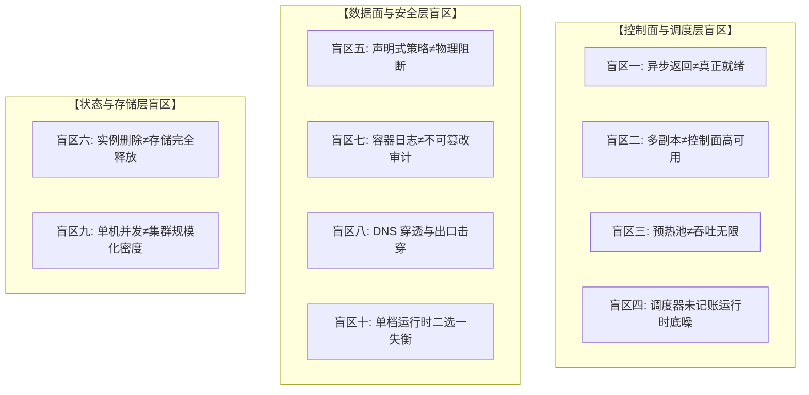
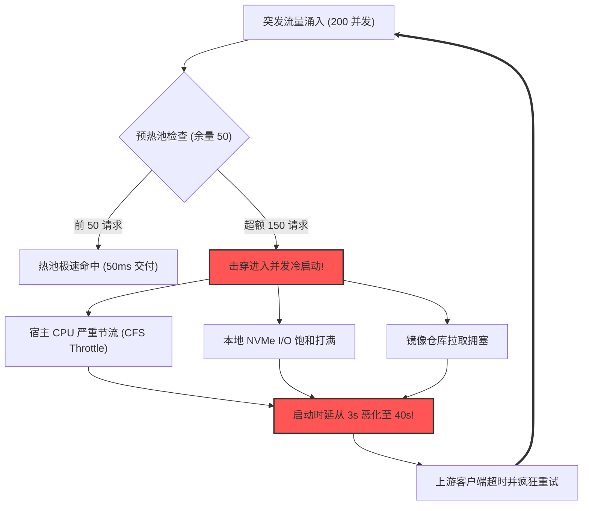
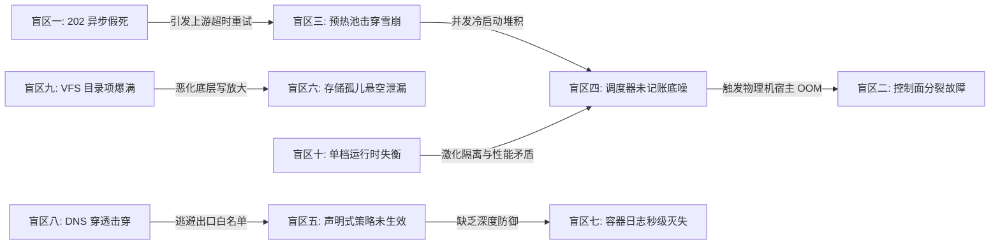
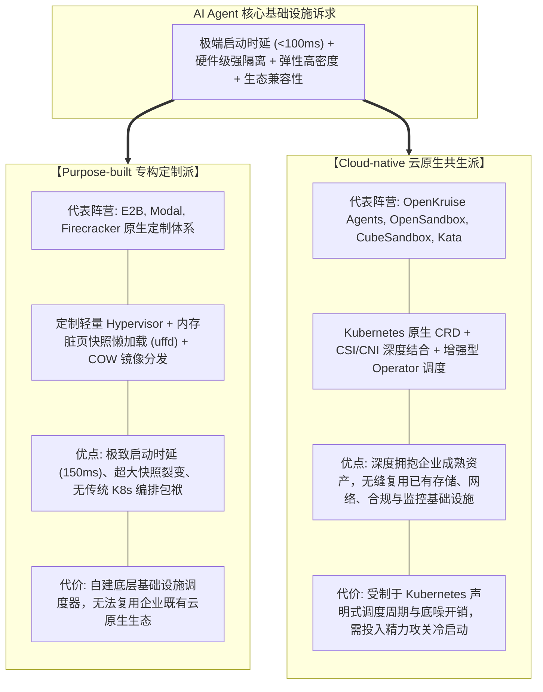
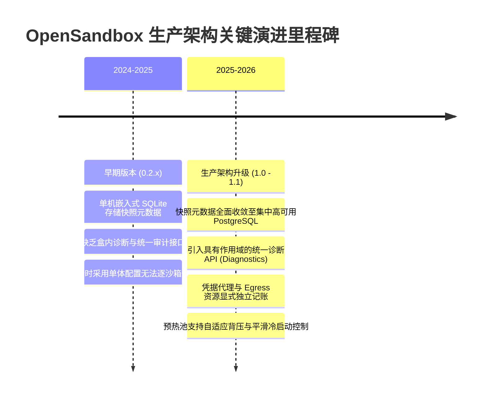
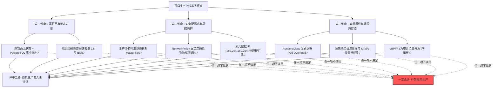
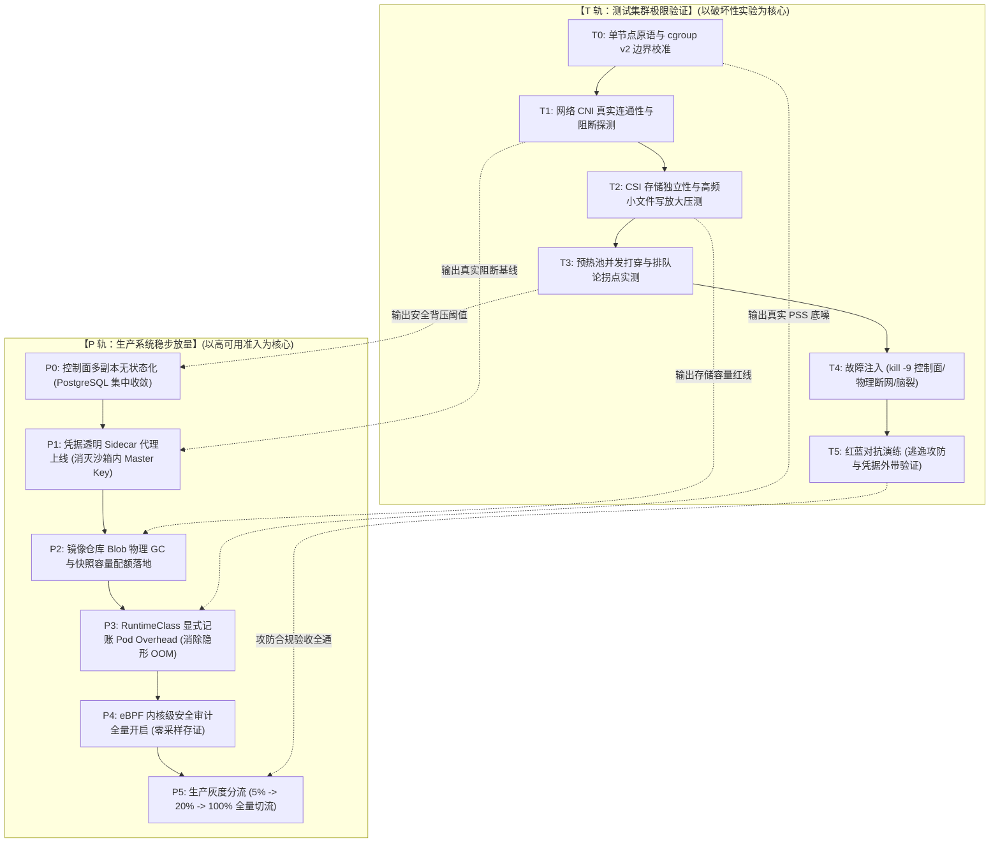

# 15 生产化深水区——十个盲区与行业共识

**摘要：**

AI Agent 沙箱技术在经历原型验证（PoC）的高速跑通之后，真正的大规模生产化落地往往会遭遇一系列反直觉的深水区陷阱：在单机环境下运行完美的逻辑，在多租户高并发场景下却频频诱发控制面假死、资源穿透与存储雪崩。本文作为专栏的收官之作，系统复盘 AI Agent 沙箱生产化落地的核心认知鸿沟：首先深入拆解业界反复踩踏的十大生产化盲区，严格遵循“是什么、为什么出现、不这样会怎样、如何落地、边界与反例”的五问方法论，涵盖异步就绪假象、多副本伪高可用、预热池雪崩击穿、调度器开销未记账、网络策略纸面生效、存储残留泄漏、审计断链、DNS 穿透、规模化写放大以及单档运行时失衡；接着全景透析当代沙箱技术演进的两大核心路线——以 E2B、Modal 为代表的“Purpose-built（专构定制派）”与以 OpenKruise Agents、OpenSandbox、CubeSandbox 为代表的“Cloud-native（云原生共生派）”在架构取舍、启动时延、生态复用与硬件成本上的终极权衡；最后建立生产上线准入工程基准与演进共识。

---

## 第 1 章 生产化的本质：从原型验证到工业基座的鸿沟

### 1.1 为什么原型验证通过不等于生产可用

在工程实践中，构建一个能够运行 AI Agent 的沙箱原型通常非常迅速：工程师只需拉起一个 Docker 容器，安装必要的 Python 依赖，暴露一个简单的 HTTP 或 WebSocket 端口接收命令并返回执行结果，一个功能完备的“代码执行沙箱”便告诞生。

然而，从“能跑的演示 Demo”跨越到“7×24 小时高可用、多租户强隔离、承载海量并发的工业级生产底座”，中间横亘着巨大的工程鸿沟：
1. **确定性逻辑与概率性载荷的冲突**：传统微服务处理的是具有明确 Schema、确定性调用路径的业务流量；而 Agent 沙箱处理的是由大模型实时生成的不可信未知代码。代码可能包含未捕获的死循环、耗尽内联缓存的递归、甚至被间接提示词注入诱导的恶意利用载荷；
2. **静态容量假设与高动态吞吐的脱节**：微服务通常具有可预测的弹性伸缩周期；而 Agent 沙箱的生命周期可能极短（单次工具调用仅需 500 毫秒）或极长（代码构建调试长达数小时），冷启动时延和实例并发创建洪峰对基础设施调度面构成了极限大考；
3. **单机局部视图与分布式全局状态的分裂**：单机原型中所有数据和状态都集中在单个节点上；而在多节点、跨可用区的生产集群中，状态的生命周期、挂载卷的并发冲突、镜像仓库的分发瓶颈以及网络隔离的失效，都会在瞬间被放大为系统级事故。

```mermaid
%%{init: {'theme': 'dracula'}}%%
flowchart LR
    subgraph PoC["原型验证阶段 (PoC)"]
        direction TB
        P1["单节点 Docker run"]
        P2["本地共享磁盘"]
        P3["静态注入 Master Key"]
        P4["忽视启动底噪与回收"]
    end

    subgraph Gap["生产化深水区鸿沟"]
        G1["并发创建雪崩"]
        G2["状态撕裂与死锁"]
        G3["多租户逃逸窃密"]
        G4["调度器隐形 OOM"]
    end

    subgraph Production["工业级生产底座 (Production)"]
        direction TB
        Pr1["多档位强隔离 (MicroVM/gVisor)"]
        Pr2["四本账状态解耦治理"]
        Pr3["Scoped Ephemeral Token 代理"]
        Pr4["自适应背压与原子 Overhead 记账"]
    end

    PoC ==> Gap ==> Production
```



### 1.2 生产化落地的三个认知误区

在走向生产化的过程中，团队最容易陷入以下三个致命的认知误区：

- **误区一：盲信“云原生已解决一切调度与隔离”**：
  许多团队认为 Kubernetes 已经是容器编排的事实标准，直接用原生的 Pod 调度不可信 Agent 代码即可。然而，Kubernetes 原生的设计初衷是编排长期运行的受信任企业微服务，其默认的共享内核容器模型、秒级的调度循环、缺乏对微虚拟机底层开销的原子感知，直接与 Agent 沙箱的超快冷启动与极端安全诉求发生剧烈冲突。
- **误区二：混淆“功能完备”与“运维稳态”**：
  平台开发人员往往专注于支持更多的编程语言、更花哨的浏览器自动化工具或更便捷的文件上传下载 API，却忽略了当集群经历 10 万次频繁沙箱创建与销毁后，Linux 内核 VFS 目录项（dentry）缓存是否泄漏、镜像仓库孤儿 Blob 是否打满磁盘、僵尸进程是否占满 PID 表。
- **误区三：单档运行时万能论**：
  试图在集群中只推行一种通用的隔离方案（例如全量采用 runc 以追求极速冷启动，或者全量采用 Kata Containers 以追求极致安全），最终要么在安全红线面前妥协引发多租户穿透事故，要么在硬件算力成本与冷启动延迟面前被业务方强行否决。

---

## 第 2 章 生产化十大盲区逐条深度拆解

为了让工程团队在架构评审与线上排障时拥有清晰的对照标尺，本章将业界在 Agent 沙箱生产化过程中反复遭遇的十个最具破坏性的盲区进行深度剖析。



### 2.1 盲区一：异步返回（202 Accepted）不等于实例真正就绪

- **是什么**：客户端调用沙箱创建接口，控制面在 50 毫秒内返回了 `HTTP 202 Accepted` 或带有实例 ID 的响应，但此时底层沙箱在宿主机物理机上可能仍处于镜像分层解压、CNI IP 分配、或者盒内通信守护进程（如 `execd`）建立握手的中间态。
- **为什么出现**：在现代分布式与云原生架构中，为了防止单个慢请求霸占 API 网关的工作线程，控制平面普遍采用事件驱动的异步创建模型。API 接收到请求并将其落入数据库或发送给控制器后即刻返回响应，而底层的实际拨备在后台并发执行。
- **不这样会怎样**：调用方（如上层 Agent 执行框架）以为拿到 ID 就意味着环境立即可用，立刻向沙箱下发首条执行命令（如执行一段初始化 Python 代码）。结果往往触发 `Connection Refused`、`SandboxNotReadyError`，或者命令被推入未初始化的管道导致进程永久假死挂起，引发大面积执行失败与重试风暴。
- **如何落地**：
  1. **明确状态机阶段划分**：严格区分沙箱状态机中的 `Accepted`（已受理）、`Provisioning`（拨备中）、`Running`（盒内守护进程已握手）、`Failed`（异常）；
  2. **端到端双向就绪探针（Ready Probe）**：沙箱的就绪状态必须以宿主机与沙箱内部 `execd` 完成一次双向加密握手（Ping-Pong 心跳）为唯一真值准绳；
  3. **客户端长轮询或流式等待**：SDK 端提供确定性的 `wait_until_ready(timeout)` 机制，结合 Server-Sent Events（SSE）或 WebSocket 事件流，在实例真正具备命令执行能力时才放行后续任务。
- **边界与反例**：严禁在服务端采用“阻塞式同步等待”来实现就绪。若 500 个并发创建请求全在服务端挂起等待容器启动，API 网关的工作连接池将在瞬间被耗尽雪崩。必须坚持“内部异步解耦，外部状态流显式对账”。

### 2.2 盲区二：多副本（Multi-Replica）不等于控制面真正高可用

- **是什么**：团队为了实现高可用（HA），将沙箱控制面服务（Server）配置为 3 副本，挂载在负载均衡器后面，但底层的元数据（如沙箱分配记录、快照目录）依然保存在各个 Pod 的本地存储（例如嵌入式本地 SQLite 文件）中。
- **为什么出现**：在架构演进初期，本地嵌入式数据库开发与测试极度轻量，无需配置外部依赖。许多团队在将镜像部署到 Kubernetes 时，简单地将 Deployment 的 `replicas` 改为 3，误以为 Kubernetes 的 Pod 副本数自动等同于“系统高可用”。
- **不这样会怎样**：负载均衡器的随机轮询机制导致严重的状态分裂：客户端发起的“创建快照”请求打在 Server-A 上，数据记录在了 Server-A 的本地 SQLite 中；随后的“基于快照启动沙箱”请求被路由至 Server-B，Server-B 查询本地数据库无此记录，随机向客户端返回 `404 Not Found`。系统不仅没有获得高可用，反而陷入不可预测的脑裂状态。
- **如何落地**：
  1. **彻底的无状态化重构**：控制面 Server 必须剥离所有持久化状态，全面迁移至外部集中式高可用数据库（如 PostgreSQL / Amazon Aurora）；
  2. **分布式条件更新与并发控制**：涉及沙箱状态转换、配额核算与快照记录时，必须利用数据库的行级悲观锁或基于版本号的 CAS（Compare-And-Swap）乐观锁，确保跨节点并发操作强一致；
  3. **多活控制面的幂等性保障**：所有受管控制器的状态协调循环（Reconcile Loop）必须天然具备幂等性，任何单点 Server 故障宕机，其余健康节点能够无缝接管任务。
- **边界与反例**：并非所有数据都适合推向中心数据库。对于纳秒级的执行进程临时状态或局部心跳缓存，若全部走中心数据库同步写入，中心 DB 将迅速被高频的小更新打垮。应采用“核心控制元数据走 PostgreSQL 强一致，高频临时租约走 Redis 分布式集群”的分级存储架构。

### 2.3 盲区三：预热池（WarmPool）不等于吞吐容量无限

- **是什么**：架构师为了消灭冷启动延迟，设计了固定大小的“沙箱预热池（WarmPool）”，维持 50 个预先启动好的干净沙箱，误以为只要有了热池，系统就能抵御任意规模的高并发突发流量。
- **为什么出现**：缺乏对排队论数学模型的敬畏。在流量平稳时，请求随到随取，命中率高达 99%，平均响应时间仅几十毫秒，掩盖了容量底座的脆弱性。
- **不这样会怎样**：突发流量洪峰一旦超过预热池的绝对容量（例如突发 200 个并发创建请求），预热池在几百毫秒内被迅速抽空穿透。系统瞬间从“毫秒级热取态”硬着陆跌入“并发冷启动泥潭”。宿主机节点为了同时拉起 150 个新沙箱，CPU 发生剧烈的上下文切换与 CFS 节流，磁盘 I/O 瞬间饱和，冷启动时延从正常的 3 秒恶化至 30 秒以上。上游客户端因超时大面积重试，进一步加剧系统拥塞，引发致命的**滚雪球击穿雪崩**。



- **如何落地**：
  1. **排队论容量模型与动态温控**：基于 M/M/c/K 排队模型计算热池安全基线，建立动态分级池（常备热池 + 弹性温池 + 快速降级通路）；
  2. **自适应背压与过载保护**：当预热池余量跌破安全警戒线（如低于 10%）且宿主机压力高企时，平台必须果断启动自适应节流，直接向上游返回带退避建议的 `HTTP 429 Too Many Requests (Retry-After: 5s)`，宁可主动拒绝部分请求，也绝不让雪崩拖垮已存活的在线任务；
  3. **并发冷启动平滑控制**：限制单节点允许同时执行冷启动的沙箱数量上限（如单机最大并发冷启动限制为 5 个），超额任务在队列中平滑排队，确保宿主机计算资源始终处于可控水位。
- **边界与反例**：盲目扩建静态预热池是另一种极端的资源浪费。常驻几百个空闲沙箱会常年吃光集群数十吉字节的物理内存。优秀的平台应结合任务时段特征（如工作时间波峰波谷）实施弹性池化管理。

### 2.4 盲区四：调度器资源视图未对齐运行时真实开销（Pod Overhead 记账缺失）

- **是什么**：Kubernetes 调度器在计算节点的剩余容量时，纸面上只统计 Pod 声明的 `resources.requests`，完全没有将底层安全沙箱运行时（如 gVisor Sentry、Kata Cloud-Hypervisor）自身的基础开销计入账本。
- **为什么出现**：在使用传统 runc 容器时，单容器的基础底噪极低（PSS 通常不足 30MiB），调度器忽略这部分底噪对集群整体影响微弱。团队在切换到 gVisor 或 Kata 等高安全运行时后，直接沿用了原先的 Pod Spec 模板。
- **不这样会怎样**：现实中，gVisor 实例的基础底噪高达 120MiB 以上，Kata Containers 微虚拟机的基础底噪更是逼近 400MiB。当调度器在单台物理机上密集调度了 40 个声明为 `512MiB` 的沙箱 Pod 时，调度器计算的内存消耗为 `20GB`（物理机总内存 32GB，看似绰绰有余）；然而物理节点上运行支撑进程实际上额外吞噬了 `16GB` 的隐形内存，物理总内存瞬间突破 32GB 物理极限！宿主机发生系统级 OOM，Kubelet、Docker/Containerd 核心进程被内核随机误杀，引发整个节点的死机与大面积驱逐。
- **如何落地**：
  1. **全链路实测基础设施底噪**：针对生产环境采用的“镜像族 × 运行时类别 × 宿主内核版本”，通过精密测量工具采集真实的 PSS（Proportional Set Size）底噪数据；
  2. **配置 RuntimeClass Overhead 显式记账**：在 Kubernetes 的 `RuntimeClass` CRD 中严格声明 `overhead.podFixed`（明确填入固定 CPU 与内存底噪），让 Kubernetes 调度器在进行装箱计算时原子化将其合并扣减。
- **边界与反例**：Overhead 配置不能凭空主观拍脑袋。若将 Overhead 虚标得过高，会导致物理节点的装箱密度严重下降，白白浪费数倍的企业硬件预算。必须坚持基于同口径实测数据进行持续校准。

### 2.5 盲区五：声明式 NetworkPolicy 不等于数据面物理生效

- **是什么**：安全团队在集群中编写并下发了看似严密的 `NetworkPolicy` 资源文件，`kubectl get networkpolicy` 显示状态一切正常，但底层的沙箱实例实际上依然可以随意访问内网任意端口。
- **为什么出现**：Kubernetes 原生代码仅提供网络策略的 API 存储抽象，完全依赖底层的 CNI 网络插件去实现数据面的过滤控制。若集群使用的是老旧配置的 Flannel，或者现代 CNI（如 Cilium/Calico）的内核 eBPF 模块、iptables 规则链在某个物理节点上发生异常崩溃未成功加载，API Server 完全不会给出任何报错。
- **不这样会怎样**：平台形成了危险的“安全虚假安全感”。一旦某个沙箱执行了被提示词注入的恶意代码，攻击者通过在沙箱内执行 `curl http://10.0.0.1:2379`（etcd 端口）或扫描内网 MySQL 数据库，将轻而易举地完成横向内网渗透，导致核心业务数据全盘沦陷。
- **如何落地**：
  1. **摒弃静态纸面信任，确立主动探测门禁**：在沙箱初始化流水线中内置自动化连通性探测探针（Active Probing），在测试沙箱中主动发起对内网保留 IP 的 TCP 握手，必须物理捕获到 `Timed Out` 强阻断事实；
  2. **选用工业级现代 CNI**：优先选用基于 eBPF 的 Cilium 作为统一网络底座，其在内核 Socket 层直接进行网络策略过滤，相比传统 iptables 规则链具备更强的阻断确定性与高吞吐性能。
- **边界与反例**：网络隔离不能做成“绝对物理断网”。Agent 往往需要拉取外部合法的代码库或模型，因此策略必须精确区分“租户间东西向物理绝缘”与“受控南北向代理外联”。

### 2.6 盲区六：沙箱实例删除不等于存储底层完全清理

- **是什么**：上层平台调用了删除沙箱接口，API 返回成功，Kubernetes 中的 Pod 也彻底消失，但底层存储系统中的快照镜像 Blob、CSI 持久卷以及宿主机的临时挂载点依然在暗中长期堆积。
- **为什么出现**：主流 OCI 镜像仓库采用基于内容寻址存储（CAS）的解耦架构，删除镜像 Manifest 时出于多方引用保护，默认绝不会同步删除底层的物理 Blob 文件；同时，Kubernetes CSI 卷在极端高频创建销毁或节点故障时，容易因超时产生悬空孤儿挂载（Orphan Volume）。
- **不这样会怎样**：几个月后，镜像仓库后端的对象存储被打满数十 TB 的无用垃圾 Blob，触发存储集群只读锁定；宿主机物理盘上的 `overlay2` 目录累积了数百万个孤儿目录，导致磁盘 inode 彻底耗尽。集群再也无法创建任何新沙箱，触发严重的线上停机事故。
- **如何落地**：
  1. **构建端到端删除证据链**：删除操作必须实施“预检意图登记 $
ightarrow$ 协调执行注销 $
ightarrow$ 物理残留对账扫描”三阶段闭环；
  2. **企业级 Registry 定期标记-清除（Mark-and-Sweep）GC**：配置镜像仓库在低峰期自动执行物理垃圾对账，彻底释放无任何引用的孤立 Blob；
  3. **宿主机清理探针定期巡检**：部署专用的守护进程扫描宿主机 `/sys/fs/cgroup` 路径和本地磁盘残存挂载点，发现脱钩的孤儿目录果断原地强行卸载。
- **边界与反例**：清理脚本严禁直接粗暴执行 `rm -rf`。在分布式存储环境下，异步解绑可能存在微小的时间窗口，必须通过原子锁与重试校验，防止误删正在被新沙箱挂载的合法数据。

### 2.7 盲区七：容器本地日志不等于生产可观测证据链

- **是什么**：运维团队仅仅依靠收集容器的标准输出日志（`stdout/stderr`），认为这就构成了沙箱的全部可观测证据。
- **为什么出现**：复用传统微服务的日志收集思维（如使用 DaemonSet 统一采集 `/var/log/pods` 下的文件）。
- **不这样会怎样**：Agent 沙箱的生命周期可能极其短暂（执行几十秒即刻销毁），一旦沙箱崩溃退出，短命容器的本地日志极易随之瞬间蒸发；更致命的是，沙箱内拥有 root 权限的不可信代码可以在退出前执行 `kill -9` 杀死日志代理，或者直接清空历史日志。当发生数据泄露时，取证团队面对的是一片空白，根本无法界定事故责任。
- **如何落地**：
  1. **审计数据完全下沉宿主内核层**：基于 eBPF 探针直接在宿主机内核挂载点（`sys_enter_execve`、`sys_enter_connect`）旁路捕获进程与网络事件，沙箱内进程无权干预；
  2. **安全审计绝对不采样**：全量内核事件通过单向 RingBuffer 异步推送至外部独立的 Kafka 与企业 SIEM，实现物理防篡改与法定存证；
  3. **语义关联与上下文串联**：通过全局唯一的 `trace_id` 将上层 Agent 的思维链、工具调用入参与底层执行命令深度绑定。
- **边界与反例**：全量审计不等于无节制地记录应用层大载荷。对于大文件传输等高频大块 I/O，审计应记录其元数据（源目标 IP、传输字节数、文件名），而非将其所有内容都推入审计流，防止打爆审计网络带宽。

### 2.8 盲区八：DNS 缓存击穿与网络出口策略穿透

- **是什么**：未对沙箱内的 DNS 解析与网络出口做针对性治理，导致沙箱被动态恶意域名击穿，或者高频域名解析直接打垮集群的 CoreDNS。
- **为什么出现**：Agent 在执行自动化任务（如网络爬虫、开源库依赖解析）时，会在短时间内动态请求成千上万个全新的外部域名，远远超出了常规微服务可预测的域名集合。
- **不这样会怎样**：
  - **CoreDNS 瘫痪**：海量未命中缓存的动态 DNS 请求瞬间打爆集群中央 CoreDNS，导致整个 Kubernetes 集群内所有的微服务解析超时中断；
  - **DNS 重绑定渗透**：攻击者利用极短 TTL 的动态域名，在 Agent 通过初始安全校验后，动态将域名解析切换为内网敏感 IP，成功突破外网白名单绕行攻击内网。
- **如何落地**：
  1. **沙箱节点级 NodeLocal DNS 缓存部署**：强制在宿主机节点部署本地 DNS 缓存探针，就地消化海量重复查询与并发请求，彻底隔离对中央 CoreDNS 的压力冲击；
  2. **安全 DNS 代理过滤内网私有地址**：在受管的 DNS 代理层开启私有 IP 屏蔽（RFC 1918 过滤），一旦公网域名解析结果指向 `10.0.0.0/8`、`172.16.0.0/12`、`192.168.0.0/16` 等内网段，直接在 DNS 解析阶段丢弃并报警；
  3. **基于 TLS SNI 的动态出口白名单**：利用 eBPF 在内核 Socket 层解析 TLS 握手报文，实施精准的域名白名单过滤。
- **边界与反例**：不能简单地封死所有外部未知域名的解析，这会导致 Agent 无法进行正常的技术调研。应当基于租户的安全评级实施分档网络准入。

### 2.9 盲区九：单机测试并发不等于集群规模化密度（VFS 目录项爆满与写放大）

- **是什么**：在单机测试环境下并发运行 10 个沙箱表现平稳，但在集群生产节点上密集调度 60 个沙箱时，宿主机系统出现极其反常的 I/O 挂起与系统卡顿，即使物理内存与 CPU 仍有大量剩余。
- **为什么出现**：现代前端与 Python 项目包含极其庞大的微小依赖文件（一个典型的 Node.js `node_modules` 目录可能包含 5 万个小文件）。当数十个沙箱同时在单节点执行依赖构建时，Linux 内核的虚拟文件系统目录项缓存（VFS dentry/inode cache）呈爆发式膨胀。
- **不这样会怎样**：内核为了维护庞大的 VFS 缓存链表，频繁触发全局内存回收锁（Slab Reclaim Latency）；同时，底层 NVMe 磁盘因处理数百万次随机小文件写产生严重的写放大（Write Amplification），I/O 时延从微秒级飙升至几十秒，系统调度陷入假死。
- **如何落地**：
  1. **内核 VFS 参数深度调优**：合理配置宿主机内核的 `vm.vfs_cache_pressure`，加速过期目录项的及时回收；
  2. **工作空间与本地可写层存储解耦**：不可信代码的工作空间独立挂载至高性能独立 NVMe 盘，避免与操作系统根文件系统共享同一块底层磁盘；
  3. **公共依赖层预编译只读共享**：将高频通用的依赖包预先烘焙进基础镜像层或挂载为只读共享卷，消灭重复的沙箱内解压构建。
- **边界与反例**：不能盲目使用 RAM 盘（tmpfs）来承载所有构建。tmpfs 消耗的是珍贵的物理宿主机内存，在面对超大代码库时极易诱发内存枯竭，必须在物理 NVMe SSD 与内存缓存之间取得平衡。

### 2.10 盲区十：单档运行时架构无法同时兼顾冷启动与极端安全

- **是什么**：团队试图在整个集群中推行单一的隔离方案，期望找到一个既有 runc 的毫秒级冷启动速度，又有物理机般硬件级安全强度的“万能银弹”。
- **为什么出现**：架构设计缺乏“安全光谱与成本收益”的客观权衡思维，试图在单一维度上消除物理法则的约束。
- **不这样会怎样**：
  - 若全选传统的 runc 容器：面对不可信的多租户代码时，平台常年暴露在内核提权与容器逃逸的巨大风险之中，无法通过企业客户的安全合规审计；
  - 若全选 Kata Containers 或 Firecracker 微虚拟机：对于仅执行一次只读代码检查的轻量任务，不仅要承受数秒的冷启动时延，还要额外背负数百兆的基础内存底噪，平台硬件成本飙升 300% 以上。
- **如何落地**：
  1. **构建动态自适应多档位架构（L1-L4）**：
     - **L1 基础档 (runc)**：服务于纯内部可信流水线、低危只读分析任务，追求亚秒级极致吞吐；
     - **L2 强化档 (OpenShell/Landlock)**：服务于日常常规代码编写与受控工具执行；
     - **L3 用户态拦截档 (gVisor)**：服务于标准多租户环境、不可信第三方包执行；
     - **L4 微虚拟机档 (Kata/Firecracker)**：服务于高危不受信外部代码、深度多租户强隔离业务；
  2. **基于任务风险上下文的动态路由分流**：由上层 Agent 网关根据代码来源、用户信任等级以及任务权限诉求，自动将其路由至最佳匹配的隔离档位。
- **边界与反例**：档位划分不宜过于碎片化（例如搞出十几个细分档位），这会导致底层节点镜像预热池被过度切分，调度碎片化严重。生产中保持 2 到 3 个核心档位是最佳工程平衡。

---

### 2.11 盲区之间的网状强关联：系统工程的木桶效应

深入剖析上述十个生产化盲区，我们能够发现一个深刻的系统工程规律：**这十个盲区绝非孤立存在的技术点，而是相互交织、互为因果的网状系统**。



1. **“假死 $
ightarrow$ 击穿 $
ightarrow$ OOM”的级联故障链**：
   当盲区一（202 异步假死）发生时，客户端误以为沙箱已就绪，下发指令失败后立刻触发自动重试；疯狂的重试洪峰在几秒内抽干盲区三中的预热池；大量并发冷启动实例涌入单个节点，与盲区四（未记账的 Pod Overhead 底噪）叠加，瞬间引发物理宿主机的系统级 OOM，造成不可逆的节点雪崩。
2. **“伪策略 $
ightarrow$ 动态穿透 $
ightarrow$ 取证断链”的安全沦陷链**：
   当盲区五（纸面 NetworkPolicy 未生效）与盲区八（DNS 动态解析穿透）共同存在时，攻击者可以通过间接提示词注入诱导 Agent 访问具有恶意 DNS 记录的外部服务器，在毫无阻碍的情况下横向扫描企业内网；而此时若系统存在盲区七（日志随短命容器销毁灭失），安全运维团队在事故发生后甚至连一份能证明数据泄漏的有效证据链都无法还原。

这充分表明：**沙箱平台的生产稳定性取决于系统中最薄弱的那一块短板**。单纯在某一个单点（例如只做极度激进的预热池扩容）进行局部优化，不仅无法解决根本问题，反而会在级联效应下加剧全局崩塌的风险。

### 2.12 生产级排队论模型：M/M/c/K 在预热池容量中的精确推导

为了将盲区三（预热池管理）的治理从“凭经验猜测”提升为严密的数学科学，必须引入运筹学经典的 **M/M/c/K 排队系统模型**：
- **到达过程（M）**：设用户与业务系统创建沙箱的请求服从泊松分布，平均到达率为 $\lambda$（个/秒）；
- **服务时间（M）**：设从预热池领用沙箱并完成任务交接的耗时服从指数分布，单个处理通道的服务率为 $\mu$（个/秒）；
- **服务通道数（c）**：对应预热池中当前维持的就绪沙箱数量 $c$；
- **系统容量上限（K）**：对应平台允许同时排队等待沙箱的最大任务队列长度 $K$（$K \ge c$）。

根据马尔可夫链状态转移方程，当系统处于稳定稳态时，系统内存在 $n$ 个并发请求的概率 $P_n$ 满足：
$$P_n = 
egin{cases} 
rac{(\lambda/\mu)^n}{n!} P_0, & 0 \le n \le c \
rac{(\lambda/\mu)^n}{c! c^{n-c}} P_0, & c < n \le K 
\end{cases}$$
其中归一化常数 $P_0$ 由全概率公式 $\sum_{n=0}^K P_n = 1$ 唯一确定。

由此可以精确推导出两大关键工程控制指标：
1. **预热池被完全打穿的概率（Pool Depletion Probability, $P_{	ext{deplete}}$）**：
   $$P_{	ext{deplete}} = \sum_{n=c}^K P_n$$
   当且仅当 $P_{	ext{deplete}} \le 0.001$（千分之一）时，预热池的容量配置才被视为达到了电信级的安全裕度；
2. **任务排队等待时间拐点（Wait Time Inflection Point）**：
   根据 Little 定律，当到达率 $\lambda$ 逼近服务极限 $c \mu$ 时，系统的平均等待时延 $W_q$ 呈现双曲线激增：
   $$W_q = rac{L_q}{\lambda(1 - P_K)} \propto rac{1}{1 - 
ho}, \quad 	ext{其中 } 
ho = rac{\lambda}{c \mu}$$
   这一公式在数学上直接证明了：**当负载率 $
ho > 0.85$ 时，任何微小的流量抖动都会诱发排队时延的雪崩式暴涨**。因此，自适应背压控制器必须在检测到 $
ho$ 突破 0.8 时主动介入限流与降级，坚决阻止系统滑入队列饱和崩溃区。

## 第 3 章 行业两大流派：专构定制派 vs 云原生共生派

在当今全球 AI Agent 沙箱技术的演进浪潮中，逐步分化出两条路线清晰、权衡截然不同的技术流派：**Purpose-built 专构定制派** 与 **Cloud-native 云原生共生派**。



### 3.1 Purpose-built 派的核心哲学与工程实现

以 **E2B** 与 **Modal** 为代表的专构定制派坚信：**AI Agent 是前所未有的全新工作负载，试图在为传统微服务设计的 Kubernetes 栈上缝缝补补是徒劳的**。

- **核心技术栈特征**：
  1. **放弃传统 OCI 镜像解包**：采用专门构建的内容寻址块设备，利用 Linux 内核的 `userfaultfd`（用户态缺页异常处理机制），实现虚拟机内存页与磁盘块的按需懒加载（Lazy Loading）。新沙箱在物理内存未完全加载前即可唤醒执行，启动时延被极致压缩至 100 毫秒至 200 毫秒之间；
  2. **基于内存转储的瞬时裂变**：直接通过 KVM 捕获已经预热好庞大环境（如包含 PyTorch、Pandas 的复杂环境）的内存脏页，生成不可变只读模板。一个模板可以在毫秒级分裂出数千个相互隔离的 Worker 沙箱；
  3. **裁剪一切通用虚拟外设**：彻底抛弃通用 PC 架构中冗余的虚拟显卡、声卡、ACPI 总线，仅保留精简的串口与 virtio 网络通道，将虚拟机基础底噪压缩至极限。
- **适用场景与局限**：非常适合纯粹的公共云 SaaS 服务商或对冷启动时延有极限要求的专业 AI 代码平台；但对于传统企业内部落地而言，由于其完全自成一体的私有架构，企业原有的 Kubernetes 运维监控工具、专有安全审计规范几乎完全无法复用，运维进入门槛极高。

### 3.2 Cloud-native 共生派的核心哲学与工程实现

以阿里开源的 **OpenSandbox**、**OpenKruise Agents** 以及 **CubeSandbox** 为代表的云原生共生派则秉持相反的务实哲学：**企业的核心数据资产、存储集群与安全网络全部沉淀在 Kubernetes 生态中，沙箱必须作为云原生一等公民深度融入基础设施**。

- **核心技术栈特征**：
  1. **CRD 与声明式编排驱动**：通过定义 `Sandbox`、`SandboxPool` 等自定义资源（CRD），将沙箱的生命周期与 Kubernetes 原生控制器模式对齐；
  2. **复用成熟的 CSI 与 CNI 生态**：代码存储直接挂接企业的 Ceph RBD 或云厂商高性能云盘，网络安全直接复用 Cilium 等经过严苛检验的 eBPF 策略引擎，安全审计直接接入已有的企业 SIEM 系统；
  3. **增强型调度与预热池控制器**：针对 Kubernetes 原生调度较慢的问题，通过自研的预热池 Operator（如 OpenSandbox WarmPool 机制）在后台维护常备实例队列，将沙箱交付时延同样优化至 1 秒以内。
- **适用场景与局限**：是绝大多数大中型企业私有化部署、金融安全合规场景下的唯一最优解。它在最大限度保护企业既有 IT 投资的前提下，平滑落地了沙箱技术；其代价是需要深入理解 Kubernetes 的底层调度盲区（如前文所述的 Pod Overhead 记账与 CSI 卷挂载超时治理）。

### 3.3 两派路线的全方位技术选型对照

| 维度 | Purpose-built 专构定制派 (E2B / Modal) | Cloud-native 云原生共生派 (OpenSandbox / OpenKruise) |
| :--- | :--- | :--- |
| **底层隔离核心** | Firecracker MicroVM / 定制 gVisor 用户态内核 | Kubernetes 容器 + Kata Containers / gVisor 插件化 |
| **沙箱启动交付时延** | **极快 (< 200ms)**，基于内存页懒加载 | **中等 (1s - 3s)**，依赖前置预热池技术削减调度开销 |
| **存储体系集成** | 定制 CoW 内存块设备 + S3 兼容对象存储 | **成熟 CSI 体系** (Ceph RBD, NFS, 本地 NVMe, 云厂商云盘) |
| **网络多租户体系** | 定制 TAP 设备 + 专有主机网络路由引擎 | **成熟 CNI 体系** (Cilium eBPF, Calico, NetworkPolicy) |
| **快照与状态恢复** | **支持全内存页快照** (直接恢复运行中进程) | **主打 rootfs 镜像与工作空间恢复** (进程依靠第三本账重塑) |
| **企业既有基础设施兼容性** | **差**。自建控制面，需专有运维支撑 | **极佳**。无缝融入已有 K8s 集群与企业监控安全平台 |
| **适用主体定位** | 面向全球开发者的公共云代码执行平台 | 大中型企业私有云、严监管行业合规平台、自建 AI 基础设施 |

---

### 3.4 开源演进标杆：OpenSandbox 架构演进与盲区关闭度复核

以开源沙箱标杆项目 **OpenSandbox** 从早期 0.2 版本向 1.1 现代化生产架构的演进历史为例，其技术路线图为我们提供了极具参考价值的工业样本：



1. **元数据账本外置（关闭盲区二）**：
   在早期版本中，快照元数据默认记录在 Server 容器本地的 SQLite 中，导致双副本部署下快照查询随机遭遇 404；在现代版本中，社区正式合入了外部关系型存储（PostgreSQL Store）支持，通过行级乐观锁与 CAS 机制，彻底消灭了多副本控制面的状态漂移；
2. **有作用域的诊断体系（关闭盲区七）**：
   早期方案中，沙箱一旦异常退出，外部调用诊断接口直接返回 501 Not Implemented，平台侧审计面完全脱节；现代版本引入了标准化的 Diagnostics API，支持按 `logs:container`、`logs:runtime` 与 `events:lifecycle` 等精细化作用域提取完整的底层诊断事件流；
3. **网络出口边车资源独立化（关闭盲区四）**：
   针对 egress 网络代理边车霸占资源的问题，新版本在配置规范中显式抽离出 `[egress.resources]` 独立声明块，让边车的 CPU 与内存开销在 Kubernetes 调度器中获得精准记账，大幅削减了物理节点的隐形超卖风险。

### 3.5 专构定制前沿：Modal 与 E2B 的微虚拟机内存快照技术解密

在 Purpose-built 阵营中，E2B 与 Modal 的技术突破为业界树立了全新的性能天花板。深入解剖其内核技术细节，能为我们理解沙箱终局提供深刻启发：

#### 1. Firecracker + userfaultfd 的按需内存流送（On-Demand Page Streaming）
传统虚拟机的内存快照恢复通常需要一次性将整个虚拟机的物理内存文件（例如 4GB 镜像）从远程存储拉取并写入内存，网络与磁盘 I/O 耗时数秒。
- E2B 的革命性设计在于利用 Linux 内核的 **`userfaultfd` 原语**：在拉起 MicroVM 的瞬间，仅仅分配一段空的虚拟地址空间，并在其上注册 `UFFDIO_REGISTER_MODE_MISSING` 缺页监听；
- 当虚拟机内部的 Guest Linux 引导并访问某个具体的代码或数据页时，CPU 触发缺页异常（Page Fault），内核直接将该事件挂起并转移给用户态的流式加载守护程序；
- 守护程序通过网络并发只拉取当前所需的那一个 4KB 物理页，并通过 `ioctl(uffd, UFFDIO_COPY)` 瞬时填充并恢复虚拟机的 CPU 执行。通过这种“**按需缺页懒加载**”机制，沙箱能够在仅加载了 15MB 核心代码页的情况下在 100 毫秒内唤醒并开始执行 Python 代码！

#### 2. gVisor 用户态 Sentry 的全状态 Checkpoint 序列化
Modal 则在 Google gVisor 的基础上进行了极致的用户态定制：
- 由于 gVisor 的 Sentry 自身完全掌控了进程树的所有虚拟内存映射、信号队列与文件描述符抽象，Modal 在 Sentry 内部实现了一套高度精简的序列化与反序列化协议；
- 当需要保存环境时，Sentry 在用户态冻结所有的执行线程，扫描所有脏页并生成极小体积的内存差异流（Memory Diffs）；
- 恢复时，Modal 绕过任何耗时的操作系统引导阶段，直接在崭新的 Pod 中将 Sentry 的内存结构重新映射，实现了真正意义上的“进程级亚毫秒级瞬时克隆”。

## 第 4 章 生产上线工程落地准入自检清单

在平台正式向全量租户开放服务之前，技术委员会必须按照以下三维工程准入清单执行严格的一票否决式闭环审查：



### 4.1 控制面高可用与状态治理准入项
- [ ] **元数据强一致收敛**：控制面 Server 副本数 $\ge 2$，所有快照元数据、实例路由状态统一持久化至外部高可用 PostgreSQL，消除任何 pod-local 嵌入式存储单点；
- [ ] **异步状态对账机制**：客户端创建 API 严格践行状态机模型，就绪探针以双向加密心跳握手为唯一准绳，杜绝假死调用；
- [ ] **删除物理证据链**：注销流程具备“删除意图 $
ightarrow$ 协调执行 $
ightarrow$ 物理残留扫描”闭环，镜像仓库配置了定期的孤儿 Blob 物理垃圾回收（GC）。

### 4.2 深度安全隔离与凭据治理准入项
- [ ] **长期主凭据绝对隔离**：沙箱内部环境变量与配置文件百分之百绝缘真实的长期 Master API Key，全部外联统一由透明 Sidecar 代理进行动态签名注入；
- [ ] **最小权限 Scoped Token 轮换**：沙箱交互仅颁发有时效限制（$\le 15$ 分钟）的范围受限临时票据，并具备紧急吊销 Kill-Switch；
- [ ] **网络策略真实阻断验证**：通过自动化红蓝脚本完成真实 TCP 连通性攻防探测，证实 CNI 策略物理生效；
- [ ] **云元数据服务（IMDS）物理硬拦截**：公有云环境下彻底丢弃对 `169.254.169.254` 的路由，阻断一切 SSRF 窃密利用链路；
- [ ] **行为审计全量零采样**：宿主机内核级 eBPF 探针直推中心审计流，系统调用记录防本地篡改，保留期限 $\ge 180$ 天。

### 4.3 容量工程与防雪崩治理准入项
- [ ] **Pod Overhead 调度记账**：针对 gVisor 或 Kata 微虚拟机运行时，在 Kubernetes `RuntimeClass` 中显式配置固定资源开销记账，消除宿主机隐形 OOM 隐患；
- [ ] **预热池排队论防护与自适应背压**：预热池配置动态水位告警，在击穿临界点具备自适应拒绝（HTTP 429）与并发冷启动节流平滑控制；
- [ ] **NodeLocal DNS 缓存就地消化**：沙箱宿主机部署本地 DNS 缓存探针，配置私有 IP 阻断规则，彻底防御 DNS 重绑定与 CoreDNS 雪崩。

---

### 4.4 生产落地演进路线：测试集群 (T轨) 与生产推进 (P轨) 双轨并进

从混乱的单机原型走向稳固的工业基座，绝不能采取“休克式”的一次性切换。在工程管理上，必须采取**测试集群验证（T 轨）与生产渐进落地（P 轨）双轨并进**的阶段化推进路线：



#### 1. T 轨（测试集群）的六大核心验证成果与退出准则
- **T0-T1 退出准则**：完成单机 cgroup v2 物理配额验证，证明 Fork 炸弹与内存炸弹无法穿透沙箱，且 CNI 连通性攻防脚本确认内网敏感端口 100% 物理阻断；
- **T2-T3 退出准则**：在工作空间内连续运行 100 次高强度前端构建，底层存储未发生 VFS 内存泄漏与死锁；使用并发压力工具打穿预热池，验证自适应背压降级（HTTP 429）能在 100 毫秒内平滑生效；
- **T4-T5 退出准则**：在多副本控制面中随机强杀单个 Server Pod，客户端未观测到任何快照查询 404；红客渗透团队尝试读取云元数据 IP 与外带环境变量，全部被内核探针即时捕获并阻断。

#### 2. P 轨（生产演进）的四项上线铁律
- **铁律一：无对账不放行**：任何涉及存储卷解绑与沙箱销毁的逻辑，必须具备后台物理扫描对账，绝不允许仅凭 API 状态流转判定资源已完全释放；
- **铁律二：凭据绝不出金库**：生产沙箱内绝不注入明文 Master Key，全部流量必须强制路由至受管的透明代理；
- **铁律三：容量模型计入底噪**：针对 gVisor / Kata 微虚拟机，必须在调度器中实装 Pod Overhead，装箱密度以实测物理 PSS 为唯一计算标准；
- **铁律四：生产切流遵循灰度阶梯**：新架构必须遵循 `内部探针流量 (1%) -> 低危业务沙箱 (10%) -> 核心业务多租户 (50%) -> 全量托管 (100%)` 的渐进式放量节奏，每个阶梯至少持续运行 72 小时无系统级告警方可晋级。

## 第 5 章 总结与深度思考题

### 5.1 本文核心架构要点

作为全专栏的技术收官篇，我们系统梳理了 AI Agent 沙箱在从实验室原型走向工业级基座过程中的关键认知：
1. **警惕表面工程指标**：异步返回成功不代表环境具备计算能力，多副本部署不代表控制面真正高可用，配置了预热池不代表具备抵御突发流量的无限容量；
2. **正视基础设施底噪代价**：安全隔离不是免费的午餐，高安全运行时产生的巨大内存底噪（Pod Overhead）必须在调度器层面显式记账，否则必将遭受物理节点 OOM 驱逐的惩罚；
3. **坚持验证驱动的安全准入**：声明式配置只是纸面意图，网络策略、凭据脱敏与删除清理必须通过实战探测与底层数据面物理对账来验证其真实有效性；
4. **客观看待行业两大流派**：Purpose-built 专构派代表了极致时延与快照裂变的工程前沿，Cloud-native 共生派则代表了深度复用企业已有云原生基础设施资产的稳健主航道，架构师应根据业务场景的核心矛盾做出理性权衡。

### 5.2 关键术语速查表

| 术语 | 英文全称 | 核心概念定义与在本文中的上下文 |
| :--- | :--- | :--- |
| **Purpose-built** | Purpose-built Architecture | 专构定制派架构，以 E2B、Modal 为代表，专门为 AI 代码执行与快照裂变裁剪定制的微虚拟机技术栈 |
| **Cloud-native** | Cloud-native Coexistence | 云原生共生派架构，以 OpenKruise Agents、OpenSandbox 为代表，深度扎根 Kubernetes 生态的沙箱平台路线 |
| **M/M/c/K Model** | Queueing Theory Model | 排队论经典模型，用于精确计算预热池容量、请求到达率、服务处理能力与系统丢包率的数学关系 |
| **Pod Overhead** | Pod Overhead Accounting | Kubernetes 用于描述高安全运行时虚拟机监视器额外消耗物理资源的原生记账机制 |
| **Active Probing** | Active Security Probing | 真实主动对抗探测，通过在沙箱内主动发起违规网络请求来检验底层 CNI 策略是否真正物理生效的方法论 |
| **Blob GC** | Registry Blob Garbage Collection | 镜像仓库物理垃圾回收，通过两阶段标记-清除释放内容寻址存储中未被引用的悬空二进制数据块 |

### 5.3 深度思考题

1. **预热池与冷启动的排队论极限**：在突发流量洪峰瞬间打穿预热池时，如果平台选择立刻将全部超额请求并发转为冷启动，宿主机 CPU 与 I/O 将迅速雪崩；如果选择严格限制并发冷启动速率并排队，客户端将承受极高的排队等待时延。你将如何通过引入自适应队列（如 CoDel 算法）来设计最优的动态节流算法？
2. **多租户网络隔离下的内网共用服务暴露**：在大型企业私有云中，所有租户的沙箱都需要访问企业统一的内部 Git 仓库（如私有 GitLab）拉取业务代码，此时如何在保证网络门禁不被穿透的前提下，向沙箱安全开放该内部服务？
3. **Purpose-built 派内存快照的合法合规风险**：E2B 等平台通过内存转储技术直接恢复处于运行中的 Python 进程与内存堆栈。在面向严监管行业的金融客户时，跨租户共享只读模板内存页表是否可能通过 CPU 侧信道攻击（如 Spectre/Meltdown 变种）诱发内存越权读取？生产上该如何防御？
4. **云原生共生派在极端规模下的 etcd 压力化解**：当集群中并发运行的短期沙箱数量达到数万级别，每个沙箱的频繁创建、心跳上报、状态流转与注销都会转化为对 Kubernetes API Server 与底层 etcd 的高频写入。你将如何设计分层控制面架构，以避免 etcd 因频繁的事务提交与压缩发生性能击穿？

### 5.4 专栏结语

至此，《Agent 沙箱技术专栏》全篇完结。
从底层的 Linux 隔离原语（Namespace、cgroup、seccomp、capabilities），到跨越共享内核、用户态虚拟化与硬件微虚拟机的隔离光谱；从解剖现代 VMM（Firecracker、Cloud-Hypervisor、Kata Containers）的监视器内核，到 OpenSandbox、E2B、NVIDIA OpenShell 等前沿平台的控制面、数据面与凭据隔离实战；再到深入生产化深水区，系统拆解状态四本账、纵深防御体系与十大致命盲区。

我们始终坚持一条核心主线：**在 AI Agent 的智能世界里，不可信的代码是动态生成的，未知的风险是必然存在的；唯有依靠扎实、透明、可度量、无信任假设的现代系统工程体系，才能为人工智能的自由探索筑起最坚固的安全堤坝**。愿本专栏的思考与沉淀，能成为你在构建下一代智能基础设施征途上的坚实基石！

---

## 参考文献

1. Alibaba OpenSandbox Official Architecture Documentation and Whitepaper. Alibaba Cloud Open Source Projects. https://open-sandbox.ai/
2. E2B Technical Documentation & Sandbox Architecture at Scale. E2B AI Infrastructure. https://docs.e2b.dev/
3. Modal Labs Technical Architecture Blog: Fast Sandboxing with Userspace Checkpoints. Modal Engineering. https://modal.com/blog
4. OpenKruise Agents: Advanced Multi-Agent Sandbox Workload Orchestration on Kubernetes. CNCF OpenKruise Project. https://openkruise.io/
5. Firecracker: Lightweight Virtualization for Serverless Applications. Agache, A. et al., USENIX NSDI 2020. https://www.usenix.org/conference/nsdi20/presentation/agache
6. Kubernetes SIG-Node Documentation. RuntimeClass & Pod Overhead Specifications. https://kubernetes.io/docs/concepts/scheduling-eviction/pod-overhead/
7. NVIDIA OpenShell Project Security Architecture. NVIDIA AI Infrastructure, 2024-2025.
8. Cilium Architecture Guide: eBPF-based Datapath and Network Security. Isovalent / CNCF. https://docs.cilium.io/
9. OWASP Top 10 for Large Language Model Applications & Agentic Considerations. OWASP Foundation. https://genai.owasp.org/
10. Linux Kernel Documentation. Memory Resource Controller (cgroup v2) & Pressure Stall Information (PSI). https://www.kernel.org/doc/html/latest/admin-guide/cgroup-v2.html

---

## 附录：生产环境上线前一票否决自查清单

```
[ ] 1. 控制面 Server 部署多副本，快照与实例元数据已完全外置至高可用 PostgreSQL，杜绝本地 SQLite 脑裂。
[ ] 2. 实例就绪状态严格基于宿主机与盒内守护进程的双向加密心跳握手，消灭 202 异步假死。
[ ] 3. 预热池基于 M/M/c/K 排队论模型建模，配置了严格的自适应背压降级（HTTP 429）与并发冷启动节流。
[ ] 4. Kubernetes RuntimeClass 显式声明了 podFixed 资源开销，消灭高安全运行时底噪导致的隐形 OOM。
[ ] 5. NetworkPolicy 已通过沙箱内主动连通性探测脚本对账，证实 CNI 插件物理生效。
[ ] 6. 沙箱容器内部绝对清空长期 Master API Key，对外调用全权由透明 Sidecar 代理进行动态签名注入与 DLP 审查。
[ ] 7. 物理硬性屏蔽云厂商实例元数据 IP (169.254.169.254)，彻底斩断通过 SSRF 盗取节点 IAM 凭据的路径。
[ ] 8. 行为审计基于宿主机内核级 eBPF 探针全量实施（绝对不采样），审计事件实时推送至独立只读 Kafka。
[ ] 9. 部署宿主机 NodeLocal DNS 缓存探针，配置私有 IP 过滤规则，杜绝 DNS 重绑定与 CoreDNS 压力雪崩。
[ ] 10. 存储生命周期具备完整的端到端删除证据链，配置了 Registry 定期孤儿 Blob 物理垃圾回收（GC）。
```
