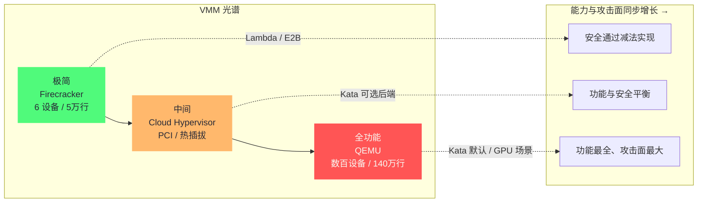
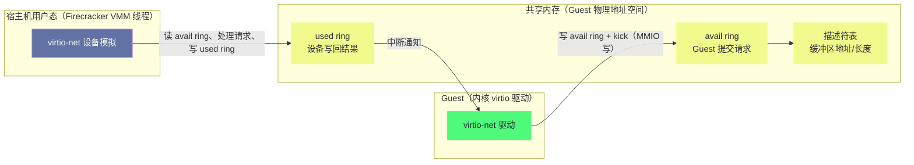
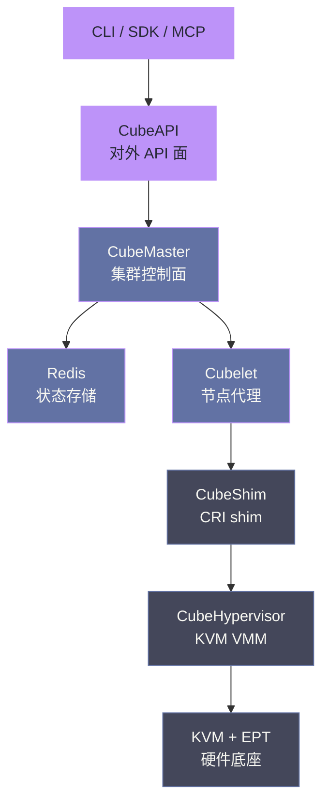

# 05 VMM 解剖——Firecracker、Cloud Hypervisor 与 Kata 的虚拟机监视器家族

**摘要：**

[[04 KVM 与硬件虚拟化——MicroVM 隔离的硬件基石]] 讲透了硬件底座（VMX/EPT/KVM 三级 fd），但"谁在用户态把 KVM 变成一台可用的虚拟机"还没有回答——这个角色是 **VMM（Virtual Machine Monitor，虚拟机监视器）**。本文解剖 VMM 家族：从 Firecracker 的"极致减法"（仅 6 个仿真设备、无 BIOS/PCI/USB、jailer 进程降权、token bucket 限流，截至 2026 年已支撑 AWS Lambda 每月 15 万亿次以上的调用），到 rust-vmm 的"组件化乐高"（不是产品而是组件库），到 Cloud Hypervisor 的"中间路线"（PCI/GPU 直通、热插拔、live migration），再到 Kata 的"多 hypervisor 可插拔策略"（2026 年 7 月的 4.0 版本把运行时从 Go 重写为 Rust，Dragonball 成为默认内置 VMM，但 GPU/TDX/SEV-SNP 依旧仅 QEMU 支持），最后拆解 CubeSandbox——从 VMM 到完整 Sandbox 产品的形态（CubeAPI/CubeMaster/Cubelet/CubeShim/CubeHypervisor 六组件）。机制层面，本文补全了 virtio 半虚拟化的队列原理（virtqueue 的 avail/used 环与 kick/中断通知）、MMDS 元数据通道、快照克隆与 v1.14 起的预留式内存热插，并给出了 QEMU 的历史对照——"设备模型即攻击面"这条判断，在 2026 年仍被 Kata 4.3.0 的 Dragonball virtio 逃逸公告反复验证。核心认知：**VMM 构成"极简↔全功能"光谱，选型不是比功能多少，而是比"设备模型与威胁模型的匹配度"——每个你模拟的设备都是一个攻击面，每个你不模拟的设备都是一个不可用能力**；同时，VMM 只是沙箱的"第 4 层"组件，CubeSandbox 的教训表明：**没有控制面与协议层的 VMM，只是半成品**。

---

## 第 1 章 VMM 是什么：虚拟机监视器的职责

上一章把 KVM 讲到了三级 fd 与 VM Exit 的粒度，但"谁把 KVM 的能力拼装成一台能跑 Linux 的机器"这个问题还悬着——本文回答它。VMM 一词常与 hypervisor 混用，先厘清职责，再看光谱，最后回答"为什么 VMM 的设计决定沙箱安全"。

### 1.1 VMM 的四个职责

VMM（Virtual Machine Monitor）是运行在宿主机用户态、负责"把 KVM 的硬件虚拟化能力变成一台可用虚拟机"的软件。它的职责可以归纳为四类：

| 职责 | 内容 | 代表实现 |
| :--- | :--- | :--- |
| **CPU 虚拟化编排** | 创建 vCPU、设置 Guest 初始状态、处理 VM Exit | 所有 VMM |
| **内存编排** | 注册 Guest 内存区域、维护 EPT 映射 | 所有 VMM |
| **设备模拟** | 模拟 virtio 设备（网络/块/串口等），处理 Guest I/O | QEMU（数百设备）/ Firecracker（6 设备） |
| **生命周期管理** | 引导加载、启动/暂停/恢复、配置接口 | Firecracker API / QEMU QMP / Kata shimv2 |

**关键认知**：VMM 是"用户态软件"——它的代码质量、设备模型大小、特权配置，直接决定了虚拟化边界的安全性。VMM 被攻破意味着攻击者获得"宿主机用户态进程权限"（比内核权限低，但仍可能读取其他 VM 的共享内存或利用更多漏洞）。

这里要强调，这四类职责的重心在近二十年里发生了明显的迁移：早期 QEMU 把大半精力花在"模拟各式各样的真实硬件"（从软驱到声卡），而 Firecracker 一代的 VMM 把精力压在"如何少模拟"与"如何把少数设备模拟得足够快"上。设备模拟从"卖点"变成"负担"，是理解整个 VMM 家族演进的关键线索。

### 1.2 术语辨析：hypervisor、VMM 与 Type 1/Type 2

hypervisor 与 VMM 在日常语境里可以互换，但严格说，hypervisor 是"管理虚拟机的那一层软件"的总称，VMM 特指其中"模拟设备、组装机器"的用户态部分。教科书把 hypervisor 分成两类：**Type 1（裸机型）**直接跑在硬件之上，譬如 Xen、VMware ESXi；**Type 2（宿主型）**跑在宿主操作系统之上。Linux 世界的 KVM 是一个教科书装不下的特殊形态——它本身是内核模块，通过 `/dev/kvm` 把 Linux 内核变成 hypervisor，而"模拟设备、引导 Guest"的用户态角色由 VMM（QEMU、Firecracker、Cloud Hypervisor）承担。

这套分工的独特之处在于：KVM 复用了 Linux 内核的调度器与内存管理，vCPU 线程对内核来说只是普通线程，超卖（overcommit）是顺其自然的行为，不需要 VMM 自己管理一套 CPU 队列。笔者提醒读者，不要把"Type 1 一定比 Type 2 强"的旧直觉带到 MicroVM 场景——Firecracker 的密度优势恰恰来自"复用内核"这种非典型结构，而不是来自更纯粹的 hypervisor 形态。

### 1.3 "极简↔全功能"光谱

VMM 的设计空间是一条光谱：一端是 QEMU 式的全功能（数百种设备、固件支持、live migration、GPU 直通），另一端是 Firecracker 式的极简（6 个设备、无固件、无热插拔）。光谱上的位置由两个问题决定：

1. **威胁模型**：VMM 的代码量直接决定攻击面——"每个你不模拟的设备就是一个你不交付的 CVE"（Firecracker 设计哲学）；
2. **功能需求**：GPU 直通需要 PCI 支持，Windows Guest 需要完整 ACPI/固件栈——功能需求越复杂，极简越不可行。



但光谱不是一张评分表，它更像租房市场的供需：**极简派（Firecracker）是一间只带床和桌子的单间，住客（Serverless 函数）只需要落脚；全功能派（QEMU）是拎包入住的豪宅，家具齐全但每一件家具都要防盗**。关键从来不是"家具多不多"，而是"住客是谁、要住多久"。紧随其后的技术限定是：所谓"攻击面"并不是抽象的设备种类数，而是 VMM 代码中处理不可信 Guest 输入的那条路径——virtio 描述符、MMIO 请求、中断注入，设备越多，这条不可信输入路径就越长，越界、整数溢出、状态机错乱这类漏洞的藏身之处就越多。

### 1.4 VMM、CRI shim 与容器运行时的边界

VMM 常与另外两个概念混淆——CRI shim 与容器运行时（runc 类）。三者的边界需要厘清：

| 组件 | 位置 | 职责 | 例子 |
| :--- | :--- | :--- | :--- |
| **容器运行时** | 宿主进程管理 | 把 OCI bundle 变成进程（namespace/cgroup） | runc、runsc |
| **CRI shim** | containerd 插件 | 把 CRI 请求翻译为运行时调用，管理容器生命周期 | containerd-shim-runc-v2、containerd-shim-kata-v2 |
| **VMM** | 虚拟机管理 | 创建/运行/模拟虚拟机（KVM 之上） | Firecracker、QEMU、Cloud Hypervisor |

**Kata 的特殊性**：Kata 的 shim（shimv2）同时承担"shim 翻译"与"VMM 调度"——它调用 hypervisor 创建 VM，Guest 内的 Kata agent 再拉起容器进程。**"容器→VM"的映射发生在 shim 层，VMM 只是 shim 的下游**。理解这个边界，才能正确阅读 Kata 的部署配置：containerd 注册的是 shim 插件（runtime_type = io.containerd.kata.v2），hypervisor（QEMU/Dragonball）是 shim 的配置项。

**对排障的意义**：沙箱创建失败时，先定位失败在哪一层——CRI 层（containerd 日志）、shim 层（shim 日志）、VMM 层（hypervisor 日志）——三层日志的排查顺序是 Kata 类方案的标配排障路径。

### 1.5 为什么 VMM 的设计决定沙箱安全

对 Agent 沙箱场景，VMM 层是"最后一层防线"的关键组成部分：沙箱内代码 → Guest 内核 → hypervisor（KVM）→ VMM 设备模拟。攻击链的每一跳都可能是逃逸点：

```
沙箱内代码（被攻破）
  → Guest 内核漏洞（Kata 用精简内核缩小此面）
  → KVM/hypervisor 漏洞（硬件层，面最小）
  → VMM 设备模拟漏洞（用户态软件，面取决于设备模型大小）
  → 宿主机
```

**VMM 在链条中的位置**：KVM 漏洞（硬件层）极难利用且稀少；VMM 设备模拟是用户态代码——历史上 QEMU 的 virtio 系列漏洞是虚拟化逃逸的最常见入口。**因此"选择多小的设备模型"不是性能问题，而是安全预算问题**——这正是 Firecracker 极简哲学的立足点，也是 Kata 允许你选择"轻 hypervisor"的原因。

这里值得补一个 2026 年的活证据：2026 年 10 月 Kata Containers 4.3.0 的安全公告里，Dragonball——一个用 Rust 写成的、设备面精简的 VMM——的多个 virtio 驱动被发现有越界内存访问，构成了 guest-to-host 逃逸（CVSS 6.4）。连"Rust + 精简设备面"的组合都会在 virtio 层翻车，"设备模型即攻击面"就不再是一句口号，而是事故统计。这个例子同时提示了一个常被低估的事实：Rust 消除的是内存安全类漏洞，逻辑类漏洞（边界检查错误、状态机缺失）依然要靠持续审计与模糊测试兜底。笔者在评估任何 VMM 时，都会把"它的 virtio 实现是否被大规模模糊测试过"列进第一梯队的问题。

---

## 第 2 章 Firecracker：极致减法的 MicroVM

### 2.1 从 AWS Lambda 的需求出发

Firecracker 的设计不是学术研究——它直接来自 AWS Lambda 和 Fargate 的生产需求。AWS 在 2018 年的 NSDI 论文中明确阐述了设计动机：

> "We built Firecracker because we didn't want to choose between hypervisor-based virtualization (and the potentially unacceptable overhead related to it), and Linux containers (and the related compatibility vs. security tradeoffs)."

AWS 需要一种隔离方案，同时满足三个看似矛盾的目标：

- **VM 级隔离强度**——Lambda 上运行着不同客户的代码，必须保证隔离；
- **容器级启动速度**——Serverless 函数需要毫秒级到秒级启动；
- **极低资源开销**——单台服务器上运行数千个函数实例。

传统 VM（QEMU/KVM）满足第一条但不满足第二、三条——QEMU 有 140 万行代码，启动一个完整 VM 需要数秒，内存开销数百 MB。传统容器满足第二、三条但不满足第一条——共享内核的隔离不够。Firecracker 的解决方案是"保留 KVM，完全替换 QEMU"——用 Rust 从零构建一个极简的 VMM，只保留 Serverless 场景需要的最小功能。

Firecracker 的出身值得多说一句：它不是从白纸开始的，而是 **crosvm（Google 为 Chrome OS 设计的虚拟化方案）的一个 fork**。AWS 团队在 fork 上砍掉了一半以上的代码，只保留 Serverless 路径所需的部分；NSDI 2020 的演讲材料给出过一个令人印象深刻的对比——相比 QEMU，Firecracker 的代码行数少了约 96%。这条时间线也值得记录：2018 年 11 月 re:Invent 上开源，2020 年 4 月 NSDI 论文发表，2025 年 9 月 AWS 工程师 Marc Brooker 写下《Seven Years of Firecracker》七周年总结。一个开源项目能被单一厂商持续使用七年并在内部不断扩张应用面（Lambda、Fargate、AgentCore、Aurora DSQL），本身就是对"极简路线是否可持续"的长期回答。

### 2.2 极简设备模型——6 个设备就够了

Firecracker 的核心设计决策是**极简设备模型**——只模拟 6 个设备：

| 设备 | 用途 | 为什么需要 |
| :--- | :--- | :--- |
| **virtio-net** | 虚拟网络 | 函数需要网络访问 |
| **virtio-block** | 虚拟块设备 | 函数需要读写存储 |
| **virtio-vsock** | VM-宿主机通信 | Agent 通信通道 |
| **virtio-balloon** | 内存气球 | 动态内存回收 |
| **serial console** | 串口控制台 | 调试和日志输出 |
| **minimal keyboard controller** | 最小键盘控制器 | 重启控制 |

**不模拟的设备**（及其不模拟的原因）：

- **无 BIOS/UEFI**——Firecracker 直接加载内核镜像，不需要固件引导。这消除了固件中的潜在漏洞（BIOS/UEFI 是历史悠久的大规模代码库，漏洞众多）；
- **无 PCI 总线**——使用 MMIO（Memory-Mapped I/O）而非 PCI 总线。PCI 总线支持设备热插拔和复杂配置，但也增加了大量模拟代码和攻击面；
- **无 USB、无图形/GPU、无声卡**——Serverless 函数不需要这些设备。

> [!info] 核心概念：每个你不模拟的设备就是一个你不交付的 CVE
> Firecracker 的设计哲学可以概括为"每个你不模拟的设备就是一个你不交付的 CVE"——减少模拟的设备数量，就直接减少了 VMM 的代码量和攻击面。QEMU 支持数百种设备，每种设备都有潜在的漏洞——Firecracker 只支持 6 种，将攻击面缩小了数量级。这不是"偷懒"——这是"安全通过减法实现"的工程哲学。在安全工程中，"代码量"与"漏洞数量"正相关——减少代码量是最有效的安全措施之一。Firecracker 的整个 VMM 代码量约 5 万行 Rust——相比 QEMU 的 140 万行 C，代码量减少了 28 倍，这直接对应了攻击面的显著缩小。

不过"6 个设备"是官方基线，不是一成不变的清单。随着用例演进，Firecracker 近年陆续加入了若干**可选的** virtio 设备：virtio-rng（熵源，解决克隆 VM 的随机数唯一性问题）、virtio-pmem（持久内存）、vhost-user-block（把块设备后端卸载到独立进程），以及 v1.14.0（2025 年 12 月）引入的 virtio-mem（内存热插拔）。这些设备默认不开、按需启用，极简哲学的边界在被用例一点点推开——但推开的原则始终是同一个：**新设备必须服务真实用例，且默认关闭**。

### 2.3 半虚拟化的内核：virtio 队列机制

这 6 个设备清一色属于 virtio 家族（串口与键盘控制器除外），而 virtio 是"半虚拟化（paravirtualization）"的设备接口——Guest 知道自己跑在虚拟机里，主动配合一套精简协议，而不是让 VMM 去逐指令模拟一块真实网卡。完全模拟（如 QEMU 的 e1000）意味着每条 I/O 指令都要触发 VM Exit、由 VMM 翻译成真实硬件的操作序列；virtio 则把"模拟真实硬件"换成了"协商一块共享内存"，双方在这块内存上直接交换数据，I/O 路径上的 VM Exit 数量减少一个量级。

virtio 的核心数据结构是 **virtqueue（虚拟队列）**，它由三部分构成：

- **描述符表（descriptor table）**：记录每个缓冲区的地址与长度，Guest 与设备共同引用；
- **avail ring（可用环）**：Guest 把待处理的请求描述符索引写进来，表示"这些缓冲区轮到你处理了"；
- **used ring（已用环）**：设备处理完后把结果描述符索引写回这里，表示"活干完了，结果在这里"。



**kick 与中断**是这条链路上的两个"通知"动作：Guest 写完 avail ring 后，通过 MMIO 写一次 kick 寄存器通知 VMM"有活干了"；VMM 处理完写回 used ring 后，注入一个中断通知 Guest"结果好了"。整个过程中，只有 kick（MMIO 写）与中断注入会触发 VM Exit，数据本身的搬运完全在共享内存里完成——这就是半虚拟化性能优势的机制根源。

Firecracker 在这个机制上还有一个刻意为之的选择：**不用 vhost**。vhost（vhost-net、vhost-scsi）把 virtio 队列的处理下沉到宿主机内核，进一步减少退出与拷贝开销，但代价是在宿主机内核里为每个沙箱增加一个"面向不可信 Guest"的驱动面——vhost 内核模块一旦有漏洞，就是一次不需要过用户态 VMM 的内核级逃逸。Firecracker 的威胁模型拒绝这笔交易：宁可让 VMM 线程在用户态多花一点 CPU，也不给宿主机内核增加新的不可信输入面。这个取舍对 Agent 沙箱尤其重要——**沙箱追求的不是"绝对最快"，而是"隔离边界上的每一层都可审计"**，内核里的 vhost 恰恰是最难审计的一层。

**MMDS（MicroVM Metadata Service）** 可以看作 Firecracker 的"第 6+1 个能力"：它不是一个 virtio 设备，而是 Firecracker 进程内自带的一小套 HTTP/TCP/IPv4 栈（内部代号 Dumbo），让 Guest 通过 `169.254.169.254` 这类元数据地址读取宿主下发的配置（密钥、网络配置、启动参数），省去了"为每台 MicroVM 单独搭配置通道"的组件。MMDS 的默认存储上限是 51200 字节，v1.13.0（2025 年 8 月）起还兼容了 EC2 IMDS 的 token 头（`X-aws-ec2-metadata-token`），方便从 EC2 生态迁入的镜像无缝复用。对 Agent 沙箱平台而言，MMDS 就是"平台↔沙箱配置下发"在 VMM 层的现成答案——E2B、OpenSandbox 这类产品自己实现的控制通道，与 MMDS 是同一类问题的不同解。

### 2.4 性能数据（官方规格）

Firecracker 的性能规格由集成测试强制保证——每次 PR 和主分支合并都会运行性能测试：

| 指标 | 规格 | 测试条件 |
| :--- | :--- | :--- |
| VMM 启动时间 | ≤ 8 CPU ms（到 API socket 可用） | 典型 12ms，范围 6-60ms |
| MicroVM 启动时间 | ≤ 125ms（到 /sbin/init） | 1 vCPU, 128MB RAM, 串口禁用, 精简内核 |
| 内存开销 | ≤ 5 MiB per microVM | 1 vCPU, 128MB RAM |
| 创建速率 | 150 microVMs/秒/主机 | 36 核主机上 180/秒 |
| CPU 性能 | > 95% 裸机性能 | compute-only 工作负载 |

**这些数字的含义**：

- **~125ms 启动**：从 API 调用到 Guest Linux 的 `/sbin/init` 开始执行——用户空间代码可以在 125ms 内开始运行。这比传统 VM（数秒）快一个数量级。对 Agent 沙箱：125ms 的冷启动配合预热池（[[09 OpenSandbox 编排面——BatchSandbox、WarmPool 与快照]]），可以做到"用户无感"的沙箱交付；
- **<5MB 内存开销**：Firecracker VMM 自身的内存开销（不包括 Guest OS）。在 64GB 内存的主机上，理论上可以运行 12000+ 个 Firecracker VMM 进程——实际受限于 Guest OS 的内存需求；
- **150 microVMs/秒**：创建速率——每秒可以启动 150 个新 MicroVM。**这个"每秒创建速率"是比"单次启动时间"更重要的容量指标**：它决定了平台在流量突增时的扩容速度上限。

快照（snapshot）与克隆（clone）是 Firecracker 在"125ms"之外的另一件武器。Brooker 在七周年博文里用 Aurora DSQL 讲了这个机制：DSQL 的每个查询处理器（Query Processor，内含一份 PostgreSQL）跑在一个 Firecracker MicroVM 里，AWS 的做法是先启动、初始化、再打快照，之后每当需要新查询处理器时直接从快照恢复——恢复比冷启动快一到两个数量级；更妙的是，从同一快照克隆出的多个 MicroVM 会**共享未修改的内存页（写时才复制）**，大幅摊薄内存成本。但克隆有一个隐蔽的坑：多个 VM 从同一内存镜像恢复，随机数、时间戳、连接标识都会重复，必须做"唯一性恢复"处理（AWS 为此专门写过一篇《Restoring Uniqueness in MicroVM Snapshots》）。对 Agent 沙箱平台的启示很直接：**WarmPool 预热（[[09 OpenSandbox 编排面——BatchSandbox、WarmPool 与快照]]）在 Firecracker 路线的等价物就是快照克隆**——它把"每次启动几百毫秒"变成"恢复几十毫秒"，把"每沙箱一份内存"变成"共享 clean 页"，代价是必须认真处理唯一性问题。

### 2.5 三线程架构

每个 Firecracker 进程封装一个且仅一个 MicroVM，运行三个类型的线程：

**API 线程**：负责 Firecracker 的 API 服务器和相关控制平面——接收配置 MicroVM 的 RESTful API 请求（设置 vCPU 数量、配置网络接口、启动机器）。API 线程永远不在虚拟机的"快路径"（fast path）上——它只在配置和控制时活跃，不参与运行时的系统调用处理。

**VMM 线程**：暴露机器模型、最小遗留设备模型、MMDS（MicroVM Metadata Service）和 virtio 设备模拟——包括 I/O rate limiting。当 Guest 发起 virtio-net 或 virtio-block 操作时，VMM 线程处理这些操作。

**vCPU 线程**（一个或多个）：通过 KVM 创建，运行 `KVM_RUN` 主循环——每个 Guest CPU 核对应一个 vCPU 线程。它们是 Guest 代码实际运行的"载体"。

这种线程模型的分离确保了"控制平面"（API 线程）和"数据平面"（VMM + vCPU 线程）的解耦——API 线程的处理延迟不影响 Guest 的运行时性能。**对沙箱平台的意义**：控制面与数据面分离是沙箱架构的通用原则（[[07 OpenSandbox 架构深度解析——协议优先与六责任面]] 的同一哲学），Firecracker 在线程级别就实现了它。

补充一个实现细节：API 线程是**单线程事件驱动**的（基于 rust-vmm 的 event-manager 组件）——一个进程内只有一个 MicroVM，控制面的并发需求天然为零，单线程足以承载全部配置请求，还省去了锁与竞态的复杂度。这种"把一个进程压到极致简单"的思路贯穿 Firecracker 全局：**进程边界 = 故障边界 = 审计边界**，一个 MicroVM 一个进程，崩了只崩一个租户，审计也只审一个单元。对比之下，Kata 是"一个 VM 装多个容器"，进程复用度高，但故障与审计的粒度就粗得多——两种粒度没有高下，但选型时必须知道自己在选哪种。

### 2.6 jailer：VMM 自身的沙箱

Firecracker 进程本身需要一定的特权来操作 KVM——但如果 Firecracker 进程被攻破（VMM 漏洞导致逃逸），攻击者可能利用 Firecracker 进程的权限影响宿主机。jailer 的职责是**在启动 Firecracker 之前，把 Firecracker 进程的权限降到最低**：

1. **创建 namespace**：jailer 为 Firecracker 进程创建新的 mount/pid/net/user namespace——隔离 Firecracker 的视图；
2. **chroot**：把 Firecracker 进程的根目录改为一个专用目录——限制文件系统访问；
3. **drop capabilities**：移除所有不必要的 capabilities——只保留 KVM 操作需要的最小权限；
4. **设置 seccomp 过滤器**：安装 seccomp-bpf——限制 Firecracker 进程能调用的系统调用；
5. **切换用户**：切换为非 root 用户——进一步降低权限；
6. **启动 Firecracker**：在上述所有安全措施就位后，execve Firecracker 二进制。

jailer 的 seccomp 过滤器值得单独说一句：它不是手写的，而是用 rust-vmm 的 **seccompiler** 组件在构建期根据启用的特性自动生成的。手写 seccomp 过滤器有一个经典的漂移问题——代码改了、新系统调用出现，但过滤器没跟上，要么误杀功能要么漏掉风险；seccompiler 把"允许哪些系统调用"变成编译期声明，从源头消除漂移。jailer 还会把 Firecracker 进程放进专属的 cgroup，保证逃逸后的进程也无法摆脱资源配额。

> [!note] 设计哲学：管理隔离边界的人，自己也住在边界之内
> jailer 的设计哲学值得每个沙箱平台借鉴：**VMM 是"制造隔离边界"的组件，但它自己也要被隔离**。这个"元隔离"思想在 Agent 沙箱平台中处处可见：OpenSandbox 的 execd 与 egress 是沙箱内的守护进程（[[08 OpenSandbox 数据面——execd 与 egress 的盒内世界]]）、Server 控制面跑在独立 Pod 中、平台自身的凭据最小化。**隔离不是"给别人的"，而是"给自己的"**——任何管理边界的组件，如果自己不受边界约束，它就是边界的薄弱点。

### 2.7 rate limiter：设备层的资源控制

Firecracker 在 virtio 设备层内置了 token bucket 限流器（网络与块设备都支持）——每个 MicroVM 的 I/O 速率在 VMM 层即可控制，不需要外部流量整形工具。对 Agent 沙箱平台的意义：**资源爆炸半径的控制下探到了设备层**——即使沙箱内代码疯狂读写，也不会拖垮宿主机的存储与网络路径。素材 PoC 中"沙箱残留 0"与"资源限制"的验收项，在 Firecracker 路线中由设备层限流提供了硬保证。

token bucket 的语义值得展开，因为"限流器放在哪一层"直接决定它有多硬：Firecracker 的限流是**双维度**的——带宽（bytes）与操作数（ops）各有一个桶，每个桶都有 refill rate（补充速率）与 bucket size（桶容量，决定瞬时突发上限）。写满桶意味着"允许短时间爆发，但长期速率被锁死"。它位于 VMM 线程处理 virtio 队列的路径上，也就是说**限流发生在数据进入宿主机网络栈/块设备栈之前**——这与"沙箱外挂一个 tc/iptables 整形"有本质区别：外挂整形拦的是已经到达宿主机的流量，设备层限流拦的是还没到达的流量。爆炸半径在源头就被压住了。

### 2.8 RESTful API 与"配置→启动→不可变"

Firecracker 通过 RESTful API 控制 MicroVM 生命周期——API 使用 OpenAPI 规范定义，支持机器配置（vCPU/内存）、驱动器配置、网络接口配置、启动/暂停等操作。

两个安全特性值得注意：

**API socket 是唯一控制接口**：没有其他方式可以配置或控制 MicroVM。jailer 确保 API socket 的文件权限只允许特定的控制进程访问——即使 MicroVM 内的攻击者逃逸到了 Firecracker 进程，也无法通过 API socket 发送控制请求。

**配置→启动→不可变**：一旦 MicroVM 启动（`InstanceStart` API 调用），大部分配置变为不可变——不能在运行中添加新设备、改变 vCPU 数量或修改网络配置。这减少了"运行时配置篡改"的攻击面。

这套"不可变"原则与快照 API 是一体两面：快照把"当时的完整状态"固化下来，恢复时沿用快照里的配置，而不是重新协商一遍——**不可变让状态可复现，可复现让快照可信**。对 Agent 沙箱平台而言，这意味着"沙箱规格漂移"这类问题在 Firecracker 路线上是结构上不可能发生的：要么符合启动时的配置，要么干脆起不来。

### 2.9 生产规模验证：Lambda、Fargate 与 2026 的 Agent 原生产品

Firecracker 的设计不是理论推演——它在 AWS Lambda 的生产环境中经过了极端规模的验证。根据 NSDI 2020 论文的数据，Firecracker 在 Lambda 中"powers millions of workloads and trillions of requests per month"——支撑每月数百万工作负载和数万亿次请求。

到 2026 年，AWS 官方页面上的口径已经更新为 **"15 trillion+ monthly Lambda invocations"（每月 15 万亿次以上的 Lambda 调用）**——七年里这个数字又涨了一个量级。但比数字本身更有意思的是 2025-2026 年出现的三个"Agent 原生"用例，它们把 Firecracker 与本专栏讨论的沙箱场景直接连了起来：

**用例一：AWS Lambda MicroVMs（2026 年 6 月发布）**。这是 AWS 第一次把 Firecracker 以托管服务的形式卖给"运行用户或 AI 生成代码"的场景——官方描述直接写着"purpose-built for workloads that execute user- or AI-generated code"。它的工作流是 image-then-launch：把 Dockerfile 和代码打包上传，Lambda 执行构建、初始化应用、打一个 Firecracker 快照，之后每个会话从快照秒级恢复；会话最长 8 小时，空闲可挂起、回来再恢复。AWS 官方文档甚至给出了把 Lambda MicroVMs 当作 OpenAI Agents API 自托管沙箱的集成示例。对读者来说，这条新闻的意义是：**本专栏讲了五篇的"Agent 沙箱"场景，被 AWS 官方产品化背书了，而底座正是 Firecracker**。

**用例二：Amazon Bedrock AgentCore Runtime（2025 年 7 月预览）**。AgentCore 的运行时为每个 agent 会话分配一个独立 MicroVM，会话结束即销毁，"所有的会话上下文被安全遗忘"。Brooker 在博文里说得很直白：agent 会话的长度从毫秒（单轮单次）到小时（数千次工具调用），上下文从零到数 GB，Firecracker 恰好能支撑这种极端弹性。

**用例三：Aurora DSQL（2024 年 12 月发布）**。每个活跃 SQL 事务跑在自己的查询处理器 MicroVM 里（内含一份 PostgreSQL），用快照克隆实现秒级创建；更"反常规"的是它的内存回收策略——**VM 跑满固定时长后直接终止**，用"廉价重建"替代 Linux 那套复杂的内存整理。笔者觉得这个设计对沙箱平台是个绝佳的思维实验：当重建成本低到一定程度，很多"优雅回收"的复杂问题都可以退化成"直接重开"。

**从 Lambda 到 Fargate**：AWS Fargate（无服务器容器平台）也使用 Firecracker 作为底层隔离——每个 Fargate task 在一个 Firecracker MicroVM 中运行。这对 Agent 沙箱有直接的参考意义：**Firecracker 的 MicroVM 模型不仅适合"秒级函数"，也适合"分钟到小时级的 Agent 任务"**——Fargate 验证了长生命周期负载在 Firecracker 上的可行性。

### 2.10 Firecracker 的边界与反例

减法哲学的代价是功能受限——Firecracker 不适合的场景需要明确识别，否则选型会撞墙：

**反例一：需要 GPU 的工作负载**。Firecracker 无 PCI 直通，Guest 无法访问 GPU——Agent 沙箱需要本地推理/训练时，Firecracker 路线直接出局（E2B 的 GPU 能力也正因此长期缺席，直到接入其他后端）。

**反例二：需要 live migration 的场景**。Firecracker 不支持在线迁移——节点维护意味着沙箱销毁重建。对"会话必须连续"的 Agent 场景，需要评估"重建会话"的成本是否可接受（状态外置后重建通常可接受，[[13 Agent 状态与存储——六类状态的正确拆分]] 的状态拆分正是为此设计）。

**反例三：Windows Guest 或复杂设备拓扑**。无 BIOS/ACPI 栈决定了它只能跑精简 Linux——需要 Windows/复杂固件的场景请用 QEMU 路线。

**反例四：需要自由热插拔容量的场景**。这条边界在 2025-2026 年发生了局部松动，值得精确说明：CPU 侧，官方 API 文档仍把 machine-config 标注为"pre-boot only"，vCPU 热插与规格缩小不在支持范围；内存侧，自 v1.14.0（2025 年 12 月）起引入了 virtio-mem，支持运行中热增与热减内存——但热插池必须在启动前通过 `PUT /hotplug/memory` 预留上限（total_size），Guest 内核还需开启 `CONFIG_VIRTIO_MEM`（x86_64 内核需 ≥5.16），且恢复自快照的 VM 不支持热插配置。也就是说，Firecracker 的规格不再"完全定死"，但热插是**预留式**的——先买好额度再谈弹性——与 Cloud Hypervisor/QEMU 的自由热插仍有本质差距。若需求是 CPU 热插或真正的在线迁移，仍应走 Cloud Hypervisor 路线。

**选择框架**：先列功能需求清单（GPU？迁移？Windows？热插拔？），命中任何一项就走 Cloud Hypervisor 或 QEMU 路线——**Firecracker 是"极简场景的最优解"，不是"所有场景的解"**。

---

## 第 3 章 rust-vmm：VMM 的乐高积木

### 3.1 rust-vmm 是什么：不是产品，是组件库

素材调研（Phase1-05）给 rust-vmm 的定位是"乐高积木不是产品"——这是一个精确的比喻。rust-vmm（https://github.com/rust-vmm）是一个开源的 VMM 组件库集合，提供构建 VMM 的 Rust 组件：

| 组件 | 功能 | 使用方 |
| :--- | :--- | :--- |
| **vm-superio** | 串口/键盘等基础设备模拟 | Firecracker、Cloud Hypervisor |
| **virtio-queue / virtio-device** | virtio 队列与设备框架 | Firecracker、Cloud Hypervisor |
| **vmm-sys-util** | 系统调用与 fd 工具 | 所有 rust-vmm 成员 |
| **kvm-bindings / kvm-ioctls** | KVM API 的 Rust 绑定 | Firecracker、Cloud Hypervisor |
| **linux-loader** | Guest 内核镜像加载 | Firecracker、Cloud Hypervisor |
| **vhost 系列** | vhost 后端支持 | Cloud Hypervisor |

**"乐高积木"的含义**：每个组件解决一个明确问题、有清晰的接口边界、可独立测试——VMM 开发者像搭积木一样组合组件，而不是从零写。这大幅降低了"自研 VMM"的门槛——**CubeSandbox 的 CubeHypervisor 能由企业自研，rust-vmm 生态是重要前提**。

rust-vmm 的出身也印证了"组件化来自复用需求"：它最初就是为了共享 crosvm 与 Firecracker 之间重复的那部分代码——KVM ioctl 封装、虚拟机内存管理、virtio 设备框架——而成立的；后来 Cloud Hypervisor、QEMU 的 virtiofsd、vhost-device 等也陆续加入。这里要顺手纠正一个流传甚广的说法：不少资料把 rust-vmm 写成 CNCF 托管的项目，但社区文档的自我定位是"共享所有权（shared ownership）"的开放项目，成员来自 Alibaba、AWS、Cloud Base、CrowdStrike、Intel、Google、Linaro、Red Hat 等——它更像 Linux 基金会体系下的中立共建项目，而不是 CNCF 的孵化项目。这个细节对选型有一层实际含义：**一个 VMM 声称"基于 rust-vmm"时，要核实它用了哪些组件、跟随了哪个版本**——组件化是降低门槛，不是免检证明。

### 3.2 生态成员与组件复用

| 项目 | 基于 rust-vmm | 定位 |
| :--- | :--- | :--- |
| **Firecracker** | 是（早期版本） | 极简 MicroVM（现已部分自研组件） |
| **Cloud Hypervisor** | 是（深度复用） | 全功能 Rust VMM |
| **Dragonball** | 是（部分复用） | 蚂蚁开源的轻量 VMM，与 containerd-shim 同进程 |
| **StratoVirt** | 是（深度复用） | openEuler 社区的轻量 VMM |

**rust-vmm 对 Agent 沙箱行业的意义**：它把"VMM 研发"从"国家级工程"变成了"企业级工程"——安全关键组件（KVM 绑定、virtio 框架）经过多家头部企业（AWS/蚂蚁/Huawei/Intel）的共同维护与审计，比单企业闭源自研更可靠。**选型启示：评估自研 VMM 方案时，先看它是否基于 rust-vmm——不是基于 rust-vmm 的自研 VMM，代码质量与审计深度需要额外怀疑**。

两个生态动态值得记录：rust-vmm 曾维护一个"参考实现"vmm-reference（用全部组件的默认配置拼出的最小 VMM），用于验证组件可用性，但它**已经归档**——官方理由是它"只供实验，不应上生产"，这本身就是一句广告：组件库的试金石项目被自己的社区降级，说明组件成熟度已经不需要靠参考实现来证明。另外，rust-vmm 正在把散落在各仓库的 crates 向单一 monorepo 合并（2025-2026 年的社区迁移），对依赖方来说，这意味着一处改动可以跨组件原子发布，也意味着锁版本时的依赖图更简单。

### 3.3 rust-vmm 的安全价值：内存安全语言与共享审计

rust-vmm 生态的安全价值来自两个叠加因素：

**因素一：Rust 的内存安全**。VMM 处理来自 Guest 的不可信 I/O（virtio 描述符、MMIO 请求、中断）——这些输入直接决定"设备模拟代码"的行为。C 语言 VMM（QEMU）的内存安全漏洞（缓冲区溢出、use-after-free）是虚拟化逃逸的主流路径；Rust 的所有权模型在编译期消除整类漏洞——**"用 Rust 写 VMM"把逃逸漏洞的类别从"常见"压缩到"逻辑类"**。这也是 Firecracker/Cloud Hypervisor/Dragonball/StratoVirt 不约而同选择 Rust 的结构性原因。

**因素二：共享审计的规模效应**。rust-vmm 的组件（kvm-ioctls、virtio-queue 等）被多个生产级 VMM 复用——**同一份代码被多家企业审计、被多种负载压测、被多个 CVE 流程打磨**。单点组件的缺陷会在生态内被更快发现、更快修复。对比闭源自研 VMM：代码只被自己的团队看到，漏洞可能潜伏多年。

但"逻辑类漏洞"四个字不是免责条款。1.5 节提到过的那次 Kata 4.3.0 公告再次适合放在这里作为反例：Dragonball 是 Rust 写的、设备面精简、与 shim 同进程，它的 virtio 驱动依然出现了越界内存访问并被判定为可逃逸（CVSS 6.4）。**结论不是"Rust 无用"，而是"Rust 把漏洞密度降了一个档，但没有把漏洞清零"**——审计、模糊测试（Firecracker 的集成测试框架把安全与性能回归做成每次合并的强制关卡）、漏洞响应流程依然是必需品。**对评估者的操作建议**：评估沙箱平台的 VMM 底座时，检查三件事——是否 Rust 实现（内存安全）、是否基于 rust-vmm（共享审计）、是否有公开的漏洞响应记录（如 GitHub Security Advisory）——三件全过才值得信任，任何一件缺失都要在安全评审中标记风险。

---

## 第 4 章 Cloud Hypervisor：中间路线

### 4.1 定位：同一技术栈上的"足够精简但功能完整"

Cloud Hypervisor 由 Intel 主导、基于 rust-vmm 构建，与 Firecracker 共享大量组件，但走了一条不同的路线：**不做"极致减法"，而是做"可控的全功能"**。

| 维度 | Firecracker | Cloud Hypervisor |
| :--- | :--- | :--- |
| **设备模型** | 6 个（MMIO） | PCI 总线 + 全 virtio 设备集 |
| **GPU 直通** | 不支持 | 支持（VFIO） |
| **热插拔** | 不支持 | 支持（CPU/内存/设备） |
| **live migration** | 不支持 | 支持 |
| **Windows Guest** | 不支持 | 支持（完整 ACPI/固件栈） |
| **目标场景** | 短生命周期 serverless | 长生命周期有状态 VM |
| **代码规模** | ~5 万行 | ~15 万行 |

Cloud Hypervisor 的治理与维护状态在 2026 年同样值得记录：它在 2021 年 12 月进入 **Linux Foundation**，创始成员是 Alibaba、ARM、ByteDance、Intel、Microsoft，此后 AMD、Ampere、SAP、Tencent Cloud 等陆续加入，从"Intel 主导的开源项目"变成了"多厂商治理的中立项目"。发布节奏上，它保持**月度发布**——2025-2026 年间从 v47.0（2025 年 7 月）一路走到 v54.0（2026 年 10 月）。几个有代表性的版本变化：v48.0（2025 年 9 月）把 x86_64 的 vCPU 上限从 254 提到 8192，并**移除了 SGX 支持**（按两个发布周期前的弃用预告执行）；v50.0（2025 年 12 月）支持可配置的嵌套虚拟化（`nested=on|off`）、QCOW2 压缩与运行中磁盘扩容；v54.0（2026 年 10 月）落地了 live migration 的 **n-2 版本兼容承诺**、VFIO 设备在线迁移与迁移取消。一个项目敢承诺"迁移兼容往前数两个版本"，说明它的迁移协议已经稳定到可以作为接口契约——这是"中间路线"走向成熟的标志。

### 4.2 为什么需要中间路线

Firecracker 的减法哲学在"短生命周期、单一 Linux 负载"场景下完美成立，但有两个场景它覆盖不了：

**场景一：GPU/高性能设备**。Agent 沙箱需要 GPU（推理/训练）时，Firecracker 无 PCI 直通能力——Cloud Hypervisor 的 VFIO 直通是替代方案（Kata 的 QEMU 路线同样支持）。VFIO 直通依赖 IOMMU 保证 DMA 隔离，这一点在 [[04 KVM 与硬件虚拟化——MicroVM 隔离的硬件基石]] 的四支柱里讲过：直通设备的 DMA 若不经过 IOMMU，会绕过 EPT 直接读写宿主机内存——评估任何"带 GPU 的 MicroVM 方案"时，IOMMU 开启与否是第一道检查。

**场景二：长生命周期与迁移**。企业级 Agent 沙箱可能需要"会话迁移到另一节点"（节点维护）——Firecracker 不支持 live migration，Cloud Hypervisor 支持。2026 年的 Cloud Hypervisor 迁移能力已经相当完整：n-2 版本兼容（升级跨度超过两个大版本不保证）、VFIO 设备在线迁移（把直通设备的状态随 Guest 一起搬走，但虚拟 IOMMU 后的设备仍不支持）、迁移取消（迁移不收敛时可以中止，源 VM 不受影响）。对"会话必须连续"的场景，这组能力把"节点维护"从"沙箱销毁重建"变成"透明搬家"。

**代价**：PCI 总线、热插拔、迁移机制都是攻击面与复杂度——Cloud Hypervisor 的 15 万行代码是 Firecracker 的 3 倍。**中间路线的存在意义是：把"安全预算"与"功能需求"的平衡点往前移一格，让不需要极简、又不想背 QEMU 包袱的场景有一个选择**。

这里还有一个机制层面的差异值得展开：Cloud Hypervisor 支持 **vhost-user** 设备卸载——把 virtio 设备的数据面放进独立进程（virtiofsd、vhost-device），VMM 只保留控制面。这与 Firecracker"一切自己模拟"的哲学正好相反：Firecracker 把复杂度留在 VMM 进程内（但尽量少），Cloud Hypervisor 把复杂度移出 VMM 进程（但保留在用户态）。前者的卖点是"边界内代码越少越好"，后者的卖点是"边界内代码越纯越好"——两种思路都成立，但评估时要知道自己面对的是哪一种。

---

## 第 5 章 Kata Containers 的多 hypervisor 策略

### 5.1 为什么 Kata 支持多 hypervisor

Kata Containers 的定位是"VM 容器的标准层"——它把"容器如何映射到 VM"标准化，但**底层 hypervisor 是可插拔的**。这个设计的动机：

1. **性能诉求不同**：QEMU 全功能但重；Dragonball 轻但功能少——不同部署场景需要不同重量级；
2. **安全审计不同**：某些组织对特定 hypervisor 有审计要求；
3. **硬件平台不同**：ARM、RISC-V 等平台对 hypervisor 的支持度不同。

Kata 的谱系值得快速回溯，因为它解释了"标准层"这个定位从何而来：2017 年 Intel 的 Clear Containers 与 Hyper.sh 的 runV 合并为 Kata Containers，2018 年 5 月 Kata 1.0 发布，目标是把 OCI 容器原样跑进轻量 VM，让 Kubernetes 与 Docker 的工作流一行不改。shimv2 是它的核心接口——containerd 通过它创建"Pod 对应的 VM"。**2026 年 7 月，Kata 4.0.0 发布，运行时从 Go 重写为 Rust（runtime-rs 成为默认运行时），Go 运行时保留但进入弃用状态**——官方博客称之为"完全新建的地基"（a completely new foundation）。到 2026 年 10 月，最新版本是 4.3.1。对 Agent 沙箱读者来说，Kata 4.0 的意义是双重的：其一，运行时 Rust 化延续了"VMM 层内存安全"的行业趋势；其二，"Go 运行时与 Rust 运行时并存过渡"意味着升级 Kata 时配置语义可能有细微差别，生产升级要按新运行时重新验证。

### 5.2 多 hypervisor 拆解

| hypervisor | 语言 | 特点 | Kata 中的角色 |
| :--- | :--- | :--- | :--- |
| **QEMU** | C | 全功能、生态最成熟 | GPU/TDX/SEV-SNP 唯一支持 |
| **Cloud Hypervisor** | Rust | 中间路线、PCI/迁移 | 轻量替代（无 GPU 需求时） |
| **Firecracker** | Rust | 极简、最高密度 | 极致密度场景 |
| **Dragonball** | Rust | 与 containerd-shim 同进程 | 4.0 默认内置 VMM |
| **StratoVirt** | Rust | openEuler 社区 | 国产化/信创场景 |

**关键事实（素材 Phase1-05 记录，2026 年官方文档复核一致）**：**GPU、TDX、SEV-SNP 等高级特性目前仅 QEMU hypervisor 支持**——如果 Agent 沙箱需要 GPU 直通或机密计算，Kata 的选型实际上被锁定在 QEMU 上。**这意味着"Kata 是轻量虚拟化"的印象在高级特性场景下不成立——重量级需求会把你拖回 QEMU 的重量级实现**。

Kata 4.0 对 hypervisor 支持矩阵做了一次收敛，这个变化需要精确表述：**runtime-rs 目前落地的后端是 QEMU、Cloud Hypervisor、Dragonball 三种**；Firecracker 与 StratoVirt 仍然出现在 Kata 整体文档的 hypervisor 列表中（对应旧 Go 运行时与现成配置模板），但新的默认运行时不再把它们列为受支持后端。同时，Dragonball 从"五个选项之一"升格为 **4.0 默认的内置 VMM**（详见 5.3）。也就是说，"五 hypervisor"是 Kata 的生态事实，"三 hypervisor"是 4.0 运行时的事实——评估部署方案时，以 runtime-rs 的支持列表为准。

2026 年 10 月的 Kata 4.3.0 还带了一个值得沙箱平台警惕的更新：两个安全修复——注释允许列表过宽导致宿主与 Guest 配置被意外改动（CVSS 7.9），以及 Dragonball 的 virtio 驱动越界访问构成的 guest-to-host 逃逸（CVSS 6.4）。**多 hypervisor 的背面是多个安全基线**：每新增一个后端，就多一份 virtio/设备模拟代码要维护、要审计。这个反例与第 3 章对 rust-vmm 的判断完全互相印证。

### 5.3 Dragonball：与 containerd-shim 同进程的设计

Dragonball（蚂蚁开源）是这几个 hypervisor 中最特殊的一个——它的设计目标是**并发启动密度**：VMM 与 containerd-shim 运行在同一个进程内，省去 shim↔VMM 的进程间通信路径。

```
传统 Kata（QEMU 路线）：
containerd → shim 进程 → QEMU 进程（VMM）
                     ↑ 两个进程，IPC 路径长

Dragonball 路线：
containerd → shim 进程（内含 VMM 逻辑）
                     ↑ 一个进程，无 IPC
```

**对 Agent 沙箱的意义**：每少一个进程，每少一段 IPC，启动路径就短一截、故障点就少一个。Dragonball 的"进程内 VMM"是"高并发沙箱创建"场景的重要工程手段——这与 WarmPool 的"提前创建"思路互补：Dragonball 优化"创建本身的速度"，WarmPool 优化"创建的需求频率"。

Kata 4.0 把这条路走到了默认：**built-in（内置）模式**把 Dragonball 直接集成进 shimv2 的生命周期——shimv2 直接控制 VMM 及其关键助手进程（virtiofsd、nydusd），生命周期统一、异常清理统一、IPC 开销归零。官方架构文档把这种模式称为"默认且推荐"的配置，理由正是高密度与低延迟。值得对照的是：CubeSandbox 的 CubeShim + CubeHypervisor 同样走"同进程"路线（见第 6 章）——**"进程内 VMM"已经成为高并发沙箱场景的行业共识，两家互不知情的团队做出了同一个设计选择**，这本身就是一条强信号。但同进程也有代价：VMM 漏洞直接变成 shim 漏洞，故障边界从"两个进程"收窄到"一个进程"——**密度与故障半径是同一枚硬币的两面**，选高密度就要接受故障半径的收窄。

### 5.4 机密计算：Kata 与 Confidential Containers

Kata 在 2026 年的另一个身份是 **CNCF Confidential Containers（CoCo）项目的事实底座**：CoCo 的版本直接基于 Kata 的某个版本构建——譬如 v0.16.0 基于 Kata 3.21.0（2025 年 9 月）、v0.17.0 基于 Kata 3.23.0（2025 年 11 月），并在 Intel TDX、AMD SEV-SNP、IBM SE（s390x）三个平台上验证远程证明（attestation）。对 Agent 沙箱，这条线的意义在于：**"云厂商完全不可信"的场景需要把隔离强度再推一层——VM 沙箱解决"隔壁租户"的隔离，机密计算解决"云平台运维者"的隔离**，两者叠加才是完整的技术保证。

云厂商的采用情况也值得记录（素材 Phase1-05 的行业调研与 2025-2026 的一手资料互相印证）：

- **Alibaba Cloud**：EAS（弹性算法服务）与 EGS（弹性 GPU 服务）使用 CoCo 的子项目保护用户数据与 AI 模型不被云服务商窥探（CoCo adopters 表登记为 Beta）；
- **IBM**：LinuxONE 与 Red Hat OpenShift sandboxed containers（2025 年 11 月技术预览）落地机密容器；IBM Cloud 的 Cloud Shell 与 CI/CD 流水线从 2021 年起持续使用 Kata（2025 年 10 月的案例更新显示部署规模显著扩大，且负载特征是"特权容器镜像构建"，正是传统容器隔离不住的那类）；
- **Ant Group**：从 2019 年使用 Kata 至今，2025 年 7 月公开的 CWPP（云工作负载保护平台）白皮书展示了 Kata + eBPF 的组合——Kata 负责隔离、eBPF 负责策略执行。

但这里必须重申 5.2 的那条边界：**TDX/SEV-SNP 目前只在 QEMU 后端落地**。也就是说，"Kata 的机密计算"与"Kata 的轻量级"在 2026 年仍是互斥的——要机密化，就得接受 QEMU 的重量级。这个矛盾短期不会消失，选型时要么接受它，要么等 Dragonball/Cloud Hypervisor 的机密计算支持落地再评估。

### 5.5 如何观察"沙箱真的跑在 VM 里"：VMM 层的证据链

[[02 Linux 隔离原语——namespace、cgroups、seccomp 与 capabilities 的安全地基]] 讲过隔离证据链的通用方法，VMM 层有自己专属的证据——宿主机上可以直接看到"虚拟机的存在痕迹"：

```bash
# 证据 1：hypervisor 进程（QEMU/Cloud Hypervisor/Firecracker）
ps aux | grep -E "qemu|cloud-hypervisor|firecracker"

# 证据 2：KVM 设备与 vCPU 线程（每个 vCPU 一个线程，名字含 vcpu）
ls /dev/kvm
ps -T -p <hypervisor_pid> | grep vcpu

# 证据 3：Guest 内核与宿主内核的差异（在沙箱内执行）
uname -r    # 沙箱内：精简 Kata 内核（如 6.x-kata）
uname -r    # 宿主机：发行版内核（如 5.14.0-570.el9）

# 证据 4：KVM 统计（可选，需权限）
cat /sys/kernel/debug/kvm/* 2>/dev/null | head
```

素材 PoC 的 Kata 隔离证据链正是这套组合：Guest 内核版本不同（证明独立内核）、QEMU 进程存在（证明 VM 层）、RuntimeClass 注入正确（证明声明与事实一致）。**任何一层证据缺失，都要先假设"沙箱没跑在预期的隔离级别"再继续排查**——这是把"配置声明"变成"运行事实"的唯一方法。

最后补一个 Kata 生态在 2026 年的安全趋势：Kata 3.22.0（2025 年 10 月）开始支持 **VMM 以非 root 模式运行**——这是 jailer 的"元隔离"思想在 Kata 侧的对等物：不仅隔离 Guest，还要隔离"制造隔离的 VMM 进程"本身。这条线在 4.x 里继续被推为默认方向，值得沙箱平台在评估时纳入核对项。

---

## 第 6 章 CubeSandbox：从 VMM 到完整产品

### 6.1 产品定位：KVM MicroVM 之上的完整 Sandbox 产品

CubeSandbox（素材 Phase1-06 专题拆解）是 Cube 开源的 Agent 沙箱产品——**它不只是一个 VMM，而是"KVM MicroVM 之上的完整 Sandbox 产品"**。这个定位在 VMM 家族中独树一帜：Firecracker/Kata 都停留在"运行时"层，CubeSandbox 向上做到了产品层。

### 6.2 六组件拆解

| 组件 | 职责 | 类比 |
| :--- | :--- | :--- |
| **CubeAPI** | 对外 API 面（生命周期/执行接口） | OpenSandbox Server 的 API 层 |
| **CubeMaster** | 集群控制面（调度、状态管理） | OpenSandbox Controller |
| **Redis** | 状态存储（沙箱元数据） | OpenSandbox 的 SQLite/CR 状态 |
| **Cubelet** | 节点代理（管理本机沙箱） | Kubelet 的沙箱版 |
| **CubeShim** | CRI shim（容器↔VM 翻译） | Kata shim 同类 |
| **CubeHypervisor** | 自研 VMM（基于 KVM/rust-vmm） | Firecracker 同类 |



**对照六层模型**（[[06 Agent 沙箱平台分层——六层模型与三条产品路线]]）：CubeSandbox 覆盖第 4 层（隔离运行时，CubeHypervisor）与第 6 层（API/协议，CubeAPI），第 1-2 层（控制面/编排）部分覆盖（CubeMaster 但 K8s 集成标注 preview），第 3 层（执行层）与第 5 层（Agent 适配）缺失或薄弱。

### 6.3 限制与教训：素材中的两个关键发现

**限制一：K8s 部署仍标注 preview**。CubeSandbox 的 Kubernetes 集成尚不稳定——企业要在 K8s 上大规模使用需要等待成熟。这个状态与 OpenSandbox 的"K8s 原生"形成鲜明对比（[[07 OpenSandbox 架构深度解析——协议优先与六责任面]]）。

**限制二：PVM（Protected VM）需要更换 host kernel 并重启**。启用 PVM（受保护虚拟机，类似机密计算）需要宿主机更换内核并重启——**运维上这是"停机变更"，不是"在线开关"**。这个细节暴露了产品成熟度的边界：安全特性的启用路径还很原始。

**教训**：CubeSandbox 是"从 VMM 向上做产品"的典型——技术底座（CubeHypervisor）扎实，但产品层（控制面、K8s 集成、执行层）尚未闭环。**这验证了本专栏的核心判断：沙箱是系统能力，VMM 只是其中一层——单点技术再强，产品层缺位就是半成品**。

把 CubeSandbox 放进 2026 年的行业坐标里看，还有一层值得说：CubeHypervisor 的"Rust + rust-vmm + 与 shim 同进程"路线，与 Kata 4.0 的"runtime-rs + Dragonball 内置"几乎是同一个设计语言——**VMM 层的技术方向（Rust 化、组件化、进程内集成）行业已经收敛，各家拉开差距的地方不在 VMM 本身，而在 VMM 之上的控制面、协议与生态**。CubeSandbox 的处境恰好反证了这一点：它的 VMM 底座跟上了行业共识，产品层的缺口才是它真正要补的课。

### 6.4 适用场景判断：什么时候选 CubeSandbox 路线

基于素材的评估，CubeSandbox 路线的适用场景可以归纳为三类"值得选"与两类"不要选"：

**值得选**：
1. **极致隔离 + 数据主权要求**：需要"自研 VMM"级别的可控性（代码在自己手里、供应链自己管），且团队有 Rust 工程能力；
2. **与 Cube 生态绑定**：已在 Cube 技术栈上投资（Cube 集群、Cube 运维体系），沙箱能力是生态的自然延伸；
3. **GPU/高性能场景的 KVM 路线**：需要 MicroVM + 高性能 I/O，且可以接受产品层（K8s 集成 preview）的不成熟。

**不要选**：
1. **平台完整性优先**：需要"开箱即用的生命周期/协议/MCP/多租户"——OpenSandbox 类平台覆盖更全；
2. **K8s 深度集成优先**：需要 CRD/Controller/RuntimeClass 原生工作流——CubeSandbox 的 K8s 集成仍 preview。

**判断口诀**：**"要技术选 Cube，要平台选 OpenSandbox；要两者兼得，先评估自研成本"**。

### 6.5 与 OpenSandbox 的定位差异

| 维度 | CubeSandbox | OpenSandbox |
| :--- | :--- | :--- |
| **技术路线** | 自研 VMM（KVM/rust-vmm） | 协议优先、运行时可插拔（runc/gVisor/Kata） |
| **覆盖层** | 第 4 层 + 第 6 层（部分） | 第 1/2/3/6 层（运行时可插拔） |
| **K8s 集成** | preview | 原生（BatchSandbox CRD） |
| **生态** | 闭源为主 | 开源（CNCF Landscape） |
| **适用** | 需要极致隔离 + 自研可控 | 需要平台完整性与生态 |

素材的选型结论是"OpenSandbox 为主候选，CubeSandbox 为隔离运行时/条件式候选"——**不是因为 CubeSandbox 技术差，而是因为覆盖层不同**：OpenSandbox 覆盖平台层（第 1/2/3/6 层），CubeSandbox 的价值集中在隔离层（第 4 层），两者互补多于竞争。

---

## 第 7 章 VMM 选型与安全评估

### 7.1 评估维度

选择 VMM（或评估使用某 VMM 的沙箱平台）时，建议按五个维度打分：

| 维度 | 评估问题 | 权重建议 |
| :--- | :--- | :--- |
| **设备模型与攻击面** | 模拟了多少设备？代码量多少？漏洞披露历史？ | 高 |
| **性能特征** | 启动时间、内存开销、创建速率是否满足场景？ | 高 |
| **功能覆盖** | GPU/迁移/热插拔/机密计算是否在路线图内？ | 中（按需） |
| **生态与审计** | 是否基于 rust-vmm？开源还是闭源？社区活跃度？ | 中 |
| **产品层配套** | 有没有控制面/协议层？K8s 集成成熟度？ | 高（沙箱场景） |

在 7.1 的"生态与审计"一栏里，笔者建议再拆出一个子问题：**维护状态**。选型不是选"今天的快照"，而是选"未来三到五年的维护承诺"——看三件事：发布节奏（Firecracker 约季度一发、Cloud Hypervisor 与 Kata 月度一发，长期停更的项目直接降权）、安全公告渠道（GitHub Security Advisory 或发布说明里有没有稳定的安全修复记录）、支持窗口（Firecracker 每个版本承诺 6 个月支持期）。一个安全的 VMM 如果三个月没人合 PR，它的"安全"保质期就值得怀疑。

### 7.2 VMM 家族对照表

| 维度 | Firecracker | Cloud Hypervisor | Kata（QEMU 路线） | Dragonball | CubeHypervisor |
| :--- | :--- | :--- | :--- | :--- | :--- |
| **设备模型** | 6 个（极简） | 全 virtio + PCI | 全功能 | 精简 | 精简（自研） |
| **代码规模** | ~5 万行 | ~15 万行 | QEMU 140 万行 | 较小 | 未公开 |
| **GPU/机密计算** | 不支持 | GPU 支持 | GPU/TDX/SEV-SNP | 不支持 | PVM（需换内核） |
| **K8s 集成** | 需自研 shim | 需自研 shim | 原生（shimv2） | 原生（同进程 shim） | preview |
| **典型用户** | AWS Lambda/E2B | Intel/云厂商 | 企业强隔离 | 蚂蚁 | Cube 生态 |

### 7.3 评估的最终视角：VMM 之上是什么

最后一节回到本专栏的主线：**VMM 是沙箱的第 4 层组件，评估任何 VMM 时都要问"它之上是什么"**：

- Firecracker 之上是 E2B 的完整平台（控制面/协议/模板），2026 年还多了 AWS Lambda MicroVMs 与 AgentCore 两个官方答案——**VMM 的极简由平台补全**；
- Kata 之上是 Kubernetes 的 RuntimeClass 生态——**VMM 的标准化由 K8s 补全**；
- CubeHypervisor 之上是 CubeSandbox 的产品层——**但产品层尚未闭环（preview）**；
- 而 OpenSandbox 的路线是"平台优先、运行时可插拔"——**先定义协议，再选择 VMM**（第 07 篇详述）。

**这个视角的结论**：不要因为"某个 VMM 技术先进"就选择它——先确定你的平台层（控制面/协议/编排）怎么建，再让 VMM 适配平台。**VMM 选型是平台选型的下游，不是上游**。

### 7.4 一句话选型总结

把本章的评估框架压缩成四句话，供实际决策时对照：

- **Firecracker**：短生命周期、无 GPU/迁移需求、追求极致密度与最小攻击面——"减法换安全"；
- **Cloud Hypervisor**：需要 PCI/迁移/热插拔、但不想背 QEMU 包袱——"中间路线"；
- **Kata（QEMU）**：K8s 原生、可能扩展 GPU/机密计算、接受重量级——"标准层的全能选手"；
- **自研 VMM（CubeHypervisor 路线）**：数据主权 + 工程能力都具备——"最贵但最可控"。

**最后提醒**：VMM 选型决定"隔离的下限"，平台层（控制面/协议/编排）决定"产品的上限"——**不要用下限的决策代替上限的思考**。下一章开始，进入平台层。

### 7.5 2026 年 VMM 家族现状速览

把第 2-5 章的时效信息压缩成一张表，便于选型时对照（数据核实至 2026 年 10 月）：

| 项目 | 最新版本（2026-10） | 维护状态 | 关键变化 |
| :--- | :--- | :--- | :--- |
| **Firecracker** | v1.17.0（2026-09） | 活跃，季度发布，每版本 6 个月支持期 | v1.14 引入 virtio-mem 内存热插；v1.17 支持 bzImage 直启与 6.18 Guest 内核、透明大页 |
| **Cloud Hypervisor** | v54.0（2026-10） | 活跃，月度发布，Linux Foundation 治理 | live migration n-2 兼容与 VFIO 设备在线迁移；vCPU 上限 8192；移除 SGX |
| **Kata Containers** | 4.3.1（2026-10） | 活跃，月度发布 | 4.0 运行时 Rust 化（runtime-rs 默认）；Dragonball 成为默认内置 VMM；Go 运行时弃用 |
| **rust-vmm** | 无版本号（组件库） | 活跃，crates 向 monorepo 合并 | 参考实现 vmm-reference 已归档 |
| **QEMU** | 沿用发行版 | 活跃 | 生态最成熟，Kata 的 GPU/TDX/SEV-SNP 唯一后端 |

这张表本身也是一次提醒：**三个主力项目的发布节奏都在 2026 年保持着月级/季度级活跃度**——VMM 层不是"选完就躺平"的层，安全补丁与能力演进会持续发生，选型评估要把"升级负担"算进长期成本。

---

## 第 8 章 总结与下一篇导读

### 8.1 本文核心要点

1. **VMM 是"把 KVM 变成可用虚拟机"的用户态软件**——设备模型大小直接决定攻击面与功能上限
2. **VMM 光谱：极简↔全功能**——Firecracker（6 设备/5 万行）→ Cloud Hypervisor（PCI/迁移/15 万行）→ QEMU（数百设备/140 万行），能力与攻击面同步增长
3. **Firecracker 的减法哲学**："每个你不模拟的设备就是一个你不交付的 CVE"——125ms/5MiB/150 每秒的性能由减法带来，Lambda/Fargate 的万亿级请求验证了它的生产可靠性
4. **jailer 的元隔离思想**：制造隔离边界的 VMM 自己也住在边界之内——管理边界者必须被边界约束
5. **rust-vmm 是"乐高积木不是产品"**——它把 VMM 研发门槛从"国家级"降到"企业级"，评估自研 VMM 先看是否基于 rust-vmm
6. **Kata 多 hypervisor 可插拔**——但 GPU/TDX/SEV-SNP 仅 QEMU 支持，重量级需求会把你拖回重量级实现
7. **CubeSandbox 的教训**：VMM 之上缺产品层就是半成品——沙箱是系统能力，不是单点技术
8. **2026 年的三个时效事实**：Firecracker 已支撑 AWS Lambda 每月 15 万亿+ 次调用，并催生 Lambda MicroVMs 与 AgentCore 等 Agent 原生产品；Cloud Hypervisor 以月度节奏演进至 v54，live migration 完成 n-2 兼容承诺；Kata 4.0 完成 Go→Rust 的运行时重写，Dragonball 成为默认内置 VMM，但 GPU/TDX/SEV-SNP 仍仅 QEMU
9. **"进程内 VMM"成为高并发沙箱的行业共识**：Dragonball（Kata 4.0 内置）与 CubeHypervisor（CubeSandbox）殊途同归
10. **设备模型即攻击面有 2026 年的活证据**：Kata 4.3.0 公告的 Dragonball virtio 越界逃逸（CVSS 6.4）表明连 Rust VMM 也需要持续审计

### 8.2 术语速查

| 术语 | 口径 |
| :--- | :--- |
| **VMM** | 虚拟机监视器，用户态把 KVM 能力变成可用虚拟机的软件 |
| **设备模型** | VMM 模拟的设备集合（virtio-net/block 等），决定攻击面与功能 |
| **virtqueue** | virtio 的共享内存环形队列（descriptor/avail/used ring），Guest 与 VMM 的 I/O 通道 |
| **jailer** | Firecracker 的安全启动器，先降权再启动 VMM |
| **seccompiler** | rust-vmm 组件，构建期自动生成 seccomp-bpf 过滤器 |
| **rust-vmm** | VMM 组件库集合（乐高积木），不是产品 |
| **Dragonball** | 与 containerd-shim 同进程的轻量 VMM（蚂蚁），Kata 4.0 默认内置 |
| **runtime-rs** | Kata 4.0 起默认的 Rust 运行时（替代 Go 运行时） |
| **virtio-mem** | 内存热插拔的半虚拟化设备（Firecracker v1.14 起支持，预留式热插） |
| **快照克隆** | 从同一快照多次恢复出多个 MicroVM，共享未修改内存页（写时复制） |
| **MMDS** | Firecracker 的 MicroVM Metadata Service（Guest 元数据通道） |
| **PVM** | Protected VM，机密计算形态（CubeSandbox 需换内核启用） |
| **VFIO** | 用户态设备直通框架（GPU 直通的基础） |

### 8.3 下一篇导读

隔离技术主线（01-05）到此收官：威胁模型 → 隔离原语 → 四档光谱 → 硬件底座 → VMM 家族，**"隔离运行时"层已经完整**。从下一篇开始进入平台层：[[06 Agent 沙箱平台分层——六层模型与三条产品路线]] 将把视角从"边界画在哪"切换到"平台怎么建"——六层模型的职责边界、E2B/SIG/OpenSandbox 三条产品路线的完整对比，以及"为什么选型是分层覆盖矩阵问题"。

> [!info] 专栏导航
> 本文是 [[00 专栏导览]] 的第 05 篇，隔离技术主线收官。前 4 篇：威胁模型（01）、隔离原语（02）、四档光谱（03）、KVM 硬件底座（04）；本文完成 VMM 家族解剖。第 06-09 篇进入平台与协议层。

---

## 参考文献

1. Agache et al. "Firecracker: Lightweight Virtualization for Serverless Applications." NSDI 2020.
2. Firecracker 官方文档. https://firecracker-microvm.github.io/
3. Firecracker. "Memory Hotplugging with virtio-mem." docs/memory-hotplug.md. https://github.com/firecracker-microvm/firecracker/blob/main/docs/memory-hotplug.md
4. Firecracker v1.14.0 Release Notes. GitHub, 2025-12-17. https://github.com/firecracker-microvm/firecracker/releases/tag/v1.14.0
5. Firecracker Release Policy. https://github.com/firecracker-microvm/firecracker/blob/main/docs/RELEASE_POLICY.md
6. AWS. "AWS Lambda MicroVMs." 2026. https://aws.amazon.com/lambda/lambda-microvms/
7. Micah Walter. "Run isolated sandboxes with full lifecycle control: AWS Lambda introduces MicroVMs." AWS News Blog, 2026-06-22. https://aws.amazon.com/blogs/aws/run-isolated-sandboxes-with-full-lifecycle-control-aws-lambda-introduces-microvms/
8. Marc Brooker. "Seven Years of Firecracker." 2025-09-18. https://brooker.co.za/blog/2025/09/18/firecracker.html
9. rust-vmm 项目. https://github.com/rust-vmm
10. Cloud Hypervisor 官方文档. https://www.cloudhypervisor.org/
11. Cloud Hypervisor v54.0 Released. 2026-10-14. https://www.cloudhypervisor.org/blog/cloud-hypervisor-v54.0-released/
12. Cloud Hypervisor v50.0 Released. 2025-12-19. https://www.cloudhypervisor.org/blog/cloud-hypervisor-v50.0-released/
13. Cloud Hypervisor v48.0 Released. 2025-09-12. https://www.cloudhypervisor.org/blog/cloud-hypervisor-v48.0-released/
14. Linux Foundation. "Linux Foundation to Host the Cloud Hypervisor Project." 2021-12-08.
15. Kata Containers 官方文档. https://katacontainers.io/
16. Kata Containers 4.0.0 Release Notes. GitHub, 2026-07-20. https://github.com/kata-containers/kata-containers/releases/tag/4.0.0
17. Kata Containers 4.3.0 Release Notes. GitHub, 2026-10-20. https://github.com/kata-containers/kata-containers/releases/tag/4.3.0
18. Kata Containers Blog. "Kata Containers 4.0.0 Brings You a New Rust Runtime." 2026-07-22. https://katacontainers.io/blog/kata-containers-4-0-0-release-overview/
19. Kata Containers Docs. "Hypervisors." https://kata-containers.github.io/kata-containers/hypervisors/
20. Kata Containers Blog. "Case Study - IBM Cloud's Continued Journey with Kata Containers." 2025-10-27.
21. Kata Containers Blog. "Inside Ant Group's Secure Container Platform." 2025-07-23.
22. Confidential Containers. ADOPTERS.md 与 v0.17.0 Release Notes. 2025-11-21.
23. 素材调研. Phase1-05 VMM 解剖、Phase1-06 CubeSandbox 专题拆解

---

> [!note] 思考题
> 1. 如果把 Firecracker 的设备模型从 6 个扩到 16 个，攻击面会等比例变大吗？判断依据是什么（提示：区分"设备种类数"与"不可信输入路径长度"）。
> 2. AWS 用快照克隆让 Aurora DSQL 的查询处理器秒级重建，你的沙箱平台的"重建成本"模型里，快照是否被计入？（提示：对照 [[09 OpenSandbox 编排面——BatchSandbox、WarmPool 与快照]] 的 WarmPool 设计。）
> 3. Kata 4.0 把默认 VMM 换成与 shim 同进程的 Dragonball，省掉了 IPC，但"同进程"也意味着 VMM 漏洞直接变成 shim 漏洞。这个权衡在什么场景下划算，什么场景下不划算？
> 4. 机密计算（TDX/SEV-SNP）目前只有 QEMU 后端支持。如果客户同时要求"Kata 轻量级"与"机密计算"，你会怎么解释这个矛盾？
> 5. 评估 VMM 时，"维护状态"（发布节奏、安全公告、支持窗口）应该占多少权重？给出你的打分公式。