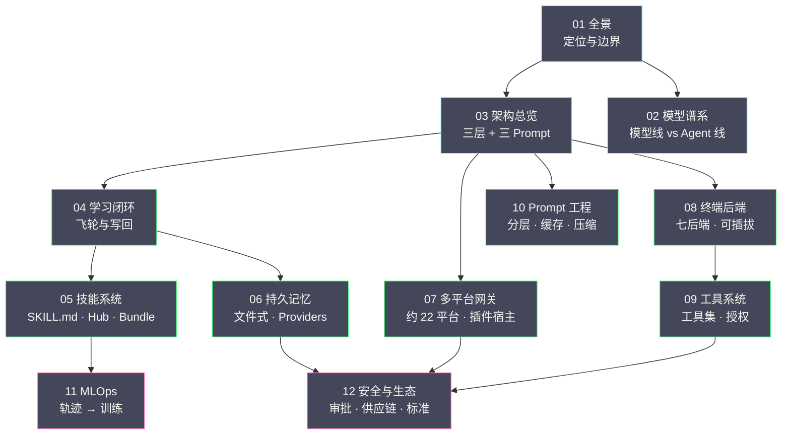

# Hermes Agent 专栏导览

> [!abstract] 专栏定位
> 本专栏研究 **Hermes Agent**——Nous Research 开源的自主 Agent 运行时（self-hosted、terminal-native，MIT 许可）。它的官方定位是一句话：「住在你的服务器上、记得它学到的东西、跑得越久越强的自主 Agent」。理解它需要先接受一个前提：**它不是模型，也不是某个 IDE 的插件，而是一套承载任意前沿模型的运行时**——消息平台是它的入口，终端是它的手脚，技能与记忆是它的沉淀。
>
> 本专栏事实基线截至 **2026-11-16（v0.23.2）**。Hermes Agent 的发布节奏以周计，文中凡涉及数量的表述都标注了时点；版本号存在 `v0.23.2` 与日历式 `v2026.x.y` 双轨命名（如 `v2026.4.8` 即 `v0.8.0`），引用时认 tag 不认序号。

## 为什么单独开一个专栏

[[LLM/Agent技术/00 专栏导览|Agent 技术专栏]]覆盖的是"IDE 内 Coding Agent"——Claude Code、Devin、Cursor 这一类，共同特征是绑定开发者工作流、在编辑器或终端里辅助编码。Hermes 走的是另一条路：它假设 agent 是一个**长期在线的服务**，而不是一次性的编码会话。

| 维度 | IDE 内 Coding Agent | Hermes Agent |
| :--- | :--- | :--- |
| 核心场景 | 编码辅助——写、改、审查代码 | 通用任务——编码、研究、自动化、日程、运营 |
| 交互入口 | 编辑器 / CLI | 约 22 个消息平台 + CLI / TUI / Dashboard / Webapp |
| 生命周期 | 会话级，任务结束即终止 | 长驻，7×24 跑在服务器上 |
| 学习方式 | 无，每次从零开始 | 闭环学习：把经验写回技能与记忆 |
| 模型关系 | 与应用深度绑定 | 模型无关，可接多提供商，`hermes model` 切换 |
| 部署形态 | 本地或厂商云端 | 自托管、容器、云沙箱、企业形态 |

两者不是替代关系。一个团队完全可能既有 IDE 内的编码 agent，也有一台跑着 Hermes 的长驻机器——前者解决"写代码这一刻"，后者解决"这件事以后每次都该怎么做"。

## 一个必须先讲清的误解：模型线与 Agent 线

搜索"Hermes"时最常撞见的两个词是 Hermes 模型与 Hermes Agent，但它们是**两条独立的线**：

- **模型线**是 Nous 的模型研发投入：Hermes 3（2024-08，微调 Llama 3.1 的 8B / 70B / 405B）、Hermes 4（2025-08，混合推理，大规模合成数据 + Atropos 强化学习环境）、以及后续的 Hermes-4 系列变体。技术报告见 [arXiv:2508.18255](https://arxiv.org/abs/2508.18255)。
- **Agent 线**是**承载任意前沿模型的运行时**。

而官方文档自己就点破了这条界线：Hermes 4 系列是前沿混合推理的**对话模型**，擅长数学、科学、指令遵循、schema 遵循与长文写作，但**不推荐在 Hermes Agent 内部使用**——它是给对话与推理调优的，不是给 agent 依赖的高频工具调用循环调优的；agent 场景官方建议改用前沿 agentic 模型。

所以"用 Hermes Agent 就等于在用 Hermes 4"这句话，两侧都不成立。这个区分直接影响选型，02 篇用整篇讲它。

## 12 篇文章的结构

### 第一部分：定位与背景（01-02）

| 篇号 | 标题 | 核心内容 |
| :--- | :--- | :--- |
| 01 | [[LLM/Hermes-Agent/01 Hermes Agent 全景——自改进 Agent 的设计哲学\|Hermes Agent 全景]] | 定位与边界、三层架构总览、能力版图、旧口径 vs 2026-11 口径、与同类产品的差异、误用清单 |
| 02 | [[LLM/Hermes-Agent/02 Nous Research 与 Hermes 模型谱系\|Nous Research 与 Hermes 模型谱系]] | 模型线与 Agent 线的分工、Hermes 2/3/4 的取向演进、Atropos 与合成数据、选型决策 |

### 第二部分：核心机制（03-06）

| 篇号 | 标题 | 核心内容 |
| :--- | :--- | :--- |
| 03 | [[LLM/Hermes-Agent/03 架构总览——AIAgent 核心循环与子系统\|架构总览]] | 三层架构与三 Prompt 层、主循环与状态流转、子代理（含 durable 语义）、gateway 作为插件宿主与 Webapp、架构债务 |
| 04 | [[LLM/Hermes-Agent/04 学习闭环——Observe-Distill-Reuse-Refine\|学习闭环]] | 飞轮五步、两个 Nudge 触发、review 判据、记忆与技能两类载体的写回、`session_search` 重写后的成本变化、闭环的代价 |
| 05 | [[LLM/Hermes-Agent/05 技能系统——SKILL.md 与 agentskills.io 标准\|技能系统]] | `SKILL.md` 字段、渐进式披露、条件激活、外部目录、Skill 捆绑包、Skills Hub 八类来源与安装扫描、`skill_manage` 六操作 |
| 06 | [[LLM/Hermes-Agent/06 持久记忆——MEMORY.md、USER.md、Honcho.md\|持久记忆]] | 文件式记忆与 Memory Providers 两层、Honcho 的辩证推理、写入判据与四道关、记忆的隐私代价 |

### 第三部分：平台与工具（07-10）

| 篇号 | 标题 | 核心内容 |
| :--- | :--- | :--- |
| 07 | [[LLM/Hermes-Agent/07 多平台网关——25+ 适配器的统一消息路由\|多平台网关]] | 单进程多平台的架构、约 22 个平台的接入方式、插件化适配器、会话映射与媒体传递、单点网关的风险 |
| 08 | [[LLM/Hermes-Agent/08 终端后端七剑——从 Local 到 Vercel Sandbox\|终端后端七剑]] | 七种内置后端与可插拔接口、清理语义、文件可见性链路、密钥透传三条路径、沙箱边界 |
| 09 | [[LLM/Hermes-Agent/09 工具系统——70+ 工具与 28 工具集\|工具系统]] | 最小可控配方、工具集分组与按平台授权、`delegate_task`、`session_search`、`@file`/`@url` 引用、Tool Gateway |
| 10 | [[LLM/Hermes-Agent/10 Prompt 工程——三层 Prompt 与上下文压缩\|Prompt 工程]] | 三层 Prompt 与缓存边界、每会话缓存时钟、渐进式披露、上下文压缩与有损性、常见误配 |

### 第四部分：研究、安全与生态（11-12）

| 篇号 | 标题 | 核心内容 |
| :--- | :--- | :--- |
| 11 | [[LLM/Hermes-Agent/11 MLOps 与研究——批量轨迹生成与 RL 训练\|MLOps 与研究]] | 会话轨迹如何变成研究素材、JSONL 导出、Atropos 与拒绝采样、批量任务的失败面、合规与分布偏差 |
| 12 | [[LLM/Hermes-Agent/12 安全、生态与未来——从个人 Agent 到标准\|安全、生态与未来]] | 威胁模型与三层防线、智能审批与拒绝规则、promptware 防护、供应链四道闸、凭据管理、从个人形态到企业形态 |

## 知识图谱

## 阅读路径

- 只想判断值不值得用：读 01，再看 12 的安全一节。
- 想搞懂它凭什么"越用越强"：04（闭环）→ 05（技能）→ 06（记忆），这三篇是一组，缺一篇就说不通。
- 想把它部署起来：03（架构）→ 07（网关）→ 08（终端后端）→ 09（工具与授权）。
- 想吃透上下文成本：10，配合 03 的 Prompt 分层一起看。
- 想做研究或数据回流：11，前提是先读 04 与 06。
- 想评估企业可用性：12 为主，02 与 07 为辅。

## 与其他专栏的关系

- [[LLM/Agent技术/00 专栏导览|Agent 技术专栏]]：姊妹篇，覆盖 IDE 内的 Coding Agent，与本专栏构成"在线长驻 vs 会话内编码"的对照。
- [[LLM/Agent沙箱技术/00 专栏导览|Agent 沙箱技术专栏]]：08 篇的七种终端后端涉及的隔离与逃逸面，在那里有更深的原语级讨论。
- [[LLM/LLM原理/00 专栏导览|LLM 原理专栏]]：理解 02 与 10 里推理模式、上下文与缓存的前提。

## 信息来源与时效

本专栏事实基线为 **2026-11-16 / v0.23.2**，主要依据以下一手来源：

1. GitHub 仓库与 release 说明：<https://github.com/NousResearch/hermes-agent>
2. 官方文档（含 Skills、Memory Providers、Messaging、Terminal、Tools reference 各章）：<https://hermes-agent.nousresearch.com/docs/>
3. Hermes 4 技术报告：<https://arxiv.org/abs/2508.18255>
4. agentskills.io 开放标准：<https://agentskills.io/specification>
5. Nous Research 官方发布页：<https://nousresearch.com/releases>

> [!warning] 时效提醒
> Hermes Agent 的迭代以周计（一个 patch 版本就可能卷进近两千个 PR），本专栏任何"数量"类表述都会过期。阅读时请以官方文档与你本机的 `hermes --version`、`hermes tools`、`hermes skills list` 实际输出为准；文中已尽量避免写死数字，凡是标注时点的数字，请当作快照而非承诺。