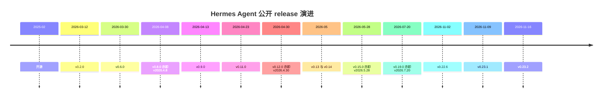
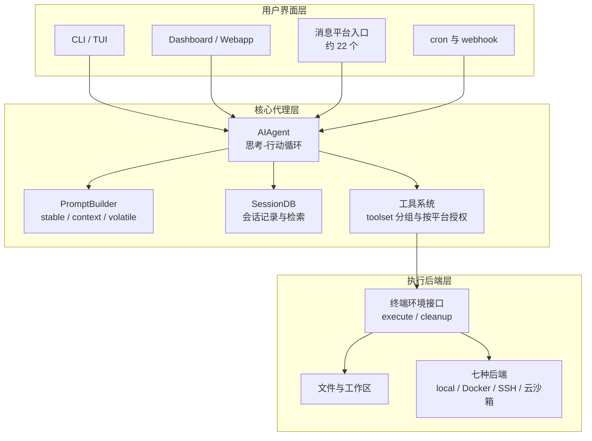
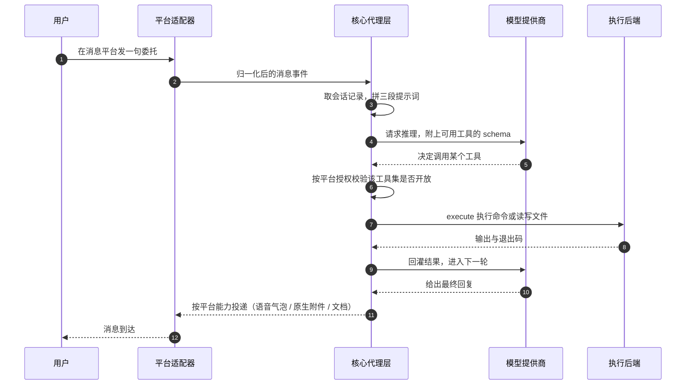
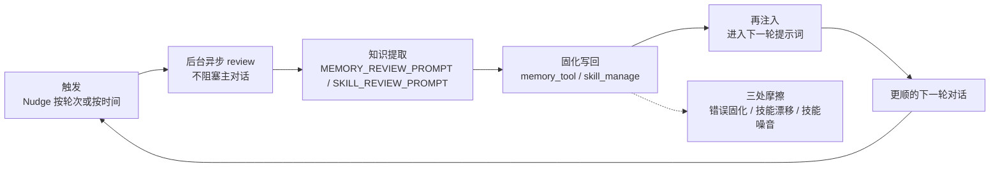
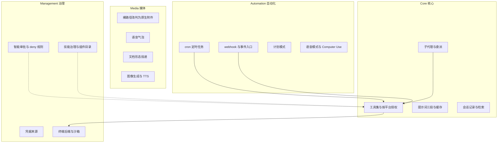

# 01 Hermes Agent 全景——自改进 Agent 的设计哲学

**摘要：**

2025 年，Nous Research 把一个自托管、终端原生的自主 Agent 放到 GitHub 上，到 2026 年 11 月 16 日的 v0.23.2，它已经长成一套带三层架构、闭环学习、可插拔技能与记忆后端、二十余个消息入口、七种执行后端的运行时。本文回答两个问题：Hermes Agent 是什么、又不是什么；以及它为什么长成现在这个形状。行文按五问推进——先划三条界线（不是模型、不是 API 封装、不是又一个聊天壳），再追它要补的三处断点（会话即遗忘、能力出厂即定、入口错位），用两处反事实说明抽掉闭环学习与消息网关之后会退化成什么样，随后把三层架构、学习飞轮、能力版图与落地路径逐层拆开，最后给出三类不该用它的场景，以及工程现状里仍在的争议。文中的版本号、日期与数量一律以 2026-11-16 的 v0.23.2 为口径；旧稿里「70+ 工具 / 28 工具集」「25+ 适配器」一类说法已经过期，第 5 章用一张对照表逐项交代改成了什么口径、为什么改。全文的落点不在功能清单，而在四对绑定——自托管与记忆价值、长驻与学习时间、模型无关与资产可迁移、插件化与治理成本，每一对都是「用代价换能力」的交易。

---

## 第 1 章 先划三条界线

### 1.1 官方那句话里有三个从句

2025 年，Nous Research 在 GitHub 上放出了 hermes-agent，官方对它的自我描述只有一句：一个住在你的服务器上、记得自己学过什么、并且运行得越久越能干的自主 Agent（an autonomous agent that lives on your server, remembers what it learns, and gets more capable the longer it runs）。这句话不长，但三个从句各自指向一处别的产品未必肯承诺的东西。

「住在你的服务器上」说的是部署单位。多数 Agent 产品的部署单位是一次会话、一个工作区、一个 IDE 窗口；Hermes 的部署单位是一台机器与一个常驻进程，进程的生命周期以月计，状态落在主目录下的一个目录里，升级、备份、迁移都按「一台主机」而不是「一次任务」来安排。

「记得自己学过什么」说的是知识落在哪里。这句话没有说模型在变，事实上模型权重从头到尾没有动过；它说的是经验被搬运到模型之外，变成可以被打开、被编辑、被删除的文件与记录。谁掌握了这批文件，谁就掌握了这个 Agent 的「工作记忆」，这一点在后文讲闭环学习与记忆后端时会反复回到。

「运行得越久越能干」说的是价值曲线。工具的效用曲线通常是平的——装好之后每次使用的收益差不多；Hermes 承诺的是一条上翘的曲线，前提是前两个从句成立。**常驻提供时间，学习把时间换成资产，资产反过来让常驻变得有意义**，三者互为条件，抽掉任何一条，另外两条都会失去依据。

### 1.2 不是模型，不是 API 封装，不是聊天壳

**运行时不等于模型**，这是第一处最容易被混淆的地方。Nous Research 有两条并行的产品线：一条是 Hermes 模型谱系（Hermes 3 于 2024 年 8 月发布，微调 Llama 3.1 的 8B / 70B / 405B；Hermes 4 于 2025 年 8 月发布，是混合推理模型），另一条才是 Hermes Agent 这个运行时。两者同名，但官方文档对模型谱系的定位说得很清楚：Hermes 4 系列是前沿混合推理的对话模型，擅长数学、科学、指令遵循、schema 遵循、角色扮演与长文写作，并不推荐在 Hermes Agent 内部使用，因为它针对的是对话与推理，而不是 Agent 依赖的高频工具调用循环；官方给 agent 场景的建议是改用前沿 agentic 模型（文档举例 `anthropic/claude-sonnet-4.6`、`openai/gpt-5.5-pro`、`google/gemini-3-pro-preview`）。把「Hermes Agent 用 Hermes 4 跑」当成事实，是对这套产品最基本的一次误读。

第二处否定针对 API 封装。API 封装的价值集中在转发、计费与密钥托管，能力边界由上游模型决定，模型一升级，封装层能做的事跟着变；Hermes 的能力边界由另外几样东西共同决定——工具集怎么分组、执行后端在哪、审批策略多严、技能库里有什么。模型在这里是可替换的大脑，换大脑不会换掉技能与记忆，这是它与「套一层 API 的聊天前端」最实际的分野。

第三处否定针对「又一个聊天壳」。最省事的反向验证是把它的部件逐个拿走：把二十余个消息平台全部删掉，它仍能在 CLI 与 cron 里干活；把模型换成另一家的，技能与记忆还在；但把执行后端与审批策略拿掉，「长驻 + 消息入口」这个组合会立刻从助理变成一台对外开放的远程执行端点。**入口数量不是它的重心，执行面与策略面才是**，这也是笔者在后续章节把大量篇幅放在终端后端与审批上的原因。

### 1.3 一个驻场员工的比喻

把 Hermes 想成你雇的一个驻场员工，各部件的位置会好记一些。自托管意味着他在你自己的场地办公，档案柜钥匙在你手里；模型无关意味着你可以随时换掉他的专业背景而不必重新招人；技能是他自己记的工作笔记，写得越细越省事；记忆是人事档案，记的是关于你和项目的稳定事实；消息网关是他腰上的对讲机，你走到哪都能喊他；审批策略是复核制度，动到敏感操作要先过一道；终端后端是他的工位，工位可以在本机，也可以外派到容器、远端的 SSH 主机或云沙箱。

比喻得跟一句限定，否则容易失真。真人雇员会疲劳、会请假、会看眼色，而 Hermes 的失误是概率性的、静默的：它不会告诉你「这次我可能记错了」，只会在下一次自信地引用一条写错的笔记。更麻烦的是笔记会一直被引用——档案柜里的错字不会自己消失，反而因为反复引用而显得权威。这两处限定正好预告了第 4 章要讲的三处摩擦，也解释了为什么这套系统把「可审计」看得比「聪明」更重。

### 1.4 与三族同类的定位差异

把 Hermes 放到市场里，最容易被拿来做对照的是三类东西：以消息网关为骨架的自托管个人助理（OpenClaw 是这一族的代表，它的 Gateway 被明确描述为控制平面，Agent 挂在网关之后）、通用编码 Agent（Claude Code、Cursor、Devin 一类，把行动域收窄到代码与终端），以及云托管的 SaaS Agent（能力与数据都在厂商侧，按订阅计费）。三者的差别不在功能清单，而在骨架重心与责任归属。

| 维度 | Hermes Agent | 自托管网关型助理（OpenClaw 一类） | 通用编码 Agent | 云托管 SaaS Agent |
| :--- | :--- | :--- | :--- | :--- |
| 骨架重心 | Agent 运行时为核心，网关只是其中一层 | 网关是控制平面，Agent 挂在其后 | 编辑器/终端里的会话循环 | 厂商侧的托管服务 |
| 能力从哪来 | 工具集 + 后端 + 审批 + 技能库共同决定 | 渠道插件 + 技能市场（ClawHub 一类） | 内置工具 + 仓库上下文 | 厂商预设，用户可调空间有限 |
| 学习与记忆 | 闭环学习写回文件，记忆可插拔后端 | 持久记忆与技能市场，机制因实现而异 | 多为会话级，靠规则文件补 | 平台侧存储，用户不可见 |
| 执行环境 | 七种后端，可插拔接口 | 取决于部署，通常以本机为主 | 本机或厂商沙箱 | 厂商沙箱 |
| 审批模型 | 智能审批默认 + deny 规则 | 允许列表与配对机制为主 | 人在环路逐条确认 | 平台策略，用户参与度低 |
| 运维责任 | 全在用户 | 全在用户 | 本机部分在用户 | 全在厂商 |

表里最值得停一眼的是最后两行。前四行决定「能做什么」，后两行决定「出了事谁兜」——Hermes 与网关型助理把运维责任整包接回用户手里，换来的是数据主权与策略自由度；云托管 SaaS 把这部分接走，代价是策略与数据都不在你手上；编码 Agent 处在中间，本机执行部分归你，模型与工具链归厂商。三类不是替代关系，而是三种不同的责任切分方式，选型时真正要比的是这一行，不是功能数量。

### 1.5 两处命名混淆与一条版本时间轴

第一处混淆前面已经说过：Hermes 模型与 Hermes Agent 是两条线，官方甚至不建议在 Agent 里用自家对话模型。第二处混淆来自版本号本身——`v0.23.2` 与日历式 `v2026.x.y` 两种写法长期并存，譬如 v0.8.0 同时被标为 v2026.4.8，v0.15.0 被标为 v2026.5.28。双轨命名的好处是同时回答两个问题：「这是第几个功能版本」与「这是哪一天的东西」；坏处是对照 release notes 时容易对错行，所以引用版本时最稳妥的做法是认 tag，而不是认别人转述的序号。

把公开 release 排成一条时间轴，能看清这条产品线的加速度：从 2025 年开源到 2026 年 3 月才走到 v0.2.0，此后节奏骤然收紧，2026 年 3 月到 5 月连续推进到 v0.15，7 月到 v0.19，11 月连发三个版本收在 v0.23.2。



v0.23.2 有一处细节值得单独拎出来，因为它把「高频」这个形容词变成了可以称重的数字：这只是一个 patch release，说明里写明它把自 v0.23.1 以来约 1,989 个 PR 卷进了一个稳定版本，统计窗口内是 7,918 个非合并提交、5,211 个文件变更（+239,733 / −22,788）、940 个关闭 issue。仓库的 release 页面上还并排挂着按日构建的 canary 标签，稳定版与每日构建两条轨道同时跑。一个 patch 能装下这些量，说明主干上合并速度长期高于发版速度，版本号在这里更像一次「结算」，而不是一次「交付」。

---

## 第 2 章 它要补的三处断点

### 2.1 三处断点与三种代价

Hermes 不是凭空长成现在这个形状的，它对应的是前几代 Agent 产品留下的三处断点。把断点、旧形态的症状、它的回应与代价并排放，能看清每一条设计选择背后的欠账。

| 断点 | 旧形态的症状 | Hermes 的回应 | 代价 |
| :--- | :--- | :--- | :--- |
| 会话即遗忘 | 关掉窗口什么都不剩，上周踩的坑这周重踩 | 闭环学习 + 持久记忆 + 会话检索 | 技能会固化、会漂移、会积噪音 |
| 能力出厂即定 | 工具与流程由开发者枚举，用户私有流程无处沉淀 | 技能从实践中生长，Skills Hub 供来源 | 技能库需要人工审视与治理 |
| 入口错位 | 低带宽任务被塞进高带宽界面 | 约 22 个消息入口 + cron + webhook | 攻击面扩大，安全责任前移到配置 |

三处断点有一个共同的形状：它们都不是「模型不够强」造成的，而是「系统没有为时间和长期关系留位置」造成的。模型能力的提升解决不了遗忘，也解决不了入口错配；这也解释了为什么 Hermes 把大量工程量投在记忆、技能、网关与审批这些看起来与「智能」无关的地方。

### 2.2 断点一：会话即遗忘

2022 年底的对话产品把 AI 带进大众视野，但它的形态是一问一答，关掉窗口状态清零。2023 年，把目标丢给模型让它自己拆解执行的做法流行过一阵，很快暴露的问题不是模型不会规划，而是没有记忆、没有成本控制、没有错误恢复——Agent 在循环里反复踩同一个坑，跑一整夜烧掉额度，第二天从零开始。这场热潮留下的判断相当朴素：**自主性不等于可用性**，没有记忆与反思的自主，只是把同一个错误重复很多遍。

2024 年之后，行业把注意力收到编码场景，用测试与编译结果作为可验证的反馈信号，取得了实在的效果。但收窄是有代价的：这些工具绑在 IDE 或终端上，绑在编码任务上，会话结束即归零。它们回答了「怎样把一件事做好」，没有回答「怎样长期陪一个人做事」。Hermes 接的是后一个问题，而它的第一步就是把「会话」这个单位换掉——换成一台常驻的进程与一份长期累积的档案。

### 2.3 断点二：能力出厂即定

传统 Agent 的能力清单由开发者预先枚举：内置哪些工具、支持哪些平台、能操作哪些服务。这份清单能覆盖通用场景，覆盖不了私有工作流，而私有工作流恰恰是长尾最长的那部分——譬如某个团队用一套内部 CLI 发布服务，某个编辑有一套自己的选题流程，某个运维有一套只在特定机房成立的重启顺序。这些流程没法提前写进产品，只能在使用现场被记下来。

技能系统就是为这件事准备的：它把「怎么做某类任务」写成一份结构化文档，交给 Agent 在需要时按需读取。这套做法与工具的关系是互补而非重复——工具让 Agent「能做」，技能告诉它「怎么做才符合这里的规矩」。能力因此不再全部由出厂决定，用户的使用过程本身就是能力的生产方式。

### 2.4 断点三：入口错位

第三处断点与智能无关，与节律有关。编码是典型的高带宽交互：光标停在第几行、diff 是否接受、测试输出是什么，这些信息必须在秒级往返，所以编码 Agent 必然长在 IDE 与终端里；而个人事务大多是低带宽交互：「明早提醒我给客户回邮件」「这周的告警汇总一下」这类委托发出之后不需要实时反馈，隔几分钟甚至隔一夜拿到结果都可以。

把低带宽任务塞进高带宽界面，体验会很别扭——为了设一个提醒去开一个编辑器会话；把高带宽交互塞进消息平台同样别扭——在聊天窗口里逐条确认 diff。**入口不是渠道问题，而是可用性问题**：任务发不出去、发出去没人接、接完了你不知道，这三件事任何一件成立，Agent 的能力都等于零。Hermes 把入口铺到约 22 个消息平台，配 cron 与 webhook，本质是把「触发点」搬到任务自然发生的地方。

### 2.5 反事实一：抽掉闭环学习会退化成什么

假设把闭环学习整个抽掉，其余部件不动，Hermes 会退化成一个更贵的 shell。它仍然能执行命令、读写文件、连消息平台，但它每次会话都从零探索：上周踩过的坑这周原样再踩，用户被迫反复交代同样的背景——「我们的部署脚本在 staging 目录」「测试要用 pytest 而不是 unittest」「这个仓库的 lint 必须先跑」。用户成了系统里唯一的记忆载体，而这层记忆的成本是隐性的：它不体现在账单上，体现在每天开工前那十分钟的重复交代里。

更麻烦的一处退化发生在长驻场景。会话级工具的遗忘只影响一次会话，长驻系统的遗忘是复利式的：同一个错误每天犯一次，一个月就是三十次；同一条纠正每天讲一遍，一个月就是三十遍。**能力随使用次数线性增长，而不是复利**，这恰好与官方那句话的承诺相反——「运行得越久越能干」的前提，就是有东西被留下来。

### 2.6 反事实二：抽掉消息网关会退化成什么

再假设把消息网关抽掉，只留 CLI 与 cron，Hermes 会退化成一个 SSH 会话。能力一样不少，丢的是四样东西：触发点（你得先想到登录上去问它）、异步性（发出委托之后你必须坐在终端前等）、事件驱动（webhook、告警、邮件到达这类外部事件没有入口可以推入）、跨设备连续性（同一份会话记录与同一批技能，无法在手机与工作站之间接力）。

这四样东西合起来，决定了它能不能在「你不在场」的时候工作。个人事务的真实形态是碎片化的：你在开会时想起一件事，在地铁上想问一句，在睡前想让它明早汇报。这些时刻的共同点是手边没有终端。抽掉网关，Hermes 剩下的能力全部要求「用户端坐在电脑前」，那它和一个功能更全的 shell 就没有本质区别——而这恰恰是它想避开的定位。

### 2.7 反事实的边界：装上也不自动成立

两处反事实容易被读成「只要把学习闭环与网关装上就赢了」，实际并非如此。长驻加消息入口，等于把一台能执行命令的机器挂到了公网可达的聊天通道上；如果审批、deny 规则、执行后端隔离没有配套，这个组合不是助理，是一台对外开放的远程执行端点。Hermes 在 v0.19 把智能审批做成默认、在 v0.15 加上提示注入拦截，正是为这个组合补欠账——第 6 章会展开这三层防线。

---

## 第 3 章 三层架构与一条消息的旅程

### 3.1 三层的职责与单向依赖

Hermes 的架构可以压成三层：最上面是用户界面层（CLI、TUI、Dashboard、以及约 22 个消息平台入口），中间是核心代理层（AIAgent 的思考-行动循环、PromptBuilder、SessionDB、工具系统），最下面是执行后端层（终端环境、文件、沙箱）。层与层之间的依赖是单向的：上层只负责把输入归一化与把输出投递，下层只负责执行，所有决策集中在中层。



这层切分有一个不显眼的好处：同一套决策在四个入口上行为一致。技能在哪一层被加载、记忆在哪一层被注入、审批在哪一层被触发，在 CLI 里和在钉钉群里是同一段代码路径。用户换入口，换的是投递方式，不是 Agent 的性格。

| 层 | 职责 | 关键部件 | 换掉它会怎样 |
| :--- | :--- | :--- | :--- |
| 用户界面层 | 归一化输入、投递输出 | CLI/TUI/Dashboard/消息平台/cron | 入口变少，能力不变 |
| 核心代理层 | 决策、组装提示词、管会话、派工具 | AIAgent/PromptBuilder/SessionDB/工具系统 | 行为风格与记忆全部重置 |
| 执行后端层 | 真正执行命令、读写文件 | 终端环境接口与七种后端 | 执行面失去隔离，风险直接暴露 |

### 3.2 系统提示词的三段切分

核心层里最值得单独讲的是提示词的组装。系统提示词被切成三段：stable 承载稳定人格与规则，context 承载会话上下文，volatile 承载易变状态，实现落在 `agent/system_prompt.py`。这个切法看着像代码整洁度的偏好，实际服务于两件事。

第一件是缓存。稳定段在整段对话里不变，因此可以被前缀缓存；易变段每次都可能变，把它隔离出来，缓存才不会被随时打断。v0.23.x 窗口里给每个会话配了一个 prompt-cache 时钟，做的正是把这件事实测化的事。第二件是可审计：当 Agent 行为不对时，可以按段定位到底是人格设定跑偏、上下文塞脏了，还是易变状态没刷新，而不是面对一坨拼好的字符串猜。

| 段位 | 承载什么 | 变化频率 | 工程意义 |
| :--- | :--- | :--- | :--- |
| stable | 人格、规则、工具约定 | 几乎不变 | 前缀缓存的主要载体 |
| context | 会话上下文、项目背景 | 每会话一次 | 决定这一轮对话的立场 |
| volatile | 时间、状态、临时标记 | 每轮可能变 | 隔离出来，避免打断缓存 |

**切分不是为了好看，是为了让不常变的部分被缓存、让常变的部分不进缓存**。这个道理与索引设计里的冷热分离同源：不是因为整齐才分，是因为访问模式不同才分。

### 3.3 一条消息的旅程

把一条消息从进入到返回的路径画成时序，能看清「短循环、长外围」这个结构。



图里有两处容易被看漏。一处是第七步：工具能不能用，不只取决于它是否存在，还取决于这条消息来自哪个平台——同一个实例在 CLI 里给全套工具，在钉钉群机器人里可能只给搜索与读文件，两边互不影响。另一处是最后一步：投递方式由适配器能力决定，同一段内容在 Telegram 上可能是语音气泡，在短彩信上可能要退化成附件。这两处都不属于「智能」，却直接决定体验。

### 3.4 为什么核心循环可以很短

思考-行动循环本身极短：模型说一句话、要一个工具、拿到结果、继续说话。真正复杂的东西全在环外——工具怎么注册与分组、执行后端怎么隔离与清理、审批策略怎么判定、提示词怎么拼装与缓存。把循环写长不等于更强，反而更难保证每个入口的一致性；这处判断在 v0.23.x 的工程记录里有一个反证：核心循环已经从原先约 10.6k 行的 `run_agent.py` 里拆出来，但被拆出的复杂度并没有消失，而是转移到了网关与 CLI 那几个更大的文件里，第 7 章会回到这件事。

**核心循环短，复杂度在环外**，这句话可以当作读这套架构的一条口诀。看到一个新功能时，先问它落在环外哪一层，比问它「智能不智能」更能判断它是否可靠。

### 3.5 单核心与多入口的账

单核心多入口的收益很实在：记忆、技能、审批在任何入口上行为一致，一个入口学到的东西另一个入口立刻能用。代价同样实在。其一，核心成了瓶颈，任何入口的新需求都要挤进同一处，文件规模随之膨胀。其二，单点故障——核心崩了，所有入口一起哑。其三，升级耦合——v0.23.x 引入的 durable subagents 让子代理能在网关重启或崩溃后存活，并可在自己的会话上继续，这类能力恰恰是核心与网关耦合加深的产物：能力越强，拆开的成本越高。这是一笔持续要还的账，不是一次能还清的债。

---

## 第 4 章 闭环学习：飞轮、触发器与摩擦

### 4.1 五步飞轮

闭环学习（Closed Learning Loop）是这套系统里最独特的一处设计，形状是一个五步飞轮：触发、后台异步 review、知识提取、固化写回、再注入。



五步里最关键的一步是第二步。review 要读长上下文、要花 token、要比较同一类任务的历史轨迹，如果它跑在对话路径上，用户每说一句话都要等一次反思，体验立刻崩掉。放到后台异步执行，主对话的延迟不受影响，飞轮才有机会转起来——**飞轮能转的前提，是 review 在后台**。不过这处设计也带来一个副作用：知识固化有延迟，刚纠正完的行为不保证下一句就生效，用户需要接受这个时滞。

### 4.2 两条 Nudge

驱动飞轮的是两套 Nudge 触发机制，一套按轮次，一套按时间，默认间隔都可配置。两条并存的理由不难推：按轮次触发对应「事情做完了」——一个复杂任务收尾，正是提炼技能的最佳时刻；按时间触发对应「聊了很久但没做成什么」——长会话里如果一直没有轮次结算，光靠轮次触发就永远等不到固化时机。两条互补，才覆盖得住真实对话里两种截然不同的形态。

Nudge 的形态是提醒而不是强制。它提示 Agent「刚才那段流程值得记下来」，Agent 或用户都可以说不；这个选择权留在人手里，是有意的：技能库一旦无人把关，错误会被固化成标准操作，而「自动记住一切」的系统在长跑里一定会积累这类错误。

### 4.3 固化的两条通道

飞轮的落点有两处，一处写陈述性知识，一处写程序性知识。

陈述性知识走 `memory_tool`，写进 `MEMORY.md` 与 `USER.md`。这两个文件由 Agent 手动维护，写入时要处理一串不显眼但必须处理的问题：分隔符解析（免得一条记忆把文件结构撑破）、并发锁（免得两个会话同时写坏）、去重（免得同一条事实被记十遍）、提示注入扫描（免得从网页抓回来的内容被当成指令记进档案）。这些都不是智能问题，是文件式记忆的固有工程成本。

程序性知识走 `skill_manage`，写进 `~/.hermes/skills/` 下的 `SKILL.md`。这个工具提供六种操作：`create`、`patch`、`edit`、`delete`、`write_file`、`remove_file`，官方把 `patch` 列为首选，因为它比整篇 `edit` 省 token。触发时机也有明确清单：复杂任务（5 次以上工具调用）成功之后、遇到错误并找到可行路径之后、用户纠正做法之后、发现非平凡工作流之后。这份清单的取向很清楚——只在「值得记住」的时刻动手，避免给每个简单任务都生成一份低价值技能。

### 4.4 记忆为什么做成了可插拔后端

文件式记忆简单、透明、可审计，但它有三个天花板：容量（两个文件装不下太多事实）、结构（纯文本难以做关系推理）、建模深度（它记录事实，不建模人）。Hermes 的解法是把记忆后端抽象成可插拔的 Memory Providers，统一接口，内置之外可以换。

已知的 provider 包括 Honcho、Hindsight、RetainDB、holographic facts、Mnemosyne 等。以 Honcho 为例，它做的是辩证推理与深度用户建模：会话摘要、派生洞察、多 agent 按 peer 隔离的画像、统一或定向的观察模式、基于结论的语义搜索，频率由 `dialecticCadence` 控制并支持 1 到 3 轮深度，冷启动与热启动各有一套提示词。这类后端把「记住你说过什么」推进到「理解你是什么样的人」，能力更强，代价是多一个外部依赖与一套新的配置面。

读取类插件在这里有一条不成文的纪律：只读优先。`hermes-memory-ui` 只展示、不提供变更端点，因为记忆属于隐私数据，让它可读已经需要信任，让它可改则需要多得多的信任。

### 4.5 飞轮的三处摩擦

飞轮不是只赚不赔的。三处摩擦在公开讨论里反复出现，评估这套系统时不该回避。

其一是错误固化。一个流程如果「偶然成功」了几次——环境状态恰好掩盖了步骤缺陷——它就会被写成技能，之后每次复用都在放大这个缺陷。其二是技能漂移。环境会变，技能不会自己变：目标服务器升级之后，旧的部署技能可能从「省事」变成「事故源头」。其三是技能噪音。低质量技能积累多了，会在检索与加载时稀释高质量技能的可见性，而加载环节本身是有预算的——三级渐进式披露（`skills_list()` 约 3k token、`skill_view(name)`、再深入 `skill_view(name, path)`）就是为了把这份预算省着用。

Hermes 的应对是 Pitfalls 段的持续修补、Curator 一类整理机制、以及 Nudge 里保留的用户确认环节。这些都是缓解，不是消除；技能库需要人定期审视，这一点在当前版本里仍主要依赖使用者自觉。

### 4.6 一处必须澄清的误解

「自改进」最容易被读成「模型在偷偷变强」。事实相反：权重从头到尾没变，变的是文件系统里的东西——`SKILL.md`、`MEMORY.md`、`.hub/lock.json` 里的扫描记录、日志目录里的轨迹。**自改进改的是文件系统，不是权重**，这句话既是对能力的准确描述，也是对风险的准确描述：正因为改的是文件，它才可读、可改、可删、可版本化；也正因为是文件，写错的东西会一直留在那里，直到有人发现。

这个设计选择本身就是一组权衡。权重内化的路线学得快、执行顺，但学错了无法审计，只能等下一次训练；外置文件的路线学得慢、需要治理，但每一步都留痕。Hermes 选了后者，代价是把一部分「训练」工作转嫁给了使用者的日常维护。

---

## 第 5 章 能力版图：四组与它们的位置

### 5.1 四组版图

把散落的能力按「谁在用、什么时候用」分成四组，版图会清楚很多：Core 是每一轮对话都要经过的部分，Automation 是让它在无人时也能工作的部分，Media 是让它把结果送到人眼前的部分，Management 是让前三维不至于失控的部分。四组不是并列的功能清单，而是四种不同的工程责任。



### 5.2 Core：每一轮都要经过的部分

工具按 toolset 分组，可以按平台分别授权，管理命令是 `hermes tools`。官方 tools-reference 里能看到的工具集包括 `file`、`terminal`、`web`、`browser`、`code_execution`、`memory`、`delegation`、`cron`、`skills`、`plugins`、`mcp`、`vision`、`feishu_doc`、`feishu_drive`、`lsp` 等，且明确不是穷举。工具集数量随版本持续增加，因此任何写死的数字都会很快过期——这一点第 5.7 节会专门交代。

Core 里有几件值得单独点名的东西。`delegate_task` 负责派生子代理，每个子代理有独立的会话、终端与 toolset，只把最终摘要返回给主代理，支持单任务 `goal` 与并行批量 `tasks`，层数与并发都有上限；它的价值不在「并行」，而在「把长上下文隔离出去」，主代理不必背着子任务的全部轨迹。`session_search` 在 v0.15 被重写，去掉了辅助 LLM，三种模式（discovery / scroll / browse）由参数推断，没有 mode 参数也没有配置开关，检索在约 20 毫秒量级；这处改动是把「检索」从一次模型调用降级成一次索引查询，成本与延迟都掉了一个量级。Context References 提供 Claude Code 风格的 `@file`、`@url` 注入，带 tab 补全；此外还有 LSP 语义诊断、Tool Search、Mixture of Agents、个性与 `SOUL.md`、皮肤主题、Language Packs、插件与内置插件目录。

### 5.3 Automation：无人时也在工作

Automation 组回答的是「用户不在场时，它靠什么被唤醒」。cron 提供定时任务，webhook 与消息平台提供外部事件入口，计划模式（`/plan`）把「先想清楚再动手」变成一道显式工序，产出 markdown 计划落到 `.hermes/plans/` 而不是直接执行；语音模式与 Computer Use 则把输入与操作面各扩了一维。这四样东西共同构成「长驻」的实际用途——没有它们，常驻进程只是一个待机的空壳。

### 5.4 Media：结果怎么送到人眼前

Media 组是最容易被低估的一组，因为它全是细节。响应里出现裸绝对路径的媒体文件时，网关会自动改判为原生附件；`[[audio_as_voice]]` 会把音频提升成语音气泡；`[[as_document]]` 强制以文档形式发送，作用是绕开 Telegram `sendPhoto` 的重压缩（约 200KB、1280px 的尺寸上限）。这些约定解决的是同一类问题：消息平台的默认行为会悄悄损伤交付质量，而用户通常只会觉得「怎么糊了」。

### 5.5 Management：让前三维不至于失控

Management 组是这套系统的免疫系统，四件事各自堵一处风险：智能审批与 deny 规则管「能不能执行」，凭据来源管「密钥放在哪」，终端后端与沙箱管「在哪执行」，技能治理与插件目录管「装进来的东西可不可信」。四件事的共同点是默认值需要被认真对待——默认宽松的系统在个人场景下省事，在多人共用的实例上就是事故源。

### 5.6 核心能力矩阵

把四组摊成矩阵，能看清每项能力的入口与默认状态。

| 能力域 | 关键机制 | 对外入口 | 默认状态 |
| :--- | :--- | :--- | :--- |
| 工具与授权 | toolset 分组、按平台授权 | `hermes tools` | 全量存在，按入口裁剪 |
| 提示词与缓存 | stable / context / volatile 三段 | 内部组装 | 每会话一个缓存时钟 |
| 会话与检索 | SessionDB、FTS5 索引 | `session_search` | 开启，三模式自动推断 |
| 技能 | 三级披露、bundles、Skills Hub | `skills_list`、`hermes skills` | 主目录为唯一可信来源 |
| 记忆 | 文件式内置 + 可插拔 provider | `memory_tool` | 文件式开启，provider 选配 |
| 自动化 | cron、webhook、计划模式 | `/plan`、cron 配置 | 需显式配置后生效 |
| 审批 | LLM 审查器 + deny 规则 | 敏感命令触发 | v0.19 起为默认 |
| 可观测 | 结构化日志、自检、回退链检查 | `hermes logs`、`hermes doctor` | 日志默认落盘 |

### 5.7 旧口径与 2026-11 口径对照

这一节是写给读过旧稿的读者的：同一篇文章写于 2026 年 8 月 1 日，当时版本还在 v0.20 之前，若干数字已经失效。逐项列清，比含糊带过更负责。

| 项目 | 旧稿口径（2026-08） | 2026-11-16 口径 | 说明 |
| :--- | :--- | :--- | :--- |
| 开源时间 | 2025 年 7 月 | 2025 年（公开材料对具体月份说法不一） | 不写死月份，以仓库首发为准 |
| 首个可用版本 | 2026 年 2 月正式发布 | v0.2.0（2026-03-12），此后 v0.6/v0.8/v0.9/v0.11/v0.12/v0.14/v0.15/v0.19 相继发布 | 版本序列见第 1.5 节时间轴 |
| 消息平台 | 25+ 适配器 | 约 22 个平台/适配器，并以插件形式扩展 | 旧口径既不准确，也不再是重点 |
| 工具规模 | 70+ 工具 / 28 工具集 | 随版本持续增加，以 `hermes tools` 与官方 tools-reference 为准 | 不同时期分别出现过 40+（v0.14）、60+（2026-10 社区口径）等统计 |
| LLM 提供商 | 18+ | v0.14 时期公开材料称 30+，此后继续增加 | 已知新增含 LM Studio 原生 provider、GMI Cloud、Azure AI Foundry、Tencent Tokenhub 等 |
| 内置技能 | 40+ | 不写死；技能来源以 Skills Hub 的多来源为准 | 数量取决于 tap 与本地目录 |
| GitHub star | 22 万+ | 不作为事实引用，以仓库页面为准 | star 是关注度而非可靠性 |
| 测试规模 | 约 25,000 测试 / 约 1,250 文件 | CI 约 24 个 job（分片测试、ruff、ty、docker build/lint、OSV 扫描、供应链审计门禁） | 前者无法核实，后者可在仓库 CI 配置中查证 |
| 记忆后端 | 8 种 provider 的枚举 | 已知 Honcho、Hindsight、RetainDB、holographic facts、Mnemosyne 等 | provider 列表随版本增删 |
| 终端后端 | 7 种 | 7 种（local、Docker、SSH、Daytona、Modal、Vercel Sandbox、Singularity），并可插件化扩展 | 数量成立，语义要从「七个内置」改为「可扩展的七种内置」 |
| 版本号写法 | 单一序号 | `v0.23.2` 与 `v2026.x.y` 双轨并存 | 引用时认 tag |

这张表最想传达的其实是一条纪律：**数字是时间戳，不是属性**。一个项目的工具数、平台数、provider 数在快速迭代期每几周就会变一次，把「70+ 工具」写进正文而不标注版本，读者半年后引用它就是在传播错误。基线没给的数字，宁可写成「随版本变化，以官方 `hermes tools` 与 release notes 为准」，也不要凭印象补一个。

---

## 第 6 章 从一条命令到一台长驻实例

### 6.1 五种分发形态

同一套代码有五条落地路径，各自的更新方式与代价完全不同。这张表值得在动手之前读完，因为选错形态的代价通常要在半年后才显现。

| 形态 | 适合谁 | 更新方式 | 代价 |
| :--- | :--- | :--- | :--- |
| GitHub release（CLI 与安装脚本） | 自己管机器的开发者 | `hermes update`，或重跑安装脚本 | 升级由你负责，回滚也要你负责 |
| Microsoft Store 应用 | Windows 桌面用户 | 随 Store 更新 | 版本节奏由商店审核节流 |
| Docker 镜像 | 服务器与团队部署 | 拉取 `nousresearch/hermes-agent:stable` 或 `:latest` | 需要自己管卷、网络与镜像重建 |
| Hermes Cloud | 不想运维的人 | 平台侧更新 | 数据与策略移出自己手里 |
| 网关自带 Webapp | 已跑网关、需要局域网访问 | 随网关版本 | 依赖 Nous 登录与端口可达 |

Hermes Cloud 与自托管之间不是「同一个产品的两个套餐」，而是一次责任转移：把服务器、升级、备份接过去，也把数据的物理位置带走了。这与第 1 章那张表的最后两行是同一件事。

### 6.2 最小可控实例

「最小可控 Agent」的配方只有两个工具集：File Operations（读写文件）加 Terminal（执行命令）。联网、浏览器、代码执行、视觉、记忆、委派、定时任务、技能、插件、MCP 都可以后加。这个配方值得单独强调，因为新手最常见的错误是一次性把工具全开——**最小可控实例只需要两个工具集**，先跑通再放权，比反过来省事得多。

常用管理命令都是同一套入口，跑一遍就能把系统的自检与治理面摸清：

```bash
hermes setup --portal      # 一次 OAuth 同时开通搜索、图像、TTS、云浏览器四类能力
hermes tools               # 看当前工具集与授权状态，数字口径以这里为准
hermes model               # 交互式切提供商与模型，换大脑不改技能
hermes doctor              # 自检：配置、provider、依赖
hermes fallback check      # 回退链就绪检查，主模型挂掉前先确认有备胎
hermes skills audit        # 审已安装技能的扫描记录
hermes bundles list        # 看技能捆绑包，一个斜杠命令可加载多个技能
hermes logs                # tail 结构化日志，默认在 ~/.hermes/logs/
hermes update --force      # 一次性停掉网关，而不是逐个 drain
```

最后一条命令的语义值得说明：默认升级会等待在途会话收尾，长驻实例上这可能拖很久；`--force` 的取舍是牺牲在途会话的完整性换停机时间的确定性。这类「默认温和、强制果断」的开关，是长驻系统必须提供的一类东西。

### 6.3 七种终端后端

执行后端决定「命令在哪里跑」，这是安全边界最实的一处开关。Hermes 内置七种后端，并通过可插拔的终端环境接口允许扩展。

| 后端 | 隔离边界 | 适合什么 | 需要注意 |
| :--- | :--- | :--- | :--- |
| local | 无隔离，直接落在宿主机 | 个人机器、可信任务 | 长驻 + 消息入口时最危险 |
| Docker | 容器 | 需要可复现环境的任务 | 密钥要走转发而不是写进配置 |
| SSH | 远端主机 | 操作已有服务器 | 远端环境你不完全控制 |
| Daytona | 云沙箱，支持容器/VM/GPU | 需要 GPU 或多种运行时 | 计费按用 |
| Modal | 云沙箱 | 按需启停、空闲不计费 | 冷启动延迟 |
| Vercel Sandbox | 云沙箱 | 与前端生态集成的执行 | 依赖外部服务可用性 |
| Singularity | HPC 容器 | 高性能计算环境 | 生态与工具链特殊 |

接口层面的三处细节决定了这些后端用起来是否顺手。第一，文件工具（`read_file`、`write_file`、`patch`、`search_files`）走的是环境的 `execute()`，因此它看到的就是命令能看到的那个文件系统；例外是声明了 `uses_host_filesystem` 的环境。第二，`cleanup()` 的默认语义是「清理后进程随沙箱消失」（`cleanup_stops_processes` 默认为真），云沙箱若希望作业在断开后继续跑，必须显式声明为假——**清理语义决定了作业能不能在断开后存活**，这一条在批处理任务上极易踩空。第三，密钥相关配置分两类：`terminal.docker_env` 写配置里的字面键值，`docker_forward_env` 从 shell 或 `~/.hermes/.env` 转发，后者的意义是密钥不进配置文件；`docker_extra_args` 用于透传 `--gpus`、`--network` 一类参数，`container_persistent` 决定云沙箱是否保留文件。

把七种后端与「隔离强度、成本、延迟」这个三角放在一起看，会发现没有一处是免费的选择：local 零成本零延迟、隔离为零；Docker 隔离够用、成本低，但容器逃逸风险始终在；云沙箱隔离接近虚拟机，代价是冷启动与按量计费。选后端本质上是选一处安全边界，这个判断与性能无关。

### 6.4 约 22 个入口与一个插件宿主

网关的演进线本身就是一条叙事。v0.2.0 时它只接七个平台（Telegram、Discord、Slack、WhatsApp、Signal、Email、CLI），v0.6.0 起加入飞书与企微等平台到 9 个，v0.9.0 加 BlueBubbles 与微信到 12 个，v0.11.0 加 QQBot 到 13 个，v0.12.0 的 Microsoft Teams 是第一个由插件交付的平台，v0.13 的 Google Chat 是第 20 个，v0.14 的 LINE 同样是插件。另有 Matrix、Mattermost、钉钉、短信（Twilio）、Webhook、腾讯元宝、IRC 等陆续补齐，当前口径约 22 个平台与适配器。

比数量更重要的是架构变化：网关现在是插件宿主（plugin host），消息适配器可以放在核心之外，按插件安装与升级。这个变化把「接一个新平台」从改核心代码降级成装一个插件，也让平台数量不再是产品叙事的重点。能力差异仍然存在——Telegram 与 WhatsApp 支持语音气泡，短信没有独立的文档路径只能回退到附件机制，Matrix 从 v0.8 起补齐 reactions 与已读回执——这些差异被适配器吃掉，上层不必逐个判断。

平台专属工具集是另一处值得记住的设计：`feishu_doc`（读飞书 Docx、Doc、Sheet 全文）与 `feishu_drive` 只对特定平台的 handler 暴露，既不出现在 `hermes-cli`，也不出现在普通的飞书聊天适配器上。工具的出现与「你从哪说话」绑定，这比全局开关更贴近真实权限。

### 6.5 三道防线：审批、注入防护、凭据

第一道是审批。v0.19 起智能审批成为默认：被标记为敏感的命令交给 LLM 审查器独立评估，而不是逐条弹给用户点确认。这处设计针对的是审批疲劳——长驻 Agent 每天可能触发几十次敏感操作，逐条确认的结果一定是用户闭眼点同意，防线形同虚设。智能审批有一条容易被忽略的约束：**每个判定只覆盖这一条具体命令**，后续同类命令需要各自审查，判定不会沉淀成「以后这类都放行」。与之配套的是用户自定义 deny 规则（即使 yolo 模式也拦截）与 `/deny <reason>`（把拒绝理由告诉 Agent，用来纠偏而不是单纯阻断）。

第二道是提示注入防护。v0.15 起在三个 chokepoint 拦截 Brainworm 一类提示注入攻击，参考的是 Origin HQ 的 Promptware Kill Chain 研究。这类防护的必要性来自长驻场景本身：Agent 会读网页、读邮件、读别人发来的消息，任何一段不可信文本都可能伪装成指令。会话级工具被注入最多搞砸一次会话，长驻实例被注入可能改技能、写记忆，污染会一直留着。

第三道是凭据。可插拔的 SecretSource 接口支持从 Bitwarden 与 1Password（`op://` 引用）在加载时取密钥，API Key 不必落在明文 `.env`；MCP 侧从 v0.8 起走完整的 OAuth 2.1 + PKCE 流程，扩展包安装时经 OSV 漏洞库扫描。技能侧也有配套：技能可以声明 `required_environment_variables`，但只在本机 CLI 加载时安全询问，消息平台不会在聊天里索要密钥——这条约定把「在群里被钓鱼要 key」这条路堵死了。

### 6.6 升级纪律

高频发布不是免费的。v0.23.2 一个 patch 卷进约 1,989 个 PR，意味着一个月里主干上发生的变化量超过很多项目一年的量；对长驻实例来说，升级动作本身带风险。可用的纪律大致三条：认 tag 不认转述（双轨命名容易对错行）、先看 release notes 再升（`--force` 这类语义变化不会在升级脚本里提示你）、留住回退能力（镜像打旧 tag、配置进版本控制、`~/.hermes/` 定期备份）。

配套工具也在这条线上：`hermes fallback check` 在升级后确认回退链仍然就绪，`hermes doctor` 做一次自检，`hermes logs` 支持 tail 与过滤，结构化日志写在 `~/.hermes/logs/` 下的 `agent.log` 与 `errors.log`。启动时会校验配置结构，畸形的 YAML 在启动前就报错，而不是等到第一次调用工具时才炸——这类「早失败」的设计在长驻系统里价值很高，因为它的故障窗口通常没人在看屏幕。

---

## 第 7 章 边界与反例：三种不该用它的场景

### 7.1 受管合规环境

第一类不该用的场景是受管合规环境：审计要求集中日志、数据不出境、供应商有 SLA、事件要能追溯到责任人。自托管在这类环境里从优势变成负担——零遥测意味着没有中央审计流水，日志在你自己机器上意味着合规证据要自己造，升级由你负责意味着安全补丁的响应时间不进任何人的 SLA。这不是能力问题，是责任模型不匹配：合规环境买的不是软件，是一份可以被追责的承诺。

### 7.2 纯一次性脚本

第二类是纯一次性脚本。这类任务的需求是幂等、可重放、能进 CI、失败可重试；Hermes 的收益全部来自时间累积——技能沉淀、记忆积累、跨会话连续性，一次任务一样也用不到。用一个常驻 Agent 跑一次性任务，等于把一台机床当螺丝刀使：能拧，但要为它接电、加油、办年检。

### 7.3 团队无运维能力

第三类是团队没有运维能力。升级、备份 `~/.hermes/`、轮换凭据、维护沙箱镜像、调审批策略，这些不是几个配置项，是岗位职责。一个团队如果没人能回答「上次升级是什么时候」「日志目录多大」「deny 规则谁审过」，那么这套系统在半年内大概率会以「某个 cron 任务悄悄失败了三周没人发现」的形式出问题。

笔者把判断标准简化成三问：谁负责升级且知道怎么回滚、谁负责看日志且看得懂结构化字段、谁有权改审批策略且改动留痕。三问有一问答不上来，就不该把这套东西放到生产职责上。

### 7.4 工程现状与仍在的争议

公开 review 里有两组数字值得摆出来，因为它们同时说明「这套工程很认真」与「这套工程还在路上」。第一组是文件规模：核心循环已经从原先约 10.6k 行的 `run_agent.py` 里拆了出来，但复杂度没有消失，只是换了地方——`gateway/run.py` 约 21k 行、`hermes_cli/web_server.py` 约 17k 行、`cli.py` 约 16k 行、`hermes_cli/main.py` 约 15k 行、`tui_gateway/server.py` 约 14k 行。god file 是转移了，不是被拆散了。

第二组是供应链与 CI：依赖改为精确锁定并逐行标注 CVE 与供应链理由，CI 约 24 个 job，包含分片测试、ruff、ty 类型检查、docker build/lint、OSV 扫描与供应链审计门禁。这组数字的针对性很明确——它是对「Mini Shai-Hulud」一类的 PyPI 蠕虫事件的回应。

两组数字放在一起，得到的判断不是「好」或「不好」，而是「这是一套仍在演进中的结构」。**复杂度不会消失，只会转移**，这句话在这里有一个很具体的例证：把核心循环拆出来是正确方向，但接收复杂度的文件又长成了新的巨石，说明拆分本身不是终点，边界设计才是。

### 7.5 一张误用对照表

把常见误用收敛成一张表，便于对照排查。

| 误用 | 典型症状 | 根因 | 正解 |
| :--- | :--- | :--- | :--- |
| 当开源版 Devin 用 | 让它独立完成大型编码任务，体验不如专用工具 | 重心在执行面与长期记忆，不在编码深度 | 编码交给编码 Agent，Hermes 负责调度与陪跑 |
| 把自改进当训练 | 期待模型自己变聪明，发现行为没变 | 权重不变，改的是文件 | 审技能、审记忆，把它当可编辑资产 |
| 全工具一次性打开 | 首次部署就给了全套权限 | 把「能力最大化」当成默认值 | 先用 file + terminal 两个工具集跑通 |
| local 后端加公网入口 | 长驻实例在宿主机上裸跑，消息通道对外开放 | 隔离为零，审批缺位 | 换容器或云沙箱，先配 deny 规则 |
| 技能库只增不删 | 加载变慢、命中变差、旧流程误导 | 漂移与噪音无人治理 | 定期审 skills，删过期的、修漂移的 |
| 数字照抄旧文 | 引用「70+ 工具」「25+ 适配器」 | 数字有版本时效 | 以 `hermes tools` 与 release notes 为准 |

---

## 第 8 章 落点：四处绑定的收益与账单

### 8.1 四处绑定

回到开头那台服务器。Hermes 的设计可以归纳成四对绑定，每一对都是一次「用代价换能力」的交易。

第一对是自托管与记忆价值。数据在自己手里，记忆才敢长期积累；反过来说，一旦把数据托管出去，长驻的记忆库就成了别人的资产。第二对是长驻与学习时间。学习需要时间，常驻提供时间，而常驻的代价是运维与攻击面。第三对是模型无关与资产可迁移。换模型不改技能与记忆，这是抗衰退设计；代价是对任何单一模型都不是最优适配，同一个技能文档在不同模型上的执行质量会有波动。第四对是插件化与治理成本。适配器与工具可以装在核心之外，扩展变便宜了，但「装进来的东西可不可信」变成一项日常职责。

### 8.2 三组权衡

三组权衡几乎覆盖了所有选型讨论。便利与主权：自托管把主权给你，把便利收走；云托管反过来。自主与监督：智能审批降低了审批疲劳，但它把判定权部分交给了另一个模型，用户需要在「每条都看」与「都不看」之间找到中间态。能力增长与技能腐化：飞轮转得越久，资产越厚，腐化的面也越大，治理成本随时间上升而不是下降。

**有利有弊才需要决策，有取有舍才需要权衡**，这三组没有一组存在「正确选项」，只有「愿不愿意付这份账单」。Hermes 相对诚实的一点是，它没有宣称这些代价不存在，而是把选择权摊开：后端你选、模型你选、技能你确认、审批策略你定。

### 8.3 不同目的的最小阅读集

十二篇通读当然最完整，但多数人没有这个预算。按目的裁剪，最小阅读集可以这样取。

| 阅读目的 | 最小阅读集 | 理由 |
| :--- | :--- | :--- |
| 判断这东西值不值得试 | 本文 | 定位与边界一篇够用 |
| 理解它最独特的创新 | 学习闭环、技能系统、持久记忆三篇 | 自改进的三根支柱 |
| 动手部署与日常运维 | 架构总览、多平台网关、终端后端三篇 | 部署的三块基石 |
| 用它的工具链做研究 | 轨迹生成与训练那篇 | 数据生产集中在那里 |
| 评估安全风险再上生产 | 终端后端 + 安全与生态两篇 | 执行隔离与应用层安全模型 |

跳读会漏掉伏笔：只读学习闭环不读技能系统，会知道技能「何时被创建」却不知道「创建出来长什么样」；只读终端后端不读安全篇，会知道有哪些后端却不知道该怎么配审批。时间允许的话，核心架构那四篇建议连着读，它是其余篇章的地基。

收束处留一句保留：这套系统目前仍在高频演进，v0.23.x 窗口新增的 durable subagents、每会话缓存时钟、网关自带 Webapp 都在改它的形状，明年再看这张版图，比例尺大概率要重画。但有几件事不会随版本变——经验外置成文件、决策留在策略层、能力从使用中生长，这三条是它区别于其他 Agent 产品的地方，也是评估它时真正该盯住的东西。

> [!info] 专栏导航
> 本文是 [[LLM/Hermes-Agent/00 专栏导览|Hermes Agent 专栏]] 的第 1 篇。下一篇：[[02 Nous Research 与 Hermes 模型谱系]]。

---

## 参考资料

1. NousResearch/hermes-agent GitHub 仓库. https://github.com/NousResearch/hermes-agent
2. Hermes Agent Releases（含 v0.23.2 说明与按日 canary 标签）. https://github.com/NousResearch/hermes-agent/releases
3. Hermes Agent 官方文档. https://hermes-agent.nousresearch.com/docs/
4. Hermes Agent 官网. https://hermes-agent.nousresearch.com/
5. agentskills.io 技能开放标准. https://agentskills.io
6. OpenClaw 官方文档（自托管网关型个人助理的对照样本）. https://docs.openclaw.ai/zh-CN
7. Origin HQ. Promptware Kill Chain（v0.15 提示注入防护的参考研究）. https://arxiv.org/abs/2601.09625
8. Nous Research 官网. https://nousresearch.com

---

> [!note] 思考题
> 1. 官方用「越跑越能干」承诺一条上翘的价值曲线，但这条曲线依赖技能库的质量。如果技能库无人治理，曲线会不会在某一点掉头向下？拐点大致由什么决定？
> 2. 闭环学习把 review 放到后台异步执行，换来主对话不被阻塞。这处设计会让「刚纠正完的行为」出现生效延迟，你认为这个延迟应当被显式告知用户，还是应当被藏起来？
> 3. 智能审批把「这条命令该不该放行」交给另一个模型判定，且判定只覆盖单条命令。它与逐条人工确认相比，谁的错误率更低？在什么场景下这个结论会反转？
> 4. 约 22 个消息入口与插件宿主降低了接入成本，也让「装进来的适配器可不可信」成为日常职责。插件化扩展与安全治理之间，你会在哪一层划边界？
> 5. 模型无关让沉淀的资产可迁移，但对任何单一模型都不是最优适配。对一套积累了大量技能与记忆的长驻 Agent，切换模型的真实成本由哪几部分组成？
> 6. 本文把「数字是时间戳，不是属性」当作引用的纪律。请举一个你自己领域里被旧数字误导的例子，并说明当时怎么发现它已经过期。

**时效说明：** 本文事实基线截至 2026-11-16（v0.23.2）。此后版本的工具集数量、消息平台数、provider 列表与默认策略仍会变化，引用前请以官方 release notes 与 `hermes tools` 的实际输出为准。