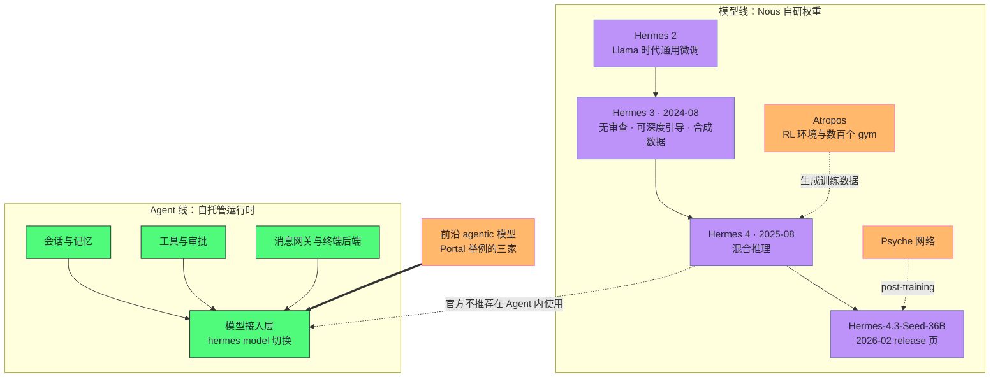
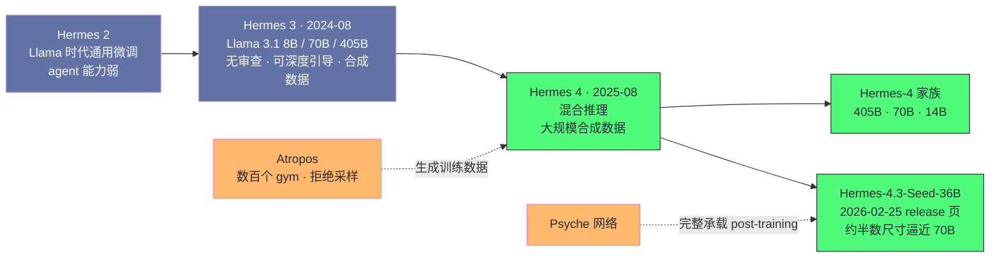
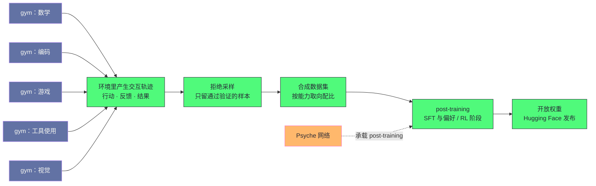
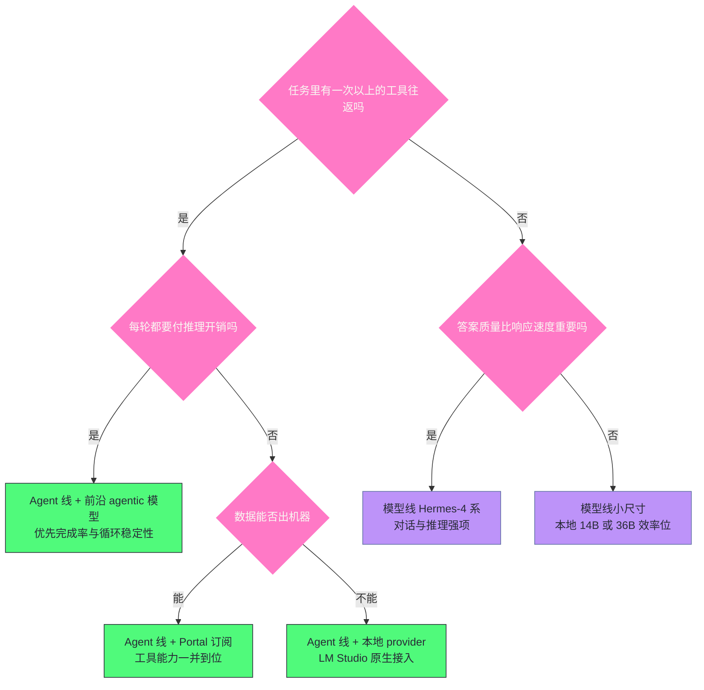

# 02 Nous Research 与 Hermes 模型谱系

**摘要：**

中文技术圈里流传着一个等式——Hermes Agent 就是用 Hermes 4 跑起来的 Agent，选 Hermes Agent 等于选 Nous 自家的模型。这个等式在官方口径里站不住：Nous Portal 的文档写明 Hermes 4 系列是前沿混合推理**对话**模型，擅长数学、科学、指令遵循、schema 遵循、角色扮演与长文写作，却不推荐在 Hermes Agent 内部使用，理由是它针对对话与推理调优，而非 agent 依赖的高频工具调用循环，agent 场景官方建议改用前沿 agentic 模型。本文要立的论点因此是一句话：**模型谱系与 Agent 产品是两条独立的线**，前者是 Nous 在开放权重、合成数据与训练环境上的研发投入，后者是一个承载任意前沿模型的自托管运行时。全篇按五问推进：两条线各自是什么、Nous 为什么要同时做、只做其中一条会退化成什么样、选型该怎么落地、以及这条分界在哪些情况下会失效。中段用四张图拆开谱系演进、数据生产管线、两条线的分工与选型路径，用六张表把四代模型的能力取向、对话模型与 agentic 模型的要求差异、Nous Portal 与自接 provider 的取舍逐项列清。全文的落点不在「哪个更好」，而在两处权衡：可引导性换来的自由度由谁承担代价，以及合成数据换来的规模由谁承担分布偏差。读完应当能回答两个问题：什么场景该买模型线，什么场景该买 agent 线；以及为什么「官方不推荐」四个字，不等于「不能用」。

---

## 第 1 章 一个被绑错的对子

### 1.1 等式是怎么长出来的

2025 年 8 月，Hermes 4 发布，官方给了它一个明确的身份——混合推理（hybrid-mode reasoning）模型，训练数据由大规模合成数据构成。对围观者来说，这条消息很容易被读成一条产品线的升级公告：Nous Research 既做 Agent 又做模型，Agent 早在同年 2 月就开源了，模型 8 月才跟上，那么顺理成章，新一代模型就是给自家 Agent 换的大脑。到了 2026 年 2 月 25 日，官方 release 页又添了 Hermes-4.3-Seed-36B 一条，说明它在大约半数尺寸下取得与 Hermes-4-70B 大致相当的表现，且 post-training 完全在 Psyche 网络上完成，这条等式看上去更顺了——自家模型、自家训练网络、自家 Agent，整条链路都在一家手里。

但这个顺理成章的推论撞上了一段不太好解释的官方文字。Nous Portal 的文档在讲模型选择时说得相当直白：Hermes 4 系列被定位成前沿混合推理对话模型，强项集中在数学、科学、长文写作这一类「一次成型、质量可评」的任务上，但**不推荐在 Hermes Agent 内部使用**，因为它调优的目标是对话与推理，而不是 agent 依赖的、一轮里反复往返的**高频工具调用循环（rapid-fire tool-calling loop）**；文档转而建议给 agent 用前沿 agentic 模型，并举例 `anthropic/claude-sonnet-4.6`、`openai/gpt-5.5-pro`、`google/gemini-3-pro-preview`。

一句话：自家产品线的文档，把自家模型从自家 Agent 的推荐位上请了下来。这算不上自相矛盾：两条线各自的优化目标本来就不同。

### 1.2 两条线各自是什么

把两条线分开定义，后面所有的讨论才有落点。

**模型线**是开放权重的研发线：Hermes 2 是 Llama 时代早期的通用微调系列，agent 能力偏弱；Hermes 3（2024 年 8 月）微调 Llama 3.1 的 8B、70B、405B 三个尺寸，训练数据以合成数据为主，官方强调无审查、可深度引导（steerable）、长上下文保持、多轮与复杂角色扮演、内部独白，以及增强的 agentic function calling，权重发布在 Hugging Face 上并附带 GGUF；Hermes 4（2025 年 8 月）走向**混合推理（hybrid-mode reasoning）**；Hermes-4.3-Seed-36B 出现在 2026 年 2 月 25 日的 release 页上。这条线的交付物是权重、技术报告与发布说明。

**Agent 线**是一个自托管运行时的产品线：它管会话与记忆、管工具与审批、管消息网关与终端后端，模型对它是外部输入而不是内置部件。这条线的交付物是能装起来、能跑起来、能长期在线的东西。

两条线的客户不同，这一点最容易被忽略。模型线的客户是想把权重拿回自己机房做部署、做微调、做研究的人，他们关心的是权重许可、量化难度、显存占用、可否离线；Agent 线的客户是想把一个常驻助理放在自己机器上的人，他们关心的是接哪个模型最省事、审批链稳不稳、崩了能不能重启。前者的评价单位是一次推理的质量，后者的评价单位是一个月的可用性。

### 1.3 为什么会被绑成一条线

绑错有三处推力，逐一说清才能避免下次再绑。

其一是命名的连带。两条线共用一个名字前缀，同一个品牌叙事，同一个官网入口，读者在搜索框里输入 Hermes，返回的结果天然混排。

其二是时间线的错觉。Agent 开源在前，模型发布在后，后来者看起来像是前者的配套升级；但发布顺序不等于依赖顺序，一条产品线的节奏由它自己的工程债决定，与另一条线何时发版无关。

其三是自托管叙事的暗示。「自托管」「开放权重」「社区驱动」这几个词堆在一起，会让人产生一种成套的联想——既然什么都自己做，那么大脑当然也用自己做的。这个联想在商业上是合理的期待，在工程上却要靠事实来校验，而事实恰好相反。

### 1.4 两条线怎么分工

把分工画出来，比用文字描述更省事。下图左侧是模型线，右侧是 Agent 线，两条线之间只有一条虚线，且方向是「不推荐」。



图里有两处值得停一眼。第一处是模型线的产出终点是权重文件，不是可用的助手——权重离「能干活」之间还隔着一整套运行时，这正是右侧那一整块存在的理由。第二处是那条虚线：它不是禁用，只是一句「不推荐」，两者在工程上的分量完全不同，后文会专门讨论这条线的边界。

把这个分工说得再具体一点，可以借一个开餐厅的比喻。模型线是一家食材供应商，它的产品是标准化、可复现、可以卖给别人二次加工的原料；Agent 线是一家厨房，它的本事是把买来的原料按客人的口味做成菜。两者共用一个招牌，供应商也时常给自家厨房供货，但厨房的菜单不会因为供应商这季度换了品种就整本重印，客人评价一家餐厅也不会只看食材产地。比喻要跟一句限定：食材与厨房可以彻底分立，而模型与运行时之间存在接口耦合——工具调用格式、系统提示的遵循程度、上下文长度这些接口项，会让「换个大脑」比「换个供应商」麻烦得多。

### 1.5 两条线的时间线为什么不同步

还有一处容易被忽略的证据，是两条线的发版节奏。模型线的节奏由训练周期与发布窗口决定，一年数个节点；运行时线的节奏由工程债决定，工具、网关、终端后端、审批链这些部件每修一处就发一个小版本，频次可以高出一个数量级。两条线共用一个品牌，读者看到高频发版，很容易把版本号当成模型代际在推进。

发版频次反映的是「补债速度」，不是「能力强度」。运行时频繁发版，说明它在补工具适配、平台接入、审批与安全这些工程欠账；模型线安静一段时间，说明它在攒下一次训练。把两者混读，会得出「产品在快速变强」的错觉，从而放松本该做的回归验证——这正是后文要反复提醒的那件事：切换模型之前先验，而不是切换之后再猜。

### 1.6 绑错的代价

绑错不是学术洁癖，它会在三个地方造成实际损失。

第一处是把对话模型塞进工具循环，然后把失败归因于框架。高频工具调用对格式稳定性的要求远高于对话，一个为长文写作与数学推导调优的模型，未必愿意在每个回合都严格吐出一段可解析的结构化调用；表现出来是「Agent 框架不好用」，实际是两侧的优化目标不匹配。

第二处是把模型线的发版当成产品线的升级。看到 release 页更新，就以为自己的 Agent 会变强，于是跳过回归验证直接切模型；但运行时侧的三个子系统——模型选择、环境自检、回退链检查——恰好是为这种切换准备的，跳过它们等于把风险直接放给生产。

第三处更隐蔽，是把「模型无关」当成免责条款。模型无关的意思是接入层不锁定某一家，不是说换哪家都等价；同一个技能文档，在不同模型上的执行保真度会有可观测的差异，把这种差异记在框架的账上，或者反过来记在模型的账上，都会导致错误的优化方向。

---

## 第 2 章 模型线：从 Hermes 2 到 4.3-Seed

### 2.1 Hermes 2：通用微调的年代

Hermes 2 属于 Llama 时代早期的通用微调系列，这个定位本身就说明了它的历史坐标。那时候开放权重生态的分工格局刚刚成形：一侧是投入巨资做预训练的组织，产出「什么都会一点」的通用基座；另一侧是社区团队，在基座之上做微调，把模型调成某种特定性格或能力取向的成品。Hermes 2 站在后一侧，做的是通用指令跟随与对话，官方口径里对它的 agent 能力评价很克制，直接说 agent 能力偏弱。

用今天的标准去挑它的毛病意义不大，但它留下的经验值得记一笔：**通用微调能改善「怎么回答」，改善不了「能不能完成任务」**。前者是风格与遵循，后者要靠工具调用的稳定性、多轮上下文的保持、长任务里的自我纠偏，这些东西在 2023 年的开放权重基座上还没有成熟的做法。这也解释了为什么 Hermes 3 的官方说明里，agentic function calling 会被单独列成一项能力——它补的正是这条缺口。

### 2.2 Hermes 3：把「可引导」做成产品特性

2024 年 8 月发布的 Hermes 3 是谱系里第一个把设计取向讲清楚的版本。它微调 Llama 3.1 的三个尺寸——8B、70B、405B，训练数据以合成数据为主，官方在发布说明里同时强调了五件事：无审查、可深度引导、长上下文保持、多轮与复杂角色扮演（含内部独白）、以及增强的 agentic function calling。权重发布在 Hugging Face 上，并带 GGUF 量化版本。

这五项能力里，「可深度引导」最容易被误读。它常常被简化成「没有安全对齐」，但更准确的读法是：模型把自己放在系统提示所指示的世界里，忠实执行那个设定，而对系统提示高度敏感。模型的默认人格因此被刻意留空，人格改由调用方提供。留空这件事在聊天产品上是缺陷——用户问一句「你好」，期待一个乐于助人的助手，而模型可能给出一个中性的、等待设定的回应；但在需要角色一致性的场景里，它又是优势，角色扮演、创意写作、特定领域专家模拟这类任务，最怕的就是模型时不时跳出角色回到出厂人格。

判断这项取向的价值，要看它把责任放在了哪一侧。可引导意味着**对齐责任从模型厂商转移给了部署者**：模型不替你拦截争议请求，也不替你预设一个安全的默认人格，这些决定权连同风险一起交到了使用者手上。对研究者与自托管用户，这是自由度；对只想开箱即用的用户，这是额外负担；对安全敏感的场景，这是一个必须自己填上的空。

Hermes 3 的另一项能力值得单独说，因为它与 Agent 线的关系最直接。官方把 agentic function calling 列为增强项，意思是模型在「该调工具时调工具」这件事上比前代可靠；但可靠与「为高频循环调优」是两件事，前者说的是单次调用的成功率，后者说的是每秒数次的往返里，格式抖动、参数幻觉、停止条件误判的累积概率。这个区别在 2025 年之后被官方文档正式写进了推荐意见里。

### 2.3 Hermes 4：混合推理的取向

2025 年 8 月发布的 Hermes 4 换了一个更明确的卖点：混合推理（hybrid-mode reasoning）。传统的开放权重模型大致分两类，一类是指令模型，收到问题直接给答案，快但浅；一类是推理模型，先在内部铺开一长串推导再作答，深但慢且贵。混合推理的取向是让模型自己判断这道题要不要打草稿——简单问题直接答，复杂问题才展开推理链。

这个取向在账面上很好理解。对聊天产品，它意味着不必为一句「今天周几」付出几千 token 的思考成本；对推理产品，它意味着复杂题仍然享受长链推导的收益。但它也埋下了一个后续争议：判断「要不要推理」这件事由模型自己完成，而模型对自身难度的判断未必准，过度推理与推理不足会同时存在，只是从用户手动切换变成了模型内部决策。

Hermes 4 的训练数据有一个技术上的关键点：**大规模合成数据**，出自 **Atropos**——Nous 开源的强化学习环境框架，内含数百个 gym，覆盖数学、编码、游戏、工具使用、视觉等方向，样本经拒绝采样筛选后才进入训练集。这条链路的细节值得单独成章，因为它解释了 Nous 为什么能在没有海量人工标注的前提下持续产出训练集。

### 2.4 release 页上的四个型号

截至 2026 年 2 月 25 日的官方 release 页，Hermes-4 系列列出的是四款，而不是一两款。这个列表本身就是一种产品策略的说明书：同一个训练管线，按尺寸与部署位置切出不同的位。

| 型号 | 尺寸 | 发布口径 | 取向 |
| :--- | :--- | :--- | :--- |
| Hermes-4-Llama-3.1-405B | 405B | 家族里被称作 frontier hybrid-mode reasoning model | 旗舰位，追求能力上限 |
| Hermes-4-Llama-3.1-70B | 70B | 同族中号 | 通用位，能力与成本的折中 |
| Hermes-4-14B | 14B | 小而稠密，面向本地推理 | 本地位，单机可跑 |
| Hermes-4.3-Seed-36B | 36B | 约半数尺寸下与 70B 大致相当，post-training 完全在 Psyche 网络上完成 | 效率位，用更少参数换相近表现 |

这张表最值得读的是最后一行的措辞。「约半数尺寸取得与 70B 大致相当的表现」是一个**相对表述**，不是绝对分数；官方没有在本次可核实的材料里给出具体评测数字，任何把这句话折算成某个榜单名次的说法都缺一手依据。本文因此只保留相对关系，不引入具体分数。

另一处需要说明的是基座。405B 与 70B 两个型号的名字里直接写着 Llama-3.1，基座来源清楚；14B 与 36B 的发布口径强调的是「小而稠密、面向本地」与「效率位」，官方没有把基座作为卖点展开，本文也不替它补。

### 2.5 谱系演进

把四代摆到一条时间轴上，能看清每一代各自在解决什么问题。下图同时标出了两类外部依赖：Atropos 为 Hermes 4 提供训练数据，Psyche 承载了 4.3-Seed-36B 的 post-training。



图里有两处容易看漏。第一处是 Hermes 4 分出了两条支线，一条按尺寸铺开（405B、70B、14B），一条按效率取舍（4.3-Seed-36B）——这不是两个产品，是同一取向在不同约束下的两种落地。第二处是两个外部依赖的箭头方向：Atropos 指向数据，Psyche 指向训练过程，一个管「用什么学」，一个管「在哪学」。

谱系的迭代方式也有个特点值得记下来：它不像换平台，更像修车行的年度调校——车架不换，照着上一年度暴露的故障清单逐项改。Hermes 2 到 Hermes 3 补的是指令遵循与多轮的底子，Hermes 3 到 Hermes 4 改的是推理成本的结构，Hermes 4 到 4.3-Seed 动的是参数效率。比喻要立刻限定：调校的假设是缺陷清单已经清楚，而模型能力的短板往往是事后才被发现的，所以这条迭代路径的真实形态是「发布—暴露—修正」，而不是计划好的路线图，这一点看官方发布的措辞比看社区总结更可靠。

### 2.6 四代能力取向对照

把四代放在同一张表里，按尺寸、训练方式、推理模式、适用场景四个维度对照，能避免把不同代际的卖点混谈。

| 代际 | 时间锚点 | 尺寸口径 | 训练方式（官方口径） | 推理模式 | 取向与适用场景 |
| :--- | :--- | :--- | :--- | :--- | :--- |
| Hermes 2 | Llama 时代早期 | 官方未公开具体尺寸 | 通用微调 | 直接响应 | 通用对话与指令；agent 能力弱，不适合多步任务 |
| Hermes 3 | 2024-08 | Llama 3.1 的 8B / 70B / 405B | 以合成数据为主的微调，含 agentic function calling 增强 | 直接响应 | 长上下文、多轮、角色扮演、可深度引导；适合需要人格与角色一致性的场景 |
| Hermes 4 | 2025-08 | 405B / 70B / 14B | 大规模合成数据，由 Atropos 的 gym 经拒绝采样生成 | 混合推理，按需展开 | 数学、科学、指令与 schema 遵循、长文写作；适合对话与推理密集型任务 |
| Hermes-4.3-Seed-36B | 2026-02-25 release 页 | 36B | 完全在 Psyche 网络上完成 post-training | 混合推理 | 效率位；适合显存受限但仍要较强表现的部署 |

这张表有两处需要加注。第一处是尺寸列里出现「官方未公开」，Hermes 2 的具体参数规模在本次可核实的材料中没有给出，不补也不猜。第二处是「推理模式」一列从「直接响应」到「混合推理」的跃迁发生在 Hermes 4，这个跃迁同时改变了成本结构与失败模式——前者便宜但浅，后者按需付费但多了一层「要不要推理」的判断风险。

### 2.7 「Seed」与 36B 该怎么读

型号名里的 Seed 值得单独解释，因为它是整份 release 页里最容易被误读的一处。把 36B 读成「70B 的蒸馏小号」是一种常见理解，但官方给出的说法更克制：它在约半数尺寸下取得与 Hermes-4-70B 大致相当的表现，且 post-training 完全在 Psyche 网络上完成。前半句说的是效率，后半句说的是训练方式的差异，两者合在一起才构成这个型号的定位。

训练方式为什么值得单独强调？因为把 post-training 放到自己控制的分布式网络上跑，意味着训练链的一环不再依赖外部集群的排期与预算。这不该按性能指标去读，它讲的是产能控制——能不能按自己的节奏反复迭代，取决于训练这一环是否自主。至于 Psyche 网络内部如何协调算力、如何验证贡献，公开材料没有给出一致口径，本文不作推断，只按官方那句「完全在该网络上完成」如实记录。

---

## 第 3 章 为什么自己做模型

### 3.1 合成数据：没有标注预算的实验室只能自己造数据

要理解 Nous 为什么自己做模型，得先理解一个约束：开放权重路线上，最难获得的不是算力也不是基座，而是高质量的指令数据。人工标注百万级样本的成本，任何社区实验室都负担不起；唯一的规模化路径是用强模型生成样本、再用某种标准筛选，也就是合成数据。Hermes 3 的训练数据「以合成数据为主」，Hermes 4 的训练数据是「大规模合成数据」，两代口径一致，说明它是一条路线选择，而非权宜之计。

合成数据这条路有一个天生的代价，必须说在前面：**学生模型的分布上限由教师模型决定**。用强模型生成的样本去训练，学生学到的是教师的偏好与盲区；教师在某类问题上系统性偏保守、偏啰嗦、偏某种格式，学生就会把这些当作「正确答案」继承下来。这就像用复印件再去复印，每一代的噪点都会被固化一次。这条限制不是 Nous 独有，所有走合成数据路线的团队都在付同样的账。

### 3.2 Atropos 与 gym：把环境变成训练原料

Nous 对这笔账的应对方式，是把数据生产放进环境里，而不是放进提示词里。Atropos 是 Nous 开源的强化学习环境框架，内含数百个 gym，覆盖数学、编码、游戏、工具使用、视觉等方向。gym 这个词借自强化学习社区，指的是一类可交互的任务环境：模型在里面做题、调工具、玩游戏，环境负责判定结果对不对。

把训练数据放进环境生成，与直接让模型「写一批问答对」有本质区别。前者产出的样本带着行动轨迹——模型做了什么、环境给了什么反馈、最终有没有通过验证；后者产出的样本只是一段文本，质量取决于生成模型的自评能力。对有客观判定标准的任务（数学题有答案、代码有测试、工具调用有返回值），环境路径的样本质量有硬校验；对没有客观标准的任务（写作、角色扮演），它就只能退回主观筛选。

下图把这条管线拆成五段，从环境到权重，中间的关键节点是拒绝采样与配比。



图里最容易被当成细节的是「配比」那一格。环境能保证单个样本的正确性，保证不了样本集合的形状——数学题刷多了，模型会变得爱写推导；角色扮演样本占比高了，它会在该直接回答的地方开始演戏。配比没有先验公式，只能靠评估结果反推，这也是为什么数据策展比数据生成更难外包。

### 3.3 拒绝采样：筛子决定模型的样子

**拒绝采样（rejection sampling）**这个词听起来技术性很强，实质却朴素：让模型对同一道题生成多个候选，只保留通过验证的那些，把没通过的丢掉。它解决的是合成数据里的一个现实问题——生成模型不是每次都对，如果全量收下，错误样本会被当成标准答案学进去。

这个机制的力量与局限都很清楚。力量在于它把「什么算对」这件事外化成了可执行的验证器：数学题对答案、代码跑测试、工具调用看返回值，验证器说不行就丢。局限在于它只能筛出「可验证的对错」，筛不出「风格的好坏」；而且它有系统性偏向——容易通过验证的题型会被过度采样，难验证的题型则被悄悄排除，训练集因此向「好判分」的方向倾斜。这条偏向在下文讨论分布偏差时还会回来。

### 3.4 Psyche：把训练的一环握在自己手里

Psyche 是 Nous 的训练网络，官方在 Hermes-4.3-Seed-36B 的说明里给出了它最具体的一次落地：这个型号的 post-training 完全在 Psyche 网络上完成。这个说法值得反复读，因为它点明了 Psyche 的角色不是「训练框架的备选方案」，而是「已经承载过实际型号训练的基础设施」。

关于 Psyche 的内部机制，公开材料的表述并不统一：本次可核实的一手材料只说明「该型号的 post-training 完全在这个网络上完成」，没有给出协调层与结算层的可引用细节，本文因此只按这一条记录，不往机制上推断。把不确定的部分写成确定，是这类基础设施话题最容易犯的错。

可以确定的推论只有一条：把 post-training 放进自有网络，等于把迭代节奏从「等外部集群排期」变成「按自己的产能安排」。对一家要走开放权重路线的实验室，这个差别不是效率问题，而是能不能按周迭代的问题。

### 3.5 为什么这条路最后落在对话与推理

把 Hermes 3 与 Hermes 4 的官方卖点并排看，会发现一个稳定的取向：它们强调的是数学、科学、指令与 schema 遵循、角色扮演、长文写作。这些都是「一次生成、质量可评」的任务，而不是「数十次工具往返、任务才算完成」的任务。这条取向不是偶然，它由数据生产方式的形状决定——gym 里最好判分的是有标准答案的题，最难判分的是长链条任务的完成度。

长链条任务的训练数据有两个难点：一是**奖励稀疏**，任务成功与否往往要等十几步之后才知道，中间步骤的对错没有明确标签；二是分布漂移，同一个任务在不同模型、不同环境下走出的轨迹差别很大，难有一套稳定的筛选标准。这两个难点决定了「为 agent 调优」需要的不只是环境，还需要一整套与具体运行时耦合的工程，而后者恰恰是 Agent 产品线在做的事。

于是两条线的分工在数据层面就已经注定：模型线把可判分的能力做到最好，Agent 线把不可判分的复杂度接过去，用运行时的手段（工具集裁剪、审批、回退、技能沉淀）来兜住长链条的不确定性。

### 3.6 只做模型会怎样

设想 Nous 只做模型线，不做运行时。权重发出去，社区拿去接各式各样的框架，工具调用格式各家适配，长链条失败率由使用者自己承担，反馈无法回流到训练——那么每一代模型的改进方向只能靠公开榜单与社区抱怨来猜，迭代会退化成「跟着评测跑」。

这条路的代价不是能力不足，而是**失去场景**：不知道真实任务里模型在哪一步掉链子，就只能优化能被打分的那部分。这也是为什么 Hermes 3 的发布说明会把 agentic function calling 单独列出——它是一种对场景缺口的公开承认，尽管当时的补法还是模型侧的。

反过来只做壳会怎样，是下一章的问题。

---

## 第 4 章 Agent 线：一个不承诺模型的运行时

### 4.1 运行时是什么，不是什么

Agent 线的产品形态是一个自托管运行时：会话与记忆归一层，工具与审批归一层，消息网关与终端后端再归各自一层，把「一个常驻助理」所需的周边收进同一个进程。它不是模型，也不是模型的服务端封装；它的核心循环本身极短，复杂度全在工具、后端与策略层。

这个定位有一个直接后果：运行时的质量与模型的强弱是两条独立的评价轴。同一套运行时，换上更强的模型会变强，但不会变成另一个产品；换上一个不匹配的模型，也不会因为运行时写得好就补齐差距。把这两条轴混在一起评价，是选型时最常见的失焦。

比喻可以用一间公寓的电路系统：它不发电，但决定了哪种电器能插上、能同时开几台、跳闸之后怎么恢复。电从哪来是供应商的事，能不能安全用电是电路的事。限定也要跟上——电路是标准化的，插头形状全球统一；而模型接入没有这种统一标准，不同厂商的工具调用格式、系统提示偏好、上下文计费方式都不一样，所以 Agent 线的「电路」里必须内置一层适配，这层适配就是后文的模型接入层。

### 4.2 提供商矩阵：把模型选择变成运营动作

Hermes Agent 的模型接入是矩阵式的。公开材料在 v0.14 时期给出的口径是 30 家以上提供商，此后仍在增加；明确落地的一批包括 OpenRouter（多模型单 key）、LM Studio（从自定义端点别名升级为原生 provider，带独立鉴权、`hermes doctor` 检查、reasoning 传输与实时 `/models` 列表）、GMI Cloud、Azure AI Foundry（自动探测）、MiniMax（OAuth 加 PKCE 浏览器流）、Tencent Tokenhub，以及 Nous 自有模型线。数字口径要谨慎：30 家是某一个版本的快照，版本推进之后的具体家数以 `hermes model` 的列表与官方文档为准。

矩阵式接入的意义不在于「支持得多」，而在于把模型选择从架构决策降级成运营动作。架构决策要评审、要改代码、要回归；运营动作只要一条命令。这个降级对长驻 Agent 尤其重要——它的任务组合会随时间漂移，第一个月以问答为主，第三个月开始跑定时巡检，某段时间又要临时顶一个高强度的项目，如果每次调整都要动架构，用户就会干脆不调，长期用着一个不合适的配置。

### 4.3 三条命令构成的选择面

模型接入层对外暴露的操作面很窄，窄到可以背下来：选模型、查环境、验回退。三条命令各管一段。

```bash
hermes model            # 交互式选出当前使用的模型，切换不改代码
hermes doctor           # 自检本地环境与提供方配置，先排掉接线错误
hermes fallback check   # 校验回退链是否就绪，主模型不可用时能不能接上
```

三段的分工值得说明。`hermes model` 解决「用谁」，`hermes doctor` 解决「接得通吗」，`hermes fallback check` 解决「断了怎么办」。第三段最容易被跳过，也最贵：主模型限流、涨价、下架、区域不可用，这些在长驻场景里都会发生，回退链没验过，就等于把可用性押在一家供应商的稳定性上。

### 4.4 对话模型与 agentic 模型的要求差异

把两类模型的要求摊开对比，就能理解 Portal 文档那句「不推荐」的技术依据。

| 维度 | 对话与推理模型（Hermes 4 系列的定位） | agent 场景要的模型 |
| :--- | :--- | :--- |
| 单次调用的形态 | 一问一答，用户在场，可追问 | 一轮任务里多次工具往返，用户常常不在场 |
| 输出约束 | 长文、公式、schema 要正确 | 工具名、参数、停止条件要稳定，格式抖动直接中断链条 |
| 错误成本 | 答错可以重问，代价是一次交互 | 一次解析失败可能让整条执行链作废 |
| 延迟与成本 | 长推理可被容忍，质量优先 | 每轮都要付，推理开销被轮次放大 |
| 优化目标 | 答案质量与遵循度 | 任务完成率与循环稳定性 |
| 官方取向 | 数学、科学、指令与 schema 遵循、角色扮演、长文写作 | 前沿 agentic 模型，Portal 举例 Claude、GPT、Gemini 三家 |

这张表的落点不在「谁更强」，而在「优化目标不同」。同一个模型在两类目标上的表现可以差得很远：一个在数学题上表现优异的模型，可能在「连续二十次调用都要吐出可解析参数」这件事上反复失手，因为后者的失败不需要理解力，只需要极端的格式纪律；反过来，一个为工具循环调优的模型在被要求写长篇分析时，也常显得干瘪。

### 4.5 运行时要为模型无关付的三笔适配成本

模型无关不是零成本的承诺，它把成本从用户侧转到了开发侧。三笔账要分开记。

第一笔是工具调用格式。各家模型输出结构化调用的形态不一样，有的靠特殊 token 包裹文本，有的在 API 层直接给结构化字段，有的用自家标记；运行时的接入层必须为每种形态准备解析路径与容错策略，否则「换模型」就成了「换一套解析器」。

第二笔是系统提示的偏好。同一个技能文档，对不同模型的效力并不一致：有的对层级清晰的结构化标记响应更稳，有的对自然语言叙述更敏感。模型无关保证的是技能文档可复用，不保证执行保真度一致，后者的波动要在回归里量出来。

第三笔是上下文与计费。上下文窗口、提示缓存是否生效、推理 token 怎么计费，各家规则不同，运行时的成本模型必须跟着调整。一笔「看起来更便宜」的切换，可能因为缓存不生效而变贵，这类账只有按实际调用量核过才算数。

三笔账合起来的结论很朴素：**模型无关是一项持续的维护投入**，不是一次性的架构选择。它带来的回报是切换自由，代价是适配层要一直跟着上游格式演化。

### 4.6 只做壳会怎样

设想 Nous 只做 Agent 线，不做模型。运行时接各家前沿模型，用户体验可以很好——用最好的大脑，配最方便的运行时。但这条路有三处结构性弱点。

第一处是**没有差异化能力的沉淀**。运行时的功能会被同行快速复制，接入层的适配优势会随各家 API 收敛而缩小，长期看，产品差异只能来自模型侧的能力或训练侧的数据。第二处是没有数据回流的方向。用户在真实任务里踩到的坑，只有变成训练信号才有价值，纯做壳的团队拿不到这条回路。第三处是供应链风险，全部押在别人的模型上，涨价的、下架的那个决定不掌握在自己手里。

但只做壳也有一条纯做模型做不到的优势：它对模型市场的变化是开放的，谁家出了更强的模型，第二天就能用上。这是典型的权衡结构——自研换控制力，接入换敏捷性，两者都不免费。

### 4.7 两条线的接触面

两条线并非完全隔离，它们在一个具体的点上握手：Nous Portal。走 Portal 接入时，一次 OAuth 订阅同时解锁四项能力——联网搜索、图片生成、TTS 语音合成、云端浏览器，这组能力被称作 Tool Gateway，省掉了逐家配置 key 的功夫。

这个接触面的设计意图很清楚：Portal 是两条线的商业交汇处，模型线与工具能力被打包成一个订阅，卖给 Agent 线的用户。但它同时也是误解的高发区——订阅包含工具能力，不等于订阅里的模型适合 agent；Portal 文档给出「不推荐 Hermes 4 用于 Agent 内部」这句话，恰恰是在这个交汇处做的切割：工具可以打包，模型要分开推荐。

---

## 第 5 章 落地：两条线怎么选

### 5.1 三个决策维度

选型不需要复杂模型，三个维度足够：任务里有几次工具往返、谁在等结果、数据能不能出机器。

第一个维度决定线路。工具往返少（一次问答、一次写作、一次抽取），模型线的能力就直接体现在结果上；工具往返多（读文件、跑命令、改代码、再验证），失败会累积，运行时的稳定性比单次生成质量更重要。

第二个维度决定模型档位。用户在场等结果，首 token 延迟敏感，混合推理的「按需展开」正好合适；无人值守的定时任务，延迟不敏感，可以容忍长推理，也能用更便宜的档位。

第三个维度决定部署形态。数据不能出机器，就只能自托管权重，模型线的开放权重与量化版本是唯一选项；数据可以出机器，接入层的便利性就成了主要考量。

### 5.2 场景到线路的映射

把常见场景按这三条维度归档，得到下面这张表。它不承担标准答案的角色，只作一份起点清单。

| 场景 | 主要矛盾 | 建议线路 | 备注 |
| :--- | :--- | :--- | :--- |
| 数学推导、科学问答、长文写作、角色扮演、结构化抽取 | 单次输出质量 | 模型线（Hermes 4 系） | 官方明确的强项区，混合推理按需展开 |
| 消息平台上的常驻助理、多步运维自动化、代码库巡检 | 长链条稳定性 | Agent 线 + 前沿 agentic 模型 | Portal 官方推荐取向，别用对话模型硬顶 |
| 本地离线、数据不出机器、显存受限 | 部署可行性 | 模型线自托管（14B / 36B） | 权重与 GGUF 可得，能力按尺寸折损 |
| 预算敏感但要 agent 能力 | 成本与完成率 | Agent 线 + 中端 agentic 模型 + 回退链 | 用 `hermes fallback check` 兜住供应商波动 |
| 造数据、跑 RL 环境、研究工具调用轨迹 | 训练侧需求 | Atropos 的 gym 环境 + 开放权重 | 这是模型线的上游，不是 Agent 线的替代 |

表里最后一行的存在感最弱，却最能说明两条线的关系：Atropos 属于模型线的上游，它产出的数据训练出模型，模型再被 Agent 线接入。同一个组织把上下游都握在手里，不代表上下游可以合并成一个产品。

### 5.3 选型路径

把三个维度串成一条判断路径，会比记表格更省事。下面这张图只分四类，实际场景可以落在两条路径的交界处，交界处就该做混合编排。



图里的分支顺序有讲究：先问工具往返，是因为它决定线路，代价最大；再问推理开销与数据边界，是因为它们只决定档位与部署形态，可逆。选型的一般原则是**先把不可逆的决策做对**，可逆的决策留到运行中调整。

### 5.4 Nous Portal 与自接 provider 的取舍

两条线路都会遇到接入方式的选择，Portal 与自接 provider 各有适用面。

| 维度 | Nous Portal | 自接 provider |
| :--- | :--- | :--- |
| 接入方式 | 一次 OAuth 订阅，`hermes setup --portal` 完成配置 | 逐家配 key 或端点 |
| 附带能力 | Tool Gateway 一次解锁联网搜索、图片生成、TTS、云端浏览器 | 每项能力各自找供应商、各自配 key |
| 可选模型 | Portal 提供的模型池，含 Nous 自有模型线 | OpenRouter 多模型单 key、LM Studio 本地、GMI Cloud、Azure AI Foundry、MiniMax、Tencent Tokenhub 等 |
| 计费 | 订阅制 | 按各家口径分别计费 |
| 适合谁 | 想少配置、把顺手放第一位 | 已有企业账号、有合规要求、或必须本地推理 |
| 代价 | 单一供应商的可用性成为上限 | 配置面变宽，回退链要自己维护 |

这张表最后一行是选择的关键。Portal 把摩擦压到最低，代价是把可用性的一部分交给单一供应商；自接 provider 把控制权拿回来，代价是配置与维护的工作量转移到自己身上。两者不是先进与落后的关系，而是「你愿意为省事付多少可用性」。

### 5.5 一个自托管实例的走查

把上面的判断放进一个具体场景，链条会更清楚。笔者设想一台放在机房角落的小机器，跑一个自托管 Agent：白天在聊天工具里回答问题、整理资料，凌晨跑一次日志巡检，周末把一周的会议记录归并成摘要。

白天那段落在 Agent 线加前沿 agentic 模型：工具往返多，用户在场等结果，需要的是稳定的循环与可接受的延迟；模型档位选中端即可，因为任务难度不高但频次高。凌晨那段落在 Agent 线的定时入口，但可以换一个更便宜的档位，因为没人在等；日志分析本身需要一点推理，混合推理的按需展开正好合适，但要注意它跑在 Agent 的循环里，格式纪律仍然优先于推理深度。周末归并那段最适合模型线：输入是几万字的长文，输出是一篇结构化的摘要，工具往返几乎为零，评价标准是文本质量，这时把模型线里长文写作强的型号拿出来用，比在运行时里硬拼工具链更划算。

这个走查暴露了一个现实：同一个实例的三个入口，最优模型可能完全不同。运行时的价值就在于让这种差异可以被配置，而不是被架构锁死。

### 5.6 混合编排

混合编排谈不上高级技巧，它是长驻场景的默认形态。可行的做法有三条：按入口分档（消息入口用中端、定时入口用便宜档、研究入口用强模型）、按阶段分工（执行用强模型、整理轨迹用便宜模型）、按可用性兜底（主模型不可用时按回退链降级，而不是直接停摆）。

三条做法有一个共同前提：**切换成本要足够低**。切换成本高，用户就会一次性选一个「差不多都行」的模型，然后把所有场景都压在它身上；切换成本低，用户才会针对场景做细化。这也解释了为什么模型接入层要把选择做成一条命令，而不是一个配置文件里的常量。

混合编排也会坏，坏的形态通常不在模型侧，而在配置失控。入口一多、档位一多，就会没人记得哪个入口配了哪个模型，于是同一类任务在不同入口上表现不一致；回退链设了却没人跑过，主模型限流时才第一次知道它不生效。对抗这种失控只能靠两条纪律。

- 把入口、档位、回退目标写成清单，与配置一起评审，让「哪个入口用哪个模型」成为可审计的记录。
- 把 `hermes fallback check` 纳入例行巡检，而不是等主模型限流了才第一次确认回退链是否生效。

还有一层成本容易被低估：多档位意味着多套提示与技能的适配验证。同一个技能文档在强模型上跑得通，在便宜档上可能因为指令跟随弱而漏步骤，因此分档之后要按档做回归，别把强模型上的验证结果当成全档通用。

---

## 第 6 章 边界与反例

### 6.1 可引导性的账单：对齐责任转移

Hermes 3 的「可深度引导」常被当成纯优点宣传，但它是一笔有账单的交易。模型不预设人格、不替调用方拦截争议请求，等于把「什么样的行为可以接受」这个判断整体交给了部署者。对企业用户，这意味着合规审查的对象从模型厂商变成了自己的配置；对个人用户，这意味着默认体验不再被保证。

这笔账在 Agent 场景会被放大。Agent 的系统提示里不只有人格，还有技能文档、工具说明、记忆片段，模型对系统提示越敏感，这些内容对行为的支配力就越强——好处是指令保真度高，坏处是提示注入的攻击面同步变大：一段被污染的外部内容如果能混进系统提示的层级，敏感的模型会被更彻底地带偏。可引导性是一把双刃，握柄那一侧交给谁，谁就要负责。

### 6.2 合成数据的分布偏差

合成数据解决的是规模问题，代价是分布问题。前文说过，学生模型的分布上限由教师模型决定；再叠上拒绝采样的偏好，偏差会以两种形式固化下来。

第一种是题型偏斜。能被验证器判分的任务被过度采样，难判分的任务被系统性排除，模型因此在「有标准答案」的问题上越来越强，在「没有标准答案」的问题上原地踏步。第二种是风格同质。教师模型的行文习惯、保守程度、格式偏好会被学生继承，多代累积之后，模型的输出会带上一种可辨识的「家族腔」。这两种偏差都不会在单次评测里暴露，只会在长期使用中表现为「说不上哪里不对，但总觉得像同一个人写的」。

评估这类风险，看发布说明里的训练数据描述比看榜单更有用：数据从哪来、怎么筛、配比怎么定，这三件事决定了模型的形状。

### 6.3 对话模型的强项被当成 agent 能力

最典型的反例是把 Hermes 4 放进高频工具循环，然后抱怨 Agent 框架不好用。这个反例的成因是能力维度被混淆：模型在数学与 schema 遵循上表现好，被误读成「结构化输出能力强」，而工具调用的结构化要求与 schema 生成的结构化要求不是一回事——前者要求在高频往返里保持格式纪律与停止条件判断，后者要求一次性生成合法结构。

另一个反例方向相反：用为工具循环调优的 agentic 模型写长篇分析，结果干瘪、跳跃、缺少论证层次。两类模型的失败方向不同，把失败归因到错误的一侧，优化就会做在错的地方。

### 6.4 「官方不推荐」不等于「不能用」

Portal 那句「不推荐在 Hermes Agent 内部使用」需要被准确理解：它是一句**基于优化目标的推荐**，不是一条技术禁令。把 Hermes 4 接进 Hermes Agent 在工程上完全可行，接入层的适配就是为了让任何模型都能接；不推荐的意思是，在典型的 agent 负载下，它的表现不会优于专门为工具循环调优的模型，而用户会为此付出更多重试与调试成本。

什么情况下可以越过这条推荐？三类场景值得考虑。

- 任务以长文生成或数学推导为主，工具调用只占很小比例，长链条失败的概率本身就不高。
- 需要本地离线、只能用开放权重，而 agentic 模型没有合适的本地选项，此时「次优但可部署」胜过「最优但出不了机器」。
- 做对比实验，需要同一套运行时下比较不同模型的行为差异，模型线的权重可复现性正好合适。

越过推荐的前提是知道自己在赌什么，而不是不知道有这条推荐。

### 6.5 版本与时效的漂移

这类文章的保质期很短，两处漂移必须提前说明。第一处是模型谱系：release 页会持续加型号，本文引用的是截至 2026 年 2 月 25 日的页面；第二处是 Agent 版本：本文的事实基线截至 2026 年 11 月 19 日，对应 v0.23.2。还有一处小坑值得提醒——版本号有两种写法并存，`v0.23.2` 与日历式的 `v2026.x.y`（譬如 v2026.4.8 对应 v0.8.0），看到两种写法不要当成两条产品线。

### 6.6 一个反例现场

设想一个不罕见的现场。某台自托管实例原本用前沿 agentic 模型跑凌晨的日志巡检，团队看到自家模型线的新型号发布，判断「自家模型总该更适合自家运行时」，于是把巡检任务的模型换了过去。头两天结果看起来更好：报告写得更详尽，根因分析更像人写的。几天之后，巡检开始偶尔卡住，日志里出现无法解析的工具调用片段，值班同学加了重试，问题被盖住但没消失。

复盘时把这段任务的轨迹拆开，才看清结构：这类巡检里有一段需要连续读取三个文件再做比对，模型在读到第二个文件时开始「总结」，把剩下那个文件当成了已知信息。这不是能力问题，症结在负载错配——那段流程要的是高频、短促、格式严格的三次往返，而模型线的优化目标是长文与推导的质量。修法也不复杂：把采集与比对那段留给 agentic 模型，把最后的报告撰写交给模型线，两段之间用文件交接。

这个现场值得记的地方在于它的失败形态——它不报错，它「更漂亮但更不可靠」。这类退化最难被发现，因为输出质量在肉眼上反而提升了，只有把任务完成率单独量出来才看得见。

### 6.7 常见误读澄清

把前面几章反复拆解的误读集中列一遍，便于对照。

| 流传说法 | 事实口径 |
| :--- | :--- |
| Hermes Agent 就是用 Hermes 4 跑的 | Portal 文档明确不推荐在 Agent 内使用，agent 场景建议前沿 agentic 模型 |
| Hermes 模型是 Nous 从零预训练的 | 405B 与 70B 的型号名里直接写着 Llama-3.1，谱系走的是微调路线 |
| Hermes 模型只能对话，当不了 agent | Hermes 3 的官方口径就含增强的 agentic function calling；差别在于是否针对高频工具循环调优 |
| 某个具体评测分数可以拿来排名 | 本次可核实材料未给出一手分数，本文不采用任何未复核数字 |
| DeepHermes 是谱系第四代 | 2026-02-25 的 release 页未列该型号，本文不把它并入主线 |
| Psyche 是区块链算力众筹 | 官方口径只说明 4.3-Seed-36B 的 post-training 完全在该网络完成，协调层无一致公开细节 |

表里第五行需要多说一句。社区材料里出现过 DeepHermes 这个名字，也出现过 3B、8B、24B 的尺寸组合，但它在本次核实的 release 页上没有对应条目，是否属于另一条分支、是否仍在维护，公开材料没有给出确定说法。处理这类材料的稳妥做法是把它标成「待核实」，而不是为了让谱系显得完整就补进去。

---

## 第 7 章 收束：两条线各有各的客户

### 7.1 把权衡写成一句话

模型线卖的是权重与能力，客户是自己部署、自己微调、自己承担对齐责任的人；Agent 线卖的是运行时与便利，客户是想要一个长期在线、装上就能用的助理、不想操心底层的人。两条线共用一个品牌，共用一些基础设施（Atropos 造数据、Psyche 训模型、Portal 卖订阅），但它们的评价标准、迭代节奏与失败模式都不一样。

把这句话落到选择上，就是两条判断：需要「一次生成的质量」时，买模型线，接受可引导性带来的责任转移与合成数据带来的分布偏差；需要「一个月的可用性」时，买 agent 线，接受运行时对模型的适配成本与供应商波动。两处都不免费，两处都需要知道自己付了什么。

### 7.2 下一篇

[[03 架构总览——AIAgent 核心循环与子系统]] 从这两条线的分界往下走一层，进入运行时内部：核心循环怎么组织、子系统怎么切分、三类入口（命令行会话、网关消息、定时任务）的数据流各自长什么样。模型线的话题到此告一段落，后面的篇幅交给运行时本身。

> [!info] 专栏导航
> 本文是 [[LLM/Hermes-Agent/00 专栏导览|Hermes Agent 专栏]] 的第 2 篇，也是「定位与背景」部分的收尾。下一篇进入「核心架构」。

---

## 参考资料

1. Nous Research 官方站点与模型发布页：https://nousresearch.com/
2. Nous Research 模型权重仓库（Hugging Face）：https://huggingface.co/NousResearch
3. Hermes 4 模型集合（Hugging Face）：https://huggingface.co/collections/NousResearch/hermes-4-collection-68a731bfd452e20816725728
4. Hermes 3 技术报告（arXiv:2408.11857）：https://arxiv.org/abs/2408.11857
5. Atropos 强化学习环境框架（Nous Research 开源）：https://github.com/NousResearch/Atropos
6. Nous Portal 站点（模型选择与推荐口径见站内文档）：https://portal.nousresearch.com/

---

> [!note] 思考题
> 1. Portal 文档把 Hermes 4 从 Agent 内部推荐位请了下来，却又把它列为模型线的旗舰。如果你的团队既买了 Portal 订阅、又要在自托管实例上跑长驻任务，你会怎样向非技术同事解释「同一个品牌的两条线适合不同场景」，而不让对方觉得这是话术？
> 2. 合成数据加拒绝采样，会把「好判分的能力」做得越来越强。如果一条产品线长期只靠这类数据迭代，它在哪些任务上会出现能力停滞，而这个停滞在榜单上根本看不出来？
> 3. 可引导性把对齐责任转移给了部署者。假设你的 Agent 会对一条来自外部网页的内容做摘要，并把它写进长期记忆，这个链路里应该由谁、在哪一步做拦截，才不至于让「可引导」变成「可被引导」？

---

**时效说明：** 本文事实基线截至 2026-11-19，Agent 侧对应 v0.23.2；模型谱系部分引用的是截至 2026-02-25 的官方 release 页口径。模型型号、提供商数量与推荐意见都会随版本变化，具体以 `hermes model`、`hermes doctor` 的输出与官方文档为准；本文不引用未经一手材料核实的评测分数，读者若在其他材料中看到具体数字，建议回查技术报告原文。
