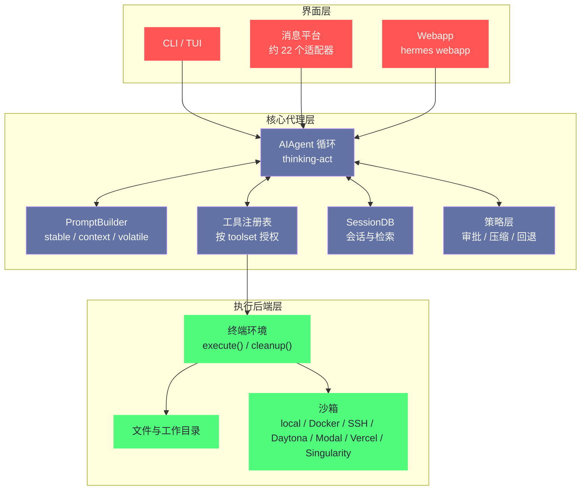
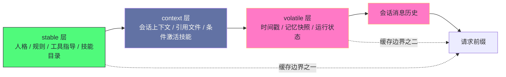
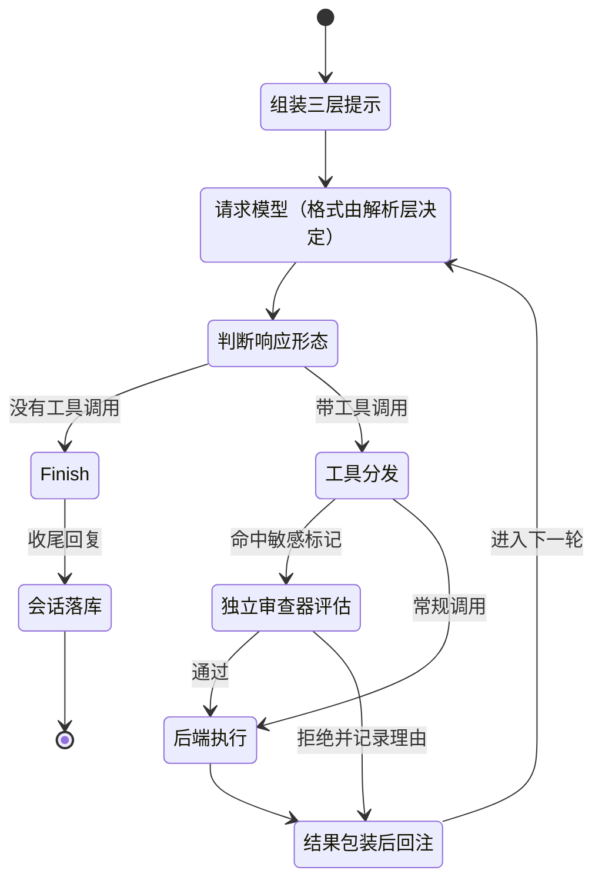
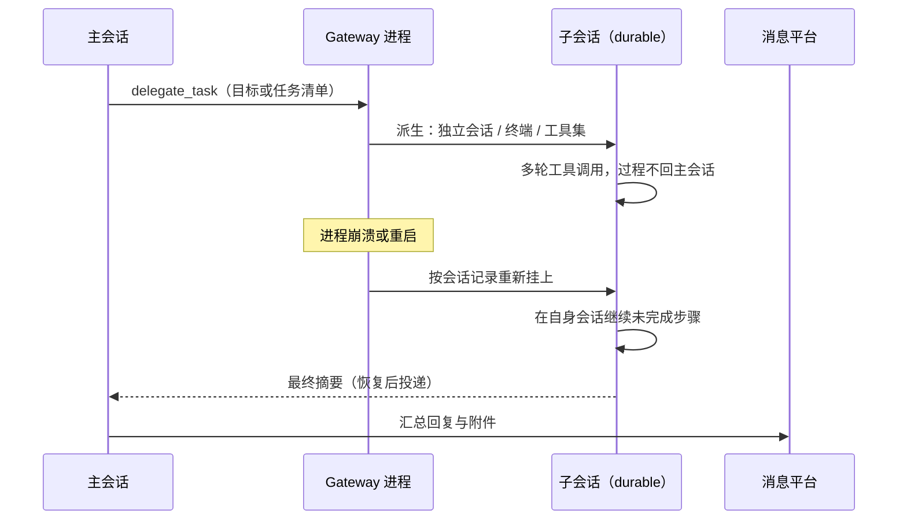
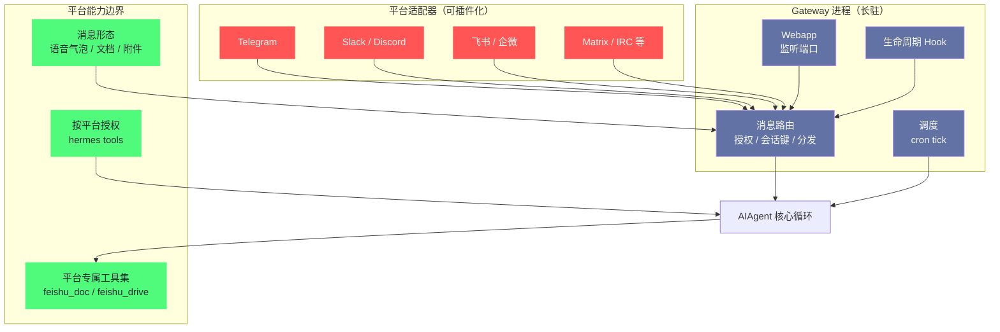

# 03 架构总览——AIAgent 核心循环与子系统

**摘要：**

Hermes Agent 被人记住的通常是能力清单：住在服务器上、从二十多个消息平台接入、把经验固化成技能、换模型不改配置。能力越多，越容易让人以为核心循环也越厚，可把代码摊开来看，真正驱动每一轮对话的那条循环短得可以一屏写完——组装提示、调用模型、执行工具、把结果塞回上下文、再调用一次。本文要回答的正是这一处反差带来的两个问题：这么强的能力凭什么能塞进一个可自托管的进程，以及这份能力最终把账单开在了哪里。全文按五问推进：三层架构各是什么，复杂度为什么被推到边界，抽掉分层会退化成什么样，扩展点与关键配置怎么落地，以及这套结构在高并发会话、长任务与多租户面前从哪里开始失效。途中用五张图拆开三层架构与请求流、三层 Prompt 的拼装顺序、一次任务在主循环里的状态流转与审批插入点、子代理在 v0.23.x 的 durable 生命周期，以及 Gateway 作为插件宿主的结构；另用表格列出三层边界、三种调用格式、Prompt 分层的缓存代价、主会话与子代理的能力差异、三类入口的差异、扩展点清单与已知架构债务，再用三条可观察的先兆收束失效边界。读完应当能自己回答一句：这套架构买的到底是什么。

---

## 第 1 章 一条消息要穿过几道边界

### 1.1 凌晨两点的那条消息

笔者先摆一个贯穿全篇的场景。凌晨两点，值班群里丢进来一句话：staging 上那个反复重启的 pod 查一下，结论发回群里。这句话落在某个消息平台上，由网关的适配器接住并转成内部事件；路由层先确认发信人在授权名单里，再按平台与频道算出一个会话键，把键对应的历史取出来；核心代理层拿到这段历史，拼出三层系统提示，选出当前配置里的模型与凭据，发出第一次请求；模型回的不是结论，而是一组工具调用——读部署清单、拉容器日志、查节点事件；这些调用经工具注册表分发，落到执行后端层的终端环境里跑，结果被包装成消息回注上下文，循环再转一圈。等模型终于给出结论，投递层把结论连同报告文件送回群里；与此同时，后台还有一条不阻塞对话的复盘在跑，判断这次排查值不值得固化成技能或记忆。

这条路径上有三处容易被略过的地方。平台适配器只负责把外部世界的消息形态翻译成内部事件，它不知道模型是谁、工具怎么调；工具执行的落点在终端环境里，不在这台机器的宿主文件系统上——除非某个环境被显式声明为直接使用宿主文件系统；审批插在工具分发之后、真正执行之前，命中敏感标记的命令要先过一道独立审查。三处分别对应界面层、执行后端层与核心代理层的策略面，也就是这一篇要拆的三层。

### 1.2 三层与两条分界线

三层的划分在架构文章里快被写滥了，但 Hermes 的这三层值得认真对待，因为它们的边界上真有一条可执行的契约，而不只是框图里的一条线。界面层承担"把人的意图变成一段输入、把一段输出变成人能读的东西"：CLI、TUI、Dashboard、消息平台，以及 v0.23.x 起由网关自带的 Webapp，都落在这层；它们之间的差异是交互形态，不是智能。核心代理层承担"一次对话怎么走完"：循环本身、三层提示的组装、会话持久化、工具注册与分发、模型与凭据的解析，以及审批、压缩、回退这些策略；这层对外只暴露两三个动作——把一段输入推进去，把一段输出取出来，中间过程以事件流吐给界面层。执行后端层承担"动作真的发生"：命令在哪台机器、哪个容器、哪个沙箱里跑，文件系统看到的是哪一份，进程在会话结束之后还活不活；这层的可替换性最强，也最容易被当成附属品，但它决定了整套系统能部署在什么环境里——一台五美元的 VPS、一台装了 Docker 的办公机，还是一个按秒计费的云沙箱。

| 层 | 承担什么 | 不承担什么 | 对外契约 | 典型实现 |
| :--- | :--- | :--- | :--- | :--- |
| 界面层 | 输入采集、输出渲染、附件处理、平台鉴权入口 | 对话状态、工具选择、记忆写入 | 一段输入加会话键；一段可投递消息加附件 | CLI、TUI、Dashboard、消息平台适配器、Webapp |
| 核心代理层 | 循环推进、提示组装、工具分发、会话持久化、审批与压缩策略 | 平台协议细节、沙箱实现 | 推进一轮对话；吐出事件流 | AIAgent 循环、PromptBuilder、工具注册表、Provider 解析 |
| 执行后端层 | 命令执行、文件可见性、进程与沙箱生命周期 | 任务语义、模型选择 | 执行与清理两个动作 | local、Docker、SSH、Daytona、Modal、Vercel Sandbox、Singularity |

两条分界线值得单独说。界面层与核心层之间的分界线，本质是输入输出的形状：界面层只能送进来一段文本（可带附件）与一个会话标识，核心层只能送出去一段可投递的消息与若干附件；这条线一旦被越过，譬如某个适配器开始自己判断"这条消息该不该写进记忆"，跨平台的一致就守不住了。核心层与执行后端层之间的分界线，本质是动作的抽象：核心层只知道要执行一条命令、读一个文件，不知道命令落在哪个后端；这条线被越过的方式通常是某个工具偷偷调了宿主机的 API。

层的数量本身也值得交代。把界面层与核心层合并看起来可行——都是"处理一次输入输出"，可消息平台的异步性会把"等模型"与"等用户"混进同一条路径，一个进程里同时挂着几百个等待中的会话，状态就该爆了；把策略层单独抽成第四层也说得通，审批、压缩、回退确实是三种独立判断，但它们都要读循环内部的中间态，抽出去就得复制一份状态，第四层的边界上立刻出现两份真相。三层是这条线上的折中：少一层则职责混，多一层则状态重。

两条线之所以重要，是因为它们决定了"换一个部件要改几处"。这个判据在后面每一章都会出现一次。

### 1.3 核心循环到底有多短

把循环单独拎出来，骨架只有五个动作：组装提示，解析模型与凭据，发一次请求，响应里带工具调用就分发执行并把结果回注，然后回到发请求这一步，直到响应里不再有工具调用。这条循环在官方语境里叫 thinking-act loop，中文一般译作思考—行动循环。写成伪代码，大概是这样：

```python
# 循环只负责推进；所有“怎么选、怎么执行、要不要拦”都推给被调用的策略与工具层
while True:
    system = build_prompt(stable, context, volatile)   # 三层拼装，顺序即缓存边界
    reply = call_model(system, history, tools)         # 用哪种协议由解析层决定
    if not reply.tool_calls:
        break
    for call in reply.tool_calls:
        history.append(dispatch(call))                 # 审批 → 后端执行 → 错误包装
save(session)                                          # 状态落库，与循环无关
```

这段伪代码里没有一处按提供商展开的分支，没有一处按平台展开的分支，更没有按工具名排开的长 if。这正是分层的收益：循环只依赖两个假设——模型会返回工具调用，工具能被分发；其余一切都留在边界之外。换模型不用改这十几行，换后端不用改，加一个平台也不用改。不过短不等于简单，循环短，是因为它把复杂度推给了边界；复杂度没有消失，只是被组织成了接口。**把复杂度推给边界**是全文的第一个论点，也是理解后面所有争议的前提。

### 1.4 总机与接线员

打个比方。这套结构像一栋大楼的电话总机：接线员只做三件事——接起、转接、回报；他不需要知道电话线是铜线还是光纤，也不需要知道对方讲哪国语言；线路换了、语言换了，要培训的是线路工程师与翻译，不是接线员。界面层是各楼层的分机与翻译，核心层是总机，执行后端层是外面的线路与机房。

比喻要跟一句限定，否则容易失真。总机不关心通话内容，核心循环却必须关心——它得判断模型返回的是不是一个工具调用、结果该以什么形状回注；换句话说，接线员虽然不修线路，但他得懂通话协议。真正被推到边界上的，是"线路怎么铺、语言怎么翻、对方用什么设备"，不是"这一轮对话怎么继续"。限定之后，比喻才可用：判断一个新需求该加在哪一层，只要问一句——它是在换线路、换语言，还是在改通话规则；换线路加后端，换语言加适配器，改通话规则才轮到核心。

### 1.5 三层架构与请求流

把三层与它们之间的往返画在一起，能看清每一层各自接收什么、交出什么。



图里有三处值得停一眼。界面层到核心层画成单向箭头，是因为输入输出的形状固定，界面层不会反向驱动循环的内部状态；核心层与执行后端层之间画成双向，是因为工具调用本身是一次往返——请求出去、结果回来，失败与超时也在这条线上。策略面被单独画成一个框，是因为审批、压缩、回退虽然跑在核心层，但它们决定的是"这一轮要不要继续、结果要不要采信"，与"怎么调用"是两种判断。

---

## 第 2 章 为什么复杂度被推到边界

### 2.1 三种变化频率

Hermes 从 2025 年开源走到 2026 年 11 月的 v0.23.2，这条版本线上有三类东西在以完全不同的节奏变化。模型与提供商最快：v0.14 时期的公开口径已经是三十多家提供商，此后 OpenRouter、LM Studio、GMI Cloud、Azure AI Foundry、MiniMax、Tencent Tokenhub 陆续进来，交互式选择器与自检命令也跟着长。平台其次：v0.2.0 的网关只接七个平台，到 2026 年 11 月约二十二个，中间从飞书、企微，到 BlueBubbles、微信、QQBot、Teams、Google Chat、LINE，几乎每个版本都在加；变的也不只是数量，语音气泡、文档与附件的发送方式、已读回执，每一样都要在适配器里落地。执行后端变得最慢，但每加一个都最重：local、Docker、SSH、Daytona、Modal、Vercel Sandbox、Singularity 七种，每一种背后是一套生命周期语义——进程会不会随沙箱销毁、文件会不会保留、清理之后作业还活不活；这些语义不是接口文档能完全盖住的，它们决定"命令跑完之后，世界变成了什么样"。

三种频率摆在一起，分层的第一条理由就出来了：**变化频率不同的东西不该绑在同一处改动**。这条理由有个不太被提的推论——如果三类东西以同一频率变化，分层就是纯开销。Hermes 分层划算，恰恰因为它服务的三个外部世界变化得足够不同步。

### 2.2 换模型不改循环

核心层里有一层 Provider 解析，做的是把（provider, model）这个二元组映射成调用格式、凭据与端点，看着只是查表，实际承担了行业里最脏的活。调用格式是第一种脏：市面上至少三套协议并存——Chat Completions 兼容格式、Responses 风格、Anthropic 的 Messages；统一压成一套当然更省事，但压的过程会丢东西，前缀缓存的断点、状态化会话的句柄、工具调用的并行语义，在转换里要么走样要么消失。Hermes 让三套格式各自原生，循环下游因此要处理三种响应形状，换来的是工具调用这条最关键的路径不被转换层磨损。

| 调用格式 | 代表后端 | 统一转换会丢什么 |
| :--- | :--- | :--- |
| Chat Completions 兼容 | OpenAI 兼容端点、OpenRouter、多数自建网关 | 相对最少，它本身是事实标准 |
| Responses 风格 | OpenAI 的 Responses 系列 | 状态化会话句柄、内置工具的语义 |
| Messages 风格 | Anthropic 的 Claude 系列 | 前缀缓存断点、思考块与内容块结构 |

凭据是第二种脏：密钥可能来自环境变量、配置文件，也可能来自 Bitwarden 或 1Password 这类可插拔的 SecretSource，以 `op://` 引用在加载时才解析；解析层要归一这三种来源，还要保证密钥不落进日志与配置文件。端点是第三种脏，自托管场景里常见自建网关、反向代理与企业出网策略，端点配置一旦散落，一次连接失败就要翻三个地方。别名解析是第四种脏，也最容易被低估：模型命名混乱是行业性的，同一模型在不同提供商处叫法不同，同一叫法可能指向不同版本，带日期的快照名与滚动名并存。把这团乱麻收在解析层一处，上层就始终面对规范的二元组——**行业级的命名混乱被关进了一个文件**，这是"基础设施替应用隐藏复杂性"最直白的一次落地。

### 2.3 换后端不改工具

执行后端被抽象成一个薄接口，形状只有两个动作：执行与清理。执行把一条命令送进某个环境并取回输出，清理在会话结束或任务完成时把环境收拾掉。**接口越薄，越能被差异极大的后端实现**——七种后端的环境语义差得比很多人想的远，接口薄才留得下这么宽的实现跨度。薄接口背后有两条容易踩的语义。第一条是清理与进程的关系：默认清理之后环境里的进程随沙箱消失，这对本地与容器是对的，对云沙箱却未必——若希望作业在断开后继续跑，就得把"清理时不停止进程"显式声明。第二条是文件可见性：文件工具走的也是执行入口，因此它看到的文件系统与命令看到的同一份，唯一例外是那些显式声明直接用宿主文件系统的环境；这条堵住了一条常见的越权路径——文件读写不会绕过沙箱去摸宿主机。

两条语义解释了"换后端不改工具"为什么成立：工具只依赖"执行一条命令"与"读写一个文件"，不依赖后端是本地、容器还是云。反过来说，一旦某个工具开始判断"这个后端是不是 Docker"，它就把自己钉死在了部署形态上。

### 2.4 换平台不改核心

网关的定位在 2026 年变过一次：它不再只是"一个进程跑一堆适配器"，而是插件宿主。平台适配器可以放在核心之外，按插件安装与升级；随核心发布的那些也以插件形式存在，可以按需启停。这次变化的价值不在省代码，而在**平台的数量增长不再受核心发版节奏约束**。适配器的职责被压到极薄：把平台事件翻译成内部事件，把内部响应翻译回平台能渲染的形态；语音要不要转成语音气泡、长文本要不要降级成文档附件、图片会不会被平台二次压缩，判断都留在适配器里。Hermes 给了两个显式标记，一个把音频提升为语音气泡，一个强制以文档发送，动机很实际——某些平台会把图片压到两百 KB 上下、一千二百八十像素宽，报告里的截图压完就看不清了。

平台专属工具集是另一处边界设计。飞书的 doc 与 drive 工具只对特定平台的 handler 暴露，不出现在 CLI 或普通聊天适配器上。这不是藏功能，而是让**能力边界跟着平台边界走**：一个只在群里回消息的机器人，没有理由拿到读整个云文档库的工具。

### 2.5 不这样会怎样：三个反事实

把分层抽掉，最省事的写法是所有逻辑塞进一条循环：收消息、判断平台、判断模型、拼提示、调模型、执行工具、回消息。前一百行很顺，第一千行开始出现按平台展开的分支，第五千行开始出现按后端展开的分支，到一万行时，加一个平台要先读懂六个 if。公开 review 记录的原核心文件是一万零六百行，那就是这条路走到尽头的形状——它的问题不是丑，而是回归面积：任何改动都可能影响全部入口，测试要按入口乘平台乘后端铺开，而人只有一双手。

第二处反事实更贵，因为代价直接落在账单上。假设系统提示不分层，每轮把人格、规则、工具指导、技能索引、上下文、记忆、时间戳一起拼成一大段发出去，功能上没问题，成本上问题很大：**前缀缓存要求每轮请求的开头逐字节相同**，而时间戳与记忆摘要每轮都变，于是整段前缀一次也命中不了。分层做的就是把不变的固定在前面、会变的推到后面，让缓存断点落在稳定段的末尾。

第三处反事实关系到部署形态。终端执行若写死成本地 shell，就只能跑在"愿意让 Agent 直接操作自己机器"的场景；企业里常见的诉求是"命令必须落在隔离容器"或"只能走 SSH 到跳板机"，写死本地等于把这两类场景排除。反过来写死 Docker，个人在五美元 VPS 上要先装容器运行时，门槛立刻抬高。可插拔后端的价值不是"支持七种"，而是部署形态不写进核心。

---

## 第 3 章 三层 Prompt 与每会话一个缓存时钟

### 3.1 stable、context 与 volatile

系统提示被拆成三层，落在一个专门的文件里，官方给出的划分是稳定人格与规则、会话上下文、易变状态；每一层具体装哪些块，随版本与配置变化，官方没有给出固定清单。从实现取向看，stable 层装的是那些"整个部署期间都不太变"的东西：身份与人格、行为规则、工具使用指导，以及技能的目录——目录只放名字与描述，量级在三千 token 上下，具体数字随技能数量变化，正文要等按需加载时才进上下文。context 层装的是"随会话而变"的东西：工作目录与路径约定、被引用进来或按需注入的上下文文件、按可用工具集条件激活的技能提示。volatile 层装的是"每轮都可能变"的东西：时间戳、记忆的当前快照、运行状态（当前模型、审批模式、来自哪个平台）。

三层不是三个文件，而是同一次拼装里的三段顺序。顺序在 stable 在前、volatile 在后，这个排列不是文风问题，它直接决定缓存能不能命中。

### 3.2 顺序就是账单

| 层 | 典型内容 | 变化频率 | 对前缀缓存的影响 | 放错的代价 |
| :--- | :--- | :--- | :--- | :--- |
| stable | 人格、规则、工具指导、技能目录 | 仅随配置或技能增删变化 | 缓存的主体，越稳定越省 | 混进一个每轮都变的块，整段前缀作废 |
| context | 会话上下文、引用文件、条件激活的技能 | 随会话演进 | 中段，会话内多数轮次可复用 | 放太稳定的内容拖低命中，放易变内容切断中段 |
| volatile | 时间戳、记忆快照、运行状态 | 每轮可能变 | 排在断点之后，不参与前缀复用 | 排到最前，等于放弃缓存 |

顺序表里有一处不太直观：记忆为什么放在 volatile，而不是 stable？记忆的稳定是"跨会话"的稳定，不是"跨轮次"的稳定——一次对话里记忆可能被写回、被压缩、被重新摘要，任何一次写回都会让这一段变化，把它放在 volatile，等于承认它会变，并把它安排在断点之后。另一处不直观的是技能目录：技能是 Agent 最贵重的资产，直觉上该放最显眼的位置，但它以目录形态待在 stable 层里，正文按需加载，同时满足两个目标——目录不变，缓存友好；正文按需，上下文不爆。

把拼装顺序与两条缓存边界画在一起，是这样：



两条虚线是全篇最贵的一处安排：断点之前的字节可以复用，断点之后的字节每轮重算。把一段本可稳定的内容挪到断点之后，等于自愿为它每一轮付一次全价；把一段每轮都变的内容挪到断点之前，等于让后面所有内容一起失效。

### 3.3 每会话一个 prompt-cache 时钟

v0.23.x 的发布说明里有一条很小、却很能说明设计取向的变更：每个会话各持一个 prompt-cache 时钟。在它之前，缓存有效期更容易做成进程级或全局的一件事——一个计时器管所有会话；之后，计时归到会话这一层。为什么粒度值得单独改一次？因为缓存前缀本来就是按会话拼的：两个会话即使共用同一套 stable 层，它们的 context 与 volatile 也不同，缓存条目天然按会话分片。用一个全局时钟去管分片缓存，会出现两种浪费——某个长会话的缓存还有效，却因为别的会话触发了刷新而被一起清掉；或者缓存已经过期，计时器还没走到点，后续请求带着过期前缀白跑一趟。**时钟下沉到会话**，等于让"何时该刷新"与"谁的缓存"对齐。

官方没有给出这个时钟的具体时长与刷新策略，能确定的是它的粒度：会话。粒度这件事在架构上往往比参数值更重要——参数可以调，粒度错了就要改结构。

### 3.4 静默退化

前缀缓存的收益有多实在，取决于两件事：稳定段有多长，以及它被复用的次数。长驻 Agent 恰好把两个条件都占满了——stable 层动辄几千 token，一个会话几十轮，跨会话还能复用同一份人格与工具指导。反过来，如果每轮都在 stable 段里塞一个时间戳，收益立刻归零，而且不会有任何报错：账单涨了，功能一切正常。这种**静默退化**是 Prompt 分层最值得警惕的地方，它不像工具调用失败那样有明确信号，只表现为每百万 token 的单价比别人高；多数 Agent 的成本事故，根因不是模型选贵了，而是提示里混进了每轮都变的东西。

上下文总会有装满的时候。策略层的做法是在超过阈值之后，对中间的对话轮次做有损摘要，把摘要留在上下文里，让原始记录留在会话库里仍然可被检索；压缩只作用于"送给模型的那一份"，不改写"系统记得的那一份"。这条分工解决的是信息不能因为压缩而永久消失的问题——摘要服务于这一轮的推理，原文服务于三个月后的检索；压缩与召回由独立组件承担，具体实现随版本变化，公开架构文档没有展开细节。

---

## 第 4 章 一次任务在主循环里的流转

### 4.1 一轮的五个动作

一次完整的轮次可以拆成五个动作：组装三层提示，解析当前该用的模型与凭据，发出请求，判断响应里有没有工具调用并分发执行，把结果回注为一条新消息，然后回到请求这一步。五个动作里只有第三个在等外部世界，其余四个都在本地完成；等待模型响应是整条循环里唯一的长尾，因此超时、重试、回退全都围在它周围。工具执行也可能长尾，但它有明确的进程边界，可以杀、可以限时、可以挪到后台。

把这条流转画成状态图，审批的插入点就看得见了：



状态图里唯一的回边是"回注到请求"，这就是 thinking-act loop 的全部：模型说要做，系统去做，做完把结果告诉它，它再说下一步。所有看起来复杂的行为——多步排查、写文件、跑测试、修错——都是这条回边转出来的。

### 4.2 审批插在哪里

审批的位置很关键：它插在"决定要执行"和"真的执行"之间，而不是插在模型调用之前。这个位置决定了它能看到什么——它看到的是具体命令与参数，不是模型对意图的文字描述。**看见命令而不是意图**，是审批能有效的全部前提：模型可以把自己的意图说得毫无风险，但它改不了要执行的字符串。v0.19 起智能审批成为默认，敏感命令不再逐条弹给人看，而是交给一个独立的 LLM 审查器评估；这里有个容易误读的细节——审查粒度是单条命令，一条通过不构成对后续同类命令的授权，下一条还要各自审。这个设计拒绝了"记住我的选择"这种便利，换来的是**每一条命令都有独立的判断记录**。

配套的两件东西是 deny 规则与 `/deny <reason>`。前者是用户定义的硬拦截，即使开了最宽松的模式也照样拦；后者让用户把拒绝的理由告诉 Agent，让它知道下一步该换做法而不是原样重试——把"拒绝"从一个布尔值变成一条带理由的反馈，是审批系统里性价比很高的一处改进。审批还有一处与架构强相关的边界：它对无人值守场景不友好。定时任务、长任务、深夜批量作业，每一条敏感命令都要过一次审查器，审查器本身又是一次模型调用，它带来延迟、成本与新的失败点。

还有一处与入口结构相关的差异：同步入口能打断，异步入口不能。CLI 里用户看到第一步方向不对，可以立刻中断，中断在实现上是取消当前请求加上丢弃尚未提交的工具结果；消息平台上的用户发完就离开，打断只能靠再发一条消息，而那条消息要等当前轮次结束才被读到。同一个"中断"诉求在两种入口里落在完全不同的位置，这也解释了界面层为什么不能替核心层做决策——它不知道自己有没有能力打断。

### 4.3 重试、回退与就绪检查

模型调用失败的处理分两层：同一提供商内的重试，处理网络抖动与限流；跨提供商的回退，处理整个提供商不可用。回退链是一条有序候选表，v0.23.x 给了它一个专门的就绪检查命令 `hermes fallback check`——检查的不是"链有没有配"，而是"链上的候选此刻是否可用、凭据是否就位"。这个区别很实际：一条配置正确的回退链，可能有三个候选里两个的 key 已经过期。同样属于运维面的还有 `hermes doctor`，它检查整套运行时依赖与配置的自洽性；把两个命令放在一起看，能看出一个取向——自托管系统的自检必须做进产品，不能指望用户去看日志猜。

`hermes update --force` 是同一族的第三条命令，它的存在说明自动更新并非无条件成功，版本判定、依赖锁定、安装脚本都可能在某个环境里卡住，`--force` 是留给卡住的人的一扇门。架构上它很小，运维上它很关键：一个装不上新版的 Agent 会迅速落后于平台侧的变化，而平台侧是本文里变化最快的一类东西。

### 4.4 结果回注与注入面

工具结果以消息形式回注上下文，这一步看着平淡，实则是整套系统**最大的注入面**。命令输出、文件内容、网页正文都来自外部世界，里面可以藏任何东西，包括"忽略之前的指令"这句话。v0.15 起 Hermes 在三个关键位置拦这类提示注入，官方用 Promptware 这一类攻击链路解释这道防线的来由，思路是在内容进入模型上下文之前设卡，而不是指望模型自己有免疫力。错误包装是同一处的另一半：工具失败时若原样把堆栈抛进上下文，模型会被无效信息带偏，甚至把错误文本里的内容当成指令；统一包装做的是把事故现场翻译成受控描述，让模型看到"命令超时，退出码 124"，而不是三百行堆栈。

---

## 第 5 章 子代理：从进程内委派到 durable 生命周期

### 5.1 delegate_task 的原始语义

`delegate_task` 是核心层里唯一一个把并行引入单线程循环的工具。它的原始语义很朴素：模型判断一个任务可以拆，就调用它派生一个子代理；子代理有自己的会话、自己的终端、自己的工具集，跑完只把最终摘要回给主会话，中间过程不占主会话的上下文。它支持单任务（给一个目标）与并行批量（给一组任务），并受层数与并发上限约束。这套语义解决了一个具体矛盾：主会话的上下文是稀缺资源，而子任务的过程往往又长又脏——几十次工具调用、几万 token 输出，全留在主会话里会把上下文顶爆，也会让后续推理被噪音污染。**把过程关在子会话里，只把结论拿回来**，是上下文预算意义上的一次分包。

### 5.2 durable 这一句改了什么

v0.23.x 对这条设计的改动只有一句：持久子代理（durable subagents），子代理可以在 gateway 重启或崩溃后存活，并能在自己的会话上继续。这句话把子代理从"父进程内存里的一个任务"变成了"一份有独立生命周期的会话"。它为什么重要？因为旧语义里子代理的寿命被父进程框住：gateway 一重启，所有在跑的子代理一起消失，长任务最容易死在这个时刻——恰恰是跑了最久、产出最多的那些。durable 之后，**重启不再等于清零**，恢复的动作变成"按会话记录重新挂上"，子代理在原来的会话里接着往下走。能确定的是语义，不确定的是实现：官方没有展开说明状态落盘的时机、恢复时如何判定哪些步骤已经执行过、主会话重启后结果如何归属；这几处正是下面要算的账。

把派生、崩溃与恢复画成时序，是这样：



### 5.3 主会话与子代理差在哪

| 维度 | 主会话 | 进程内子代理（旧语义） | durable 子代理（v0.23.x） |
| :--- | :--- | :--- | :--- |
| 会话记录 | 与平台和会话键绑定 | 独立会话 | 独立会话，且跨进程存活 |
| 上下文窗口 | 承载全部对话历史 | 只装子任务 | 只装子任务，重启后恢复 |
| 终端与工具集 | 按平台授权 | 独立终端与独立工具集 | 同左，寿命不再随父进程 |
| 审批 | 在主会话里过 | 在子会话里过 | 重启后仍需各自复审 |
| 崩溃影响 | 会话本身可恢复 | 子任务丢失 | 子任务可续跑 |
| 结果交付 | 直接回平台 | 最终摘要回主会话 | 恢复后回投，需防重复 |
| 成本归集 | 记在主会话 | 记在调用点 | 记在子会话，跨重启累加 |

### 5.4 durable 带来的三笔新账

第一笔是归属与谱系。会话从"一条线"变成"一张网"，检索、清理、审计都要回答"子会话的父是谁、父没了子怎么办"，而这一步在旧语义里根本不存在，因为子代理的生命周期被父进程兜住了。第二笔是交付幂等：崩溃点可能落在"子代理算完"与"主会话收到"之间，恢复后可能重复投递，投递层需要一个去重键；更麻烦的是工具调用的中间态——命令已经发出、结果还没回写时崩溃，恢复后不能盲目重放，因为有的命令不幂等，发消息、转账、删文件都属于这一类。

第三笔是成本归集。durable 子代理的 token 消耗记在子会话上，跨重启累加，预算告警必须按会话树汇总而不是按进程汇总；一个跑了三次重启的调研任务，账单分散在三个时间片里，按进程看会严重低估。这三笔账都不在"让子代理活下来"这句话里，但它们是让子代理活下来必须付的。

### 5.5 反事实与边界

没有 durable 的子代理，在"长任务加常重启"的组合下几乎不可用：一个跑四十分钟的调研任务，gateway 每升级一次就死一次；用户看到的是"又没了"，模型看到的是"任务未完成"，中间已经花掉的 token 不会退。反过来，durable 也不是免费的，它把进程内状态变成持久状态，持久状态就要面对版本迁移、并发写、垃圾回收这些老问题。更根本的一点是：**durable 只解决"活着"，不解决"值得活"**——子代理重启后继续跑，如果方向本来就错了，续跑只是把错误延长，所以恢复逻辑里"要不要继续"的判断，比"怎么继续"更难。

---

## 第 6 章 Gateway：插件宿主与平台适配层

### 6.1 从七个到二十二个

网关的起点很小：v0.2.0 只接七个平台——Telegram、Discord、Slack、WhatsApp、Signal、Email 与 CLI。之后几乎每个版本都在加：v0.6.0 起飞书与企微，v0.9.0 加 BlueBubbles 与微信，v0.11.0 加 QQBot，v0.12.0 的 Teams 是第一个由插件交付的平台，v0.13 的 Google Chat 是第二十个、也是插件，v0.14 再加 LINE。到 2026 年 11 月，公开口径是约二十二个平台或适配器。数量本身不是重点，重点是它们怎么被接进来：早期是核心仓库里的适配器文件，随核心发版；后来一部分移成插件，随插件独立安装与升级。

哪些平台进内置、哪些进插件，划分标准不是流行度。按仓库目录的划分，Telegram、Slack、Discord 这些最流行的反而在插件侧，Signal、微信、QQBot 在内置侧；更合理的解释是变更频率与依赖重量——内置适配器要跟随核心发版，适合依赖轻、接口稳定的平台；插件可以独立演化，适合依赖重或 API 频繁变动的平台。**划界的依据是变更频率，不是平台的名气**，这条判断比"怎么写插件"更难，也更能决定三年后的维护成本。

网关进程同时承担四件事：消息路由（授权、会话键解析、事件分发）、调度（cron 的 tick 挂在它身上）、生命周期 Hook（会话开始、结束、重置时触发插件回调），以及 Webapp 的托管。四件事共用一个进程，这个选择让部署简单到"起一个进程"，也让它成为整套系统的单点——它停了，消息不收、定时任务不跑、Webapp 打不开。

### 6.2 插件宿主与适配层

把网关的四项职责、适配器与平台能力边界画在一起，能看清谁连着谁。



图里最该多看一眼的是两条箭头：适配器只连到路由，不连到核心循环。平台要想绕过路由直接和循环说话，就没有地方插授权与会话键解析；而平台专属工具集反过来从核心接到能力边界，说明"能做什么"由核心按授权决定，不由适配器说了算。

### 6.3 适配器薄到什么程度

适配器不认识模型，不碰工具，不做会话决策；它只做两件事：把平台事件翻译成内部事件，把内部响应翻译成平台能渲染的形态。消息形态的差异全在这一层：某些平台支持语音气泡，SMS 没有独立文档通道、只能退回附件机制，另一些平台会对图片做激进压缩。这条纪律的价值在演进成本上：二十二个平台意味着二十二个会独立变化的外部依赖，平台改 API、改鉴权、改消息格式，适配器就得跟着改；如果业务逻辑散落在适配器里，每次平台变更都要回归业务，把适配器压到只做格式转换，变更的影响面就被锁在转换层。

平台专属工具集则解决"能力与场景错配"。同一个实例在 CLI 上可以给全套工具，在钉钉群机器人上只给搜索与读文件，两处互不影响；工具集能按平台分别授权，靠的是 `hermes tools` 这套配置。一个只在群里回消息的机器人拿到全盘文件读写权限，风险与收益完全不成比例，能力授权按平台切分，是最省事的一道边界。

三类入口的差异可以收在一张表里，它们最终都汇到同一条循环，分歧全在入口特性上。

| 入口 | 会话历史 | 身份与授权 | 打断能力 | 主要失败形态 |
| :--- | :--- | :--- | :--- | :--- |
| CLI 与 TUI | 本地会话，可续可翻 | 能坐在终端前即视为授权 | 立即打断当前轮次 | 终端断连，会话可恢复 |
| 消息平台 | 按平台与会话键隔离 | 授权名单与配对流程 | 只能再发一条排队消息 | 平台改 API，适配器先失效 |
| 定时任务 | 无历史，可注入技能 | 创建时确定投递目标 | 无 | 调度器停摆，任务静默不跑 |

### 6.4 Webapp：界面层的第三类前端

v0.23.x 给网关加了一个浏览器入口：`hermes webapp`，从网关监听的端口打开，支持局域网访问，也支持用自己的 URL 经 Nous 登录。表面看这只是多了一个前端，架构上的意义更大——界面层原本是"终端加消息平台"两类，现在多了第三类，而核心代理层一行没改。这也是检验分层是否真的成立的试金石：加一个全新的前端，如果只需要在界面层加一个适配器、核心层不动，分层就是有效的；如果加前端要顺手改循环，分层就只画在图上。

不过 Webapp 把网关的单点属性又加重了一层。消息收不到只是"这一个平台不通"，Webapp 打不开则是"所有图形界面一起不可用"，而它的可用性取决于同一个进程。这个代价在自托管场景里可以接受——一个进程便于备份、迁移与排障，重启一次也就几秒；但如果把它当成团队级门户来用，单进程就从"简单"变成了"脆弱"。

---

## 第 7 章 扩展点与关键配置

### 7.1 七个扩展点

Hermes 的可替换性不是口号，它落在一组具体接口上。把接口、入口与"换掉它意味着什么"列成一张表，比记目录结构有用得多。

| 扩展点 | 接口形态 | 入口 | 换掉它意味着什么 |
| :--- | :--- | :--- | :--- |
| 工具与工具集 | 自注册加 toolset 分组 | `hermes tools` | 能力清单与平台授权矩阵一起变 |
| 技能 | SKILL.md 加渐进式加载（agentskills.io 兼容） | `~/.hermes/skills`、`hermes skills` | 程序性知识，写入即生效 |
| 插件 | 注册工具、命令与 Hook | `hermes plugins` | 生命周期与请求级钩子 |
| 记忆后端 | Memory Provider 接口 | 配置切换 | 记忆的存储、检索与建模方式 |
| 上下文策略 | 压缩与召回策略 | 插件 | 上下文预算的用法 |
| 终端环境 | 执行与清理两个动作 | 配置或自定义 provider | 命令落在哪、文件可见性 |
| 平台适配器 | 事件与消息转换 | 插件 | 能出现在哪些平台 |

### 7.2 关键配置都在调边界

常用配置项有一个共同点：它们调的都是边界，不是循环。`container_persistent` 决定云沙箱在会话结束之后是否保留文件，调的是后端的生命周期语义；`terminal.docker_env` 与 `terminal.docker_forward_env` 一对，前者写入配置里的字面键值，后者从 shell 或 `~/.hermes/.env` 转发，密钥因此不必写在配置文件里；`terminal.docker_extra_args` 用来透传 `--gpus`、`--network` 这类参数；`terminal.env_passthrough` 控制哪些环境变量能进沙箱；`skills.external_dirs` 用 `~` 与 `${VAR}` 展开加外部技能目录，本地同名优先，但外部目录不构成写保护边界。**配置项的位置本身就是分层是否干净的证据**：如果一个常用诉求必须改循环才能满足，说明边界划错了地方。

### 7.3 最小配方与自检

官方给过一份"最小可控 Agent"的配方：文件操作加终端两个工具集就能跑起来，联网、浏览器、代码执行、视觉、记忆、委派、定时任务、技能、插件、MCP 全部按需开启。这份配方的价值不在省资源，而在把"能力默认关闭"变成可执行的默认值——**默认越少，出事时能归因的范围越小**。运维面则由几条命令支起来：`hermes doctor` 检查运行时与配置的自洽，`hermes fallback check` 检查回退链此刻是否可用，`hermes update --force` 处理卡住的升级，`hermes logs` 看结构化日志（`agent.log` 与 `errors.log`）。启动时还会校验配置结构，畸形 YAML 在启动前就报错——配置错误在启动时报，比在第二天的某次对话里报，排查成本差一个数量级。

---

## 第 8 章 不足与争议：god file 只是换了住址

### 8.1 从一万零六百行说起

v0.14 前后，核心循环从 `run_agent.py` 里拆了出来。公开 review 记录的原核心文件是一万零六百行——一个文件装着提供商选择、提示构造、工具执行、重试、回退、回调、压缩与持久化。拆分的动机不难理解：这个文件是所有改动的交汇点，任何一次提交都要面对它。但拆完之后，账没有消失，公开 review 里能看到的是另一组数字：`gateway/run.py` 约两万一千行，`hermes_cli/web_server.py` 约一万七千行，`cli.py` 约一万六千行，`hermes_cli/main.py` 约一万五千行，`tui_gateway/server.py` 约一万四千行。循环出来了，**god file 只是换了住址**。

| 文件 | 行数量级 | 承担什么 | 影响 |
| :--- | :--- | :--- | :--- |
| `gateway/run.py` | 约 21k | 网关路由、授权、会话、投递、cron tick、Hook | 网关相关改动全在这里排队，review 与冲突面最大 |
| `hermes_cli/web_server.py` | 约 17k | Web 侧接口与页面 | 前后端边界在文件内部，测试隔离困难 |
| `cli.py` | 约 16k | 终端交互、渲染、中断处理 | 交互细节堆积，回归多靠手工 |
| `hermes_cli/main.py` | 约 15k | 全部子命令入口 | 命令注册与实现耦合，加命令先要读懂 |
| `tui_gateway/server.py` | 约 14k | TUI 的网关侧 | 与 `cli.py` 同型复杂度，存在重复实现风险 |

### 8.2 为什么拆不动

拆分失败的原因通常不是懒，而是状态耦合。循环内部有一个跨轮次的状态机：消息历史、工具调用的中间态、重试计数、压缩边界、审批上下文，这些状态在每一步之间流转；把它们拆进多个文件，要么用大量参数传递维持一致性，要么引入一个共享上下文对象，而后者往往只是把耦合从文件之间搬到了对象内部。`gateway/run.py` 的两万一千行同理——它同时管路由、授权、会话、投递与调度，这些职责共享同一份运行时状态，拆开就要先设计一套状态所有权。

这处债务与"分层清晰"并不矛盾，它们是两个不同层次的事实。分层是运行时与接口层的事实：换模型、换后端、换平台确实不用改循环，这一点在前面的章节已经验证；**分层是运行时的事实，解耦是代码组织的事实**——改一个网关内部行为，仍然要在一个两万行的文件里找位置。把这两件事混为一谈，会得出两个都错的结论："分层是假的"，或者"债务不要紧"。

如果真要还债，有两条路线。一条按职责切：把路由、授权、投递、调度从网关文件里拆出去，每条职责有自己的入口与测试；另一条按状态切：先定义一份显式的运行时状态结构，写清谁拥有哪个字段、谁能改，再动手拆文件。前者快、见效早，但容易拆出"文件小了、耦合还在"；后者慢、要先做设计，拆完才是真正解耦。多数项目的经验是两条一起走——先用职责切降低单文件的负担，再用状态切解决跨文件的隐式耦合。

### 8.3 CI 能对冲什么

对冲这笔债务的是工程门禁。CI 大约有二十四个 job：分片测试、ruff、ty 类型检查、Docker 构建与 lint、OSV 漏洞扫描、供应链审计门禁；依赖被精确锁定，每一行都标了 CVE 与供应链理由，这是对"Mini Shai-Hulud"那一类 PyPI 蠕虫的回应。**门禁能买到"没有破坏已知行为"，买不到"改动容易做"**：前者是回归问题，可以靠加测试解决；后者是设计问题，只能靠拆文件解决。一个两万行的文件配上二十四道门禁，结果往往是"不敢改"，而不是"改得对"。

### 8.4 这笔债由谁付

三类人在分摊。贡献者付定位成本——改一处行为要先读完一个两万行文件的相关区段；维护者付冲突成本——两个不相干的 PR 在同一个文件里打架；运维付变更风险——一次看似局部的改动可能带着未覆盖的路径上线。用户不直接付，但用户的等待时间与事故时长里含着它。公允地说，这是"接口分层已完成、模块解耦未完成"的中间态：它不是失败的证据，因为它换来了前面论证的那些可替换性；它也不是终态，因为文件级 god 结构会在功能密度继续上升时变成瓶颈。判断标准可以很具体：新人不读那两万行能不能加一个平台适配器——能，说明分层有效；改一个循环内部缺陷要多久——长，说明解耦未完成。

---

## 第 9 章 边界与反例：这套架构在哪里失效

### 9.1 高并发会话

第一个失效场景是"很多会话同时活跃"。核心循环是同步的——一个会话的一轮处理完，才轮到下一轮，工具执行更是同步等结果；单进程下，一个跑十分钟的终端命令会把后续会话排在后面。这不是实现缺陷，而是选择的代价：同步带来状态简单、调试可控，代价是并发要靠多实例，或者把长任务挪进子代理。每会话一个缓存时钟在会话数上升后还带来第二重压力：缓存条目按会话分片，活跃会话越多，同时存在的缓存前缀越多，命中率与内存占用都会变差，省下来的 token 钱会被缓存管理开销吃掉一部分。第三重压力在会话库：本地单文件库的写入是串行的，会话并发写会排队——对单人自托管这个上限远在天边，对一个小团队共用一个实例，它会先于模型配额成为瓶颈。

有意思的是，每会话一个缓存时钟在多实例部署里反而更合身：会话一旦有粘性、固定落在某个实例上，时钟跟着会话走，就不需要跨实例同步缓存状态；反过来，如果坚持一个全局时钟，多实例之间还要为它选一个协调者。**把状态放在正确的粒度上，往往能顺手解决掉一部分分布式问题**，这是分层设计里最实用的一条经验，也是后面判断"该不该拆"的一个参照。

### 9.2 长任务

第二个失效场景是长任务。同步循环、单条命令审批、模型长尾三者叠加的结果是：任务越长，中间过审的次数越多，被打断的概率越高；任务越长，一次 gateway 重启的损失越大——durable 子代理缓解了后者，但没有改变"审批按条、不按任务"的粒度。更根本的边界在于，这套架构没有把"任务"做成一等公民：会话是一等公民，工具调用是一等公民，子代理在 v0.23 之后也接近一等公民，但一个可以暂停、恢复、查询进度的任务仍然要靠会话去模拟；cron 提供的是定时触发，不是任务编排。长任务真正需要的是队列与状态机，这两样东西目前不在核心层。

### 9.3 多租户隔离

第三个失效场景是多租户。Hermes 的部署假设是**一个实例服务一个人或一个团队**，官方口径里的隔离手段是平台授权（哪些工具对哪个平台可见）与审批（哪些命令要过审），这两样解决的是能力边界，不是数据边界：会话、记忆、技能目录、日志都在同一个 home 下，没有按租户划分的命名空间。要在一个实例上做多租户，等于要求核心层在会话键、记忆读写、技能加载、工具授权四处都带上租户维度，这不是配置能解决的，是数据结构要改。现实的替代方案是"一租户一实例"，代价是资源利用率与运维成本，或者在外面套一层路由把租户映射到不同实例。这条边界值得写清楚，因为它是自托管产品最常见的一处预期错配——用户看到"多平台、多个人能对话"，就以为它是多租户系统；**多用户对话与多租户隔离是两件事**。

### 9.4 三条先兆

什么时候该承认这套架构到了边界？笔者给三条可观察的先兆。

- 单会话延迟开始受其他会话影响，说明同步循环与单进程成了瓶颈，该考虑把执行面拆成队列加 worker。
- 审批次数成为任务时长的主要构成，说明审批粒度与任务粒度不匹配，该把审批从"每条命令"上移到"每个任务"。
- 会话库的备份、清理、迁移开始需要停机窗口，说明状态增长超过了单库的管理能力，该把会话存储换成可水平扩展的形态。

三条先兆对应三种改法，三种改法都要动核心层——它们不是配置问题，是换架构的问题。这也解释了为什么"架构能撑多久"这个问题没有统一答案：它取决于你什么时候开始在这三条曲线上看到拐点。

---

## 第 10 章 账单与落点

回到开头那个问题：这么强的能力为什么能塞进一个可自托管的进程。答案在分层的方式上——核心循环只保留"推进一轮对话"这一件事，把模型差异推给解析层，把后端差异推给执行接口，把平台差异推给适配器，把上下文预算推给三层 Prompt 与压缩策略；循环因此短到一屏写完，而能力可以长到二十多个平台、七种后端、随时可换的模型。**它愿意用"现在麻烦"换"以后可替换"**，换模型不用改循环、换后端不用改工具、换平台不用改核心，这三句话是它买的保险。

账单开在三处。第一处在边界上：每一条分界线都要有契约，契约要维护、要测试、要随外部世界的变化调整，这些成本不会出现在架构图上。第二处在运维面：网关是单点、审批对无人值守不友好、多租户要一租户一实例，这些是自托管形态的固有税。第三处在文件级：接口分层完成了，模块解耦没有，god file 从循环转移到了网关与 CLI，改动的定位成本仍然由贡献者承担。三处账单里，第一处是设计费，第二处是形态费，第三处是历史费——设计费与形态费换来了可替换性，历史费只能靠持续重构慢慢还。

由此可见，架构评价的正确问法不是"它分了几层"，而是"换一个部件要改几处"。分层清晰但文件级解耦未完成，是一个可以接受的中间态，前提是团队清楚自己在为哪些可替换性付费；如果这一点没算清，再漂亮的架构图也只是图纸。至于 v0.23.x 之后这条线往哪走，durable 子代理与 Webapp 已经透露了方向——把越来越多的东西从"进程内"挪到"可恢复的持久状态"，这条路能走多远，目前仍然言之尚早。

> [!info] 专栏导航
> 本文是 [[LLM/Hermes-Agent/00 专栏导览|Hermes Agent 专栏]] 中「核心架构」部分的开篇，读完可继续 [[04 学习闭环——Observe-Distill-Reuse-Refine|学习闭环]]，看后台复盘如何把一次任务沉淀成技能与记忆。

---

## 参考资料

1. Hermes Agent 架构文档. https://hermes-agent.nousresearch.com/docs/developer-guide/architecture
2. Hermes Agent 特性总览. https://hermes-agent.nousresearch.com/docs/user-guide/features/overview
3. Hermes Agent 文档站. https://hermes-agent.nousresearch.com/docs/
4. Nous Research, hermes-agent 仓库（含 v0.23.2 发布说明，2026-11-16）. https://github.com/NousResearch/hermes-agent
5. agentskills.io 开放标准. https://agentskills.io

---

> [!note] 思考题
> 1. 如果要给这套架构加一个"任务"一等公民（可暂停、可查询进度、可重试），你会把它放在核心代理层还是执行后端层？提示：先想清楚"任务"的状态该由谁拥有。
> 2. durable 子代理带来了归属、幂等与成本归集三笔账，你会优先解决哪一笔？提示：从"哪一种错误最难被发现"入手。
> 3. 三层 Prompt 的顺序是为前缀缓存优化的。如果某天所有提供商都支持任意位置、任意粒度的缓存断点，"顺序"这件事还重要吗？提示：想清楚顺序除了缓存还承担了什么。
> 4. 接口分层已完成而文件级解耦未完成，你认为这是应当接受的中间态，还是应当集中偿还的债务？提示：取决于团队规模、发版频率与贡献者数量这三个变量。

> 时效说明：本文事实基线截至 2026-11-19，对应 Hermes Agent v0.23.2（2026-11-16 发布）。该项目的版本号存在双轨写法——`v0.23.2` 与日历式 `v2026.x.y`（如 v2026.4.8 即 v0.8.0），文中统一用 v0.x 口径；平台数、行数与工具集数量随发版变化，引用时请以当次 release 说明为准。