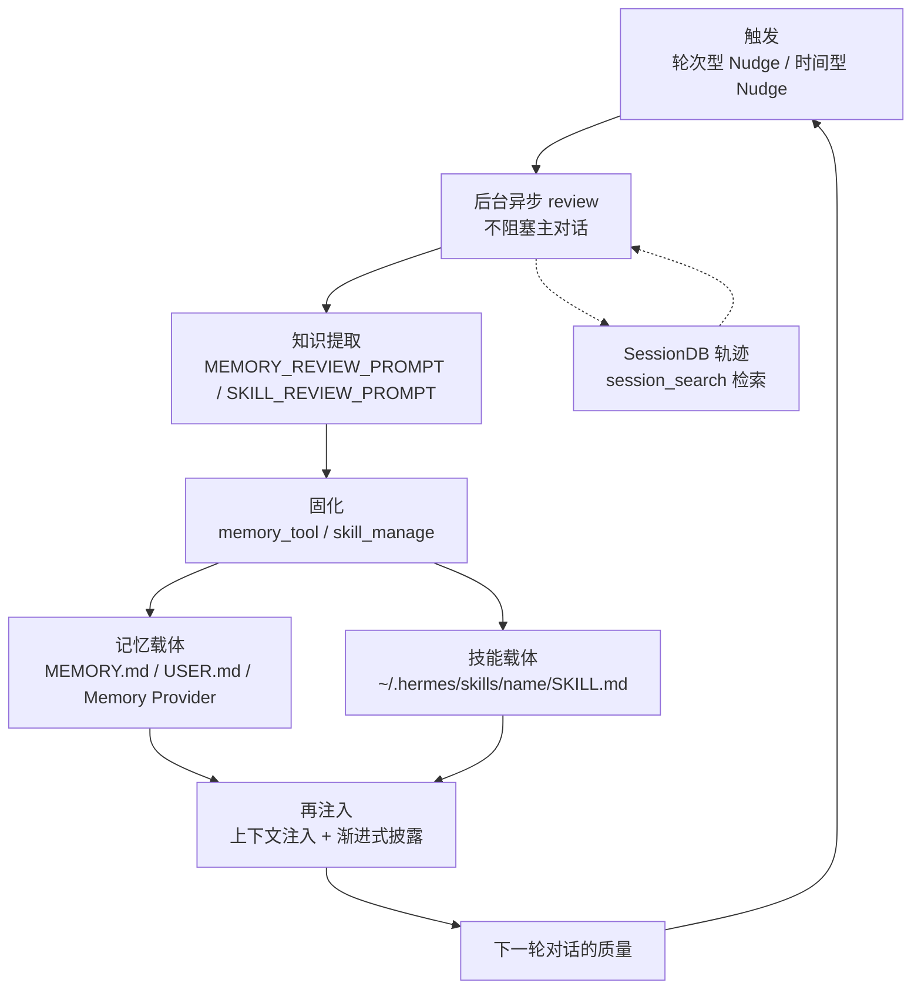
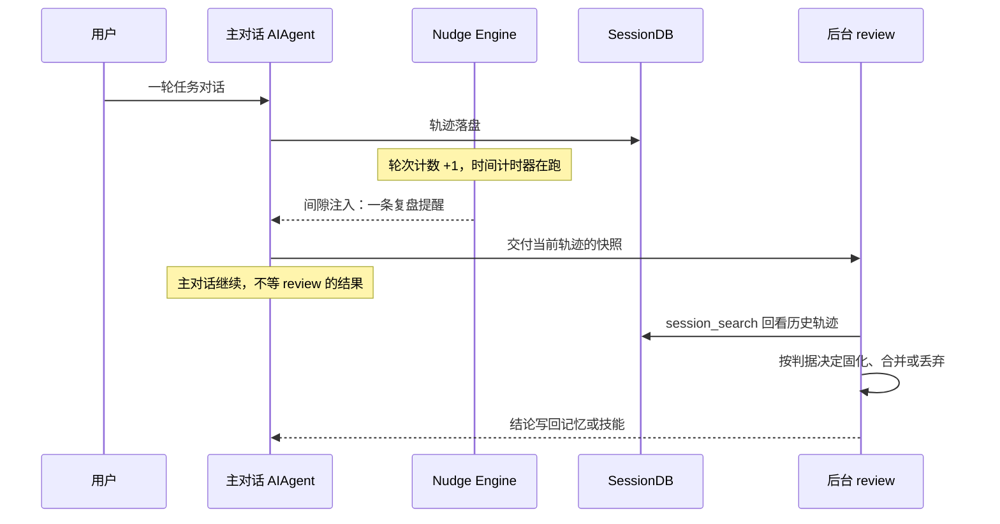
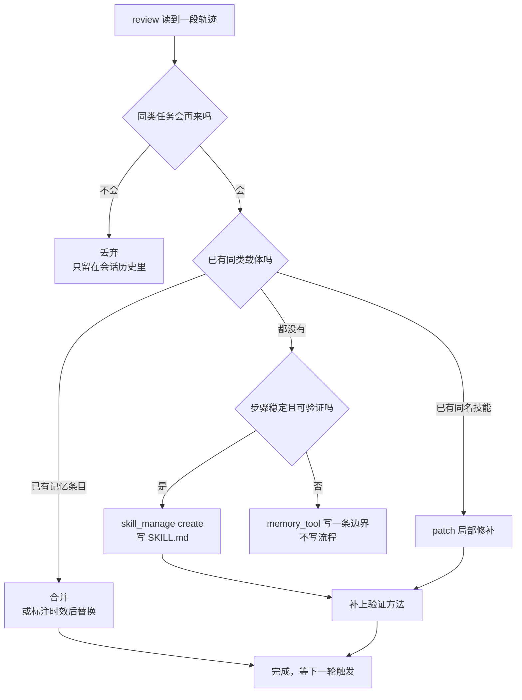
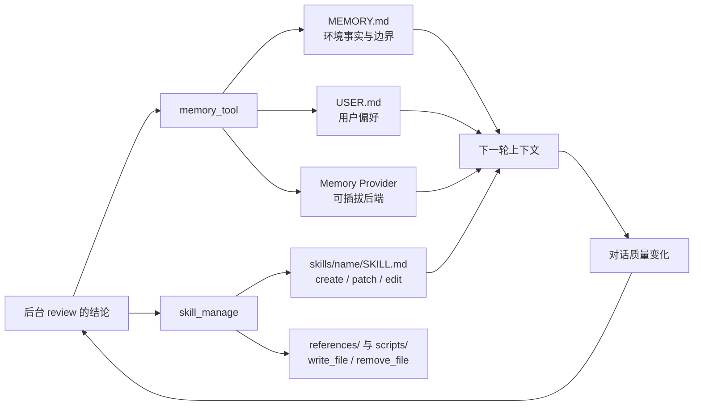
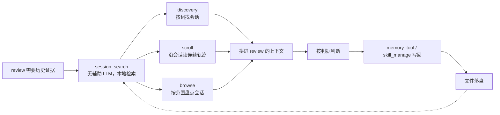

# 04 学习闭环——Observe-Distill-Reuse-Refine

**摘要：**

一个 Agent 用得久了究竟会不会变强，这个问题在 Hermes Agent 里有一个能落到文件路径上的答案：会变强，但变强的是磁盘上的两样东西，不是模型权重。本文把官方口径里那句听起来像宣传语的"闭环学习"（Closed Learning Loop）拆成五段可以逐段验证的机制——两个 Nudge 负责在对话间隙触发，后台异步 review 负责在不打断主对话的前提下复盘，两份报告式 prompt（`MEMORY_REVIEW_PROMPT` 与 `SKILL_REVIEW_PROMPT`）负责判断该提取什么，`memory_tool` 与 `skill_manage` 负责把结论写回记忆与技能两类载体，再靠上下文注入与渐进式披露把写回的东西重新读进下一轮对话。文章按五问推进：闭环是什么、为什么"由人给 agent 写 prompt"这条路走不通、没有固化会退化成什么样、四段机制各自如何落地、以及它在哪些地方付出代价。第四段里有一处 2026 年 5 月的变化必须写进去——`session_search` 在 v0.15.0 被重写成去掉辅助 LLM 的三模式检索，"回头翻自己的历史"从一笔要花钱的账单变成一次约 20 毫秒的本地查询，反思的原材料因此不再稀缺。收尾落在六条边界上：记忆污染、技能膨胀、错误经验被固化、后台 review 的 token 账单、prompt 缓存失效，以及用户纠正与自动学习之间的拉扯。

---

## 第 1 章 学习闭环的位置——模型之外的两类载体

### 1.1 先把范围限死

本文所说的学习闭环，特指 Hermes Agent 在不改动模型权重的前提下，把运行过程中产生的经验写进文件系统、再在后续会话里读回来的那一整套机制。这句话里有一个否定和一个肯定：否定的是微调、RLHF 一类的参数更新路线，肯定的是"经验必须落到磁盘上的某个文件，并且这个文件在下一个会话开始时能被重新读进上下文"。范围一旦这样限死，很多争论就自动消解了——读者不必纠结"它到底有没有在学习"，只需要问"它往哪个文件里写了什么，下一轮又从那里读回了什么"。

这套机制的存在理由，写在官方那句定位里：an autonomous agent that lives on your server, remembers what it learns, and gets more capable the longer it runs。2025 年开源至今，这句话被反复引用，但它其实是一句承诺而不是一份说明书，真正需要拆开看的是 remembers 和 gets more capable 之间那条因果链——记住了什么、记在哪、怎么被下一次用到。本章先回答"记在哪"，后续七章回答"怎么记"与"记错了怎么办"。

Hermes 的答案是两类载体并行：一类是**记忆**，即 `MEMORY.md` 与 `USER.md` 这两个由 Agent 自己维护的文件，或者由 Memory Provider 接管的可插拔后端；另一类是**技能**，即 `~/.hermes/skills/<name>/SKILL.md`，Agent 通过 `skill_manage` 自己创建、修补、重写与删除。前者装的是"这个环境里什么是真的"，后者装的是"这类事情该怎么做"。两类载体的分工看起来很朴素，但后面所有关于污染、膨胀与失效的讨论，根源都在这个二分上——装事实的容器怕过时，装流程的容器怕重复。

### 1.2 两条自改进路线

把 Hermes 的做法放回整个 Agent 领域看，它不是唯一选项。AI 系统的自改进至少有两条路，且两条路的工程性质完全不同。

| 路径 | 改动对象 | 单次代价 | 生效速度 | 出错后的回滚 |
| :--- | :--- | :--- | :--- | :--- |
| 权重更新 | 模型参数 | 训练算力与数据管线 | 月级 | 只能回退到上一个检查点 |
| 程序性记忆积累 | 磁盘上的文本文件 | 一次模型调用的 token | 分钟到天级 | 打开文件改一行 |

权重更新这条路的能力上限最高，模型本身变强了，任何任务都受益；但它的门槛也最高——要有可微调的权重、要有训练数据、要有工程能力把一次训练跑完，而且失败的成本不可逆。程序性记忆这条路的上限低得多，模型一个字都没变，只是多读了几份文件；但它的门槛低到几乎为零，一次调用、一次写文件，错了删掉重写即可。

这里值得停一下，因为很多关于"Agent 会不会自我进化"的争论，本质上是在争论这两条路该不该混为一谈。Hermes 的立场是明确的：自改进发生在模型之外，写在文本文件里，可以被 `cat`、被 `git diff`、被人工编辑。**可审计性不是这条路线的副产品，而是它被选中的主要原因**——如果一个 Agent 的行为会因为学习而改变，使用者至少要有能力看见它改变了什么。

用学徒制打个比方，会更容易记住两条路的区别。权重更新像是给学徒换一副脑子，换完之后整体手艺都提高，但手术不可逆，也不可能只换半个脑子；程序性记忆像是让学徒随身带一本工单本，脑子还是原来那副，簿子却越记越贴合他手上那些活。比喻要立刻加上限定——工单本只能记下他已经看懂的东西，看不懂的部分记了也是死条文，这正是笔者要反复强调提炼质量的原因。

### 1.3 为什么是文件而不是权重

选择文件作为载体，有四笔账要算，四笔都指向同一个方向。

其一是模型无关。Hermes 的一个核心承诺是可以用任何模型，`hermes model` 里切换 provider 是常规操作。若自改进依赖权重更新，那么改进能力只对"可微调的开源模型"成立，闭源前沿模型直接被排除在外，这条承诺当场破产。技能与记忆与模型解耦之后，换模型只影响"提炼得好不好"，不影响"能不能积累"。

其二是可回滚。权重是黑盒，一次训练把行为改坏之后，除了回退检查点几乎没有别的手段，而检查点回退会连带丢掉这段时间里所有正确的改进。文本文件不同，`skill_manage(action='patch')` 改错了，再 patch 一次改回来就是，最坏情况 `delete` 掉整个技能，损失局限于那一个流程。

其三是可移植。`~/.hermes/skills/` 是一个普通目录，复制过去就能用，也可以经 `skills.external_dirs` 挂到多个实例上共享。技能还兼容 agentskills.io 这个开放标准，意味着同一个 SKILL.md 可以被别的兼容 Agent 读取——这份可迁移性在权重路线上根本不存在。

其四是隐私边界。轨迹存在本地 SessionDB 里，记忆与技能都是本地文件，整条链不要求把工作流数据送到任何云端。对自托管这个定位来说，这不是加分项而是前提。

不过这里要立刻做一处限定，否则容易滑向另一种极端：文件路线并不比权重路线"更先进"，它只是在不同约束下更合适。文本载体的容量受上下文窗口限制，一条记忆、一份技能都要挤进 prompt 的预算里，而权重可以承载远超上下文的信息量。换句话说，**这条路线的天花板是上下文，权重路线的天花板是训练管线**，前者适合"少量高价值、需要人看得见"的经验，后者适合"海量隐式、不需要解释"的模式。

### 1.4 什么知识才配得上固化

载体定了，接着要定的是准入标准。学习闭环最怕的不是学不会，而是什么都学——一个把每次对话都写成技能的 Agent，用不了两周就会拥有一座无法检索的技能垃圾场。

适合固化的知识有一个共同形状：步骤相对稳定、结果可以验证、同类任务会重复出现。部署流程、PR 审查流程、数据备份流程都属于这一类，它们的"怎么做"变化慢，"做没做对"能客观判断，下一次遇到同类任务时把文件读进来就能省下重新摸索的时间。

不适合固化的是强上下文依赖的一次性判断：某个线上故障的根因、某次架构选型的权衡、某个客户的特例要求。这些内容强行提炼成技能，得到的只会是"排查问题时要仔细"这类正确的空话；写成记忆，则在环境一变时立刻变成误导。判断标准可以压成一句话：**能写成"先做什么、再做什么、怎么知道做成了"的，才配进技能库**。

这条边界给使用者的直接启示是审查习惯。看一份 Agent 自动生成的技能，第一个问题不是"写得全不全"，而是"它描述的是一段可重复的程序，还是一次性的判断"。前者留下并补验证方法，后者删掉或降级为一条记忆。技能库的价值密度取决于这个过滤做得勤不勤——它与代码库一样，需要定期删除坏味道，而不是只往里加。

后文会反复借用同一个场景来承载这些判断：把一个服务部署到 staging。这个例子足够短，一次任务就能走完；又足够真实，环境参数、失败恢复、验证方法一样不缺，凡是在它身上成立的结论，挪到 PR 审查、数据备份这些任务上也大体成立。**案例的作用不是举例，而是让抽象判据有一个可以落地检验的位置**。

### 1.5 飞轮全景

把触发、复盘、提取、固化、再注入这五段接起来，学习闭环的形状是一个首尾相接的环，而不是一条流水线。

图里有两处值得多看一眼。第一处是虚线：review 的原料不来自当前这一段对话，而来自 SessionDB 里所有能被检索到的历史轨迹，这条虚线决定了反思的视野有多宽。第二处是回到起点的箭头：闭环的产出不是"更好的答案"，而是"更容易被触发的下一轮"——一次成功的固化会让同类任务下次更顺，更顺的任务又更容易满足触发条件，飞轮因此越转越快。

---

## 第 2 章 为什么"人给 agent 写 prompt"走不通

### 2.1 会话级的失忆账

在 Hermes 之前，绝大多数 Agent 的经验传递方式是人写系统提示。用户把自己知道的规矩、偏好、流程一条条写进 CLAUDE.md、写进 custom instructions、写进某段 system prompt，Agent 每次开工前读一遍，读完按着做。这套办法在"规矩少且稳定"的阶段是有效的，成本也低，一次投入长期受益。

但它有两个绕不过去的缺陷。第一个是覆盖面：人能写下来的只有自己意识到的东西，而 Agent 每天踩的坑里有大量是"踩了才知道"的——某个命令在新版系统里参数变了、某个仓库的 CI 只有在 PR 里才会跑全、某个接口的时区默认值不是本地的。这些知识在写 prompt 的时候根本不在人的意识里，自然写不进去。

第二个是时效：写下来的 prompt 是静态的，而环境是动的。半年前写的部署步骤，今天可能已经有三处不对；但没有人会定期回去重读自己的 system prompt 并逐条校对，于是它从"指导"慢慢变成"误导"，而且这种退化是静默的——Agent 不会告诉你它照着过时的步骤做失败了，它只会失败。

把这两件事并排看，画面很像一个没有交接班的车间：每一班工人上岗之后都要重新摸一遍机器的脾气——哪个阀门要反着拧、哪台泵预热要三分钟——摸熟了干一班，交班时经验随人一起走掉，下一班从头再摸一遍。车间并不缺人手，缺的是一张写在墙上的交班单。

### 2.2 成本被转移给了谁

把这两个缺陷放在一起，会看到一笔被隐藏的账。人写 prompt 的做法并没有消除学习成本，它只是把成本从"Agent 学"转移到了"人维护"。

转移的代价比看起来高。其一，维护是低频但高门槛的动作，需要人在没有即时反馈的情况下回忆并更新细节，绝大多数人做不到持续维护。其二，维护的粒度粗，一份 system prompt 是整体替换的，改一条规矩的副作用要由整段提示承担。其三，维护无法复用，一个人写好的 prompt 换一个环境就不适用，因为它混杂了太多只对特定环境成立的假设。

Agent 自己写技能与记忆，本质上是在把这笔成本挪回它该在的位置：谁踩的坑谁记录，谁执行谁更新。人的角色从"维护知识库"退到"审查知识库"——前者是持续投入，后者是低频抽查，两者的可持续性差了一个量级。

### 2.3 反事实：没有固化的 Agent 长什么样

要判断一件事的价值，最直接的办法是把它抽掉，看剩下什么。

假设一个 Agent 完全没有固化机制，每次会话都从零开始。第一个可预见的结果是重复劳动：上周花二十分钟摸清的部署顺序，这周再花二十分钟摸一遍，而且因为上下文不同，摸出来的路径可能还不一样。第二个结果是用户被迫重复交代：同一个偏好、同一条边界、同一个"不要动那个目录"，每次新会话都要再说一遍。第三个结果更隐蔽——Agent 无法形成稳定的行为基线，用户对它的预期只能是"每次都不一样"，于是只能把它当工具用，而不是当协作者用。

这三个结果叠起来，正好解释了为什么"长驻"这个定位离不开"学习"。一个 7×24 跑在服务器上的 Agent，如果每次都失忆，那么它跑得越久，浪费的累计时间越多；而一个会积累的 Agent，跑得越久，同类任务的处理成本越低。**长驻的价值不在在线时长，而在线时长能不能被换成经验**。

反过来看也成立：学习闭环之所以在 Hermes 里被放到这么核心的位置，是因为它的产品形态是长驻个人 Agent。如果它是一个会话级的编码工具，"每次从零开始"根本不是问题，因为每次的任务本来就不同。定位决定了机制的必要性，而不是机制本身有多先进。

### 2.4 素材正在变多

进入 2026 年下半年，这条因果链的上游又出现了两个变化，都让"固化的收益"变大。

第一个变化是子代理的持久化。v0.23.x 引入了 durable subagents——子代理可以在 gateway 重启或崩溃之后继续存活，并能在自己的会话上接着干。这件事对学习闭环的意义是间接但实在的：子代理有了独立且较长的会话，它的执行轨迹就成了一段可复盘的素材；而后台 review 这类"不面向用户、只在后台跑"的工作，本身也最适合交给持久化的执行体去做，不必担心一次发布把复盘打断在半路。

第二个变化是会话量的自然增长。长驻 Agent 的会话数只增不减，接入的消息平台从 v0.2.0 时的七个涨到如今的二十余个，每个平台上的每一段对话都会留下轨迹。素材越多，"回头看看以前怎么做的"这件事的收益就越高——前提是检索足够便宜，这一条留到第 7 章展开。

---

## 第 3 章 触发——两个 Nudge 与它们的时序

### 3.1 为什么需要驱动器

机制齐备不等于行为会发生。模型有能力提炼技能，与模型会主动提炼技能，是两件不同的事，中间的差距不是能力问题而是意愿问题——主对话的目标是"把用户这件事办完"，复盘与固化对当前任务没有直接收益，于是它天然会被排在优先级最后。

这个困境人类也熟悉：有能力写日记，不等于会坚持写日记。行为科学里把这类"不强制、不禁止，只调整提醒时机"的干预叫轻推（Nudge），Thaler 与 Sunstein 在 2008 年的同名著作里把它推广成了公共政策领域的常用词，Hermes 则把这个词直接拿来命名了闭环的驱动器——Nudge Engine。它的职责只有一个：在该复盘的时刻，往对话里放一条提醒，让"要不要固化"这个问题重新进入模型的视野。

需要强调的是，Nudge 解决的是充分条件而不是必要条件。触发条件、判据、写回工具这些是必要条件，没有它们学习无从发生；但只有必要条件时，学习发生的概率由模型的自觉性决定，而自觉性在长对话里衰减得很快。把触发做成一个独立组件，等于把"会不会学"从概率问题变成机制问题。

### 3.2 两个 Nudge 的分工

Hermes 的 Nudge 有两个触发器，一个按轮次计，一个按时间计，两个间隔都可配置。

轮次型 Nudge 计的是主对话的轮数。它的优势是与工作量对齐：聊得越多，攒下的可复盘素材越多，提醒的密度也就自然增加。它的盲区是不区分内容——一段二十轮但全是闲聊的对话，同样会把计数器推到阈值，此时提醒换来的是一次空转的复盘。

时间型 Nudge 计的是时间。它的优势是兜住"低轮次但长时间"的场景：用户一天只在早上问一句、晚上问一句，轮次计数永远到不了阈值，但两次对话之间环境可能已经变了，昨天记下的东西今天就不对了。它的盲区与轮次型相反——高频短对话会把计时器反复重置或反复触发，提醒的密度与实际工作量脱钩。

两种计时器并存，本质是用两个不完美指标互相补盲。下表把两者的差别摊开。

| 维度 | 轮次型 Nudge | 时间型 Nudge |
| :--- | :--- | :--- |
| 触发条件 | 主对话累计轮数达到设定间隔 | 距上次复盘的时间达到设定间隔 |
| 默认间隔 | 可配置项，官方未把默认值当公开契约固定，判断本机取值应看配置与日志 | 同左，独立配置 |
| 与工作量的关系 | 正相关，聊得多触发多 | 无关，取决于会话在时间轴上的分布 |
| 擅长兜住的场景 | 连续多轮的重活，素材密集 | 零散、长跨度的会话，环境已漂移 |
| 主要盲区 | 长篇闲聊也会推高计数 | 高频短对话使提醒与实际工作量脱钩 |
| 关闭后的后果 | 只剩时间兜底，重活可能攒着不固化 | 只剩轮次兜底，跨天漂移无人察觉 |

两个间隔都不该被当成跨版本事实来记。它们是可配置项，而配置的默认值属于随版本调整的实现细节，笔者不建议读者把任何一篇二手材料里的具体数字当成自己机器上的事实；要知道本机的真实取值，正确做法是看配置文件与 `~/.hermes/logs/` 下的结构化日志。

### 3.3 时机纪律

触发器的设计里，比"多久触发一次"更重要的是"什么时候不许触发"。

Nudge 只在主对话的间隙生效，不在工具调用执行到一半时插入。这条纪律的理由是注意力经济学：Agent 的上下文窗口是稀缺资源，任务执行到中途时插入一条与当前任务无关的元指令，轻则稀释模型对当前步骤的注意力，重则让它在"继续执行"与"响应提醒"之间摇摆，产出半截动作。把复盘严格限制在任务边界之外，等于用时机换执行质量。

时序上，一次完整的触发与复盘大致如此：

图里有两条容易被忽略的边。一条是"交付快照"之后主对话就继续了——异步的关键不在快，而在不等，用户感知到的延迟是零。另一条是 review 从 SessionDB 回看历史，说明它读的不只是刚才那段对话，这个视野宽度直接决定了它能做出多好的判断。

### 3.4 拒绝也是数据

Nudge 是建议性的，用户或模型自己都可以选择不复盘。这个设计容易被理解成"软弱"，实际恰恰相反：拒绝本身携带信息。

用户对某类复盘提醒的持续拒绝，等于在告诉系统"这类任务在我这里不值得沉淀"。一个设计得当的提醒策略应当记住这个信号，让同类提醒的频率随时间收敛，而不是按固定节拍反复问同一句话。理想状态不是"每次都问"，而是"只在该问的时候问"——提醒系统自己也需要被校准。

从提醒的措辞上还能看出一个共同结构：先陈述观察到的事实，再给出建议。"刚才那段任务用了十几次工具调用并且中途恢复过一次失败"是事实，"要不要把它存成技能"是建议。事实在前的好处是用户可以基于事实判断建议是否成立，这让提醒从"无来由的打扰"变成"有依据的提议"；两者的内容差别很小，被接受的概率差别很大。

---

## 第 4 章 后台 review——不阻塞主对话的异步复盘

### 4.1 为什么不能放在主循环里

最省事的做法是让主对话自己复盘：任务完成后，在同一个上下文里追加一句"请总结刚才的流程并保存为技能"。这条路径不需要任何新组件，看起来也最直接。

它的问题出在三个地方。其一是延迟，复盘是一次完整的模型调用，产出可能上千 token，用户要等它写完才能看到任务的最终答复。其二是上下文污染，复盘产生的思考过程会留在主对话的上下文里，占用后续轮次的空间，还可能影响模型对当前任务状态的判断。其三是角色冲突，主对话此时的角色是"完成任务的人"，让它同时扮演"审视自己表现的评审"，两个角色的目标并不一致——完成者倾向于把过程描述得比实际顺利。

异步 review 把这三件事分开：主对话负责干活并在间隙交出快照，后台负责在另一个上下文里审视快照，两者通过写回的文件发生联系，而不是通过共享的上下文。

这个分工很像出版社的编审流程。作者在书桌上写稿，写完把稿子交出去；编辑在另一张桌子上看稿，改的是稿子而不是作者的脑子，两人不共用同一张桌面。合在一张桌子上边写边审当然也不是不行，但写作时惦记着"待会儿要给自己挑错"，落笔就会变形——先把动作做完、再换一副眼光回看，是这两件事各自能做好的前提。

### 4.2 异步的三条边界

异步带来解耦，也带来三个必须显式处理的边界。

**边界一，快照必须是自足的**。后台 review 看不到主对话里那些"没写进轨迹"的东西——用户的语气、中途被撤销的设想、模型内部的犹豫。所以交给它的快照要包含足够重建判断的信息：调用了哪些工具、参数是什么、返回了什么、哪里失败过、用户在哪一步纠正了方向。快照的信息密度决定了复盘质量的上限，缺了纠错那一段，review 就提炼不出陷阱。

**边界二，写回必须幂等且串行**。两次几乎同时结束的 review 若都决定"创建同一个技能"，结果要么是后写覆盖先写，要么是目录里出现两份近义技能。写回端的做法是让结论先经过"查重"再落盘——先看已有载体，能 patch 就不 create；同时保证同一时刻只有一个写回动作在改同一个文件。

**边界三，结论必须标明来源**。一条来自 review 的记忆条目，如果不带"基于哪次任务、当时环境是什么"的痕迹，三个月后没有任何人能判断它是否还成立。标来源的成本极低，收益是把一条会过期的断言变成一条可追溯的断言。

### 4.3 后台不等于免费

异步最容易被误解的一点，是它被当成"没有成本"。实际上它只是把成本从用户感知的路径上挪走了。

后台 review 的账单由三部分构成：给它的轨迹快照有多大、它读了多少历史、它生成了多少结论。三者都与触发频率正相关。把轮次间隔调小、把时间间隔调短，账单就按比例上涨，而收益并不按比例上涨——因为大多数复盘的结果是"这次没什么值得记的"。

这里有一处需要权衡的取舍：复盘频率高，捕获率高但账单高、噪音多；频率低，账单省但可能错过那些"只在这次出现过"的经验。稳妥的做法是把频率交给"任务的异质程度"而不是拍一个固定值——如果这个实例每天处理的任务高度雷同，低频就够；如果任务每天都不一样，高频才有意义。

### 4.4 prompt 缓存时钟

v0.23.x 里有一处与 review 直接相关的改动，官方描述为"每个会话一个 prompt-cache 时钟"。这条改动的意义在于把缓存的失效判定从全局收敛到单个会话：一个会话里发生的写入，不会凭空让另一个会话的前缀缓存作废。

对学习闭环来说，这相当于给"主对话"与"后台 review"划出了各自的缓存账本。后台 review 频繁读写记忆与技能文件，会改变下一次注入内容的形状；如果缓存判定是全局的，那么每一次写回都可能牵连所有活跃会话的缓存前缀。按会话计时之后，写回的代价被关在触发它的那个会话里，不再溢出到别处。

---

## 第 5 章 知识提取——两份 review prompt 与固化判据

### 5.1 两份 prompt 的分工

后台 review 不是一段"请你总结"的万能提示，而是两份分工明确的报告式 prompt：`MEMORY_REVIEW_PROMPT` 与 `SKILL_REVIEW_PROMPT`。

`MEMORY_REVIEW_PROMPT` 面向事实层。它要回答的问题是：这段轨迹里有没有出现"关于这个世界"的新信息——用户偏好、环境约束、项目约定、外部系统的行为特征。产出是一条条可以被独立删改的断言，落点是 `MEMORY.md`、`USER.md`，或接管的 Memory Provider。

`SKILL_REVIEW_PROMPT` 面向流程层。它要回答的是：这段轨迹里有没有出现一段"下次可以照着做"的程序——步骤序列、前置条件、已知陷阱、如何验证做成了。产出是一份结构化的 SKILL.md 草稿，落点是 `~/.hermes/skills/`。

两份 prompt 分开而不是合并成一个"总结一下这次会话"，理由是判据不同、容错不同、失效方式也不同。事实写错了是要误导后续所有判断的，流程写错了则会在下一次执行失败时暴露；两者的审查标准、写回位置、清理节奏都不一样，混在一个 prompt 里只会让模型在两种判据之间来回摇摆。

### 5.2 判据：什么值得固化

review 的产出质量，取决于它被要求用什么标准筛选。下表是五条可以直接用的判据。

| 判据 | 追问什么 | 通过后去向 | 不通过时 |
| :--- | :--- | :--- | :--- |
| 可重复性 | 同类任务还会不会再出现 | 进入下一步筛选 | 丢弃，只留在会话历史里 |
| 可验证性 | 做完之后能不能判断对错 | 固化为技能并内置验证方法 | 降级为记忆里的一条注意事项 |
| 稳定性 | 步骤会不会随环境频繁变化 | 固化，且标注适用版本 | 记为短时效记忆，等下次漂移再更新 |
| 载体占用 | 已有同类技能或记忆条目吗 | 合并或打补丁 | 新建 |
| 成本收益 | 下次省下的时间是否大于加载成本 | 固化 | 丢弃 |

五条判据里最容易被跳过的是第四条和第五条。跳过第四条的直接后果是重复技能——同一个部署流程被写成三份名字不同的技能，检索时互相稀释，用户不知道该信哪一份。跳过第五条则导致技能库虚胖——每条技能都要在摘要层占位置，几十条"下次省三十秒"的技能加起来，换来的是每次会话多出来的固定开销。

这套筛选与会计做账有相通之处。流水账把每一笔进出都记下来，账面上不少，年底却看不出钱花在哪；会计科目只记归类之后的科目，颗粒度粗了，判断反而快了。学习闭环要的是科目：轨迹里那些"做过一次、以后大概不会再做"的动作属于流水，记下来只会把账本撑厚，对下一次决策没有任何帮助。

门槛的松紧还取决于实例的用途。譬如一个只服务单人的私有实例，判据可以放宽到"我自己会不会再用一次"；一个给团队共用的实例，判据就得收紧到"别人照着这份技能能不能做对"，因为共享技能的执行者往往不是写它的那个人。同一套判据在不同用途下给出不同答案，这不是判据含糊，而是它本来就该带一个使用场景的坐标。

### 5.3 一次 review 的决策树

把判据串成流程，一次 review 的完整判断路径如下。

这张图里最值得记住的是"已有载体"那个分叉。它把 review 从"生成"变成"维护"——大多数时候正确动作不是新建一份东西，而是修正已有的那一份。生成让人有成就感，维护没有；但从技能库的长期健康看，维护的价值远高于生成。

### 5.4 抽象的两个失败方向

判据通过之后，还有一道工序决定技能能不能用：把具体轨迹抽象成步骤。这道工序有两个失败方向，方向相反，代价相同。

抽象不足，技能会锚死在当次环境上。轨迹里出现的具体参数被原样写进技能——某个固定的命名空间、某个只在那台机器上存在的路径、某个特定版本的命令行选项。这类技能在写就的那天完美可用，环境一变立刻失效，而失效的方式是执行报错，用户得自己判断是环境变了还是技能写错了。

抽象过度，技能会变成一句空话。"检查配置是否合理""确认服务状态正常"这种步骤，形式上填满了流程，实际上没告诉执行者做任何动作。过度的抽象通常来自模型想表现得通用，但它违背了技能的初衷——技能的价值在于把"需要判断"压缩成"照着做"。

可行的分寸是：保留决策结构，把参数留成占位。技能里写"部署到目标命名空间，命名空间由用户当前上下文给出"，而不是写死 `prod-ns-01`；写"若 CI 状态为 pending 则等待，超时则询问用户"，而不是写"检查 CI"。**步骤承载判断，参数留给执行时填充**——这条界线画清楚，技能才有跨环境的生命力。

### 5.5 可验证性是分水岭

五步工序里最容易被省略的是"定义验证方法"，而它恰恰是技能与口头经验的区别所在。

没有验证方法的技能是危险的，因为它的失败是静默的。Agent 照着技能做完，无从判断到底做成了没有，只能默认成功；而技能失效的典型形态不是报错，是"动作执行了但结果不对"——评论发到了错误的仓库、备份写进了错误的目录、迁移脚本跑在了错误的库上。这类失败不会自己冒出来，只会在很久以后以另一个事故的形式被想起来。

有验证方法的技能则自带收尾判据：评论发布后确认目标仓库与 PR 编号，备份完成后校验目标路径的文件数与最新时间戳，迁移完成后对比源库与目标库的行数。**可验证性把技能从"建议"变成"契约"**，也让 Refine 阶段有了明确的触发信号——验证不通过，就是技能该被修补的那一刻。

---

## 第 6 章 固化——记忆与技能两条写回路径

### 6.1 两类载体的分工

写回是闭环里唯一会改变磁盘的动作，也是唯一会被下一轮读到的东西。它分两条路，对应两类载体。

记忆这条路走 `memory_tool`。内置形态是两个文件：`MEMORY.md` 存环境与任务相关的事实，`USER.md` 存用户偏好与身份信息，两者都由 Agent 自己维护，没有独立的维护界面。装进去的内容通常是短断言：这台机器上 `python` 指向哪个版本、这个仓库的测试命令是什么、用户不接受未经确认的删除操作。

技能这条路走 `skill_manage`。落点是 `~/.hermes/skills/`，这是技能的主目录与唯一可信来源；`skills.external_dirs` 可以额外挂载外部目录，本地同名优先，但外部目录不是写保护边界——这条细节意味着"从外部目录加载的只读技能"是一种误解，写保护要靠文件权限而不是靠目录约定。

两条路的差别不只是文件不同，而是**失效的方式不同**。记忆失效是"它说的不再是事实"，通常因为环境变了而没人更新；技能失效是"照着做会失败"，通常会在下一次执行时暴露。前者静默，后者有声，这个不对称决定了清理策略的差异：记忆要定期抽样核对，技能可以等失败来报信。

用日常物件打个比方：记忆像贴在显示器边框上的便签，抬眼就能看见，贴多了会互相遮挡；技能像收在抽屉里的操作手册，平时不占地方，要用时抽出来翻到对应那一页。便签的毛病是旧了没人换，手册的毛病是抽屉塞满之后找不到想要的那本——两类载体的维护动作因此完全不同，一个是换纸，一个是整理抽屉。

### 6.2 Memory Provider 改变了什么

内置的两个文件是默认形态，但不是唯一形态。Hermes 把记忆后端做成了可插拔的 provider 接口，公开材料里出现过的实现包括 Honcho、Hindsight、RetainDB、holographic facts、Mnemosyne 等。

Honcho 是其中差别最大的一个。它不是"把记忆存到别处"，而是在内置文件之外加了一层辩证推理（dialectic reasoning）与深度用户建模：会话摘要、由摘要派生的结论、按 peer 隔离的多 Agent 画像、统一或定向的观察模式、基于结论的语义搜索，频率由 `dialecticCadence` 控制，支持一到三轮的深度，并会自动在冷启动与热启动 prompt 之间选择。

这层能力对学习闭环的意义是双向的。好处是"用户是谁"这件事不再依赖几条手写的断言，画像可以由后端持续重建；代价是记忆的写入路径变长，写入语义要处理分隔符解析、并发锁、去重、提示注入扫描——这些都是文件形态下不存在的问题。选择 provider 因此不是"要不要更强记忆"的问题，而是"愿不愿意用一条更复杂的写入链换一层更深的用户建模"。

### 6.3 skill_manage 的六个动作

技能侧的写回由 `skill_manage` 承担，它有六个动作。

| 动作 | 做什么 | 典型时机 | 风险 |
| :--- | :--- | :--- | :--- |
| `create` | 新建一份 SKILL.md | 判据全部通过且无同类载体 | 重复技能、缺验证方法 |
| `patch` | 局部修补指定片段 | 使用时发现步骤缺失或环境漂移 | 低，改动面可控 |
| `edit` | 重写较大范围 | 技能整体结构过时 | 中，可能连带改坏正确部分 |
| `write_file` | 往技能目录写附件 | 需要参考文件或脚本 | 低，但要控制体量 |
| `remove_file` | 删掉附件 | 附件过时 | 低，注意别删被 SKILL.md 引用的 |
| `delete` | 删掉整个技能 | 技能已彻底失效或被合并 | 高，不可恢复，需人工确认 |

这六个动作里，`patch` 被官方明确列为首选，理由是它比 `edit` 省 token——只需要给出被替换的片段，不必重写整份文件。省 token 只是表面理由，更深的一层是安全：局部修补天然限制了爆炸半径，改一个陷阱条目不会顺手动到验证方法，而重写整份文件时模型有充分的机会把原本正确的段落"顺手优化"成错的。

### 6.4 写回路径全景

把两条路画在一起，可以看到它们在"注入"这一端重新汇合。

图里有一个不对称值得点出：记忆是"全量注入"，每次会话开始时所有条目都要进上下文；技能是"按需加载"，摘要层常驻、正文靠模型判断后才取。这个不对称意味着两类载体的容量压力完全不同——记忆的增长是线性加在每轮成本上的，技能的增长只加在摘要层。**记忆的预算是硬的，技能的预算是软的**，这条差别在第 8 章会变成两种完全不同的病。

### 6.5 载体对照

把两类载体的属性逐项排开，取舍就清楚了。

| 维度 | 记忆 | 技能 |
| :--- | :--- | :--- |
| 落盘位置 | `MEMORY.md` / `USER.md`，或 Memory Provider 后端 | `~/.hermes/skills/<name>/SKILL.md` |
| 写回者 | `memory_tool` | `skill_manage` |
| 粒度 | 一条事实、偏好或边界 | 一段带前置条件与验证的流程 |
| 生效方式 | 每轮注入上下文 | 摘要层常驻 + 正文按需加载，或斜杠命令直接调用 |
| 加载成本 | 随条目数线性增长 | 约 3k token 的摘要起步，正文按需 |
| 失效方式 | 静默过时，需要人工核对 | 执行失败时暴露，可被 patch 修回 |
| 主要风险 | 污染：错误断言被当成真理 | 膨胀：重复与低价值技能稀释检索 |
| 适合承载 | 偏好、环境事实、明确边界 | 可复现的多步流程、已知陷阱 |

看完这张表可以得出一条实操结论：凡是"下次还会用到、但不构成一段流程"的内容，写记忆；凡是"下次可以照着做"的内容，写技能。把流程塞进记忆会让记忆线性膨胀，把事实塞进技能则会让每次都要加载一份根本不该被执行的文档。

---

## 第 7 章 再注入——session_search 重写之后的反思

### 7.1 反思的原料决定反思的质量

review 要有东西可看。它能看到的范围，取决于会话检索能给回多少。

这一点在 2026 年上半年之前是个真实的约束。旧版的会话搜索要借助一个辅助 LLM 来读历史会话并给出摘要，这意味着两件事：一是每次检索都有明确的 token 成本，二是检索是"有损"的——你拿到的是辅助模型转述的摘要，而不是原始轨迹。于是反思这件事在实践里被自然地压低了频率：既然翻历史要花钱且只能拿到二手转述，那就少翻。

v0.15.0（v2026.5.28，代号 The Velocity Release）对 `session_search` 做了一次重写，把这条约束直接拆掉了。

### 7.2 重写做了什么

重写后的 `session_search` 有三个变化，每一个都恰好对着旧版的一处成本。

第一个是去掉了辅助 LLM。检索不再需要另一个模型读会话再总结，直接对本地会话数据做查询，返回命中的原始片段。这一步同时消掉了 token 账单与"二手转述"两个问题。

第二个是模式由参数推断。重写后有三种模式——discovery、scroll、browse——但**没有 mode 参数，也没有配置开关**：调用方给什么参数，系统据此判断这是哪种检索意图。这个设计对使用者是隐形的，它的价值在于减少了"摆错开关"这类低级错误——工具只有一个入口，语义从参数里读出来。

第三个是速度。官方给出的量级是约 20 毫秒级的检索。这个数字的意义不在于快，而在于它把检索从"一个需要权衡要不要做的动作"变成了"随手就能做的动作"。

| 模式 | 参数特征 | 返回什么 | 典型用途 |
| :--- | :--- | :--- | :--- |
| discovery | 给关键词 | 命中的会话与片段 | 找"哪次讨论过这个" |
| scroll | 给会话并沿位置推进 | 该会话的一段连续轨迹 | 复盘某次任务到底怎么走的 |
| browse | 给时间或范围 | 会话清单及其概要 | 盘点最近干过哪些事 |

三种模式的参数形态官方文档有具体说明，本文只从用途上区分，不逐一列举参数名，因为参数会随版本调整而用途不会。

### 7.3 成本归零改变的是什么

"检索成本归零"这句话常被理解成性能优化，实际影响的是使用习惯。

当一次检索要花钱时，review 的默认策略是"少看"，只在触发条件非常明确时才去翻历史；当检索几乎免费时，默认策略可以变成"先看再说"——先查有没有同类技能，再查这个问题以前是否讨论过，再查上次执行失败的记录。这个顺序变化看起来微小，它改变的是判据第四条（载体占用）的可执行性：只有在"查已有载体"足够便宜的前提下，"先查重再新建"才可能成为默认动作。

对模型来说，这条变化还有一层认知意义。模型不知道的东西，此前只能靠"用户告诉我"或"上下文里恰好有"来获得；现在它可以自己去找——不是凭记忆猜，而是真的翻。**一个能廉价翻自己历史的 Agent，才有资格谈"经验"**，否则所谓经验只是上下文窗口里那点残留。

这几步合起来，像把图书馆的检索方式从"请管理员读一遍再讲给你听"换成了"自己走到索引柜前翻卡片"。前一种方式里管理员是瓶颈，转述会失真，每问一次还要占用他一段时间；后一种方式里卡片就在那儿，翻的代价低到可以随手翻十次，于是"先去查一查"从一道要下决心的工序变成了习惯动作。

### 7.4 三模式的数据流

把三种模式放回 review 的流程里，数据流是这样的。

最后那条虚线是这张图的关键：写回的文件又会在下一次检索与下一次注入里被读到，闭环因此闭合。它同时提示了一处风险——如果写回的是一条错误结论，下一次 review 检索到它时会把它当成"既有事实"，错误便获得了自我强化的通道。这条通道是第 8 章讨论记忆污染时的主要入口。

### 7.5 渐进式披露与缓存

技能写回之后要能被读到，读的方式是渐进式披露的三级加载：`skills_list()` 给出全部技能的 name、description 与分类，约 3k token；`skill_view(name)` 加载某一份技能的完整内容；`skill_view(name, path)` 再取该技能目录下的某个附件。

这个三级结构决定了技能库能长多大。假设一个实例积累了一百份技能，全量塞进上下文是不可行的；三级加载让常驻成本停在摘要层，只有真正被用到的技能才付正文的钱。它也顺带解释了一处设计选择：技能的 description 值得认真写，因为它是模型在摘要层唯一能看到的线索，写得含糊就会在该加载时不加载、不该加载时乱加载。

与缓存的关系也在这三层里。摘要层相对稳定，适合待在前缀里被缓存命中；正文在对话中途注入，不影响前缀。这也解释了一个官方细节为什么值得注意——技能捆绑包（bundles）被明确设计成不使 prompt 缓存失效，因为一个斜杠命令同时拉起多份技能时，若每次都打穿前缀，用起来会比不用更贵。

---

## 第 8 章 代价——六条边界

### 8.1 记忆污染

记忆是断言，断言没有验证机制，所以错误断言一旦写进 `MEMORY.md`，就会以"事实"的身份参与此后每一次判断。

污染有三个来源。其一是把一次性纠正当成长期偏好：用户某次说"这次别动配置"，review 记下"不要动配置"，此后每次都被这条限制挡住。其二是把环境快照当成环境事实：某台机器的路径、某个仓库的分支名、某个版本的命令参数，写进去的时候是对的，环境一变就错。其三是把模型的自我解释当成真实原因：轨迹里模型说"因为 X 所以失败"，但真实原因是 Y，review 读到的是模型的自述而非客观事实。

三种污染的共同点是它们都不会立刻暴露。被污染的记忆不会报错，它只会让 Agent 的行为慢慢偏离用户的预期，而偏离的过程平缓到没人能指出是哪一天开始的。缓解手段有三条：写回时标注来源与时间，让断言可追溯；定期抽样核对，把"半年没被引用过"的条目拿出来重验；纠正发生时先删旧条目再写新条目，避免两条相反的断言共存。

这三条缓解手段对应的是同一件事——让记忆保持可被质疑的状态。断言一旦失去来源与时间，它就既不能被证实也不能被推翻，只能在系统里一直生效下去；好比一张多年前画的地图上标着一条近路，路早就封了，图还挂在墙上，每个新来的人都照着走。

### 8.2 技能膨胀与重复技能

技能的病与记忆不同。记忆怕错，技能怕多。

膨胀有两个方向。一个是横向的重复：同一段流程被写成多份技能，名字不同、内容八成相同，可能是不同时间的两次 review 各自新建的结果，也可能是多个 Agent 各自 install 的结果。重复技能的危害在于检索被稀释——模型在摘要层看到三份相似描述，加载哪一份都有理由，加载错了就是一次失败。另一个是纵向的堆积：单份技能的正文越来越长，Pitfalls 一条条追加，最后一份技能里有四十条陷阱，其中三十五条已经过期。

后者的机制值得单独说。Pitfalls 是"踩了就记"的产物，它的价值随时间衰减而条目只增不减；一条"不要用命令 X，v2.0 已废弃"在 v3.0 之后就从警告变成了噪音。噪音不只是占 token，它稀释注意力，让真正相关的陷阱被埋在四十条里的第三十七条。**陷阱清单需要的是蒸馏，而不是只增不减的日志**——把 N 条具体陷阱合并成 M 条模式级陷阱，M 远小于 N，这是维护动作而不是记录动作。

### 8.3 错误经验被固化

比技能过时更麻烦的是技能从一开始就错。

错误的固化有两条常见路径。其一是偶然成功被当成规律：那次 staging 部署收场是成功的，但成功的原因与流程无关——恰好网络没抖、恰好缓存是热的、恰好那台机器的时区配置正确。review 看到的是"这个流程走通了"，写进技能，此后每次失败都被解释成"环境问题"。其二是把绕过当成解法：任务中途遇到障碍，Agent 用了一个不正确的绕行方式达成了目标，轨迹上看起来同样是成功。仍在这个 staging 部署的场景里：目标机器缺一个依赖，Agent 手动装了一个不同大版本的包把流程推了过去，部署是成功的，而"缺依赖就换个大版本硬装"这个技术债被写进了标准流程。

防御这类问题，机制侧能做的只有两件事：一是要求重复证据，同类流程只出现过一次时不固化为技能；二是把验证方法写进技能，让它在下一次执行时自己暴露。剩下的要靠人——技能创建是低频事件，一次创建后花一分钟看一遍，就能拦住大部分"步骤缺一环"的缺陷。低频事件配人工审查、高频事件配自动机制，这个分工在学习闭环里同样成立。

### 8.4 后台 review 的 token 账单

异步不等于免费，这一点在第 4 章已经算过一次，这里补上它在长期运行下的形态。

review 的成本结构是"每次固定、总量随频率线性增长"。单次 review 的输入是轨迹快照加检索回来的历史片段，输出是若干条结论。它的成本与主对话的成本不在一个量级上，但在长驻实例里，它的累计量可能超过主对话——因为主对话由用户驱动，有自然的上限；review 由计时器驱动，没有上限。

容易被忽略的是"空转"的占比。大多数 review 的结论是"没有什么值得固化"，但判断"没有"本身也要读完轨迹。把频率调高，换来的边际收益很快趋近于零，边际成本却是常数。理性的做法是把频率与任务的异质程度挂钩，并定期看日志确认空转比例——若大部分 review 都没有产出，把间隔调长是纯收益。

### 8.5 prompt 缓存失效

学习闭环与上下文缓存之间有一种结构性张力：学习的产出是要被注入上下文的，而注入的内容一变，缓存前缀就失效。

这条张力在两处最明显。一处是记忆：记忆是全量注入的，任何一条记忆的增删都会改变注入段的形状，让此前的缓存前缀作废。一处是技能摘要：新增或删除技能会改变 `skills_list()` 的输出，而这段输出通常位于提示的稳定层。

缓解手段有三种。其一是把变更集中到间隙：写回发生在任务边界，而不是任务执行中途，避免一次任务内反复打穿。其二是让缓存判定按会话隔离：v0.23.x 的每会话缓存时钟正是在这个方向上的一步，一个会话的写入不再牵连其他会话。其三是接受这笔账——不过接受不等于放任：如果一条记忆能省下用户三次重复交代，那么一次缓存重建的成本是值得付的，**缓存是优化项，学习是功能项**，两者冲突时不该让优化项否决功能项。

### 8.6 用户纠正与自动学习的冲突

最后一处边界最微妙：用户纠正与自动学习可能互相拆台。

典型场景是这样：用户说"不对，应该先跑 lint 再提交"，Agent 记下了，写进技能；过了两周，用户换了一个项目，那边的规矩是先提交再让 CI 跑 lint，于是又说了一次"不对"。第二次纠正与第一次的记忆直接冲突，而 Agent 未必知道这是两个不同的项目——如果记忆条目不区分适用范围，两次纠正就会在同一个位置反复覆盖，最终留下一条谁都不满意的断言。

这类冲突有三条出路。其一是给记忆加适用范围，把"在这个仓库里"写进条目，从源头避免覆盖。其二是把纠正与审批机制接上：v0.19 起智能审批成为默认，敏感命令由独立的评审器评估，同时支持用户自定义 deny 规则与 `/deny <原因>` 这条命令——后者尤其重要，因为它允许用户告诉 Agent"为什么拒绝"，而理由正是最好的学习材料。其三是承认这不是技术问题：同一个用户在不同项目里给出相反的指令是完全正常的，学习系统不该假设用户是自洽的，它该假设用户是分场景的。

### 8.7 失败模式对照

把上述六条收敛成一张排查表。

| 失败模式 | 典型表现 | 根因 | 对策 |
| :--- | :--- | :--- | :--- |
| 记忆污染 | Agent 坚持一条早已不成立的偏好 | 一次性纠正被写成长期事实 | 标注来源与时间，定期抽样重验，纠正时先删后写 |
| 技能膨胀 | 技能数涨而命中率跌 | 触发过宽，缺合并与删除 | 先查重再新建，定期合并同类，控制 description |
| 重复技能 | 同一流程有三份技能 | review 看不到全库 | 写回前先 `skills_list()` 判断，能 patch 不 create |
| 错误经验固化 | 坏流程被反复复用 | 单次成功被当成规律 | 要求重复证据，技能内置验证方法，人工过目 |
| 账单失控 | 后台 review 高频空转 | 触发间隔过短 | 拉长间隔，看日志确认空转比例 |
| 缓存打穿 | 每轮都重建前缀，成本高于收益 | 记忆与摘要频繁变更 | 变更集中到间隙，按会话隔离缓存时钟 |
| 与用户冲突 | 两次纠正互相覆盖 | 记忆条目缺适用范围 | 写入范围限定，借 `/deny` 的理由做素材 |

---

## 第 9 章 落点——节流与蒸馏

回到开头那个问题：一个 Agent 用得久了会不会变强。把八章讲完，答案可以给得更准确一些——它会变强，前提是它学的东西被筛过。

Hermes 在这条链上处处选择了克制：触发用两个可配置的间隔而不是每次对话都复盘，复盘放到后台而不是插进主循环，提取分成两份判据不同的 prompt 而不是一句"总结一下"，写回优先 `patch` 而不是重写，加载走三级披露而不是全量注入。这些克制共享同一个判断——**自动积累的知识如果不加筛选，污染的速度会超过积累的速度**。所以这套机制的工程难点从来不是"让 Agent 学"，而是"让 Agent 只学值得学的"。

这个判断可以推得更远一点。学习闭环的价值不在"能记住"，而在"记得的东西下次真的被用到"。一条从不被检索到的记忆、一份从不被加载的技能，对行为没有任何影响，它们在账面上是资产，在效果上是负债——因为它们占着注入预算，还稀释了检索。笔者评估一个实例的学习效果时只看两个数：技能被加载的次数、记忆被引用之后改变了行为的次数。数量是生产的副产品，命中率才是系统健康度的指标。

这个动作更准确的说法是蒸馏。海水烧干之后留下的是盐，不是海水；四十条具体陷阱经过合并之后留下的应该是三五条模式级判断，而不是四十条压缩版的条目。蒸馏与过滤的区别在于后者只负责删，前者要求把留下来的东西重新组织成更高一层的形态——**删减让库变小，蒸馏让库变准**。

行文至此，也要说清这套机制的局限落在哪里。它的上限由两件事共同决定：模型的理解力决定了提炼质量的上限，人的审查频率决定了污染累积速度的下限。两者都不是架构能改的——换更强的模型，同一个闭环的产出自动水涨船高；而人一旦停止抽查，再精巧的判据也只是延迟污染的发作，而不是阻止它。**学习系统最终考验的是使用者的克制，而不只是框架的设计**。

> [!info] 时效说明
> 本文事实基线截至 2026-11-16（v0.23.2）。版本号在 Hermes 的发行里存在双轨写法，`v0.23.2` 与日历式的 `v2026.x.y` 并存，引用时需注意二者指向同一个发布。文中涉及的可配置项（两个 Nudge 的间隔、记忆 provider 的选择、技能目录的挂载方式）默认值会随版本调整，判断本机行为应以配置文件与 `hermes doctor`、`hermes logs` 的实际输出为准，不要照抄本文或任何二手材料里的具体数值。

---

## 专栏导航

- 上一篇：[[03 架构总览——AIAgent 核心循环与子系统]]
- 下一篇：[[05 技能系统——SKILL.md 与 agentskills.io 标准]]
- 记忆侧细节：[[06 持久记忆——MEMORY.md、USER.md、Honcho]]
- 返回专栏首页：[[LLM/Hermes-Agent/00 专栏导览|Hermes Agent 专栏导览]]

---

## 参考资料

1. Nous Research. Hermes Agent 官方文档：Skills、Memory、Session Search. https://hermes-agent.nousresearch.com/docs/
2. Nous Research. hermes-agent 仓库与 release 说明（v0.15.0 "The Velocity Release"、v0.19.0 "The Quicksilver Release"、v0.23.1、v0.23.2）. https://github.com/NousResearch/hermes-agent
3. agentskills.io 开放标准（SKILL.md 结构与渐进式披露约定）. https://agentskills.io
4. Thaler R H, Sunstein C R. Nudge: Improving Decisions about Health, Wealth, and Happiness. Yale University Press, 2008.
5. 运行痕迹：`~/.hermes/skills/<name>/SKILL.md`（技能载体）、`~/.hermes/skill-bundles/*.yaml`（捆绑包与缓存约定的实现）、`~/.hermes/logs/`（Nudge 与 review 的结构化日志）。

---

> [!note] 思考题
> 1. 两个 Nudge 分别按轮次与按时间计，各自的盲区恰好是对方的优势。如果只能保留一个，你会保留哪个，判断依据是该实例的任务同质性还是会话的时间分布？
> 2. `session_search` 去掉辅助 LLM 之后检索几乎免费，这让"先查已有载体再决定是否新建"成为默认动作。如果检索仍然昂贵，你会牺牲哪一条判据来补偿？
> 3. 记忆是全量注入、技能是按需加载，这个不对称意味着两类载体的容量压力完全不同。若记忆条目已经多到每轮都要挤占预算，你会选择蒸馏记忆，还是把部分事实迁移成技能？
> 4. 错误经验被固化的两条路径是"偶然成功"与"绕过障碍"，两者在轨迹上的表象都是成功。有没有可能设计一种判据，在复盘时区分"走通了"与"走对了"？
> 5. 缓存失效是学习闭环的隐形账单，而变更集中到间隙只是缓解。如果要求在"学习更及时"与"缓存更稳"之间取一个点，你会把这个点定在哪里，为什么？
> 6. 用户在不同项目里给出相反指令是常态。把适用范围写进记忆条目是一种解法，但它要求 review 准确识别"当前项目"。识别错了会怎样，代价由谁承担？