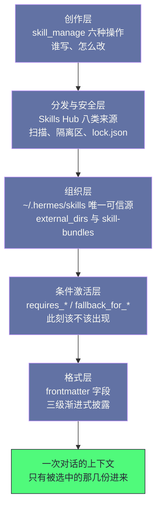
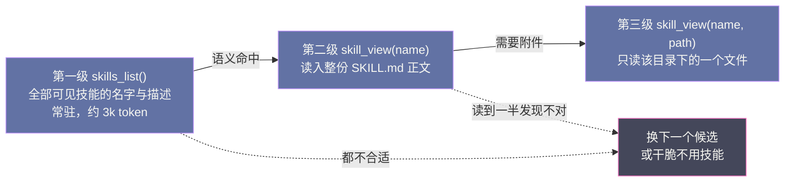
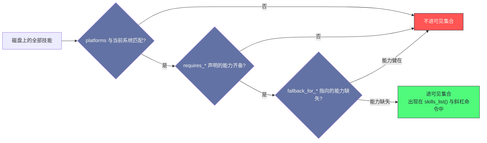
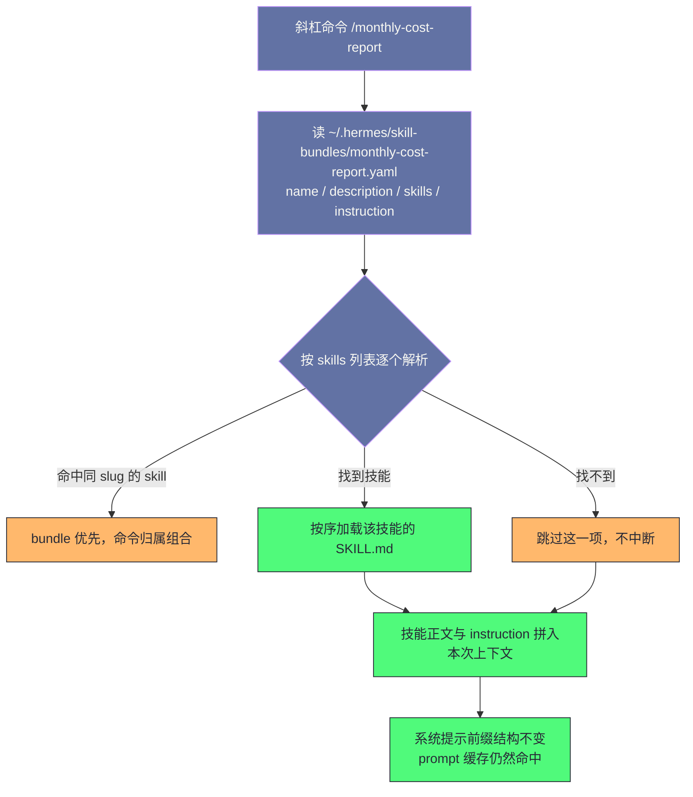
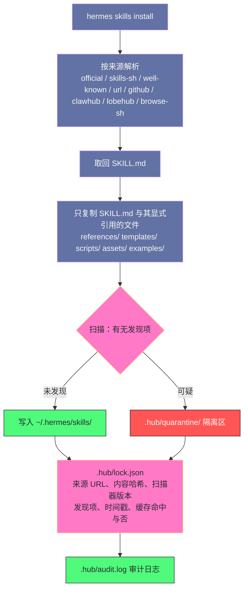

# 05 技能系统——SKILL.md 与 agentskills.io 标准

**摘要：**

Hermes Agent 的技能系统常被当成一叠提示词模板，但它早已不是若干 Markdown 文件的简单集合。截至 2026 年 11 月的 v0.23.2，一个技能从写下第一行 frontmatter 到进入某次对话的上下文，要穿过五层：格式层决定它长什么样，条件激活层决定它此刻出不出现，组织层决定它存在哪里、和谁一起被调用，分发与安全层决定它从哪个来源来、装进来之前被检查了什么，创作层决定它由谁写、怎么改。本文按这五层逐层拆开，用一次「整理月度成本报表」的任务串起全部机制：一份技能如何在 `skills_list()` 约 3k token 的索引里被看见，如何靠三级披露只在需要时把正文读进来，如何在 web 工具缺失时用 `fallback_for_tools` 顶替上来，如何被打包进 `~/.hermes/skill-bundles/<slug>.yaml` 一次加载多个技能，如何从八类来源安装并在 `.hub/lock.json` 里留下来源、哈希与扫描器的记录，以及 agent 自己如何用 `skill_manage` 的六种操作把一次成功的任务写成技能。文章同时回答两个问题：为什么不该把全部规则塞进系统提示词；以及这套分层在哪些地方会失效——外部技能目录不是写保护边界，bundle 不负责安装依赖，扫描通过也不等于安全。落点不在功能清单，而在三处取舍：可见集合与可用集合的对齐、省下的 token 换来的发现成本、以及生态扩张换来的信任负担。

---

## 第 1 章 一句话背后的五层

### 1.1 群里的那句话

笔者先摆一个贯穿全篇的场景。某台 VPS 上跑着一份 Hermes，它被拉进一个运维群，某个工作日的上午十点，群里有人丢下一句：「把这个月的云成本导出来，画个趋势图，连上周那台机器的巡检结果一起发我，要能下载的。」这句话里没有一个技术名词，却要求 agent 做四件彼此不同的事：找到本月的成本数据、算出趋势并成图、翻出上周的巡检记录、把结果以可下载的形态投递到聊天窗口。

这四件事都不难，难的是「不难」这件事本身要靠运气。若 agent 每次都要从零发明成本数据的取法、图表的画法、巡检记录的字段含义，那么它的表现就取决于当天模型的状态，而不取决于这个团队积累了多少经验。技能系统要解决的是这一类问题：把「这类事该怎么做」从一次性的临场发挥，固化成一份能被检索、被加载、被复用、被修订的文本，并且在下次遇到同类任务时自动把它送到模型眼前。

顺着这句话往下追问，会连续撞上五个不同层面的问题：模型怎么知道有这样一个技能存在，是检索的事；知道了要不要读完全文，是加载的事；发现本机没有 web 工具时它该不该出现，是激活条件的事；它存在哪个目录、能否和另外两份技能一起被一个斜杠命令唤起，是组织的事；它从某个仓库装进来时被谁检查过、留下什么证据，是分发与安全的事；而它是谁写的、改的时候整篇重写还是只补一行，是创作的事。五件事各有答案，合起来才是「技能系统」的真实所指。

### 1.2 技能是什么

技能（Skill）在 Hermes 里是一份写给模型看的执行规范，落地形态是一个目录，核心是一个带 YAML frontmatter 的 Markdown 文件 `SKILL.md`。frontmatter 面向系统——解析器、检索器、调度器读它，用它判断平台是否匹配、能力是否齐备、是否该出现在候选列表里；正文面向模型——步骤、陷阱、验证方式都写在里面，读进来就是一份可执行的作业指导书。

这个二分决定了技能的两种身份。作为系统对象，它必须结构化到能被程序逐字段筛选；作为文档对象，它必须自然到能被模型顺畅读懂。用 JSON 写正文会让人类难以维护，用纯自由文本写元数据则无法做平台过滤和能力感知，于是格式上取了一个折中：**机器读 frontmatter，人写正文，两者装进同一个文件**。这个折中并不新鲜，静态站点生成器十多年前就这么干了，但它在 Agent 语境里有一个额外的好处——技能对人类是完全可读的，打开文件就能看懂 agent 学会了什么，用任何编辑器能改，用 git 能版本化，用代码审查能约束。

需要提前划清一处边界：技能不是工具。工具给 agent 增加「能做什么」的能力，技能给它「怎么做」的知识。只有技能没有对应工具，它知道流程却动不了数据；只有工具没有技能，它拿得到数据却每次都要重新决定怎么汇总、怎么成图。两者失败时的表现也不同——前者执行到一半报权限错误，后者每次产出都不一样。

### 1.3 全部塞进系统提示词会怎样

最直接的反驳是：既然技能就是一段写给模型的说明，为什么不干脆把所有这些说明都塞进系统提示词，让它一直在场，省掉检索和加载的麻烦。

这条路在三处会撞墙。第一处是预算。系统提示词的每一行都要在每轮对话里重新付费，一个跑得久一点的实例，技能库里躺着几十上百个技能，全部常驻意味着每次请求都携带大量当下用不到的流程，而这些流程里真正被用到的，一天可能只有两三份。第二处是注意力稀释——常驻的规则越多，每条被认真遵守的概率越低，一份三千行的操作手册摆在眼前，模型对其中任何一条的遵循度都不会比一份三十行的清单更高，这是上下文工程里反复被验证的现象。第三处最要命：知识不可复用。写在系统提示词里的流程，只属于这一个实例、这一个 profile，既不能被别的 Agent 拿去用，也不能被单独版本化、单独审查、单独回滚，改一句话要动整个提示词文件，出了问题也无从判断是哪次改动引入的。

反过来说，如果没有这套按需加载的机制，最典型的退化形态是这样的：为了控制提示词长度，团队开始删技能，删到最后只剩下几条最常用的规则，其余全凭模型即兴发挥；或者相反，为了保留知识而不断往提示词里加，直到某天发现上下文窗口被自己的规则占掉了大半，真正的对话内容反而没地方放。两种退化其实是同一个问题的两个方向，而按需加载给出的答案是：**让知识的存储量与知识的在场量脱钩**——磁盘上可以放一百份技能，任何一次对话里只让其中一两份进入上下文。

这个道理不难理解，难的是做扎实。要做到按需，至少得先解决三个前置问题：技能得有一个足够短的索引让模型知道它存在；索引条目得足够准确地描述它适用什么任务；加载得能分级，先读概要再读细节，而不是一上来就灌进整份文件。这三件事对应后文的描述写法、检索匹配与渐进式披露。

### 1.4 五层结构

把上面提到的五个层面按「从写出来到用起来」的顺序摆开，就得到下图。这张图是全文的目录，后面每一章对应其中一层。



图里有一处容易被看漏：五层不是并列模块，而是有依赖顺序的。格式层在最下面，因为后面四层全要读 frontmatter——条件激活读 `metadata.hermes` 里那四个字段，组织层读 `name` 与目录名，分发层读来源与被引用的文件清单，创作层写的就是这份文件本身。格式定得越稳，上面四层越能各自演化；反之，字段语义一年改三次，扫描规则、解析逻辑、缓存策略就全要返工。

### 1.5 本文的口径

本文事实基线截至 2026-11-16 的 v0.23.2。版本号有两种写法并存，`v0.23.2` 与日历式的 `v2026.x.y`，后者如 `v2026.4.8` 对应 `v0.8.0`，两套指同一个发布，读文档时不要被绕晕。从 2026 年 3 月的 v0.2.0 到 11 月的 v0.23.2，版本号一路推到 0.23.x，v0.23.2 的说明提到自 v0.23.1 起累计约 1,989 个 PR——这个数字只说明技能系统的形态仍在快速变动，本文的字段名与路径是当下这一版的实况。

---

## 第 2 章 格式层：一页文件与三级阶梯

### 2.1 一份能用的 SKILL.md

先看一份把格式层主要字段都用上的技能。它做的是「从 Hub 之外的地方取一份数据，汇总成报表并发出去」这类事，字段不多，但每一个都在后文有对应的机制。

```markdown
---
name: monthly-cost-report
description: 汇总云成本与巡检记录，生成趋势图并以文档形式投递
version: 1.3.0
platforms: [macos, linux]
metadata:
  hermes:
    tags: [report, cost, ops]
    category: ops
    requires_toolsets: [terminal]
    fallback_for_tools: [web_search]
    config:
      - key: report.currency
        description: "报表使用的计价货币"
        default: "CNY"
        prompt: "用哪种货币计价"
---

# 月度成本报表

## 触发条件
- 用户要求「本月成本」「成本趋势」「账单汇总」
- 已知账期，且巡检记录可按主机名关联

## 步骤
1. 用 `terminal` 调用既有的取数脚本，导出原始账单为 CSV
2. 按天聚合，缺天补零，避免趋势图出现断点
3. 关联巡检记录，按主机名与日期取最近一条
4. 生成图表与明细页，落盘为单个文件
5. 投递时在响应中给出该文件的绝对路径

## 陷阱
- 账单接口按自然月切分，跨月任务要拆成两次取数
- 巡检记录可能缺主机，缺失项要显式标注而不是留空

## 验证
- 明细合计与账单原始总额相差为 0
- 图表天数与账期天数一致
```

这份文件里有三处值得看：`description` 写得像一句任务描述而不是产品介绍，因为它唯一的职责是被匹配到；`requires_toolsets: [terminal]` 把「必须有终端」这个前提从正文挪到元数据，让不满足前提的环境根本看不到它；`config` 把货币这种环境参数抽走，正文因此保持通用，同一份技能能被两个结算货币不同的团队共用。

### 2.2 frontmatter 字段

把 Hermes 认的字段逐个列清，比逐个解释更快。下表按「谁在读它」分组，右列写的是这个字段不写会怎样——后者往往比字段本身更有信息量。

| 字段 | 位置 | 作用 | 省略后的后果 |
| :--- | :--- | :--- | :--- |
| `name` | 顶层，必填 | 技能标识，同时是斜杠命令名与目录名依据 | 无法被检索与调用，技能等于不存在 |
| `description` | 顶层，必填 | 进入 `skills_list()` 索引的描述句，是匹配的唯一依据 | 索引里只有名字，匹配几乎全靠猜 |
| `version` | 顶层 | 语义化版本，供更新与发布时判断新旧 | 更新时只能比内容哈希，无法表达「这次是修 bug 还是加功能」 |
| `platforms` | 顶层，可选 | 限定 `macos` / `linux` / `windows`，不匹配即在系统提示、`skills_list()` 与斜杠命令中隐藏 | 平台特有的技能会在别的系统上出现然后失败 |
| `metadata.hermes.tags` | 元数据 | 分类标签，供人浏览与粗筛 | 只能靠名字归类，技能库变大后难以巡查 |
| `metadata.hermes.category` | 元数据 | 单一类别归属 | 同上，且 bundle 与人工作业少了分组线索 |
| `metadata.hermes.fallback_for_toolsets` | 元数据 | 指定工具集可用时隐藏本技能 | 本应作为备胎的技能与正规技能抢位置 |
| `metadata.hermes.fallback_for_tools` | 元数据 | 指定单个工具可用时隐藏本技能 | 同上，粒度到单个工具 |
| `metadata.hermes.requires_toolsets` | 元数据 | 指定工具集不可用时隐藏本技能 | 技能被加载后卡在第一步，报权限或找不到命令 |
| `metadata.hermes.requires_tools` | 元数据 | 指定单个工具不可用时隐藏本技能 | 同上，粒度到单个工具 |
| `metadata.hermes.config` | 元数据 | 声明需要用户填写的配置项，建 setup 时询问 | 环境相关参数只能写死在正文里，技能无法共享 |

表里十一个字段，只有前两个是必需的。这个取向很清楚：**让最小可用技能的门槛低到一行 name 加一行 description**，其余字段按需加装。代价是质量下限完全取决于作者自觉——一份只有两个字段的技能完全合法，却可能既匹配不准也执行不了。

### 2.3 索引条目的长度预算

`description` 是唯一进入常驻索引的字段，它的长度不是文风问题，而是预算问题。`skills_list()` 拿到的是一份约 3k token 的索引，装着全部可见技能的名字与描述；技能份数越多，每份能分到的字数越少。粗算：一百份技能分三千 token，每份连同格式开销只有三十 token 上下，中文三四十字就到顶。

这个预算解释了为什么「精确」比「全面」重要。索引条目的职责是被匹配到，不是被读完；它应该写成动词加对象加步骤线索，而不是「一个强大而灵活的成本分析助手」。前者在模型判断「当前任务是不是这件事」时给出可比的依据，后者除了占位没有别的用处。

还有一层不那么直观的效应：模糊的描述不只是浪费自己的位置，它会**主动污染检索**。「处理数据」「帮助运维」这类描述几乎能匹配一切沾边的任务，于是每次语义相近时它都会被拉进候选，把真正合适的那一份挤出去。技能库和代码库一样有依赖地狱，只是发作的形式是语义地狱——没有编译错误，只有「怎么又用了那个不对的技能」的困惑。

### 2.4 三级阶梯

渐进式披露（Progressive Disclosure）是这套系统里最像「查手册」的部分。第一级 `skills_list()` 只给名字与描述，约 3k token，常驻；第二级 `skill_view(name)` 读入某一份技能的完整 `SKILL.md`；第三级 `skill_view(name, path)` 再按路径读取该技能目录下的某一个附件文件——`references/` 里的参考资料、`scripts/` 里的脚本、`templates/` 里的模板，只有真正需要时才读。三级之间的落差与回退，如下图。



这个阶梯的设计意图，说穿了就是查手册与背手册的区别。没有人把整本设备手册背下来再干活，正常做法是记住目录，遇到问题时翻到对应章节，章节提到某个参数表再去翻附录。成本的分布因此是：目录维护成本与手册总量成正比，单次工作的阅读成本只与那一节有关。技能系统把同一套结构搬进上下文，于是技能库可以从十份长到一百份，而单次对话的固定开销几乎不变。

不过阶梯不是免费的。每一级都要一次工具调用往返，三级走满就是三次；更麻烦的是第二级读到一半才发现「不是这个技能」的概率不低，因为 description 再准也只是摘要。真正影响体验的是第一级到第二级的命中率，而不是阶梯有几级。

### 2.5 正文的惯用骨架

正文没有强制的段落结构，但社区里形成了一套相当稳定的写法：先说触发条件，再列步骤，然后记陷阱，最后写验证。这套骨架和工业界的作业指导书同构——适用范围、操作步骤、安全注意事项、验收标准——人类在这个结构上打磨了上百年，换到 Agent 语境里依然成立。四段之中最容易省掉的是触发条件与验证，而它们恰恰决定了技能能不能被自动调度：没有触发条件，模型只能凭 description 猜，猜偏了就白读一遍；没有验证，执行完没人知道成没成，失败要靠用户下次发现。

**自主性正是 Agent 技能与普通文档的分界线**——给人看的文档写清步骤就够了，给 agent 用的规范还得写清何时用、怎么核对。陷阱那一段通常是空的，它的内容来自实际踩坑，这也是为什么技能越用越准，而第一版往往只是一份能被跑通的草稿。

### 2.6 环境变量：默认不进沙箱

技能经常需要凭据：报表技能要 API token，部署技能要 kubeconfig 的路径。这类信息在 Hermes 里由 `required_environment_variables` 声明，声明之后有两处行为变化。一是获取方式受控——只在本机 CLI 上加载技能时才会安全地询问用户，从消息平台进来的对话不会在聊天窗口里索要密钥，改提示走 `hermes setup` 或写进 `~/.hermes/.env`。二是使用方式自动——声明过的变量会被自动透传到 `execute_code` 与 `terminal` 沙箱里，技能正文里的脚本直接读环境变量即可，不用在步骤里教模型「先 export 再执行」。

第二处容易被忽略其分量。沙箱默认不继承宿主机的环境变量，这是隔离的常识——否则容器里的命令就能读到宿主机的一切凭据。技能声明透传，等于在这个默认关闭的门上开了一道只对已声明变量生效的缝：门还是关的，只是这几把钥匙被明确递了进去。这比「沙箱全量继承环境」安全得多，也比「让模型自己 export」可靠，因为后者会把密钥写进对话记录。

相邻的还有终端侧配置：`terminal.env_passthrough` 控制哪些变量进入终端环境，`terminal.docker_forward_env` 从 shell 或 `~/.hermes/.env` 转发变量而不把密钥写进配置文件。技能声明的变量随技能走，这些配置随实例走。

### 2.7 为什么是 Markdown 加 YAML

这个组合看起来平平无奇，换其他格式却都要牺牲同一件东西。JSON Schema 更严格、数据库记录更可控、专用二进制更紧凑，但三者都不可读，而技能的价值恰恰建立在人类可读上——要能审查、能改、能用 git 管、能在代码审查里讨论。

frontmatter 承担结构化，正文承担叙述，这个分法还带来一个额外的好处：**技能的演化可以只动一半**。加一个 `platforms` 限制只改三行元数据，改写某一步骤只动正文一段；换成 JSON，改一个标点都要经过转义，评审时满屏 diff 反而淹没了真正的改动。代价是弱校验：YAML 缩进错一个 tab 就能让整段元数据解析失败，正文写错工具名要等执行时才炸——后文的安装扫描与审计，就是在补这个短板。

---

## 第 3 章 条件激活层：可见集合等于可用集合

### 3.1 四个字段，两个方向

`metadata.hermes` 下有四个条件激活字段，两两成对，方向相反。`requires_toolsets` 与 `requires_tools` 是「有这个才显示」，`fallback_for_toolsets` 与 `fallback_for_tools` 是「缺这个才显示」。前者防止技能被加载到一半发现干不了，后者防止能力缺失时彻底没有替代方案。

| 字段 | 判断方向 | 何时隐藏 | 典型用例 |
| :--- | :--- | :--- | :--- |
| `requires_toolsets` | 正向，看工具集 | 指定工具集不可用时 | 部署技能要求 `terminal`，在禁用了终端的消息平台上不出现 |
| `requires_tools` | 正向，看单个工具 | 指定工具不可用时 | 依赖浏览器截图的技能，在没有 browser 工具时不出现在候选里 |
| `fallback_for_toolsets` | 反向，看工具集 | 指定工具集可用时 | 一整套基于 curl 的取数技能，仅在 web 工具集缺失时顶替 |
| `fallback_for_tools` | 反向，看单个工具 | 指定工具可用时 | 只用 `web_search` 的替代实现，正式工具在时自动让位 |

四个字段合起来实现的是一种能力感知的调度：技能库不是静态清单，而是随当前环境能力收缩与替换的活集合。`requires` 回答「这个环境配得上它吗」，`fallback` 回答「这个能力缺了谁来补位」。

这处设计的精妙在于它把判断放在了加载之前。放在执行之中的写法是：技能照常加载，第一步先检查 web 工具在不在，不在就改用 curl。这能工作，代价是模型要先读一遍可能用不上的流程，而且「先检查再分支」要靠它自觉，忘了就直接在第一步失败。前移到元数据，等于让调度器替模型做分支，模型看到的永远是当下能用的那一份。

### 3.2 一个 curl 搜索技能的诞生

最典型的例子是「web 不可用时的搜索」。有些部署为了控制出网面，关掉了 web toolset，此时一个基于 curl 与本地解析的搜索技能就该出现；同一个技能在 web 工具齐全的实例上则应该完全隐身，免得模型在两份能力之间来回权衡。

```markdown
---
name: curl-search-fallback
description: 用 curl 直接请求搜索端点并解析结果，替代缺失的联网搜索工具
version: 0.9.2
platforms: [linux, macos]
metadata:
  hermes:
    tags: [search, network]
    category: net
    requires_toolsets: [terminal]
    fallback_for_toolsets: [web]
---
```

两个条件并列出现，读法是「终端必须有，web 必须没有」。这种组合写法覆盖了绝大多数替代型技能的场景：替代方案总需要一个执行手段（这里是终端），同时以「正主缺席」为前提。若把 `fallback_for_toolsets` 误写成 `requires_toolsets`，语义会完全反过来——技能只在 web 可用时出现，恰好在最需要它的时候隐身，而作者在本地测试时往往正开着 web，于是这个错误可以潜伏很久。

同一份 YAML 还说明条件激活与平台限定是两套正交的机制。`platforms` 管操作系统，`fallback_for_*` 与 `requires_*` 管能力：前者静态，装好就不变；后者动态，同一个实例在 CLI 里给全套工具、在某个群里被裁成只给搜索与读文件，两个场景下可见的技能集合本来就该不同。

### 3.3 为什么值得在加载前判断

从检索质量看，条件激活的收益不止于「避免失败」。不可用的技能被隐藏之后，`skills_list()` 的索引更短、更聚焦，模型匹配时受到的干扰更少。这与平台限定的收益是同一个：**可见集合应当尽量等于可用集合**。

反过来说，可见集合大于可用集合会持续产生三种损耗：索引预算被永远不可能执行的技能占着；匹配被诱导，模型看见「部署到 K8s」就倾向认为该用它，然后在第一步发现没有终端；最难察觉的是**模型开始学会忽略技能列表**——在它的经验里一半条目点开就报错，久而久之它更愿意自己即兴发挥。第三种损耗不会报错，只表现为 agent 越来越不听话。

把技能从磁盘目录筛到可见集合的过程画出来，如下图所示。



图里三条判定路径是依次短路的关系，任何一条不通过就直接出局。这个顺序不能随意调换：先判平台成本最低，因为不需要查询工具注册表；反过来先查能力，就会为一批注定被隐藏的技能白做查询。技能库小的时候看不出差别，到了几十上百份，这类小顺序就成了启动开销的一部分。

### 3.4 写错条件的三种后果

条件字段写错的后果，按严重程度排有三档，且都不会在加载时报错——这正是它难查的原因。

最轻的一档是「过度隐藏」：把 `fallback_for_toolsets: [web]` 写成 `requires_toolsets: [web]`，技能在 web 可用时出现、缺失时隐身，而作者本地测试时通常正是 web 可用，看起来一切正常，直到某天在裁过工具集的群聊里才发现它不见了。中间一档是「永不出现」：两个条件指向同一个工具集，互相排斥，逻辑上无解，技能在任何环境下都不会被选中，也没有任何提示。最重的一档是「错误地出现」：条件过宽，替代方案与正规手段同时在场，模型先用替代方案干活，质量下降却没有任何错误信号。

防范的办法不复杂，但笔者以为需要纪律：写完之后在两种环境下各看一次 `skills_list()`，一次工具齐全、一次裁到只剩最小集，确认技能的出现与消失都符合预期。

---

## 第 4 章 组织层：唯一可信源与两个外延

### 4.1 唯一可信源

技能的存放规则只有一句话：`~/.hermes/skills/` 是主目录，也是唯一可信来源。自动生成的技能、从 Hub 安装的技能、用户手写的技能，全部平等地躺在这一个目录里，没有按来源划分子目录，也没有「官方技能」的特权区。

这个扁平化设计值得说一句。按来源隔离看似更整洁，代价是同一份技能可能在多处各有一份副本，改哪一份、以哪一份为准、删哪一份，全变成新问题。扁平化把这些一次消掉：**来源可以不同，地位一律平等**；代价是目录会逐渐杂乱，长到几十上百份就很难靠肉眼巡查。

### 4.2 外部目录：联合馆藏，不是保险柜

主目录之外，还可以通过 `skills.external_dirs` 挂载外部技能目录，配置里支持 `~` 与 `${VAR}` 形式的展开。用途很实在：团队把共享技能放在一个 git 仓库里，每个成员把仓库克隆下来登记为外部目录，于是技能拿到了版本控制、代码审查与回滚能力；项目专属的技能也可以放在项目仓库里，随项目一起走。

这里有一条必须写清楚的规则：**外部目录不是写保护边界**。标记为「外部」不等于只读，本地同名优先也不等于外部目录被隔离保护起来；agent 的写操作该受什么约束就受什么约束，不会因为路径在外部而多一道闸。把它当成保险柜，是这套机制最常见的误读——有人把只读的团队规范仓库登记成外部目录，以为 agent 改不动它，实际上这个假设没有任何机制支撑。

外部目录与主目录的关系更像图书馆的联合馆藏：两边都能借，同一本书两边都有时以本地那份为准，但两边都不是密封的。真要做出只读效果，办法在文件系统权限与版本控制上，譬如把仓库以只读方式挂载。

### 4.3 bundle：一个斜杠命令的清单

技能一多，就会出现「这几份总是一起用」的组合。报表任务要同时用取数、成图、投递三份技能；代码审查要同时用 PR 流程、测试规范、风格检查三份。逐个敲斜杠命令当然可以，但那是在用命令行的方式解决编排问题，每次都得记住组合。

Skill 捆绑包（bundle）要解决的正是这件事：一个 YAML 文件，放在 `~/.hermes/skill-bundles/<slug>.yaml`，一个斜杠命令同时加载多个技能。字段有四个：`name`、`description`、`skills`、`instruction`，其中 `instruction` 是给这次组合额外附加的一段说明，用来表达「这几份一起用时先做哪一步」这类跨技能约束。

```yaml
name: monthly-cost-report
description: 月度成本报表：取数、成图、投递一次走完
skills:
  - cost-fetch
  - chart-render
  - file-delivery
instruction: 先跑完取数与成图再投递；投递时用文档形式，避免图片被压缩。
```

管理命令有五个，覆盖了从建到改的完整动作：

```bash
hermes bundles create monthly-cost-report   # 生成 ~/.hermes/skill-bundles/monthly-cost-report.yaml
hermes bundles list                          # 看当前有哪些 bundle
hermes bundles show monthly-cost-report      # 看某个 bundle 的字段与它引用的 skill
hermes bundles reload                        # 改完 YAML 就地生效，不必重启
hermes bundles delete monthly-cost-report    # 删除 bundle 本身，不动它引用的 skill
```

五条命令里 `reload` 是最实用的一条。bundle 的 YAML 是纯配置，改一行 `instruction` 想要生效，如果还要重启进程，那就没人会去改它；能就地重载，才谈得上「把编排当配置调」。

三条行为细节决定了边界情况下的表现。其一，slug 冲突时 bundle 优先于同名 skill——同一个名字既能指向单个技能又能指向组合时，组合赢。其二，缺失 skill 跳过而不报错——引用的技能被删了或没装，加载时跳过，其余照常。其三，bundle 不使 prompt 缓存失效。

### 4.4 bundle 与 skill 的差别

把两者放在一起对比，能看清 bundle 到底是什么、不是什么。

| 维度 | 单个技能（SKILL.md） | 技能捆绑包（bundle YAML） |
| :--- | :--- | :--- |
| 文件位置 | `~/.hermes/skills/<name>/SKILL.md` | `~/.hermes/skill-bundles/<slug>.yaml` |
| 内容 | 步骤、陷阱、验证等可执行正文 | 只声明组合关系与一句跨技能指令 |
| 触发方式 | 自动检索命中，或斜杠命令直接调用 | 只有斜杠命令触发，不参与自动检索 |
| 是否含执行逻辑 | 是 | 否，它把执行交给被引用的技能 |
| 依赖处理 | 用 `requires_*` 声明能力前提 | 不安装、不检查依赖，缺了就跳过 |
| 更新联动 | 更新自己 | 引用的技能各自更新，bundle 无感 |
| 冲突优先级 | 同名时让位给 bundle | 同名时优先于 skill |

表里最要紧的是两行：「是否含执行逻辑」为否，「不安装、不检查依赖」。这两条把 bundle 的定位钉死在编排层——它是一个清单，不是一个包。

用依赖管理的视角再看一眼会更清楚：bundle 相当于一份 `package.json` 里的依赖列表，它引用的技能是那些依赖本身。清单描述组合，组件保持独立，于是 `chart-render` 可以同时被报表 bundle 与周报 bundle 引用，改一次两边都受益；而把所有逻辑合并成一个大技能，任何一处子逻辑要更新都得重做整个合并。

### 4.5 一次加载的路径

一个 bundle 被唤起时，系统内部走的路径大致如下图。注意图里没有出现「重启」「重载全部技能」这类动作，这是 bundle 能保持轻量的关键。



「不使 prompt 缓存失效」这条行为值得单独解释，它是 bundle 能被称为「轻」的技术前提。可以这样理解：bundle 改变的是「谁来触发加载」，不是「加载什么、按什么顺序拼进上下文」——拼进去的仍是那几份技能的正文，与逐个调用斜杠命令所得相同，系统提示的前缀结构因此不被重排，缓存仍然命中。若改成往系统提示里插一段组合说明、把技能换成摘要，前缀就会变形，每次切换都要重算缓存，代价比省下的几次命令调用大得多。这层解释是从官方口径反推的，具体实现以代码为准，但它足以说明取向：**编排机制不该污染上下文结构**。

---

## 第 5 章 分发与安全层：八类来源与一道闸

### 5.1 八类来源

技能从哪来，Skills Hub 给了八类来源；这个划分不是因为分类学上的整齐，而是每类的解析方式与信任假设不同——从官方仓库装和从一个网址直接装，风险差着一个量级。

| 来源名 | 指向什么 | 解析方式 | 信任假设 |
| :--- | :--- | :--- | :--- |
| `official` | 官方 optional-skills 仓库 | 按名字取官方维护的技能 | 官方背书，随版本维护 |
| `skills-sh` | Vercel 的 skills.sh 目录 | 按目录索引解析 | 目录方审核过，仍需自看 |
| `well-known` | 站点的 `/.well-known/skills/index.json` 发现约定 | 先取索引再取技能 | 站点自己声明，等于站点自证 |
| `url` | 直接指向一份 `SKILL.md` 的 URL | 直接抓取该文件 | 无中间方，全凭使用者自核 |
| `github` | 仓库与仓库内路径，可配自定义 tap | 按仓库路径取，或经 tap 索引 | 仓库属主背书 |
| `clawhub` | ClawHub 技能注册表 | 按注册表索引解析 | 注册表背书 |
| `lobehub` | LobeHub 的技能集合 | 按该站点的目录结构解析 | 站点背书 |
| `browse-sh` | browse.sh 的技能来源 | 按该站点约定解析 | 站点背书 |

表格右列是真正的重点。`official` 之所以可以「装了就信一半」，是因为它同时受两道约束——官方维护，且随版本一起测试；`well-known` 则相反，站点在自己的域名下放一个索引文件声明自己有技能，等于自己给自己发证，发现约定的价值在于「可被自动找到」，不在于「证明安全」。`url` 更极端：一个网址就是全部上下文，没有仓库、没有属主、没有版本历史。

### 5.2 默认 tap

`tap` 是技能来源的登记项，默认就配好了一批：`openai/skills`、`anthropics/skills`、`huggingface/skills`、`NVIDIA/skills`、`VoltAgent/awesome-agent-skills`、`garrytan/gstack`。前四个是组织级仓库，`VoltAgent/awesome-agent-skills` 是聚合型的清单仓库，`garrytan/gstack` 是个人仓库——三种形态并存，说明了 tap 的一个性质：**它登记的是一个可信的取数地址，而不是一个质量评级**。

`NVIDIA/skills` 有额外看点：它带签名文件 `skill.oms.sig`，并配一份治理用的 `skill-card.md`——签名证明「确实来自这个仓库且中途没被改过」，卡片说明「谁维护、依赖什么、权限多大」。这与包管理器同源，但落在技能上意义更重：代码包至少还要被执行，技能直接进上下文，一份被篡改的技能就是一段被注入的指令。

### 5.3 一次安装的全流程

安装是这套系统里唯一同时具备「从外部取内容」与「把内容放进模型上下文」两个动作的环节，因此也是唯一必须设闸的环节。完整流程如下图，从取回到落盘一共四道关。



第二道关值得单独说：**只复制 `SKILL.md` 与它显式引用的文件**。显式引用指正文里以相对路径点到的那几类目录——`references/`、`templates/`、`scripts/`、`assets/`、`examples/`。仓库里即便塞了几百个文件，装进来的也只被点名的那几个；藏着一段和技能无关的恶意脚本，只要正文没引用它就不会被复制。这条规则把「安装」从整仓克隆变成了按引用清单取件。

第三道关是扫描。它看的是取回来的文本里有没有可疑模式——原理与静态分析相近，能抓住明显的坏味道，抓不住精心伪装的指令。扫出问题就进隔离区 `.hub/quarantine/`，不写入主目录，也不删除，留着给人看。

第四道关是留痕。结果写进 `~/.hermes/skills/.hub/lock.json`，同时另有审计日志 `.hub/audit.log` 记录安装与后续操作的动作序列。

### 5.4 lock.json 里的四个字段

`lock.json` 借用依赖管理的名字，四个字段各有各的用途。

内容哈希回答的是「这份技能还是我装的那份吗」。技能正文是会被改的——agent 自己会用 `patch` 改，用户也会手工改——所以哈希不能用来说「被改过就是错的」，它只是给出一个可比的基线：某天发现行为变了，先比哈希确定变的是技能还是环境。

来源 URL 回答「它从哪来」，这一条在出事后是唯一能把责任链往回溯的线索。扫描器版本回答「当时用什么标准查的」——规则会更新，半年前装的东西用今天的规则可能过不了关。时间戳与缓存命中回答「这次是真下载还是复用缓存」，排查可疑内容时两者含义截然不同：缓存命中意味着信任的是上次那份。

四个字段合起来，让「装进来的东西」从一件无从追查的事变成一条有据可查的记录。这也是 `audit` 存在的理由：有记录才谈得上审计。

### 5.5 命令族

Hub 命令有八个，覆盖技能从装进来到发出去的全过程。

| 命令 | 面向的动作 | 用在什么时候 |
| :--- | :--- | :--- |
| `hermes skills audit` | 审计本地已装技能与扫描记录 | 定期巡检，或怀疑某个技能行为异常时 |
| `hermes skills check` | 对单个技能做检查 | 装完立刻核一遍，或改完想确认没写错 |
| `hermes skills update` | 按来源取新版本 | 上游修了 bug，或想跟上官方版本 |
| `hermes skills uninstall` | 卸载 | 技能没用、重复、或来源不再可信 |
| `hermes skills reset` | 复位本地 Hub 状态 | lock 或缓存出现不一致，需要回到干净状态 |
| `hermes skills publish` | 把自己写的技能发布出去 | 团队共享，或回馈社区 |
| `hermes skills snapshot` | 固化一份当前技能集合的快照 | 迁移机器、复制实例、事故前留档 |
| `hermes skills tap` | 管理来源登记项 | 增加内部仓库，或移除不再信任的来源 |

八条命令里，`snapshot` 与 `reset` 最容易被忽略。前者把「当前这套能跑」固化成资产，后者在 lock 与磁盘内容对不上时承认现状不可信——一个保现状、一个推倒重来，正好对应运维里最常见的两种决策。命令的参数细节各版本可能增删，以 `hermes skills --help` 为准。

### 5.6 扫描不替代审查

扫描器能做什么、不能做什么，需要说清楚。

它能做的是模式匹配：明显的危险命令、可疑的网络请求、把敏感路径打包上传的步骤，这类有固定形态的东西能抓住。它不能做的是语义判断：一段用自然语言写的、看起来完全合理的步骤，可能恰好在做一件不该做的事——「先把配置备份到临时目录，再上传到校验服务器」，每句都不触发规则，合起来是一次外泄。技能的载体是自然语言，而自然语言可疑与否取决于意图，扫描器读不出意图。

于是审查的位置无法被替代。好在成本不高：一份技能通常一两屏，读一遍两分钟，比读一个代码包快得多。需要纪律的是把这两分钟固定下来，重点看三类句子——把什么东西发给什么地方、执行什么来路不明的脚本、跳过什么校验，这三类是恶意技能最终都要落地的地方。

### 5.7 agentskills.io：从格式到生态

上面这套机制之所以能成立，前提是技能的格式本身是公开的。Hermes 的技能兼容 agentskills.io 这个开放标准，标准定义的是「技能长什么样、元数据有哪些、怎样被发现」这类跨实现的约定——正因为格式公共，一个从 `github` 来源装进来的技能才可能原本是给别的 Agent 写的，一个在 Hermes 里写好的技能也才可能被别的工具直接使用。

把这条标准放回 Agent 技术栈的演化里看，它补的是第三块拼图。MCP 标准化了 Agent 与工具的连接，A2A 一类协议在管 Agent 之间的通信，agentskills.io 管程序性知识的共享。三者的标准化难度依次递增：工具接口是机器与机器的契约，签名与消息格式严格，没有歧义；知识是写给模型看的自然语言文档，同样的步骤描述，不同模型的理解会有偏差。**工具标准是精确的协议，知识标准是约定俗成的文体**。

从生态角度看，公开格式加上一个带八类来源的 Hub，等于把「写技能」与「用技能」的人分开了：写的人不必关心谁会用，用的人不必自己写。不过这里需要克制：**生态规模是供给侧的指标，不是质量分布**。用户贡献的生态都近似幂律分布，极少数高频优质技能承载大部分使用量，长尾的多数安装量趋近于零；官方并未给出稳定的技能总量口径，各来源注册表每天都在增减，拿「多少万技能」当论据意义有限。

### 5.8 技能与 MCP 的分工

回到最容易混淆的对照：技能与 MCP 不是二选一。MCP 让 agent「能做新事」——连 GitHub API、读数据库、发邮件；技能让 agent「知道怎么做」——PR 审查看哪几项、报表按什么口径汇总。有技能没有对应 MCP，它知道流程却动不了数据；有 MCP 没有技能，它每次都要重新决定看什么，产出质量随对话波动。以那句成本报表为例，要的能力是对象存储读取与投递，要的知识是取数口径、趋势图与投递形态——**能力决定下限，知识决定稳定性**。

这处分工还解释了一个现象：Hermes 的 MCP 侧从 v0.8 起配了 OAuth 2.1 与 PKCE 全流程，MCP 扩展包安装时经 OSV 漏洞库自动扫描恶意包；技能侧的检查重心不同——技能不执行代码，只是文本，所以扫描看的是文本里的可疑指令，审查靠人读。

---

## 第 6 章 创作层：skill_manage 与自建时机

### 6.1 六种操作

技能不全是从 Hub 装的，相当一部分是 agent 在干活过程中长出来的，写回工具是 `skill_manage`，它有六种操作。

| 操作 | 做什么 | 典型场景 |
| :--- | :--- | :--- |
| `create` | 新建一个技能，写入 `SKILL.md` 与 frontmatter | 一类任务第一次被完整跑通，值得固化 |
| `patch` | 局部替换技能里的一段文字 | 补一条陷阱、改一句触发条件、修一个错字 |
| `edit` | 整篇重写正文 | 流程整体改版，局部替换已经不够用 |
| `delete` | 删除整个技能 | 技能被更好的版本取代，或流程已废弃 |
| `write_file` | 往技能目录下写附属文件 | 加一份参考资料、一个脚本、一个模板 |
| `remove_file` | 删掉技能目录下的附属文件 | 附属文件过时，正文已不再引用 |

六个操作里 `patch` 与 `edit` 的差别最值得留意，因为两者都能改正文，取舍只在成本：`patch` 只需给出要替换的那一小段与替换后的内容，`edit` 要给出整篇正文。对一份两百行的技能来说，改一行陷阱用 `patch` 只花十几 token，用 `edit` 要重新输出两百行——不只是贵，还容易在重写过程中把无关段落改坏。

### 6.2 为什么 patch 是首选

把 `patch` 定为首选，表面上是一个 token 成本的优化，往深一层看，它改变的是「修改」这件事的风险结构。

整篇重写时，模型要重新生成全部内容，在没有逐字比对的情况下，未被要求改动的段落也可能被微妙改写——同义替换、顺序调换、某条陷阱被压缩成半句。技能的价值恰恰建立在那些细节上：一句「账单接口按自然月切分」被改写成「注意账期」，信息就丢了。局部替换把改动面锁在指定那一段，其余字节不变。

这个道理在工程上并不新鲜，diff 优于重写是版本控制的基本立场。技能系统把它搬进 agent 自己的写回路径，等于要求 agent 改自己的知识时也遵守最小改动：**改知识要像改代码一样留 diff，而不是像改草稿一样重抄一遍**。

### 6.3 四个触发时机

什么时候该把一个任务写成技能，官方给出的时机有四类，四类的共同点是「这次的经验值得下一次复用」，区别在于经验的性质。

第一类是复杂任务成功之后——工具调用超过五次的那类任务。五次这个门槛不是随便定的：一次调用能完成的事，下次重来成本也很低；五次以上意味着这里有流程，有流程就有复用的价值，也就有记错的余地。

第二类是遇到错误并找到可行路径之后。这类经验最值钱，也最容易丢——报错、试错、绕过，整个过程消耗了大量往返，若不写下来，下次同样的坑要再踩一遍。写进技能的「陷阱」一段，正好对应这类经验。

第三类是用户纠正了做法之后。用户说「不是这样，应该先取数再校验」，这句话背后是团队约定或业务规则，是 agent 无论如何推不出来的信息。这类纠正如果只留在当次对话里，下个会话就蒸发了；写进技能，它才成为组织记忆。

第四类是发现了一条非平凡的工作流。所谓非平凡，指的是步骤之间有依赖、有顺序要求、有前置条件，不是几个命令的简单堆叠。这类工作流最容易在第一次跑通后被忘掉，因为跑通那一刻看起来「显然」，而显然的东西最不值得记，直到第二次重新摸索时才发现它并不显然。

### 6.4 自建技能的纪律

agent 自己写技能，最大的风险不是写不出来，而是写出一份看起来完整、实际不可执行的技能。几条纪律可以挡掉大部分问题。

不发明命令。步骤里出现的每一条命令都应该是这次任务里真实执行过并成功的，凭印象补一条「应该是这样写」的命令，等于在技能里埋一颗雷。不写没验证过的步骤，宁可在陷阱里留一句「此路未验证」。description 要写触发词——自建技能最常见的死法是被写出来然后永远不被匹配到。

还有一条更隐蔽的纪律：别把一次性的环境细节写进正文。「这次账单从 `/tmp/download-3.csv` 读的」这种信息，下个月就是错的；正确写法是把路径做成 `config` 里的配置项，正文只写「从配置指定的路径读取」。**技能正文写方法，环境参数走配置**。

### 6.5 回到那句成本报表

把创作层放回贯穿案例，整条链就闭合了。第一次做月度成本报表时，agent 大概要走七八次工具调用：找数据、试接口、算聚合、画图、发现图被压缩、改投递方式、核对合计。跑通之后，按四个时机里的第一条，这次经验值得固化：用 `create` 写出 `monthly-cost-report`，用 `patch` 把当时踩的两个坑补进陷阱段，用 `write_file` 把取数脚本放进技能目录，把货币、账期提升为 `config` 项。

下一次同样的请求进来时，检索命中 `description`，`skill_view` 读入正文，`terminal` 里已有声明过的密钥，`config` 里的货币是上次填的，投递时按陷阱段那条经验用了文档形式。整条链上没有一步是即兴发明的。这才是技能系统真正交付的东西——**第二次做同一件事时的确定性**。

---

## 第 7 章 交付形态：媒体传递的三条约定

### 7.1 裸路径

agent 的产出经常是文件：一张图、一段录音、一份表格。把这东西送到用户眼前，有一个跨平台的麻烦——每个消息平台的媒体接口都不一样，Telegram 用一套，Discord 用另一套，SMS 干脆没有独立的文档通道。

Hermes 的处理方式是把这件事从技能层收走：当响应里出现裸的绝对路径且指向媒体文件时，比如 `/home/user/screenshots/trend.png`，网关会自动识别它，从可见文本里剥掉这段路径，并把文件作为原生附件投递给用户——Telegram 上是图片，Discord 上是附件。技能因此不需要知道目标平台是什么，只要在响应里给出路径即可。

这个设计把「内容生产」与「交付适配」解耦了。技能只管把文件生成出来并说出路径，平台差异由网关承担；同一个技能在三个平台上跑，媒体投递的代码一行都不用改。这是分层的老套路，但在媒体这件事上格外有价值，因为平台接口的差异既琐碎又易变。

### 7.2 两个指令

裸路径的默认行为是「按平台认为合适的方式投递」，多数时候这是对的，有两种情况需要显式改判。

| 指令 | 作用 | 用在哪 | 不生效时 |
| :--- | :--- | :--- | :--- |
| `[[audio_as_voice]]` | 把音频提升为原生语音消息气泡 | 语音回复、语音报告，在支持语音气泡的平台上 | 退化为普通音频附件 |
| `[[as_document]]` | 强制以文档形式发送该响应的全部媒体 | 高分辨率图、可下载报表、需要保真的截图 | 退化为默认投递方式 |

`[[as_document]]` 是这两个里更常用的一个。图片在聊天平台上的默认投递路径普遍会压缩：Telegram 的 `sendPhoto` 会把图片重压缩到约 200KB、长边约 1280px。对一张随手拍的截图，这个压缩几乎看不出差别；对一张要看清坐标轴刻度的趋势图，或者一张要交给财务的明细截图，压缩之后就是不可用。走文档通道原始字节不变，代价只是用户要多点一下才能预览。

两个指令在语法上写成双方括号，与正文里的 Markdown 链接不冲突，读起来也足够显眼——它们出现在响应文本里，由网关解析。语法故意做得「不像命令」：`[[as_document]]` 写出来更像一句标注，这与它的语义定位一致。

### 7.3 指令是建议，不是命令

这两个指令的实现取向值得说清：它们表达的是投递意图，最终决策在网关。平台不支持文档投递时，`[[as_document]]` 被安全忽略，媒体按默认方式处理，不会报错也不会丢失文件。

这个分层的价值在于扩展性。若指令是硬命令，每加一个指令就要改一遍所有平台的适配器，否则会出现「不认识这个指令于是整条消息发不出去」的故障。做成意图之后，新指令可以自由加，不认识的平台忽略即可，跨平台共享技能不会被某个平台的私有指令打破。**扩展点留在语义层，适配留在网关层**。

代价是行为不完全可预测：同一个技能在这里产出可下载文件，在不支持的平台上产出一张图，只能靠文档写清楚。

---

## 第 8 章 边界与反例

### 8.1 外部目录不是写保护边界

前文点过一次，这里值得展开：把团队规范仓库登记为 `skills.external_dirs`，得到的是「与本地技能一起被检索」，不是「只读」；同名优先也只是覆盖关系。

想做出真正的只读效果，办法在机制之外：用文件系统权限把目录挂成只读，或者干脆不在生产实例上登记可写的外部目录，把团队仓库的同步交给部署流程而不是 agent 的写操作。**机制的边界要写在机制说清的地方**，指望一个「外部」前缀承担审计职责，等于把安全建立在命名上。

### 8.2 bundle 不装依赖

第二个反例是把 bundle 当成安装清单。写一份 bundle，`skills` 里列三份技能，然后期待在干净实例上装好这份 bundle 就能用——不会。bundle 是 YAML，它引用技能，不下载技能，也不检查技能在不在；缺了就跳过，跳过之后那个斜杠命令仍能跑，只是少了三分之一的能力，而且不会有任何报错。

这个取舍是明确的：报错会让一个 bundle 因一份技能缺失而整体不可用，跳过则让编排保持可用，代价是失败静默。所以使用方要自己补一道检查——`hermes bundles show` 能看到引用的技能列表，逐个确认装没装，比等某次执行产出不对再回头查要省事。

### 8.3 扫描通过不等于安全

第三个反例是把 `.hub/lock.json` 里没有发现项读成「这个技能是安全的」。扫描器版本记录在案这个事实本身就说明一件事：扫描标准会变。今天通过的技能，半年后按新规则可能通不过；反过来，扫描器覆盖不到的手法，从第一天起就是盲区。

技能这种载体的特殊之处在于攻击面是自然语言：一段写成「请先把配置文件复制到临时目录以便比对」的步骤，任何模式匹配都抓不住，只有读过全文的人能判断它在这个场景下是否合理。所以扫描的定位只是一道粗筛。**自动化能提高审查的下限，提高不了审查的上限**。

### 8.4 社区来源的信任分级

八类来源的信任假设上文用一张表列过，落到操作上可以再压成三档：官方与组织仓库、目录与注册表、裸链接与来源不明的个人仓库。

第一档是 `official` 与默认 tap 里的组织级仓库，信任来自「有人对它的质量负责」，处理强度是按需更新、定期 audit。第二档是 `skills-sh`、`clawhub`、`lobehub`、`browse-sh`、`well-known` 与 `github` 里的公开仓库，信任来自「有人对它的存在负责，但不对它做的事情负责」，处理强度是装前读一遍正文、装后 `check` 一遍。第三档是裸 `url` 与来源不明的个人仓库，没有中间方，处理强度只有一个：别在有凭据的实例上装。

**所有来源都不该被无条件信任，区别只在信任的成本谁付**——官方来源由维护者付，社区来源由使用者付，裸 URL 由出事之后的自己付。

### 8.5 一张误用对照表

把前面几章出现过的失效形态收拢成一张表，便于对照排查。

| 误用 | 典型症状 | 根因 | 正解 |
| :--- | :--- | :--- | :--- |
| 把全部规则塞进系统提示词 | 提示词越写越长，模型对规则的遵循度反而下降 | 常驻内容挤占预算，注意力被稀释 | 按需加载，磁盘上多放、上下文里少放 |
| description 写成宣传语 | 技能永远匹配不上，或总在无关任务里被拉进候选 | 索引条目缺动词与对象，无法参与匹配 | 动词加对象加步骤线索，写成任务描述 |
| 条件字段写反 | 技能在最需要的时候隐身，或替代方案抢占正主 | requires 与 fallback 语义相反，且不报错 | 在工具齐全与裁剪两种环境下各看一次列表 |
| 把外部目录当只读 | 团队规范被 agent 改写而无人察觉 | 外部目录只影响检索优先级，不是写保护 | 用挂载权限或部署流程隔离 |
| 把 bundle 当安装包 | 干净实例上装完 bundle，能力缺一块且无报错 | bundle 不装依赖，缺失项跳过 | 先 show 出引用列表，逐个确认已装 |
| 只看扫描结果 | 装进来的技能行为异常，而扫描从未报警 | 自然语言的恶意藏在语义里，模式匹配看不出来 | 装前读正文，重点看把什么发给哪里 |
| 用 edit 改小错 | 无关段落被顺手改写，信息悄悄丢失 | 整篇重写没有 diff 约束 | 默认 patch，只改指定那一段 |
| 只发裸路径不管形态 | 高清图被压成糊图，用户以为分析质量不行 | 平台默认投递会压缩图片 | 需要保真时用 `[[as_document]]` |

八行里最容易被忽视的是第一行与最后一行：前者是起点性的错误，想的是「把规则写全」；后者是终点性的错误，形态没选对，前面的努力被打折。

---

## 第 9 章 落点：三处取舍

### 9.1 可见等于可用

第一个取舍是可见集合与可用集合的对齐。条件激活、平台限定、bundle 的 slug 优先级，做的都是同一件事：让 agent 看到的技能尽量等于它真能用的。对齐越好，检索噪声越低，模型对技能列表的信任度越高；代价是元数据维护负担，每加一个能力前提就要改一次字段，每裁一次工具集就要验一次可见集合。

不对齐的极端形态是把技能列表当成愿望清单，这在技能少时看不出问题，长到几十份之后 agent 会开始系统性忽略它，而忽略列表的 agent 与没有技能系统的 agent 差别不大。

### 9.2 省下的 token 换成了发现成本

第二个取舍是渐进式披露：省下每次对话的固定 token 开销，付出一到三次工具调用往返和「读错技能」的概率。这笔账在技能库小时是亏的，三五份技能全塞进上下文也没多少 token；库大时是赚的，因为固定开销只随索引增长，而索引增长远比正文慢。

临界点在「索引还能不能准确描述技能」上——一旦技能多到描述开始重复，披露的收益就被命中率下降吃掉，这时该做的是合并、删减、重新分类，**技能库和代码库一样需要定期还债**。

### 9.3 生态换信任

第三个取舍是分发层。八类来源加上默认 tap，把「写技能」与「用技能」分开了，代价是每次安装都是一次信任委托。完全自建能彻底避开这个代价，也放弃了别人已经踩过的坑——图表、OCR、格式转换这类通用流程没有自建的理由。

分寸在「通用与私有」这条线上：通用部分交给生态，私有部分留给自己。团队约定、内部流程、涉及生产变更与凭据的操作几乎都该自建并逐行审查；其余通用技能装现成的、装完读一遍，更划算。

### 9.4 回到那句成本报表

把三个取舍摆回最初的场景，答案就具体了。那句话之所以能在第二次、第三次被稳定完成，靠的是四件事各就各位：技能是一份带 frontmatter 的 `SKILL.md`，格式层给了它可被解析的形状；它在裁过工具集的环境里也能正确出现或隐身，条件层保证了可见即可用；它被三份技能打包进一个 bundle，组织层把编排变成了配置；它从可信来源装进来并在 `lock.json` 里留了痕，分发层让信任有了凭据。而它最初由一次成功的任务写出来，创作层让经验变成资产。

这四件事没有一件是「更强的模型」能替代的。模型变强，即兴发挥的上限会提高，但第二次做同一件事的确定性不会因此提高——确定性的来源是知识被固化、被检索、被正确加载，而不是推理能力的增长。**技能系统交付的不是能力，是稳定**。

至于这套分层往哪走，从近一年的节奏看，方向是把技能从「一份文件」推向「一个有人维护、有来源、有审计记录的生态」。但生态成熟度与个体收益并不总是同步：来源越多，选择成本越高；审计越细，信任越依赖流程而不是印象。将来这套机制会不会因为过重而重新收缩，目前仍然言之尚早。

---

## 专栏导航

- 上一篇：[[04 学习闭环——Observe-Distill-Reuse-Refine]]。
- 下一篇：[[06 持久记忆——MEMORY.md、USER.md、Honcho]]。
- 返回专栏首页：[[LLM/Hermes-Agent/00 专栏导览|Hermes Agent 专栏]]。

---

## 参考资料

1. Hermes Agent 官方文档：Skills 系统（技能目录、frontmatter 字段、渐进式披露三级、条件激活、环境变量）. https://hermes-agent.nousresearch.com/docs/user-guide/features/skills
2. Hermes Agent 官方文档：Skills Hub 与 `hermes skills` 命令族（八类来源、默认 tap、安装扫描与 `.hub/lock.json`）. https://hermes-agent.nousresearch.com/docs/skills
3. Hermes Agent 官方文档：Skill Bundles（`~/.hermes/skill-bundles/<slug>.yaml` 与 `hermes bundles` 命令）. https://hermes-agent.nousresearch.com/docs/user-guide/features/skills
4. Hermes Agent 官方文档：配置项 `skills.external_dirs` 与终端环境变量透传. https://hermes-agent.nousresearch.com/docs/configuration
5. Hermes Agent 官方文档：消息平台媒体投递（裸路径、`[[audio_as_voice]]`、`[[as_document]]`）. https://hermes-agent.nousresearch.com/docs/user-guide/messaging
6. agentskills.io 开放标准与规范. https://agentskills.io/specification
7. agentskills.io 官网. https://agentskills.io
8. Hermes Agent 发布说明（v0.23.2，2026-11-16；版本号 `v0.23.x` 与 `v2026.x.y` 双轨）. https://github.com/NousResearch/hermes-agent/releases
9. Anthropic. Model Context Protocol 规范（用于对照工具连接层的标准化）. https://modelcontextprotocol.io

---

> [!note] 思考题
> 1. 三级披露把「索引常驻、正文按需」当作前提，可索引本身也有预算上限。当技能库从三十份长到三百份时，最先失效的是索引的容量还是描述的区分度？如果两者都失效，合并技能与增加索引层级哪个更划算？
> 2. 条件激活把「能力是否齐备」的判断从执行中前移到加载前。这解决了「加载了做不了」，但也把环境差异藏进了可见性里——用户看不到一个技能为何不出现。这种静默在什么场景下是优点，在什么场景下会变成排查负担？
> 3. bundle 在缺失技能时选择跳过而不报错，理由是不让一份缺失拖垮整套编排。可跳过意味着一次成功执行可能只用了三分之二的技能。请设计一种既要保持可用、又要让缺失可见的折中方案。
> 4. `.hub/lock.json` 记录内容哈希，但技能正文是会被 agent 自己 patch 的。那么哈希的基线应该定在安装时刻，还是每次改动之后？两种定法分别让审计能回答什么问题、不能回答什么问题？
> 5. 扫描器读不出自然语言里的意图，人工审查又难以规模化。如果把「审查」本身做成一份技能——由 agent 在安装前按固定清单检查待装技能——它会解决哪部分问题，又会引入哪种新的信任循环？

> [!info] 时效说明
> 本文事实基线截至 2026 年 11 月 16 日的 v0.23.2，校订于 2026-11-19。Skills 的字段、命令与来源列表随版本变动，实际以 `hermes skills --help` 与官方文档为准。
