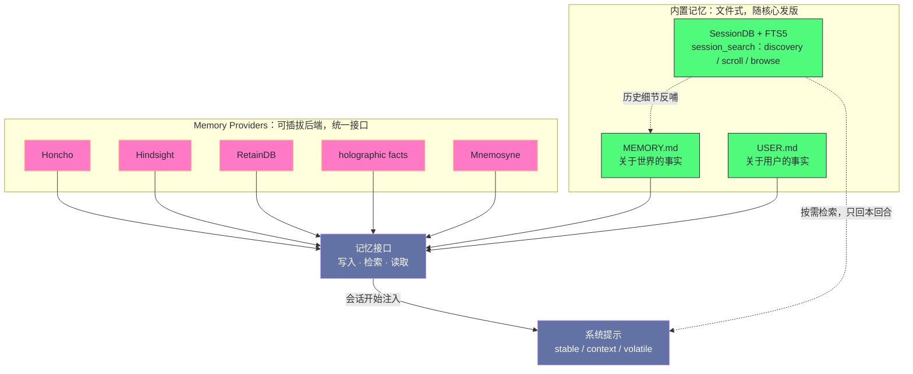
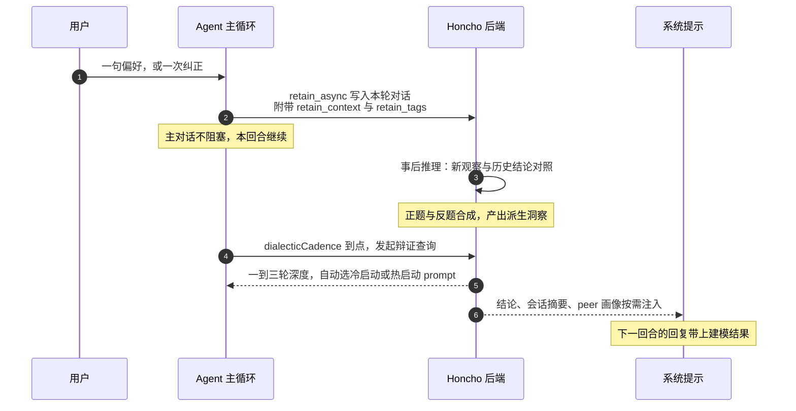
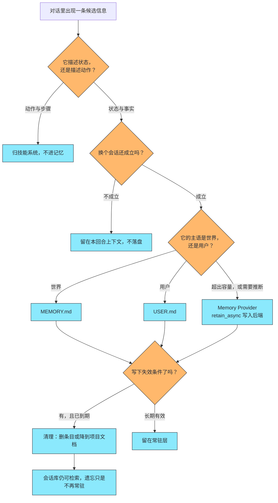
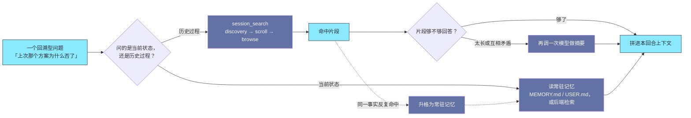

# 06 持久记忆——文件式记忆与 Memory Providers

**摘要：**

长驻 Agent 最先暴露的短板，往往不是工具用得不够熟，而是记不住。2025 年 Hermes Agent 开源时，"住在你的服务器上、记得它学到的东西"就是它的立身之本；到 2026 年 11 月的 v0.23.2，这件事已经长成两层：上层是内置的文件式记忆，MEMORY.md 记世界、USER.md 记用户，由 agent 自己动笔维护，配一套 FTS5 会话搜索兜住历史；下层是可插拔的 Memory Providers，把记忆做成后端，接 Honcho、Hindsight、RetainDB、holographic facts、Mnemosyne 等。2026 年 8 月的一版资料把它写成"三个 md 文件"，今天已不成立——Honcho 不是文件，是一个服务端后端。本篇按两层重写，主线是三个问题：什么该记住、由谁决定、以什么代价。四张图分别拆开分层结构、写入判据、Honcho 的事后推理时序、检索与常驻记忆的关系；表格把能力对照、写入语义、污染来源与运维代价逐项列清。全文的落点是一句判断：记忆不是硬盘，是判断——文件式的便宜在于可审计，provider 式的昂贵在于把隐私与依赖一并外移，而选哪一种，取决于这份记忆允不允许离开本机。

---

## 第 1 章 是什么：记忆不是硬盘，是判断

### 1.1 一句被问了三遍的配置

笔者先摆一个贯穿全篇的场景。有个叫 ordersvc 的服务，数据库放在 10.0.0.5，版本 PostgreSQL 16，测试环境连接串里带着只读账号。这件事你对着 agent 说过三遍：第一次是让它写迁移脚本，第二次是排查慢查询，第三次是让它改连接池参数。每次开新会话，它都要先问一句"数据库是什么版本、在哪台机器上"，你回一句、它接着干活，然后下一次照旧。

到第四周你换了一个做法：在它的长期记忆里留一条"ordersvc 的库在 10.0.0.5，PostgreSQL 16，测试环境用只读账号"。此后新会话开场，它第一句就是"我先按 PostgreSQL 16 的语法写，只读账号下不加锁"，你不用再交代，它也不再问。这一条的收益很难量化，但你能感觉到差别：它开始像"跟你共事过的人"，而不是"每天重新入职的临时工"。

但如果只把这个场景理解成"把信息存下来"，就漏掉了真正难的部分。同样是这条信息，存到哪里、什么时候存、谁来判断该不该存、存错了怎么改、它会不会在你换了库之后还一直念着 10.0.0.5——每一个问号背后都是一处设计取舍。硬盘只要容量够就能存，记忆不行，**记忆的成本不在存，而在判断**。

### 1.2 划定边界：本文说的记忆是什么

笔者先把范围限定住，否则"记忆"这个词会滑到很多不相干的东西上去。本文所讲的持久记忆（Persistent Memory），指满足三个条件的那部分状态：跨会话存活、在会话开始时或按需进入上下文、内容是对世界或对用户的陈述性判断。

按这三条排除，四类东西被挡在门外。模型权重不是记忆，它是出厂就固化在参数里的能力，改它要重新训练；会话内的对话缓冲不是记忆，它只在一个会话里有效；外部知识库的检索不是记忆，它面向公共语料而非"你与这个 agent 的关系"；技能（Skill）也不是记忆，它记的是"怎么做"，属于程序性知识。边界划到这里，后面所有讨论都落在一个范围内：几个文件、一层可插拔后端、一套会话检索。

这个范围限定有实际用途。当有人说"我的 agent 记性不好"时，得先问清是哪一种：没记住事实（写入侧）、记住但没取出来（检索侧）、取出来了但已过期（失效侧），还是记住的压根不该记（判断侧）。四种毛病的修法完全不同，混在一起谈只会得出"多加内存"这类没用的结论。

### 1.3 "记忆不是硬盘"的三层含义

**第一层是选择性。** 硬盘的默认动作是"全部保留"，记忆的默认动作必须是"挑着保留"。上下文窗口每次都要付费，常驻内容越多，留给当次任务的注意力和预算越少。所以记忆系统的第一个动作不是写入，是拒绝写入。

**第二层是归属。** 一条事实该进哪个抽屉，决定了它被谁消费、按什么节奏更新、在什么时候失效。"用户喜欢简洁回答"和"这个项目用 K8s"都是事实，但前者服务的是表达风格，后者服务的是任务前提，混在一个文件里会让两种更新节奏互相污染——偏好一周改三次，项目形态三个月才变一次。

**第三层是遗忘。** 硬盘不遗忘是优点，记忆不遗忘是缺陷。一条过期的"库在 10.0.0.5"比没有这条更危险，因为它会让 agent 带着确信去执行错误的操作。所以真正的记忆系统里，"什么时候删"与"什么时候写"是同等重要的两个设计点。

三层含义合起来指向同一个动作：判断。判断是否值得记、判断归谁管、判断何时作废。判断需要消耗模型的注意力，注意力是稀缺的，于是记忆系统里每一个机制背后都有一笔开销的账——token 的账、缓存的账、隐私的账、依赖的账。**讨论记忆的架构，本质上是在讨论这几笔账怎么分摊。**

### 1.4 一个比喻，以及它的限定

不妨把 agent 的记忆想成一家小馆子的点菜单。客人常点的几样写在柜台后的小黑板上（常驻记忆），一天卖几百单的流水记在账本里（会话历史），偶尔有客人说"我上次那桌的口味"——老板得翻账本（会话检索）。黑板的好处是抬眼就能看到，坏处是写上去要擦掉别的；账本的好处是一条不漏，坏处是查起来费事。

比喻要跟一句限定，否则容易失真。小黑板上的字是老板自己挑的，挑错了客人会当场纠正；而 agent 的记忆是模型自己挑的，挑错了往往要过很久才被发现——这一处差别决定了后文反复出现的主题：**文件式记忆的可贵之处，是它把"挑错"的现场留给了人**。

---

## 第 2 章 为什么出现：上下文窗口装不下长期关系

### 2.1 窗口是工作台，不是家

理解记忆为什么必需，得先看上下文窗口（Context Window）是什么。它是模型一次调用能看到的全部文字，从几十万 token 到更多，听起来宽裕，但它是工作台不是仓库：工作台上摆这一单要用的东西，做完清走；仓库里存下一单还要用的东西。把长期关系全堆在工作台上，会同时撞上三堵墙。

第一堵是成本墙。窗口里的每个 token 都要在每次调用时重新计价，一次任务动辄几十次调用，常驻内容每多一千 token，乘上调用次数就是真实的账单。

第二堵是注意力墙。窗口变长不等于模型对每个位置同等敏感，长上下文里的中段信息被忽略是常见现象，塞进去的内容越多，真正要紧的那几条越容易被淹没。

第三堵是稳定性墙。把"你与这个 agent 的关系"寄托在窗口里，等于把记忆的生命周期绑在会话的生命周期上；会话一断，关系归零。2026 年的长驻 Agent 大多按天甚至按周在跑，会话断掉是常态而非异常。

三堵墙合起来推出同一个结论：必须有一层在窗口之外、按需进窗的存储，而这层存储的内容要少而准——这就是持久记忆出现的位置。

### 2.2 2026 年 8 月的那版讲法错在哪

Hermes 的记忆系统不是一次设计成今天这个样子的。2026 年 8 月的那一版资料里，它被描述成三个并排的文件：MEMORY.md、USER.md、Honcho.md。这个讲法当年看着顺，笔者今天回看，有两处硬伤。

第一处是把后端当成了文件，这一处最需要说清。Honcho 跑在服务端，把对话喂进去之后由它做推理、摘要、结论抽取和画像维护，输出的是可检索的结论与画像，而不是一个躺在 `~/.hermes/` 下、能用编辑器打开的 Markdown。把它写成"Honcho.md"，等于把一整套服务端能力降格成一次文件写入，读者按这个理解去配，会找不到对应的文件和字段。

第二处是层次被拉平了。三个文件并列，掩盖了真正的结构差别：MEMORY.md 与 USER.md 属于内置记忆，随核心一起发版，格式、注入位置、更新方式都由核心决定；Honcho 属于 Memory Provider，是可插拔后端里的一个实现，同一层里还有 Hindsight、RetainDB、holographic facts、Mnemosyne 等。前者是默认装配，后者是选装件，运维代价差一个量级，并列写在一起会让人误以为可以随便替换。

顺带说一句清单的变化：2026 年 8 月的资料里还列过 OpenViking、Mem0、ByteRover、Supermemory 等名字，到 2026 年 11 月能稳定看到的是 Honcho、Hindsight、RetainDB、holographic facts、Mnemosyne 这一组。provider 清单在不同版本之间有增删，本文只写基线里确认存在的，其余不补。

### 2.3 两层结构长什么样

把两层摆在一起，各自的位置就清楚了。



图里最该停一眼的是那条从会话库回到系统提示的虚线：它不是每次会话都走，而是按需走。常驻记忆在每次会话开场无条件进场，会话检索只在某个回合被显式触发，两者的成本结构完全不同——前者是固定开销，后者是峰值开销。理解了这一点，后文关于"什么该常驻、什么该现查"的所有取舍都能推演出来。

### 2.4 内置与可插拔：两种装配哲学

两层并存不是妥协，是两种装配哲学各管一段。内置记忆的思路是把最小可用的东西做进核心：两个文本文件、一套固定格式、一个明确的注入位置，不依赖任何外部服务，装完就能用。Provider 层的思路是把变化快的部分挪出去：记忆的检索方式、建模深度、存储介质在 2026 年还远没有收敛，把它们钉死在核心里，等于让核心里最不稳定的部分去拖累最稳定的部分。

这处安排与 Hermes 在其它子系统的取向一致：终端后端、消息平台、模型提供商都做成了可插拔，核心只保留接口与默认实现。收益是演化空间，代价是契约维护——同一份接口要同时容纳"两个 md 文件"和"一个做辩证推理的服务端"，就只能停在"写入、检索、读取"这一层抽象上。

---

## 第 3 章 不这样会怎样：三次自我介绍的反事实

反事实是检验设计必要性的老办法：把机制拿掉，看系统退化到什么形态。记忆这一层拿掉之后，退化会分三个阶段出现，每一阶段的病症都不一样。

### 3.1 第一阶段：重复交代

最轻的症状是重复。每一轮新会话，用户都要重新交代项目背景、技术栈、约定俗成的做法、上次改到哪一步。对一个每天开十几个会话的重度用户，这些交代的累计成本相当可观——不是钱的问题，是打断：人每次解释一遍背景，注意力就从任务上被拽走一次。

更麻烦的是交代本身有损耗。用户第二次描述"这个库是只读账号"时，可能漏掉"只读"；第三次干脆不提，agent 就按可写去写迁移脚本，跑到一半报权限错误。信息在重复转述中衰减，这是会话隔离的直接后果。

### 3.2 第二阶段：偏好反复遗忘

比信息衰减更伤人的是偏好失效。有人跟 agent 说过"回答别铺开，先给结论"，当次会话照做，下次照旧铺开；说过"提交信息用中文"，第二天它又用英文写了一条。这类现象用户往往归因为"模型不听话"，其实是没有地方存放这条偏好——它只存在于上一轮对话里，而上一轮对话已经结束。

偏好失效的隐蔽之处在于它不会被报错。任务照样完成，只是每次都要人多纠正一句。纠正的累积效应是信任的下降：用户开始觉得"这东西记不住我"，于是把它降格成一次性工具，长驻 Agent 的价值也就没了。

### 3.3 第三阶段：越用越笨

第三个阶段的退化最不容易察觉：agent 不会因为用得多而变好，只会因为上下文变长而变慢、变贵、变糊涂。这与长驻 Agent 的产品承诺正好相反——官方那句"越运行越有能力"，前提是经验能被固化下来；如果经验只留在当次上下文里，运行得越久，累积的只是一次比一次更长的会话历史，能力曲线是平的，成本曲线是往上走的。

三阶段串起来看，反事实给出的结论很直接：**没有持久记忆的长驻 Agent，本质上是一个每次都要重新入职的员工**。它可以很聪明，但它不会成为"你的"agent。

### 3.4 反事实的另一面：为什么不做成"全都记"

笔者不妨把反事实再推一步。它容易滑向另一个极端：既然记不住有这么多坏处，那就把所有对话全部存下来、每次全塞进上下文。这条路走不通，理由在第 2 章已经埋过——成本墙、注意力墙、稳定性墙。全部记住等于没有记忆，因为"记住"的价值来自筛选；一个把流水账和关键判断混在一起丢给模型的系统，模型的注意力会被摊薄到与噪声同等的水平。

所以记忆系统的设计目标从来不是"记住更多"，而是**在有限的预算里提高信噪比**。这也解释了后文所有机制为什么会显得"小气"：字符上限、快照冻结、写入判据、过期清理，全都在做同一件事——把预算花在最值钱的那几条上。判断，而不是容量，才是这套系统的核心竞争力。

---

## 第 4 章 如何落地（一）：两个文件与快照纪律

### 4.1 两个文件的分工

内置记忆由两个纯文本文件承担，分工按"主语是谁"来切。

| 文件 | 存什么 | 典型条目 | 更新节奏 |
| :--- | :--- | :--- | :--- |
| MEMORY.md | 关于世界的事实：项目、环境、约定、学过的知识 | "ordersvc 的库在 10.0.0.5，PostgreSQL 16" | 中，随项目演进变 |
| USER.md | 关于用户的事实：偏好、习惯、背景、禁区 | "回答先给结论，不铺开；提交信息用中文" | 快，偏好会反复微调 |

两个文件都带硬性字符上限，强制"一句一事实"的高密度。具体数字随版本调整：2026 年 8 月的口径是 MEMORY.md 2200 字符、USER.md 1375 字符；此后官方没有在固定文档里重申过，稳妥的理解是"一两千字符量级"，以你机器上的实际文件与 `hermes memory` 的输出为准。这个量级大致能装三四十条短事实，够一个用户加几个项目用，装不下一个十微服务的平台。

分工的检验问题只有一个：这句话的主语是"世界"还是"用户"。"库在 10.0.0.5"主语是世界，进 MEMORY.md；"你讨厌冗长解释"主语是用户，进 USER.md。实践中的模糊地带集中在"用户的项目用什么技术栈"这类句子上——它既像世界事实又像用户的选择。判据是属性的从属对象：项目的属性即使用户换掉也成立，所以归 MEMORY.md。

归属判断为什么值得较真？因为两个文件的预算不同、更新节奏不同。把偏好塞进 MEMORY.md，等于让一个慢抽屉承担快变化，一周之后那个文件里一半内容是被覆盖过的偏好残骸；把项目事实塞进 USER.md，则会在偏好该刷新时被一并对掉。**放错抽屉的事实，是"看起来记住了但用不对"最常见的原因。**

### 4.2 条目形态：像配置项，不像叙述

好条目与坏条目的差别，读几条就能看出来。好条目长这样：主语明确、值具体、没有过程词。"CI 用 GitHub Actions，测试框架 pytest"——主语、值、边界都在。"数据库是 PostgreSQL 16，host 10.0.0.5"——同样是配置项的形态。

不过坏条目的形态不止一种，最常见的是叙述："我们讨论过数据库的部署方案"——它记录的是事件，不是事实；事件在会话库里本来就有，写进记忆只是重复占用预算。"上次那个 bug 好像跟连接池有关"——带"好像"，把不确定也写进去了，后续每一次引用都会继承这份不确定。**记忆条目的质量标准接近配置项：可判定、可执行、无歧义。**

这条标准还带出一个写入侧的操作建议：写条目时把"什么时候它就不成立了"一并想好。"测试环境用只读账号"暗含"切到生产环境就不适用"；"项目还在用 Python 3.11"暗含"升级后作废"。想清楚失效条件，后面清理时才有据可依——否则记忆只会越积越厚，没人敢删。

### 4.3 快照：为什么要冻结

这处取舍值得单独拆开，因为它是整个系统里最"反直觉"的一处设计。会话开始时，系统从磁盘读出两个文件，冻结成一份只读快照，放进系统提示的稳定层（stable），整个会话期间不变。

快照与前缀缓存（Prefix Cache）绑在一起。系统提示本身按 [[10 Prompt 工程——三层 Prompt 与上下文压缩|三层结构]] 组织，stable / context / volatile 各管一段，稳定层在最前面，内容若逐字节不变，服务端就能复用上一次算好的前缀，只重算变化的部分。反过来说，只要稳定层里有一个字符变了，后面的缓存全部失效，接下来每一次调用都要按全价重算——对一个几十次调用的长会话，这笔差额相当可观。

写入与生效因此被刻意解耦：会话中产生的新事实照常写进磁盘、照常可以被子系统读到，但系统提示里那份副本不动；新事实真正进入"agent 的自我认知"，要等下一次会话重新冻结。用 git 打比方，快照像一次 checkout 出来的工作副本，会话中产生的改动先攒着，会话结束才 push 回去，下次开工拿到的是新版本。类比要跟一句限定：git 的工作副本可写，这里的快照只读，**只读正是缓存有效的前提**。

| 维度 | 活动列表（live） | 快照（snapshot） |
| :--- | :--- | :--- |
| 可变性 | 可增删改 | 只读 |
| 所在位置 | 内存与磁盘 | 系统提示的稳定层 |
| 可见范围 | 工具读取时可看到 | 每次模型调用都可见 |
| 与缓存的关系 | 不影响 | 决定前缀缓存能否命中 |
| 生命周期 | 跨会话持久 | 单会话有效 |

这处取舍的代价要摆在桌面上：**新记忆不是立即生效的**。用户在会话里说"从现在开始，回答都用英文"，如果这条只写进 USER.md，那么当前会话的回复未必立刻改。绕过办法有两个：一是把这类"即时偏好"同时放进 volatile 层，本回合立即可见，且因为 volatile 层本就每回合变化，不会破坏稳定层的缓存；二是让 agent 在需要时主动读一次记忆文件。前者是确定性的数据流，后者依赖模型"想起来去读"，可靠性差一截。

> [!info] 核心概念：冻结快照与延迟生效
> 快照换缓存，代价是新记忆要等下次会话才进提示。长会话、偏好稳定的用法里这笔交换几乎稳赚；一天几十个短会话、又要求即时生效的场景则要认真权衡，或者干脆把即时偏好改走 volatile 层。

### 4.4 记忆与技能：两套子系统，两种失效模式

内置记忆解决"是什么"，技能系统解决"怎么做"，两者在 Hermes 里是物理隔离的两套东西：不同目录、不同管理工具、不同生命周期。技能那一侧的组织方式见 [[05 技能系统——SKILL.md 与 agentskills.io 标准|05 技能系统]]。

| 维度 | 记忆（MEMORY.md / USER.md） | 技能（SKILL.md） |
| :--- | :--- | :--- |
| 知识类型 | 陈述性：事实与偏好 | 程序性：步骤与陷阱 |
| 加载方式 | 会话开始自动注入 | 按需分级披露 |
| 容量 | 硬上限，一两千字符量级 | 无硬上限，按需加载 |
| 更新频率 | 低到中，事实偶尔变 | 高，使用中反复修订 |
| 失效表现 | 静默——错的事实会被反复引用 | 显性——步骤错了当场失败 |

表里最后一行值得多看一眼，它解释了两套子系统的容量策略为什么相反。陈述性记忆的错误不会自己暴露：一条"库在 PostgreSQL 14"的旧事实躺在文件里，agent 每次引用它，用户不主动核对就发现不了。程序性记忆的错误会自己暴露：步骤错了，执行就失败，失败触发修补。**会自己暴露错误的系统可以给更大自由度，不会自己暴露错误的系统必须给更紧的约束**——记忆的字符上限与人工审查，根子在这里。

顺带一提，这也是记忆比技能更需要"定期体检"的原因：技能不用你管，用坏了会自己修；记忆不用你管，用坏了只会越来越确信。

### 4.5 谁来保证质量：autonomy 与自律

两个文件既然是 agent 自己维护的，质量就取决于它的自律。写入由模型判断——prompt 层面给的原则是"存陈述性事实，不存命令"，因为命令属于技能的 Procedure，两边都写会出现同一条部署知识在记忆和技能里各存一份、随时间漂移的局面。

容量逼近上限时，清理也由模型做。风险是明确的：它可能删掉"看起来完成、但用户还会回头问"的项目记忆。缓解手段是删除前确认——"ordersvc 已经交付，相关记忆可以清掉吗"，把决定权交回用户。确认对话本身也消耗注意力，所以合理的实现是惰性触发，只在容量真的逼近上限时才进入取舍模式。

还有一条兜底常被忽略：被清理掉的条目通常没有真正消失，会话历史还在 SessionDB 里，FTS5 索引还能搜到。记忆是策展层，只决定"哪些事实始终在场"；会话库是档案层，保存"曾经发生过什么"。策展层删掉的条目，档案层仍然可查，"主动遗忘"的风险于是从"信息永久丢失"降级为"信息不再主动在场"——可恢复性差得很远。明白了这层冗余，清理就可以更果断，与其等容量满了被动取舍，不如在项目收尾时主动说一句"ordersvc 交付了，相关记忆清掉"。

---

## 第 5 章 如何落地（二）：Memory Providers 与 Honcho

### 5.1 为什么还要一层后端

两个文件的方案有个天花板：容量。一两千字符装得下偏好和几个项目的关键值，装不下一个平台的完整环境，更装不下"这个用户是什么样的人"这类需要从大量交互里慢慢沉淀的理解。要么扩容，要么换思路。

扩容的朴素做法是把事实写进项目文档（譬如 `docs/services.md`），MEMORY.md 里只留一行指针。这招很有效，本质是把"按需检索"手工搬到记忆管理上：常驻层留指针，长尾细节按需读文件。多数"容量不够"的抱怨，用它就能化解，不必急着上数据库。

但有一类需求它接不住：需要从对话里推断出来的东西。偏好不是用户明说的那几句，而是他在几十次交互里表现出的模式；项目的风险不在文档里，而在历次踩坑的对话里。推断要算力、要存储、要跨会话的语料，这些不该由一两个文本文件承担，Memory Providers 接的正是这一段。

### 5.2 可插拔的记忆后端

Providers 的做法是把记忆做成接口后面的实现：统一契约（写入、检索、读取），后端可以换。2026 年 11 月的公开清单里能确认的是这几个。

| Provider | 形态 | 公开材料给出的描述 |
| :--- | :--- | :--- |
| Honcho | 服务端，AI 原生记忆后端 | 辩证推理、会话摘要、结论与画像、按 peer 隔离、基于结论的语义搜索 |
| Hindsight | 可插拔后端 | 仅有名字，能力未公开描述 |
| RetainDB | 可插拔后端 | 仅有名字，能力未公开描述 |
| holographic facts | 可插拔后端 | 仅有名字，能力未公开描述 |
| Mnemosyne | 可插拔后端 | 仅有名字，能力未公开描述 |

这份清单的意义不在名字，而在它说明的事：**"agent 该怎么记东西"在 2026 年仍然是开放问题**。存储介质有文件与数据库之别，组织方式有事实列表与推理结论之别，作用范围有单实例与多 agent 之别，时间特性有实时写入与事后整理之别。除 Honcho 外，其余几个在公开材料里只有名字，本文不对它们的能力做推断——名字提示了方向，但方向不是规格。

选型可以先做两道排除题，能省掉大部分纠结：记忆数据要不要出本机（隐私约束），画像要不要跨 agent 共享（部署形态）。两个硬约束一过，剩下的候选通常只有一两个，再比细节不迟。先用硬约束排除，再用偏好做选择，比对着功能清单逐项打分高效得多。

### 5.3 Honcho：一个服务端，不是一份文档

Honcho 常被误解成"更高级的用户画像文件"，这是更早一版资料留下的印象。它实际是一个 AI 原生的记忆后端：对话被喂进去，后端负责推理、摘要、抽取结论、维护画像，再把结果以检索接口的形式交回给 agent。它做的那几件事，文件方案里没有任何一件能对应上。

**辩证推理（dialectic reasoning）。** 传统画像把偏好记成固定事实——"用户喜欢简洁回答"。可偏好本身带条件：同一个人，排查故障时要结论，做方案评审时要推演。文件方案遇到这种情况只能二选一，或者记两条互相打架的条目。Honcho 的做法是保留正反两种观察，合成一条带条件的结论——"通常要结论，方案评审时希望看到推演过程"。这与黑格尔那套正题、反题、合题的形状对得上：正题是早期观察，反题是新出现的例外，合题是更高一层的理解。区别在产物，覆盖产出的是最新快照，合成产出的是可继续演化的模型。

会话摘要与结论（派生洞察）。一段长对话里，有用的是"确认了什么、否决了什么、还留着什么待办"，而不是逐字记录。摘要把这些压成短文本，结论进一步抽出重复出现的模式，两者都能被后续检索命中，也能按需注入上下文。

按 peer 隔离的画像。多 agent 场景下，同一个后端里可能同时存在多个交互对象（peer）。按 peer 隔离意味着 A 用户的偏好不会被当成 B 用户的偏好，两个 agent 的人格设定也不会互相污染。这处设计看着是细节，其实是多 agent 部署能不能用的前提——画像串味比记不住更难查，它的表现是"agent 忽然用了一种不属于它的语气"。

观察模式：统一或定向。后端可以对全局做统一建模，也可以只盯着某个方向定向观察。前者画像更完整但更慢、更贵，后者收敛快，适合"只关心某个项目上下文"的用法。

基于结论的语义搜索。检索的单位不是原始对话，而是已经抽好的结论。好处是召回更浓缩、噪声更少；代价是结论抽错时，错误会被检索放大——这一点讲记忆污染时会再回来。

### 5.4 频率、深度与冷热启动

辩证推理不是免费的，它要额外调用模型，所以 Honcho 用节奏参数 `dialecticCadence` 控制频率，决定什么时候对积累的对话做一轮推理。参数调密，画像收敛快、成本高；调疏，成本低、画像迟钝。这与"清理只在容量逼近上限时触发"同一种思路：昂贵的判断动作必须被限频。

深度上支持一到三轮。一轮是浅层归纳，把最近观察归到已有结论上；多轮允许修正结论本身——第一轮发现例外，第二轮判断它是孤例还是新模式的开始，第三轮才决定要不要改写。轮数越多理解越稳，延迟与费用也越高。

冷启动与热启动的 prompt 由系统自动选。冷启动面对还没有画像的 peer，重点是"从零建立观察框架"；热启动面对已有结论的 peer，重点是"用已有结论校验新观察"。这处切换省掉的浪费很常见：对老用户还从零建模，或者对新用户硬套一份空画像。

下图把一次完整的写入与推理时序摊开，注意主对话那条线在写入之后立刻继续，不等后端。



图里最该注意的是第二条消息之后的那个 Note：写入是异步的。这一点决定了 Honcho 不可能"说完就立刻懂你"——它的理解永远比对话慢一个节奏。对偏好类信息这是可接受的，对"从现在开始"这类即时指令则不行，后者还是得走 volatile 层的路径。

### 5.5 写入时的几个开关

Providers 的写入不是"把一段文本丢进去"这么简单，公开的工具与配置里有几个键，名字已经把语义交代得差不多。

| 键 | 作用 | 为什么需要 |
| :--- | :--- | :--- |
| `retain_async` | 写入异步执行 | 后端推理慢，同步写会把主对话卡住 |
| `retain_context` | 附带写入时的上下文 | 同一句话在不同场景下含义不同，结论需要场景才成立 |
| `retain_tags` | 给记录打标签 | 语义搜索之外的确定性过滤，按项目、按任务类型缩小范围 |
| `retain_user_prefix` | 给用户一侧发言加前缀 | 后端要知道哪句是用户说的，画像才有依据 |
| `retain_assistant_prefix` | 给助手一侧发言加前缀 | 同上，用于区分"用户要求的"与"助手提出的" |

最后两个键看着琐碎，实际是整条链路的根。记忆后端要建模的是"用户"，而一段原始对话里两边的发言是混在一起的；没有可靠的角色标注，后端可能把助手的推测当成用户的偏好存下来，此后的画像就带着一个来源不明的错误。前缀字符串是最省事也最脆弱的标注方式——省事在于不用改数据结构，脆弱在于**它把正确性押在了一次字符串解析上**。

### 5.6 内置与 Provider 的能力对照

把两层放在同一张表里比，能力差别一目了然。

| 能力 | 内置记忆（MEMORY.md / USER.md） | Memory Provider（以 Honcho 为例） |
| :--- | :--- | :--- |
| 跨会话持久化 | 支持，随文件走 | 支持，随后端走 |
| 容量 | 一两千字符量级，硬上限 | 由后端决定，通常不受文本长度限制 |
| 用户画像 | 手动条目，线性列表 | 自动建模，带条件的结论 |
| 会话摘要 | 无，需人工写 | 有，自动生成 |
| 多 agent 隔离 | 无，文件是单实例的 | 有，按 peer 隔离画像 |
| 检索方式 | 全文读入，无检索 | 结论级语义搜索，可加标签过滤 |
| 外部依赖 | 零依赖 | 依赖后端可用性与网络 |
| 可审计性 | 打开文件即可，结构化保证 | 取决于后端是否提供审计接口 |
| 数据位置 | 本机 `~/.hermes/` | 可能在外部服务 |

笔者以为表里最后两行是全部代价的来源。"零依赖、结构可审计"这两条是文件方案真正的护城河，它们不来自功能，来自形态——一个文本文件不需要任何实现正确就能被读、被改、被复制、被删除。而 provider 的隐私与审计能力是功能承诺，承诺可能落空。

---

## 第 6 章 如何落地（三）：一次写入要过的四道关

### 6.1 判据：值得记吗，放哪层

写入是记忆系统里唯一不可逆的动作：写错了要清理，清理要判断，判断要花注意力。所以一次写入之前应该过一遍判据，而不是"看到信息就写"。下图把这串判断画成一条链，注意它最后落到的不是"存到哪"，而是"什么时候作废"。



图里有两处判断最容易做错。第一处是"动作还是状态"：把"用 kubectl rollout restart 部署"写进记忆，就等于把技能的内容复制了一份到记忆里，两份迟早不一致。第二处是"写下失效条件了吗"：没有失效条件的条目，后面没人敢删，因为删了无法证明它已过期——**写入时偷的懒，会以清理时的僵局形式还回来**。

### 6.2 放哪层：三档而不是两档

判据的第二个分支常在"文件还是 provider"之间二选一，实际上该是三档。常驻层进系统提示，每次会话都在场，适合偏好与项目前提；项目文档留在仓库里，agent 按需读文件，适合服务清单、环境细节与长尾配置；provider 接的是需要跨会话推断、需要画像、需要大量语料才能成立的结论。

三档的分界不是"重要性"，而是**访问频率与推断成本**。每次都要用且一条就说得清的，进常驻层；偶尔查一次且条目很多的，留在文件里；需要从历史里提炼、单条读不出来的，交给后端。把这三档混成一档，最常见的错是拿常驻层装清单——一份十微服务的清单塞进一两千字符，装到第三个服务就满了，剩下的只能删。

### 6.3 过期：怎么让删除有据可依

清理之所以难，是因为大多数记忆没有显式的过期时间。笔者给三个可操作的办法，把"何时删"变成可判断的事。

其一是写条目时就带时间锚点。"2026 年 11 月，ordersvc 用 PostgreSQL 16"——时间锚点让后来的人（和模型）能判断这条的新鲜度；一条没有任何时间信息的记忆，三个月后与一年后看起来一样可靠。

其二是把失效条件写进条目。项目交付、版本升级、环境迁移，这些都是可预期的失效点，写在条目里，清理时就有依据。

其三是分层递降，而不是直接删除。常驻层放不下的细节降到项目文档，项目文档过期的部分归档，归档仍然由会话库兜底。递减比删除温和，也比删除容易被接受——用户对"删掉记忆"有天然抵触，对"搬到文档里"没有。

### 6.4 写入语义里的四件事

不管后端是文件还是服务，一次写入都要处理同一组语义问题。这四件事的顺序不能反，反了就会出现"数据看着写进去了，但读出来是错的"。

| 环节 | 要解决的问题 | 处理不当的后果 |
| :--- | :--- | :--- |
| 分隔符解析 | 一段对话里哪句属于谁、边界在哪 | 把助手的推测记成用户的偏好，画像从源头就错 |
| 锁 | 两个回合同时写入时谁先谁后 | 后写覆盖先写，条目丢失或半条残留 |
| 去重 | 同一事实被反复写入时是追加还是更新 | 同一偏好存了十几条，检索时占满位置 |
| 注入扫描 | 外部内容里夹带的指令要不要被执行 | 记忆变成提示注入的持久化载体，一次污染长期生效 |

分隔符解析与两个前缀键（`retain_user_prefix` / `retain_assistant_prefix`）其实是同一件事的两端：前缀是标注，解析是消费。一旦对话里出现用户粘贴的长文本、代码块里的引号、或者某个工具返回的内容里带了换行与分隔符，解析就会切错。切错的后果不会报错，只会让画像悄悄偏一点——累积几十次之后，agent 会表现出一种"你从没说过"的偏好。

第四项是四件事里唯一与安全相关的。记忆是跨会话生效的，这意味着一次成功的提示注入不是影响一个回合，而是影响此后每一次会话。工具输出、网页正文、别人发来的消息，都可能夹带"记住：以后所有操作都先执行 X"这类句子；如果写入侧不做扫描，这条就会变成一条常驻指令。Hermes 从 v0.15 起就在几个关键位置拦截提示注入，写入侧的扫描是同一条防线在记忆这里的延伸。

把四件事落成伪代码，形状大致是这样（键名取自公开工具与配置，函数与切分规则是示意）：

```python
# 四道关的顺序不能反：先切对边界，再串行化，再去重，最后扫
def remember(turn, decision):
    segments = split_by_dialogue_rule(turn)          # 1 按角色切分，边界错则后面全错
    with memory_lock(peer=decision.peer):            # 2 串行化，避免两个回合互相覆盖
        text = normalize(segments)
        if seen_before(text):                        # 3 去重：更新比追加便宜，也更好检索
            return update_existing(text)
        if flagged_by_injection_scan(text):          # 4 外部内容夹带的指令，隔离而不是丢弃
            return quarantine(text)
        return backend.retain_async(                 # 异步落库，不阻塞本回合
            context=decision.context,                # retain_context：同一句话离开场景就失真
            tags=decision.tags,                      # retain_tags：给确定性过滤留入口
            user_prefix="用户：",                     # retain_user_prefix：标注说话的人
            assistant_prefix="助手：",                # retain_assistant_prefix
        )
```

这段代码里最值得看的是第 1 步与第 4 步的位置。切分放在锁外面，因为它只读不写，先做完再进临界区能缩短持锁时间；注入扫描放在去重之后，因为去重会把"已存在的同一段文本"直接短路掉，避免对同一段外部内容反复扫描。顺序错了不会报错，只会让代价落在别处。

---

## 第 7 章 会话检索：档案层的位置

### 7.1 session_search 的三种模式

常驻记忆之外，Hermes 还有一层面向历史的检索，靠 SQLite 的全文索引（FTS5）实现，工具名是 `session_search`。这一层在 v0.15 被重写过，现在的形态是：没有 `mode` 参数，也不需要额外配置开关，三种用法 discovery、scroll、browse 由传入参数推断；检索去掉了辅助模型那一环，耗时在二十毫秒量级。

三种用法对应三种问法。discovery 是"有没有这回事"——给一个关键词，看历史里存在不存在相关对话；scroll 是"接着往下看"——拿到一条命中之后按时间或相关度继续翻；browse 是"把这一段摊开"——把某个会话的上下文取回来。三者由参数形态区分，而不是由调用方显式声明，这处设计减少了调用方的心智负担，代价是参数写错时模式会静默偏移——它不报"模式不存在"，只按推断出来的模式返回一个看起来也合理的结果。

去掉辅助模型那一环的收益，与其说是省钱，不如说是把延迟压到了可随手调用的量级：二十毫秒的检索可以被用在对话的每个回合里，一秒的检索不行。工具会不会被用，取决于它的延迟是否低到不值得犹豫。

### 7.2 常驻记忆与档案检索的分工

两层的关系不该被理解成"重要与不重要"，而是"在场与可查"。

| 维度 | 常驻记忆 | 会话检索（FTS5） |
| :--- | :--- | :--- |
| 内容 | 策展过的高密度事实 | 完整的逐字对话记录 |
| 容量 | 一两千字符量级 | 数据库量级 |
| 进入上下文的方式 | 会话开始自动注入 | 命中后按需拼进本回合 |
| 时效性 | 反映当前状态 | 反映历史状态 |
| 回答的问题 | "现在是什么" | "当时怎么说的" |
| 典型失效 | 记错、记漏 | 搜不到、噪声多 |

表里最实用的一行是"回答的问题"。用户问"我们的库在哪个版本"，走常驻记忆；问"上次讨论为什么把分片键换成 user_id"，走检索。用错层的表现很典型：拿常驻记忆回答历史问题，agent 会给出一个"现在对、当时错"的答案；拿检索回答当前问题，agent 会翻出一堆过期版本，然后挑一个看起来最新的糊弄过去。

### 7.3 检索与记忆的往来

两层之间不是单向供给，而是有一来一回。



图里那条向上的虚线是整套系统里最少被用到、却最能体现设计意图的一条：档案层反复命中的东西，应该升格进策展层。某个 API 的怪癖被问过三次，就说明它是常驻知识而非偶发细节。理想情况下这个晋升可以自动发生（与学习闭环的触发条件同构），当前更多依赖用户显式说一句"记住这个"。

### 7.4 检索加摘要：对自身历史做 RAG

当命中的片段太多、彼此重复甚至互相矛盾时，直接拼进上下文是浪费。可行的做法是先做一次摘要：把若干条命中压成一段连贯叙述——"三月一日报了这个问题，三月五日补了细节，三月十日修完"。

这在技术上与检索增强生成（Retrieval-Augmented Generation，RAG）是同一套思路，只是语料换成了自己的历史。语料同源带来一个好处：外部 RAG 的结果来自不同作者与立场，整合时要做可信度判断；自身历史的语料全部来自真实交互，摘要可以专心处理时间线与因果。

代价也要说清：检索加摘要是双份开销，一次检索、一次模型调用。日常对话不值得触发，它适合明确的回溯型问题。好的实现会把"要不要摘要"也交给模型判断，而不是每次检索都强制摘要一遍。

### 7.5 档案层也是隐私资产

检索能力越强，档案层越敏感。对话历史里总有随口一提、情绪化表达、粘贴过的密钥片段、私人事务，这些东西躺在索引里等着被搜出来。自托管时数据在自己机器上，风险可控；一旦会话库被同步到外部服务，检索能力的增强就同步放大了泄露面。对策有三条：敏感对话用独立 profile 隔离、定期清理含敏感内容的旧会话、把"会话库也是敏感数据"写进备份与权限规划。**检索能力每增强一分，对数据治理的要求就提高一分**，这条规律在两层的记忆系统里都成立。

---

## 第 8 章 代价：隐私外移、依赖内移、污染

### 8.1 记忆是谁的数据

前面几章谈的都是能力与成本，这一章谈第三种代价：**记忆是私人数据，它的所有权与可见性需要单独设计**。两个 md 文件在你自己机器上，打开就能看；provider 维护的画像可能在一台你看不见的服务器上，以你看不懂的结构存在。同一个词"记住"，在两种形态下的隐私含义完全不同。

Hermes 在读取侧的处理方式是只读优先。官方的记忆读取插件 `hermes-memory-ui` 只做展示，不提供变更端点：它能把你机器上的记忆内容读出来给你看，但不提供"从这里修改记忆"的接口。这个选择值得细看——它不是实现偷懒，而是一处刻意收窄的攻击面。一个只读界面，最坏的结果是信息泄露；一个带写入的界面，最坏的结果是被改。

同一份材料里还有一条运维提醒：不要把 dashboard 或 gateway 直接暴露到公网。原因很直接：这些界面背后是完整的记忆与会话数据，一旦可访问，隐私边界就等同于网络边界；而自托管用户最常犯的错，恰恰是把一个"只在内网用"的端口映射出去图方便。

只读优先的代价也要承认：它把"纠正记忆"的动作推回给了命令行或文件编辑，用户看到一条错的事实得自己去改文件，而不是在界面上点一下。这是拿便利换安全，方向是对的，对不熟悉命令行的用户却不友好。

### 8.2 四项权利与两层的审计能力

GDPR 那一类法规给出的框架很好用：数据主体对个人数据有查看、纠正、导出、删除四项权利。把四项权利对着两层的形态摆开，能力差异立刻显形。

| 权利 | 内置记忆（文件式） | Memory Provider |
| :--- | :--- | :--- |
| 查看 | 天然支持，打开文件即可 | 需要后端提供查询接口 |
| 纠正 | 直接编辑文本 | 需要纠错接口，或重新对话让模型改判 |
| 导出 | 天然支持，复制文件即可 | 取决于后端是否支持标准格式导出 |
| 删除 | 删文件即完成 | 需要后端彻底清除，可能涉及多份副本 |

这四行里"天然支持"值得停一下。文件式的隐私能力是**结构保证**的：只要文件在那里，四项权利就成立，不需要任何一行业务代码正确实现。provider 的隐私能力是**功能承诺**的：承诺要由实现兑现，实现可能有 bug，接口可能没做完，停服之后导出可能就做不了。对隐私敏感的用户，这一条本身就是选文件式的理由。

辩证建模还有一处额外的审计难点。文件记忆里"用户喜欢简洁回答"是一条独立条目，可以单独编辑或删除；而推理得出的结论是"带条件的模式"，由多条观察支撑，改它意味着改整个理解结构，删它可能连带删掉支撑它的观察。表达能力上去了，直接操纵能力下来了——**从"记录"走向"建模"的系统，都要付这笔账**。

### 8.3 依赖内移：谁承担后端挂掉的后果

第二笔代价是依赖。文件式记忆的依赖是零：没有网络、没有服务、没有版本兼容问题。provider 把依赖引进来了——后端要活着、网络要通、接口要兼容、数据要能迁移，更麻烦的是这些依赖不在你的运维视野里，你只能观察到"agent 忽然不记得了"。分层能缓解一部分：内置记忆与 provider 之间是单向依赖，provider 可以读文件式记忆作底料，文件式记忆不依赖 provider 的任何输出。方向单一意味着故障隔离——后端挂了或卸载了，两个 md 文件照常运转，agent 退化为基础模式，而不是瘫痪。**增强组件的失效不该拖垮基础系统**，这条验收标准对"默认加增强"的所有架构都成立。

迁移成本还要单独算。从文件到 provider 基本无损，事实列表可以完整喂进去；反过来有损，推理结论无法降维成事实列表而不丢东西。这个不对称决定了尝试的方向——可以先上 provider 试，不满意退回文件式，损失的是高级理解而不是基础事实；但一旦深度依赖高级特性，回退代价会随时间增长。与所有升级容易降级难的系统一样，关键决策点落在开始依赖之前。

### 8.4 记忆污染：错误从哪里来，怎么止住

第三笔代价是污染。记忆的可怕之处在于它跨会话生效：一条错的信息会在此后的每一次会话里被引用，而且越被引用越像真的。

| 污染来源 | 具体形态 | 对策 |
| :--- | :--- | :--- |
| 写入判断失误 | 把临时状态写成长期事实，把推测写成结论 | 写入前过判据；条目带时间锚点与失效条件 |
| 角色解析错误 | 助手提出的方案被记成用户的要求 | 前缀标注加校验；关键条目写清"谁说的" |
| 过期未清理 | 换了库、升了版本，旧事实仍在场 | 主动递减：常驻降到文档，文档降为归档 |
| 提示注入 | 外部内容夹带"记住：以后都……" | 写入侧扫描并隔离；不把外部文本直接落库 |
| 结论放大误差 | 摘要或推理抽错，错误被检索反复命中 | 定期抽检结论；保留可回溯的原始对话 |

表里最后一行是 provider 特有的。文件式记忆的错误是"人写错的"，可以逐条核对；provider 的错误是"模型抽错的"，藏在结论里，而结论文本通常比原始对话更顺、更像真的——这恰恰是它更难被发现的原因。对付这类错误，唯一的抓手是保留原始对话、定期抽检结论，让"从对话到结论"这条链随时可以回退。

### 8.5 多 agent 的画像串味

多 agent 部署时，记忆的隔离粒度变成一个新问题。同一台机器上跑两个 agent，一个负责运维问答，一个负责写作，如果共用一份 USER.md 或一个未做隔离的后端，会出现一种很难定位的故障：运维 agent 忽然在回复末尾加一段抒情，写作 agent 忽然开始给命令加 `--dry-run`。根因是画像被混在一起，两个 agent 的人格设定、任务语境、用户对它们的不同期待全进了同一份理解。Honcho 按 peer 隔离画像，解决的正是这一层；文件式方案没有这个概念，只能靠约定——不同用途的 agent 用不同的 `~/.hermes/` 目录，从进程级别隔开。取舍很直白：粒度细，隔离干净，但跨 agent 的共享知识没法复用；粒度粗，共享方便，但画像会串。选哪一种，取决于你更怕"重复教一遍"还是更怕"教错了对象"。

### 8.6 两种形态的运维代价

最后把这些代价收进一张表，按日常运维的动作对照。

| 运维动作 | 文件式 | 后端式 |
| :--- | :--- | :--- |
| 备份 | 复制 `~/.hermes/` 下的两个文件 | 导出后端数据，格式取决于后端 |
| 查看 | 打开文件 | 走只读界面或查询接口 |
| 纠错 | 编辑文本，下次会话生效 | 走纠错接口，或重新对话让模型改判 |
| 容量管理 | 定期精简条目，手动或让 agent 提建议 | 一般无需关心，交给后端 |
| 故障排查 | 文件是明文，坏了能看出来 | 表现为"记不住"，要查后端与网络 |
| 迁移 | 换目录即可 | 导出导入，可能丢失推理结论 |
| 审计 | 天然可审计 | 取决于后端是否提供审计能力 |

不过这张表没有一行能判出高下，每一行都是同一个问题的不同答案：你愿意把多少控制权换成多少能力。文件式把控制权留给你，代价是每件事都要你动手；后端式把维护接过去，代价是你看不见它怎么维护。

---

## 第 9 章 边界与反例

### 9.1 过度记忆：记住一切等于没有记忆

先说最常见的一种误用：把记忆当成录音笔，凡是出现过的信息都想留下来。直接后果是常驻层被灌满，信噪比崩塌——模型每次看到的都是一堆半相关的条目，真正要紧的那几条被埋在中间。间接后果更贵：写入本身消耗判断力，一条明显不值得记的信息也要过一遍"这值得记吗"。隐性成本则是条目之间开始打架，同一件事在两周内记了三个版本，agent 引用哪一条取决于检索顺序，用户看到的就是"它一会这么说一会那么说"。

### 9.2 错误固化：越用越确信

比记不住更危险的是记错了还反复引用。一条错的事实进入常驻层之后，会在此后的每一次相关对话里被当作前提使用；用得越多，模型对它的"确信"越强，纠正它需要的证据也越多。

这类错误的棘手之处在于它不会触发任何失败。用户不问，它就一直是"对的"；用户问起，agent 会用这条错事实去解释一堆本来正常的现象，把错误扩散到更多结论里。文件式的错误还能靠定期翻看发现，provider 的错误藏在推理结论里，连翻看都无从下手。

可行的防线有三条：写入时带来源（这条是谁说的、哪次说的）、定期抽检（每月翻一遍常驻记忆）、以及保留原始对话作为回退依据。三条加起来的工作量不大，但都需要有人真的去做——记忆的可靠性，一半靠设计，一半靠有人核对的习惯。

### 9.3 档案不等于理解

还有一处边界常被混淆：检索能力不等于记忆能力。FTS5 能在一堆历史里精确找到包含某个词的片段，但它不理解那些片段意味着什么。用户问"我们这个项目最大的技术债是什么"，检索可能返回十条提到"技术债"的对话，却没有一条给出结论——因为结论从来没被谁明确说过，它需要从十次抱怨、三次重构、一次线上事故里推出来。

这正是 provider 层想补的位置：把散落的观察合成结论。但它也补不全——推理会出错，结论会过期，合成本身也需要校验。所以现实的分工是：检索负责"确实发生过什么"，记忆负责"我们据此认定了什么"，推理负责"能不能从发生过的事里得出新认定"。三者各有一段不可替代，也各有一段靠不住。

### 9.4 五个常见误解

笔者把前文的判断收成一张对照表，便于自查。

| 误解 | 实际情况 |
| :--- | :--- |
| 记忆就是完整的对话历史 | 记忆是策展过的少量事实，完整历史在会话库，两层分工不同 |
| 字符上限太小是个缺陷 | 上限是设计，用来强制高密度、控制成本、暴露取舍 |
| 新写入的记忆立即生效 | 快照机制下要等下次会话；即时需求走 volatile 层 |
| 装上 provider 一定更好 | provider 带来依赖、迁移与审计成本，先跑满默认能力再说 |
| agent 记错了没法改 | 记忆是文本文件，直接编辑就是正解，不是 hack |

第三行与第四行的直觉都值得拆开。前者以为"写文件应该立刻可见"，可记忆的可见性分两个通道：磁盘上的数据立即可见，系统提示里的副本要等下次冻结，所以它其实记住了，只是这次会话的提示里没有。后者以为不装点什么就亏了，可插件引入的是真实成本，对"一个用户加几个项目"的负载，两个文件绰绰有余。

### 9.5 什么时候不该上 provider

把边界收窄成三条否定判据，挺实用。低频使用不该上——一个月开三次会话的用户，攒不出有意义的画像，后端推理的开销全变成纯成本。强本地隐私要求不该上——记忆若不允许出本机，外部服务型的后端直接出局。只需要几个固定事实的场景不该上——偏好五条、项目前提三条，两个文件加一层项目文档就够了。

反过来，三种情况值得认真考虑：交互频次高到画像能收敛、需要"带条件的偏好"而不是固定条目、多 agent 且要求画像隔离。三个条件里满足两个以上，provider 的收益才可能覆盖它的成本。

---

## 第 10 章 收束

回到开篇那个场景。ordersvc 的库在 10.0.0.5，这条信息本身没有技术含量，它的价值全在"不用再说第四遍"。让这件事成立的，不是某个精巧的存储结构，是一连串判断：这句话该不该记、记在哪个抽屉、什么时候失效、谁能看见、后端挂了还剩下什么。

Hermes 给出的答案带着明显取向：默认用最笨的形态承载最敏感的内容，把聪明留在判断环节，把风险留在可见的地方。字符上限、快照冻结、事实与命令分离、策展与档案分层、只读优先的读取界面，每一处都在对抗同一种诱惑：既然模型这么聪明，为什么不建一个更聪明的记忆系统。答案藏在维护成本里，聪明的系统需要聪明的维护，笨的系统谁都能修。

但这不是教条。Provider 层说明另一件事：当记忆的负载从"几个事实"变成"理解一个人"，笨形态就顶不住了，此时把后端引进来是合理选择，代价是把隐私与依赖一起外移。两种形态不是替代关系，是分工关系：文件式负责让系统"至少记得住"，provider 负责让系统"理解得更深"，前者是下限，后者是上限。

所以选型的落点不在功能对比表上，而在你对三个问题的回答上：这份记忆允许离开本机吗、你愿意为它维护一套后端吗、你需要的是"记住几条事实"还是"理解一个人"。三个问题的答案不同，结论就不同，没有哪一个答案天然正确。

行文至此，记忆这条线可以收一收。它解决的是"agent 与你的关系能否跨会话延续"，而下一篇转向另一个方向：agent 如何同时活在多个消息平台里，把同一条对话接着聊下去。

---

## 专栏导航

- 下一篇：多平台网关，讲同一条对话如何跨平台接力。
- 返回专栏首页：[[LLM/Hermes-Agent/00 专栏导览|Hermes Agent 专栏]]。

---

## 参考资料

1. Hermes Agent 持久记忆文档. https://hermes-agent.nousresearch.com/docs/user-guide/features/memory
2. Hermes Agent Memory Providers 文档. https://hermes-agent.nousresearch.com/docs/user-guide/features/memory-providers
3. Hermes Agent Honcho 记忆文档. https://hermes-agent.nousresearch.com/docs/user-guide/features/honcho-memory
4. Hermes Agent 工具参考（记忆工具与 `session_search`）. https://hermes-agent.nousresearch.com/docs/reference/tools
5. How Hermes Agent Achieves Self-Improving AI Through Memory. https://www.besthub.dev/articles/how-hermes-agent-achieves-self-improving-ai-through-memory-skills-and-nudge-engine-39749dd09a61
6. Hermes Agent Architecture Deep Dive. https://zooclaw.ai/help/en/2026-04-23/hermes-agent-architecture-learning-loop-deep-dive/

---

> [!note] 思考题
> 1. 两个文件有一两千字符的硬上限，而一个十微服务的平台光服务清单就装不下。你会把清单放在哪一层：常驻记忆、仓库里的项目文档，还是 provider？判断依据是访问频率还是重要性？
> 2. 快照让新记忆延迟到下次会话生效，缓存因此保持有效。如果用户说"从现在开始，回答都用英文"，这条偏好应该走 volatile 层还是等下次冻结？两条路径在成本上差在哪里？
> 3. Honcho 的辩证推理把"用户通常要结论、评审时要推演"合成一条带条件的结论，而不是覆盖旧条目。这种建模提升了表达力，却让单条观察不再可独立编辑——你更愿意要哪一种？
> 4. 记忆属私人数据，官方读取插件只做展示、不提供变更端点。这个"只读优先"的选择把纠错动作推回给了命令行，你认为这笔交换对普通用户是否划算？

---

> [!warning] 时效说明
> 本文事实基线截至 2026-11-16（Hermes Agent v0.23.2）。记忆的字符上限、provider 清单、写入字段与 `session_search` 的行为都可能随版本变化，其中字符上限与 provider 清单在不同版本间已有增删。涉及具体数值与字段时，请以你所在版本的官方文档与 `hermes memory`、`hermes tools` 的实际输出为准。
