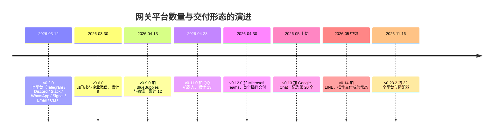
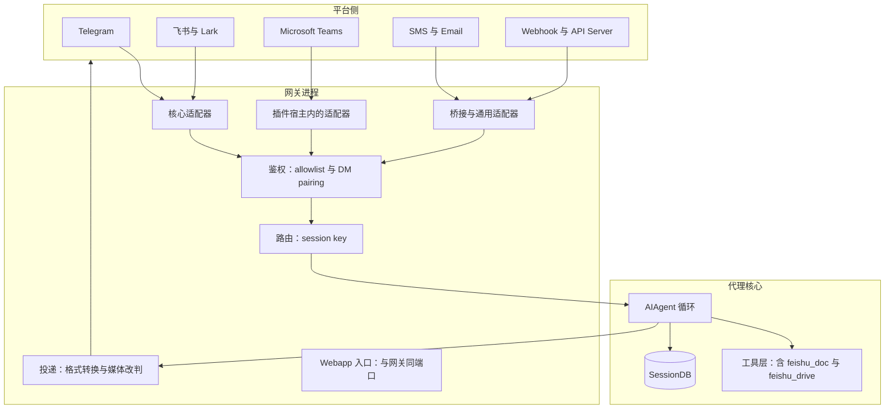
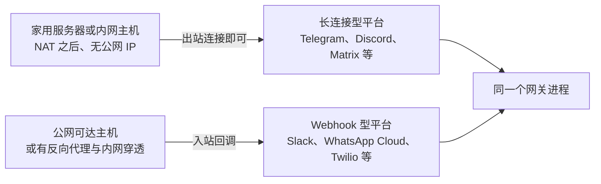
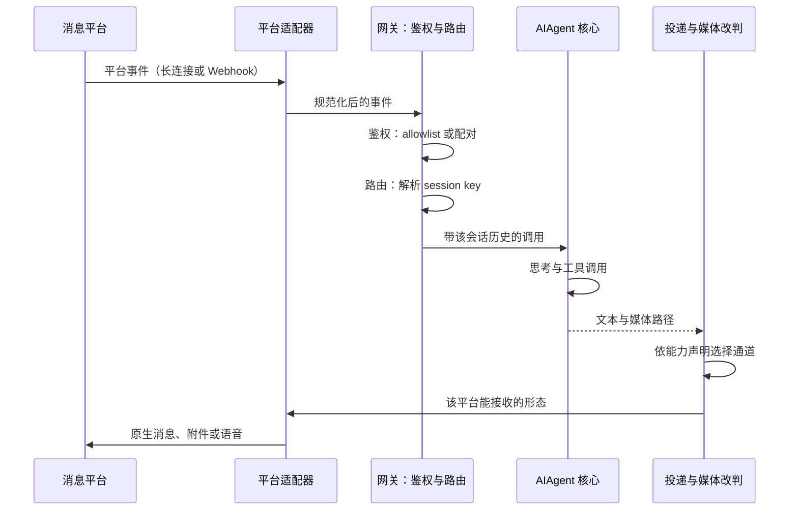
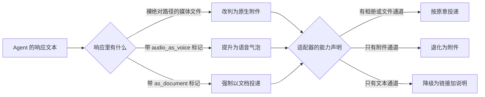

# 07 多平台网关——约 22 个平台与插件化宿主

**摘要：**

2025 年 Hermes Agent 开源时，它给自己定的位置是“住在服务器上、随时能被叫到”的那个 agent，而“被叫到”这件事最终落在一个长驻进程上，也就是网关。2026 年 3 月的 v0.2.0 里，这个进程同时挂着七个平台；到 2026 年 11 月的 v0.23.2，按公开材料的口径已经长到约二十二个平台与适配器。数量只是表象，真正改动形状的是 v0.12.0：Microsoft Teams 成为第一个由插件交付的平台，网关从“一堆适配器的容器”变成“插件宿主（plugin host）”，此后 Google Chat 以第 20 个平台的身份走同一条路，LINE 亦然。本文按五问推进——网关是什么、为什么要把多平台塞进同一个进程、拆成每平台一个 bot 会怎样、接入鉴权媒体如何落地、单点与隐私的边界又在哪里。八张表把平台清单、接入方式分组、平台能力差异、核心与插件的交付形态、单进程与多实例的代价、两种授权方式、失败回归与常见误读逐项摆开；五张图分别画架构、一条消息的往返、平台数量的时间轴、媒体传递的三条路径、两种接入形态对网络的要求。落点在两处权衡：插件化换来了升级自由，也把信任边界一起外移；单进程换来了记忆与技能的一份，也换来了一个不能随便倒下的单点。

---

## 第 1 章 是什么：一个进程，二十来个平台

### 1.1 凌晨的一条报错

笔者先摆一个贯穿全篇的场景。周六凌晨两点，订单服务 ordersvc 的 502 报警刷进了工作群的飞书机器人对话，值班同事在群里直接 `@` 了它一句“这是谁的锅”。一分钟后它回了第一条：上游连接池打满，链路指向新上线的库存 SDK；两分钟后又发了一张截图和一段日志摘录，附一句“要我按这个结论建工单吗”。周日早上笔者在地铁上用 Telegram 私聊它，问“周六那条 502，最后有没有人认领”，它翻出那次会话的记录，答得上来。周一坐到工位上，笔者打开终端敲 `hermes`，接着问了第三遍同一个问题，让它把周末的对话整理成一份复盘，它给出的文本里，飞书群的对话、Telegram 的追问、两条媒体附件全都在。

三个入口，三种设备，一个 agent，一份记忆。这件事今天看起来平淡，但它成立的前提是一连串并不平淡的决定：飞书群的陌生人凭什么能触达这台机器上的 agent、Telegram 的私聊为什么不会把上下文搅进飞书的群聊、那张截图为什么是以图片而不是一条链接的形式落地、以及这三处消息凭什么共用同一份记忆而不是各自记一份。

### 1.2 划定边界：本文说的网关是什么

“网关”这个词在本专栏里出现过好几次，含义却各不一样，笔者先把范围限定住。本文所讲的网关（Gateway），指 Hermes 里那个把外部消息平台的输入输出接到 agent 核心上的长驻进程：它负责接收平台事件、判断发送者是否有权、把消息映射到某个会话、把 agent 的回复改写成该平台能接收的形态，并在一个进程里同时维持这些连接。它不包括 agent 的思考循环，那属于第 03 篇的 AIAgent；也不包括命令在哪儿执行，那属于第 08 篇的终端后端。把它比作公司前台最贴切：访客先登记，登记之后才被领到对应的会议室，而会议室里的讨论不会因为门口换了一个人就从零开始。

边界画清之后，有三样东西要从“网关”这个概念里剔出去。一是 cron 定时任务，它同样与网关共处一个长驻进程，但没有外部平台这一侧，触发源是时钟而不是消息；二是审批与沙箱，那是第 12 篇的事，网关只负责把“这个人说了这句话”忠实地转述给核心；三是 API Server 这类入口，它是适配器家族的一个成员，接的是 OpenAI 兼容的聊天前端而不是消息平台，所以本文把它算作“同一宿主的另一种入口”，讲边界时会提到，但不当成平台来数。

### 1.3 清单与时间轴：22 这个数字怎么来的

数字先说清，因为它是本文最容易被误读的地方。公开材料给出的口径是约二十二个平台与适配器，而这个口径有明确的版本落点：2026 年 3 月 12 日的 v0.2.0 是七个（Telegram、Discord、Slack、WhatsApp、Signal、Email、CLI），2026 年 3 月 30 日的 v0.6.0 加入飞书 / Lark 与企业微信、累计九个，4 月 13 日的 v0.9.0 加入 BlueBubbles（iMessage）与微信、累计十二个，4 月 23 日的 v0.11.0 加入 QQ 机器人、累计十三个。此后节奏换了挡：4 月 30 日的 v0.12.0 交给 Microsoft Teams 一个特殊身份——第一个由插件交付的平台；5 月上旬的 v0.13 把 Google Chat 记为第 20 个；5 月中旬的 v0.14 补上 LINE。腾讯元宝被记为第 18 个，Matrix、Mattermost、钉钉、SMS（Twilio）、Webhook、IRC 则分散在不同版本落地。

清单按交付形态分成四组摆开，比按字母序排列更能看出设计意图。

| 分组 | 平台 | 进入时点 | 说明 |
| :--- | :--- | :--- | :--- |
| 核心，起点一批 | Telegram、Discord、Slack、WhatsApp、Signal、Email、CLI | v0.2.0（2026-03-12），共 7 个 | 网关最早的形态就是一进程七入口 |
| 核心，追加 | 飞书 / Lark、企业微信 | v0.6.0，累计 9 个 | 中文办公场景的两条主线 |
| 核心，追加 | BlueBubbles（iMessage）、微信 | v0.9.0，累计 12 个 | 一条 macOS 桥接，一条国内 IM |
| 核心，追加 | QQ 机器人 | v0.11.0，累计 13 个 | 核心内置阶段的最后一站 |
| 插件交付 | Microsoft Teams | v0.12.0 | 第一个由插件交付的平台 |
| 插件交付 | Google Chat | v0.13 | 官方记为第 20 个 |
| 插件交付 | LINE | v0.14 | 插件交付从此成为常态 |
| 插件交付 | IRC | 随版本 | 官方当作参考实现来看待 |
| 桥接与通用入口 | Matrix、Mattermost、钉钉、SMS（Twilio）、Webhook、腾讯元宝、API Server | 分散落地 | 元宝为第 18 个；API Server 供 Open WebUI 一类前端接入 |

表里刻意留了空白。第 15、16、17、19、21、22 号分别落在哪个版本、哪个平台，公开材料没有逐一给出，笔者不替它补；同样地，v0.6.0 到 v0.9.0 之间累计数从 9 跳到 12，而同批被点名的只有两个平台，中间那一个没出现在清单里，笔者按累计口径照录，不回头去凑。这种留白在技术写作里应当被保留，因为补一个数字只换来一次通顺，代价是读者拿它当事实引用之后的连锁错误。平台数量的意义也有限度：它是团队覆盖广度的证据，不是能力的度量，一个只用飞书和终端的用户，从二十二个平台里得不到任何额外的东西。

把这些落点排成时间轴，能看清一条被数量掩盖的曲线：前半段是“补平台”，后半段是“改交付方式”。

---

## 第 2 章 为什么出现：把 N 条连接线收进一个进程

### 2.1 从多协议客户端说起

把多个聊天网络接到同一个窗口里，这件事在桌面软件时代就做过一遍。2000 年代中期的多协议即时通讯客户端，靠一套协议插件同时挂 ICQ、MSN、Yahoo Messenger 与 Jabber，用户不必为每个网络装一个程序；2011 年 GitHub 开源的 Hubot 把同一套思路搬进了聊天室机器人，一个脚本进程同时服务 Campfire、IRC 与后来的 Slack；2014 年 Matrix 协议公开发布，干脆把“多个网络之间互通”写成了协议本身的目标。

这些先例给出的结论是一致的：协议适配层是必需品，但适配层的数量与价值不成正比。真正决定用户体验的，是多个入口背后是不是同一个“我”。多协议客户端里那个“我”是好友列表与聊天记录，机器人的“我”是脚本里那份状态，而在 Hermes 这里，“我”是记忆、技能、工具授权与学习闭环——四样东西都必须唯一，否则入口越多，agent 越分裂。

### 2.2 一座调度台，而不是二十二个值班员

笔者愿意用铁路调度台来比这个进程：二十二条线路各有各的信号制式、各有各的车厢规格，但调度台只有一座，它决定哪列车进哪条股道、哪张时刻表生效、临时加开怎么插空。适配器相当于各条线路上的信号设备，负责把本线路的方言翻译成调度台听得懂的报文；调度台自己不碰铁轨，也不管车厢怎么造。

这个比喻要立刻加一道限定：铁路调度台是纯转发，消息网关不是。它还必须回答“这个人是谁、他有没有资格、他这句话属于哪段对话”，这三件事在铁路里由票务与站台解决，在网关里却没有别的角色可以代劳。所以 Hermes 的网关比调度台多了两层：鉴权与会话映射。也正是这两层决定了它为什么不能退化成“每个平台一个转发脚本”。

### 2.3 四个共享，撑起“同一个我”

把单进程的好处拆开数，是四个共享。第一是记忆：MEMORY.md 与 USER.md 只有一份，飞书群里确认的“ordersvc 的库在 10.0.0.5”这条事实，在 Telegram 与终端里立刻可用，不需要在三个平台各教一遍。第二是技能：`skill_manage` 沉淀下来的技能写在一个目录里，哪个入口触发都读到同一份，改一次全体生效。第三是工具授权：工具按工具集分组、又可按平台分别授权，同一个实例在终端里给全套工具、在群里只给搜索与读文件，这份授权表挂在核心而不是适配器上，才不会出现“飞书能跑命令、Telegram 不能”这种靠人肉记的差异。第四是学习闭环：闭环的触发靠轮次与时间，若每个平台各跑一个实例，nudge 的计数、审阅的节奏、记忆的写入会分散到 N 个互不知情的进程里，学习这件事就不再收敛。

这四个共享里，前三个是功能，第四个是时间。功能可以靠同步弥补，时间不行——三个实例各自积累经验，三个月后它们会变成三个性格不同、能力不同的 agent，而用户以为自己在跟同一个东西说话。

### 2.4 一张图看清进程边界

这段边界用一张图收束更省事：平台侧、网关进程、代理核心三层，中间那一层是本文的全部话题。

图里有两处容易被忽略的连线。一是从鉴权到路由的顺序：未授权的消息连“属于哪个会话”都不必知道，这条顺序是安全设计而不是实现顺序。二是 `APP` 那个节点：从 v0.23 起网关还兼着 Webapp 的宿主，用户可以从网关监听的端口打开一个网页界面，这个变化让网关的单点属性更重了，第 8 章会专门算这笔账。

---

## 第 3 章 不这样会怎样：七个 bot 的墓志铭

### 3.1 反事实：七套部署的世界

假设 2026 年 3 月那个版本没有选择单进程，而是按平台各起一个 bot：Telegram 一个、Discord 一个、Slack 一个，其余类推。第一周一切正常，每个 bot 都挺好用；第二周开始出现三件麻烦。这七个 bot 像七个各记一本账的账房，同一个客户在三个窗口留过话，没有一个账房知道全貌。

第一件是会话割裂。用户在 Slack 里问了半截，转到 Telegram 接着问，两个 bot 各自有各自的上下文，第二句一到，对面那个 bot 一脸茫然。有人会说手动把上下文抄过去就行，可“抄上下文”这个动作本身就是产品失败的证据——用户之所以换平台，往往正是因为换了设备或换了场景，此刻最不想做的事就是复述。

第二件是记忆分裂。七个实例各有一份 MEMORY.md，用户在 Telegram 上纠正过一次“别用 sudo”，这条纠正只对 Telegram 那个实例生效；Slack 那个照旧 `sudo`，用户再一次被拒绝执行弄得莫名其妙。纠正的传播速度取决于用户的耐心，而耐心是有限资源。

第三件是运维账单。七个进程意味着七套凭据、七份日志、七次升级、七处“它怎么又不回消息了”。升级一个共享库要重启七次，排查一个超时要翻七个日志文件，任何一次令牌轮换都得记得去七个地方改。这些成本单看都不高，乘以七再乘以每周之后，就变成了“懒得维护”，而懒得维护的长驻服务，最后都会停在那儿慢慢烂掉。

### 3.2 最贵的一条：学习闭环断在入口上

这三件麻烦都能靠工程手段缓解，但还有第四件，工程手段解决不了。学习闭环的飞轮是这样转的：一次复杂的任务成功 → 后台异步审阅 → 提取出可复用的技能或事实 → 写回 → 下次注入。这条链上的每一环都要求“这件事发生过几次”有个统一的计数。七个实例各数各的，于是“同一个坑踩到第三次就该沉淀技能”这条判据永远不触发——每个实例都只见过一次。

不过单进程也不是白拿这些好处，四个共享收进来的同时，代价也一起收进来了。

### 3.3 代价：单点与耦合

一个进程跑二十二个平台，等于把二十二条链路的可用性绑在一起。任何一次核心侧的崩溃、任何一次内存失控、任何一次升级失误，代价不是“某个平台失联”，而是“全部失联”。适配器再多也没用，因为它们共享同一个事件循环、同一份配置加载、同一个进程地址空间。

耦合还有一层更隐蔽的代价：平台之间的资源会互相挤占。群里刷屏带来的高频消息、某个平台的媒体批量上传、一个适配器的死循环重试，都可能拖慢其他平台的响应。多实例部署下这类问题是局部的，单进程下它们是全局的。第 7 章的失败回归大半源于此，这也是为什么网关必须把“适配器故障隔离”当成硬要求而不是优化项。

两种形态的账并排摆开，取舍就清楚了。

| 维度 | 一个进程跑多平台 | 每平台一个实例 |
| :--- | :--- | :--- |
| 记忆 | 一份，跨入口即时可用 | N 份，靠人肉同步 |
| 技能 | 一处沉淀、全体生效 | 各自沉淀，版本漂移 |
| 升级 | 一次发版，一次重启 | N 次，且顺序无人管 |
| 凭据 | 集中轮换 | 分散，漏改是常态 |
| 故障面 | 单点，一坏全坏 | 局部，坏一个剩 N-1 |
| 资源争抢 | 全局，互相拖慢 | 隔离，各吃各的 |
| 会话 | 逻辑隔离、物理同库，可显式切换 | 天然隔离，无法切换 |

这张表没有给出“选哪个”的答案，因为答案取决于负载的形状。个人自用、平台三四个、消息量每天几十条，单进程的收益压倒性；面向一个部门、需要按平台做资源配额与合规隔离时，多实例的代价反而更低。**单点是价格，不是缺陷**——价格合适就买，不合适就换一种买法。

---

## 第 4 章 如何落地（一）：插件宿主与平台差异

### 4.1 v0.12.0 那次转折

平台数量从七涨到十三的过程，本质上是同一个动作反复执行：写一个适配器，合进核心，随版本发出去。这条路走到 v0.11.0 就走不动了，原因不在技术，在协作：核心仓库的发版节奏由核心团队掌握，而长尾平台的适配器往往由更了解那个平台的人写，两边的节奏对不上，只能互相等。

v0.12.0 的处理办法是把适配器搬出核心——Microsoft Teams 成为第一个由插件交付的平台。这个动作的分量要到 v0.13 才看得清：Google Chat 以第 20 个平台的身份同样走插件路径，v0.14 的 LINE 也一样。三个连续版本之后，“适配器是不是插件”不再是一个需要讨论的问题，它变成了默认答案。

插件宿主（plugin host）这个说法容易被当成营销词，它其实更像机箱上的扩展槽：主板不必动，板卡可以单独换，换一块也不必把整台机器拆开。这个比喻对应三件很具体的事。其一是加载：宿主在启动时扫描已安装的插件、按声明注册适配器、把事件接进统一的分发路径，插件不参与核心逻辑的编译。其二是生命周期：插件可以单独安装、单独启用、单独升级，升级不必等下一个核心版本，回滚也不必整机回退。其三是隔离：一个插件加载失败，宿主应当把这个平台标为不可用并继续服务其余平台，而不是拒绝启动。第三件事是宿主与“把插件当源码外挂”的分水岭——前者要求宿主对失败有预案，后者只要编译通过就万事大吉。

### 4.2 宿主契约：适配器要交出四样东西

不管适配器来自核心还是插件，它对宿主交出的东西是同一套。第一样是接入能力：或用长连接主动拉取，或暴露 HTTP 端点被动接收，宿主不关心哪一种，只要最终产出统一的事件结构。第二样是规范化：把平台的消息体翻译成宿主认识的字段——发送者、会话、内容、附件、时间戳、消息 ID，其中消息 ID 是后面做幂等的锚点。第三样是投递能力：把宿主给出的回复渲染成该平台能接收的形态，包括分片、转义与媒体选择。第四样是能力声明：能不能发语音气泡、能不能发文件、单条消息长度上限大概多少、有没有按钮与回调。宿主拿这份声明去决定“这条回复怎么发”，这一点第 6 章会展开。

四样东西里，最容易被写坏的是第二样。规范化做浅了，平台特有的信息会在翻译中丢掉，譬如群组里的 @ 提及、回复引用的原消息、消息编辑事件；做深了，统一结构就会长出一堆只有某个平台用得上的字段，退化成“联合体”。合理的落点是**只规范化路由与安全必需的部分**——这也是后文 `feishu_doc` 那类工具集存在的理由。

### 4.3 核心交付与插件交付

两种交付形态的差别，不止是“放在哪个目录”。

| 维度 | 核心交付适配器 | 插件交付适配器 |
| :--- | :--- | :--- |
| 进入方式 | 随核心版本发布 | 单独安装后由宿主加载 |
| 升级节奏 | 跟随核心，无法单飞 | 可单独升级与回滚 |
| 启用成本 | 装好即存在 | 需显式安装与启用 |
| 失效影响 | 与核心同生命周期 | 可被宿主隔离、单独重启 |
| 信任边界 | 与核心同权，默认被信任 | 取决于来源与打包方式，需单独评估 |
| 典型平台 | v0.11.0 之前的十三站 | Teams、Google Chat、LINE、IRC |

第三行与第五行是一体两面。核心交付的适配器不需要用户做任何动作，代价是它必然被信任；插件交付把选择权交给用户，代价是每一次安装都变成一次判断——这个包谁维护的、依赖了什么、要不要给它凭据。**插件化把信任责任一起外移**，这笔交易对技术用户划算，对只想“装上就能用”的用户未必。

### 4.4 平台能力的落差

把二十二个平台当成同构的东西，是所有多平台设计里最先崩掉的一环。它们在最基本的三个维度上就不一致：语音能不能发成气泡、文件能不能作为附件、群聊里能不能收到“只回应提及”这类事件。差异不必逐个平台列举，按族看更清楚。

| 能力 | 即时通讯类（Telegram、Discord、Slack、飞书等） | 短信与邮件类 | 桥接类（Matrix、Mattermost、BlueBubbles） | 通用入口（API Server、Webhook） |
| :--- | :--- | :--- | :--- | :--- |
| 语音气泡 | 多数支持，Telegram 与 WhatsApp 明确支持 | 无此概念 | 取决于底层应用与桥接实现 | 无此概念 |
| 附件与文档 | 支持，但图片常被平台重压缩 | 邮件支持附件；短信一般没有独立的文档通道 | 受底层客户端能力约束 | 由调用方自行处理 |
| 群聊 | 支持，共享会话需要额外约束 | 无群聊语义 | 支持，线程与房间模型各异 | 无群聊语义 |
| 回调与交互 | 按钮、内联键盘等各不相同 | 无 | 部分支持，Matrix 自 v0.8 起补齐 reactions 与已读回执 | 由前端实现 |
| 单条长度 | 各平台上限差异很大 | 短信按段计费，长度最紧 | 受底层协议约束 | 取决于前端 |
| 失败语义 | 429 限流、消息编辑、撤回 | 送达回执不可靠 | 同步延迟、事件补拉 | HTTP 状态码即全部 |

这张表最实际的用途不是选型，而是给“降级”定标准。同一段回复发到短信和发到 Telegram，本来就不该长得一样：前者要短、要纯文本、链接另发；后者可以带图、可以分段。宿主若坚持“一种格式发遍所有平台”，结果只有两种——要么按最弱平台裁剪，把强平台的能力浪费掉；要么按最强平台渲染，让弱平台报错。

### 4.5 平台专属工具集：能力下沉的边界

有些能力不宜进统一抽象，而应当只对特定平台的 handler 暴露，飞书就是例子。`feishu_doc` 用来读飞书 Docx、Doc、Sheet 的全文，`feishu_drive` 用来处理云空间里的文件，这两个工具集只在飞书那一侧的处理器上出现，在 `hermes-cli` 里没有，在普通的飞书聊天适配器上也不出现。这个安排初看有点怪：同一个飞书，为什么聊天能用、文档不能用？

答案在授权的粒度上。读一份云文档，等价于拿到那个组织里一份可能含敏感内容的资料，这个权限不该因为“你在飞书里跟 agent 聊过天”而自动获得。把它做成平台专属的工具集，意味着授权表里可以单独一行地写“这个飞书实例可以读文档”，而不是笼统地“这个平台可以用”。同一套逻辑解释了为什么工具要按平台分别授权——**能力边界跟着凭据边界走**，而不是跟着平台的边界走。

顺着这条线还能推出一个反例：如果哪天有人把 `feishu_doc` 塞进通用工具集，让所有平台都能调，那么 Telegram 上一个未配对成功的陌生人只要能让 agent 转述一份文档，就等于绕过了飞书的组织边界。这不是理论风险，是所有“把平台能力提升为全局能力”的设计都会遇到的同一道题。

### 4.6 适配器的质量怎么保

适配器的规模上来之后，测试策略会跟着变。每个适配器背后是一个外部平台，平台 API 会改、会抖、会调整鉴权方式，而适配器自身的逻辑大多只是“把 A 翻译成 B”。对这种代码，可行的分层是三层：契约测试用录制的事件样本回放，验证规范化之后的字段对不对，不依赖真实平台；投递测试把平台 API 换成桩，验证渲染出来的形态符合该平台的能力声明；端到端冒烟只对少数关键平台做真实收发，验证整条链路没断。三层成本递增、频率递减，日常靠契约测试守住大部分回归。

这背后有一句判断值得记住：对外部依赖的测试，测的是我们对它的假设，而不是它的行为。平台今天的行为只能被记录，不能被断言；能断言的只有两件事——拿到某种事件之后翻译得对不对，某种能力缺失时降级得对不对。

### 4.7 接入形态决定部署形态

最后一件落地前必须算清的事，是平台侧要求你用哪种方式接入。两种方式对网络的要求截然相反。

长连接是出站：网关主动连平台，家庭宽带、NAT 后面、只有动态 IP 的机器都能跑。Webhook 是入站：平台要能访问到你的 HTTP 端点，需要公网可达性，或者一台反向代理、一条内网穿透隧道。于是出现一种很常见的错配——用户在一台家用 NAS 上部署，却挑了只有 Webhook 接入的平台，接不通之后以为是软件问题。

把平台按接入方向分个组，部署前的那道判断就变成了一次查表。

| 接入方向 | 平台（示例） | 对部署的要求 | 常见坑 |
| :--- | :--- | :--- | :--- |
| 出站长连接 | Telegram、Discord、Matrix、Mattermost、IRC | NAT 之后可用，不需要公网 IP | 断线重连与断线期间的消息补拉 |
| 入站回调 | Slack、WhatsApp Cloud、飞书、企业微信、钉钉、QQ 机器人、Teams、Google Chat、LINE、SMS（Twilio） | 端点需公网可达，或有反向代理与隧道 | 平台要求数秒内应答，超时即重投 |
| 轮询与本地桥接 | Email、BlueBubbles 一类依赖本地客户端或轮询的适配器 | 本地客户端或账号须在线 | 延迟不可控，桥接侧掉线等于平台失联 |
| 通用 HTTP 入口 | Webhook、API Server | 端点可被调用方访问 | 鉴权与重放防护要自己做 |

表里的平台只是示例，不是穷举：同一个平台有时两种方式都支持，选哪一种取决于你的网络条件，而不是平台的清单。**选平台很多时候是在选接入方式**。

---

## 第 5 章 如何落地（二）：鉴权、配对与会话映射

### 5.1 门为什么必须开在最前面

一个住在消息平台上的 agent，收到的不只是主人的消息。群里的陌生人、被拉进来的机器人、扫到公开链接的爬虫，都能对它说话。未授权访问的危害按烈度可以分三层：低烈度是蹭额度，陌生人让它查资料、跑长任务，账单记在你头上；中烈度是套信息，诱导它把记忆里的项目前提、内网地址、账号习惯说出来；高烈度是夺控制权，诱导它执行命令、把恶意内容写进技能目录，从此这台机器不再属于你。

威胁还可以按攻击者的位置分层：平台上的任意陌生人是最外层，已授权账号的盗用者是中间层，能碰到这台服务器的人是内层。网关的鉴权专治最外层，中间层要靠操作分级与二次确认，内层根本不归它管，交给系统安全。**网关只守最外面那道门**——把定位说清楚，后面的设计才好理解：它不负责判断“这条命令危险吗”，只负责判断“这个人是谁、他有没有资格”。

### 5.2 DM pairing：一次性凭证加带外通道

默认的授权方式是配对（DM pairing）。用户在终端侧发起配对，机器给出一个配对码；用户在自己的消息平台账号上把这个码发给 agent；agent 校验通过之后，把这个平台账号与当前配置档关联起来，此后的消息才被当作“主人”的消息处理。

值得琢磨的是为什么用配对码而不是密码。密码是长期凭证，一旦泄露，暴露面按年计；配对码是一次性的、短时效的凭证，用掉即废，暴露面按分钟计。授权本身是低频动作——一个账号一辈子配对一两次——为低频动作配长期凭证，是拿长期风险换短期方便。快递柜的取件码是同一个道理——码发到手机上，人到柜前输入，缺一头都取不走东西。蓝牙配对、双因素绑定的二维码，走的都是同一条路：**短时效凭证加带外验证**——码在终端上显示、在聊天窗口里输入，两条通道缺一不可，截获一条通道的攻击者拿不到完整凭证。

这里有个笔者愿意强调的细节：配对码的校验发生在网关的鉴权环节，而不是适配器里。适配器只负责把“某个账号发来了这串字符”如实上报，判断这串字符算不算数的逻辑在核心侧。位置选对了，新增一个平台时就不必重新实现一遍配对协议；位置选错了，二十二个适配器就有二十二份配对逻辑，任何一次策略收紧都要改二十二处。

### 5.3 allowlist：静态信任与它的审计价值

另一条路是允许列表（allowlist）：在配置里直接写死哪些平台账号可以使用。配对是动态授权，allowlist 是静态授权，两者并不互斥，常见的组合是“几个固定账号写进 allowlist，新账号按需配对”。

按信任的稳定性分工，判据很清楚：自己的各平台账号、家人，信任稳定，一次配好写进 allowlist；同事、朋友，信任存在但会变化，按需配对更合适。这个组合还附带一份审计上的便宜——allowlist 里的每个条目都有“当初为什么写进去”的出处，配对记录则构成一份“谁在何时获得了访问权”的事件流。授权体系最怕的是权限悄悄累积，静态加动态的双轨让每条授权都能追溯，撤销时也才敢下手。

| 维度 | Allowlist | DM pairing |
| :--- | :--- | :--- |
| 授权方式 | 预先配置 | 按需配对 |
| 适用对象 | 信任稳定的常驻账号 | 临时或新增账号 |
| 凭证形态 | 配置文件里的平台 ID | 一次性短时效配对码 |
| 撤销方式 | 改配置并重载 | 解除配对 |
| 审计线索 | 配置变更记录 | 配对事件流 |
| 失败姿态 | 漏配即拒绝 | 漏配即拒绝，但多一步操作 |

### 5.4 session key：会话映射的形状

过了鉴权那道门，下一个问题是“这句话属于哪段对话”。Hermes 用 session key 回答它，默认形状是“平台加发送者标识”，譬如 `telegram:12345`。这个形状的价值在于三条性质同时成立：唯一性上，平台与 ID 的组合在单实例内不会碰撞；稳定性上，同一用户跨时间映射到同一个 key，会话得以延续；可读性上，人一眼就能读出这是哪个平台的哪个账号，排查“为什么这条消息进了那个会话”时不必查表。

可读性这一条常被低估。用哈希值做会话标识，路由正确时与可读 key 毫无差别，出错时却是天壤之别：前者让你只能加日志、只能猜，后者让你直接看出“这条消息被归到了群组而不是私聊”。**可读性也是运维性**，它把一类排查从“读代码”降级成“看一眼”。

会话的默认策略是平台隔离：Telegram 上的对话不出现在终端的会话列表里。理由是语境不同——群里的快速问答与终端里的深度改造任务混在一条历史里，上下文预算会被稀释，压缩会更频繁，相关性也会更稀。隔离的收益不只是体验，还是上下文预算的分配策略。

但隔离会挡住一个真实需求：周末在手机上聊到一半，周一想接着聊。Hermes 的处理是把连续性做成显式动作——需要延续时手动切到那个会话，而不是自动合并。自动合并听起来更聪明，代价是无法回收的：用户失去了场景切换的能力，上下文污染也难以归因。**默认保护多数，逃生门留给少数**，把破坏隔离的操作变成用户的知情选择，是这一处设计的全部主张。

### 5.5 群组：半公开空间里的两个收紧

群组把会话映射的问题放大了一档。若 session key 精确到群组，群内所有人共享一段会话，agent 看到的是完整讨论；若精确到“群组加成员”，每个成员各有上下文，agent 要自己判断谁在跟谁说话。Hermes 默认取前者，因为群聊的语义本来就是“多人讨论一个话题”，切开反而丢信息。

代价是授权模型被稀释：私聊里“谁在跟 agent 说话”由 allowlist 与配对决定，群聊里“谁能触发 agent”却由平台侧决定——谁能进这个群，是群管理员说了算，不是 allowlist 说了算。于是群组场景的安全实践是两条收紧：收紧触发条件，譬如只响应提及；收紧能力范围，譬如群组会话禁用高危工具。**群组与私聊是两个安全等级**，这不是配置洁癖，而是把“群组是半公开空间”这个事实翻译成可执行的规则。

### 5.6 一条消息的完整往返

把前面几节串起来，一条消息在网关里的路径是这样的。

图里省掉了两处并发细节，值得补一句。会话内部的并发取串行：同一个人在上一条还没回完时又发了一条，两条必须按顺序处理，因为对话语义依赖顺序，乱序会让回答驴唇不对马嘴。会话之间取并行：飞书群的对话与终端的对话互不依赖，同时处理没有语义问题。**会话内串行、会话间并行**，与数据库里的行级锁是同一种思路——把冲突范围压到最小，再谈吞吐。

---

## 第 6 章 如何落地（三）：媒体的三条路径

### 6.1 裸路径：默认改判

agent 生成回复时，脑子里并没有“附件”这个概念，它只是写了一行 `/home/me/charts/ordersvc-latency.png`。人的直觉是这行路径会以文本形式发出去，实际不是：响应里出现裸的绝对路径媒体文件时，网关会自动把它改判为该平台的原生附件。用户收到一张图，而不是一串路径。这层默认像熟客进门不用报名字，而不是每来一次都要在前台填单。

这个默认值选得很讲究。让模型自己判断“这算不算要发文件”是不可靠的——同一段输出里可能既有要展示的图，也有仅仅被提及的路径；让用户手动加指令又太啰嗦。按“路径存在且是媒体文件”来判断，规则简单、行为可预期，错判的代价也低：多发一张图，比少发一张图容易纠正。

### 6.2 语音：把文件提升为气泡

第二条路径是语音。平台侧的“语音气泡”与“音频文件”是两回事：前者点一下就能听，后者要先下载再播放。Hermes 用一个标记把音频提升为语音气泡，写法是双方括号里放一个裸词 `audio_as_voice`。这条路径的意义在于交互成本——语音消息的一半价值来自“不用点开播放器”，如果最终落地成一枚附件，那还不如打字。

### 6.3 文档：绕开重压缩

第三条路径是文档。有些图不是为了“看”，而是为了“取”——设计稿、截图原件、需要放大的图表。Telegram 的 `sendPhoto` 会重压缩图片，公开材料给出的量级是约 200KB、1280 像素这一档，一张带细字的架构图经过这一道，缩略图里的文字基本不可读。`as_document` 这条标注的作用就是强制走文件通道，让字节原样到达，它的写法与前者相同，只是在双方括号里换成另一个词。

把三条路径画成一张判定图，能看清它们共用的是哪一段逻辑。

### 6.4 没有文档通道时：回退而不是报错

三条路径的下游是能力声明，而不是平台名。这一点在短信上体现得最清楚：SMS 没有独立的文档通道，`as_document` 这个要求它满足不了，宿主此时的做法是回退到它自己的附件机制，而不是抛一个“不支持”的错误回去。回退之后用户收到的可能是一条带链接的短信，或者一段说明文字，体验打折，但信息到达了。

这就是为什么前文说降级的目标是送达而不是保真。若选择“不支持就报错”，agent 的回复会随平台能力随机失败，用户看到的现象是“它有时候不回我”，这种故障极难归因，因为触发条件藏在模型的输出格式里。**消息系统的第一美德是可靠**——降级不是妥协，是履行“消息必达”这个承诺。

不过回退也有边界，值得说清。回退能保住“信息”，保不住“语义”：一条本来要展示趋势的图，退化成链接之后，收件人需要自己点开、下载、再打开，中间任何一步都可能被跳过。所以回退策略要与内容的重要性匹配——真正关键的图，宁可在生成阶段就选一个支持附件的平台投递，也不要在短信里指望回退。

---

## 第 7 章 代价：令牌、限流、重复投递

### 7.1 令牌失效：长驻服务的第一个慢性病

长驻进程与短期任务最不一样的运维现实，是凭据会过期。平台的应用凭据有有效期，机器人令牌可能被撤销，权限范围可能被管理员改动，机器人的账号甚至可能被踢出群。这些变化在适配器看来只有一个表征：接口开始返回鉴权错误。

坏的处理方式是静默重试。适配器每隔几秒试一次，日志里堆满同样的错误，进程假装还活着，用户发消息石沉大海——这种“看着在跑、其实已经不工作”的状态比崩溃更糟，因为它绕过了所有人的注意力。好的处理方式是把失败显性化：启动时自检凭据，运行中遇到鉴权错误就把该平台标为不可用并告警，把轮换凭据的动作交回给人。这与第 09 篇的工具可用性判断是同一种思路——**不可用就明说**。

### 7.2 限流：平台的耐心是有限的

每个平台都对机器人有速率限制，形式各异，本质都是令牌桶：短时间发太多就返回 429。这在私聊里几乎碰不到，在群聊里是常态——群里连着几条提问，agent 又爱把长回复分成多条发，很容易在几秒内打满配额。

限流的正确应对是退避：收到 429 之后按指数退避重试，而不是原地重试；同一会话的发送排队，而不是并发抢配额；长回复尽量合并，而不是切成五条分别发。三条里第三条最容易被忽视，因为它不是错误处理而是产品设计——**分片策略决定限流**。

限流还有一个平台差异的维度：有的平台按会话限速，有的按机器人整体限速。前者意味着一个热闹的群会影响同一个机器人在其他群里的发言，后者意味着多发几条私聊就可能拖慢群里的响应。适配器若不把限流错误与业务错误区分开，宿主就无法据此做调度，用户看到的是“有时快有时慢”，而运维看不到任何指标。

### 7.3 重复投递：幂等是网关的必修课

同一条回答出现两遍，是多平台网关最经典也最难查的故障。它有三个来源。平台侧重投：Webhook 模式下平台要求快速应答，处理超时就会重发同一条事件。适配器侧重连：长连接断线重连后，平台可能补发断线期间的消息。宿主侧重试：一次投递超时，宿主退避之后再发一次，而第一次其实已经送达。

三个来源的共同解法是幂等键。规范化阶段保留平台侧的消息 ID，投递阶段用“会话加消息 ID”做去重，去重窗口覆盖平台的重试周期。窗口太短，重连补发的消息会重复处理；窗口太长，状态存储开销上升，且要处理“同一个 ID 真的被用了第二次”这种边界。这里没有一劳永逸的参数，只有与平台重试策略对齐的窗口。

### 7.4 适配器故障的隔离

二十二个适配器挤在一个进程里，任何一个抛出未捕获的异常，都可能把整个网关带走。宿主的责任是把故障关在插件边界内：单个适配器的启动失败不应阻止网关启动，单个适配器的运行异常不应拖垮事件循环，单个适配器的重连风暴不应耗尽连接资源。

v0.23.x 这一代又添了一层考量。它引入了可持久化的子代理（durable subagents），子代理能在网关重启或崩溃之后存活，并在自己的会话上继续；网关本身也兼起了 Webapp 的宿主。子代理存活是好事，但它把“网关重启”从一次无害的重启变成了一次需要协调的事件——重启时那些正在跑的会话怎么办、重启后 Webapp 的连接怎么恢复、重启窗口内到达的平台消息会不会丢。**能力扩张会在重启语义上收利息**。

### 7.5 观测：三个问题要在日志里答得出来

长驻服务排障的第一现场不是代码，是日志。同一套结构化日志里，网关这一侧至少要能回答三个问题：哪个平台此刻是通的、哪条消息被拒了、一次投递失败发生在哪一段。

三个问题对应三类字段。平台状态要按适配器维度可聚合——哪几个在跑、哪几个在退避重连、哪几个被标为不可用。拒收要带原因——未授权、配对码过期、群组未授权触发、能力不支持。投递失败要能区分发生在平台侧（返回限流或鉴权错误）还是宿主侧（序列化失败、媒体改判失败）。三类字段缺一类，日志再多也只是猜。

还有一件容易被忽略的事：网关的日志是最容易混进敏感内容的地方，消息正文、媒体路径、凭据片段都可能出现在里面。按级别与来源切分，把正文类信息压到可关闭的调试级别，是部署时的最低要求。能排障，又不把第三方对话变成一份长期留存的副本，这两件事同时做到才算合格。

把上面几类故障与对策收进一张表，便于部署前对照检查。

| 故障 | 现场表现 | 根因 | 对策 | 代价 |
| :--- | :--- | :--- | :--- | :--- |
| 应用凭据失效 | 接口持续鉴权失败，消息无回应 | 令牌过期、被撤销、权限范围被改 | 启动自检；失败即标记该平台不可用并告警 | 轮换窗口内该平台离线 |
| 平台限流 | 回复变慢，长回复缺段 | 令牌桶按会话或按机器人限速 | 指数退避、按会话排队、合并长回复 | 实时性下降 |
| 重复投递 | 同一条回答出现两遍 | 平台重投、重连补发、宿主重试 | 以消息 ID 做幂等键，去重窗口对齐重试周期 | 需要一份去重状态 |
| Webhook 超时重放 | 平台反复 POST 同一事件 | 平台要求数秒内应答，处理超时即重发 | 先应答、再异步处理 | 需要一条内部队列 |
| 长连接掉线 | 该平台消息静默不达 | 网络抖动、平台侧断开连接 | 心跳探测与指数退避重连 | 重连窗口内需补拉 |
| 单适配器异常 | 仅该平台失联，其余正常 | 适配器异常未捕获 | 宿主隔离故障、单独重启该适配器 | 宿主复杂度上升 |
| 媒体超限 | 图片被压缩或直接拒收 | 平台体积与尺寸上限 | 走文档通道或改投其他平台 | 聊天窗口里不再是预览图 |

---

## 第 8 章 边界与反例

### 8.1 平台的审核差异不是细节

同一条内容，在不同平台上的命运不一样。有的平台对链接敏感，带外链的消息可能被折叠或被判定为垃圾信息；有的平台对自动化账号有额度与频率的额外限制；有的平台在特定地区的可用性本身就不稳定。这些差异无法被统一抽象抹平，只能被承认。

承认之后有两个动作。一是把“内容策略”当成部署参数而不是代码常量——同一段回复，在 A 平台可以原样发，在 B 平台需要把链接换成摘要。二是接受某些平台就是不适合某些用途：需要长文与附件的工作流放在群聊型 IM 里，体验一定不如放在终端或 Webapp 里。**平台不是透明的管道**。

### 8.2 隐私：三个人的镜像

网关天然是数据的汇聚点：所有平台的对话都经过它，所有记忆都写在它旁边。这个位置带来两类隐私问题。

第一类是对话内容的去向。消息在到达 agent 之前已经过了平台的服务器，这一点无法改变；能改变的是网关自己留下什么——会话库、日志、镜像。镜像（把一段对话转投到另一个平台以便观察）尤其容易出事，因为这里站着三个人：配置镜像的管理员、与 agent 对话的成员、以及被镜像内容所指向的对话方。技术上“用户控制”只覆盖第一个人的选择，第二个人的知情权要靠制度（团队明示“对话会被镜像”），第三个人往往从头到尾不知道。**技术能力要配知情制度**。

第二类是记忆的默认可见性。记忆只有一份，意味着在飞书群里说的一句话，可能通过记忆影响到终端里的行为，而用户并不预期这个跨平台的传播。这不是缺陷，是单进程设计的必然结果；处理办法是让“什么该进记忆”由 agent 与用户共同把关，而不是让所有平台的输入平等地进入同一个池子。

### 8.3 单点：网关变成宿主之后更重了

前文已经算过单点的可用性账，v0.23 这一代还要再加两笔。一笔是 Webapp：网关监听的端口同时对外提供网页界面，意味着这个进程从“消息入口”升级成“所有入口”，它挂掉时，消息、网页、乃至局域网内的访问一起消失。另一笔是子代理：可持久化的子代理以网关为宿主，网关重启的语义因此变复杂，前文已经说过。

还有一笔是工程债，值得在这里点明。公开的技术 review 指出，核心循环虽然从原来约一万行的 `run_agent.py` 里拆了出来，但“上帝文件”并没有消失，只是搬了家——`gateway/run.py` 约两万一千行，`cli.py` 约一万六千行，`hermes_cli/web_server.py` 约一万七千行，`tui_gateway/server.py` 约一万四千行。一个两万行的网关主文件意味着：改一处投递逻辑要在其中反复跳转，新增一个平台要理解一个巨大的上下文，任何重构都牵动全部适配器。插件化的价值在这里才完整：它不只是“让第三方能加平台”，更是给这个巨型文件开了一道泄压阀——把能搬出去的东西搬出去。

### 8.4 什么时候不该用一个网关

单进程网关有明显的适用边界，越过边界之后，代价会盖过收益。

多租户场景是第一条。一个团队共用一套网关，等于所有人共用一个记忆与一套授权，这在小团队里是优点，在需要按人隔离的场合是硬伤——此时应该用配置档（Profile）隔离，或者干脆多实例，而不是在一个进程里做权限分区。合规隔离是第二条：某些组织要求特定平台的数据不得与其他平台的数据共处一库，这条要求直接否定了“隔离但同库”的存储布局。跨司法辖区是第三条：当数据出境成为合规问题，把不同地区的平台接进同一个进程，等于把所有地区的对话混在一起落盘。

这三条都在说同一件事：**网关优化的是一个人的多个入口**。用错方向，它会显得既不安全也不好用。

### 8.5 几处常见误读

| 误读 | 实际情况 |
| :--- | :--- |
| 约二十二个平台等于二十二套实现 | 一套宿主契约加二十二个实现，鉴权与路由只有一份 |
| 平台支持得越多越好 | 每个平台是一条长连接加一份维护责任，按需启用才对 |
| 配对完成就一劳永逸 | 授权要能撤销才成立，设备丢失与人员变动时就得动手 |
| 插件化只是打包方式的变化 | 它同时改了升级节奏、启用成本与信任边界 |
| 网关只是个路由器 | v0.23 起它还是 Webapp 宿主与子代理存活的锚点 |
| 重复消息是平台的问题 | 平台重投、重连补发、宿主重试三者都可能，幂等要自己做 |

---

## 第 9 章 收束

回到凌晨那条报错。让“三个入口、一个 agent”这件事成立的东西，其实都不在模型里：是鉴权把陌生人挡在门外，是 session key 让飞书群与 Telegram 私聊各安其位，是能力声明让同一句话在短信和 Telegram 上被翻译成两种形态，是幂等键让重连之后那条消息没有被处理两次。这些东西单独看都很朴素，凑在一起才构成“随时能被叫到”。

网关这条线上有两处真正的架构选择，其余都是它们的推论。第一处是把多平台收进一个进程：它换来了记忆、技能、工具授权与学习闭环的唯一性，代价是一个不能随便倒下的单点，以及平台之间互相挤占的资源。第二处是从 v0.12.0 开始的插件化：它把适配器的升级节奏从核心版本里解耦出来，代价是信任边界从“核心团队背书”变成“每一个插件单独评估”。两处选择的取向是一致的——用显式的代价换确定性的收益，而不是把成本藏进运行时的意外里。

这里没有推荐哪种部署形态，只有一组问题值得每个部署者自己回答：你的平台是三个还是十个、你的可用性能不能容忍一次全平台中断、你的对话内容能不能共处一库、以及你愿意为长尾平台承担多少维护责任。四个答案不同，结论就不同——**形态服从负载**，没有哪一种网关形态天然正确。

行文至此，入口这一层讲完了。下一篇转向另一个方向：agent 拿到消息之后，命令究竟在哪里执行——从本机到容器，从远程主机到云沙箱，七种终端后端各自的隔离强度与代价。

---

## 专栏导航

- 上一篇：[[06 持久记忆——MEMORY.md、USER.md、Honcho]]，讲记忆如何跨会话存活。
- 下一篇：[[08 终端后端七剑——从 Local 到 Vercel Sandbox]]，讲命令在哪里执行。
- 返回专栏首页：[[LLM/Hermes-Agent/00 专栏导览|Hermes Agent 专栏]]。

---

## 参考资料

1. Hermes Agent 消息平台文档. https://hermes-agent.nousresearch.com/docs/user-guide/messaging/
2. Hermes Agent 网关内部实现. https://hermes-agent.nousresearch.com/docs/developer-guide/architecture/gateway-internals
3. Hermes Agent 架构文档. https://hermes-agent.nousresearch.com/docs/developer-guide/architecture
4. Hermes Agent 工具参考（工具集与平台授权）. https://hermes-agent.nousresearch.com/docs/reference/tools
5. Hermes Agent 技能与媒体传递文档. https://hermes-agent.nousresearch.com/docs/user-guide/features/skills
6. Hermes Agent GitHub 仓库与 Release. https://github.com/NousResearch/hermes-agent
7. Hermes Agent 官网. https://hermes-agent.nousresearch.com/

---

> [!note] 思考题
> 1. 网关把鉴权放在路由之前，未授权的消息连“属于哪个会话”都不必知道。如果反过来先路由再鉴权，功能上完全跑得通，多出来的风险具体落在哪一步？
> 2. 配对码是一次性、短时效的凭证，用掉即废。这条设计挡住了凭证泄露，却挡不住“已配对账号的手机被拿走”，第二道防线应该放在网关里还是放在工具审批里？
> 3. 插件化把适配器的升级自由交给用户，也把信任判断交给用户。你会为了一个新平台接受一个来源不明的插件吗，判断依据是什么？
> 4. `as_document` 标注存在的理由之一是 Telegram 的图片重压缩。如果一个平台的限制是“附件不能超过某个体积”，这个标记还够用吗，还是需要宿主提供更细的降级策略？

---

> [!warning] 时效说明
> 本文事实基线截至 2026-11-16（Hermes Agent v0.23.2）。平台数量与交付形态在此后仍会变化：截至本文重写时，公开材料给出的口径是约二十二个平台与适配器，且第 15 至 17、19、21、22 号平台的落点未见逐一公布。文中涉及的具体平台清单、插件交付身份、媒体指令与限流行为，请以你所在版本的官方文档、`hermes --help` 的实际输出与 release notes 为准。