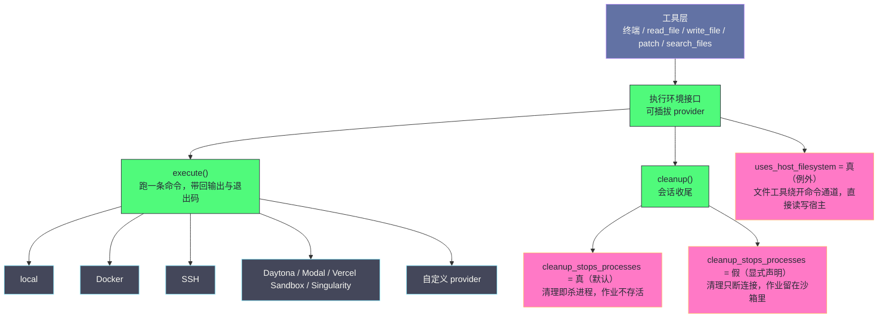
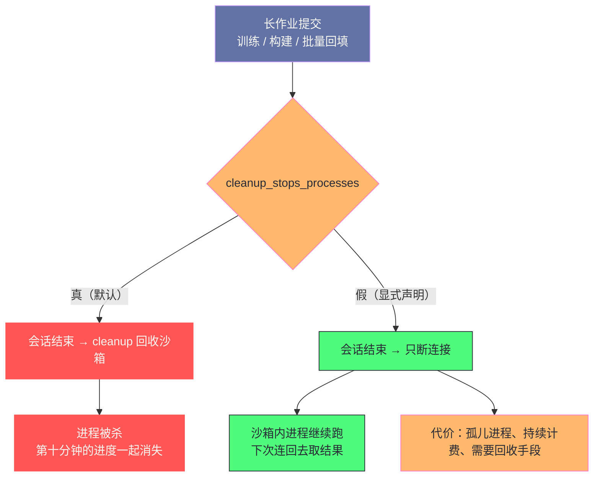
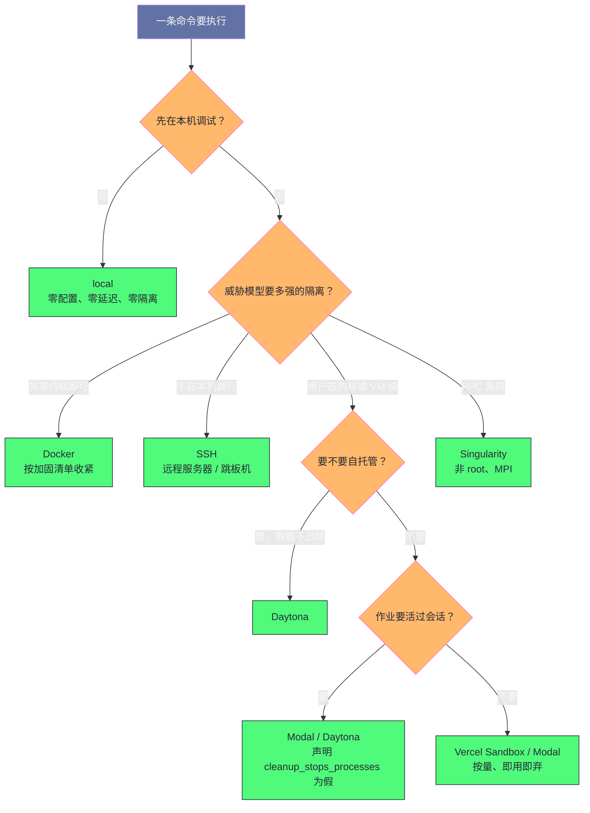
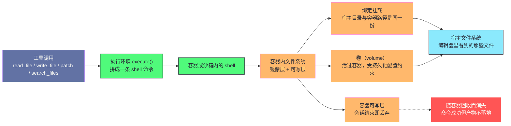
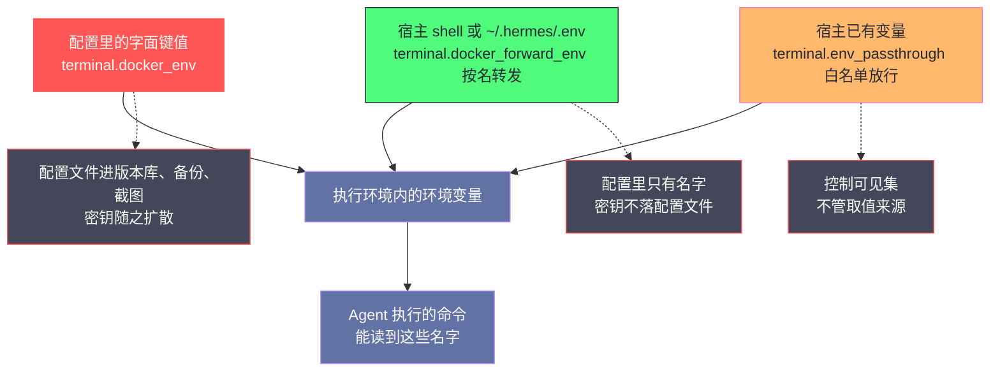

# 08 终端后端七剑——从 Local 到 Vercel Sandbox

**摘要：**

终端后端这个词听起来像部署细节，可它管的恰恰是 Agent 与世界之间那条最实的接触面：命令落在哪台机器上、文件写进了哪一份文件系统、会话结束之后作业还在不在、密钥从哪条路进到执行环境。Hermes 给出的是一份七选一的清单——local、Docker、SSH、Daytona、Modal、Vercel Sandbox、Singularity——但值得写的不是清单本身，而是清单背后那层接口：执行环境被做成可插拔的 provider，核心只要求实现 `execute()` 与 `cleanup()` 两个动作，再用 `cleanup_stops_processes` 与 `uses_host_filesystem` 两处默认值，表达"作业能不能幸存"与"文件工具看到的是不是宿主那一份文件系统"。本文按五问推进：执行环境是什么、为什么把它做成可插拔接口、不这样做会退化成什么样、七种后端各自如何落地、以及这套设计在哪些地方开始失效。中段用五张图拆开接口的两个动作与两处默认语义、作业幸存的分叉、文件可见性的三级链路、密钥透传的三条路径、七种后端的决策树；另用六张表列清七后端对照、Docker 加固清单、关键配置键与几类高频事故。落点在权衡：七种后端不是七种武器，而是同一份接口在隔离强度、状态寿命与运维成本三个维度上的七个坐标，选型的正确顺序是先按威胁模型定下限，再在达标者里挑体验。

---

## 第 1 章 一条命令落在哪台机器上

### 1.1 凌晨两点半的那次重跑

笔者先摆一个贯穿全篇的场景。凌晨两点半，值班群里丢进来一句话：昨天那批失败的离线任务重跑一遍，跑完把日志和产物丢回来。这句话落在消息平台上，被网关的适配器接住，转成一次对话；Agent 翻出昨天的运行记录，确认要重跑的是哪个脚本、依赖哪些数据、上次失败在第七个分片；接着它要做四件事——把脚本取到执行环境里、装上脚本需要的依赖、把脚本跑起来、在跑完之后把产物与日志放到一个能取回来的位置。

这四件事里最容易被略过的是"在哪跑"。在本机跑，脚本能直接读到本机的数据目录、能用本机已经配好的云凭证，代价是它同时也读得到本机的 SSH 私钥与浏览器数据；在容器里跑，环境是干净的、依赖是镜像里写死的，代价是数据目录要额外挂进去，容器一销毁产物就没了；在那台装了 GPU 的远程机器上跑，资源管够，代价是每条命令都要过一次网络往返，而且机器休眠会带走这条连接；在云沙箱里跑，隔离最彻底、最不占本机资源，代价是按量计费，并且默认情况下会话一结束，那个还在跑的脚本就跟着沙箱一起消失。

四种落点对应四种代价，没有一种是免费的。所谓终端后端，说的就是这四种落点在 Hermes 里被收敛成的那一组可配置实现，以及为了让它们可以互换而抽出来的那层接口。

### 1.2 五个诉求，未必能同时满足

把选型时要看的维度摆开，会发现它们并不同向。隔离强度与便利性反向，延迟与距离反向，成本与弹性反向，运维负担与可控性反向；还有一条常被漏掉的第五维——状态寿命，也就是这次执行产生的文件与进程，在会话结束之后还能活多久。

| 维度 | 关心的东西 | 选错的典型后果 |
| :--- | :--- | :--- |
| 隔离强度 | 命令出错时损失扩到多大 | 一次误删越过工作目录，删到宿主用户目录 |
| 延迟与体感 | 一次往返多久、冷启动几秒 | 交互式对话被每次执行的等待切碎 |
| 成本结构 | 空转要不要付钱、按量还是包月 | 低频的重任务买了一张长期 GPU 账单 |
| 运维负担 | 镜像、补丁、密钥、监控由谁管 | 自建沙箱的补丁节奏跟不上内核更新 |
| 状态寿命 | 产物与进程在会话结束后留不留 | 跑了四十分钟的任务随沙箱一起消失 |

五条里前四条是大家都会算的，第五条最容易被忽略，因为它不出现在任何一张价格表上，只在出事那天出现。凌晨两点半这次重跑恰好把第五条摆到了台面上：脚本跑起来只要几分钟，但"跑完之后产物在哪"决定了这次任务到底算不算完成——如果产物落在容器可写层，命令返回零、日志一切正常、任务却白跑。

### 1.3 执行环境其实是一个接口

Hermes 把"在哪跑"抽象成一个可插拔的执行环境（Environment）接口，七种后端是它的七个实现，加上自定义 provider 这条出口，第八个实现可以由使用者自己写。接口薄得有点出乎意料：核心只有两个动作，`execute()` 跑一条命令并把输出带回来，`cleanup()` 在会话收尾时做清理。除此之外还有两处默认值承担了语义，一处叫 `cleanup_stops_processes`，一处叫 `uses_host_filesystem`。

这两个名字值得逐字读。`cleanup_stops_processes` 问的是"清理的时候要不要顺手把还活着的进程杀掉"，默认为真，也就是清理之后进程随沙箱一起消失；云沙箱如果希望作业在断开连接之后继续跑，就得显式把它声明为假。`uses_host_filesystem` 问的是"这个环境的文件工具要不要绕开 `execute()` 直接读写宿主文件系统"，它是一个例外开关，默认不开，因为默认情况下文件工具与命令走同一条路，看到的东西才一致。

接口之所以能这么薄，是因为它把"能力"与"表态"分开了：能力只有一个——跑命令；需要表态的地方却有好几处——清理要不要杀进程、文件工具走不走命令通道、命令出错时如何回传退出码与输出。**凡是能用一条命令派生的能力都不进接口**，凡是无法从命令输出推断的语义都必须显式表态。这条划分决定了接口的形状，也决定了新后端的实现门槛。

### 1.4 为什么把执行环境做成可插拔

三个驱动。其一是场景差异太大：个人开发机上跑一条 `pytest`，与超算集群上跑一次分子动力学模拟，对隔离、调度、网络、文件系统的要求几乎没有交集，硬编一个通用执行器只会得到一个对谁都不合适的中间物。其二是外部世界易变：容器运行时在变、云沙箱的产品形态在变、HPC 的调度器也在变，把这些易变挡在接口另一侧，核心代码面对的永远是两个方法。其三是切换成本：插件化的直接收益是换后端只改配置，这条在事故现场尤其值钱——某类任务被发现不该在本机跑时，改一行配置就能把它挪走，不必等一次发版。

不过可插拔不是免费的。接口一旦公开，就要接受实现者的多样性：有人会写一个只支持命令、对文件语义只能凑合的环境，有人会写一个 cleanup 语义与默认相反的云沙箱，接口必须把这些差异用显式字段表达出来，而不是靠文档口头约定。`cleanup_stops_processes` 与 `uses_host_filesystem` 就是两处被显式化的差异，它们的存在本身就是接口承认自己不够通用的证据；反过来说，一处差异能被写成字段，就说明它已经被纳入了契约，而不是留给使用者去猜。

### 1.5 办公场地的比喻

把七种后端想成七种办公场地，会更容易记住各自的位置。local 是自家书桌，起身就能干活，抽屉里的东西随手可及，代价是来客也能翻你的抽屉；Docker 是公司里的独立工位，桌子是标准尺寸、工具是配好的，散会时桌面一清；SSH 是异地分部，人不在跟前，但设备与带宽在那边；Modal 与 Daytona 是按小时租的实验台，仪器齐全、用完就退，区别是 Daytona 允许你把整间实验室搬回自己楼里；Vercel Sandbox 是开在写字楼大堂里的共享工位，跟你的办公地址在同一栋楼，进出最省事；Singularity 是超算机房的机时，进门要刷卡、出门不留痕，用多少算多少。

比喻要跟一句限定。办公场地换了，工作方法也得跟着换：在自家书桌上可以随手把文件摊一桌，到了共享工位就得先确认哪些文件真的挂载过去了；在异地分部干活，网络一断手上的活就断，除非放进一个不随连接消失的会话里。三处限定对应后文三个技术点——文件可见性、进程幸存、连接生命周期。

---

## 第 2 章 接口的两个动作与两处默认值

### 2.1 execute() 是唯一原语

接口把执行压成一个动作，其余能力都从它派生。装依赖是执行一条 `pip install`，看进程是执行一条 `ps`，取文件内容是 `cat`，改文件是 `sed` 或者一次原地写入，检索文件是 `grep` 与 `find`。凡是能用一条命令表达的动作，都不进接口——这条纪律让新后端的实现门槛降到"能跑命令、能回传输出"，也让接口不必随工具数量增长而膨胀。

文件工具是最能说明这条纪律的例子。`read_file`、`write_file`、`patch`、`search_files` 这四个工具看起来应该直连文件系统，实际上它们走的是环境的 `execute()`：读文件拼一条读取命令，写文件拼一条写入命令，patch 拼的是一次带上下文的替换，检索拼的是 `grep`。这样做的收益是一致性——**文件工具看到的就是命令能看到的文件系统**，两者不会分叉。如果文件工具绕过 `execute()` 直读宿主，那么"命令在容器里、文件工具在宿主上"就会形成一种极难排查的错位：Agent 写了一个文件，命令却读不到；命令生成了一个产物，文件工具却看不见。

这处设计还解释了另一个常见疑问：为什么文件工具不能"顺便"访问宿主的任意路径。因为它没有自己的路径空间，它用的是执行环境的路径空间；要让某个宿主目录出现在执行环境里，正确做法是把目录挂载进去，而不是给文件工具开一条绕过通道。**能看见什么由挂载与执行环境决定**，不由工具决定——这条边界一旦动摇，一致性就没有了立足点。

### 2.2 cleanup() 与作业幸存

`cleanup()` 承担收尾，收尾的力度由 `cleanup_stops_processes` 决定，而这一处默认值直接决定了作业能不能在断开连接之后活下来。默认为真，意味着清理是一次彻底的回收：容器停掉、沙箱退回、还在跑的进程一并消失。这个默认方向是对的，因为绝大多数执行是短命令，短命令跑完就没有"还活着的进程"这回事，收干净不留垃圾；但长任务的语义正好相反——训练、构建、批量回填这类作业的完成时间以小时计，会话不可能一直挂着等它。

于是就有了一处必须由使用者显式表达的判断：这个环境里的作业，是不是应该比会话活得更久。声明为假之后，`cleanup` 只负责断开连接与释放会话句柄，沙箱内的进程继续跑，下次连回去还能取到结果。**默认值回答多数情况，显式声明回答我这类情况**，两者分工清楚，出错的成本也清楚：该声明为假而没有声明，四十分钟的作业在第十几分钟随沙箱消失；不该声明为假而声明了，孤儿进程留在云上按秒计费。

这里还有一层容易被忽略的顺序问题：作业的提交与作业的等待，在长任务场景里是两次独立的会话。提交时把作业放进去、拿到一个作业标识，等待时再连回来取结果，这种"提交—断开—重连"的节奏要求执行环境在两次会话之间保持状态；如果后端的实例在会话之间就被回收了，那么声明 `cleanup_stops_processes` 为假也没有用，因为进程所在的沙箱本身已经不在了。两处语义要配套使用：一处管进程不被杀，一处管沙箱不被回收。

### 2.3 uses_host_filesystem：唯一的例外

`uses_host_filesystem` 是一处刻意留下的例外。当它为真时，文件工具不再经过 `execute()`，而是直接读写宿主文件系统。这个开关存在的理由是有些环境的文件语义与命令语义本来就该分开：某些远程或云环境只提供命令通道，文件操作若也走命令通道，代价是每次读写都要序列化一遍，大文件与高频小文件都会很痛；反过来，当执行环境就是本机时，让文件工具直连宿主反而少一层间接。

但例外就是例外，它把一致换成了性能与便利，代价是可见性分叉：命令看到的文件系统与文件工具看到的文件系统不再是同一份，Agent 可能在一个世界里写好文件，在另一个世界里找不到它。所以这个开关的正确用法是"当且仅当执行环境与宿主本就是同一份文件系统时打开"；判断标准可以写得更硬一点：打开它之后，如果还可能存在"命令在别处执行"的情形，就不该打开。

### 2.4 接口为什么这么薄

两个动作加几处语义声明，就已经能表达一个执行环境的全部必要操作；这个结论不是设计出来的，是删出来的。一个接口每多一个方法，就多一处所有实现都要回答的问题：`list_processes()` 在只有命令通道的环境里怎么实现，`install_package()` 在镜像不可写的环境里怎么实现，`mount_volume()` 在云沙箱里该由谁负责。把这些问题的答案统一压回"执行一条命令"，接口就只需要两个动作，而每个实现只需要回答一个问题：这条命令，你怎么跑。

正交的收益可以用一句算术说清：几十个工具乘以七种后端，如果两两耦合，要维护的是几百条路径；把执行收敛到一个接口之后，要维护的是"工具数加后端数"个独立单元。**耦合系统的复杂度是乘法，正交系统的复杂度是加法**，这条算术在网关的适配器、记忆的 provider、执行环境三处重复出现，是同一套扩展哲学的三次落地。

薄接口的另一个收益在测试上。后端要验的东西很少：命令能不能跑通、输出与退出码能不能回来、清理之后进程是不是按声明处理、文件工具与命令看到的是不是同一份文件系统。四个用例覆盖完，一个后端的基本契约就成立了。

### 2.5 一张图看清两个动作

把接口、两处默认值与七个实现画在一起，能看清哪些东西是契约、哪些东西是实现的自由度。

图里最该停一眼的是中间那三个粉色节点。它们不是实现，是语义声明：两个声明清理之后进程还活不活，一个声明文件工具走不走命令通道。七个实现各自只需回答这几处表态，再加上"`execute()` 怎么跑"，就构成了一个完整的执行环境。这也是可插拔能成立的前提——**接口的定义是你必须在哪里表态**，而不是你能提供什么能力。

顺着这张图还能看出一个隐含的层次：工具层只知道接口，不知道后端；后端只知道命令，不知道工具。两层之间唯一的耦合点是那个字符串——命令文本。这解释了为什么新增一个后端不必改动任何工具，也解释了为什么命令文本的构造质量会直接影响七种后端上的一致体验。

---

## 第 3 章 反事实：不把执行环境做成接口会怎样

要理解一个设计的价值，最省力的办法是把它抽掉，看系统退化成什么样。假设 Hermes 只有一个写死的本机执行器，既没有 provider 机制，也没有那两处默认值，会同时出现四种退化。

### 3.1 只能本地跑

第一种退化最直接：所有命令都在宿主上跑，Agent 的权限等于你的权限。它能读你的 SSH 私钥、用你的云凭证、改你的 `~/.gitconfig`，与你自己坐在终端前能做的事完全一样。这个等式在 Agent 行为正确时是优点，在行为出错时是全部风险。

退一步说，本机执行还有一层更隐蔽的代价——隐式状态漂移。Agent 改的未必是新增的东西，也可能是覆盖：改了某个配置文件的默认值、升级了某个全局工具的版本。这类变更不留下"Agent 来过"的痕迹，却悄悄改变了本机行为；一周后某个脚本突然不工作了，排查方向很难联想到 Agent。**显式新增可清理，隐式覆盖难追溯**，这是"重要任务用容器"最硬的一条论据，也是单一本机执行器最贵的账单。

没有接口就没有替换，只能靠软隔离兜底：命令审批挡已知的危险模式，工作目录限制缩小爆炸半径，环境变量过滤减少泄密面。三层措施分别对应事前拦截、事中限损、事后少泄密，但它们都基于规则，规则可能被绕过——审批看到的是 `python`，看不到 `python -c` 里拼出来的那条删除命令。软隔离不是一道墙，是三道纱窗，挡得住飞虫，挡不住有人推门。

### 3.2 密钥只好写进配置

第二种退化发生在密钥上。没有"从 shell 转发"这条路径，密钥就只能写进配置文件：`terminal.docker_env` 是配置里的字面键值对，写进去就落盘，落盘就进备份、进同步盘、进截图、进某次 `git add .`。密钥一旦以字面形式存在于配置文件里，它的生命周期就与配置文件的复制路径绑定了——轮换密钥要改配置、要重启、要通知所有拷贝过这份配置的人。

有了 provider 机制之后，密钥可以走另一条路：`terminal.docker_forward_env` 只写变量名，值从 shell 环境或 `~/.hermes/.env` 里取，配置文件从头到尾没有密钥。这条路径的意义不在于少打几个字，而在于把"密钥在哪里"与"配置在哪里"分成了两件事——**配置可以公开评审，密钥只存在于运行时**。这也解释了为什么两个键要分开存在，而不是合成一个"环境变量"配置项：一个管值是什么，一个管名字从哪来；混在一起，就等于强迫所有人把密钥写进配置。

### 3.3 清理之后作业全丢

第三种退化最容易被低估。没有 `cleanup_stops_processes` 这个显式声明，清理的语义就只有一种：收干净。短命令无所谓，长任务则是灾难——第四十分钟的构建、第二小时的微调、第三小时的批量回填，都会在会话结束的那一刻连沙箱一起消失，只留下一条"任务已提交"的日志。

两条路径差在一个声明上，代价差在一次作业。这里有一处需要如实说明的取舍：声明为假并不是更安全的选择，它把"作业会丢"换成了"进程会留"。留下意味着三件事要有人管——孤儿进程要能查到、要能杀掉、要能算清它烧了多少钱。默认收干净、按需声明存活，等于把这三件事的责任显式交给声明者，而不是让所有人一起承担。

### 3.4 加一种后端要动几处

第四种退化是演进成本。没有接口，新增一种后端意味着在每一个调用点上分支：终端工具一处、文件工具四处、会话管理一处、配置解析一处、错误处理若干处。这些分支还会互相影响——为云沙箱加的重试逻辑，会在 Docker 路径上触发一次不该有的重连；为 SSH 加的连接复用，会让本机命令多一次无意义的握手。

接口把这件事变成"实现两个方法、声明两个开关"，新增后端不再触碰工具代码，新增工具也不再触碰后端代码。这条收益在项目早期看不出来，因为它只影响"加东西"的那一刻；但长期维护的项目里，加东西的频率远高于重构的频率。

四处退化合起来指向同一个结论：可插拔不是架构上的洁癖，而是把隔离、密钥、状态寿命、演进成本四件事从"使用者的自觉"变成"接口的显式语义"。**能被声明的差异，才不会被默认为不存在**。

---

## 第 4 章 七种后端的位置

### 4.1 先给一张决策树

七种后端的选择并不需要每次从零推演，一张按顺序问三个问题的流程图能覆盖多数场景：先问要不要在本机调试，再问威胁模型要求多强的隔离，最后问云沙箱里的作业需不需要活过会话。

这张图给的是直觉，不是判决。真实选型仍要回到威胁模型，因为图上每一个分叉都在做简化——"隔离强度"被压成了一个刻度，而实际至少有三个不同维度：不在我机器上（SSH）、即使在我机器上也出不来（用户态内核与 VM）、以及就算出来了也只能用到我的权限（Singularity 的权限收敛）。三者不能互相替代，也不该被同一条刻度衡量。

### 4.2 local：权限等同

local 直接在本机通过子进程调用 shell，没有额外的隔离层。它的优点是零配置、零延迟、完全访问与简单调试——命令的副作用直接可见，产物直接落在你的目录里；它的缺点与优点是同一件事的两面：`rm -rf` 会真的删掉本机文件，装过的包会留在本机，改过的配置会跟着你到下一个项目。

local 的正确用法是按任务性质切分，而不是按"我是否谨慎"来赌。Agent 执行的命令大多源自你自己的意图，"帮我跑一下测试"的危险性与你自己敲 `npm test` 相当；真正的风险集中在 Agent 处理不可信内容的那一刻——分析来路不明的文件、抓取网页正文、读陌生人发来的消息，这些内容里可能埋着提示注入。**local 加可信任务安全，加不可信内容危险**，这句话比"local 不安全"精确得多。

### 4.3 Docker：共享内核与环境可声明

Docker 后端在容器里执行命令，每个会话有自己的容器，文件系统、进程、网络都与宿主隔开。它买到两样东西。一样是隔离：容器里的 `rm -rf` 删的是容器里的文件，宿主的目录纹丝不动。另一样常被低估——环境可声明：镜像文件就是执行环境的完整定义，Python 版本、系统依赖、工具链全部固化，"Agent 在什么环境里执行"从"这台机器碰巧装了什么"变成"镜像里写了什么"。对可复现性来说，这一条的份量与隔离相当：同一个任务在本地与同事机器上行为不一致，根源往往就是环境漂移，容器把环境变成了可以版本控制的资产。

Docker 的代价同样清楚：宿主需要装 Docker，镜像要维护，容器销毁后可写层的东西全部丢失，而最要紧的是它共享宿主内核——内核漏洞是逃逸的一条现实路径，容器隔离的最后一道防线是内核本身的正确性。加固能把这条路径收窄，但收不没。

| 加固项 | 挡住什么 | 代价 |
| :--- | :--- | :--- |
| seccomp 白名单 | 大量用不到的系统调用，缩小攻击面 | 依赖冷门系统调用的程序直接报错 |
| AppArmor / SELinux | 越界的文件与网络访问 | 策略写错就是什么都读不到 |
| 用户命名空间 | 容器内 root 映射为宿主非 root，降低提权收益 | 部分镜像假定自己是真 root，行为异常 |
| 只读根文件系统 | 落盘后门的持久化 | 需要写 `/tmp` 的程序要额外挂 tmpfs |
| 不给 `--privileged` | 设备直通与内核能力被滥用 | 需要访问设备的任务得逐项加 `--device` |

加固的取舍不止在安全与功能，还在谁来做决定。要求用户自己研究 seccomp 配置的结果，是绝大多数人直接用默认值跑，安全特性形同虚设。把合理加固做成出厂状态、把"要不要更严"留给高级用户，是让默认值落在多数人该在的位置，而不是最宽松的位置。这条原则可以被写成一句判断：**安全默认值该设在使用者的中位数上**，而不是专家的上限上。

### 4.4 SSH：把连接与作业分开

SSH 后端把命令送到另一台机器上执行，本机只负责发命令、收结果。它买到的是物理层面的分离：命令在另一台机器上跑，本机不受影响；算力与带宽在远程，本机只当一个瘦客户端；多台 Hermes 实例可以连同一台服务器，共享一套环境；远程机器可以用防火墙限制 Agent 的出网面。

代价集中在连接上。每条命令一次网络往返，连续执行二十条命令就是二十次往返的叠加；更麻烦的是连接的生命周期——网络中断、笔记本休眠、Wi-Fi 切换都会断开 SSH，而默认情况下远程 shell 会收到挂断信号，正在跑的长命令随之被杀。把长任务放进 tmux 或 screen 之类的会话里，让作业与连接解耦，是远程执行可靠性的分水岭：连接断了只是看不见，作业还在跑；重连之后 attach 回去继续观察。缓解延迟的思路有两条，把多条命令打包进一次会话摊薄往返成本，或者把执行环境挪到离使用者更近的节点——**延迟的本质是往返次数乘以单次延迟**，减少次数往往比缩短距离更可行。

SSH 在安全上还有一处容易被忽略的优势：凭证与算力分离。私钥在本机，命令在远程跑，远程上跑的代码拿不到本机的其他凭证；本机失陷时，攻击者还要先拿到私钥才能触及远程。对高安全场景，把 SSH 收束到跳板机、在跳板机上做审计与命令过滤，是把 Agent 纳入既有运维管控体系的最低摩擦路径——不为 Agent 新建一套管控，而是接入企业已有的那一套。

还有一层实践上的判断：SSH 后端最适合的场景是"本地 UI 加远程执行"。开发者在笔记本上用 CLI 对话，代码、依赖、数据都在机房那台机器上，Agent 把命令送到那边执行。这个模式的价值不在于省资源，而在于让"执行环境"与"编辑环境"解耦——换一台笔记本不必重装环境，换一台服务器也不必迁移开发习惯。

### 4.5 Modal：用户态内核与弹性

Modal 后端把命令交给云端沙箱，沙箱建立在 gVisor 一类的用户态内核之上：容器内的系统调用先被拦截、在用户态翻译与过滤，才可能触达真实内核，于是"容器内进程不直接接触宿主内核"这件事从约定变成了结构。这样得到的隔离强于共享内核的容器，启动又比虚拟机轻，适合"跑不可信代码、又要求按需弹性"的组合。

它的代价有三处。冷启动——首次调用要等沙箱起来；成本结构——按执行时间付费，长时间连跑比自建贵；无状态——每次调用可能落在新实例上，之前装的包、写的文件都可能不在。第三处是工程上真正要解的问题，解法无非三条：把常用依赖预装进镜像层，把需要跨会话保留的产物放进持久化卷，把会话期间的中间态靠会话亲和性固定在同一个实例上。三者按状态的寿命分工，镜像层管启动前就有的东西，卷管要活过会话的产物，亲和性管会话进行中的临时状态，寿命越长，机制越重。

Modal 的适用面因此很具体：低频、高强度、要 GPU 的实验型负载。云上按小时租一张旗舰 GPU，对"每周跑几次几小时微调"的负载远比自购划算，还要算上电费与折旧；对每天二十四小时连跑的负载，自建反而便宜。GPU 实例的冷启动通常比 CPU 实例更慢，驱动初始化与显存分配都要时间，所以务实的做法是按交互模式分流——调试用持久实例，正式训练用弹性沙箱，让付费模式匹配交互模式。

### 4.6 Daytona：容器、VM 与自托管

Daytona 提供的是多形态的执行环境：容器、虚拟机、GPU 都可以，并且可以自托管。两点合在一起，它解决的是另外一类问题——数据不能离开自己的网络，同时又要比 Docker 更强的隔离。

VM 形态的价值在于把最后一道防线从内核挪到虚拟化层。容器隔离的最后一道防线是内核的正确性，VM 隔离的最后一道防线是 hypervisor 的正确性；后者的接口面比 Linux 的系统调用面窄得多，攻击面小几个数量级。处理完全不信任的代码时，这个差异就是够用与不够用的分界。代价也要如实陈述：独立内核意味着独立的内存开销、更慢的启动、更高的调度成本，**VM 的隔离是用资源换的**，所以它不该是默认选项，而是威胁模型提出要求时的升级选项——为不需要的隔离强度付资源税，是另一种形式的浪费。

自托管的账则要单独算。自托管意味着升级、备份、补丁、监控全部回到自己肩上，云托管时这些是平台的责任。这与"开源自托管用便利换主权"是同一笔交易，只是从整个产品细化到了执行环境这一层。企业选型的判断标准因此可以写得很直白：合规红线是否要求数据不出域，要求则没有别的选择，不要求则云托管几乎总是更省心。

### 4.7 Vercel Sandbox：把执行搬到既有工作流旁边

Vercel Sandbox 是云端临时沙箱，形态与 Modal 一类相近：按需起、用完退、隔离在云上、本机零风险。它的独特性更多来自工作流的距离，而不是隔离技术本身——已经在 Vercel 上托管站点、配过环境变量、管过域名的开发者，复用同一套账号与计费，接入的边际成本接近零；而为一个 Agent 单独注册一个云沙箱平台、配一套凭证、学一套新控制台，是真实的摩擦。**采用成本取决于与既有工作流的距离**，而不取决于工具本身的优劣。

它的边界也要说清楚：与 Modal 同样的持久化问题——会话结束后文件留不留，取决于 `container_persistent` 一类配置；沙箱对系统调用与网络的限制视平台策略而定，某些需要在宿主层面操作的任务在云沙箱里做不了；成本按使用计。至于它具体调度到哪个区域、网络拓扑如何，官方文档给的是产品口径且随平台演进，本文不把这类细节当作稳定事实，选型时请以当次文档为准。

### 4.8 Singularity：HPC 的权限收敛

Singularity（现多以 Apptainer 之名分发）是高性能计算领域的容器技术，为多用户共享的超算集群设计。它与 Docker 的差异不在功能多少，而在设计假设：Docker 假设单用户、容器内可以是 root、网络丰富可用；Singularity 假设多用户共享、非 root 运行、MPI 与高速互联是常态。镜像形态也不同，Singularity 用单文件镜像，便于在集群节点之间搬运，不需要一套镜像仓库与分层拉取。

非 root 运行在 HPC 语境里有具体的含义：集群是多用户共享的，用户之间不互信，如果容器需要 root，那么甲用户的容器就可能影响乙用户的进程；Singularity 把容器权限收敛到用户权限，于是甲的容器影响不到乙。这个原则对 Agent 场景有一个干净的推论——**Agent 的破坏力上限等于运行它的用户的权限上限**：以普通用户身份跑容器，Agent 最坏也只是毁掉自己的用户目录，集群其他部分安然无恙。权限最小可用这条原则，在 HPC 场景里由容器技术本身强制执行，不靠使用者自觉。

支持这样一种后端，也透露了产品策略上的一层判断：超算用户是小众群体，但"Agent 加科学计算"恰恰是 Agent 能力结构最契合的方向之一——模拟、数据分析、论文复现，都是多步、可验证、重复性强的任务。今天看小众，可能是明天的一条增长曲线。

### 4.9 七种后端放在一张表里

把七种后端按五个维度排开，各自的坐标就清楚了。注意"清理语义"这一列——它不是实现细节，而是使用前必须确认的契约。

| 后端 | 隔离强度 | 持久化 | 成本结构 | 适用场景 | 清理语义 |
| :--- | :--- | :--- | :--- | :--- | :--- |
| local | 无，权限等同宿主用户 | 直接落在宿主，天然持久 | 零 | 个人开发、可信任务的默认 | 无沙箱可清，进程即宿主进程 |
| Docker | 中，共享宿主内核 | 可写层随容器消失，需卷或绑定挂载 | 零（自有机器） | 跑不信任的代码、需要可复现环境 | 默认杀进程，容器回收 |
| SSH | 强，物理上不在本机 | 远程文件系统，天然持久 | 服务器固定成本 | 远程开发、算力在别处、需审计 | 默认杀远程进程，除非放进 tmux 类会话 |
| Modal | 强，用户态内核 | 卷与会话亲和性，按需保留 | 按量付费 | 低频高强度 GPU 实验、弹性负载 | 默认随沙箱消失，长作业需声明存活 |
| Daytona | 可选，容器到 VM | 视形态，VM 可保留盘 | 自托管固定 / 云按量 | 要强隔离又要自托管、需要 GPU | 视形态与声明而定 |
| Vercel Sandbox | 强，云端隔离 | 由 `container_persistent` 一类配置决定 | 按量付费 | 已在 Vercel 工作流里的前端与 Node 任务 | 默认回收，长作业需声明存活 |
| Singularity | 中，权限收敛到用户 | 集群文件系统，天然持久 | 集群既有成本 | HPC 集群上的科研任务 | 作业随调度器策略结束 |

这张表没有一行全绿，这正是七种后端存在的理由。任何宣称一个后端通吃全场景的方案，必然在某几列上做了使用者看不见的牺牲，而牺牲最多的那一列通常是状态寿命——因为它不在价格表上，也不在压测报告里。

---

## 第 5 章 文件工具看到的是哪一份文件

### 5.1 一条 read_file 的链路

文件工具的调用链比想象中长。Agent 说"读一下这个配置文件"，工具层把请求交给环境的 `execute()`，执行环境把它拼成一条读取命令，命令进到容器或沙箱的 shell 里，shell 按容器内的路径空间解析路径，最后读到的是容器里那份文件系统的内容。

图里最该注意的是中间那个分叉：命令读到的东西，取决于容器内路径与宿主路径的映射关系。绑定挂载让两边是同一份文件，卷让数据活过容器，容器可写层则是一份只在这个容器里存在的副本。三者可以同时存在，于是"同一个路径名在两处指向不同内容"就成了一种常见的错觉来源。

### 5.2 三种映射关系

绑定挂载是最直接的一种：宿主的一个目录挂到容器的一个路径上，两边看到的是同一份文件，任一方的修改立刻对另一方可见。它适合工作目录——你在编辑器里改代码，Agent 在容器里跑测试，改的是同一份。代价是权限与路径的对齐：宿主上的用户 ID 与容器里的用户 ID 未必一致，写出来的文件可能属主奇怪；路径也可能不对称，宿主是 `~/work/app`，容器里是 `/workspace`。

卷是第二种：数据存在容器之外，容器销毁后卷还在，下次挂回来内容还在。它适合产物与缓存——构建产物、依赖缓存、模型权重。云沙箱的 `container_persistent` 管的就是这一类：会话结束时是否保留沙箱里的文件。这里的取舍很直白，保留要多付存储、也要处理"旧文件污染新会话"的问题；不保留则每次从干净状态开始，代价是每次都要重新装依赖、重新下载数据。

容器可写层是第三种，也是最容易被误认成持久化的一种：在容器里写文件看起来成功了，`ls` 也在，但它只存在于这个容器的生命周期内，容器一回收就没了。这不是缺陷，是容器的设计本意，问题在于使用者容易把"命令执行成功"误读成"文件已经落地"。

### 5.3 三类高频错位

第一类是产物写进了可写层。Agent 在容器里跑完构建，产物落在 `/app/dist`，命令返回零，日志一切正常；会话结束，容器回收，产物消失。排查时的困惑在于"明明成功了"——成功的是命令，不是持久化。对策是把产物目录做成卷或绑定挂载，并且在配置里明确 `container_persistent` 的取值。

第二类是路径空间不一致。绑定挂载把宿主目录挂到容器内的另一个路径上，Agent 按宿主的路径去读，命令自然找不到文件。这类错位在 patch 上更隐蔽：patch 按路径定位文件，路径错了不是报错，而是"找不到要替换的片段"。

第三类是权限与属主错位。容器内以非 root 运行、绑定挂载的宿主目录属于另一个用户，写入直接失败；这类失败信息通常很短，容易被当成"工具坏了"，实际是容器用户与宿主用户没有对齐。

### 5.4 uses_host_filesystem 的例外与代价

某些环境的 `uses_host_filesystem` 为真，文件工具绕开 `execute()` 直接操作宿主文件系统。这个开关在"执行环境本来就是本机"时是合理的：少一层间接，大文件与高频小文件的读写都快得多，也不会出现"命令在容器、文件工具在宿主"的错位。

代价是可见性分叉。命令与文件工具看到的文件系统不再是同一份，于是出现一种新的困惑：Agent 用 `write_file` 写了一个文件，再用命令去执行它，命令说没有这个文件——因为在容器里。**这个开关表达的是这里本来就是同一份文件系统**，不该用来解决文件操作太慢；用错了，等于主动放弃了接口提供的一致性保证。

---

## 第 6 章 落地：选后端、配持久化、配密钥

### 6.1 威胁模型先定下限

选型的第一步不是比较后端，而是回答三个问题：这次任务的输入里有没有不信任的内容——外部文件、网页正文、他人转发的消息；执行环境里有没有损失不起的东西——生产凭证、唯一的数据副本、无法重建的配置；一旦出事，爆炸半径能不能接受。三个答案的组合基本就锁定了隔离等级的下限，剩下的才是体验与成本的权衡。

这个顺序不能反。常见的错误是把运维能力放在第一位——"我不会 Docker，就用 local 吧"——这在"Agent 只做可信任务"时成立，一旦任务性质变了而执行环境没跟着变，风险就裸奔了。隔离差异决定的是最坏情况损失多大，延迟差异决定的只是体验好坏；前者必须事前设防，后者可以事后优化。**安全是约束条件，体验是目标函数**。

三个问题还可以各自再追问一层：输入从哪来，是全部来自你自己手写的指令，还是夹着外部抓取、他人消息、第三方脚本，风险差着量级；副本有几份，本机唯一的数据库文件与可重建的构建缓存价值不同；事后能不能查，命令在本机跑还是在容器里跑，决定了出事之后有没有现场可看。

### 6.2 状态寿命要分层配置

持久化不是开或关一个开关，而是按状态寿命分层。预装的东西放镜像层，它们启动前就该在；要活过会话的产物放卷，它们比容器命长；会话进行中的中间态靠亲和性，会话结束即可丢弃；临时文件留在可写层，随容器一起消失。四层各有各的机制，混用就会出现两种误配：把产物留在可写层，作业成功但结果没了；把依赖装在可写层，每次会话都要重装一遍。

`container_persistent` 管的是云沙箱这一层的取值。打开它，文件留在沙箱里，适合同一个项目连续几天的多轮对话；关掉它，每次从干净状态开始，适合一次性任务、每次都要求可复现的场景。两者都不是默认正确，正确的判断依据是"下一次会话需不需要看见这一次的文件"。

### 6.3 密钥的三条路径

密钥进入执行环境有三条路径，安全性不同，适用场景也不同。

第一条是配置里的字面键值，对应 `terminal.docker_env`。它把键与值直接写在配置里，进容器的环境变量。适合非敏感的配置——时区、语言、日志级别；不适合任何密钥，因为配置文件会进版本库、会进备份、会被复制。

第二条是按名转发，对应 `terminal.docker_forward_env`。配置里只写变量名，值从 shell 环境或 `~/.hermes/.env` 里取，密钥不落配置文件。这是密钥的默认路径：配置可以公开评审，值只存在于运行时。

第三条是放行白名单，对应 `terminal.env_passthrough`。它控制哪些环境变量可以进沙箱，管的是可见集而不是取值来源，作用是收窄面——**默认不放行，需要什么放什么**，把"容器里恰好能看到宿主的几十个变量"变成"容器里只能看到这五个"。

| 路径 | 配置键 | 值从哪来 | 适合什么 | 风险 |
| :--- | :--- | :--- | :--- | :--- |
| 字面写入 | `terminal.docker_env` | 配置文件本身 | 非敏感配置项 | 随配置扩散，轮换困难 |
| 按名转发 | `terminal.docker_forward_env` | 宿主 shell 或 `~/.hermes/.env` | 密钥与令牌 | 宿主的变量本身要有权限保护 |
| 白名单放行 | `terminal.env_passthrough` | 宿主已有变量 | 收窄容器可见集 | 误当密钥通道，放行了不该放的 |

三条路径之外还有一层兜底：凭据可以走可插拔的密钥源接口，譬如从 Bitwarden 或 1Password 按引用在加载时取值，不落明文文件。它解决的是连 `~/.hermes/.env` 都不想放的场景，与上面三条路径是叠加关系，不是替代关系。

### 6.4 docker_extra_args：把特权显式化

`terminal.docker_extra_args` 是透传参数的口子，容器启动时把这些参数原样交给 Docker。常见用途是 `--gpus` 指定可见的 GPU、`--network` 指定网络模式、`--device` 直通设备。它的设计意图是不要把每个 Docker 参数都做成一个配置键——参数空间太大，逐个建模既追不上 Docker 的演进，也会把配置表撑成一本手册。

代价是特权从此显式化，而显式化的东西需要有人审。透传 `--gpus all` 意味着容器能看见全部 GPU，包括别的任务正在用的那张；透传 `--network host` 意味着容器的网络隔离基本消失，容器里的服务直接占用宿主端口；一旦有人图省事加上 `--privileged`，前面那套加固清单就全部作废。三条里前两条在确有需要时是合理的，第三条几乎没有正当理由，**透传参数的自由度应该与审阅它的严格程度成正比**。

### 6.5 env_passthrough 与最小可见集

`terminal.env_passthrough` 常被当成"顺手也把密钥传进去"的通道，这个误用值得单独拆开。它管的是"宿主上已有的哪些变量可以出现在执行环境里"，本质是一张白名单，作用是收窄可见面，而不是提供取值来源。把它当成密钥通道，结果往往是白名单越加越长，最后连不该出现的变量也一起进去了。

正确的做法是反过来：先列出执行环境里真的需要哪些变量——代理地址、地区设置、少量非敏感开关，再逐个放行；密钥走 `docker_forward_env`，与这张白名单分开管理。两件事分开之后，白名单的长短就不再是安全风险，而是一个可评审的清单。

这处配置还牵涉一个细节：变量是给命令用的，而命令是模型生成的。模型可能被诱导去 `env` 一下，把容器里所有可见变量打出来；白名单越长，被诱导时泄漏的面越大。**可见集默认应为空，而非全部**。

### 6.6 配置键与其作用

把这一章提到的键集中列一遍，顺便标出各自的常见误配。

| 配置键 | 管什么 | 常见误配 |
| :--- | :--- | :--- |
| `terminal.docker_env` | 字面键值写入容器环境 | 把密钥写在这里，随配置扩散 |
| `terminal.docker_forward_env` | 按变量名从宿主转发 | 只写了名字，宿主上并没有这个变量 |
| `terminal.env_passthrough` | 控制宿主变量进沙箱的白名单 | 误当密钥通道，或干脆全放行 |
| `terminal.docker_extra_args` | 透传 Docker 启动参数 | 加上 `--privileged`，加固全部失效 |
| `container_persistent` | 云沙箱是否保留文件 | 长任务产物留在可写层，会话一结束就没了 |
| `cleanup_stops_processes` | 清理时是否杀掉存活进程 | 长作业没声明为假，随沙箱一起消失 |
| `uses_host_filesystem` | 文件工具是否绕开命令通道 | 为防止文件太慢而打开，造成可见性分叉 |

七个键里，三个（`container_persistent`、`cleanup_stops_processes`、`uses_host_filesystem`）改的是语义，四个（`docker_env`、`docker_forward_env`、`env_passthrough`、`docker_extra_args`）改的是边界。语义配错的表现是"作业莫名消失"，边界配错的表现是"密钥莫名泄漏"，两类故障的排查路径完全不同。

配完之后还有一步自检值得做：用一条最简单的命令确认执行环境真的按配置起了——`env` 看变量、`nvidia-smi` 看 GPU、`mount` 或 `df` 看挂载、`pwd` 看工作目录。四类信息一次看清，比事后从日志里倒推要省力。运行时的自检命令（譬如 `hermes doctor`）能覆盖配置结构层面的问题，但覆盖不了"配置的语义是否符合这次任务的意图"，后者只能由使用者判断。

### 6.7 几类高频事故

事故表比配置表更有用，因为它把现象、根因与对策放在同一行，出问题时可以直接对号。

| 现象 | 根因 | 对策 |
| :--- | :--- | :--- |
| 长作业跑到一半没了，日志停在"已提交" | `cleanup_stops_processes` 默认为真，会话结束连进程一起收走 | 显式声明为假，并配套查孤儿进程与计费的手段 |
| 配置文件被提交到仓库，密钥随之泄漏 | 密钥写进了 `terminal.docker_env` 的字面值 | 改用 `docker_forward_env` 按名转发，值留在 shell 或 `.env` |
| 容器里 `nvidia-smi` 报找不到设备 | `--gpus` 没有通过 `docker_extra_args` 透传 | 显式透传所需 GPU，避免 `all` |
| 构建成功但产物不见了 | 产物写在容器可写层，会话结束即丢弃 | 产物目录做成卷或绑定挂载，云沙箱确认 `container_persistent` |
| Patch 报找不到要替换的片段 | 宿主与容器的路径空间不一致 | 对齐挂载路径，或改用容器内路径 |
| 容器里连不上外部服务 | 网络模式未按需透传，或代理变量未放行 | 通过 `docker_extra_args` 指定网络，代理变量走 `env_passthrough` |

这张表的每一行背后都是一次"默认值假设与任务性质不符"。默认值是给多数情况准备的，长任务、GPU、跨环境文件这三类情况都不在多数里，所以它们需要显式配置——**配置的工夫该花在偏离默认的地方**，而不是把默认值再抄一遍。

---

## 第 7 章 边界与反例

### 7.1 云沙箱断连即失

最典型的一处失效是断开即失。云沙箱的默认语义是临时计算：连接在、沙箱在；连接断、沙箱收。这对交互式任务是优点，对长任务则是硬约束。加上 `cleanup_stops_processes` 声明为假之后，作业能活过会话，但另一组问题随之而来：谁确认它还在跑、谁在它跑完之后取结果、谁在它失控时把它杀掉。这三件事没有任何一件能靠配置自动解决，它们需要一层外部的作业管理——哪怕只是提交时记一条记录、跑完发一条消息。

还有一处更隐蔽的边界在网络的另一头：云沙箱的出网面决定了它能做什么。装依赖要能访问包仓库，拉数据要能访问对象存储，调用模型要能访问 API；一旦出网被限制，任务会在最不起眼的一步失败——`pip install` 超时。选型时把"这个沙箱允许访问哪里"当成一个与隔离同等重要的参数，比事后排查网络要省力得多。

第三处边界是成本的可观测性。按量计费的沙箱里，一个忘了收的进程可以安静地跑一整晚，而费用账单又滞后又聚合，看不出是哪个作业烧的。在声明作业存活之前，先想清楚"我凭什么知道它还在跑"。

### 7.2 Docker 的逃逸面

容器共享宿主内核，这件事的后果是逃逸面的大小由内核决定。评估这条风险可以用攻击链的长度：需要内核漏洞存在、漏洞未被修补、攻击者能从容器内触发、触发之后能利用，四个条件缺一不可。对个人开发场景，攻击者还要先把恶意内容送进 Agent 的上下文，再诱导它执行，再利用一个未知内核漏洞——链条极长。但链条长不等于零，**风险的正确单位是资产价值乘以链条断裂概率**：本机只放玩具项目，Docker 足够；本机存着生产凭证与唯一的数据副本，那就该升级到 VM 级隔离。

加固能做的只是把链条上的每一环变难，不能让它断掉。这也是为什么"容器隔离等于绝对安全"是一种误读：它把很难读成了不可能，而安全工程里这两个词的差值，就是事故的入口。

还有一处常被忽视的边界是镜像本身。容器隔离的是运行时，不隔离构建时：一个来路不明的镜像可能在构建阶段就把凭据打包进去，或者在入口脚本里留一段读环境变量再外发的逻辑。镜像的可信度与内核的补丁级别，是容器方案两条同样重要的前提。

### 7.3 GPU 与网络特权的代价

GPU 与网络是两类最常被顺手打开的特权，代价也最容易被低估。透传 GPU 意味着容器能看见宿主上的显卡设备，多个任务共享同一张卡时，显存与算力会互相挤占，一个跑飞的训练进程可以把整张卡占满；`--gpus all` 让这种挤占从可能变成默认。网络特权更直接：`--network host` 取消网络隔离，容器里的进程直接占用宿主端口，之前那条"容器出网受限"的安全假设随之失效。

正确的做法是把特权当成一次需要说明的例外：确需 GPU 就指定具体的设备编号，确需宿主网络就写清为什么容器网络不行，确需设备直通就逐项加 `--device`，而不是一次性用 `--privileged` 把所有闸门打开。**特权不是不能用，是不能不说明理由地用**。

### 7.4 合规与多租户

合规的边界通常落在数据出域这一条上。源代码、内部接口、用户数据都可能出现在 Agent 的执行环境里，对个人用户，代码经过某家云沙箱无关痛痒；对有合规要求的企业，这一步就是审计红线。自托管形态的后端（Daytona 与 local、SSH）因此不是技术上的备选，而是合规上的唯一解。

多租户则是一条更容易被误判的边界。Hermes 的部署假设是一个实例服务一个人或一个团队，隔离手段是工具授权与命令审批，这两样解决的是能力边界，不是数据边界：会话、记忆、技能目录、日志都在同一个 home 下，没有按租户划分的命名空间。要在一个实例上做多租户，等于要求核心层在会话键、记忆读写、技能加载、工具授权四处都带上租户维度，这不是配置能解决的。现实的替代方案是一租户一实例，或者在外面套一层路由把租户映射到不同实例——**多用户对话与多租户隔离是两件事**，把它们混为一谈，是自托管产品最常见的预期错配。

### 7.5 三条先兆

什么时候该承认执行环境这一层到了边界？笔者给三条可观察的先兆。

- 同一条命令的耗时开始随并发会话数上升，说明执行环境成了串行的瓶颈，该考虑把长任务挪到独立的执行面。
- 孤儿进程与重复计费开始需要人工清理，说明"声明作业存活"这条路缺少配套的作业管理，该补一层记录与回收。
- 同一个任务在不同后端上行为不一致，说明文件可见性与环境定义没有被显式化，该把镜像与挂载当成契约来维护。

三条先兆对应三种改法，三种改法都不在配置层面——它们是给执行环境补一套运维面的问题，而不是再换一个后端的问题。

---

## 第 8 章 落点：把选择权做成可逆的

走到这里可以回答开头那个问题了：七种后端凭什么同时存在。答案不在功能清单里，而在三个维度上——隔离强度、状态寿命、运维成本，每一种后端都是这三个维度上的一个坐标；坐标之间没有优劣，只有与威胁模型的匹配度。local 用隔离换便利，Docker 用共享内核换启动速度与环境一致性，SSH 用网络延迟换算力与凭证分离，Modal 用无状态换弹性，Daytona 用运维负担换自托管与 VM 隔离，Vercel Sandbox 用平台绑定换与既有工作流的近距离，Singularity 用生态规模换 HPC 场景的权限收敛。

真正比"选哪个"更重要的是"能不能换"。接口把执行环境收敛成两个动作与两处默认值之后，后端成了一个可替换的配置项：今天用 local 顺手，明天任务里开始出现不可信内容，改成 Docker 是一行配置；某个作业需要活过会话，把 `cleanup_stops_processes` 声明为假，也只改一处；某天发现文件工具与命令看到的不是同一份文件，去查挂载与 `uses_host_filesystem`，而不是去改工具代码。**可逆性本身是一种架构能力**——它让选型从一次赌注变成一次可以反悔的决定，而唯一确定的事情是任务组合会变，后端需求也会跟着变。

不过可逆也有代价。每一条可替换的边界都要有契约，契约要维护、要测试、要随外部世界变化调整；两处默认值的语义要讲清楚，否则"默认收干净"会被误读成"作业永远在"，"文件工具走命令通道"会被误读成"文件工具能看见宿主"。这些成本不会出现在任何一张架构图上，它们是可插拔的入场费。愿不愿意付这笔入场费，取决于一个问题：你的执行环境，是一次性的部署决定，还是随任务变化的选择——如果是后者，这笔费用得值。

下一篇 [[09 工具系统——70+ 工具与 28 工具集|工具系统]] 从执行环境转向工具本身，看几十个工具如何按工具集分组、如何按平台分别授权、如何在能力缺席时用回退技能顶上——执行环境解决的问题是"在哪跑"，工具系统解决的是"能做什么"，两者合起来才是 Agent 的行动能力。工具集的数量随版本持续增加，具体口径以 `hermes tools` 与官方 tools-reference 为准，不必记死某个数字。

> [!info] 专栏导航
> 本文是 [[LLM/Hermes-Agent/00 专栏导览|Hermes Agent 专栏]] 的第 8 篇，「平台与工具」部分的第 2 篇，上一篇是 [[07 多平台网关——25+ 适配器的统一消息路由|多平台网关]]。

---

## 参考资料

1. Hermes Agent 终端后端文档. https://hermes-agent.nousresearch.com/docs/user-guide/features/terminal-backends
2. Hermes Agent 架构文档. https://hermes-agent.nousresearch.com/docs/developer-guide/architecture
3. Hermes Agent 文档站. https://hermes-agent.nousresearch.com/docs/
4. Nous Research, hermes-agent 仓库（含 v0.23.2 发布说明，2026-11-16）. https://github.com/NousResearch/hermes-agent
5. Modal Documentation. https://modal.com/docs
6. Daytona Documentation. https://www.daytona.io/docs
7. Singularity / Apptainer Documentation. https://apptainer.org/docs
8. Vercel Sandbox Documentation. https://vercel.com/docs
9. gVisor Documentation. https://gvisor.dev/docs/

---

> [!note] 思考题
> 1. `cleanup_stops_processes` 默认为真，语义是"收干净"。如果把它改成默认为假，会让哪些事故变多？提示：先想清楚默认值服务的是多数场景还是少数场景。
> 2. 文件工具走 `execute()`，因此看到的就是命令能看到的文件系统。这个一致性在什么情况下反而是负担？提示：考虑大文件、高频小文件与 `uses_host_filesystem` 的适用条件。
> 3. 密钥的三条路径里，`terminal.env_passthrough` 常被误当成密钥通道。如果要设计一条"既能收窄可见集、又便于审计"的配置方案，你会怎么划分这三个键的职责？
> 4. 七种后端里有一种是给极小众场景准备的。开源项目支持小众后端的收益与成本各是什么？提示：从接口成本、社区贡献与"今天的增长曲线"三个角度权衡。

> 时效说明：本文事实基线截至 2026-11-19，对应 Hermes Agent v0.23.2（2026-11-16 发布）。该项目版本号存在双轨写法——`v0.23.2` 与日历式 `v2026.x.y`（如 v2026.4.8 即 v0.8.0），文中统一用 v0.x 口径。七种后端的清单在该版本仍然成立，但各后端的具体实现、云平台的产品能力与配置键可能随发版变化；工具集数量与平台数量亦随版本增长，引用时请以当次 release 说明与官方文档为准。