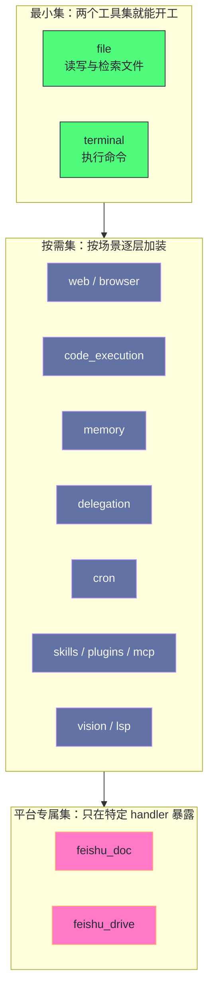
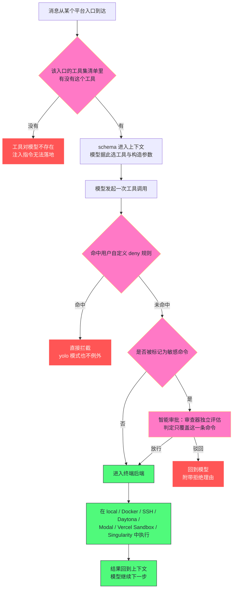
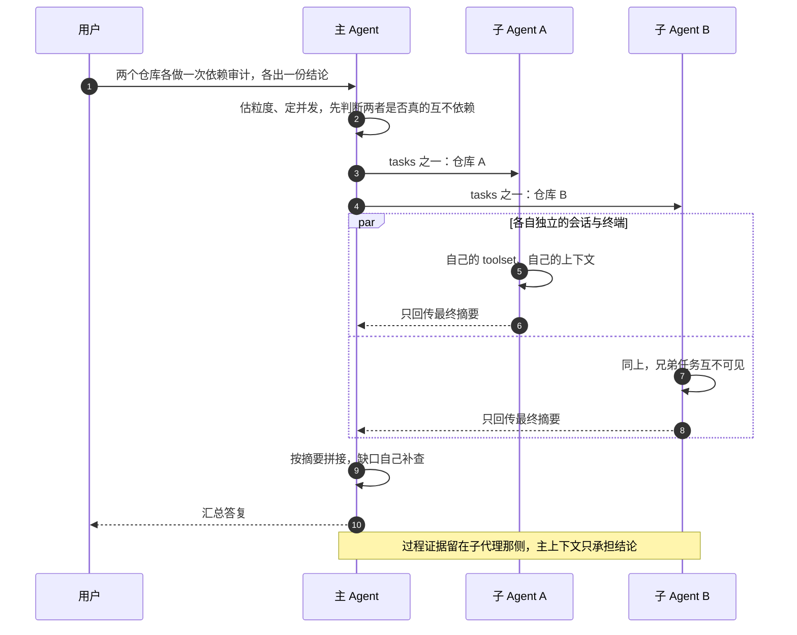
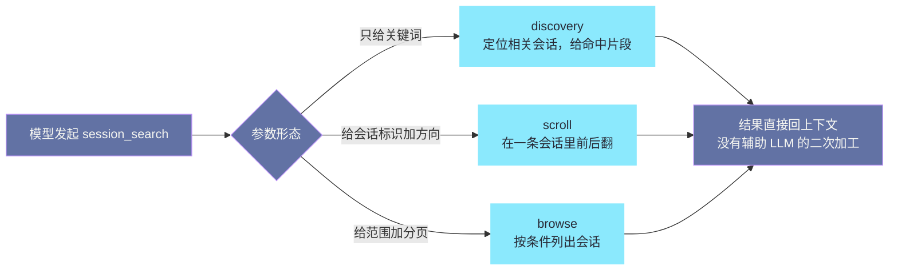
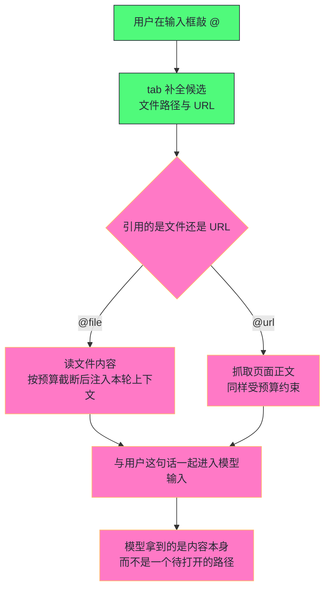

# 09 工具系统——工具集分组与最小可控 Agent

**摘要：**

工具系统是 Agent 的手和眼，也是它唯一能把推理变成外部世界动作的通道，因此这套设计的重点从来不是「有多少工具」，而是「谁能拿到哪些工具」。Hermes 把工具按工具集（toolset）分组，一个工具集既是功能的归属单位，也是启用、禁用与授权的单位，同一实例可以在 CLI 上拿到全套工具，在钉钉群机器人上只给搜索与读文件，两边互不影响，日常管理走 `hermes tools`。本文沿这条线索回答两个问题：为什么授权单位选在工具集这一层，而不是逐个工具；以及那条所谓「最小可控 Agent」的边界究竟划在哪里——只需要读文件与执行命令两个工具集就能开工，联网、浏览器、代码执行、视觉、记忆、委派、定时任务、技能、插件与 MCP 全部按需加装。中段会拆开自注册与 schema 的生成机制，用反事实论证权限过宽、上下文被工具定义吃掉、平台侧越权三种失效形态，再落到按平台配置的具体做法，并把 `delegate_task`、`session_search`、`skill_manage`、上下文引用（context references）与 Tool Gateway 这几个必须看机制的工具逐一剖开。收尾落在三处代价：工具变多之后的选择成本、智能审批也挡不住的审批疲劳，以及子代理只回传摘要带来的信息损失。读完应当能回答：一个装在自己服务器上的 Agent，第一天该开哪几个工具集，第一百天又该关掉哪几个。

---

## 第 1 章 两个工具集就能开工

### 1.1 值班室里的一台机器

笔者先摆一个贯穿全篇的场景。一个三个人的运维小组，把 Hermes Agent 装在一台常驻的 VPS 上，机器的入口不止一个：自己用终端直连（CLI），同事在钉钉群里 @ 它，飞书群里另有一份，手机上是 Telegram 私聊，凌晨的巡检由定时任务唤起。第一天他们的需求朴素得近乎无聊——让它读日志、改配置、跑几条命令，把巡检结果贴回群里。

第二天问题就来了。群里的同事随口一句「帮我看看订单服务今天的报错」，模型有能力执行 `rm -rf`，也有能力把内网端口扫一遍，因为它手上握着的是和 CLI 同一个终端；而群里的消息可能来自任何一个群成员，甚至可能来自一段被粘贴进来的外部文本。同一份能力，在终端里是工具，在群聊里就是风险。

这个落差不是配置失误，而是工具系统必须首先回答的问题：能力本身没有立场，立场取决于它经由哪个入口、被谁触发、能不能被回滚。Hermes 的答案是把工具编成组，再按入口分别授权——而不是把工具一个个开关。

### 1.2 工具、工具集、暴露

三个概念得先分清，后面所有讨论都建立在这个分层上。

工具（tool）是模型可以发起的一次调用，它带名字、描述、参数结构与返回结构，调用一次就产生一次外部效果或者一次信息读取。文件读写、执行命令、联网搜索、抓网页、生成图片、派生子代理、检索历史会话，都是以工具形态交付的。

工具集（toolset）是一组工具的归属单位，也是启用与禁用的单位。官方 tools-reference 里能看到的那些名字——`file`、`terminal`、`web`、`browser`、`code_execution`、`memory`、`delegation`、`cron`、`skills`、`plugins`、`mcp`、`vision`、`lsp`，以及两个平台专属的 `feishu_doc` 与 `feishu_drive`——就是这个层级的标识，列表本身并不穷举。

暴露（exposure）是某个入口此刻实际能看到的那份清单。注册决定工具进不进系统，分组决定它归谁管，暴露决定它在哪个入口出现。这三步合起来构成工具从代码到模型视野的完整路径，也解释了为什么同一个实例在不同平台上会有完全不同的行为。

一处容易混淆的地方需要点破：模型看不到工具的实现，也看不到工具集的存在。它看到的只是系统提示里那段工具清单，工具集是给人用的管理单位，对模型而言不存在。**权限是管理面的概念，能力是模型面的概念，两者在「清单」这个交汇点上才合流。**

### 1.3 数字为什么会变

讲这套系统绕不开数量，而数量恰恰是最容易写错的地方。不同时点的公开材料给过不同的口径：v0.14 时期有「40+ 内置工具」的说法，2026 年 10 月前后社区文章里出现的是「60+」，而这个专栏 2026 年 8 月的旧稿写的是「70+ 工具、28 个工具集」。三个数字都不算错，它们只是被统计在不同的时间点、按不同的边界计数——是否把插件注册的工具算进去，是否把 MCP Server 衍生出来的工具算进去，是否把同一个工具在不同平台上的重复暴露算成多个。

正确的写法是承认它会变：工具集的数量随版本持续增加，具体的集合与工具以 `hermes tools` 的列表和官方 tools-reference 为准，旧稿的 70+ 与 28 是 2026 年 8 月的口径，今天已经不能当真。本文因此不再给出任何固定数字，凡涉及规模的地方一律用「随版本变化」表述。

这不是回避。工具系统的设计意图恰恰与具体数字无关：它要保证的是「加一个工具集不影响别的工具集」「给一个入口加权限不影响另一个入口」，这两个性质与工具集的具体数目无关，在任何规模上都成立。**把注意力放在数字上，会错过这套设计真正要解决的问题。**

### 1.4 最小可控的配方

如果要给「最小可控 Agent」下一个可操作的配方，答案是两个工具集：`file` 负责读写与检索文件，`terminal` 负责执行命令，两个都在，Agent 就能改代码、跑测试、看日志、装依赖，一个完整的干活闭环就成立了。

其余全部按需。联网（`web`）、浏览器（`browser`）、代码执行（`code_execution`）、看图（`vision`）、记忆（`memory`）、委派（`delegation`）、定时（`cron`）、技能（`skills`）、插件（`plugins`）、MCP（`mcp`）、语义诊断（`lsp`），每一个都是「让它看得更远」或者「让它记得更久」的加装件，而不是开工的前提。

这个配方像毛坯房交付：水电通了就能住人，家具家电按生活习惯一件件添。判断的依据不是「哪个工具更强」，而是「有没有它这件事就做不成」。改一个配置文件不需要联网，跑一次回归不需要看图，写一段脚本不需要委派给子代理——需求倒推出来的清单，通常只有两三个。

不过配方的边界要一并说清。`file` 与 `terminal` 之所以能被当成最小集，前提是它们已经足够危险：`file` 能覆盖真实文件系统，`terminal` 能起进程、能出网、能改环境。最小集不等于安全集，它只是**能力上的最小闭环**；正因为这两个工具集最危险，它们才最需要按入口分别授权，这也正是后文第 5 章要展开的部分。

### 1.5 三层不是能力等级

把工具集按授权姿态摊开，会看到它们天然分成三层：最小集、按需集、平台专属集。这三层不是能力高低的分级，而是授予范围的差别。



图里最该停一眼的是第三层的位置：它不挂在「能力」这条线上，而挂在「入口」这条线上。`feishu_doc` 与 `feishu_drive` 只在特定的飞书平台 handler 上出现，CLI 上没有，普通飞书聊天适配器上也没有——因为它依赖的是那套文档 ID 体系与平台凭据，换一个入口就没有意义。**工具集的归属不只由功能决定，还由「谁有能力调用它」决定。**

明白了这一点，就能理解为什么最小集选在那两个工具集上：它们不依赖任何外部凭据，不绑定任何平台，纯靠本机的文件系统与终端后端就能工作。凡是需要凭据、需要账号、需要平台上下文的工具集，天生就该晚一步加装。

---

## 第 2 章 工具从哪里来

### 2.1 导入即登记

工具的进入方式是自注册：每个工具定义在被导入时把自己登记到注册表，不需要有人去维护一张中央清单。一个典型形态如下，装饰器做的只是把函数登记进去。

```python
# tools/file_ops.py
from .registry import register_tool

@register_tool
def read_file(path: str, max_lines: int = 200) -> dict:
    """Read a text file and return its first max_lines lines."""
    # 登记与执行分离：导入时只登记元数据，真正的读盘推迟到调用时
    return {"path": path, "content": "..."}
```

被导入之后，函数名成为工具名，类型注解成为参数类型，docstring 成为描述，注册表据此组装出一份模型能读的 schema。这个过程的关键在于**签名就是契约**：改了函数签名，schema 自动跟着改，不存在「文档说需要 url、实现里没有 url」这种脱节。

### 2.2 schema 的三个来源

schema 的三个来源全部是语言原生特性：函数签名给出参数名与顺序，类型注解给出类型与可选性，docstring 给出语义描述。没有额外的 schema 文件，没有 YAML 声明，工具的文档就是它的代码。

这个分工里有一处必须认清的边界：结构正确性由机制保证，语义质量由人负责。自动生成能保证「参数名、类型、必填项」不会与实现漂移，但保证不了 description 写得好不好；而 description 恰恰是模型唯一的判断依据。**机制兜住结构，人兜住语义，两者不能互相替代。**

### 2.3 三个字段与三个决策

一份工具 schema 通常由名字、描述、参数、返回四部分组成，它们对应模型调用工具的三个决策阶段：选哪个工具（名字加描述）、怎么调（参数结构）、怎么解读结果（返回结构）。

返回字段最容易被省略，而它恰恰是闭环的最后一环。返回结构明确时，模型知道该从哪个键取内容；省略时，它只能把整个返回体塞进上下文自己猜，既费预算又容易误读。上下文额度是按 token 计的，一份五百行的日志原样回到上下文，代价不是「多占一点」，而是挤掉了后面两步的判断空间。

参数描述的重要性同理。人类读接口文档时能容忍模糊，因为读不懂可以翻源码；模型没有源码可翻，schema 之外的信息对它等于不存在。所以好的参数描述会把格式约束写进去，譬如「包含协议前缀的完整 URL」比「URL」多消解了「要不要写 https://」这个高频歧义点，「ISO 8601 格式的日期串」比「日期」多消解了「2026-09-05 还是九月五日」的分歧。**每一个没写进描述的格式假设，都是一次潜在的调用失败。**

### 2.4 顺着 Function Calling 的标准

Hermes 的工具 schema 与主流厂商的 Function Calling 格式对齐，因此工具的清单可以直接作为函数声明交给模型，不需要另造一套调用协议。这处顺应有两层收益：一是省掉了协议适配的成本，模型原生的工具调用能力直接可用；二是工具本身具备了可移植性，一个写好的工具稍作包装就能拿到别的框架里用。

这条线索与 [[LLM/Agent技术/基础范式/03 Tool Use 与 Function Calling——三大厂商的标准化博弈|Coding Agent 专栏第 3 篇]]讨论的标准化博弈是同一条——顺应标准的系统，把自己的资产放进了一个更大的流通池。工具的可移植性与技能的可移植性（agentskills.io）叠在一起，才构成 Hermes 生态的双向通道：既能取用别人的，也能被别人取用。

### 2.5 自注册的账单

自注册不是免费的，账单有三处。其一是导入副作用，导入即登记意味着导入一个模块就会执行登记逻辑，测试隔离、按需加载、循环导入的处理都因此变得微妙。其二是注册冲突，两个模块登记同名工具时，是覆盖还是报错，取决于注册器的策略，这需要一条明确的约定，否则同名工具的胜者取决于导入顺序。其三是启动开销，扫描并导入全部工具定义，工具集增多之后冷启动会被拖慢——对长驻进程是一次性成本，对频繁起停的 CLI 是可感知的延迟。

Hermes 的应对是把登记做成轻量声明：导入时只登记元数据，不做初始化，重活推迟到工具首次被调用。**登记便宜、执行谨慎**，这个组合让自注册的便利没有被工程代价抵消，也是它能撑起一个持续增长的工具库的原因。

---

## 第 3 章 为什么按集分组，而不是平铺

### 3.1 平铺看起来更精细

直觉上，最精确的授权粒度应该是单个工具：想给什么就给什么，多一个不给，少一个补上，逻辑上无懈可击。真实系统里这条路走不通，原因不在理念而在算术。

假设工具库里躺着几十个工具，逐个勾选意味着每个入口都要维护一份几十项的清单，五个入口就是五份，任何一次工具增减都要同步五处。漏掉一处不会报错，只会表现为「这个入口上某个功能莫名其妙不可用」，或者更糟——「某个本不该出现的工具出现了」。清单越长，人与系统之间的同步成本越高，出错的位置越隐蔽。

### 3.2 三笔账

按集分组省下的第一笔是上下文预算。工具的 schema 是要进系统提示的，每一个工具都要占掉描述、参数结构、返回结构这几段文字，几十个工具加起来是几千 token 量级的固定开销，而且这笔开销在每一轮对话里都要付一遍。分组之后，一个入口只挂它需要的那几个集，清单长度立刻从几十降到个位数。

第二笔是选择准确率。模型选工具是一个「从候选集里匹配意图」的动作，候选越多，干扰项越多，相邻工具之间的语义边界越容易糊。`web`、`browser`、`code_execution` 三个集同时在场时，「去把这个页面抓下来」这句话可以在三处落地，选错的概率与工具描述的重叠程度成正比。收窄候选集，本质上是替模型做了一次预筛选。

第三笔是授权粒度与信任模型的对齐。这一笔最容易被忽略，却是分组真正的理由，下一节单独说。

### 3.3 边界画在信任模型的拐点上

工具集怎么分，常见的误解是按功能相似度分：读文件的和写文件的放一起，本地的和远程的放一起。真正决定边界的是信任模型——**当一组工具的风险处置方式发生变化时，边界就应该出现在那里。**

`file` 与 `terminal` 是最能说明问题的一对。两者都碰文件系统，功能上高度重叠，按相似度它们该合成一个集；但信任模型完全不同：`file` 只能读写与检索，`terminal` 能起进程、能出网、能改环境变量、能装东西。一个只读型的群机器人入口，恰恰需要「能看文件但不能执行命令」这一档能力，而这档能力只有在两者被拆成独立工具集时才可配置。同理，`code_execution` 与 `terminal` 的功能重叠更大，但前者在受控的代码沙箱里跑，后者由终端后端决定在哪个环境跑，风险面不一样，因此也是两个集。

由此可以推出一条划分原则：**按功能分，会得到一张漂亮的分类图；按风险分，会得到一份能用的授权表。** 前者适合写文档，后者适合放进生产。

### 3.4 一张分类表

把官方 tools-reference 里能见到的工具集按授权姿态归拢，大致是下面这张表。表里刻意不写总数，因为列表本身随版本变动，且并非穷举。

| 分层 | 工具集 | 大致能力 | 常见授予姿态 |
| :--- | :--- | :--- | :--- |
| 最小集 | `file` | 读写、打补丁、检索文件 | 多数入口都给，写权限按入口收 |
| 最小集 | `terminal` | 经由终端后端执行命令 | 只给 CLI 一类可信入口 |
| 按需集 | `web` | 联网搜索与抓取 | 面向问答的入口常给 |
| 按需集 | `browser` | 云端浏览器，可处理登录态 | 按需，注意会话凭据 |
| 按需集 | `code_execution` | 在代码沙箱里执行片段 | 按需，与 `terminal` 分开授权 |
| 按需集 | `vision` | 看图与图像理解 | 按需 |
| 按需集 | `memory` | 读写记忆文件 | 常限 CLI，记忆属隐私数据 |
| 按需集 | `delegation` | 派生子代理 | 长任务入口，注意并发与成本 |
| 按需集 | `cron` | 定时任务 | 常限 CLI，无人值守时更要收紧 |
| 按需集 | `skills` | 列出、查看、管理技能 | 常限 CLI |
| 按需集 | `plugins` | 插件注册进来的工具 | 随插件安装，视同新增风险 |
| 按需集 | `mcp` | MCP Server 提供的工具 | 随接入方确定，需单独评估 |
| 按需集 | `lsp` | 语义诊断与代码理解 | 编码类入口 |
| 平台专属 | `feishu_doc` | 读飞书文档全文 | 仅特定飞书 handler |
| 平台专属 | `feishu_drive` | 访问飞书云盘 | 仅特定飞书 handler |

这张表可以直接当配置起点用，但它有个前提要交代清楚：工具集的划分不是按「最小集、按需集、平台专属」这三档设计的，这个分层是笔者按授权习惯做的归纳。系统本身只认工具集这个单位，三档是使用方总结出来的经验。

### 3.5 自我管理也走同一条通道

这张表里有一处设计信号容易被略过：`skills` 与 `memory` 本身也是工具集。这意味着 Agent 查看自己的技能库、检索自己的记忆，走的是与抓网页、跑命令完全相同的通道——同样的注册、同样的 schema、同样的平台控制。

这处同构的深意在于，自我管理不需要特殊机制。Agent 的「内省」不是内建的元能力，而是一次普通的工具调用；也正因为是普通的工具调用，它同样能被授予、被禁止、被审计。如果把记忆读写做成隐藏在循环里的特权通道，那么「禁止某个入口写记忆」这件事就无从表达，而记忆恰恰是最该按入口分权的地方。

`cron` 与 `delegation` 也是同样的信号，它们把「时间」与「人手」也工具化了：定时任务是一个可以被授予的能力，派生子代理也是。**凡是能被工具化的能力，就能被按入口分权；能被分权的能力，才谈得上可控。**

---

## 第 4 章 不这样会怎样

### 4.1 权限过宽：注入链的最后一环

反事实的第一步，是把工具权限放到攻击链里看。提示注入的经典路径是「不可信内容进入上下文 → 模型被诱导 → 调用工具 → 造成外部后果」，前三环都可能被模型自身的安全对齐削弱，第四环却必须经过一个真实存在的工具。

这就是平台级不暴露与审批机制之间的根本差别。审批是在动作即将发生前拦一道，它依赖审查者正确判断这一条命令危不危险；工具不存在则是物理上无法发生，无论注入的指令写得多像真的。Hermes 从 v0.15 起在三个关键卡点拦截 Brainworm 一类的提示注入（参考 Origin HQ 的 Promptware Kill Chain 研究），但那三层守的是内容侧；工具侧的防线是另一条，靠的是「这个入口本来就没有 terminal」。

两者不是替代关系，是纵深的两层。**把危险工具从不可信入口上摘掉，比在危险动作前加一道审批更根本**，因为审批的可靠性上限取决于审查者的判断，而工具清单的可靠性上限只取决于配置有没有写对。

### 4.2 上下文被工具定义吃掉

反事实的第二步算一笔预算账。假设不做分组，把整个工具库平铺给每个入口，那么系统提示里会常驻一份几十个工具的完整 schema，按每个工具几百 token 估，固定开销就在几千 token 量级。

这笔开销的伤害不是「贵」，而是「挤」。上下文窗口是有限的，工具定义占掉的每一块，都是从任务材料里切走的：日志片段少贴一段、代码文件少读一个、历史对话多压缩一轮。更麻烦的是模型注意力的稀释，指令遵循的稳定性会随提示变长而下降，工具越多，越容易出现在两个相邻工具之间反复横跳、或者干脆忘了某个约束。

所以「工具越多越强」这个直觉在工程上是错的。能力与暴露是两个独立变量：库可以无限长，清单必须受控。**工具系统的设计目标是让前者增长而后者稳定，不是让两者一起膨胀。**

### 4.3 平台侧越权

反事实的第三步最贴近真实事故：同一实例挂了多个入口，权限却不分，等于把 shell 挂在了聊天软件上。

设想那个运维小组的机器：CLI 上给全量工具是合理的，因为那是机器所有者在操作；但钉钉群里的消息来自任何一个群成员，还可能来自一段被转发进来的外部文本。如果群入口也拿着 `terminal`，那么一次成功的注入就等于拿到了这台机器的命令执行权，损失上限是整台机器。

这里有一处值得单独拎出来的对照：飞书那两个平台专属工具集的暴露方式，恰好反证了「按入口配置清单」是这套系统的原生能力。`feishu_doc` 与 `feishu_drive` 只对特定平台 handler 暴露，在 `hermes-cli` 或普通飞书聊天适配器上都看不到——不是因为这些工具不好用，而是因为它们依赖特定 handler 的上下文。既然系统本来就能按 handler 决定清单，那么「群入口不给 terminal」就不是能力限制，而是配置选择。

### 4.4 一次调用要过四道闸

把上面三节的防线合起来，一次工具调用从意图到落地要经过四道闸，下图把它们串成一条链。



四道闸的分工值得逐一看：第一道是可见性，由平台授权决定，模型根本不知道有这个工具；第二道是 deny 规则，用户写死的黑名单，即使开了 yolo 模式也照样拦；第三道是智能审批，v0.19 起成为默认，由审查器对标记为敏感的命令独立评估，而不是逐条弹给人点；第四道是执行环境，同一份 `terminal` 在不同的终端后端上风险面完全不同，`local` 直接就是宿主机，Docker 与几个云端沙箱则各有一层隔离。

这里有两处细节容易被读漏。一是审批的判定只覆盖那一条具体命令，后续同类命令需要各自审查，这意味着一条被放行的 `systemctl restart` 不构成对下一条 `systemctl stop` 的授权。二是文件工具走的是终端环境的执行通道，因此「`read_file` 看到的文件」与「命令能看到的文件」是同一份，例外只出现在声明了使用宿主机文件系统的环境里——这条约束解释了为什么给 `file` 就等于给了文件系统的可读面。

### 4.5 三条判据

面对一个新工具集，决定它在哪个入口出现、要不要额外审批，笔者常用的判据有三条，合起来是一张四列的小表。

| 判据 | 要问的问题 | 决定了什么 | 例子 |
| :--- | :--- | :--- | :--- |
| 可否回滚 | 做错了能不能撤销 | 默认暴露面有多宽 | `read_file` 只读，撤销成本为零，可以全入口给；`write_file` 改的是真实文件，必须按入口收 |
| 是否有副作用 | 会不会改变外部世界 | 是否需要审批 | `terminal` 的副作用不可枚举，走智能审批；`web` 只读但会向外部发请求，要盯出网 |
| 是否可审计 | 事后能不能还原做了什么 | 日志与 deny 规则的粒度 | `feishu_doc` 留下的是读取记录，可审计；`browser` 带登录态，会话里发生过什么难还原，要收紧 |

三条判据不必都满足才收紧，任一条亮红灯就值得单独考虑。反过来，三条全绿的典型就是只读检索类工具，它们是唯一可以放心铺到所有入口的类型。**授权不是给能力打分，是给后果定价。**

---

## 第 5 章 按平台授权的落地

### 5.1 预设兜住多数人

工具集的管理入口是 `hermes tools`，子命令与参数随版本会有调整，实际用法以 `hermes tools --help` 的输出为准。这个入口承担两件事：看当前各平台挂了哪些集，以及按平台增删。

如果全靠用户从零逐个勾选，门槛不低，因此系统里有平台预设这一层：每种入口类型带一套默认的工具集组合，装完就能用，且默认值本身就是合理的。CLI 作为本机所有者直接操作的入口，默认最宽；面向群聊与外部消息的入口默认更保守。

「预设加微调」是配置设计的经典分层：预设承载多数人的最佳实践，微调承载个体差异。只有微调，新用户面对一长串工具集无从下手；只有预设，「我就是想在群机器人上临时跑条命令」这种需求无法满足。两层缺一不可，但顺序不能反——先有可用的默认，再谈调整。

### 5.2 三种操作意图

`hermes tools` 背后的操作意图其实只有三种，认清意图比记住命令更管用。

第一种是查看现状。配置之前先审计，把每个入口当前挂的集合列一遍，这是所有调整的前提，也是排查「为什么这个功能在这个入口不可用」的第一步。

第二种是黑名单模式。默认全开，把危险的那几个关掉。个人设备上这是最省事的心智，因为默认值已经把九成工具准备好了，只需要处理剩下的一成。

第三种是白名单模式。默认全关，只开需要的那几个。公共入口上这是唯一可靠的心智，因为它的默认是安全，漏配的后果是「功能不可用」而不是「权限越界」。

两种模式的差别不在操作便利，而在出错方向。黑名单漏掉一项，等于把一个工具意外送给了不该有的入口；白名单漏掉一项，等于让某个功能暂时不可用。**在生产入口上，宁可功能缺失，也不要权限溢出。**

### 5.3 一张授权矩阵

把那个运维小组的五个入口按上面的判据摆开，会得到类似下面这样一张矩阵。表里的组合是示例，不是推荐值，每个团队应当按自己的威胁模型重写。

| 入口 | 谁会发消息 | 授予的工具集 | 审批姿态 | 理由 |
| :--- | :--- | :--- | :--- | :--- |
| CLI / TUI | 机器所有者本人 | 全套，含 `terminal`、`memory`、`skills`、`cron` | 智能审批加 deny 规则 | 唯一适合给命令执行权的入口 |
| 钉钉群机器人 | 群内同事，消息可被转发 | `web` 加 `file` 的只读面 | 无写操作可审批，靠清单本身 | 问答型入口，只要能查与能读 |
| 飞书群 | 特定团队 | `feishu_doc`、`feishu_drive` 加 `web` | 同上 | 平台专属集只在这个 handler 上存在 |
| Telegram 私聊 | 本人，但账号可能被他机登录 | CLI 的缩略版，去掉 `terminal`、`cron` | 智能审批加 deny 规则 | 带宽够，但入口不在本机 |
| 定时任务 | 无人值守 | 该任务自身所需的最小集 | 更严，必要时全拒 | 没有人在现场审批 |
| SMS | 任何知道号码的人 | 只读检索类 | 无 | 带宽最窄，身份最弱 |

这张表里最值得看的是第一行与第二行的落差。同一个实例、同一套工具库、同一份能力，CLI 上给全套，钉钉群只给搜索与读文件，两边互不影响——这就是「按平台分别授权」的全部含义。它不要求部署两份实例，也不要求两套配置，只是同一份清单在不同入口下的两次投影。

矩阵还有一处隐含约定：入口的信任度与交互带宽决定了默认宽度。CLI 既是本人操作、又能承载长输出，两项都最高，所以最宽；SMS 两项都最低，所以最窄。记住这两个变量，面对一个新入口（譬如将来某个语音通道）时不必逐个记忆清单，直接按这两个维度推一遍就有合理起点。

### 5.4 平台专属集是另一条线

平台专属工具集提醒我们，清单的宽度不是唯一可控的维度，清单的「来源」也可控。`feishu_doc` 与 `feishu_drive` 的暴露由平台 handler 决定，不由全局配置决定，这一点在其他工具集上不成立——你没法把 `terminal` 配成「只在 CLI handler 上出现」，但飞书文档类工具天生就是这样。

原因不神秘：读取飞书文档要走飞书的凭据与文档 ID 体系，脱离那个 handler 就没有可用的上下文。**能力依赖什么，暴露就该绑定什么**——这条原则可以推广到所有需要外部凭据的工具集，MCP 与插件注册的工具同理，它们能不能用取决于接入方，而不取决于全局开关。

### 5.5 动态暴露的折中

按平台配置是静态的：配置一次，长期生效。更理想的方向是动态暴露，按当前任务的上下文只把相关的工具集挂上去。它要解决的真问题很清楚——工具选择准确率随候选集增长而下降，而静态配置只能按入口粗分。

难点在于「谁来判断哪些工具相关」。让模型先选工具集再选工具，是两跳决策，每一跳都可能错；用规则预判（按平台、按任务类型），又会损失灵活性。Hermes 目前走的是折中路线：平台级静态配置负责粗筛，技能按需引导负责细筛——工具全集在该入口可用，但技能的步骤会引导模型用对哪一个。另有 Tool Search 一类的按需检索能力，让模型在需要时去查工具而不是常年背着一份清单。这个折中会不会被真正的动态暴露取代，取决于工具库继续增长的速度，目前仍然言之尚早。

---

## 第 6 章 几个工具的机制

工具清单解决「有哪些」，机制决定「怎么用」。下面几个工具之所以必须单独讲，是因为它们的语义不是一次调用能说清的，每一个都带着自己的边界。

### 6.1 Tool Gateway：一次订阅解四件事

联网搜索、图片生成、语音合成、云端浏览器这四件事，如果逐家去配 API key，是四份凭据、四套额度、四次账单核对。走 Nous Portal 的路径（`hermes setup --portal`）时，一次 OAuth 订阅就把这四项一起解锁，不需要逐家配置。

```bash
# 一次 OAuth 订阅，解锁搜索、图片生成、TTS 与云端浏览器四项能力
hermes setup --portal
```

这处设计的价值在运维面而非能力面：能力本身没有变强，变强的是「让它变强」的成本。四份 key 意味着四处会过期、四处会欠费、四处要轮换；一份订阅意味着一个失效点。不过便利总有对价，对价是把四个能力绑在同一个供应方上——哪天这个供应方出问题，四项一起不可用。**集中换来的省心，本质上是把四个小风险合并成了一个大风险**，是否值得取决于你对这个供应方的依赖程度。

### 6.2 delegate_task：派生与回传

`delegate_task` 是派生子代理的工具。它支持两种形态：单任务的 `goal`，派一个子代理去啃一个目标；并行批量的 `tasks`，一次派出一组互相独立的目标。每个子代理都有自己独立的会话历史、自己的终端环境、自己的工具集，只把最终摘要回传给主代理。

下图把一次并行派生的时序画出来，重点是过程留在哪一侧。



这张图里有一处最该记住的不对称：子代理继承的是「会什么」，不继承「正在做什么」。技能与记忆是共享的，沉淀下来的程序性知识每个子代理都能用；会话历史是隔离的，兄弟任务的注意力不会互相污染。反过来——共享上下文、隔离技能——子代理就成了知道所有八卦却什么都不会干的帮手。

参数与限制值得单列一张表，因为这类工具的语义几乎全在限制里。

| 维度 | 形态 | 语义 | 边界与代价 |
| :--- | :--- | :--- | :--- |
| 单任务 | `goal` | 一个目标派一个子代理 | 适合一次深挖，解决不了吞吐 |
| 并行 | `tasks` | 一组目标各派一个 | 子任务必须真正独立，有依赖时并行是假的 |
| 隔离 | 会话、终端、工具集 | 每个子代理各自持有一份 | 主代理看不到过程，只能等摘要 |
| 回传 | 最终摘要 | 只有结论回到主上下文 | 中间证据与试错细节留在另一侧 |
| 层级 | 派生层数 | 防止无限递归派生 | 子代理不能再无限向下派 |
| 并发 | 同时运行数 | 同时进行的子代理有上限 | 超出的排队或失败，具体上限以配置为准 |
| 生命周期 | durable subagents | v0.23.x 起子代理可在网关重启后存活，并在自身会话上继续 | 需要按会话标识回到它那边继续 |

最后一行是较新的能力，它改变的是子代理的时间尺度：过去子代理是「一次调用内的一次派生」，网关一重启就没了；durable 之后子代理可以活过重启，成为一个可以事后回来追问的对象。这处变化对长任务的吸引力很大，代价是生命周期管理从「调用栈」变成了「会话集合」——谁在跑、跑到哪、要不要收，都得有人记账。

### 6.3 session_search：把检索变成默认动作

会话检索在 v0.15 被重写过，重写的方向是「减掉中间层」：去掉辅助 LLM，不再让一个模型先加工一遍检索意图，而是让调用方直接给参数，三种模式由参数形态推断出来——只给关键词走发现（discovery），给会话标识加方向走滚动（scroll），给范围加分页走浏览（browse）。没有 mode 参数，也没有配置开关，模型按需要给什么参数就得到什么结果。

下图是三种模式的分派路径。



减掉辅助 LLM 之后，检索的延迟降到约 20 毫秒量级，底层是 FTS5 的全文索引。这个数字的意义不在快，而在它改变了动作的经济性：一次检索从「值得斟酌的开销」变成「随手可做的前置动作」。于是在动手之前先翻一遍过去有没有做过同类事，成了默认姿势；而「先检索再决定要不要新建技能、要不要写记忆」这条纪律，只有在检索几乎免费时才站得住。

不过去掉中间层也有它的对价。辅助 LLM 在的时候，模型可以只说一句模糊的意图，由中间层去补全查询；现在参数得自己给准，给错了就是空结果，而且空结果与「确实没有」长得一样。**把中间层拆掉，等于把表达责任从系统挪回了调用方。**

### 6.4 skill_manage：六个动作

技能的自建入口是 `skill_manage`，六个动作分别是 `create`、`patch`、`edit`、`delete`、`write_file`、`remove_file`。前三个管正文：新建、局部修补、整篇替换；后两个管附属文件；`delete` 管退役。

`patch` 被明确当作首选，理由很实际：局部修补只传变更片段，比整篇 `edit` 省 token，而技能正文动辄上千字，整篇重写在上下文里是一笔不小的开支。这个偏好透露了一个设计取向——**自建技能的默认路径被设计成「小步改」，而不是「大段写」**，因为大段写在没有人类审阅的场合更容易把一份本来能用的技能改坏。

动作之外，触发时机同样在规范里：复杂任务（工具调用五次以上）成功之后、踩过坑找到可行路径之后、用户纠正了做法之后、发现了一条非平凡的工作流之后。四个时机有一个共同点——它们都是「刚刚付出过代价」的时刻，代价换来的知识如果不当场固化成文件，下一轮就开始贬值。

### 6.5 context references：把材料递到手边

上下文引用是 Claude Code 风格的那个 `@`：输入时敲 `@file` 或 `@url`，带 tab 补全，选中的文件内容或页面正文会被注入本轮上下文。它的价值在于把「模型自己去找」变成「用户直接递过去」。

下图把注入点与两条来源路径画出来，起点就在输入框里。



这处机制省掉的是「让模型先调 read_file 再开始思考」那一跳，省掉的不只是一次调用，还有一次调用的失败可能——路径写错、文件太大、编码不对。但它并不能绕开预算：注入的内容照样占上下文，内容太长一样要被截断，因此它适合递小材料（一段配置、一份接口说明、一个报错栈），不适合递整本手册。**把材料递到手边与把材料塞进背包，是两件事。**

### 6.6 插件与 MCP 的位置

插件与 MCP 提供的工具，在体系里与内置工具平权：注册进同一个注册表，归属工具集，受同一套平台控制。插件还能做到更多——注册 CLI 子命令、拿请求级 API 钩子（带 correlation ID）、在安装时询问必需的环境变量、挂接会话生命周期事件。MCP 侧从 v0.8 起走完整的 OAuth 2.1 加 PKCE 流程，扩展包安装时经 OSV 漏洞库扫描。

平权的意义在于，Agent 的能力边界不取决于「哪些工具是官方写的」，而取决于「哪些工具被接入了」。MCP 生态里的那些 Server，理论上都是潜在供给；内置工具只是出厂配置，真正的工具库边界由接入方决定。

这句话反过来也是一条警示。装上十几个 MCP Server，工具数量会迅速越过「清单还能被模型读懂」的阈值，而每一个新接入方都是一个需要重新评估的信任面。**接入的自由与清单的可控，天然相互拉扯**，这也是第 3 章那笔账在生态层面的翻版。

---

## 第 7 章 工具缺席时的降级

### 7.1 四个条件字段

技能可以声明四个与工具相关的条件字段，两正两反：`requires_toolsets` 与 `requires_tools` 是正向条件，对应能力可用时才激活；`fallback_for_toolsets` 与 `fallback_for_tools` 是反向条件，对应能力不可用时才作为替代方案出现。

这四个字段把「能力是否齐备」的判断从执行中前移到了加载前。技能库因此不再是静态清单，而是一个随环境能力伸缩的活集合：同一条用户请求，在不同入口上会得到不同的、但都合理的响应。

### 7.2 一个 curl 搜索技能

最典型的用法是一个基于 curl 的搜索技能：当 `web` 工具集不可用时，它作为 fallback 出现，教模型用命令行把检索做完。

这条路径之所以值得配，是因为「工具不可用」在长驻实例上是常态而非异常：API key 会过期、工具集会被按平台禁掉、某些沙箱里出网受限。没有 fallback 的 Agent 在这些情况下只会回答一句做不到；有 fallback 的 Agent 会给出「直接搜索不可用，可以这样手动查」的指引。两种实现的差别可能只有几十行，用户的感受差的却是一个会不会干活的助手。

一处场景可以把两个方向的条件同时演出来：用户在 Telegram 上说「搜一下这条新闻」——`web` 在该入口被禁用，`requires_toolsets: [web]` 的快速搜索技能不加载，`fallback_for_toolsets: [web]` 的手动检索技能自动激活，Agent 回一句「我这边不能直接搜，但你用这组命令可以拿到同样的结果」。

### 7.3 三条边界

降级也要划边界，否则它会从保险变成遮羞布。

其一，降级路径的质量必然低于主路径，手动检索永远不如直接调工具，它是保底不是平替；不能因为有了 fallback 就放松主路径的可用性维护。其二，降级链不能太长，A 坏了退到 B，B 坏了再退到 C，每退一级结果质量都在下滑，超过两级就该直接告诉用户环境有问题，而不是继续往下将就。其三，降级要可见，用替代方案完成任务时应当明说「这次走的是降级路径」，把环境异常摆到台面上——悄悄降级会让「系统已经不健康」这个事实被一直掩盖，直到某天它连降级都做不了。

**降级是给人留出修时间的缓冲，不是让系统假装一切正常。**

---

## 第 8 章 工具与技能的分工

### 8.1 能力与知识

工具是能力，回答「能做什么」；技能是知识，回答「怎么做」。`terminal` 让 Agent 能执行命令，一份审查技能告诉它审查一个合并请求该按什么顺序看、哪些点必须查。两者缺一不可：有能力无知识，会乱做；有知识无能力，做不成。

这处分工在加载时机上也有体现。工具常驻在清单里，技能按需加载、分三级披露——先列索引，再看正文，再取附属文件。工具是「随时可用的手」，技能是「用到才翻的书」。

### 8.2 一次审查的三层接力

把一次代码审查的调用链拆开，能看到三层知识的接力。技能层给出流程：先取差异，再按清单逐项看，最后按模板出结论；工具层执行具体动作：调 `terminal` 跑取差异的命令，用 `file` 读相关文件；后端层决定这些动作在哪个环境落地：`local` 直接打在宿主机上，Docker 里打在一个容器里，SSH 打在一台远端机器上。

三层各司其职，逐层委托：技能不知道命令怎么被执行，工具不知道命令在哪个环境跑，后端不知道命令是为了审查还是为了部署。每层的变更都不波及其他层，这条链路是整套抽象设计的缩影——知识、能力、执行，逐层解耦，逐层可替换。

一处推论值得写下来：运维时看到「同样的技能在不同机器上表现不同」，问题的位置通常在第三层而不是第一层。技能写的是流程，流程不会因为换了台机器就变；变的是后端与它的环境。

### 8.3 反哺

工具与技能不只有静态分工，还会互相反哺。技能的陷阱段里积累的「这个工具容易踩的坑」，本质上是一份工具的可用性缺陷清单；如果工具作者定期看「哪些技能的陷阱段提到了我的工具」，就能发现哪个默认值该改、哪个参数该加校验。技能库因此成了工具的真实使用数据源，比任何问卷都更贴近实际场景。

反方向也成立：Agent 发现某个工具的用法不显然时，可以创建一份「怎么用这个工具」的技能，让后续调用更准；而当这类技能越积越多，说明工具本身的默认语义不够自解释，该改的仍然是工具。这个回路目前靠人工连线，方向是清楚的。

---

## 第 9 章 边界与反例

### 9.1 工具过多的税

第一笔税是选择成本，第 3 章已经算过：候选集越大，误选越多，指令遵循越松。第二笔税更隐蔽，是维护成本——每多一个工具集，就多一份要回答「这个入口该不该给」的判断，工具库增长的速度如果超过配置治理的速度，授权表很快就会与真实情况脱节，最后没人知道某个群机器人到底能干什么。

第三笔税落在权限面本身。能力越多，可被组合出来的攻击路径越多，而配置审计的复杂度随工具集数量呈组合式上升。这也是为什么「最小可控」这个说法把「最小」放在「可控」前面的原因：**可控性不是靠更强的审批换来的，是靠更小的暴露面换来的**，审批只是在暴露面已经确定之后再加一道保险。

### 9.2 审批疲劳

智能审批把人工逐条确认换成了审查器独立评估，这确实降低了操作负担，但疲劳并没有消失，只是换了一种形态。每个判定只覆盖那一条具体命令，于是同一条流水线上的十条命令要过十次审查；审查器与执行者用的是同源的模型，遇到同一种话术的变体可能给出同样的误判。

两处配套机制是为此准备的。一是用户自定义的 deny 规则，写死之后连 yolo 模式也照拦，适合那些「任何情况下都不许做」的动作，把它从审批面挪到拦截面，等于永久性地减少需要审查的条目。二是拒绝时给出理由，让模型知道为什么被拒，下次不再尝试同一条路径，这比静默失败有效得多。

不过两者都只是缓解。真正的解法仍然在工具清单上：把高危工具从低信任入口摘掉，需要审批的命令自然减少。**审批疲劳的解药在授权表，不在审批器。**

### 9.3 只回摘要的损失

`delegate_task` 只回传最终摘要，这个设计既是优点也是缺陷。优点是主上下文不被过程污染，一个读了三十个文件的审计任务在主干上只占一段结论；缺陷是证据链断了——主代理看不到子代理读过哪些文件、试过哪些走不通的路、在哪一步改变了判断。

后果在需要复核时最明显。当用户追问「你凭什么说这个依赖没有风险」，主代理手上只有一句摘要，要么重新派一次子代理，要么自己再读一遍，两种都要重付成本。更麻烦的是摘要有失真风险，子代理可能把「没查到」写成「没有」，而主代理没有材料去分辨这两者的差别。

可行的缓解有三条：让子代理在摘要里保留关键证据的引用（文件路径加行号），让主代理对结论性判断做抽样复核，以及在任务本身要求可追溯时干脆不用委托、自己串行做完。**委托换来的是上下文空间，付出的可追溯性，这两样都要明码标价。**

### 9.4 三个授权反例

第一个反例是把 CLI 的配置整份复制到群机器人上。理由是「反正配起来快」，后果是把命令执行权交给了任何一个群成员，而群消息还可能来自转发的外部文本。

第二个反例是以「有审批兜底」为由给全量工具。审批是第二道闸，不是第一道；一道闸的可靠性取决于审查者，两道闸的可靠性取决于两者同时失效的概率。先撤掉第一道再指望第二道，等于把系统的安全边际压到最薄。

第三个反例是把平台专属工具集当通用集用。`feishu_doc` 只在特定飞书 handler 上存在，有人看到它好用，就想在 CLI 上也挂一份，结果因为缺少该 handler 的凭据与 ID 体系而反复失败。能力依赖什么，暴露就该绑定什么，绕开这层依赖只会得到一份看起来能用、实际每次都报错的清单。

### 9.5 一张误读对照表

工具系统的高频误读，收敛成一张表便于对照。

| 常见说法 | 实际情形 | 该怎么想 |
| :--- | :--- | :--- |
| 工具有固定数量，记住那个数就行 | 数量随时点与口径变，旧稿的 70+ 与 28 是 2026 年 8 月口径 | 以 `hermes tools` 与官方 tools-reference 为准 |
| 工具越多 Agent 越强 | 选择准确率随候选集下降，schema 还常驻吃预算 | 能力与暴露是两个变量，库可以长、清单必须短 |
| schema 是写给开发者看的文档 | schema 的唯一读者是模型 | 质量标准是模型能不能用对，不是人读得顺不顺 |
| 有审批就可以放开工具 | 审批只覆盖单条命令，审查者与执行者同源 | 先摘掉高危工具，再谈审批 |
| 分组是按功能相似度分的 | 真正的边界在信任模型变化处 | `file` 与 `terminal` 功能重叠却必须分开 |
| fallback 技能可以替代主工具 | 降级路径质量必然更低 | 保底不是平替，链长不超过两级 |
| 子代理会把过程带回来 | 只回最终摘要 | 需要可追溯时就不要委托 |

---

## 第 10 章 落点：开放发生在开发时，收敛发生在运行时

回到开头那台 VPS。第一天只开 `file` 与 `terminal`，机器就能干活；第三天给 CLI 加上 `web` 与 `memory`，因为它开始需要查资料和记事；第二周给钉钉群只留 `web` 与 `file` 的只读面，因为群里的消息不再都来自自己人；第三周加上 `delegation` 与 `cron`，前者用来并行啃几个互不相关的仓库，后者用来在凌晨跑巡检。每一次加装都是一次判断，判断的依据不是「这个工具强不强」，而是「这一档能力值不值得在这个入口暴露」。

这套设计最值得记住的一处张力，是它对工具供给与工具暴露采取了相反的策略：注册是开放的，任何人都能低成本地加一个工具，插件与 MCP 还把这种开放延伸到了核心之外；暴露是收敛的，每个入口只看到该看到的那一份。一开一收之间，生态的繁荣与运行时的可控被拆成了两个问题分别处理，互不拖累。**开放发生在开发时，收敛发生在运行时。**

它的代价也来自同一处。开放的供给端会让工具库持续膨胀，而收敛的配置端需要人持续维护，两者之间存在一个速度差：库的增长快过治理，授权表就会慢慢失真。这个速度差没有一劳永逸的解法，只能靠几条纪律压住——清单按入口分别配置而不是全局一刀切，高危工具不进低信任入口，配置之前先看现状，用完的临时授权及时收掉。

至于工具系统接下来往哪走，笔者倾向于认为方向不是「更多工具」，而是「更懂取舍的暴露」：动态暴露、按需检索、技能引导这几条线都在往同一个目标上使劲，即让模型在恰当时刻只看见恰当的工具。但这条路能不能走通，取决于工具库增长与选择能力提升谁更快，目前仍然言之尚早。

---

## 专栏导航

- 上一篇：[[08 终端后端七剑——从 Local 到 Vercel Sandbox]]。
- 下一篇：[[10 Prompt 工程——三层 Prompt 与上下文压缩]]。
- 返回专栏首页：[[LLM/Hermes-Agent/00 专栏导览|Hermes Agent 专栏]]。

---

## 参考资料

1. Nous Research. Hermes Agent 官方文档：Tools 与 tools-reference（工具集划分、平台授权、`hermes tools`）. https://hermes-agent.nousresearch.com/docs/user-guide/features/tools
2. Nous Research. Hermes Agent 官方文档：Terminal 后端与执行环境（七种后端、`BaseEnvironment` 可插拔接口、文件工具走 `execute()`）. https://hermes-agent.nousresearch.com/docs/user-guide/features/terminal
3. Nous Research. Hermes Agent 官方文档：Messaging Gateway 与平台适配器（含平台专属工具集 `feishu_doc`、`feishu_drive` 的暴露范围）. https://hermes-agent.nousresearch.com/docs/user-guide/messaging
4. Nous Research. Hermes Agent 官方文档：Approvals 与安全（智能审批默认、自定义 deny 规则、Promptware 防护的三个卡点）. https://hermes-agent.nousresearch.com/docs/user-guide/security
5. Nous Research. hermes-agent 仓库与 release 说明（v0.15.0 "The Velocity Release" 的 `session_search` 重写、v0.19.0 的智能审批、v0.23.x 的 durable subagents，当前 v0.23.2）. https://github.com/NousResearch/hermes-agent/releases
6. Nous Research. Nous Portal 与 Tool Gateway（一次 OAuth 订阅解锁搜索、图片生成、TTS、云端浏览器）. https://portal.nousresearch.com
7. Origin HQ. Promptware Kill Chain（提示注入攻击链研究，arXiv 2601.09625），用于对照工具侧防线的位置.
8. Anthropic. Model Context Protocol 规范（工具自描述与连接标准化，用于对照 Hermes 的工具注册与 MCP 接入）. https://modelcontextprotocol.io

---

> [!note] 思考题
> 1. 最小集的配方是 `file` 加 `terminal`，而这两者也恰好是风险最高的两个集。如果必须把其中一个降到只读，你会降哪个，判断依据是它能做的事更少，还是它出错后更难收场？
> 2. 工具集的边界应当画在信任模型的变化处，可信任模型本身会随部署方式改变——同一份 `terminal` 在 `local` 与在 Docker 里风险面差得很远。那么边界该画在「工具集」这一层，还是该画到「工具集乘后端」这一层？后者的配置成本由谁承担？
> 3. 白名单与黑名单的出错方向相反，前者漏配导致功能缺失，后者漏配导致权限溢出。在一个每天都有新人加入的团队里，哪一种默认值更符合长期利益？
> 4. `delegate_task` 只回摘要，主上下文因此干净，证据链也因此断裂。有没有一种回传形态能同时满足「主干不被污染」与「结论可追溯」，它需要子代理额外交付什么？
> 5. `session_search` 去掉辅助 LLM 之后检索几乎免费，代价是调用方必须自己把参数给准。如果把这段表达责任再抽回去做一层薄薄的意图改写，你会用什么信号判断这一层是赚的还是亏的？
> 6. 平台的工具清单是静态配置，而威胁模型是动态的——今天可信的群，明天可能进来一个外部顾问。静态清单与动态风险之间的这处错配，应该靠更频繁的审计来补，还是靠把授权粒度做得更细来补？

> [!info] 时效说明
> 本文事实基线截至 2026 年 11 月 16 日的 v0.23.2，校订于 2026-11-19。工具集的具体构成、`hermes tools` 的子命令、审批策略与各平台默认清单都随版本变动，实际以 `hermes tools --help`、`hermes tools` 的列表输出与官方 tools-reference 为准；文中不给出工具与工具集的固定数量，也是因为这类数字随时点变化。