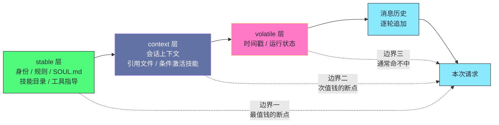
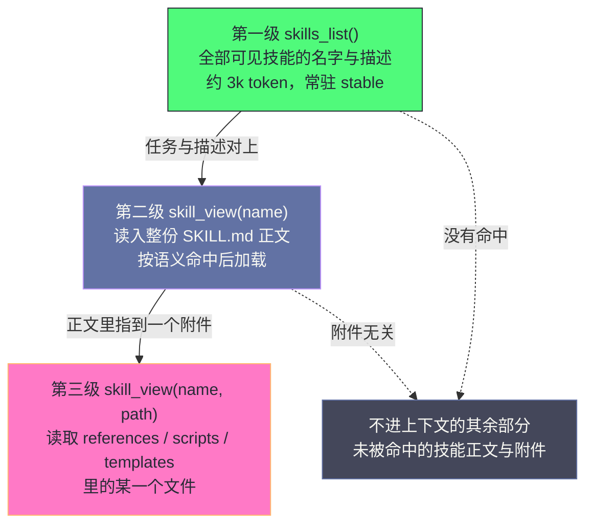
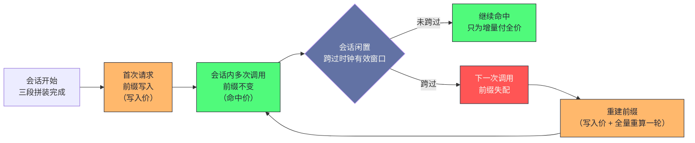
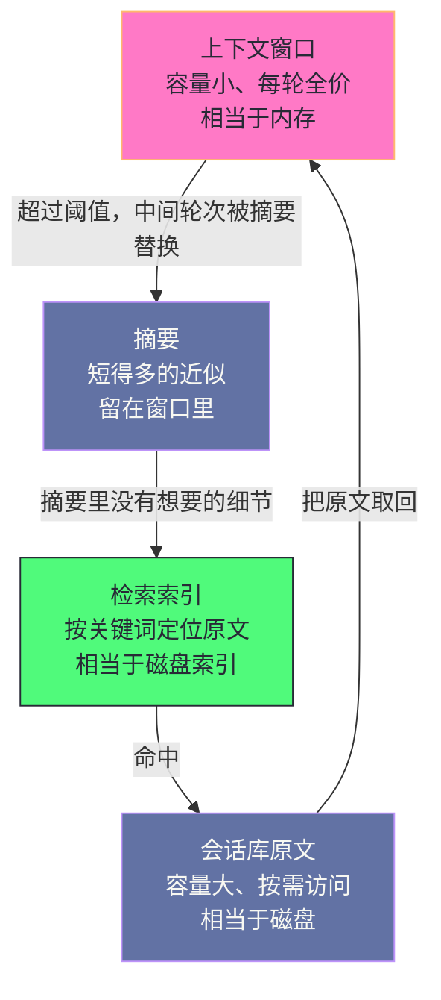

# 10 Prompt 工程——三层 Prompt 与上下文压缩

**摘要：**

Hermes Agent 常被描述成一个会自己变强的长驻 Agent，但它在账单上最先暴露的问题往往不是模型选贵了，而是上下文被反复重算。截至 2026 年 11 月的 v0.23.2，一次会话的系统提示被拆成 stable、context、volatile 三段，实现落在 `agent/system_prompt.py`；v0.23.x 又给每个会话配了一个 prompt-cache 时钟。这两件事回答的是同一个问题：在窗口有限、单价既定的前提下，一段长期运行的对话如何把"每轮重付一次全款"改成"只为变化的部分付账"。本文按五问推进：上下文由哪些块拼成、为什么按变化频率而不是功能类别分层、单层大 prompt 与全量工具定义会退化成什么样、渐进式披露与引用检索怎么落地、以及压缩与缓存时钟在哪些情况下会反过来伤人。中段用五张图拆开三层的拼装顺序与缓存边界、技能三级披露的 token 阶梯、缓存时钟与失效的对照、压缩与召回的分层、一次会话的增长与压缩点，并用表格列出三层的职责、各类上下文手段省下什么又付出什么、压缩的触发条件与风险、常见误配的症状。全文的落点不在"用哪个技巧"，而在三处权衡：缓存失效是隐性成本、压缩是有损操作、检索与引用的命中率决定这套办法的上限。读完应当能回答两个问题：为什么把变化的内容放错位置比内容本身更贵；当压缩掉的正好是后面要用的那一段时，系统拿什么兜底。

---

## 第 1 章 一次请求里装了什么

### 1.1 一条账单

笔者先摆一个贯穿全篇的场景。ordersvc 要做一次灰度发布，十个实例分成两批，配置项里有一个开关控制新版本的流量比例，发布过程中要盯日志、看指标、判断是否回滚。笔者把这个活交给跑在 VPS 上的那份 Hermes，一个下午下来，它读了十几份配置文件、跑了二十来条命令、被要求重试过三次，会话积累了两百多轮。月底对账时发现，这个会话吃掉的输入 token 是输出的三十多倍，而模型没换，任务也没变。

第一反应通常是某个工具的返回值太大，于是去查那几条完整的资源描述输出，把返回截断到一百行，账单只掉了一点点。真正的问题不在某一次读得太多，而在于每一次调用都把前面积累的全部内容重新送了一遍：第 200 轮的请求里，装着第 1 轮到第 199 轮的全部对话、全部工具输出、全部配置片段，而这一轮真正用得上的，可能只有最后一条命令的结果。**上下文的花费从来不取决于用了多少，而取决于重复了多少**。

### 1.2 八类内容的共同点

把一次请求摊开，装进去的东西大致有八类：系统身份与行为规则、人格文件 `SOUL.md`、记忆快照、技能目录、工具定义、会话历史、被显式引用进来的文件与网页、当轮的用户消息与工具结果。官方把系统提示这一段拆成 stable、context、volatile 三层，分别对应稳定人格与规则、会话上下文、易变状态，实现在 `agent/system_prompt.py` 里，但每一层具体装哪几块随版本与配置变化，官方没有给出固定清单。

这八类内容有一个共同点，容易在讨论中被忽略：它们全部由系统拼接，而不是由模型索取。模型看到的永远是"这一次被递进来的一整块"，它没有往后翻页的能力，也没有"这份内容上一轮已经看过"的记忆。任何一次本可省掉的重复，最后都会变成账单上的一行，而且不会有任何一处报错提醒你。

### 1.3 上下文是预算不是仓库

理解这件事最省力的类比，是把上下文窗口当成预算，而不是仓库。仓库的容量是存量概念，东西放进去不会因为你不看而花第二次钱；预算的容量是流量概念，每一轮都要重新申报一次，报得越厚，付得越多。窗口的物理容量像仓库，计价方式却像预算，两者错位，才生出了后面所有的机制。

这个类比要跟一句限定，否则会失真。预算一般按周期结算，而这里的"周期"是每一次模型调用，一个下午两百多轮的会话，等于把同一份预算表重报了两百多遍；反过来，预算里也有一些条目是"一次审批、长期有效"的，缓存做的正是把其中某些行从每轮申报改成一次审批。分清哪些行可以这么改，就是分层。

### 1.4 成本的乘法结构

把一次会话的输入量写成一个粗略的式子会更清楚。设 stable 与 context 段里那些会话内基本不变的部分为 S，每轮新增的对话与工具结果平均为 d，当轮新消息与思考为 v，那么第 n 轮的输入大约是 S + n·d + v，n 轮累计约等于 n·S + d·n²/2 + n·v。三个量级摆在一起，结论有点反直觉：真正把长会话拖垮的是 d 的平方项，而 S 的项虽然是线性，却按会话数累加——会话越短、次数越多，S 在总账里的占比越高。

这两个因子对应两套完全不同的手段。分层不减少进入窗口的 token，它改变的是服务端为这些 token 重算前缀的工作量，账单上体现为命中部分的折扣价；压缩才真正减少进入窗口的 token，它把历史折成一个近似常数。**分层管钱，压缩管容量**，两件事经常被混为一谈，混起来讨论就会得出"有了缓存就不用压缩"这类错误结论——缓存再便宜，也救不了装不下的那一段。

---

## 第 2 章 为什么按变化频率分层

### 2.1 分层的依据不是功能类别

按功能分类看起来更整齐：记忆一类、技能一类、工具一类、对话一类。但它把变化频率打散了——记忆里有会话内一字不动的那一份，也有写回之后立刻生效的那一份；技能里有常驻的目录，也有按需读入的正文；工具里有会话内固定的定义，也有每轮都变的返回结果。同一类里塞着两种频率，缓存就只能按最坏的那个算。

Hermes 取的是另一个维度：按变化频率切。人格与规则放 stable，会话上下文放 context，时间戳与运行状态这类每轮都可能变的内容放 volatile。这个选择的理由很朴素——前缀缓存只认字节，不认概念。服务端不知道哪一段叫"记忆"，它只知道从第一个字节起有多少个字节与上次一致；内容按概念分得再漂亮，只要字节在变，缓存就断在那里。

### 2.2 排列即账单

顺序这件小事值得单独算一遍。假设有人按功能排序，把技能段放在对话段之后：对话每轮追加，追加一发生，技能段就脱离了已缓存的前缀，此后每轮都要为技能段全价重算。同样的内容，仅因排列不同，账单可能差出一个量级。**在缓存的世界里，顺序不是排版问题，是计价问题**。

还有一种更常见的错排来自好心：为了让模型"看到最新的工具"，把工具定义贴在系统提示的末尾，甚至贴在对话之后。这在没有缓存的年代是无害的，在有缓存的年代等于自愿放弃整段前缀，因为工具定义之后的内容每轮都在变，而工具定义本身又足够长，长到足以把折扣抹平。

### 2.3 三层的职责与变化频率

三层的分工、变化频率与缓存影响，列成一张表更容易对照。层名与各段的归属在 [[03 架构总览——AIAgent 核心循环与子系统|03 架构总览]]里已经交代过，本章补的是它没有展开的那一半：顺序与边界为什么必须这么排。

| 层 | 典型内容 | 变化频率 | 对前缀缓存的影响 | 放错的代价 |
| :--- | :--- | :--- | :--- | :--- |
| stable | 身份与行为规则、`SOUL.md` 人格、冻结的记忆快照、技能目录、工具使用指导 | 仅随配置、技能增删或版本升级变化 | 缓存的主体，越稳定越省 | 混进一个每轮都变的块，其后全部作废 |
| context | 会话上下文、被引用的文件与网页、按工具集条件激活的技能提示 | 随会话演进，多数轮次可复用 | 会话中段的扩展前缀 | 放过稳的内容拖低收益，放过易变的内容切断中段 |
| volatile | 时间戳、运行状态（当前模型、审批模式、来源平台） | 每轮都可能变 | 排在断点之后，不参与复用 | 排到最前，等于放弃整段缓存 |

表里有两处不合直觉，值得各说一句。其一是记忆快照凭什么待在 stable：它靠的不是"记忆不常变"，而是会话开始时的那次冻结——同一份记忆，每天开工时读一次、整段会话不挪动，才够格做前缀；一旦改成注入活动视图、让会话中的写回立刻生效，它就必须挪到 volatile，否则每一次写回都是一次前缀作废。冻结换来了什么、延迟生效又付出什么，[[06 持久记忆——MEMORY.md、USER.md、Honcho|06 持久记忆]]里有更细的拆解。其二是技能以目录形态留在 stable：目录只放名字与描述，量级在三千 token 上下，正文按需加载，于是同时满足两个目标——目录不变所以缓存友好，正文按需所以窗口不爆。

### 2.4 两条边界与它们的位置

把拼装顺序与缓存边界画在一起，是本篇第一张图。

图里最值得停一眼的是第三条虚线。断点的价值等于"它前面的字节有多长、有多稳"，边界一前面是整段 stable，几乎每轮都能命中；边界二前面多了 context 的已有部分，命中率取决于这一段有多稳；边界三前面是每轮都变的 volatile，它几乎永远命不中，把断点放在那里等于放了一个不起作用的路标。**断点应该落在最后一个稳定的字节上，而不是最后一层上**——这两句话看着像同义反复，差的是一个"稳"字。

### 2.5 错放是静默退化

错放的后果不会以报错的形式出现。功能一切正常，回答质量也没有明显下降，变的只是每百万 token 的单价，而单价这种东西没人会逐日盯着。这类退化最难排查，因为它没有失败点：你无法从任何一次调用看出"缓存没命中"，只能从一段时间后的账单倒推。多数关于 Agent 成本的事故，根因不是模型选贵了，而是提示里混进了每轮都变的东西。

---

## 第 3 章 不这样会怎样

### 3.1 单层大 prompt

把三层合并成一个字符串，是很多自研 Agent 的第一步做法，也是最容易在后期付出代价的一步。它在三处会撞墙。第一处是计价：稳定段与易变段混在一起，服务端看到的前缀从某一字节起就与上次不同，整段退化成全价，一个几十轮的会话等于为同一份人格设定付了几十次钱。第二处是注意力：常驻的规则越多，每条被认真遵守的概率越低，一份写得密密麻麻的说明摆在眼前，模型对其中任何一条的遵循度都不会比一份三十行的清单更高。第三处是排查：行为不对时，面对一整块拼好的字符串，你没法判断是人格设定跑偏、上下文塞脏了，还是运行状态没刷新。

第二处最容易被低估，因为它与直觉相反。多给模型一些信息，人的第一反应是"只有好处"；但模型不存在"跳过不看"这个动作，所有递进去的 token 都会参与注意力分配，无关内容占的比例越高，相关内容的权重被摊得越薄。**塞满的上下文不是更充分的上下文，是更模糊的上下文**。

### 3.2 全量工具定义常驻

第二则反事实是把所有工具的定义一次性常驻。工具定义是一段段 JSON Schema，单个工具的定义几十到上百 token，工具集全开时整块会积到不容忽视的规模，而它恰恰是最"占地方又不常被读"的部分——绝大多数轮次只用到其中两三个工具。

Hermes 在 v0.23.x 里把这块做成按需：Tool Search 让工具定义不再一次性全量占位，而是按当前任务检索出需要的那一组再注入。这么做的收益不只在 token 上，还在选择精度上——候选工具的清单越短，模型挑错工具的概率越低。代价也真实：多一次检索往返，检索本身可能漏掉该用的工具，而且模型对"存在但没被加载的工具"是没有感知的，它不会主动说"我还需要一个你没想到的工具"。官方在能力清单里给出了这个名字与取向，具体的检索实现与召回策略没有展开，本文只讨论这一类设计的位置与代价。

### 3.3 不压缩

第三则反事实是不压缩。窗口终有装满的时候，装满之后只有两条路：主动压，或者被动截。被动截断的坏处不只是丢内容，更在于它静默——用户不知道丢了什么，模型自己也不知道，它会基于一份残缺的上下文给出自信的回答。

主动压缩至少留下了一份摘要作为痕迹，模型知道"前面发生过什么"这件事本身，而这个"知道"往往比摘要的细节更重要：它决定模型会不会在回答里给出"根据之前的选择"这类限定，还是把一个已被否决的方案重新提出来。**可感知的遗忘好过不可感知的遗忘**，这是主动管理的底线价值。

### 3.4 三则反事实对照

把三则反事实与分层后的形态并排摆开，症状与根因的对应关系会清楚很多。

| 反事实 | 直接症状 | 根因 | 对应的机制 |
| :--- | :--- | :--- | :--- |
| 单层大 prompt | 账单随会话长度陡增、规则遵循度下降、异常无法定位 | 稳定与易变同处一段，前缀每轮作废 | stable / context / volatile 三段拆分 |
| 全量工具定义常驻 | 固定开销高、工具选择精度差 | 整块工具 schema 每轮都在场，多数轮次用不到 | Tool Search 按需检索 |
| 完全不压缩 | 撞窗口、被动截断、回答基于残缺上下文 | 容量问题被当成计价问题处理 | 阈值触发的有损摘要 + 原文可检索 |
| 为了省事全部塞 volatile | 每轮全价、断点失效 | 变化的内容放错位置 | 变化内容后置或追加为消息 |

表里最后一行值得多看一眼，因为它是最常见的"看起来在优化、实际在退化"的做法：把所有可能用到的内容都挪到末尾，理由是"反正它每轮都重建"。位置对了，代价却从缓存折扣变成了全额重算，而这段内容本来可以待在 stable 里享受折扣。

---

## 第 4 章 stable 层怎么写

### 4.1 装什么，按什么顺序

stable 层的组装顺序大致是：最前面的身份与行为规则（它是所有后续内容的解释框架），接着是人格文件 `SOUL.md`，然后是记忆快照，再是技能目录，最后是工具使用指导。这个顺序不是随意排的，越靠前的内容越"解释性"，越靠后的越"操作性"——同一个问题，先读规则再读工具说明，与先读工具说明再读规则，得到的判断常常不同。

`SOUL.md` 的位置值得单独说一句。人格放在 stable 里几乎是必然选择：它在会话期间不该变化，Agent 不该聊着聊着换了性格；它又是每次调用都必须在场的身份信息，缺了它，回答的语气与取舍标准就会漂移。更妙的是它与缓存的配合——**人格几乎是唯一一种"零边际成本却作用于每一次响应"的内容**，放在 stable 里，它一次计价、全程生效。

### 4.2 冻结的粒度是会话

stable 之所以能叫 stable，靠的不是"它碰巧没变"，而是一个显式的设计：会话开始时组装一次，此后不再改动。这个冻结的粒度是会话，不是系统——下一次会话开始时重新读取配置、重新列技能、重新取快照，改动照样生效。**冻结是会话级的妥协，不是系统级的僵化**，这个粒度选择把代价限制在单次会话之内，同时把收益放到整段会话之上。

这也解释了一处常见困惑：为什么在会话里说"以后都用英文回答"，回答未必立刻变。写进用户偏好要等下次会话才进快照；要让这一轮立刻生效，正确做法是把它作为当轮消息递进去——它本来就该待在 volatile 的位置上，而不是去改 stable。两层各管一段，即时性与缓存效率就不必二选一。

### 4.3 四类缓存杀手

stable 层的敌人是确定性，具体说是四种不显眼的动态元素。

| 杀手 | 典型形态 | 为什么致命 | 正确做法 |
| :--- | :--- | :--- | :--- |
| 时间戳 | 系统提示里写"当前时间：某年某月某日某时某分" | 秒级变化，从第一个字节起就不可能一致 | 时间放进 volatile 或当轮消息 |
| 随机与无序 | 技能列表按目录遍历顺序输出、会话 ID 混进正文 | 同样的输入产出不同的字节序 | 显式排序，标识符只出现在日志里 |
| 半稳定内容 | 把"当前已加载的技能清单"写进 stable | 技能随任务加载，stable 在会话中途变化 | 目录进 stable，已加载清单进 context |
| 版本漂移 | 配置项里带版本号或构建号并注入提示 | 每次升级都让全体会话的缓存失效一次 | 版本只进日志与自检输出 |

第三行是四者中最隐蔽的，因为它看起来完全合理：把"这一轮加载了哪些技能"告诉模型，有助于它知道手上有哪些能力。但只要这份清单随行为变化，它就一定会在会话中途改动 stable，而 stable 一改，其后的整段前缀全部作废。判断标准只有一个问题：**这段内容在下一次调用时还一字不差吗**——必然一样进 stable，大概率一样进 context，必然不一样进 volatile。

### 4.4 确定性是一种代码性质

"字节级一致"这个要求的严格程度容易被低估。不是语义相同，是字节完全相同：一个空格的差异、一个时间戳的秒数、一个随机排序的列表，都足以让缓存匹配失败。这对拼接代码提出了一个不太常见的要求——确定性，同样的输入必须产出逐字节相同的输出。任何顺手加进去的动态元素，都是缓存的地雷。

确定性不是写一次就一劳永逸的性质。它会被后续每一次"顺手改动"侵蚀：某人加了一行调试信息、某个插件往系统提示里注入了当前工作目录、某个钩子在末尾追加了请求标识。这些改动单看都无害，合起来就是命中率缓慢下滑。把"拼接结果可复现"做成一条可测试的性质——同一份配置连续拼两次，比较字节——是这类问题的唯一可靠防线。

### 4.5 变更要批量化

既然 stable 一变，全体会话的缓存就要重建一次，那变更本身的节奏就成了成本变量。把"本来要改五次"的配置调整合并成一次发布，缓存失效的成本就只付一次；技能库的整理、语言包的切换、人格文件的改写，都属于这一类。

这条纪律与传统运维的变更窗口同源，只是优化的对象从停机时间换成了 token。它还有一个副产品：批量变更天然要求你把变更想清楚，而零散变更允许你边走边改——前者逼出设计，后者积累技术债。**缓存的约束在这里意外地起到了纪律作用**，这大概是它最不受注意的一处收益。

---

## 第 5 章 context 层：渐进式披露与引用

### 5.1 追加-only 的纪律

context 层在会话内是渐变的，它的缓存有效性建立在一条纪律上：只追加，不改写。新内容贴在末尾，已有内容一个字节都不动，于是"前 n 轮"始终是一段稳定的前缀，第 n+1 轮只需为新增的那一段付全价。

这条纪律在正常对话里天然成立，因为对话本来就是追加的。它会在两种操作下被打破：用户编辑了之前的消息，系统重排了历史（譬如把某条早期消息提升成系统提示）。两种操作都很有诱惑力，前者让用户能纠正口误，后者让重要信息更"显眼"。这套设计的取向是不鼓励这类改写——宁可少一个编辑功能，也不让前缀的稳定性被破坏——**这是一次功能取舍服从计价结构的典型决策**，而且它换来的不只是钱，还有"历史不可篡改"这个附带的对齐好处。

### 5.2 技能的三级披露

技能是 context 层里最讲究的一块。这套三级加载的格式、来源与条件激活，[[05 技能系统——SKILL.md 与 agentskills.io 标准|05 技能系统]]里已经逐层拆过，这里只看它在预算上留下的形状。Hermes 用的是渐进式披露（Progressive Disclosure），三级依次展开：第一级 `skills_list()` 只给名字与描述，约 3k token，常驻在 stable；第二级 `skill_view(name)` 读入某一份技能的完整正文；第三级 `skill_view(name, path)` 再按路径读取该技能目录下的某一个附件文件。三级之间的落差，用一张图看得最清楚。

这张阶梯的形状值得琢磨：它把"知道有什么"与"知道怎么做"分开，前者用极低的单价常驻，后者按需付费。回报随技能库增大而增大——固定开销只随目录增长，而目录增长远比正文增长慢；技能库小的时候这笔账甚至是亏的，三五份技能全塞进去也没多少 token。分寸落在"目录还能不能准确描述技能"上，一旦描述开始重复，披露的收益就被命中率下降吃回去。

### 5.3 `@file` 与 `@url`：把往返换成一次注入

上下文引用（Context References）提供了 Claude Code 风格的 `@file` 与 `@url` 注入，并带 tab 补全。它的价值不在于"能读文件"——工具也能读——而在于把两次往返压成一次：不用先调一次读文件工具、再把结果塞进下一条消息，用户一句话就能把内容直接放进这一轮的上下文。

代价是确定的：注入是全量的，一次 `@file` 会把整份文件送进去，而不是先看一眼目录再决定读哪一段。所以它适合"小且确定要用"的内容，譬如一份几十行的部署清单、一份接口契约；用它去引用一份两千行的日志，等于主动制造一次上下文膨胀。**引用把"检索成本"换成了"体积成本"**，两者哪边更贵，取决于你知不知道自己要的是哪一段。

### 5.4 Tool Search 与工具定义的位置

工具定义这块内容的位置比较微妙。它在一次会话里基本不变，所以直觉上该进 stable；但它的"不变"是会话级的，换个 toolset 授权、换个子代理、换条入口，定义集合就不同。把它整个压在 stable 里，代价是每个会话都背着一整块用不全的 schema，而绝大多数轮次只用到其中两三个。

Tool Search 的做法是把这块从"常驻"改成"检索后注入"：先按当前任务挑出一组相关工具，再把它们的定义放进来。收益是固定开销下降、候选清单变短、选择精度上升；代价是检索可能漏、模型对未加载的工具无感知、以及多了一次往返。这处权衡有一个明确的分界：**工具集越是按平台与场景裁剪过，检索的收益越小**——只开文件与终端两组工具的最小可控配置，本来就没多少可省的，按需检索反而添乱。

### 5.5 命中率是命门

渐进式披露、引用注入、工具检索，三件事共享同一个命门：命中率。目录描述写得准，第二级就一次读对；描述写得含糊，模型会读错技能，白花一次正文的钱，还可能按错的流程执行。引用用得准，一次注入就够；用得不准，等于把整份文件塞进去当噪声。

这套办法的天花板因此不在 token 省了多少，而在"检索与引用的判断有多准"。而判断是概率性的：同样的目录，换个说法就可能命中不同的技能。可控的改善手段只有两个——把描述写成"适用什么任务、排除什么任务"的样子，以及把技能库控制在描述还能互相区分的规模内。

---

## 第 6 章 volatile 层与注意力稀释

### 6.1 每轮重建的部分

volatile 层装的是每轮都可能变的东西：时间戳、运行状态（当前模型、审批模式、来自哪个平台），以及当轮的用户消息、Agent 的思考过程与工具调用结果。它排在断点之后，不参与前缀复用，每次调用都按全价计。

既然是全价，这一层的设计原则就只有一条：够用即止。它不是"越全越好"，往里面塞"可能有点用的背景"，看似帮了模型，实则稀释注意力——模型要在更多 token 里找重点，指令遵循的精度反而下降。这一层的最优状态是"刚好够完成这一轮"，而"刚好"这个尺度的判断，恰好是 Prompt 工程里最难教、最依赖经验的部分。

### 6.2 工具结果是最大的变量

volatile 层里体量最不可控的是工具结果。一条命令的输出可能是十行，也可能是八百行，而它每一轮都按全价重算，直到被压缩或滑出窗口。回到 ordersvc 那个场景，一次集群资源描述的输出就有几百行，其中真正被后面用到的往往只有状态字段与两个事件时间。**工具结果是上下文里唯一一个"由外部世界决定大小"的部分**，因此它也是治理收益最高的一块。

治理手段有三种，构成一个漏斗。最粗的是截断，只保留头部若干行，实现简单但会丢掉尾部关键信息；中等的是分页，工具支持偏移与条数，按需读取，精确且无损失；最细的是摘要，让模型或辅助模型把超大结果压成要点，有损但能保住全貌。三者的适用顺序不能反：能分页就分页，不能分页再截断，超大且必须看全貌时才摘要。顺序反了——先摘要——会引入不必要的失真，而失真是不可逆的。

还有一处更靠前的治理：把"大文件请先检索再读"写进工具说明里。工具的 description 是模型的行为说明书，说明书里写了这条，模型照做的概率远高于事后截断。治理最好的位置永远在问题发生之前。

### 6.3 密度比数量重要

上下文膨胀有一个共同的外形：token 数在涨，有用信息的密度在降。两者同时发生的时候，症状往往不是"答不出来"，而是"答得含糊"——模型开始给出笼统的结论、开始忽略早前明确的约束、开始重复已经确认过的信息。这些表现与人类工作记忆被无关刺激塞满之后的状态很像：不是不会想，是想不深。

所以"上下文膨胀"这个说法本身有点误导，它让人以为问题在体积。体积只是账单上的表现，真问题是信噪比：一份八千 token 的上下文里如果只有两百 token 相关，那它与一份两百 token 的上下文在信息量上没有区别，却在价格上差了四十倍。**判断上下文是否健康，看的应该是相关内容的占比，而不是总量**。

### 6.4 膨胀的四种症状

膨胀在工程上会以四种形式露头，每一种都可以从日志里认出来。其一是单轮输入 token 的曲线从缓慢上升变成阶跃，通常意味着某次工具返回特别大；其二是同一轮里反复读同一份内容，说明前面的读取没有留下可用的结论，只能重读；其三是压缩触发得越来越频繁，说明增量 d 本身失控；其四是回答里开始出现"根据之前的对话"这类模糊指代，而之前并没有明确结论，说明摘要替代了原始细节而模型并未察觉。

四种症状里，第二种最值得警惕，因为它同时说明两件事：上下文里有过这份内容，但模型没能从里面提取出结论。这通常不是模型的问题，而是那份内容塞得太杂，结论埋在噪声里。

---

## 第 7 章 prompt-cache 时钟与失效

### 7.1 一个会话一块表

v0.23.x 的发布说明里有一条很小、却极能说明设计取向的变更：每个会话各持一个 prompt-cache 时钟。在它之前，缓存有效期更容易做成进程级或全局的一件事，一个计时器管所有会话；之后，计时归到会话这一层。

理由不难推：缓存前缀本来就是按会话拼的，两个会话即使共用同一套 stable，它们的 context 与消息历史也各不相同，缓存条目天然按会话分片。用一个全局时钟去管分片缓存，会同时出现两种浪费——某个长会话的缓存还有效，却因为别的会话触发了刷新而被一起清掉；或者缓存已经过期，计时器还没走到点，后续请求带着过期前缀白跑一趟。**把计时下沉到会话，等于让"何时该刷新"与"谁的缓存"对齐**。

### 7.2 时长未知，粒度已知

这里要处理一处流传很广的说法。旧材料里常能看到"前缀缓存跨会话有效一小时"这类具体时长，把它当成 Hermes 的机制参数来引。就目前能核实到的官方材料而言，这个时长没有被公开给出，能确定的只有粒度：会话。这两件事的重要程度差得很远——参数可以调，粒度错了就要改结构。

处理方式也因此明确：把时钟当成一个"按会话计的有效期"，不要在自己的容量规划里写死某个时长；真要做规划，就去看本机的日志与账单，从命中率的实际曲线反推你这套部署下的有效窗口。**凡是需要写进架构文档的数字，都应该来自自己的观测而不是别人的博客**，这条纪律在缓存这类强依赖服务端实现的地方尤其要紧。

### 7.3 位置比内容更贵

有了时钟，还要知道什么东西会让它归零。这里有一处容易被忽略的区别：不是所有"变化"都会打穿缓存，真正决定后果的是变化发生在哪个位置。

| 变化 | 位置 | 是否打穿前缀缓存 | 原因 |
| :--- | :--- | :--- | :--- |
| 追加一条新的用户消息 | 消息流末尾 | 否 | 追加不动已有字节，前一段仍是合法前缀 |
| 加载一个 skill bundle | 生成一条新用户消息 | 否 | 它没有改动系统提示词，只是在末尾多了一条消息 |
| 调用 `skill_view` 读入技能正文 | 消息流中追加 | 否 | 同样是追加，代价是这一段本身要全价 |
| 会话中途刷新冻结的记忆快照 | 系统提示内 | 是 | 快照在断点之前，刷新一次其后全废 |
| 升级版本或换语言包 | 系统提示内 | 是 | stable 段字节变化，全体会话一起失效 |
| 时钟走到期 | 与位置无关 | 是，且只失效一次 | 前缀失配，下一次调用需重建 |

第二行最值得说。bundle 是 `~/.hermes/skill-bundles/` 下的一个编排文件，一个斜杠命令同时加载多份技能。它不使 prompt 缓存失效，原因不在它"轻"，而在它的作用方式是生成一条新的用户消息，而不是去改系统提示词。这一处细节几乎可以当成判断标准用：**任何通过追加消息来表达的变化，都不伤前缀；任何通过改写系统提示来表达的变化，都会**。前者把成本限制在"这一段本身"，后者把成本扩散到"它之后的一切"。

### 7.4 多实例与粘性

每会话一块表，在单实例部署里是自然的事，在多实例部署里反而更合身：只要会话有粘性、固定落在某个实例上，时钟跟着会话走，就不需要跨实例同步任何缓存状态；反过来，如果坚持一个全局时钟，多实例之间还要为它选一个协调者，凭空多出一致性问题。把状态放在正确的粒度上，往往能顺手解决掉一部分分布式问题。

风险出在粘性失效的时候。负载均衡把同一会话的两次请求打到不同实例，两边各有一块表、各有一份缓存，于是两次都从零开始；更隐蔽的是重连与重启之后，会话还在、实例换了，缓存的实际状态却与时钟的说法不一致。这类问题的排查顺序是先看请求落点再看命中率，反了会白查很久。

### 7.5 计价的三种形态

缓存在账单上不是"免费"两个字，它至少有三种形态：写入时付一次稍贵的价，命中时付一次折扣价，未命中时付全价。三者叠加，同一段内容在不同生命周期里的单价并不相同，而差多少由提供商决定，跨厂商比价时不能只看每 token 单价。

把时钟、失效与重建画成一条时间轴，三种形态的位置就清楚了。

图里最贵的一格是最后的重建：它不只是把前缀再算一遍，还叠了一次写入价，而且这一轮没有任何可复用的部分，整段都是全价。所以失效本身不可怕，可怕的是频繁失效——偶尔一次重建是常数成本，每轮都重建就是回到了没有分层的那套账。

---

## 第 8 章 压缩：有损的容量手段

### 8.1 与缓存的分工

第 1 章里那句"分层管钱，压缩管容量"，到这里可以具体化了。缓存解决的是重复计算的成本，压缩解决的是窗口容量的物理限制；缓存再高效，也救不了装不下的内容，因为装不下的内容不是"贵"，是"根本进不去"。两者因此是互补而非替代，顺序也不能颠倒：先让该便宜的便宜，再让该进去的进去。

Hermes 的策略层在上下文超过阈值之后，对中间的对话轮次做有损摘要，把摘要留在上下文里，原始记录留在会话库里仍然可被检索。这条分工的关键在于它压的是"送给模型的那一份"，而不是"系统记得的那一份"：摘要服务于这一轮的推理，原文服务于三个月后的检索。**压缩压掉的是"在场"，不是"存在"**，这句话是理解整套机制的前提。

### 8.2 触发条件与风险

压缩的触发条件、粒度与各自的风险，摆成一张表比逐条讲更清楚。

| 触发与策略 | 常见做法 | 收益 | 风险 |
| :--- | :--- | :--- | :--- |
| 阈值触发 | 上下文达到窗口的某个比例后启动 | 避免每轮都压，压一次管一段 | 阈值高则压缩时余量不足，阈值低则压得过频 |
| 压缩粒度 | 只压中间偏旧的轮次，保留最近若干轮与系统提示 | 近期细节与规则不动，缓存只需局部重建 | 中间轮次里可能藏着关键约束 |
| 摘要模型 | 用便宜模型执行摘要 | 单次压缩成本下降 | 便宜模型的取舍判断更容易漏信息 |
| 原文保留 | 完整记录留在会话库，可被检索 | 摘要丢失的细节仍可找回 | 找回依赖"知道要去找"，模型未必知道 |
| 压后重建 | 摘要替换旧内容后重发 | 立刻释放窗口 | 前缀大变，缓存整体重建一次 |

第一行与第三行合起来说明一件事：阈值与模型是两个可调的旋钮，但它们只影响"成本"与"漏多少"的比例，不改变"必然有损"这个前提。任何把压缩当成无损操作的规划都会在长会话里翻车，因为压缩的本质是一次有价值观的信息筛选，而"价值观"这件事没有客观解。

### 8.3 摘要的价值观

生成摘要的那次调用，模型扮演的不是 Agent 而是编辑。它的任务不是回答问题，而是判断哪些信息对未来的对话还有价值。这个判断的质量，直接决定压缩之后 Agent 的"智商"，而它可以被一份清单显著改善。

| 必须保留 | 理由 | 可以舍弃 | 理由 |
| :--- | :--- | :--- | :--- |
| 决策与理由 | 用户选了方案 A 而非 B，以及为什么 | 工具原始输出 | 需要时可由原文检索重建 |
| 错误与修复 | 踩过的坑与绕过的方法，避免重复踩 | 中间试错过程 | 结论已在上行，过程无复用价值 |
| 用户偏好 | "别用 sudo"、"输出要简短" | 寒暄与确认 | 不含任何约束 |
| 任务状态 | 做到哪一步、下一步做什么 | 已完成的重复确认 | 与当前进度无关 |
| 未决问题 | 悬着的问题与前置条件 | 大段原始日志 | 体积大、信息密度低 |

表里最容易被漏掉的是第一行与第四行。"决策与理由"漏掉，模型会重新提出已被否决的方案；"任务状态"漏掉，模型会在压缩之后重新开始做已经做完的事。这两类错误的表现都不是答错，而是"绕圈"，而绕圈的代价往往比答错更高。

### 8.4 原文、索引与召回

压缩之所以敢做，是因为原文还在。会话库里留着完整记录，索引让它可以被检索；`session_search` 的三种模式（discovery / scroll / browse）由参数推断，检索在毫秒量级，不必再起一次模型调用。把窗口、摘要、索引与原文放在一起看，Hermes 的上下文管理就有了一个清晰的形状。

这个形状与操作系统的虚拟内存很像：窗口是内存，会话库是磁盘，索引是页表，压缩是换页。类比要立刻限定：换页是精确的，被换出的页原样回来；摘要是有损的，回来的是摘要而不是原文，除非模型主动去检索。**这套机制的设计前提是"多数轮次不需要精确回放"**，一旦任务要求精确回放，它就不够用了。

### 8.5 压缩会破坏证据链

回到 ordersvc 那个场景，看一次典型的翻车。发布进行到一半，Agent 已经试过两个镜像 tag，都因为 tag 不存在而失败，第三个才成功。这一段在三轮之后被压缩进了摘要，而摘要里只留下了"镜像问题已解决"六个字。半小时后回滚评审要写清楚"为什么第一次发布失败"，Agent 已经答不出来了：它知道问题解决过，但不知道问题是什么、试过哪些、哪个错误码。原文还在会话库里，可它不知道要去检索。

这个例子的教训不是"压缩要更小心"，而是压缩的取舍标准与任务的证据要求未必一致。摘要的价值观偏向"让对话继续"，而审计的价值观偏向"让决策可复核"，两者在多数场景下重合，在出问题的时候分道扬镳。**压缩对"继续干活"是安全的，对"事后追责"是有损的**。要在这种场景里保住证据链，只能把关键证据在产生的那一刻就外置——写进记忆、写进仓库里的变更记录、写进工单，而不是指望它挺过一次压缩。

### 8.6 摘要的摘要

长会话会多次触发压缩：第一次压过的内容，第二次压缩时又成了输入的一部分。每压一次都是有损，多次迭代之后损失不是线性累加，而是复合——第二次可能丢掉第一次摘要里"当时看着不重要"的信息，而那条信息在新的上下文里恰好变成关键。

缓解有三条，力度递减。第一条是把"跨压缩仍需长期在场"的事实及时晋升到记忆层，让结论不必依赖经历活着；第二条是让摘要的保留清单显式包含未决问题与前置条件，把最容易掉的类别固定下来；第三条是接受这件事——长驻 Agent 的记忆本来就会衰减，衰减的速度由压缩深度决定，能做的是别让关键结论躺在会被反复摘要的位置上。**该沉淀成结论的东西，不要留在经历里**。

---

## 第 9 章 落地清单与误配症状

### 9.1 一份可执行的顺序

把前八章压成一份可操作的清单，顺序按影响面从大到小排。其一，把每轮必变的内容全部赶出系统提示，放进 volatile 段或直接追加为消息；其二，把 stable 段的拼接做成确定性的，同一份配置连续拼两次必须逐字节相同；其三，给技能、工具、人格这几块重资产排出"常驻 / 按需"的次序，目录常驻、正文按需；其四，能分页的读就别整份读，能检索的文件就别整份引用；其五，压缩的阈值与粒度按任务阶段调，长任务在阶段边界压比在阶段中间压安全；其六，关键证据在产生时就外置，不指望摘要保存它；其七，变更批量发布，尤其别在会话高峰改 stable；其八，给自己的部署留一份观测，命中率、每轮输入量、压缩次数三个指标就够用了。

这份清单里没有一条是"技巧"，全是位置与节奏的选择。这也解释了为什么 Prompt 工程难以被写成一册配方：配方给的是内容，而这里要决定的是内容的去处。

### 9.2 手段总表

各类上下文手段省下什么、付出什么，列成一张表便于横向比较。

| 机制 | 省什么 | 代价 | 什么时候不划算 |
| :--- | :--- | :--- | :--- |
| 三层拆分与冻结 | 稳定段的重复计价 | 会话内改动不能即时生效 | 会话极短，一次调用就结束 |
| 渐进式披露 | 技能正文的常驻开销 | 一到三次往返与读错技能的概率 | 技能库小到目录与正文同量级 |
| `@file` / `@url` 引用 | 一次工具往返 | 全量注入的体积 | 引用的文件很大而只用一段 |
| Tool Search | 工具定义的固定占位 | 检索漏召回、多一次往返 | 工具集已经裁到很小的规模 |
| 上下文压缩 | 窗口占用 | 有损，且损失不可逆 | 任务要求精确回放证据 |
| `SOUL.md` 人格 | 零边际成本塑造每次响应 | 人格变更需重启会话生效 | 需要按任务切换人格的场景 |
| Language Packs | 多语言部署的维护成本 | 切换语言包等于换 stable，缓存全灭 | 频繁切换语言的部署 |
| Mixture of Agents | 单次生成的质量上限 | 多份输入各自计价，与缓存复用天然对立 | 对延迟与预算敏感的场景 |

最后两行属于容易误解的一类。Language Packs 的好处是部署侧的可维护性，但它把"语言"变成 stable 段的一部分，于是切换语言就是一次全体缓存失效——这类"配置层的便利"往往在缓存上收账。Mixture of Agents 把一次生成拆成多稿再汇总，质量上限确实上去了，可每一稿都是新的输入，前缀复用率随之下降；它适合"一次做对很值钱"的任务，不适合高频小任务。

### 9.3 常见误配与症状

误配与其症状的对应，是排查时最省时间的一张表。

| 误配 | 典型症状 | 根因 | 纠正方向 |
| :--- | :--- | :--- | :--- |
| 系统提示里带时间戳 | 命中率长期为零，账单均匀偏高 | 每轮第一个变化点在最前面 | 时间移入 volatile 或当轮消息 |
| 技能清单按目录顺序输出 | 命中率忽高忽低，跨实例不一致 | 遍历顺序不稳定，字节序变化 | 显式排序后再拼 |
| 中途刷新记忆快照 | 会话越往后越贵，前期正常 | 快照在断点之前被改写 | 快照会话内冻结，即时偏好走消息 |
| 照抄别处的缓存时长做容量规划 | 规划值与实测差很远 | 时长未公开，且随实现变化 | 用自己的日志反推有效窗口 |
| 只压一次就以为解决 | 长会话仍撞窗口 | 增量本身没治理，摘要的摘要会复利 | 同时治理工具结果与压缩粒度 |
| 把已加载技能列表写进 stable | 会话中途缓存全灭 | 半稳定内容混入稳定段 | 目录进 stable，清单进 context |
| 用整份引用代替检索 | 单轮输入阶跃后缓慢下降 | 注入体积大于实际使用量 | 先定位段落再引用 |

第二行与第六行是同一类错误的两副面孔：都是把"内容是什么"想清楚了，却没把"字节会不会变"想清楚。排查顺序因此可以固定下来——先看有没有动态元素，再看排列位置，最后才怀疑提供商实现。

### 9.4 一次会话的形状

把上述机制放回一条时间轴，一次长会话的上下文增长与压缩点大致是下图这样。

图里最该注意的是最后一段。收尾轮次恰好是任务状态、未决问题、下一步约定最集中的时候，而它又恰好是压缩最容易光顾的位置——如果把"什么时候压"当成一个纯容量问题，就会在最需要细节的时刻把细节压掉。按任务阶段定压缩时机，而不是只按窗口水位定，能避开这一类损失。

---

## 第 10 章 落点：三处权衡

### 10.1 缓存失效是隐性成本

第一处权衡在缓存与自由度之间。冻结 stable 换来可预测的计价，代价是会话内的改动不能即时生效；批量发布换来失效次数的最小化，代价是变更的节奏被约束。这两笔账的共同点是它们都不出现在功能清单里——不会有人因为"缓存没命中"而报 bug，只会有人在季度对账时发现这一项比同类产品贵。

隐性成本的处置办法只有一个：把它变成显性指标。命中率、每轮输入量、压缩次数这三个数，成本就大致可算；没有这三个数，所有的优化都只能是猜。

### 10.2 压缩的有损性

第二处权衡在容量与证据之间。压缩让长会话能继续，代价是压掉的可能是后面要用的那一段，而"后面要不要用"在压缩的那一刻无法判断。这处权衡没有技术解，只有流程解：把可能被追责的信息在产生时就外置，把结论写进记忆而不是留在经历里，把任务阶段作为压缩时机的依据。

把这条落成一句话：**压缩只对"继续干活"负责，不对"事后解释"负责**。指望一套摘要机制同时满足这两个目标，等于要求一个编辑既懂取舍又懂取证。

### 10.3 命中率决定上限

第三处权衡在检索与全量之间。渐进式披露、引用注入、工具检索，三者的收益都随规模增大而增大，代价都是命中率的概率性。技能库小的时候全量更划算，库大之后按需更划算，临界点在"目录还能不能准确区分技能"上。

这条曲线还有一个方向性：规模越大，命中率越重要，因为一次读错技能的成本不止是那一次的钱，还有按错流程执行之后的返工。所以在扩库之前，先把描述写法与分类边界理清，比扩库之后再去治理要省得多。

### 10.4 别把 prompt 当配置中心

最后一处边界要说清楚。三层结构很容易被当成一个配置框架：既然有稳定的位置，那就把各种开关、策略、参数都做成可注入的块，按需拼装。这条路走到底会得到一个看起来很像配置中心的东西，而它有三个问题。

其一是组合爆炸。可注入的块越多，实际拼出来的形态越多，测试覆盖不住，出了问题先要复现"当时拼的是哪一种"。其二是缓存惩罚。配置中心的价值观是"随时可改"，而缓存的价值观是"尽量别改"，两者在同一条链路上，改动越频繁越贵。其三是责任模糊。当行为异常时，"是配置错了、拼装错了，还是模型理解错了"这三问没有明确的归属，排查会退化成穷举。

配置化本身没错，错在把"可配置"当成了默认选项。判断标准很朴素：这个块会不会按会话变化，变了之后有没有人负责。前者决定它该放在哪一层，后者决定它该不该存在。

### 10.5 回到那笔账

把三处权衡摆回 ordersvc 的发布现场，答案具体了一些。那个会话之所以贵，不是因为读了太多文件，而是因为它把"读过的全部内容"在每一轮重新申报了一遍；它的后半段之所以开始绕圈，不是因为模型变笨，而是因为摘要把"试过哪两个镜像"压成了"已解决"；它事后之所以答不出回滚原因，不是因为原文丢了，而是因为取回原文这件事需要有人想到。

三件事指向同一个取向：**上下文是预算，不是仓库**。预算是每轮重新结算的，所以要把稳定的部分做成一次审批；预算是有限的，所以要把不常用的部分按需取用；预算是会被人复核的，所以要把关键凭证在产生时归档到预算之外的地方。这套机制没有一步到位的配置，只有一组互相牵制的选择，而选择的依据永远是你自己的任务形态与观测数据——别人的阈值、别人的时长、别人的技能库规模，搬过来都只是起点。

至于这套结构往哪走，从近一年版本节奏看，方向是把"什么时候该重算、什么时候该压"从被动触发推向主动调度，缓存时钟下沉到会话已经是这个方向的第一步。但调度越精细，对状态的依赖越重，多实例与跨会话连续性上的摩擦也会随之出现在新位置。将来它会不会因为过重而重新收回去，目前仍然言之尚早。

---

## 专栏导航

- 上一篇：[[09 工具系统——70+ 工具与 28 工具集|09 工具系统]]。
- 下一篇：[[11 MLOps 与研究——批量轨迹生成与 RL 训练]]。
- 返回专栏首页：[[LLM/Hermes-Agent/00 专栏导览|Hermes Agent 专栏]]。

---

## 参考资料

1. Hermes Agent 官方文档：Prompt 系统与三层提示的组装（`agent/system_prompt.py`）. https://hermes-agent.nousresearch.com/docs/developer-guide/architecture/prompt-system
2. Hermes Agent 官方文档：架构总览（三层架构、策略层、压缩与召回的分工）. https://hermes-agent.nousresearch.com/docs/developer-guide/architecture
3. Hermes Agent 官方文档：技能系统（`skills_list()` 与 `skill_view()` 的三级渐进式披露、技能目录的 token 量级）. https://hermes-agent.nousresearch.com/docs/user-guide/features/skills
4. Hermes Agent 官方文档：上下文引用（`@file` / `@url` 注入与补全）. https://hermes-agent.nousresearch.com/docs/user-guide/features/context-references
5. Hermes Agent 发布说明（v0.23.x：每会话一个 prompt-cache 时钟、durable subagents）与版本双轨命名说明. https://github.com/NousResearch/hermes-agent/releases
6. Hermes Agent 官方文档：配置与日志（`~/.hermes/logs/`、`hermes logs`、`hermes tools`）. https://hermes-agent.nousresearch.com/docs/configuration
7. Anthropic. Prompt caching（前缀缓存的显式断点、写入价与命中价的计价结构）. https://docs.anthropic.com/en/docs/build-with-claude/prompt-caching
8. agentskills.io 开放标准（渐进式披露的规范表述）. https://agentskills.io/specification

---

> [!note] 思考题
> 1. 断点的价值取决于它前面的字节有多长、有多稳，而"稳"是会话级的性质。如果一段内容在会话前半段稳定、后半段会变，你会把它放在哪一层，用什么代价换这个位置？
> 2. bundle 不伤缓存是因为它追加了一条消息而不是改写系统提示。如果要做一套"会话中途切换人格"的功能，用同样的手法能实现吗，会留下什么副作用？
> 3. 压缩的保留清单把"任务状态"列为必须保留，而任务状态的描述本身是主观的。谁该来写这份清单——写 prompt 的人、跑任务的 agent，还是验收任务的人？
> 4. Mixture of Agents 与前缀复用天然对立，因为它每一稿都是新输入。在什么任务形态下这笔钱值得花，判断依据是单次做对的价值还是返工的成本？
> 5. 每会话一块缓存时钟在多实例部署里更合身，前提是会话有粘性。粘性一旦失效，缓存与时钟的说法就会不一致，你会先查请求落点还是先查命中率，为什么？
> 6. 把 prompt 当配置中心会同时带来组合爆炸与责任模糊。如果非要做配置化，哪一类块值得开、哪一类必须固定，你用什么标准划线？

> [!info] 时效说明
> 本文事实基线截至 2026 年 11 月 16 日的 v0.23.2，校订于 2026-11-19。三层提示的具体分块、prompt-cache 时钟的有效时长与刷新策略、压缩的阈值与实现细节，官方均未给出固定数值，本文只描述机制位置与取舍，不含推算出的比例；涉及具体数值时请以你所在版本的官方文档、`~/.hermes/logs/` 下的实际记录与 `hermes tools` 的输出为准。