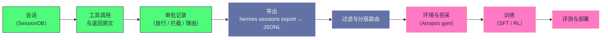
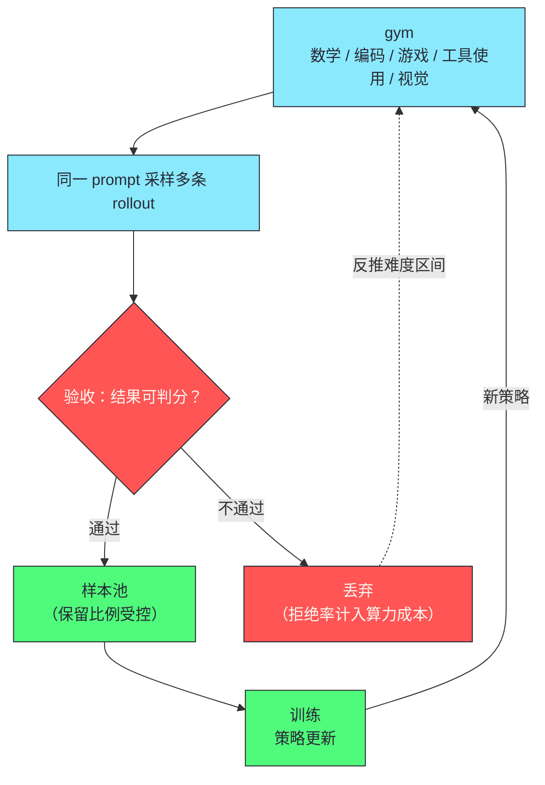
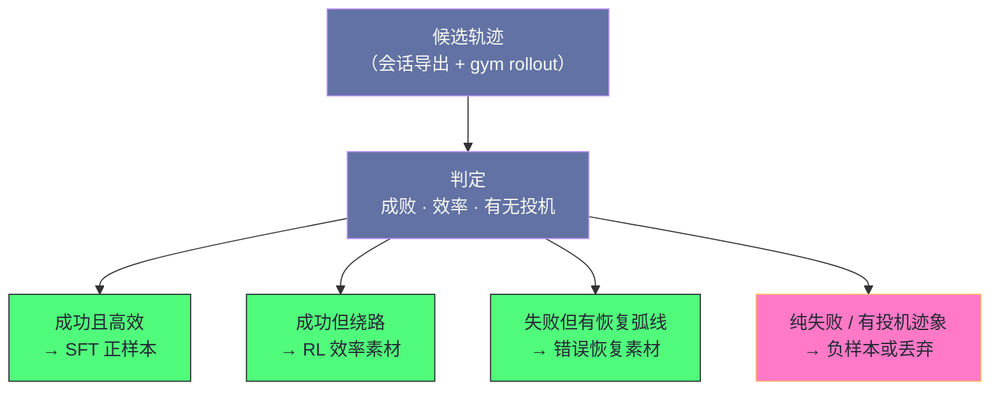
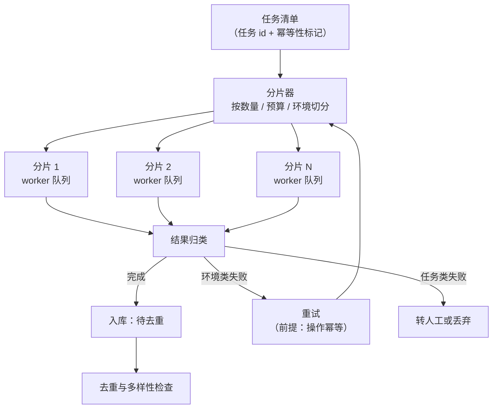
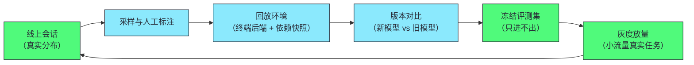

# 11 MLOps 与研究——批量轨迹生成与 RL 训练

**摘要：**

Hermes Agent 常被当成一个住在服务器上的个人助理，可它同时是一条数据生产线：每一次会话、每一次工具调用、每一次审批拦截，都以结构化记录的形式留在自己的机器上，并可以用 `hermes sessions export` 导出成 JSONL。本文不从功能清单讲 MLOps，而是顺着一条素材的旅程走。先看一条排障会话里究竟留下了什么，再看 session_search 在 v0.15（2026-05-28）被重写之后，把"翻历史找素材"这件事的成本压到了什么量级。随后转进反面：如果这套过程数据只存在于云厂商的黑盒里，研究会失去哪些能力，自托管又要为此付什么账。中段接到训练信号那一端——Nous 的 Hermes 4（2025-08，技术报告 arXiv:2508.18255）用 Atropos 生成的合成数据训练，而 Atropos 是一个带数百个 gym（数学、编码、游戏、工具使用、视觉）的开源 RL 环境框架，靠拒绝采样把"能跑通"的尝试筛成可训练样本。后段讲批量任务的工程（分片、重试、幂等、去重、成本）与评测口径，末段落在边界：分布偏差、审核成本、隐私合规，以及那条最容易被讲顺、中间却断开的"自改进闭环"。全文回答两个问题：会话怎么变成训练信号，以及这一步的代价记在谁账上。

---

## 第 1 章 一条会话的两种命运

### 1.1 从一台机器的磁盘告警说起

2026 年 11 月的一个下午，一台名为 opsbox-07 的机器报出 /data 分区使用率九成二的告警。值班的人没有直接登机器，而是把这件事交给跑在宿主机上的 Agent，要求它先看清楚再动手，不要碰线上服务。接下来的十几分钟里，这个 Agent 通过 SSH 后端在远端执行 `df`、`du`、`ls`，把增长的目录一层层收到 /data/logs，发现应用日志按大小切分、却没有按天切，单日文件能涨到几个 G；它试过一次直接清空日志目录，命令被 deny 规则拦下，于是改为先压缩归档、再校验释放量，最后给出根因与后续建议。收尾时它把结论写回会话，等人确认。

这条会话在当天只是一次普通的值班处理，第二天就沉进历史。可如果把它完整摊开，里面其实有四类东西：命令的原始输出（容量、inode、文件清单）、模型的决策序列（先看什么、后看什么、为什么绕开 `rm`）、一次被否决的动作连同否决的理由、以及最终判定（定位正确，处置需人工复核）。四类东西合在一起，恰好构成一个可复用的样本——它记录的不是"磁盘满了怎么办"这条知识，而是"一个模型在真实环境里如何一步步逼近根因、又在哪一步被边界挡住"的过程。

同一段记录，在两种人手里有两种命运。值班的人拿它复盘，研究者拿它做训练素材。两者的前提是同一个：这段记录必须能被取出来、被读懂、被重新组织。本文走的就是这条从会话到训练信号的路。

### 1.2 轨迹不是聊天记录

聊天窗口里看到的是渲染过的结果：工具调用被折成一行"读取文件"，返回内容被截断成摘要，思考过程按需展开。轨迹（trajectory）要的却是原文——模型发起的调用名与参数、工具返回的完整内容（哪怕是一屏几百行的 `du` 输出）、每一个被判定过的动作、以及它当时所处的执行环境。两者的差别不是详略，而是能不能重放。

用病历打比方会更清楚。聊天记录像病人出院时的一句"恢复良好"，轨迹像整本病历：入院指标、每一步用药、哪次用药被上级医生叫停、叫停之后换成了什么。要训练一个模型学会处置，靠"恢复良好"学不会，靠病历才能看见判断的分岔点在哪里。不过这个比喻要跟一句限定：真实病历有主治医生签字，责任是明确的；轨迹没有天然的签字人，成败常常要事后补判——这正是后文质量过滤与人工审核要补的那一环。

一条可用的轨迹，笔者以为至少要满足四个条件。其一是可寻址，每条轨迹有稳定标识，能与任务、模型、时间对上，否则几万条混在一起只是一团浆糊。其二是可重放，参数与返回都在，重放时能还原模型当时的处境，而不只是它的结论。其三是有边界，得知道它跑在哪种终端后端里（local、Docker、SSH、Daytona、Modal、Vercel Sandbox、Singularity 七种之一），环境不同，同一个任务的难度与失败形态可以完全不同。其四是可标注，成败能被人或规则判出来，这一步决定轨迹能不能变成带标签的样本，而不只是一段无从评价的日志。

至于格式，官方给出的是导出为 JSONL，一行一条记录；每一行里究竟有哪些字段，由导出结构与下游工具共同决定，笔者不去替它规定。这份谨慎并非多余：训练所需的字段取决于你要做监督微调（Supervised Fine-Tuning，SFT）还是强化学习（Reinforcement Learning，RL）、要不要回放环境、要不要对齐工具调用的中间态，格式是跟着用途长出来的，先立一个"标准格式"再倒推用途，通常两头不讨好。

### 1.3 本文不讨论"功能清单"

有一种写法很容易讨巧：列举 Hermes 在研究方向上提供了哪些能力，配上命令与截图，凑成一篇"研究指南"。这篇不这么写，原因是官方并没有一套叫 MLOps 的独立模块，硬要列举，最后列出来的必然是散落在会话、日志、审批、终端后端里的既有机制，再把它们重新命名一遍。

笔者想讨论的是一个位置问题：一个自托管、会话可导出、执行过程可审计的 Agent，在整个研究管线里占住了哪一段。这个位置的判断比功能清单稳定得多——功能会随版本增删，位置由"数据在哪里产生、能不能取走"这两件事决定，而这两件事在自托管形态里是结构性的。

### 1.4 两个问题与全文路线

全文要回答两个问题。第一个是正向的：会话怎么变成训练信号，中间要过哪几道工序，每道工序各自淘汰掉什么。第二个是反向的：这条路上哪些代价是省不掉的，哪些"看起来很顺"的叙事其实中间断开了。

路线按五问铺开。第 2 章讲素材是什么、从哪来；第 3 章做反事实推演，看抽掉自托管与可导出之后研究会退化成什么样；第 4 章进训练端，拆 Atropos 的 gym 与拒绝采样；第 5 章讲批量任务的分片、重试与成本；第 6 章讲评测口径；第 7 章收在边界与反例上；第 8 章把断点与接通处摆到一起。

---

## 第 2 章 素材从哪里来

### 2.1 会话是这台机器上的一等公民

Hermes 的核心代理层里有一个会话库（SessionDB），会话不是临时上下文，而是有身份、有生命周期的对象：可以列出、可以重命名、可以删除，也可以整体导出成 JSONL。这几条管理动作看似琐碎，放在研究语境里却各有分工——重命名是给一批会话打标签，删除是把明显无用的记录从候选池里剔掉，导出则是把候选池变成可搬运的文件。

会话默认落在自己的机器上，这一点决定了后面所有的讨论。自托管意味着会话库、结构化日志（`~/.hermes/logs/` 下的 `agent.log` 与 `errors.log`）、记忆文件都在部署者手里，数据是否外流由部署者决定，而不是由服务条款决定。日志还能用 `hermes logs` 直接 tail 与过滤，某次失败究竟是模型判断错还是环境拒绝，答案常常在这两个文件里。

这套安排还有一层不那么显眼的好处：留存与备份的策略也归自己定。会话库既是资产又是负债——资产是它能被反复检索、导出、重组；负债是它随时间膨胀，含着的敏感信息也一起膨胀。托管服务里这两件事由对方的策略决定，自托管里由自己的规范决定，规范缺失时它就会以"谁也不敢删"的形态堆在那里。

顺带说明一处容易被绊住的版本细节：版本号有两种写法并存，`v0.23.2` 与日历式的 `v2026.x.y`（譬如同一个版本既叫 v0.8.0 也叫 v2026.4.8）。读 release notes 时若把两种写法当成两条版本线，会把演进节奏看错。本文统一用 `v0.x.y` 的说法。

### 2.2 检索被重写之后

2026-05-28 发布的 v0.15.0 代号是 The Velocity Release，session_search 在这次版本里被重写：去掉了原先参与检索的辅助 LLM，改成三种由参数推断的模式（discovery、scroll、browse），不再有 mode 参数，也没有配置开关，检索延迟落在二十毫秒这个量级。

这次改动值得单独讲，因为它改变的不是体验，而是素材的可得性。旧的检索实现要在环路里跑一个辅助模型，于是每检索一次就是一次模型调用——有费用、有延迟、有非确定性。新的实现走本地的 FTS5 全文索引，**零模型调用**，同一句查询永远得到同一批结果。三件事随之成立。

第一件是成本归零。研究者挑素材的典型动作是"翻遍历史，找出所有在某类任务上失败的会话"，这在按次计费的检索里是一个要预算的动作，在本地索引里变成一个可以随手重跑的动作。第二件是可穷举。既然检索便宜，就不必先猜关键词再抽样，可以直接把整个会话库过一遍，按工具名、按失败信号、按会话长度筛。第三件是可复现，这一点对研究最要紧——检索结果不依赖模型温度、不依赖辅助模型的版本，今天跑出来的候选集与三个月后跑出来的应当一致，实验才有对照的基础。

**检索从付费动作变成免费动作**，这是这条素材管线上最实质的一次变化。它没有让轨迹变得更完整，也没有让训练变得更便宜，它只是把"找到合适素材"这一步的门槛拆掉了。笔者以为，很多所谓数据工程的门槛，最后都卡在这种不起眼的取数环节上。

这个判断有个边界要说明：检索免费不等于筛选免费。检索只负责把候选集摆出来，候选集里哪些能用，仍然要过判定这一关，而判定要么花钱（评审模型），要么花人（抽查），这两笔账在第 4 章与第 7 章分别算。

### 2.3 审批记录是被忽略的偏好数据

第二条素材来源是审批记录，它对训练的价值被严重低估。v0.19 起智能审批（smart approvals）成为默认：被标记为敏感的命令由 LLM 审查器独立评估后放行或拦截，每一次判定只覆盖当次那条具体命令，后续同类命令需要各自审查；再配上用户自定义的 deny 规则（即便在放开审批的模式下也照样拦截）和 `/deny <reason>` 这条反馈命令，一条"人为什么拒绝"的链路就成形了。

把它翻译成训练语言：deny 规则是显式写下的偏好，审查器的判定是隐式的策略偏好，`/deny <reason>` 带着理由的否决则是最接近人类偏好标注的东西——有负样本、有原因、有上下文。RLHF 里最贵的一环就是这类标注，而在自托管的日常使用中，它是顺带产生的，不需要额外雇人，也不需要专门设计标注任务。

不过这里也有它的偏差来源，不能直接当金标准用。审查器本身是一个模型，它对"什么可疑"的判断带有自己的倾向；用户写 deny 规则的动机常常是"别碰这条路径"，而不是"这条路径在语义上错误"；`/deny` 的理由有时只有四个字，事后无法还原当时的考虑。**审批记录是偏好数据的富矿，但矿石不等于金属**，它需要清洗、归类、去重之后才能进训练管线。

### 2.4 一个工具集清单就是任务空间

第三条来源常被当成元数据而忽略：当前版本启用了哪些工具集。工具集（toolset）可以按平台分别授权——同一个实例在命令行给全套工具，在某个群机器人里只给搜索与读文件——`hermes tools` 就能看到当前授权。研究者据此可以判断两件事：这批轨迹的"动作空间"有多大，以及哪些动作在采集时根本没被允许发生。

这件事直接关系到数据集的解释力。若某批轨迹是在只开文件与终端的配置下采的，那么它天然不含联网检索、浏览器操作、视觉理解的行为样本，用这批数据训练出来的模型在这些方向上不会有任何长进，而这与模型能力无关，纯粹是采集时的授权收窄了动作空间。清单不清，后面的覆盖率统计就无从谈起。

把素材来源、命令面与管线位置摆到一起，先看清地图再谈工程。

图里有一处容易被读错：审批记录夹在工具调用与导出之间，看上去只是元数据，实际上它是这条管线里唯一带有"人类否决"的环节。少了它，导出的东西只是执行日志；有了它，同一段执行才带上了价值判断。

命令面与素材面各用一张表收敛，前者说明怎么取，后者说明取到什么、缺什么。

| 命令或入口 | 作用 | 在管线里的位置 |
| :--- | :--- | :--- |
| `hermes sessions export OUT` | 把会话导出为 JSONL 文件 | 采集：候选池落盘 |
| `hermes sessions` 的 rename / delete 子命令 | 给会话命名、删除废弃会话 | 整理：批次标注与剔除 |
| `session_search` | 跨会话检索，三种模式按参数推断，约 20ms 级 | 选题：从历史里挑素材 |
| `hermes logs` | tail 与过滤 `agent.log`、`errors.log` | 归因：失败落在模型还是环境 |
| `hermes tools` | 查看当前工具集与按平台的授权 | 盘点：确认动作空间 |
| `hermes model` | 切换当前使用的模型 | 对照：同一批任务换模型重采 |

| 素材来源 | 拿得到什么 | 主要偏差 | 更适合的用途 |
| :--- | :--- | :--- | :--- |
| 真实会话（本机会话库） | 指令、工具调用与原文返回、失败与恢复、人工纠正 | 长尾稀疏，成功标签要事后补判，含隐私 | 分布校准、长尾能力、错误恢复 |
| 工具调用与审批记录 | 被拦截的动作、deny 理由、人工放行 | 只覆盖被策略触及的动作 | 偏好数据、安全行为、奖励信号 |
| 脚本化批量生成 | 可控任务集、规模、可对照的成败 | 预设任务不等于真实分布 | 覆盖度补齐、回归基线 |
| 环境侧 rollout（gym） | 同一 prompt 的多条尝试、可判定的成败 | gym 本身是人挑出来的任务分布 | RL 训练信号 |
| 运行日志与临时状态 | 异常堆栈、重试痕迹、超时与清理记录 | 不含模型推理原文 | 归因、可观测、失败分类 |

表格右下角那格最容易被忽略：日志本身不是训练数据，但它是判断"这条轨迹为什么烂"的唯一证据。一条失败轨迹如果没有任何日志，它在数据集里就只能被标成"失败"，而没法被标成"因环境超时而失败"——后一种标签才教得会模型该不该重试。

---

## 第 3 章 不这样会怎样：黑盒里的研究困境

### 3.1 只拿到输入与输出

假设 Hermes 不是自托管的开源软件，而是一个托管服务：你把任务发过去，它把结果送回来，中间以摘要形式回传。这种形态做产品没问题，做研究立刻遇到第一堵墙——你拿到的是"结果"，不是"过程"。模型在第三步选错了工具、在第七步丢了前几步才拿到的关键参数，这些信息在结果里全部消失，只在过程里存在。

更麻烦的是失败样本。成功的会话结果可用，失败的呢？失败会话说"我没做成"，而研究者需要知道的是它卡在哪一环、哪一步的判断依据不足、换一个模型会不会更好。这些问题都要求重放，而重放要求参数与返回原文，恰好是黑盒最不愿意给的东西。

### 3.2 判定不可审计

第二堵墙是判定。训练信号来自"什么算成功"，而"成功"必须有判定依据。自托管形态里，判定依据散落在审批记录、终端输出、日志三段里：命令有没有被执行、退出码是什么、被拦截之后模型有没有改道、改道之后有没有验证。托管形态里，这些判定要么不暴露，要么以"任务完成"这种笼统状态暴露，后者既不能区分部分成功，也不能区分"表面上完成、实际上留了坑"。

**没有审计就没有归因，没有归因就没有可靠的正负样本**。这句话可以反过来验证：凡是一个团队在抱怨"微调之后模型没变好"，往上追多半会发现，它的训练数据里根本没有可信的成败标签，只有一堆自认为成功的样本。

### 3.3 数据主权的硬约束

第三堵墙不在技术里，在采购流程里。金融、医疗、政企这类场景对数据出域有硬性约束，会话里出现的路径、配置、业务字段，都可能被归入不得外传的范围。云托管的 Agent 在这一关往往直接被否，理由是"过程数据不可控"，而不是"效果不好"。

自托管的形态把这道门推开了：会话库、日志、记忆都在自己的机器上，是否外流由部署者决定。对合规行业来说，这等于把问题从"能不能用"换成了"愿不愿意承担运维"。换出来的空间很大——原本被合规否决的 Agent 场景，忽然可以做 PoC 了。

不过这句话要说得准确些。自托管解决的是"数据默认在本机"，不解决"数据永远不会外流"：只要你把会话导出成文件、把文件交给外部训练方、或者在提示里带上第三方 API，数据就再次流动了。主权不是一个开关，而是一串需要逐环节确认的动作。

### 3.4 反事实推演：三样能力同时消失

把上面的墙收拢成一次反事实推演。如果这套过程数据只存在于云厂商的黑盒里，会同时消失三样能力。

第一样是过程可得性。你只能拿到结果与摘要，重放无从谈起，失败分析退化成猜测。第二样是判定可得性。没有审批记录与执行日志，成功与失败都只能由结果反推，带噪声的标签进训练集，模型学到的就是噪声。第三样是迁移可得性。数据的导出格式、字段定义、留存周期都由服务方决定，你无法保证今天采的数据明天还能读，也无法保证同一批任务在换供应商之后还能对照。

三样能力同时消失的后果，是研究退化成试用：你只能比较"哪个 API 效果更好"，不能研究"为什么更好"。比较是采购动作，研究才需要过程数据，两者的分界线就在这里。

### 3.5 自托管的账单

反过来说，自托管也不是白拿的。它把三笔账挪到了部署者身上。

第一笔是运维账：机器、备份、升级、日志轮转，出了问题没有人替你兜底。第二笔是治理账：脱敏、访问控制、留存期限，这些在托管服务里是对方的义务，在这里是你的义务，而且一旦出事，责任归属没有模糊空间。第三笔是能力账：本地算力有限，批量生成与训练都要自己找资源，规模上限受制于自己的硬件与预算。

**数据主权与治理责任是同一枚硬币的两面**，想要前者就必须接住后者。笔者见过一些团队把自托管当成"省钱又安全"的选项，结果在脱敏与备份上省掉的工，后来在事故里加倍还了回去。第 7 章会把这份账单的细目展开。

---

## 第 4 章 从轨迹到训练信号

### 4.1 Hermes 4 的数据不是捡来的

2025 年 8 月，Nous 发布 Hermes 4，技术报告 arXiv:2508.18255 在 2025-08-25 提交，同年 9 月初出了第二版。报告对训练数据的描述是大规模合成数据，而生产这批数据的是 Atropos——Nous 自己开源的 RL 环境框架。这条线索不是孤例：再往前推到 2024 年 8 月的 Hermes 3（微调 Llama 3.1 的 8B、70B、405B 三个尺寸），训练数据同样以合成数据为主。合成数据不是这条模型线的补丁，而是它的传统。

这个传统回答了一个常见疑问：为什么一个开源实验室能在数据量上与大厂掰手腕。答案不是"偷偷抓了更多网页"，而是"换了一种生产方式"——不去互联网上找现成的轨迹，而是造一个能反复跑、能判分、能批量并行的环境，让模型在里面自己产生轨迹。这条路的前提是环境与判分标准都能写成代码，而能不能写成代码，取决于任务本身是否可判定。

### 4.2 Atropos：把任务写成 gym

Atropos 的官方口径是一个开源 RL 环境框架，内含数百个 gym，覆盖数学、编码、游戏、工具使用、视觉几类任务，并采用拒绝采样。把 gym 这个词直译成"健身房"会丢掉关键信息，它在这里更接近飞行模拟器：可以重置、可以重复、可以在同一科目上飞很多次，而且每次落地都有教员打分。

模拟器这个比喻能带出 gym 的三个性质，而这三个性质恰好是 RL 最缺的东西。**可重置**让同一个任务能被采样多次，不必担心环境被上一次尝试污染；**可判定**让每次尝试都有明确成败，数学题对错分明，编码题有测试用例，游戏有分数；**可并行**让采样吞吐随机器数量扩展。真实会话一条都不占：不可重置（磁盘已经被清过一次）、不可判定（"处置是否合理"要人来判）、不可并行（同一台机器上的副作用互相干扰）。

所以 Atropos 与 Hermes Agent 的关系，不是"同一个产品的两个功能"，而是"两条数据生产线"。一条在模拟器里造可判定的尝试，一条在真实机器上留不可判定的过程。前者的产出适合做训练信号，后者的产出适合做分布校准，第 4.4 节把这条分工讲透。

### 4.3 拒绝采样的回路

拒绝采样（rejection sampling）的机制很朴素：同一个 prompt 让当前策略采样多条尝试，通过验收的留下，不通过的丢掉，留下的那批才进训练。它解决的是一个很实际的问题——策略还很弱的时候，绝大多数尝试是错的，直接把所有尝试都拿去训练，等于用大量错误示范教模型。

回路可以画成下面这样，注意回路里没有"人工"这个节点，人工的位置在回路之外。

回路里有三个可以调的旋钮：每次采样的条数、验收的门槛、以及最终保留的比例。三者互相牵制——采得多则算力贵，门槛高则拒绝率高，保留比例低则单位有效样本的成本上升。**拒绝采样本质上是用算力换样本质量**，拒绝率越高，这笔交易的单价越贵，所以它有一个天然的上限：当通过率低到某个程度，继续采样的钱不如拿去换更强的底座模型。

有一处细节常被忽略：被拒绝的样本不是垃圾。它们携带"当前策略在这个难度上不行"的信息，可以反过来标定任务难度区间，用来调整下一轮的 gym 配比。把拒绝样本直接删掉，等于每轮都从零开始猜难度。

这些原则落到工具上，就成了 Atropos 里的三个参数：按组保留得分最高的前若干条、是否允许负分样本、以及组内最高分与最低分的最小差值门槛（`--save-top-n-per-group`、`--allow-negative-scores`、`--minimum-score-diff-max-min`）。三者放在一起看，它筛的不是绝对好坏，而是同组内的相对优劣——同一个 prompt 的多次尝试互相比，组内分差若达不到门槛，说明这条 prompt 区分不出策略的高低，这样的样本即使留下也提供不了多少有效信号。按组筛选比按绝对分筛选更难被投机：绝对分可以靠一条捷径刷上去，组内分差则要求同一题上真的分得出优劣。

### 4.4 合成保信号，真实保分布

合成数据与真实数据之争，在 Agent 场景里有一个比"哪个更好"更有用的问法：各自补的是哪一块短板。

合成数据补的是判定。它来自可判分的环境，成败明确、可重复、可批量，适合做训练信号。真实数据补的是分布。它来自用户真实遇到的任务，含脏环境、含含糊的指令、含人类中途纠正，适合做评测集与分布校准。**合成保信号，真实保分布**——把这句话记住，很多选型争论会自动消解：问题不是"要不要合成"，而是"信号与分布各占多少"。

配比没有先验最优解，但有两条可操作的判断。其一是看评测：如果模型在合成分布上分数很高、在真实会话的回放上明显掉下来，说明分布偏差已经压过了信号收益，该加真实数据。其二是看长尾：真实会话里出现频次极低但后果严重的任务（譬如误删、权限变更），必须靠人工或规则挑出来补进训练集，指望合成环境自然覆盖它们是碰运气。

### 4.5 过滤的本质是路由

拿到候选轨迹之后，第一反应通常是"过滤掉差的"。这个反应会浪费掉大部分素材，因为"差"不是一种属性，而是相对于训练目标而言的。

成功但绕了远路的轨迹，对模仿学习是坏样本——它教模型绕路；对强化学习却是好素材——它说明"同样的结果存在更短的路径"，奖励函数只要把效率计入，模型就能从中受益。失败之后又恢复成功的轨迹，是最珍贵的错误恢复素材；被拦腰截断、只有失败的轨迹，才是纯粹的负样本。四类轨迹，四种归宿，四条出口画在一起是这样的。

**过滤的本质是路由，不是淘汰**。同一批原始轨迹，在四种训练目标下有四条出口，判定环节要输出的是"它该去哪条出口"，而不是一个简单的通过/不通过。这个视角转换带来一个实际收益：原先被丢弃的样本里，至少有两类能重新回到管线里，候选池的实际产出率会显著上升。

判定这一步可以用评审模型做初筛，人工只抽查。笔者要提醒的是"初筛"这两个字的重量：评审模型与被训练的模型往往同源，它对"投机"的嗅觉可能与被训练模型一样迟钝。第 7 章会讲到，拒采筛不掉"模型很自信但错了"的样本，而这类样本恰恰是评审模型最容易放行的。

### 4.6 Psyche 与 36B 的 post-training

数据之后是算力。官方 release 页上的 Hermes-4 系列里，Hermes-4.3-Seed-36B 有一个特别之处：它完全在 Psyche 网络上完成 post-training，并在半数尺寸下做到与 Hermes-4-70B 大致相当的表现。Psyche 是 Nous 自建的分布式训练网络，这句话的技术含量在于，它把 post-training 这一段从"必须有集中式大集群"里解耦了出来。

对研究者的启示不在于"小模型能追平大模型"这种结论式的说法，而在于 post-training 的杠杆率。当一个 36B 的模型能在约一半参数下做到与 70B 大致相当，说明决定能力的不只是底座规模，还有数据质量与后训练配方——而这两样恰好是开源栈里最容易被复现的部分。技术报告给配方，Atropos 给数据生产线，Psyche 给算力，三段拼起来，一个小团队才有可能把"研究"做成"实验"而不是"阅读"。

不过这里要留一个伏笔。Psyche 上训出来的模型，与 Hermes Agent 这个产品用哪个模型跑，是两件事。第 7.5 节会把这条线挑明，它是本篇最重要的一处反例。

---

## 第 5 章 批量任务：分片、重试与成本

### 5.1 两种驱动方式

要批量产出轨迹，有两种驱动方式，控制面不在同一个地方。

第一种在会话内：用 `delegate_task` 派生子代理，每个子代理有独立的会话、终端与工具集，主代理只拿回最终摘要。它适合"任务数不多、有人在旁边看着"的场合，好处是编排灵活，坏处是过程数据分散在各个子会话里——主会话里只有摘要，要采集得去子会话取。第二种在会话外：用脚本驱动多个独立实例，每个实例跑完自己导出，脚本只负责派活、收文件、记账。它适合"无人值守、规模优先"的场合，代价是要自己做并发控制、限流与失败处理。

两者不是替代关系。笔者更倾向于把它们叠起来用：外层脚本做分片与重试，内层用子代理拆解单个复杂任务，导出时把主会话与子会话按 id 串起来。这个串接动作很小，却决定了后面能不能把"一个任务的完整过程"还原出来。

### 5.2 为什么必须分片

一次跑几万个任务是行不通的，不是因为跑不完，而是因为跑炸了收不住。分片把一次大作业拆成若干可独立成败的小块，换来四样东西：失败隔离（一个分片炸了不影响其他分片）、预算上限（每个分片有独立的 token 与时间预算）、并行度控制（分片数就是并发上限，不会把目标服务打挂）、以及可续跑（中断之后从分片粒度续，不必从头再来）。

分片的维度有三种常见取法。按任务数切最直观，适合任务成本接近的场合；按预算切更稳，适合单个任务长度差异大的场合，否则一个超长任务会把整片预算吃光；按环境切最讲究，把需要 Docker 的、需要 SSH 的、需要 GPU 的分开，避免同片内环境准备互相拖累。

分片数还有一处外部约束容易被忽略：并发上限应当按被操作的那一方来定，而不是按自己的机器来定。若所有分片都在同一批目标主机上跑命令，分片数超过目标的承载能力，失败率会集体上升，而这类失败会被误判成环境类失败，触发更多重试，把目标压得更死。限流要放在分片器里，而不是放在单个 worker 里。

分片、失败归类与重试的关系，画成图会更清楚。

图里那个"幂等性标记"是整张图的关键前置条件，第 5.3 节解释它为什么不能省。

### 5.3 失败的三类与重试的前提

批量任务失败，原因可以归成三类，三类对应三种处置。

环境类失败最常见：容器起不来、远端连接断、依赖没装好、磁盘满了。这类失败与任务本身无关，重试通常能过，是重试机制的主要服务对象。模型类失败次之：同一 prompt 采样出不同结果，这一次模型走进了死循环，下一次可能就出来了，处置方式是"再采一条"而不是"修环境"。任务类失败最少但最麻烦：任务本身有歧义、目标页不存在、权限根本不够，重试多少次都一样，只能转人工或标为不可行。

重试有一个前提条件，就是幂等。**重试一次不幂等的操作，代价可能比重试本身大得多**——在真实机器上重跑一次"删日志再归档"，如果第一次其实成功了只是回传失败，第二次就会在空目录上再操作一遍；如果任务里有对外发送动作（发消息、改工单、提交评论），重试会造成重复副作用。银行冲正的做法值得借鉴：先在账上记一笔"待确认"，确认后再落账，重试时先查状态再决定动作。批量任务里的对应做法是给每个任务一个幂等键，落地前查一次"这个键是否已完成"。

这条要求会反向影响任务设计：写任务清单时就要标注哪些任务可重试、哪些只能跑一次。没有这个标记，重试策略就只能在"多跑一遍"与"不敢重跑"之间二选一。

### 5.4 去重与多样性

同一个 prompt 采样多次，得到的轨迹往往高度相似——相同的工具序列、相似的开场白、甚至连失败都失败在同一个地方。这种相似性在拒绝采样里是好事（说明策略稳定），在训练集里是坏事（模型只学到一种解法）。

去重的常见做法有两层。第一层是结构指纹：把工具调用序列抽出来做归一化，序列相同或高度相似的判为重复，只留质量最高的一条。第二层是语义指纹：对任务描述做向量化，同一意图的不同表述合并成一条。两层都做，能压掉大部分重复，但也会误杀——同一任务的不同解法是宝贵的多样性，不该被指纹当重复删掉，所以去重要保留"解法不同"的副本，只删"解法相同"的副本。

多样性不能靠数量堆。**多样性是设计出来的，不是采多了自然就有的**：同一任务的不同解法、同一工具的简单调用与复杂组合、不同错误类型对应的不同恢复路径，这三种受控变异需要在任务清单里显式安排。一个可操作的检验指标是工具覆盖度——统计轨迹集中每个工具出现的频率，若某些已授权的工具在训练集里一次都没出现，模型在这些工具上的可靠性就没有数据支撑。

### 5.5 成本的真正主项

批量生成要花真金白银，成本结构却常被算错。很多人按"任务数 × 平均 token"估预算，低估的原因在于 Agent 的 token 消耗是非线性的。

一条轨迹的第 n 轮，输入里包含系统提示词、历史对话、以及此前所有工具返回的累积。工具返回往往是长文本（一屏 `du` 输出、几百行配置文件），于是每一轮都要为重付一次历史。**上下文膨胀才是批量生成成本的主项**，任务数只是乘数。这也解释了为什么长会话的成本会突然跳一个台阶：不是模型变慢了，而是输入长度跨过了某个阈值。

缓解手段有三条。其一，能短则短的提示词纪律：工具返回不必要就不要原样塞回上下文，用摘要加文件引用代替。其二，前缀缓存：同一部署里系统提示词这一层几乎不变，v0.23.x 给每个会话配了 prompt-cache 时钟，重复前缀的计费会便宜很多，但工具返回的增长部分照付。其三，分档用模型：大部分轨迹用便宜模型跑量，关键样本用强模型生成，前者的作用是覆盖，后者的作用是示范。

成本核算还有一笔隐性支出：失败重试。假设失败率一成，预算就要按一点一倍算，且失败的那部分往往消耗了 token 却没产出可用样本。把重试成本计入单条有效样本的单价，才是能用来做决策的数字。

---

## 第 6 章 评测：别把已上线能力当评测集

### 6.1 三种口径不要混用

评测最容易出问题的地方，不是指标选得不对，而是三种口径混着用，最后得出一个自己都无法解释的分数。

| 口径 | 回答的问题 | 数据从哪来 | 典型失效方式 |
| :--- | :--- | :--- | :--- |
| 能力评测 | 这个模型会不会做这类任务 | 与训练集隔离的 held-out 任务集 | 任务与训练集同源，分数虚高 |
| 回归评测 | 改一处会不会弄坏别处 | 历史失败案例 + 关键路径用例 | 用例太少，覆盖不到被改坏的路径 |
| 在线行为 | 真实用户实际遇到什么 | 线上会话采样与人工标注 | 只统计成功案例，忽略放弃与重试 |

三种口径各自成立，混用的后果是决策失真。典型场景是：能力评测涨了三个点，就认为可以上线，结果在线行为没有任何改善——因为涨的那三个点来自训练集附近的任务，而真实用户的任务分布根本不在那里。**评测集的价值不在规模，而在它与训练集的隔离程度**，一个两百条但完全隔离的评测集，比两万条与训练集同源的评测集有用得多。

### 6.2 评测与线上行为的反馈环

健康的评测不是一个静态分数，而是一个环：线上会话采样、回放环境、版本对比、冻结评测、灰度放量，再回到线上采样。

环里最难的一步是"回放环境"。要重放一条线上轨迹，得同时还原终端后端、依赖版本、以及数据当时的快照——这三样缺一件，重放出来的就不是同一个任务。自托管在这里又占了一次便宜：终端后端是可插拔接口，环境定义本来就在自己手里；云沙箱的 `container_persistent`、Docker 的环境变量转发，这些配置决定回放能不能对齐。顺带一提，终端环境的 `cleanup_stops_processes` 默认为真，意思是清理之后进程随沙箱消失；云沙箱若希望作业在断开后继续，需要显式改这个开关，否则回放时会发现"任务跑到一半环境没了"。

即便环境对齐了，回放仍会有不一致，来源通常有三个：依赖漂移（镜像或库版本变了）、数据漂移（被操作的对象已经不是当时的状态）、以及时间相关行为（重试间隔、超时阈值随环境变化）。这三种不一致都要求把环境当成产物来管理，而不是把回放当成"再跑一遍"。

环里还有一条纪律：评测集只进不出。任何进过训练集的样本，都不能再回评测集，哪怕它以另一种形式出现。这条纪律听起来简单，执行起来需要时间戳与任务指纹两重校验，否则某次"顺手把线上数据补进评测集"就会把环打断。

### 6.3 污染与过拟合

污染（contamination）是评测里最隐蔽的失效。它的形态不止一种：训练集与评测集用了同一批任务；评测集的 prompt 出现在训练语料里；甚至评测集的任务描述被模型在训练中"见过近似表述"。三种形态的后果一样——分数失去意义，而且失真的方向永远是高估。

检测污染有一个朴素办法：对评测集里的每条任务，在训练集里做一次近似检索。session_search 这类本地检索在这里又派上用场——它便宜、可穷举，适合做这种"全库比对"的脏活。检索出高相似度的条目，要么从训练集剔除，要么从评测集剔除，两者不能都留。

过拟合的表现比污染更早出现。训练轮次增加，训练损失持续下降，评测分数在某个点之后不再上升甚至回落——这是模型开始记忆训练分布的信号。对策不是"少训几轮"这么简单，而是检查训练集的任务类型分布是否过窄：如果九成样本都来自同几类任务，模型当然会在这些任务上过拟合，而在其余方向上退化。

### 6.4 演示偏差

最后一种失真不在数据里，在叙述里。挑十个成功案例录一段演示，比公开一百次运行的完整统计好看得多，这是所有 Agent 产品都会遇到的压力，也是研究者最容易自我欺骗的地方。

**演示是抽样后的结果，评测是抽样的过程**。区别在于前者可以选择样本，后者必须公开抽样规则。判断一个能力声明是否可信，可以问三个问题：评测集怎么来的、失败样本怎么处理的、以及结果能不能被第三方用同样的环境复现。第三个问题把话题带回开源：可复现不是道德姿态，它是让能力声明可以被审计的技术前提。

---

## 第 7 章 边界与反例

### 7.1 分布偏差是结构性的

数百个 gym 覆盖数学、编码、游戏、工具使用、视觉，看上去已经很全面。但这套分布是研究者按"可判定的任务"挑出来的，不是按"用户实际遇到的任务"统计出来的。两者的差距是结构性的，不是靠多造几个 gym 能补上的。

差距有三处具体表现。其一是任务的可判定性偏差：能被 gym 判分的任务，天然偏向有明确答案的那一类，而真实任务里大量存在"没有标准答案、只有更好方案"的情况。其二是环境的干净程度偏差：gym 里的环境是准备好的，真实机器上有历史包袱、有半坏的配置、有别人留下的进程。其三是指令的模糊度偏差：gym 的 prompt 是写清楚的，真实用户的指令常常含糊，需要先澄清再执行。

分布偏差的后果不是"模型不会做"，而是**模型在没见过的处境里做得比预期差**。这个后果在评测里很难被发现，因为评测集往往与训练集同源；它只在真实使用中暴露，而暴露的形式通常是"某些用户觉得它很笨"，却说不出具体哪里笨。

### 7.2 拒采筛不掉自信的错误

拒绝采样能筛掉的是"没过验收"的尝试，它有一个天生的盲区：模型很自信、验收也通过了、但结论其实是错的。这类样本在数据里看起来最漂亮——步骤流畅、结果通过、没有重试——因而最容易被当成高质量正样本喂进训练。

要补这个盲区，只能靠人的判断，或者靠一套独立于模型的校验。机器与人的分工可以排成下面这张表。

| 环节 | 机器负责 | 人负责 | 为什么这样分 |
| :--- | :--- | :--- | :--- |
| 候选生成 | 批量采样、控制成本与吞吐 | 定任务清单与难度区间 | 规模问题机器更快，任务定义是价值判断 |
| 初筛与判分 | 规则判定、评审模型打分 | 定判定标准、处理边界样本 | 规则能覆盖常见情形，标准必须由人定 |
| 抽查 | 按分层抽样给出待审清单 | 审高奖励样本与异常样本 | 人审全量不可行，但必须审"最像真的"那批 |
| 争议裁决 | 汇总分歧、给出证据链 | 判定申诉、修订规则 | 规则错了要有人负责改 |
| 最终入库 | 去重、打标、写元数据 | 抽查元数据正确性 | 机械动作归机器，语义正确性归人 |

表里最值得看的是第三行。人工审核的正确用法不是"从头看到尾"，而是"按分层抽样看最该看的那批"——奖励最高的一批、模型最自信的一批、以及与其他样本分歧最大的一批。**人工审核的价值在于校准标准，不在于覆盖数据**；把人力花在覆盖上，很快就会被数据量淹没。

### 7.3 隐私：导出即风险

会话一导出，风险就落地了。真实轨迹里含着路径、主机名、业务字段、偶尔还有密钥与个人信息，一旦进入训练集，它可能通过模型的行为被间接复述出来——这种泄漏比文件泄漏更难发现，也更难撤回。

脱敏的常见手段有三种：占位符替换（路径与主机名换成 `<HOST>` 一类）、结构保留（替换值但保留数据形态，让轨迹的教学价值不损失）、分层发布（方法开源、数据不公开）。三者可以叠加，但顺序很重要——脱敏必须在导出的管道里做，而不是"发布前记得处理"。

**脱敏应该是管线里的一个环节，而不是一条纪律**。管线化的做法是：规则进版本控制，每次导出自动执行，命中与未命中的记录都留审计日志。纪律化的做法是把责任压在人身上，人在赶进度的时候一定跳过它。这与工具设计里"把约束写进契约"的思路是同一个：能在结构上保证的事，不要指望靠自觉。

审计日志在合规问询时还有一层额外作用：它是举证材料。被问起"你们怎么保证模型没有接触到客户数据"时，一份可追溯的导出记录、脱敏命中记录与访问记录，比一份制度文档有说服力得多。这也是自托管的一处隐性收益——举证所需的原始材料，本来就在你自己的机器上。

隐私与可复现之间的张力也要说清楚。方法开源、数据不开源，是隐私敏感研究的常规解——外部研究者用同样的方法与自己的数据复现，能验证方法是否成立，但不能验证具体数据上的结论。这个折中不完美，却是目前唯一能同时守住合规与学术信任的做法。

### 7.4 自举需要锚

用模型自己产生的数据训练下一代模型，是这套叙事里最诱人的部分。它确实有效，但有效的前提是掺了"锚"。

纯自举的问题在几轮之后显现：模型的能力分布会向自己已经擅长的方向收窄，长尾与边缘情形逐步消失，最后连"自己到底不会什么"都判断不出来。这个现象通常被笼统地称为退化，它的机制并不神秘——训练数据的分布由上一代模型的行为决定，上一代不做的动作，下一代永远不会出现在训练数据里。

锚有三种，作用都是把分布拉回来。第一种是人工审核过的样本，它们携带模型自身无法产生的判断。第二种是不同模型产生的轨迹，跨模型的差异本身就是多样性。第三种是外部基准与真实会话，它们代表模型管不到的那部分世界。**带锚的自举是改进，不带锚的自举是收窄**，两者的区别在头两轮几乎看不出来，在第五轮之后会拉开很大。

### 7.5 最重的一条反例：闭环在部署处断开

到这里必须正面处理一个流传很广的说法：Hermes 用自己产生的轨迹训练新一代 Hermes 模型，再把这代模型部署回 Hermes，形成一个自我改进的闭环。这个说法在叙事上非常顺，顺到很少有人去核对最后一步。

核对的结果是，最后一步不成立。Hermes 4 系列在官方口径里是前沿的混合推理对话模型，擅长数学、科学、指令遵循、schema 遵循、角色扮演与长文写作，但官方明确不推荐在 Hermes Agent 内部使用——原因是它针对对话与推理调优，而不是 agent 依赖的高频工具调用循环（rapid-fire tool-calling loop）。官方给 Agent 场景的建议是接前沿的 agentic 模型，文档里举的例子包括 claude-sonnet-4.6、gpt-5.5-pro、gemini-3-pro-preview。

于是整条链路可以重画一遍：产品端跑的是别人的前沿模型，产品产生会话；会话导出成轨迹，轨迹进 Atropos 一类环境与训练管线；训练出的 Hermes 模型发布在模型线上；模型线服务于对话与推理场景，不被部署回产品端。中间那一步，也就是训练成果回到产生数据的那个产品，**在当前的官方口径里是断开的**。

这不是缺陷，而是一次分工。模型研发线与 Agent 产品线本来就是两条线：前者赌的是合成数据与后训练配方，后者赌的是运行时、工具生态与多模型接入。两条线共享方法论（拒绝采样、环境、判分标准），不共享同一份权重。把它们混为一谈，会得出两个错误结论——要么以为产品端的"越用越强"来自权重更新，要么以为模型线的新版本会立刻改善产品体验。两者都不对，前者来自技能与记忆在会话内的积累，后者要经过产品端的模型接入才能落地。

反过来看，这条反例恰好解释了为什么本篇要把"素材"与"信号"分得这么细。素材是产品线的副产品，信号是模型线的原料，两者之间隔着环境、判分与训练三段工程，从来不是一条"自动流动"的管道。

### 7.6 常见失败与对策

把散在各章的失败形态收成一张表，便于在真实项目里对照排查。

| 失败形态 | 现象 | 根因 | 对策 |
| :--- | :--- | :--- | :--- |
| 重复轨迹 | 训练集里大量近乎相同的工具序列 | 同一 prompt 多次采样，未做结构指纹去重 | 两层去重，只删解法相同的副本 |
| 失败样本污染 | 模型学到"遇错就放弃" | 截断的失败轨迹被当成普通负样本 | 按恢复弧线切分，恢复段单独路由 |
| 隐私泄漏 | 输出里出现内部主机名或路径 | 脱敏靠人工补做，未进导出管道 | 规则进版本控制，导出即脱敏并留审计 |
| 评测过拟合 | 评测分数涨、线上无改善 | 评测集与训练集同源或任务类型过窄 | 冻结 held-out，按任务指纹校验隔离 |
| 自举退化 | 连续几轮后能力面收窄 | 纯自举，无人工或其他模型样本作锚 | 固定掺入三类锚，按轮次监控分布宽度 |
| 成本失控 | 单条有效样本单价远高于预算 | 忽略上下文膨胀与重试消耗 | 按输入长度分档，工具返回摘要化 |
| 回放失败 | 评测重跑结果与线上不一致 | 环境、依赖或数据快照未对齐 | 固化终端后端与依赖版本，录制数据快照 |

表里七种失败有共同点：它们都不在"模型"这一层，而在数据与环境的接口上。这也解释了为什么 MLOps 的功夫大多花在模型之外——模型是别人训好的，管线得自己搭。

---

## 第 8 章 落点：三处断点与一处接通

把全文收拢，这条从会话到训练信号的路上有三处断点，三处都需要人工投入，也都无法靠工具自动化掉。

第一处在采集与可用之间：导出很容易，导出之后能直接用的数据很少，脱敏、去重、打标这三件事要做扎实，靠的是管线而不是纪律。第二处在可用与可训之间：什么样的轨迹算好样本，取决于判分标准，而判分标准是价值判断，写进代码只是让它可审计，并不能替人做决定。第三处在可训与可用回产品之间：训练出的模型要回到产生数据的产品，需要模型能力与产品需求对齐，而在 Hermes 这条线上，两者目前由不同的模型承担。

三处断点之间，有一处真正被打通了——检索。v0.15 对 session_search 的重写，把"从历史里找素材"的成本打到了近乎零，这是整条管线上唯一一处**成本被消灭**而不是被转移的地方。它不制造数据，也不改善数据质量，它只是让"翻历史"这件事从一笔预算变成一个随手动作。笔者以为这类改动值得单独记住，因为研究效率的提升，往往来自这种把某个环节的成本归零的工程决定，而不是来自某个更大的模型。

回到开头那台 opsbox-07。它的那次排障会话，今天还躺在会话库里，可以检索、可以导出、可以被归到"错误恢复"那一类样本里。它会不会真的变成训练信号，取决于三件事：有没有人愿意做脱敏与判定，判分标准能不能写清楚，以及训出来的模型打算用在哪里。三者缺一，它就只是一段被保存下来的历史。

这也是本文想留下的判断：**自托管 Agent 的研究价值，来自数据在自己的机器上这个事实**，而它的代价同样来自这个事实。可导出与可审计是同一套设计的两面，数据主权与治理责任也是。开源让这条路径可以被复现，也让它的缺陷可以被审计——对研究来说，后一点可能比前一点更重要。至于这条路径未来会不会收敛成一套标准，目前仍然言之尚早。

---

## 专栏导航

- 上一篇：[[10 Prompt 工程——三层 Prompt 与上下文压缩]]。
- 下一篇：[[12 安全、生态与未来——从个人 Agent 到标准]]。
- 返回专栏首页：[[LLM/Hermes-Agent/00 专栏导览|Hermes Agent 专栏]]。

---

## 参考资料

1. Nous Research. Hermes 4 Technical Report. arXiv:2508.18255, 2025-08-25（v2 2025-09-02）. https://arxiv.org/abs/2508.18255
2. Nous Research. Atropos：LLM RL 环境框架（README 列出 gym 清单与拒绝采样的三个控制参数）. https://github.com/NousResearch/Atropos
3. Nous Research. hermes-agent 仓库与发布说明（v0.15.0 的 session_search 重写、v0.19 的智能审批、v0.23.2 的当前版本线）. https://github.com/NousResearch/hermes-agent
4. Hermes Agent 官方文档：会话、工具集、终端后端与研究用法. https://hermes-agent.nousresearch.com/docs/
5. Nous Research. 模型与 release 页面（Hermes 2 / 3 / 4 系列，含 Hermes-4.3-Seed-36B 与 Psyche 网络上的 post-training）. https://nousresearch.com
6. [[02 Nous Research 与 Hermes 模型谱系]]：模型研发线与训练方法的专栏内展开。
7. [[04 学习闭环——Observe-Distill-Reuse-Refine]]：会话内的技能与记忆积累，与本篇的权重级改进互补。

---

> [!note] 思考题
> 1. 一条真实会话里"被审批拦下的动作"往往比"执行成功的动作"信息量更大。如果要把拦截记录做成偏好数据，你需要补齐哪几类上下文，才能让标注者在半年后仍能复原当时的判断？
> 2. 拒绝采样用算力换样本质量。当通过率低到某个程度，继续采样的钱不如换更强的底座模型——这个临界点该用什么指标来判断，而不是凭感觉？
> 3. gym 的可判定性既是它的优势，也把训练分布限制在"有标准答案"的任务上。如果要在不可判定的任务上做后训练，判分标准可以怎么构造，代价又是什么？
> 4. 三处断点里，哪一处最可能被工具自动化掉，哪一处永远需要人？请用你自己的项目经验给出判断，并说明如果强行自动化会以什么形式失败。
> 5. 把线上会话补进评测集，短期看是"用最新数据"，长期看是自欺。除了时间戳与指纹校验，还有哪些机制能防止这种顺手动作？
> 6. 如果模型研发线与 Agent 产品线长期由不同模型承担，"产品数据反哺产品体验"这条路径还有哪些现实的落点？

---

> [!info] 时效说明
> 本文事实基线截至 2026-11-16（Hermes Agent v0.23.2）。版本号存在 `v0.23.2` 与 `v2026.x.y` 双轨写法，文中统一用前者；`hermes sessions export` 的导出结构、会话管理子命令的具体形态、以及工具集清单，均以你所在版本的 `hermes --help` 与官方文档为准。Hermes 4 技术报告发布于 2025-08，其模型定位与 Agent 场景建议若在后续版本中调整，本文第 7.5 节的判断需要随之复核。
