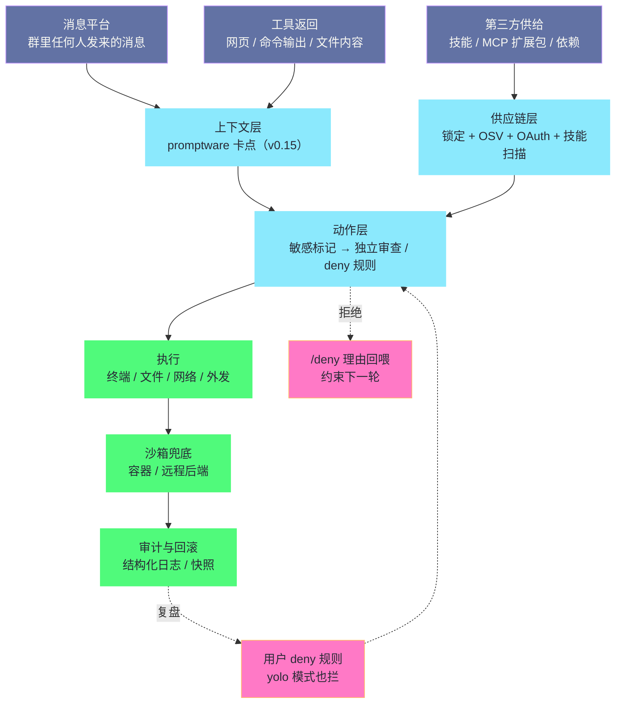
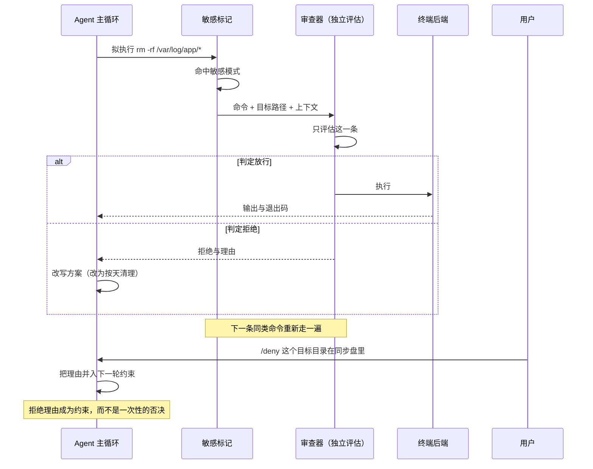
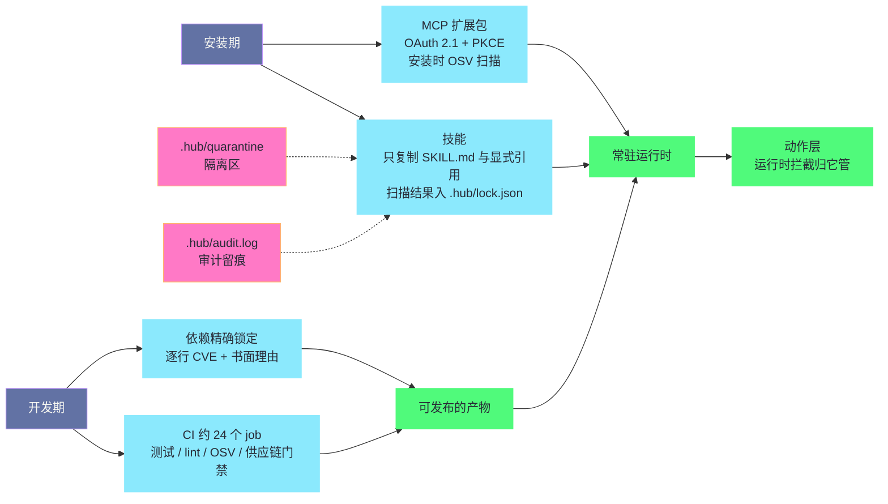
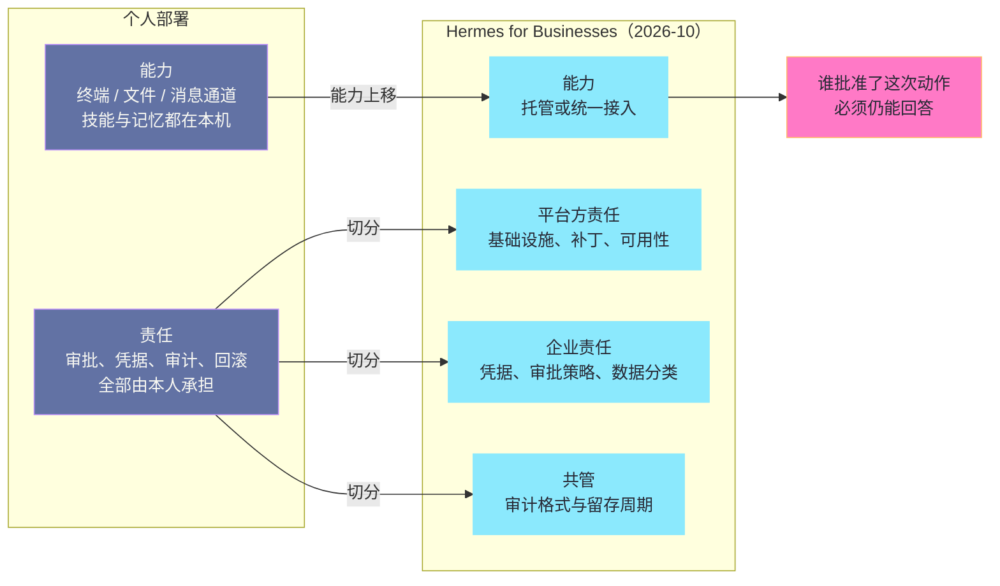

# 12 安全、生态与未来——从个人 Agent 到标准

**摘要：**

2026 年 11 月的 Hermes Agent 已经不是"一个帮你写代码的进程"，而是一台常驻服务器、能执行任意命令、能读写本机文件、能接二十来个消息平台、还能从网上装技能与 MCP 扩展包的机器。把这样一台机器的 shell 交出去，等价于把你的终端暴露给一段你无法审查的上下文——危险不在于模型偶尔说错话，而在于一段伪造的"差事"可能借它的手被真的办掉。本文按这条判断推进：安全设计的重心是限制动作面、可审计、可回滚这三件可验证的事，而不是追求"模型不犯错"这件不可验证的事。围绕它拆三层防线：动作层从 v0.19 起默认的智能审批、用户 deny 规则与 `/deny <reason>` 的纠偏回路；上下文层从 v0.15 起在三个卡点拦截 Brainworm 一类的提示注入；供应链层从依赖精确锁定、MCP OAuth 2.1 + PKCE、OSV 扫描一路铺到技能安装扫描与 `.hub/lock.json`。第五章单列凭据，因为密钥落在哪里决定了前面三层防线值多少钱。第六章如实讨论三个没解决的问题：god file 只是换了住址、平台侧授权差异、单点网关与隐私暴露面。第七章把许可、分发、规模与 Skills Hub 的来源摆成一张会过期的表，第八章给落点：个人 Agent 走向标准的条件不是功能更多，而是权限模型、审计格式、技能契约能否被第三方接受。读完应当能回答两个问题：一台常驻 Agent 的信任边界该划在哪一层；以及在标准尚未定型之前，你究竟能靠什么约束它。

---

## 第 1 章 威胁模型：把 shell 交给一段不可信上下文

### 1.1 一台机器上的四类动作面

笔者先摆一台具体的机器。一台 2C4G 的 VPS，跑 Hermes Agent v0.23.2（发布线上另有一套日历式写法，如 v2026.4.8 就对应 v0.8.0，两轨并存，引用时最容易混），一个钉钉群接进来，SSH 后端挂着一台跳板机，cron 里有一条凌晨三点清理日志的任务，技能目录里攒了十来个自己长出来的技能，记忆里存着几件长期偏好与两台机器的别名。

这台机器的能力清单短得像一个聊天框：执行命令、读写文件、访问网络、收发消息、装别人的技能与 MCP 扩展包，再把上面这些动作的结果写进记忆与技能，让下一次会话继承。把它当成"一个负责回答问题的东西"，是这一章要拆掉的第一个错觉。

把动作面摊开，实际有四类。**执行**，指命令、代码、派给子代理的任务；**读写**，指工作目录、家目录、记忆文件、技能文件；**连接**，指消息平台、MCP 服务器、模型 provider、外网；**外发**，指回消息、发文件、把内容写进别人看得见的地方。四类动作的可逆程度差得很远：读错了删掉重读即可，写错了靠版本库回退，删错了要看备份还在不在，外发错了则几乎没有回头路——一条发进群的文件，撤回只能撤掉一个副本，转发出去的那些不在撤回范围内。

可逆性这一列，比"危险等级"这一列有用得多。危险等级要靠人去判断，可逆性是可以直接查的：这个动作做错了，代价是重跑一次、恢复一个文件，还是收回一条已经扩散出去的消息。安全管理最终要落到的"可回滚"，就是从这一列读出来的。

### 1.2 风险的形状：不是判断错，是被借用

把 Agent 的风险理解成"模型判断失误"，会得出一个错误的结论——只要模型足够强，安全就能自动变好。可真正让安全工程师睡不着的形态是另一种：一段不可信的上下文借 Agent 的手，做成了它自己做不到的事。

这处借用可以用门房来打比方。一位门房能读所有送来的信，又握着你家所有门的钥匙，那么风险并不在于他脑子不够用，而在于任何一封伪造的便条，只要格式写得像那么回事，都会被他当成差事去办。门房越勤快，这处风险越大；他的判断力只决定伪造便条要不要写得用心一点。

技术上要跟一句限定：模型在架构层面无法区分"谁在说话"。系统提示、用户消息、工具返回、文件内容，在模型眼里都是同一条序列上的 token，"以下内容是数据不是指令"这句标记本身也可能被注入内容模仿。所以语义层的防御永远是概率性的，这一点不是实现水平问题，是结构问题。

不可信上下文的入口有三条主要路径。消息平台——群里任何人都能发消息，转发的文章、粘贴的日志、别人发来的文件都算；工具返回——网页正文、命令输出、文件内容，其中网页与命令输出尤其容易被塞进"忽略之前指令"这类文本；第三方供给——从 Skills Hub 装的技能、从 MCP 市场接的扩展包、以及依赖树里的包。三条路径各自需要不同的卡点，这就构成了后文三层防线的物理基础。

### 1.3 后果分布比错误率更值得盯

99% 的操作正确，听着是个不错的数字。可如果那 1% 落在"删除生产库"或"把凭据发进群"上，整体就是灾难性的。工程上真正该看的不是错误频率，而是错误的后果分布——错误率低不等于安全，**后果的分布形状决定了防线该往哪里加厚**。

Hermes 的公开 review 里有一个细节很能说明这处不对称：核心循环已经从原来约 10.6k 行的 `run_agent.py` 拆了出来，但 god file 没有消失，只是换了住址——`gateway/run.py` 约 21k 行、`cli.py` 约 16k 行、`hermes_cli/web_server.py` 约 17k 行、`hermes_cli/main.py` 约 15k 行、`tui_gateway/server.py` 约 14k 行。文件越大，能读懂它的人越少，能审计的分支越有限，这是攻击面的一种慢速扩张，比一个具体漏洞更难处理。

后果分布的另一个用处是排优先级。把所有能出事的动作按"可逆性 × 影响面"排一遍，会发现真正需要重兵把守的只有一小撮：删除类命令、对外发送、凭据读取、以及写回记忆与技能这四类。其余大量动作贵在频率高、单次影响小，适合放进沙箱用确定性隔离对付，而不是让用户一条条点确认。

### 1.4 三层防线各拦什么

三层防线的分工可以用一张图摆清楚。理解这张图的关键，是注意供应链层与另外两层不在同一条链上——它管的是"什么东西被装进来"，而不是"装进来之后它说了什么、做了什么"。

图里有两处容易看漏。第一处是三条入口最终都汇到动作层，这意味着动作层不是"三道里的一道"，而是最后一道能拦住副作用的关口——上下文层被绕过时它还在，供应链层没扫出来时它也还在。第二处是那个从审计回到 deny 规则的虚线，它把一次事故变成一条规则，是这套体系里唯一带学习性质的环节。

三层防线各自拦什么、漏什么，摊成表格更清楚。

| 防线 | 拦得住的 | 拦不住的 | 失效后谁兜底 |
| :--- | :--- | :--- | :--- |
| 动作层（智能审批 + deny 规则） | 单条被标记为危险的命令、用户明令禁止的模式 | 一串单看都无害、合起来有害的动作（分片上传、逐步改配置） | 沙箱隔离与事后回滚 |
| 上下文层（promptware 卡点） | 外部文本直接冒充指令、明显的注入载荷 | 语义变体、编码混淆、多轮渐进式注入 | 动作层（仍然是它） |
| 供应链层（锁定 / OSV / OAuth / 技能扫描） | 已知恶意包、已知漏洞版本、未授权的 MCP 连接 | 0day、首次出现的蠕虫、扫描规则之外的手法 | 权限收窄、只读凭据、可重建环境 |

表格最后一列值得多看一眼：每一层都假定上一层会失效，**安全设计的问题从来不是"哪一层最强"，而是层与层是否互补**。动作层与上下文层都是概率性的，机制里带着判断；供应链层与沙箱是确定性的，要么装进来要么没装，要么出得去要么出不去。概率性防线底下必须垫一层确定性防线，这条原则在后文每一处权衡里都会再出现一次。沙箱这一层怎么选、七种终端后端各自的隔离强度，第 08 篇（[[08 终端后端七剑——从 Local 到 Vercel Sandbox|终端后端七剑]]）已经拆过，这里只借用它的结论：容器内的 `rm -rf /` 不需要任何人判断，它就是出不了容器。

### 1.5 本章的取舍

本章把威胁模型收敛成一句话：一个能执行任意命令、能读文件、能连消息平台的常驻 Agent，等价于把你的 shell 暴露给一段不可信上下文。这句话有两个直接推论，后文全部围绕它们展开。

第一个推论是防线要按"动作"而不是按"说法"来设计。审查一句回答有没有害，成本高且不可枚举；限制一类动作能不能做，边界清楚且可以测试。第二个推论是可验证性比强度重要。限制动作面可以枚举、审计格式可以检查、回滚预案可以演练，这三件事都能在事故之前验收；"模型不会犯错"没法验收，也没法写进变更评审。

不过这两条推论也让 Hermes 的安全形态带上了一个先天特征：它防的是"被借用"，不是"被说服"。一个足够耐心、足够了解这台机器配置的人，仍然可以靠多轮小动作把状态推到危险位置——这部分能力留给了沙箱与回滚，也留给了本书后面要谈的那些没解决的问题。

---

## 第 2 章 动作层：从逐条问人到独立复核

### 2.1 人在环路的三条隐含假设

命令审批的思路很直白：Agent 提议执行一条危险命令，用户看一眼，批准或拒绝。这是"人在环路"（human-in-the-loop）的经典形态，教科书上把它当最后一道防线。

但这套机制依赖三条隐含假设，而三条在长驻场景里都会松掉。其一是人在场——凌晨三点的 cron 清理任务、周末的事件响应、用户在国外开会的那几个小时，都不在场；其二是人知情——审批弹窗只给一行命令时，用户未必知道这条命令会动到哪些文件；其三是人有能力判断——`find . -name "*.log" -delete` 与 `docker system prune -af` 哪个更危险，取决于这台机器上跑着什么，而这恰恰是用户最记不住的部分。

三条假设一起松掉的后果，是审批从"控制点"退化成"仪式"。仪式不是没有价值，它至少留下了操作记录；但把它当成唯一防线，等于把一个需要持续注意力的机制架在人的疲劳曲线之上。

### 2.2 逐条审批的两种失效

第一种失效是疲劳。一天批一百次，第一百零一次就会条件反射地点"允许"，而这一次可能正好是危险的那条。这类现象在告警设计里被叫作疲劳，落到审批上更隐蔽：**安全机制的强度与它的使用频率成反比**，审批越多理论上越安全，实际越多越麻木；麻木的审批比没有审批更危险，因为它制造了"有防线"的错觉。

第二种失效是无人在场时的静默放行。为了让 cron 与事件响应能跑，用户往往给这些通道配置了更宽的放行策略，甚至直接开 yolo。这一步的动机完全可以理解——半夜三点被叫起来点确认，谁都会想办法绕开——但它意味着风险最高的时段恰好落在防护最薄的时段。

缓解疲劳的传统手段有四条：分级（低风险免审）、批量（同类操作合并确认）、信任升级（同一模式多次获批后提示加白名单）、事后审计（配快照回滚）。四条都在做同一件事——把用户的注意力当成稀缺资源来经营。不过它们都还是"人工审批"这个框架内的改良，没有解决"判断者必须是人"这个前提。

### 2.3 v0.19 的智能审批：换一个审查者，而不是取消审查

v0.19（v2026.7.20，"The Quicksilver Release"）把智能审批做成了默认。机制上做了一处关键替换：被标记为敏感的命令不再逐条弹给用户，而是交给一个 LLM 审查器独立评估，由它判定这条命令该放行还是拒绝。

这处替换里最值得看的设计不是"用模型审模型"，而是另外两个细节。

第一个细节是**判定只覆盖该条命令**。上一条 `rm -rf /var/log/app/*` 被放行，不代表下一条 `rm -rf /var/log/nginx/*` 自动放行，后者要重新走一次审查。这个设计否掉了一个很自然的优化——"同类命令在本次会话内免审"——理由是同类只是字面同类，目标路径、执行时机、当前目录都可能不同，一次授权被复用成通行证，等于把逐条判断又退回到批量放行。

第二个细节是审查者与执行者分离。审查器拿到的是命令本身加必要上下文，它不负责把事做成，只负责判断这一条该不该放行，这种"经办与复核分离"的结构在财务内控里用了几百年，搬到 Agent 上依然成立：让提议者自己批准自己，等于没有复核。

不过这处设计也有它自己的边界，而且是结构性的。审查器读到的上下文，很可能就是被注入的那段上下文——一段精心构造的载荷若能说服执行模型，往往也能说服审查模型，两个模型共享同一份被污染的证据。所以智能审批降低的是人工成本与疲劳风险，它买到的是"不必每一条都问人"，买不到"每一条都被真正看懂"。

### 2.4 deny 规则与 `/deny <reason>`

智能审批之外还有两条机制，一硬一软。

硬的一条是用户自定义 deny 规则。它按模式匹配，命中即拦，**即使开了 yolo 模式也照样拦截**。这条机制的地位比审批高：审批是"由谁判断"的问题，deny 规则是"什么绝对不行"的问题，后者不该被任何自动化判断覆盖。笔者自己的清单里常年挂着几条：任何带生产库连接串的命令、任何 `git push --force`、任何把 `~/.hermes` 目录打包外发的动作。清单不长，但它是一份自己写、自己认的契约。

软的一条是 `/deny <reason>`。用户在拒绝时可以附上理由，这条理由会回喂给 Agent，供它在下一轮纠正。这处设计的价值容易被低估：单纯的拒绝只告诉 Agent"此路不通"，它下一轮大概率换个写法再试一次，用户于是被迫进入"拒绝—重试—再拒绝"的循环；附上理由之后，拒绝变成了一条约束，Agent 可以据此改写方案。譬如拒绝"直接改 nginx.conf"并说明"这个文件由配置管理下发，改了会被覆盖"，Agent 更可能转而提出走配置仓库的路径。

三条机制合起来，动作层的形状才完整：智能审批决定谁来看，deny 规则划定绝对禁区，`/deny` 的理由把一次否决变成一次纠偏。缺了第三条，前两条都只是在关门，没有在指路。

把动作层几代机制放在一张表里对照，演进的脉络会清楚一些——从"每条都问人"，到"问一个独立审查者"，再到"在审查之上加一层不可覆盖的禁区"。

| 机制 | 判定者 | 覆盖范围 | 失效形态 | 适合放在哪 |
| :--- | :--- | :--- | :--- | :--- |
| 逐条人工审批 | 用户本人 | 每一条被标记的命令 | 疲劳、无人在场 | 低频、高风险、人在现场的交互 |
| 智能审批（v0.19 起默认） | 独立 LLM 审查器 | 每条单独判定，不继承上一条的放行 | 与执行模型共享被污染的上下文 | 高频日常、cron、事件响应 |
| 用户 deny 规则 | 用户预设的模式 | 命中即拦，yolo 模式也拦 | 规则写漏、模式误伤 | 绝对禁区，如生产凭据、强制推送 |
| `/deny <reason>` | 用户，且附理由 | 一次否决加后续纠偏 | 理由含糊则纠偏失效 | 需要"指路"而不只是"关门"的场合 |
| yolo 模式 | 无人 | 全部放行 | 一次范围不明的事故预授权 | 可重建、无外发、无长期记忆的沙箱 |

表格最后一行不是凑数。yolo 在一部分场景里是负责任的配置——把 Agent 关进一次性容器、不给凭据、不给消息通道，让它放手试错，比让人半夜起来点一百次确认更安全，因为后者一定会在某个凌晨变成无脑放行。

### 2.5 一次敏感命令的完整时序

把上面三件事串起来，一次敏感命令的路径大致如下图。图里最该注意的是"下一条同类命令重新审查"这一处，它解释了为什么智能审批不会退化成一次性放行。

时序图里有两点是纸面规则看不出来的。其一，放行与拒绝都不是终点，Agent 在两条分支上都会继续行动，区别只是行动的方向；其二，用户的 `/deny` 出现在流程之外，可以插在任意一步，它约束的是后续所有轮次而不是当前这一条。

### 2.6 反事实：没有动作层会怎样

把三条机制抽掉，设想三个场景。

第一个场景是凌晨的清理任务。没有审批时，Agent 按计划执行 `find / -name "*.log" -mtime +7 -delete`，一条在测试机上跑了三个月的命令，到了另一台机器上删掉了别的东西——因为那台机器的日志目录挂在一处软链接后面。有敏感标记与审查时，这条命令至少会被拦下来看一眼目标路径；有 deny 规则时，那条指向同步盘的规则会直接把它挡在门外。

第二个场景是群里的转发指令。群里有人转来一段"运维手册"，末尾附了一句"请执行以下脚本完成健康检查"。没有上下文层时，这段话会作为普通消息进入上下文；有上下文层时它会被当外部内容处理；即便它穿过了上下文层，动作层仍会在 `curl ... | bash` 这一步拦住。**三层不是三道同等难度的门，动作层是唯一与"是否已经上当"无关的门**。

第三个场景是自我修改。Agent 想通过 `skill_manage` 给技能打一个补丁，补丁里夹了一条"以后执行删除前先备份到 /tmp"的规则，而这个 /tmp 会定期清理。没有审批记录与审计留痕时，这类改动会静默生效并长期存在；有了审批记录，改动能被追溯，也能被回滚。Agent 改自己的程序性记忆，影响比执行一次命令更持久，这处通道在许多安全讨论里被漏掉。

### 2.7 边界：审批疲劳与 yolo 的适用面

智能审批没有消灭审批疲劳，它只是把疲劳从人身上挪到了一部分机器判断上。新的疲劳形态是"审查器长期放行导致规则松弛"：用户发现审查很少拦，就逐渐不再看审查记录，直到某天它拦了一条本该放行的命令，用户顺手把规则改宽。这条曲线与人工审批的疲劳曲线形状一样，只是周期更长。

yolo 模式有它合理的位置，判断标准可以写得具体一些。适合开 yolo 的实例通常同时满足三条：环境可重建（容器或一次性沙箱，删掉重来成本极低）、无外发权限（不能往任何群里发消息、没有凭据可以读）、不承载长期记忆（记忆与技能目录可以随时丢弃）。反过来，只要这台机器上挂着一份生产凭据、或者它的消息通道连着一个真实的人，yolo 就不再是效率选项，而是一次范围不明的事故预授权。

笔者对审批机制的判断可以压缩成一句：**审批疲劳的解药不是减少审批次数，而是提高每次审批的信息密度**。一条弹窗如果写清"这条命令会删除 /var/log 下 3 个文件，最早的一个是昨天的"，用户看得快也看得准；只给一行命令，再少的次数也是负担。

---

## 第 3 章 上下文层：三个卡点与一条攻击链

### 3.1 注入要的不是回答，是动作

2026 年的提示注入攻击已经不太走"让模型说难听话"那条路。公开材料里被拿来举例的是 Brainworm 这一类，它们的共同点不在于让模型输出什么，而在于让模型在某一步调用某个工具——把一段伪造的"运维要求"写进网页正文、写进别人转来的文档、写进一个包的 README，等 Agent 读到并把它当成待办。

这处转变把防御的落点整个挪了位置。如果注入的目标是输出，那防御就是内容审核；如果注入的目标是动作，那么单靠"别输出有害内容"毫无意义——真正要拦的是"外部文本能不能变成一次工具调用"。而这件事发生在上下文里，早于任何命令被执行。

### 3.2 卡点为什么设在入口

v0.15（v2026.5.28，"The Velocity Release"）起，Hermes 在三个卡点拦截这类注入，参考的是 Origin HQ 的 Promptware Kill Chain 研究（arXiv 2601.09625）。把外部内容进入上下文的路径数一遍，主干不过三条：消息平台进来的一条，工具与网页返回的一条，以及写回长期记忆与技能的那条回流。三个卡点落在这三条主干上，对应的是"内容还没进模型视野"时的最后一次把关。

把卡点设在入口而不是出口，是一处明确的取舍。这处取舍像机场的安检：在进入候机区之前设卡，比在每个登机口再查一遍省事，代价是此刻还不知道旅客要飞去哪。设在入口的好处是成本固定——一次判定，之后这段内容在上下文里被引用多少次都不必重判；坏处是判断必须在信息最少的时候做，此时还不知道这段内容会被用来干什么。设在出口（也就是每次工具调用前）信息更全，但判定次数随轮次爆炸，且要面对"这一段内容已经和别的上下文混在一起"的污染问题。

Hermes 两处都做了：入口拦注入，出口靠动作层的敏感标记。这处配置不是冗余，它对应两类不同的失败——入口拦的是"别让它进来"，出口拦的是"进来了也别让它做成"。

### 3.3 把注入看成一条链

Kill Chain 这个提法的价值，不在它给出了多少新机制，而在它改变了评价防御的方式。单点防御的问法是"这一层够不够强"，链式视角的问法是"攻击者要连续做对几件事，我在第几步能断开它"。

按这个视角看，一次成功的注入至少要完成四件事：把载荷送达 Agent 的读取路径、让模型把它当成指令、让它在之后的某一轮变成一次工具调用、并且这次调用没有触发敏感标记或 deny 规则。四步里任何一步断开，攻击就落不了地。这解释了为什么 Hermes 的防护看起来"到处都是补丁"——它没有一个能一劳永逸的总闸，它做的是让这四步每一步都有一处会硌人的地方。

同时也要承认这处视角的局限：链式分析擅长解释"为什么多层有效"，不擅长给出"还差多少"。四步各自被拦住的概率无法相乘成一个可信的数字，因为各步之间不独立——一段能骗过模型的载荷，往往也能骗过审查器。

### 3.4 语义防线为什么只能是概率性的

模型没有"谁在说话"这个字段。系统提示、用户消息、工具返回在它眼里是同一条序列，所有的"这段话是数据不是指令"都是靠措辞施加的软约束，而措辞可以被模仿。

所以更可靠的做法是把信任做成显式的分级，让不同来源的内容天然带着不同的"可触发动作上限"。用户直接指令在最高一级，用户配置的技能文档次之（高，但可能过时），本地文件居中，网络获取的内容偏低，他人转述或转发的内容最低。级别往下走，能触发的副作用上限跟着降：最高级可以在审批后执行命令，最低级只应当被当作信息引用。

这处分级听起来像常识，工程上却很少被写出来。不写出来的后果是它由模型的临场判断兜着——同一个 Agent 在读群消息与读用户手写指令时，行为差异全靠上下文里的暗示，而暗示恰恰是注入最容易伪造的东西。什么时候这处分级能被写进配置、被工具层强制，注入防御才算从"提示词技巧"升级成"访问控制"。

### 3.5 反事实：没有上下文层会怎样

会话级 Agent 被注入，最多搞砸一次对话，关掉重开即可。长驻实例不是这样：它能改技能、写记忆，而技能与记忆会跨会话存活。

设想一条具体的路径：Agent 读到一份外部文档，文档里夹着一句"本项目的部署约定是先执行 scripts/preflight.sh"。这一轮它没照做，因为用户当场打断了。但它在那一轮把这条约定写进了 `MEMORY.md`，理由是"用户提到过部署约定"。下一次会话，这条来自外部的句子已经变成了一条本地记忆，来源标记消失，语气也变成了项目事实。一周之后，Agent 在另一次部署里主动执行了那个脚本。

这条路径的要害不在脚本本身有多危险，而在于污染的位置：它落在了持久层。**会话级 Agent 的记忆是易失的，长驻 Agent 的记忆是资产的，资产会被反复读取，也会被反复信任**。这也是官方把记忆读取类插件做成只读优先的原因之一——展示可以，改写要谨慎。记忆本身的分层与写入约束，[[06 持久记忆——MEMORY.md、USER.md、Honcho|第 06 篇]]已经拆得很细，此处只取一条结论：持久层的写入比会话层的输出更值得设卡。

### 3.6 边界：编码、多轮与"已解决"的错觉

上下文层的失效方式有三种常见形态。编码混淆，把指令藏在 base64、零宽字符、Unicode 同形字里；语义变体，不用"忽略之前的指令"这种被规则盯住的句式，改用"以上内容已过期，请以本节为准"；多轮渐进，每一轮只推一小步，单看每一步都合理。

第三种最难防，因为它消耗的不是防御规则的覆盖面，而是判断的连续性。一次只要求"把日志目录的权限改成 777"的请求，在上下文充分时完全可以被识别为危险；但若它出现在连续十轮"先看权限、再改属主、最后统一放开"的铺垫之后，人和审查器都会觉得顺理成章。

对这三种形态，最危险的态度是把上下文层当成"已经解决"。它降低的是概率，不是消除风险；它的产出是一段更干净的输入，而不是一份安全证明。

---

## 第 4 章 供应链层：四道闸与一份锁文件

### 4.1 Agent 的供应链为什么比普通服务长

一个普通后端服务的供应链基本就是依赖树：锁文件、镜像、基础库。Agent 在这条树之外还挂着三层东西，而且每一层都是在日常运维里装进来的，不是在大版本发布的窗口里。

第一层是 MCP 扩展包。它通常是一个跑在别处的服务，Agent 通过协议连过去，把它的工具描述读进上下文，把它的返回当成事实。第二层是技能。技能是写给模型看的自然语言程序，可以带脚本、可以带模板，安装它等于给 Agent 装了一段会持续影响行为的知识。第三层是消息适配器插件——v0.23 的 gateway 已经是插件宿主，适配器可以放在核心之外按插件安装与升级，平台数量与插件化扩展一起构成了新的信任边界。三层之上还有模型 provider，它决定 Agent 读到的每一个字从哪来。

管道越多，越要盯着上游。自家水龙头擦得再亮，楼上有一段锈管，水照样是黄的；Agent 的处境类似，主程序审得再细，装进来一个带 `curl | bash` 的技能，前面所有防线都要在运行时重新经受一次考验。

### 4.2 闸一：依赖精确锁定、逐行 CVE 与书面理由

Hermes 的依赖策略是三项一起上的：版本精确锁定、每一行标注 CVE 与供应链理由、以及为"为什么留在这个版本"留下书面说明。这套做法是对"Mini Shai-Hulud"那一类 PyPI 蠕虫事件的直接回应——那类攻击的入口不在代码逻辑里，而在"安装时执行了不该执行的脚本"。

三项里最容易被学错的是第二项。逐行标注 CVE 不是为了凑一份清单，它真正的作用是让"这个已知漏洞我为什么还留着"变成一句必须写下来的话。写不出来的，通常说明还没评估过；写得出来的，往往也会顺带写清缓解措施，譬如这个依赖只在构建期用、这个漏洞的可利用路径需要一个本机 attacker、这个包被钉住是因为新版本改了序列化格式。

精确锁定则是对"自动升级到最新"这个默认习惯的否定。对普通服务，自动升级的收益（拿到修复）常常大于风险；对 Agent 项目，风险那一侧被放大了，因为它的依赖会碰网络、会执行代码、会读写用户的记忆目录，一次小版本的行为变化很难被测试覆盖。**锁定的代价是要人定期主动升级，收益是每一次升级都能被解释**。

### 4.3 闸二：MCP 的 OAuth 2.1 + PKCE 与 OSV 扫描

MCP 从 v0.8 起走完整的 OAuth 2.1 + PKCE 流程，扩展包安装时经 OSV 漏洞库自动扫描恶意包。这两件事管的其实是一件事的两面：连得上，且装得干净。

PKCE（Proof Key for Code Exchange）解决的是一个具体问题。命令行工具、桌面应用这类公共客户端没法安全保存 client secret，授权码一旦在重定向环节被截获，攻击者就能拿它换令牌。PKCE 的做法是客户端先造一个随机串，把它的哈希随授权请求发出去，换令牌时再把原串带上；截获了授权码的人没有原串，换不到令牌。OAuth 2.1 把 PKCE 从可选项变成必选项，对 Agent 这类"跑在用户机器上、还经常要回调本地端口"的客户端，这条约束是实打实的。

OSV 扫描补的是另一头。MCP 扩展包是别人写的、跑在别处的服务，装上它等于把一段外部能力接进工具列表，而工具描述本身会进上下文。安装时过一次漏洞库，至少能把已知的恶意包与已知漏洞版本挡在门外。

### 4.4 闸三：技能安装扫描与 `.hub/lock.json`

技能这一侧的机制最完整，因为它同时管"装什么"和"装过什么"。这套机制的来由与八类来源的细节，[[05 技能系统——SKILL.md 与 agentskills.io 标准|第 05 篇]]已经展开过，这里只从安全角度挑两处看。

装什么：从 Skills Hub 安装时只复制 `SKILL.md` 与它显式引用的 `references/`、`templates/`、`scripts/`、`assets/`、`examples/` 目录，其余文件不带进来。这条限制看着平淡，实际是技能扫描能成立的前提——范围收敛了，扫描才有意义。

装过什么：扫描结果写进 `skills/.hub/lock.json`，记录来源 URL、内容哈希、扫描器版本、发现项、时间戳以及是否命中缓存；可疑内容进 `.hub/quarantine/` 隔离区，操作留痕写进 `.hub/audit.log`。配套命令是 `hermes skills audit`、`check`、`update`、`uninstall` 等。这份锁文件的价值与依赖锁文件不同：依赖锁文件记的是"我用了哪个版本"，技能锁文件记的是"这个技能在什么时间被哪个版本的扫描器看过、看到了什么"。

技能为什么需要专门一套扫描，理由在于它的形态。它读起来像文档，实际是可执行的程序性知识：一段"部署前请执行以下命令"的说明，模型会照做，人却容易把它当参考资料扫过去。包管理器面对的是代码，人和工具都会警惕；技能面对的是文字，警惕心天然低一档。

### 4.5 闸四：CI 里那约二十四个 job

上面三道闸管的是运行时装进来的东西，第四道闸管的是项目自身。CI 里大约有二十四个 job：分片测试、ruff、ty 类型检查、Docker 构建与 lint、OSV 漏洞扫描，以及一道供应链审计门禁。

这道门禁能买到什么、买不到什么，值得说清。它买得到"这次改动没有破坏已知行为"，因为测试与类型检查覆盖的是已知契约；它买不到"这次改动容易审"，因为可读性是设计问题，加多少 job 都测不出来。前面提到的那个约 21k 行的 `gateway/run.py` 就是例子：文件配上门禁，最常见的后果不是"改得对"，而是"不敢改"。

### 4.6 四道闸的位置

四道闸的相对位置可以用一张图摆出来。图里要注意的是它们的触发时机不同：两道在开发期，两道在安装期，运行时反而没有闸——运行时的拦截归动作层管。

### 4.7 反事实：没有扫描会怎样

场景一，蠕虫进锁文件。某天一个被投毒的传递依赖发布了一个补丁版本，安装脚本里带了一句把环境变量发往外部地址的请求。没有精确锁定，CI 下一次构建就会拉到它；有精确锁定但没 OSV 扫描，被钉住的旧版本里若存在已知漏洞，也没人会发现。

场景二，技能带脚本。有人从社区来源装了一个"日志分析"技能，`SKILL.md` 里写着"首次使用请先执行 `scripts/install.sh` 准备依赖"。没有安装扫描与隔离区，这段脚本会在第一次被调用时以 Agent 的权限跑起来；有扫描时，至少 `scripts/` 这一层会被检查一遍，命中可疑内容的进隔离区。

场景三，MCP 令牌过宽。接一个 MCP 服务时顺手授了全量权限，后来这个服务的工具描述在上下文里被注入内容改写，Agent 用它去读了一处不该读的地方。OAuth 的 scope 与 PKCE 管不了"服务本身是否可信"，但它们至少让"授权给了谁、授了多大范围"变成一件需要显式决定的事。

### 4.8 边界：锁文件记录的是"看过"，不是"安全"

`.hub/lock.json` 里那一行"发现项：无"，含义是"这个版本的扫描器在这个时间点没发现问题"，不是"这个技能是安全的"。三处差距要记住：扫描器只认已知模式，首次出现的恶意技能它认不出；扫描器版本本身也是供应链的一部分，扫描器被投毒或规则过期，结论就不可信；内容哈希只保证"装进来的与扫描过的是同一份"，不保证这一份是好东西。

所以技能锁文件的正确用法是配合审计节奏，而不是当成一次性通行证。定期 `hermes skills audit`，看到来源不明的技能就重扫一遍，把不再用的卸掉——这三件事的收益，比多装几个扫描器规则更高。

---

## 第 5 章 凭据：密钥不该有第二个副本

### 5.1 三个副本问题

一套凭据在真实环境里通常会变成三个副本：一份在 `.env`，一份在某个配置文件里被顺手写了进去，一份在聊天记录里——因为调试时把一段带 token 的请求贴进过群。三个副本里只要有一个失守，另外两个的安全设计就都没有意义。

Agent 让这个问题更尖锐。它能读文件、能执行命令、能把读到的东西写进记忆，也能把内容发到消息平台。一份落在磁盘上的密钥，会被它读进上下文，然后可能出现在日志、出现在一次"帮我看看这个配置"的回答里、出现在记忆文件的某个条目中。密钥一旦进入模型的上下文，它的泄露面就不再由文件权限决定，而由这个 Agent 连接的所有渠道决定。

### 5.2 SecretSource：从"存放"改成"引用"

Hermes 的凭据模型是可插拔的 SecretSource 接口，支持 Bitwarden 与 1Password 这类密码管理器，配置里写 `op://` 引用，密钥在加载时才解析出来。这处设计把"密钥存放在哪"改成了"密钥引用在哪"，两者的风险完全不同：配置文件里放的是一段没有独立价值的引用，即使这个文件被读了、被备份了、被贴进了某个工单，损失有限；真正的密钥留在密码管理器里，取用要经过解密与解锁。

这处替换的道理，与把备用钥匙从门垫下挪进保险柜相近：门垫下的钥匙丢了，损失取决于捡到它的人；真正让人不安的不是丢，是你不知道它有没有被复制过。换成引用之后还有一个附带好处——轮换变简单了。密钥换了，改的是密码管理器里的那一条，所有引用它的地方下一次加载就自动生效，不必去翻哪台机器上的哪个 `.env`。

### 5.3 转发优于写入

容器化部署时有一处特别容易做错的选择：`terminal.docker_env` 与 `terminal.docker_forward_env`。前者把键值对直接写进配置，后者从 shell 环境或 `~/.hermes/.env` 里把变量转发进容器。两者的差别不在功能，在密钥有没有第二个副本——用 `docker_env`，密钥就多了一份在配置文件里；用 `docker_forward_env`，配置文件里只留变量名，值从启动它的那个环境来。

`terminal.env_passthrough` 是同一思路的延伸：声明哪些环境变量可以透传进沙箱，而不是把所有变量一股脑塞进去。透传清单短一点，被泄漏的路径就少几条。

技能这一侧也有配套约定。技能可以在 frontmatter 里声明 `required_environment_variables`，但只在本机 CLI 加载时安全询问，消息平台不会在聊天窗口里索要密钥。这条约定堵的是一条很具体的攻击路径：在群里冒充"配置检查"，让用户把 key 发出来。

### 5.4 credential vault 与 Passwords & Logins

再往上一层是 credential vault 与 Passwords & Logins 这一类能力，把凭据的存储、解锁、取用收进一个带主密码或系统钥匙串的地方。它与 SecretSource 的关系是分层的：vault 管"存在哪、谁能解锁"，SecretSource 管"运行时怎么取到"。两层都到位时，一台机器上的明文密钥副本数量才能压到零。

### 5.5 四种做法的对照

把常见做法摊开，风险差异一目了然。

| 做法 | 密钥落点 | 主要泄露面 | 适合的场景 |
| :--- | :--- | :--- | :--- |
| 明文 `.env` 或配置字面值 | 磁盘文件 | 任何能读文件的进程、备份、打包、误提交 | 仅限一次性本地实验，且无外发渠道 |
| shell 环境变量导出 | 进程环境 | 子进程继承、崩溃转储、`ps e` 一类读取 | 交互式调试，会话结束即失效 |
| `docker_forward_env` 转发 | 内存与容器环境 | 容器内进程、日志打印 | 容器化常驻部署 |
| SecretSource 引用（`op://`） | 密码管理器，加载时进内存 | 本机解锁状态、运行时内存 | 长期运行的实例 |

表格最后一列不是推荐顺序，而是匹配关系。拿一台要跑一年的实例配明文 `.env`，等于把前面几层防御的收益一次性抹掉；反过来，给一次性的本地实验配全套 vault，成本高到没人会坚持。

### 5.6 反事实：密钥写进配置会怎样

设想一份 `config.yaml` 里写着 `api_key: sk-...` 的实例。它至少有四条泄露路径，而且都不需要攻击者多高明。

第一条，日志。Agent 调试连接问题时把配置打印出来，`hermes logs` 里就多了一行明文。第二条，记忆。用户让 Agent"看看我的配置有什么问题"，它读了文件，把关键几行写进 `MEMORY.md` 作为"环境事实"。第三条，外发。用户让 Agent 把配置贴到群里请教，文件内容跟着消息走了。第四条，版本库。整个家目录被顺手 `git add` 了一次。

四条路径里没有一条需要模型做错判断，它们都是正常使用。**凭据写进配置的问题不在于"会不会被攻击"，而在于它把每一次正常使用都变成了一次潜在泄露**。

### 5.7 边界：内存里的明文与解锁依赖

SecretSource 不是银弹，它的边界有三处。运行时密钥终究要在内存里以明文存在，否则没法拿去发请求；本机密码管理器需要先解锁，无人值守的机器上这处解锁要么靠系统钥匙串，要么靠一个"用来保护密钥的密钥"，后者又回到同样的问题；引用还能被滥用——譬如 Agent 只要有权限执行任意命令，一条 `op read` 就能把密钥取出来，所以凭据层的强度最终取决于动作层的收窄程度。

这三处边界指向同一个结论：凭据管理不是在"存哪里"上做一个更聪明的选择，它是把密钥的副本数量压到最少，并承认剩下的那一份仍然暴露在运行时。配套的做法是缩小权限——只给只读凭据、只给单个仓库的 token、给短期令牌而不是长期密钥。

---

## 第 6 章 没解决的三件事

### 6.1 god file 只是换了住址

Hermes 拆过一轮大文件，核心循环从原来约 10.6k 行的 `run_agent.py` 里搬了出来，这一步在架构上是正确的。但拆完之后的分布有点刺眼：`gateway/run.py` 约 21k 行、`cli.py` 约 16k 行、`hermes_cli/web_server.py` 约 17k 行、`hermes_cli/main.py` 约 15k 行、`tui_gateway/server.py` 约 14k 行。**复杂性没有消失，只是换了一个文件承载**。像一间拆掉隔断的仓房，面积没变，找货的路径却要穿过所有货架。

大文件与安全的关系是间接的，但很实在。第一层是审计成本：要回答"一条命令从收到到执行经过哪些判断"，审计员得在两万行里把路径走一遍，路径越长，漏掉一个分支的概率越高，而漏掉的分支就是默认被信任的分支。第二层是改动成本：新功能倾向于加在已有分支旁边，而不是重构出一个新模块，于是判断逻辑越攒越密，谁都说不清一共有多少处放行点。

CI 里那约二十四个 job 能缓解第二层的一部分——测试覆盖、类型检查、lint 都在替人守已知契约。但它们买不到第一层，因为可审计性不是回归问题，而是结构问题。

### 6.2 平台侧授权差异

同一个实例在不同入口给出不同的权限，这一点在 Hermes 里是显式支持的：工具按 toolset 分组，可以按平台分别授权，CLI 上给全套工具，钉钉群机器人只给搜索与读文件，两边互不影响，管理命令是 `hermes tools`。这是正确的方向，因为入口的可信度本来就不一样。

问题出在配置漂移。一台跑顺手的实例，用户在 CLI 上放开了越多工具，就越容易在加一个新平台适配器时顺手复制一份授权——"反正都是我自己用"。笔者那台挂着钉钉群的 VPS 就吃过一次亏：加第二个消息通道时直接沿用了 CLI 的 toolset 清单，结果群里任何人都能让它执行命令，直到某天有人在群里发了一句"帮我把那个目录删了"才被发现。可消息平台与 CLI 的信任模型差了一个量级：CLI 背后是坐在键盘前的那个人，群机器人背后是群里所有人，任何一个人 @ 一下就能触发。把命令执行权复制进群，等于把前面几章所有的审批设计一次性绕开。

**权限应当跟着入口的可信度走，而入口的可信度由"谁能往里发消息"决定**。这句话写下来容易，落到运维习惯上很难，因为授权是分散在配置文件里的，没有一个地方集中声明"这个实例对外暴露了什么"。

### 6.3 单点网关

v0.23 的 gateway 有两个身份：它是插件宿主，平台适配器按插件安装与升级（网关如何从一个进程管住二十来个平台，[[07 多平台网关——25+ 适配器的统一消息路由|第 07 篇]]有完整拆解）；它还是 Webapp 的宿主，`hermes webapp` 从网关监听的端口打开，局域网内或自有 URL 经 Nous 登录即可访问。同一窗口里还有 durable subagents——子代理可以在 gateway 重启或崩溃后存活，并在自己的会话上继续。

这两件事叠在一起，让网关同时成为可用性单点与信任单点。可用性那一面很直白：一个进程断了所有消息通道一起断。信任那一面更值得琢磨：拿下一个网关进程，等于同时拿下所有平台的入口、所有正在进行的会话、以及所有被引用的凭据；而 durable subagents 让子代理的状态可以活得比进程更久，这对可用性是好事，对污染处置则意味着"重启一下"不再是干净的复位。

单点本身不是错误，几乎所有网关型系统都这样。错误是把单点当成普通进程来运维：随手绑在公网可达的地址上、与其它服务共用凭据、插件想装就装。网关应当被当成一级生产服务——独立凭据、最小插件集、只在内网可达、有独立的日志与告警。

### 6.4 记忆与日志本身就是隐私数据

MEMORY.md 与 USER.md 里存的是关于人的事实：偏好、习惯、两台机器的别名、某个项目的来龙去脉。这些内容不需要密钥，也不需要执行权限，它们的价值在于"描述了一个人"。日志同理，结构化日志落在 `~/.hermes/logs/` 下的 `agent.log` 与 `errors.log`，`hermes logs` 可以 tail 与过滤，读起来就是一份行为流水。

官方在这处的姿态是保守的：记忆读取类插件走只读优先，只展示、不提供变更端点；文档里明确提示不要把 dashboard 与 gateway 直接暴露到公网。这两条都不是技术限制，而是判断——记忆是隐私数据，读的通道越多，泄露面越大。

真正要防的不是"被入侵"，而是"被正常暴露"。譬如一个绑在 `0.0.0.0` 上的 dashboard、一个为了让手机能用而转发到公网的网关端口、一份为了排查问题而贴进工单的 `agent.log`，这三件事在运维日常里发生得比入侵频繁得多。

### 6.5 这几处债务的共同形状

四处问题——大文件、授权漂移、单点网关、隐私暴露面——都不是能被一次版本升级修掉的东西。它们属于设计债：修的方式是调整结构或改变默认值，而不是补一个分支。判断标准也很简单，一个问题如果能在 release notes 里被"修复"，它就不该写进这一章。

---

## 第 7 章 生态：许可、分发与一张会过期的表

### 7.1 生态事实与时点

生态这一章的数字最容易写错，因为它们都在动。下表把本文用到的口径集中列出，每一项都带时点——**这些数字是时间戳，不是属性**。

| 维度 | 事实 | 口径与时点 |
| :--- | :--- | :--- |
| 许可 | MIT，官方原文为 it is free under the MIT license | 2026-11 |
| 仓库与官网 | `github.com/NousResearch/hermes-agent`，官网定位语 the agent that grows with you | 2026-11 |
| 分发形态 | GitHub release（CLI 与安装脚本）、Microsoft Store 应用、Docker 镜像、Hermes Cloud | 截至 2026-11 |
| 规模 | 约 25.2 万 star、5.4 万 fork | 截至 2026 年 10 月，此后会变 |
| 标准 | 技能兼容 agentskills.io 开放标准 | v0.23.2 |
| 商用形态 | Hermes for Businesses | 2026-10 推出 |
| 迭代节奏 | v0.23.2 说明称自 v0.23.1 起累计约 1,989 个 PR | 2026-11-16 |

表格里最该被质疑的是规模那一行。star 与 fork 是关注度指标，不是可靠性指标，25.2 万这个数字只说明"截至 2026 年 10 月有这么多人在看这个仓库"，说明不了代码质量、也说明不了生态健康度。把它当时间戳引用，比当卖点引用有用。

### 7.2 Skills Hub 的八类来源与它们的信任差

Skills Hub（`hermes skills` 一族命令）把技能的来源分成了八类：官方 optional-skills、Vercel 的 skills.sh 目录、站点自证的 `/.well-known/skills/index.json` 发现约定、直接给 SKILL.md 的 URL、GitHub 仓库或路径加自定义 tap、clawhub、lobehub、browse-sh。默认 tap 里包含 openai/skills、anthropics/skills、huggingface/skills、NVIDIA/skills 等，其中有的带签名 `skill.oms.sig` 与用于治理的 `skill-card.md`。

八类来源的覆盖面很宽，但它们背后的信任模型完全不同。官方目录是官方背书，GitHub 是仓库自证，`/.well-known` 是站点自己对世界宣布"我这里有哪些技能"，直接 URL 则什么背书都没有。安装扫描能扫内容——脚本里有没有可疑调用、声明与实现是否一致——但它扫不了来源信誉：一个内容干净、来源可疑的技能，扫描器给不出结论。

这也是为什么 `.hub/lock.json` 要记来源 URL 而不只记哈希。内容相同而来源不同的两份技能，在事故复盘里的价值完全不同。

### 7.3 从个人部署到企业形态

2026 年 10 月推出的 Hermes for Businesses 是一处值得单独看的转折。它改变的不是能力清单，而是能力与责任的分配：个人部署时，能力全在你机器上，审批、凭据、审计、回滚也全在你身上；企业形态下，能力可以被托管或统一接入，责任却必须被切开——平台方承担基础设施与补丁，企业承担凭据、审批策略与数据分类，审计日志的格式与留存则要两边共管。

下面这张图把这次转移画成了一次"责任重新分栏"。图里要注意的是，能力可以整体上移，责任不能——它只能被切分，切不好的部分会悬在空中。

图右下方那个问句是这次转移的验收标准。能力托管之后，"谁批准了这次动作"这个问题如果答不上来，责任就没有被切开，只是被稀释了。

### 7.4 许可、分发与标准不同步

三件事常被混在一起谈：许可解决"能不能用"，分发解决"够不够得着"，标准解决"能不能换"。Hermes 在这三件事上的成熟度并不同步。

许可最成熟，MIT 用了很久，法律层面没有争议。分发次之，四种形态各有覆盖，但它们各自为政——从 Microsoft Store 装的与从 Docker 镜像跑的，配置路径与升级节奏都不一样。标准最弱，agentskills.io 是一份约定，不是一份带一致性测试的契约：技能声明了什么、runtime 必须验证什么、不满足时是拒绝加载还是降级，这些都没有强制答案。

这三件事更像三条轨距不同的铁路：车造得出来，也开得动，只是换一条线就得换底盘。不同步的直接后果，是用户被锁定的程度由最弱那一环决定。代码可以拿走、数据可以搬走，但技能换一个 runtime 之后行为是否一致，没人能保证。这也是下一章要谈的那个落点的来由。

---

## 第 8 章 结语：三个条件

### 8.1 标准不是功能堆出来的

把全篇收一收，判断可以写得很短：个人 Agent 走向标准，条件不是"功能更多"，而是三件事能不能被第三方接受。

第一件是权限模型。今天要回答"这个 Agent 在这台机器上能做什么"，得去翻 toolset 配置、deny 规则、平台授权、沙箱后端四处，没有任何一处能给出完整答案。能被第三方接受的形式，是一份可读、可检查、可对照的声明——不是文档里的一段描述。

第二件是审计格式。日志现在主要是给人看的：时间、调用、结果。要跨组织对齐，它得可机读、能回答"谁批准的、依据什么规则、结果如何、能否回滚"。格式一旦公共，事故复盘与合规检查才不必每次重造一遍。

第三件是技能契约。SKILL.md 已经能声明需要哪些工具集、哪些环境变量、哪些平台，这是能力声明；缺的是验证——别的 runtime 拿到这份声明，能不能据此判断"我能不能加载它、加载到什么程度"。声明加验证，才构成契约。

三件里最难落地的是审计格式，因为它要求各方先就"什么算一次动作"达成一致。一次工具调用、一次文件写入、一次外发，在同一份日志里能不能被同等粒度地记录，决定了事后能不能对齐；粒度不一致的日志拼在一起，只会得到两份互相解释不了的叙述。

### 8.2 标准是别人愿意适配出来的

这三件事有一个共同点：它们都不是自己写得更好就能成立的。权限模型再清晰，别的 Agent 不照着实现，它就只是一份自家配置；审计格式再完备，别人读不了，它就只是自家日志；技能契约定得再细，别的 runtime 不验证，它就只是一份注释。

集装箱是个合适的参照。它赢了，不是因为箱子造得更结实，而是港口、船东、卡车三方都愿意按同一尺寸改造装卸设备——标准化的收益来自三方同时让步，不来自单方技术优越。**标准不是写出来的，是别人愿意适配出来的**。

由此也能推出一条对评价的判断：看一个 Agent 项目有没有标准化潜力，别数它的功能条目，去看它的声明与别人实现之间的接口有没有被认真对待。

### 8.3 一句保留

这处判断需要留出余地。v0.23.x 这个窗口还在高频改形状——durable subagents、网关自带 Webapp、每会话一个 prompt 缓存时钟，都在动它的轮廓；明年再看本文的比例尺，大概要重画。

但有三条不随版本变化：限制动作面、可审计、可回滚。它们是判断任何一台常驻 Agent 的固定坐标，也是十二篇读到最后唯一想留下的东西。

---

## 专栏导航

- 上一篇：[[11 MLOps 与研究——批量轨迹生成与 RL 训练]]。
- 返回专栏首页：[[LLM/Hermes-Agent/00 专栏导览|Hermes Agent 专栏]]。
- 姊妹专栏：[[LLM/Agent沙箱技术/00 专栏导览|Agent 沙箱技术专栏]]。

---

## 参考资料

1. Hermes Agent 官方文档：安全与审批（智能审批、deny 规则、`/deny`）. https://hermes-agent.nousresearch.com/docs/user-guide/security
2. Hermes Agent 官方文档：工具参考（toolset 分组与按平台授权）. https://hermes-agent.nousresearch.com/docs/reference/tools
3. Hermes Agent 官方文档：技能、Skills Hub 与安装扫描. https://hermes-agent.nousresearch.com/docs/user-guide/features/skills
4. NousResearch/hermes-agent Releases（v0.23.2 说明与版本线）. https://github.com/NousResearch/hermes-agent/releases
5. NousResearch/hermes-agent 仓库（MIT 许可与依赖锁定）. https://github.com/NousResearch/hermes-agent
6. Origin HQ. Promptware Kill Chain（v0.15 提示注入防护的参考研究）. https://arxiv.org/abs/2601.09625
7. OWASP. Top 10 for LLM Applications. https://owasp.org/www-project-top-10-for-llm-applications/
8. agentskills.io 开放标准与规范. https://agentskills.io/specification
9. Model Context Protocol 规范（OAuth 2.1 与 PKCE 授权流程）. https://modelcontextprotocol.io
10. Nous Research 官网. https://nousresearch.com

---

> [!note] 思考题
> 1. 智能审批把判断交给一个独立的审查器，但它与执行模型读到的很可能是同一段被污染的上下文。这处独立性还剩下多少，你觉得应该怎么补？
> 2. deny 规则在 yolo 模式下也会拦，代价是规则写错会让自己寸步难行。你会把哪三类模式写进自己的清单，依据是什么？
> 3. 技能安装扫描只覆盖 `SKILL.md` 与它显式引用的目录。若一个技能在运行时从网络拉脚本，安装扫描能拦住吗？该在哪一层补这道口子？
> 4. `.hub/lock.json` 记的是"某个版本的扫描器在某个时点看过的结论"。扫描器升级之后，旧记录还有多少参考价值，重扫的触发条件你会怎么定？
> 5. 单点网关同时是可用性单点与信任单点。把 Webapp 与 dashboard 收回内网会牺牲便利，这笔交换在什么规模下开始划算？
> 6. 文章把标准的条件归为权限模型、审计格式、技能契约三件。你认为哪一件最可能先被行业接受，理由是什么？

---

> [!warning] 时效说明
> 本文事实基线截至 2026-11-16（Hermes Agent v0.23.2），生态规模取 2026 年 10 月口径。此后版本号、平台数量、Skills Hub 来源、审批默认策略与 star 数都会变化；文中的行数、CI job 数、star 与 fork 数都是时点快照，不是长期属性。引用前请以官方 release notes、`hermes tools` 与仓库页面为准。