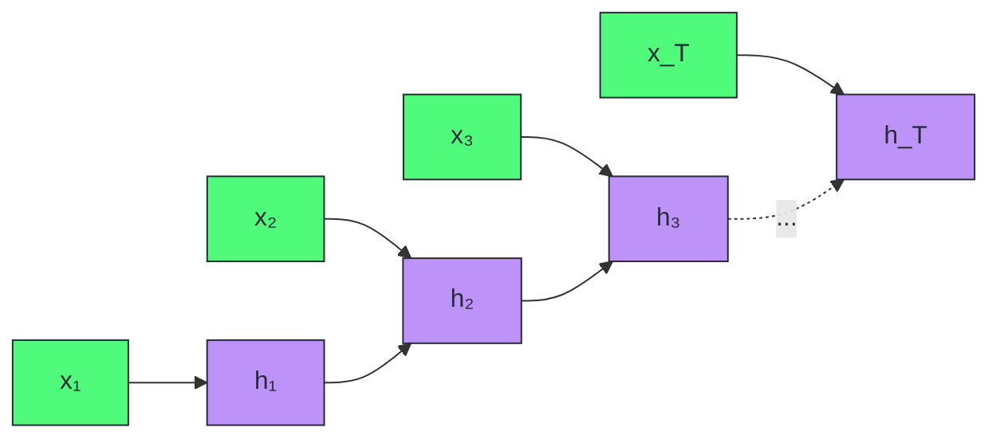
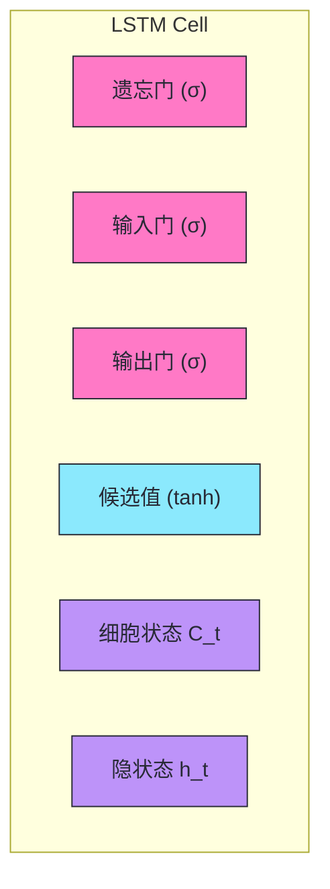
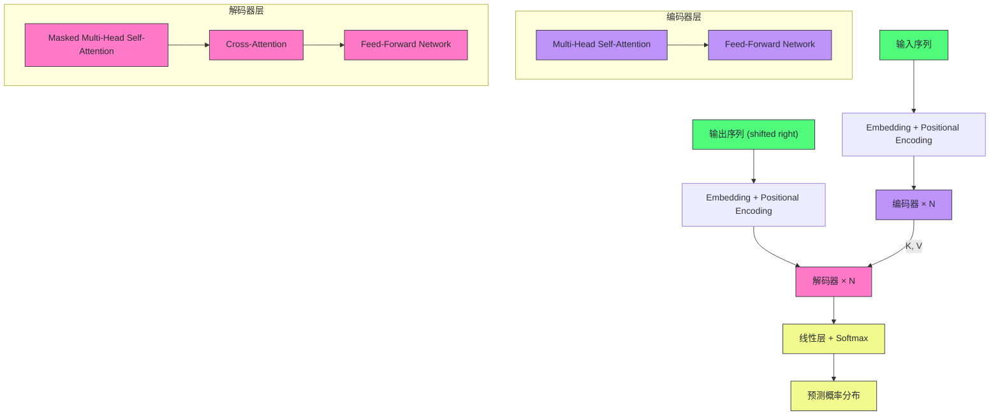

# 01 从 RNN 到 Transformer——注意力机制的革命

**摘要：**

本文从序列建模的本质需求出发，梳理从 RNN → LSTM/GRU → Attention → Transformer 的技术演进链路，并把视线延伸到 2023-2026 年次二次方架构与混合架构的新一轮竞争。核心问题只有一个：**如何让模型有效地捕捉序列中任意两个位置之间的依赖关系？** RNN 用"逐步传递"的隐状态尝试回答，但受限于梯度消失与串行计算；LSTM 用门控机制开出信息"高速公路"，却仍未消除路径长度与容量衰减；Attention 以"查询-键-值"的软寻址方式让任意两位置直接相连，信息路径降到 $O(1)$；Transformer 把 Attention 发展为 Self-Attention，配合多头机制与位置编码，构建了完全基于注意力的并行架构——这正是 GPT、BERT、LLaMA 等所有现代大语言模型的基石。但 $O(n^2)$ 的计算代价催生了线性注意力、状态空间模型与原生稀疏注意力，2024 年以来的混合架构（Jamba、MiniMax-M1、Qwen3-Next 等）则表明：注意力并未被取代，而是在与循环思想融合中持续演化。全文试图回答两个问题：注意力机制为什么是序列建模的转折点？它之后的路又走向何方？

---

## 第 1 章 引言：序列建模的核心挑战

### 1.1 什么是序列建模

人类语言天然是序列——一句话由词按顺序排列，词的含义依赖于它在句子中的位置和上下文。"银行"在"去银行取钱"和"河的南岸是一片银行"中含义截然不同。序列建模的核心任务就是：**给定一个序列的前文，预测下一个元素**（语言模型），或者**将一个序列映射为另一个序列**（机器翻译/摘要生成）。

从数学角度看，序列建模要解决的核心问题是建模条件概率分布：

$$P(x_t | x_1, x_2, \ldots, x_{t-1})$$

即在已知前 $t-1$ 个 token 的情况下，预测第 $t$ 个 token 的概率分布。整个序列的联合概率可以通过链式法则分解为：

$$P(x_1, x_2, \ldots, x_T) = \prod_{t=1}^{T} P(x_t | x_1, \ldots, x_{t-1})$$

这个分解看似简洁，但实际计算面临一个根本性挑战：**条件概率 $P(x_t | x_1, \ldots, x_{t-1})$ 的条件集合随 $t$ 增长而增长**。当 $t$ 很大时（譬如一篇文章的第 5000 个词），模型需要"记住"前面所有 4999 个词的信息来做出预测。这就是序列建模中最核心的难题——**长距离依赖**（Long-Range Dependencies）。

在神经网络成为主流之前，语言建模走的是一条截然不同的路：基于**马尔可夫假设**（Markov Assumption）的 n-gram 模型——只依赖最近 $n-1$ 个词来预测下一个词，把 $P(x_t | x_1, \ldots, x_{t-1})$ 粗暴地截断为 $P(x_t | x_{t-n+1}, \ldots, x_{t-1})$。这个近似把条件集合固定下来，解决了"条件越滚越大"的问题，代价却是放弃了一切更远的依赖：n-gram 既算不出"我出生在法国，多年后回到欧洲工作"里"法语"这个答案，也面临**组合爆炸**与**数据稀疏**——词表大小为 $V$ 时，4-gram 的组合空间高达 $V^4$，绝大多数组合在有限语料里从未出现，概率被压成零。相反方向的反例同样值得警惕：如果把序列当作**词袋**（Bag of Words），彻底丢掉顺序信息，模型就连"狗咬人"和"人咬狗"都分不清。n-gram 与词袋这两个极端恰好划出了序列建模的坐标轴——既要利用顺序，又要突破有限窗口，这正是后文所有架构共同的出发点。

### 1.2 长距离依赖为什么难

考虑一个简单的例子：

> "我出生在法国，在巴黎长大，后来去了美国留学，在那里读了计算机科学的博士，毕业后回到了欧洲，在一家科技公司工作，日常使用的语言是______。"

要正确填入"法语"，模型需要关注到句子开头的"出生在法国"——中间隔了几十个词。这就是长距离依赖的典型场景。

长距离依赖之所以难，根源在于信息传递的**衰减**和**干扰**：

- **衰减**：如果信息必须通过多个中间步骤逐步传递（如 RNN 的隐状态），每一步都会引入信息损失，传递距离越远，原始信息保留得越少
- **干扰**：中间步骤引入的新信息会"覆盖"或"稀释"早期信息，因为隐状态的容量有限（固定维度的向量），无法无限制地累积信息

这两个问题的根源是相同的：**信息传递路径的长度与序列距离成正比**。如果模型能够直接建立任意两个位置之间的连接，而不需要经过中间位置的"接力"，长距离依赖问题就能从根本上解决——这正是 Attention 机制的核心思想。

不妨把信息传递想象成一场没有广播的接力赛：RNN 是跑者，信息是接力棒，每跑一段就要交给下一个人，人的手会出汗、会打滑，跑得越远，棒上的信息磨损越严重。注意力的思路则是直接给每个位置装一部电话——任意两人可以随时通话，距离不再是问题。后文的全部演进，本质上就是这场接力赛到电话网络的改造史。

### 1.3 技术演进的主线

序列建模技术的演进，本质上是围绕"如何缩短信息传递路径"这一核心问题展开的：

| 模型 | 任意两位置的信息路径长度 | 并行度 | 核心限制 |
| :--- | :--- | :--- | :--- |
| **RNN** | $O(n)$——必须逐步传递 | 无法并行（串行依赖） | 梯度消失/爆炸，长距离信息丢失 |
| **LSTM/GRU** | $O(n)$——门控缓解但未消除 | 无法并行 | 长距离依赖仍衰减，训练慢 |
| **Attention（Seq2Seq）** | $O(1)$——直接连接 | 编码端可并行，解码端串行 | 仍依赖 RNN 作为骨架 |
| **Transformer** | $O(1)$——Self-Attention | 完全并行 | 计算复杂度 $O(n^2)$ |
| **线性注意力/SSM（2023-2025）** | $O(1)$——压缩进固定状态 | 训练可并行 | 状态容量有限，精确召回弱 |

下面我们沿着这条主线，逐步深入每种架构的设计动机、工作原理和核心局限。表里最后一行代表的是 2023 年之后的新一轮竞争，笔者会在第 8 章专门展开——先交代一个预告：当信息路径不再是问题，竞争的主战场就转移到了"用多大的代价换取这条路径"。

---

## 第 2 章 RNN——序列建模的起点

### 2.1 RNN 的基本结构

循环神经网络（Recurrent Neural Network, RNN）是最早为序列建模设计的神经网络架构。它的核心思想极为朴素：**用一个"隐状态"向量 $h_t$ 来累积截至当前时间步 $t$ 的所有历史信息**。

在每个时间步 $t$，RNN 接收当前输入 $x_t$ 和上一步的隐状态 $h_{t-1}$，计算新的隐状态 $h_t$：

$$h_t = \tanh(W_{hh} \cdot h_{t-1} + W_{xh} \cdot x_t + b)$$

其中 $W_{hh}$ 是隐状态到隐状态的权重矩阵，$W_{xh}$ 是输入到隐状态的权重矩阵，$\tanh$ 是激活函数。$h_t$ 既作为当前步的输出（可以接一个全连接层做分类/生成），也作为"记忆"传递给下一步。

这个设计优雅而直观——隐状态 $h_t$ 就像一个"压缩的记忆"，理论上包含了从 $x_1$ 到 $x_t$ 的所有信息。

从历史看，这种"用状态传递记忆"的构想可以追溯到 1990 年 Elman 提出的**简单循环网络**（Simple Recurrent Network, SRN）——当时的隐状态只是把上一时刻的隐状态原样拼进当前输入，结构比现代 RNN 更简单，但"记忆随序列流动"的骨架已经成形。笔者愿意把 RNN 的隐状态比作一本**只准往背面写、不许往前翻的笔记本**：每个时刻你读到的是前一页的摘要，再把自己的新笔记和摘要合并，压缩成下一页——信息确实在流动，但每一页都是一次有损压缩，翻页越多，最初几页的细节就越模糊。这个比喻里的"有损压缩"和"不许往前翻"，恰好预言了 RNN 的两个致命缺陷。

### 2.2 RNN 的致命缺陷：梯度消失与爆炸

理论上，RNN 能够捕捉任意长度的依赖关系。但在实际训练中，RNN 面临一个根本性的数学难题——**梯度消失**（Vanishing Gradient）和**梯度爆炸**（Exploding Gradient）。

在反向传播（Backpropagation Through Time, BPTT）中，损失函数对早期隐状态 $h_k$（$k \ll t$）的梯度需要通过链式法则逐步回传：

$$\frac{\partial L_t}{\partial h_k} = \frac{\partial L_t}{\partial h_t} \cdot \prod_{i=k+1}^{t} \frac{\partial h_i}{\partial h_{i-1}}$$

关键在于中间那个**连乘项** $\prod_{i=k+1}^{t} \frac{\partial h_i}{\partial h_{i-1}}$。由于 $\frac{\partial h_i}{\partial h_{i-1}} = W_{hh}^T \cdot \text{diag}(\tanh'(z_i))$，其中 $\tanh'$ 的值域为 $(0, 1]$，每一步乘积都会缩小梯度。当 $t - k$ 很大时（即时间步间隔大），梯度会指数级衰减趋近于零——这就是梯度消失。

梯度消失的直接后果是：**模型无法学习到长距离依赖**。反向传播时，远处时间步的梯度信号几乎为零，权重更新微乎其微，模型实际上只能学到近几步的局部模式。

反过来，如果 $W_{hh}$ 的最大特征值大于 1，连乘项会指数级增长，导致梯度爆炸。梯度爆炸可以通过**梯度裁剪**（Gradient Clipping）缓解，但梯度消失没有同样简单的补救措施——因为你无法凭空"放大"一个已经丢失的信号。

指数衰减到底有多快，值得用一个小学算术感受一下：设每一步对梯度的缩放系数平均为 0.9（这已经算相当温和），相隔 100 步后梯度只剩 $0.9^{100} \approx 2.7 \times 10^{-5}$，相隔 300 步则到 $10^{-14}$ 量级——比任何浮点数的精度下限都更接近零。这便是"梯度消失"字面背后的残酷算术。至于为什么有的任务里梯度爆炸先出现，取决于 $W_{hh}$ 的**谱半径**（Spectral Radius，最大特征值的模）与非线性激活的联合作用：谱半径小于 1 则必然收缩，大于 1 则可能放大——这也是早期研究用"初始化谱半径接近 1"来缓解问题的原因，但初始化只能延后灾难，不能消除它。

> [!warning] 核心洞察
> 梯度消失不仅仅是一个"训练技巧"问题，它反映了 RNN 架构的根本局限：**信息必须通过 $O(n)$ 步的串行传递**，每一步都是一个有损压缩，长距离信息必然衰减。这个问题不是调参数或换优化器能解决的——需要架构层面的革新。

### 2.3 训练算法：随时间展开的反向传播

RNN 的训练算法值得单独交代，因为它的名字本身就暴露了架构的代价。**BPTT**（Backpropagation Through Time）的做法是先把网络按时间步"展开"成一个与序列等长的深层前馈网络——$t$ 时刻的隐状态对应第 $t$ 层——然后对这个展开后的网络做标准反向传播。展开的层数等于序列长度，这意味着：

- **训练即深层网络优化**：一个长度为 500 的句子，BPTT 等价于训练一个 500 层的网络，梯度消失问题在训练时就无处不在，这也是第 2.2 节数学分析的直接来源
- **梯度爆炸的工程对策**：实践上几乎人人都会在梯度范数超过阈值（譬如 1.0）时把梯度整体按比例缩放回去，即梯度裁剪，防止参数一步跳进无穷大

两个工程细节进一步左右了 RNN 的实际表现。其一是**截断 BPTT**（Truncated BPTT）：把序列切成固定长度（如 20-40 步）的片段，每片段内展开反向传播，片段之间只传递隐状态、不回传梯度——这是算力与长依赖之间的第一次妥协，代价是超过截断长度的依赖彻底学不到。其二是**教师强制**（Teacher Forcing）：训练时把真实的前一个 token 而非模型自己的预测作为下一步输入，加速收敛、稳定训练，但会造成训练与推理的分布不一致（exposure bias）——模型训练时永远有"标准答案"兜底，推理时却要用自己的错误输出继续生成，错误会逐步累积。这两个细节提醒我们，RNN 的问题从来不只是"一个公式"，而是从数学到工程的全链路妥协。

### 2.4 串行计算的效率瓶颈

除了梯度消失，RNN 还有一个严重的工程问题：**无法并行化**。

$h_t$ 的计算依赖 $h_{t-1}$，$h_{t-1}$ 依赖 $h_{t-2}$……这种严格的串行依赖意味着：即使你有一块拥有上万个 CUDA Core 的 GPU，在处理一个长度为 $T$ 的序列时，也必须串行执行 $T$ 次矩阵运算。GPU 的并行计算能力完全无法发挥。

更具体地说，GPU 擅长的是"同时对大量数据做同一类运算"，而 RNN 在时间维上天然是"一次只算一个"——批处理（Mini-batch）虽然能把多个句子塞进一个矩阵并行计算，但那只是把"多个样本"并行化，时间维的串行链条丝毫未动。如果一块 GPU 单步矩阵运算需要 0.1 毫秒，一个 1024 步的序列就要 100 毫秒起步，而且这个数字不随 GPU 变强而下降——硬件算力越强，串行瓶颈越刺眼。

在深度学习从"小模型+小数据"走向"大模型+大数据"的时代，这个效率瓶颈是致命的。后来 Transformer 能够用数万亿 token 训练的前提之一，就是它的 Self-Attention 机制允许序列中所有位置**同时并行计算**。

---

## 第 3 章 LSTM 与 GRU——门控机制的缓解

### 3.1 LSTM 的设计动机

长短期记忆网络（Long Short-Term Memory, LSTM）由 Hochreiter 和 Schmidhuber 在 1997 年提出，直接针对 RNN 的梯度消失问题。它的核心思想是：**引入一条"高速公路"（Cell State），让信息可以不经过非线性变换地直接传递**。

在标准 RNN 中，信息传递的唯一通道是隐状态 $h_t$，每一步都要经过 $\tanh$ 非线性变换——这正是梯度消失的根源。LSTM 额外引入了一个**细胞状态** $C_t$（Cell State），它像一条传送带，信息可以沿着它几乎无损地向前传递。

值得补充的历史细节是：梯度消失问题早在 1991 年就被 Hochreiter 在他的学位论文中系统诊断过，LSTM 正是带着"要修这个病"的明确处方诞生的。它的设计要害在于**常数误差传送带**（Constant Error Carousel, CEC）——细胞状态 $C_t$ 的更新若只做线性运算，误差就可以像没有摩擦的传送带一样原样滚回早期时间步。相比之下，1997 年的原版 LSTM 甚至还没有遗忘门，三个门的设计是后来逐步补全的（见 3.3 节）——这种"先有核心思想、再打补丁"的演进史，本身就是一篇架构设计的微型教材。

### 3.2 LSTM 的三个门

LSTM 通过三个"门"（Gate）来控制信息的流动：

**遗忘门**（Forget Gate）决定从细胞状态中丢弃什么信息：

$$f_t = \sigma(W_f \cdot [h_{t-1}, x_t] + b_f)$$

$\sigma$ 是 Sigmoid 函数，输出值在 $(0, 1)$ 之间。$f_t$ 中接近 1 的维度表示"保留"，接近 0 的维度表示"遗忘"。

**输入门**（Input Gate）决定往细胞状态中写入什么新信息：

$$i_t = \sigma(W_i \cdot [h_{t-1}, x_t] + b_i)$$
$$\tilde{C}_t = \tanh(W_C \cdot [h_{t-1}, x_t] + b_C)$$

$i_t$ 控制哪些维度被更新，$\tilde{C}_t$ 是候选新信息。

**细胞状态更新**——结合遗忘门和输入门：

$$C_t = f_t \odot C_{t-1} + i_t \odot \tilde{C}_t$$

这一步是 LSTM 的精髓。注意 $C_{t-1}$ 到 $C_t$ 的传递只涉及**逐元素乘法和加法**——没有矩阵乘法，没有非线性激活。如果遗忘门 $f_t$ 接近 1（即"全部保留"），信息可以无损地从 $C_{t-1}$ 流向 $C_t$。这意味着梯度也可以沿着这条通道几乎无损地回传，从而缓解了梯度消失。

**输出门**（Output Gate）决定细胞状态的哪些部分作为当前步的输出：

$$o_t = \sigma(W_o \cdot [h_{t-1}, x_t] + b_o)$$
$$h_t = o_t \odot \tanh(C_t)$$

三个门的分工可以这样理解：细胞状态像一间仓库，遗忘门决定"把什么旧货清出去"，输入门决定"把什么新货放进来"，输出门决定"这间仓库的什么内容值得对外展示"。门控的价值在于**让"记住还是忘记"变成模型自己可学习的选择**，而不是架构强加的宿命——这比标准 RNN"什么都往里塞"显然更聪明，但聪明的代价是四个门控方程带来的参数量与计算量。

### 3.3 两个迟到的重要补丁：遗忘门与 peephole

有意思的是，1997 年论文里的原版 LSTM 并没有遗忘门——细胞状态只会被输入门追加，永远不会主动清空，等于仓库只进不出，长期运行必然塞满噪音。**遗忘门**是 Gers、Schmidhuber 和 Cummins 在 2000 年补上的，由此才形成现代教科书里"三个门"的形态。这个补丁的价值不只是工程上的，它让模型具备了**显式的记忆清除能力**：读完一个话题的句子后，模型可以主动把上一个话题的残留状态归零，而不是让旧信息和新信息在状态向量里互相稀释。

同一篇论文还引入了 **peephole 连接**（Peephole Connections）——让各门在计算时"偷看"一眼细胞状态 $C_{t-1}$ 本身，而非只看隐状态和输入。这个想法的初衷是让门控决策更精准，但后续大量实验表明 peephole 的收益并不稳定，今天的多数实现并不使用它。笔者认为这段历史值得记下：它说明 LSTM 家族的每一个部件都经历过"引入—检验—取舍"的循环，架构的最终形态是大量实验筛选的结果，而非一次性设计出来的——所谓"没有银弹，架构即权衡"，在这里就有一个具体注脚。

### 3.4 GRU——LSTM 的简化变体

门控循环单元（Gated Recurrent Unit, GRU）由 Cho 等人在 2014 年提出，是 LSTM 的简化版本。它将遗忘门和输入门合并为一个**更新门** $z_t$，同时合并了细胞状态和隐状态：

$$z_t = \sigma(W_z \cdot [h_{t-1}, x_t])$$
$$r_t = \sigma(W_r \cdot [h_{t-1}, x_t])$$
$$\tilde{h}_t = \tanh(W \cdot [r_t \odot h_{t-1}, x_t])$$
$$h_t = (1 - z_t) \odot h_{t-1} + z_t \odot \tilde{h}_t$$

GRU 的参数量比 LSTM 少约 25%，训练更快，在许多任务上性能与 LSTM 相当。但两者共享相同的根本局限。

如果把 LSTM 比作一套"进水闸、出水闸、展示闸"三个独立阀门的水利系统，GRU 就是把进水与出水合并成一个**音量旋钮**：旋钮往一边拧是保留旧记忆，往另一边拧是写入新记忆，两者此消彼长、合二为一。旋钮结构少了一个门的参数，训练更快，在数据量不太大的任务上往往和 LSTM 平分秋色；但"遗忘"与"写入"被强行绑成互补关系，也让记忆管理少了一点自由度。选 LSTM 还是 GRU，在 2014-2018 年间几乎是每个 NLP 项目的第一个架构决策，如今回头看，这不过是"复杂门控"与"简洁门控"之间一次典型的因地制宜。

### 3.5 LSTM/GRU 仍未解决的问题

LSTM 和 GRU 通过门控机制**缓解**了梯度消失，但并未**消除**长距离依赖的衰减。原因有三：

**第一，遗忘门不可能永远全开。** 在实际训练中，遗忘门 $f_t$ 不可能在每一步都精确地保持接近 1——它需要根据内容动态决定保留和遗忘什么。随着序列变长，累积的遗忘效应仍然会导致早期信息的逐步丢失。实验表明，LSTM 在序列长度超过几百步时，性能开始显著下降。

**第二，固定维度的隐状态容量有限。** 无论是 LSTM 的细胞状态还是 GRU 的隐状态，都是一个固定维度的向量（通常 256-1024 维）。要在这个有限容量中"压缩"整个序列的信息，信息损失不可避免。序列越长，每个 token 能分到的"带宽"就越少。

**第三，串行计算的瓶颈依然存在。** LSTM 和 GRU 与标准 RNN 一样，$h_t$ 依赖 $h_{t-1}$，无法并行。在 GPU 时代，这意味着训练效率的天花板。

抛开数学，还需要补充一个历史坐标：门控循环网络在 2010 年代中叶曾是机器翻译、语音识别、序列生成的绝对主力——2014 年之后的神经机器翻译（Neural Machine Translation）标准配置就是"编码器 LSTM + 解码器 LSTM"，语音识别系统同样大量采用双向 LSTM。但 LSTM 并不是"没解决长距离依赖就没用"，而是在其统治的十年里，把序列建模的精度推到了当时硬件与数据条件下的极限。问题只在于：**它解决问题的方式——逐步传递——本身成了天花板**。突破来自一个完全不同的方向。

> [!note] 设计哲学
> LSTM 的设计哲学是"在 RNN 的框架内，通过更精巧的信息流控制来缓解梯度消失"。它没有质疑 RNN"逐步传递"的根本假设。真正的突破需要一种完全不同的信息传递方式——Attention 机制提供了这种可能。

---

## 第 4 章 注意力机制——直接连接的突破

### 4.1 Attention 的诞生：Seq2Seq 的瓶颈

注意力机制最初出现在序列到序列（Seq2Seq）模型中，解决的是一个非常具体的问题：**编码器-解码器架构中的信息瓶颈**。

2014 年，Sutskever 等人提出了经典的 Seq2Seq 模型用于机器翻译。编码器（一个 RNN/LSTM）将输入序列处理成一个固定长度的"上下文向量" $c$（即编码器最后一步的隐状态），解码器（另一个 RNN/LSTM）基于这个 $c$ 逐步生成翻译结果。

问题很明显：**整个输入序列的所有信息被压缩到一个固定维度的向量 $c$ 中**。对于短句子，这或许够用；但对于长句子，$c$ 根本无法承载所有信息。Cho 等人在 2014 年的实验中明确观察到：随着输入句子长度增加，Seq2Seq 模型的翻译质量急剧下降。

把问题说得形象一点：这相当于把整本书的内容先浓缩成一张便签，再要求作者根据便签把书复述出来。便签写不下书的全部细节，于是句子越长，丢失越多。当时的应对办法无外乎两招：把隐状态维度加大（治标），或者把输入句子倒过来读（缓解远距离词的路径长度，治标不治本）。注意力机制给出了治本的回答：**别压缩了，直接把原文摆在解码器面前，让它随时查阅**。

### 4.2 Bahdanau Attention：让解码器"回头看"

2015 年，Bahdanau、Cho 和 Bengio 提出了一个关键改进——**注意力机制**（Attention Mechanism）。核心思想是：**解码器在生成每个输出词时，不再只依赖一个固定的上下文向量 $c$，而是动态地"关注"编码器的所有隐状态，对它们做加权求和**。

具体来说，在解码器的第 $t$ 步：

**第一步**：计算**注意力分数**（Attention Score）。解码器当前隐状态 $s_{t-1}$ 与编码器每个位置 $j$ 的隐状态 $h_j$ 之间的"相关性"：

$$e_{t,j} = a(s_{t-1}, h_j)$$

其中 $a$ 是一个可学习的对齐函数，Bahdanau 使用了一个小型的前馈神经网络：$a(s, h) = v^T \tanh(W_s s + W_h h)$。

**第二步**：将注意力分数通过 Softmax 归一化为**注意力权重**：

$$\alpha_{t,j} = \frac{\exp(e_{t,j})}{\sum_{k=1}^{T_x} \exp(e_{t,k})}$$

$\alpha_{t,j}$ 表示解码器在生成第 $t$ 个输出词时，对编码器第 $j$ 个位置的"关注程度"。所有权重之和为 1。

**第三步**：用注意力权重对编码器隐状态做**加权求和**，得到当前步的上下文向量：

$$c_t = \sum_{j=1}^{T_x} \alpha_{t,j} \cdot h_j$$

注意这个 $c_t$ 是动态的——每个解码步都会重新计算，关注输入序列的不同部分。翻译"bank"时可能关注原文的"银行"，翻译"river"时关注"河流"。

> [!info] 核心概念
> 注意力机制的本质是一个**软寻址**（Soft Addressing）过程：用查询信号（解码器状态）在一组键值对（编码器隐状态）中检索最相关的信息。这个"查询-键-值"的思想，后来被 Transformer 正式提炼为 Q/K/V 框架。

### 4.3 注意力分数的两种形态：加性与点积

Bahdanau 用的打分函数 $a(s,h) = v^T \tanh(W_s s + W_h h)$ 属于**加性注意力**（Additive Attention）——两个向量先各自线性变换，相加后过 $\tanh$，再投影成标量。它的表达能力不差，但有一个工程缺陷：打分过程必须逐位置串行计算，难以用矩阵乘法一次性完成。

同年稍晚，Luong 等人在论文里系统比较了加性打分与**乘性打分**（Multiplicative Attention）——直接用向量点积或双线性形式 $s^T W h$ 衡量相关性。乘性打分的计算可以组织成一次大矩阵乘法（$S H^T$），这为 GPU 并行扫清了障碍，也正是在这个意义上，点积注意力成了后续 Transformer 的直接前身。两种打分的取舍可以概括为：加性注意力以更多可学习参数换取非线性，点积注意力以线性相似度换取计算效率与并行性——后来的实践一边倒地选了后者，原因不是加性打分的表达力不够，而是**在"算得完"面前，表达力要让路**。

### 4.4 Attention 为什么有效

注意力机制之所以能解决长距离依赖问题，根本原因在于：**它在解码器和编码器的任意位置之间建立了直接连接**。

在没有 Attention 的 Seq2Seq 中，输入序列第 1 个词的信息要传递给解码器，必须经过编码器的 $T_x$ 步串行传递，压缩到上下文向量 $c$ 中，然后在解码器中展开。信息路径长度为 $O(T_x + T_y)$。

有了 Attention 后，解码器在任何一步都可以直接"看到"编码器的任何位置——信息路径长度降为 $O(1)$。这不仅解决了长距离依赖，还提供了良好的**可解释性**：通过可视化注意力权重 $\alpha_{t,j}$，我们可以直观地看到模型在翻译每个词时"关注"了源句的哪个部分。

从训练的角度看，注意力还有一层常被忽略的贡献——**梯度捷径**。注意力权重是 $c_t$ 对每个 $h_j$ 的直接系数，反向传播时，损失对遥远位置 $h_j$ 的梯度不需要穿过漫长的循环链，而是沿着注意力权重这条短路径直达。这意味着注意力不仅让"表示"绕开了距离衰减，也让"学习信号"绕开了距离衰减——两个问题一次解决。

不过，"可解释性"这个说法需要打个折扣。Jain 和 Wallace（2019）的实验表明，注意力权重与模型实际使用的信息并不总是一致——把注意力权重随机打乱，模型输出往往变化不大，说明权重高并不等于"这个位置贡献了大"。因此更稳妥的表述是：注意力给了我们一个**观察入口**，但它更像"心电图"而非"诊断书"，需要谨慎解读。

### 4.5 Attention 的局限：仍然是 RNN 的"配件"

Bahdanau Attention 虽然是一个重大突破，但它仍然嵌套在 RNN/LSTM 的框架中——编码器和解码器本身还是 RNN。这意味着：

- 编码器仍然需要串行处理输入序列
- 解码器仍然是逐步生成的
- RNN 本身的参数和计算量仍然存在

Attention 在这里的角色是 RNN 的"增强配件"，而非替代品。一个自然的问题浮现：**既然 Attention 已经能让模型直接访问序列的任意位置，我们还需要 RNN 吗？**

---

## 第 5 章 Transformer——Attention Is All You Need

### 5.1 从"配件"到"主角"的范式转变

2017 年，Google 的 Vaswani 等人在论文《Attention Is All You Need》中给出了一个大胆的回答：**不需要 RNN，纯 Attention 就够了。**

他们提出的 Transformer 架构完全抛弃了循环结构，仅靠注意力机制和前馈网络构建了一个序列到序列的模型。这不仅解决了 RNN 的串行计算瓶颈，还在机器翻译任务上取得了当时的最优性能——而且训练速度大幅提升。论文报告，基础模型在 8 块 P100 GPU 上训练约 12 小时即达到当时最优的翻译质量，最大的模型也只需 3.5 天——与当时动辄数周的 LSTM 翻译系统相比，这个数字本身就是"注意力革命"最好的注脚。

论文标题把话说到极致，而"Transformer"这个命名本身也值得玩味——它借用了"变形金刚"的意象：同一套架构，输入输出两侧共享结构与参数，像一台机器在不同形态之间切换。这篇论文的意义远超机器翻译。Transformer 成为了后续所有大语言模型的基础架构：GPT 架构（Decoder-Only）、BERT（Encoder-Only）、T5（Encoder-Decoder）都是 Transformer 的变体。

### 5.2 Self-Attention：序列内部的注意力

Transformer 的核心创新是 **Self-Attention（自注意力）**——不再是编码器和解码器之间的注意力，而是**序列自身内部的注意力**。

在之前的 Bahdanau Attention 中，查询来自解码器，键值来自编码器——是两个不同序列之间的交互。Self-Attention 将查询、键、值都来自同一个序列，让序列中的每个位置都能关注到序列中的其他所有位置。

给定输入序列的表示矩阵 $X \in \mathbb{R}^{n \times d}$（$n$ 个 token，每个 $d$ 维），Self-Attention 的计算分三步：

**第一步：线性投影生成 Q、K、V**

$$Q = X W^Q, \quad K = X W^K, \quad V = X W^V$$

其中 $W^Q, W^K \in \mathbb{R}^{d \times d_k}$，$W^V \in \mathbb{R}^{d \times d_v}$。$Q$（Query，查询）、$K$（Key，键）、$V$（Value，值）三个矩阵各有不同的语义角色：

- **Query**：代表"我在寻找什么信息"
- **Key**：代表"我能提供什么信息"
- **Value**：代表"我实际携带的信息内容"

为什么需要三个不同的投影，而不是直接用 $X$ 本身？因为一个 token 在"查询其他 token"和"被其他 token 查询"时，关注的语义维度可能不同。譬如，动词在查询主语时关注的是"施事者"维度，而它被形容词查询时暴露的是"被修饰对象"维度。三个独立的投影矩阵让模型能够灵活地学习这些不同的语义角色。

**第二步：计算注意力分数并归一化**

$$\text{Attention}(Q, K, V) = \text{softmax}\left(\frac{QK^T}{\sqrt{d_k}}\right) V$$

$QK^T \in \mathbb{R}^{n \times n}$ 是注意力分数矩阵，第 $(i, j)$ 个元素表示位置 $i$ 对位置 $j$ 的"关注程度"。除以 $\sqrt{d_k}$ 是**缩放**（Scaled）操作——当 $d_k$ 较大时，$QK^T$ 的元素值会很大，Softmax 会进入饱和区（梯度接近零），缩放可以避免这个问题。

缩放系数的来源值得说透：如果 $q$、$k$ 的每个分量独立且均值为零、方差为 1，那么点积 $q \cdot k$ 的方差恰为 $d_k$（方差相加），标准差为 $\sqrt{d_k}$。不做缩放时，点积结果的分布随 $d_k$ 增大而越来越"胖"，Softmax 的输入落在两端饱和区，梯度趋近于零——训练会陷入停滞。除以 $\sqrt{d_k}$ 把方差重新压回 1，Softmax 回到"灵敏区"。这不是一个调出来的超参数，而是一个**从概率分布推出来的数学结论**。

Softmax 将每一行归一化为概率分布（和为 1），然后用这些权重对 $V$ 做加权求和。

**第三步：输出上下文感知的表示**

最终输出矩阵的第 $i$ 行是 $V$ 中所有行的加权平均，权重由 $Q$ 的第 $i$ 行与所有 $K$ 的点积决定。这意味着每个位置的输出都融合了来自序列所有位置的信息——信息路径长度为 $O(1)$。

> [!info] 核心概念
> Self-Attention 的本质可以类比为**信息检索**：每个 token 带着自己的 Query 去整个序列中"搜索"最相关的 Key，然后读取对应的 Value 并融合到自己的表示中。这是一个完全数据驱动的、可微分的"查找表"操作。

如果给 Self-Attention 找一个生活比喻，最贴切的是**全息会议**：会议室里每个人都可以发言，也可以同时倾听所有人的发言，每个人最后吸收的，是所有发言者话语的加权混合——权重大小取决于"他说的和我关心的有多少关系"。与传统会议（RNN）"只能听上一位发言者转述"相比，全息会议的信息传递是即时的、全局的，谁都不需要等待转述，这就是 $O(1)$ 路径的含义。

### 5.3 Multi-Head Attention：多视角的并行关注

单个 Self-Attention 只能捕捉一种"注意力模式"——譬如主语-谓语的句法关系。但自然语言中的关系是多维度的：一个词可能同时需要关注句法依赖、语义相似性、共指关系等。

**Multi-Head Attention（多头注意力）** 的解决方案是：**并行运行多个 Self-Attention，每个"头"用不同的投影矩阵，关注序列的不同方面，最后拼接起来**。

$$\text{MultiHead}(Q, K, V) = \text{Concat}(\text{head}_1, \ldots, \text{head}_h) W^O$$

其中每个头：

$$\text{head}_i = \text{Attention}(X W_i^Q, X W_i^K, X W_i^V)$$

假设模型维度 $d = 512$，使用 $h = 8$ 个头，那么每个头的 $d_k = d_v = d / h = 64$。8 个头并行计算（可以通过矩阵 reshape 在 GPU 上高效实现），最后拼接得到 $8 \times 64 = 512$ 维的输出，再通过 $W^O$ 线性投影。

这种设计的精妙之处在于：

- **参数量不变**：$h$ 个头的总参数量与单个全维度 Attention 相当（因为每个头的维度缩小了 $h$ 倍）
- **计算量不变**：同理
- **表达能力增强**：每个头可以学习不同的注意力模式

实验观察表明，不同的注意力头确实会学到不同的模式——有的头关注相邻词，有的头关注句法依赖，有的头关注远距离的共指关系。

不过，"每个头各司其职"只是理想图景，实测要复杂得多：Clark 等人的分析发现头之间的分工确实存在，但 Michel 等人（2019）的实验又表明，很多头在训练完成后可以被**剪掉**而不损伤性能——说明头与头之间存在大量冗余，模型并不像设计文档描述的那么"人尽其才"。这里呈现的是一组有趣的反差：多头既带来了真实的表达能力提升，也带来了可观的冗余；而后来的 MQA（Multi-Query Attention）与 GQA（Grouped-Query Attention）正是顺着"冗余"这条线索，通过让多个查询头共享少数键值头来削减 KV Cache——这已经是 [[06 推理优化——KV Cache、量化与投机解码]] 的话题了，本文先按下不表。

### 5.4 位置编码：弥补顺序信息的缺失

Self-Attention 有一个重要特性：**它是置换不变的**（Permutation Invariant）。也就是说，如果我们打乱输入序列的顺序，Self-Attention 的输出只是相应地打乱，注意力权重本身不变。

这对于集合（Set）数据是理想的特性，但对于序列数据是灾难性的——"狗咬人"和"人咬狗"对 Self-Attention 来说没有区别，因为它不知道词的顺序。

**位置编码**（Positional Encoding）就是为了弥补这个缺失。原始 Transformer 使用**正弦-余弦位置编码**：

$$PE_{(pos, 2i)} = \sin\left(\frac{pos}{10000^{2i/d}}\right)$$
$$PE_{(pos, 2i+1)} = \cos\left(\frac{pos}{10000^{2i/d}}\right)$$

其中 $pos$ 是位置索引，$i$ 是维度索引。这种编码有两个巧妙的性质：

1. **每个位置有唯一的编码**：不同位置的编码向量不同
2. **相对位置信息可通过线性变换获得**：$PE_{pos+k}$ 可以表示为 $PE_{pos}$ 的线性变换（因为三角函数的和差公式），这使模型能够学习到相对位置关系

位置编码被直接加到输入的 token embedding 上：$\text{input} = \text{token\_embedding} + \text{positional\_encoding}$。

第二个性质值得展开，因为它是整个方案的点睛之笔：利用 $\sin(a+b) = \sin a \cos b + \cos a \sin b$，位置 $pos+k$ 的编码可以由位置 $pos$ 的编码经过一个**只依赖 $k$ 的旋转矩阵**线性变换得到——也就是说，任意两个位置之间的相对距离信息被编码进了它们的向量关系里，模型只要学会"读"这个关系，就能感知相对顺序。这相当于给每个词发了一张**座位号**：不只告诉它"你在第几排"，还让任意两个座位之间的相对距离一眼可读。

> [!note] 设计哲学
> 正弦-余弦位置编码是 Transformer 的原始方案，但它有一个局限：它是绝对位置编码，不能很好地泛化到训练时未见过的更长序列。后续的 GPT 架构 使用了**可学习的位置编码**（Learnable Positional Embedding），而更先进的方案如 **RoPE**（Rotary Position Embedding）和 **ALiBi**（Attention with Linear Biases）将位置信息注入到注意力分数中而非 embedding 中，显著提升了长序列的泛化能力。我们将在后续文章中详细讨论。

### 5.5 Transformer 的完整架构

一个完整的 Transformer 由**编码器栈**和**解码器栈**组成，每个栈由多个相同的层堆叠而成。

**编码器层**包含两个子层：
1. **Multi-Head Self-Attention**
2. **Position-wise Feed-Forward Network**（两层全连接，中间用 ReLU/GELU 激活）

每个子层都有**残差连接**（Residual Connection）和**层归一化**（Layer Normalization）：

$$\text{output} = \text{LayerNorm}(x + \text{SubLayer}(x))$$

残差连接的作用与 LSTM 的细胞状态类似——提供一条"高速公路"让信息和梯度直接传递，避免深层网络的退化问题。

**解码器层**包含三个子层：
1. **Masked Multi-Head Self-Attention**——带掩码，防止位置 $i$ 关注到位置 $i+1$ 及之后的 token（保证自回归生成的因果性）
2. **Cross-Attention**——Query 来自解码器，Key 和 Value 来自编码器（类似 Bahdanau Attention）
3. **Position-wise Feed-Forward Network**

原始论文还报告了几个训练细节：在子层输出处加 **Dropout**、对注意力权重矩阵施加 **Label Smoothing**、使用 **学习率预热**（Warmup，先线性上升再按倒数平方根衰减）来稳定训练。这些细节与 Pre-Norm/Post-Norm 的讨论共同说明一个事实：Transformer 的工程成功，是架构设计与训练调参协同的结果，把架构单独拎出来谈"为什么有效"，永远只能看到一半。

### 5.6 Feed-Forward Network：逐位置的非线性变换

Self-Attention 提供了 token 之间的交互能力，但它本质上是一个线性操作（加权求和）。**Feed-Forward Network**（FFN）为每个位置独立地提供非线性变换能力：

$$\text{FFN}(x) = \text{ReLU}(xW_1 + b_1)W_2 + b_2$$

FFN 在每个位置独立应用（Position-wise），不涉及 token 之间的交互。它的作用是：

- **增加模型的非线性表达能力**：Self-Attention 本身是线性的（如果不考虑 Softmax 的非线性），FFN 补充了非线性
- **特征变换和记忆存储**：研究表明，FFN 层实际上充当了一个"键值记忆"——$W_1$ 的每一行是一个"键"，$W_2$ 的对应列是一个"值"，FFN 通过 ReLU 激活来"选择"匹配的记忆条目

"键值记忆"这个解读值得多说两句。Geva 等人的工作把 FFN 第一层解释为一组**记忆条目**（每条对应 $W_1$ 的一行），第二层是**读取过程**：输入 $x$ 与各条记忆的键做点积，ReLU 相当于"过滤掉不相关的记忆"，被选中的条目按点积强度加权求和作为输出。由此，模型训练 FFN 的过程，可以被理解成**往模型里写知识条目**的过程——这为后来"模型即知识库"的直觉提供了架构层面的证据。在现代 LLM 中，FFN 通常使用 **SwiGLU** 激活函数（LLaMA/Mistral 等采用），其表达能力优于 ReLU：

$$\text{SwiGLU}(x) = (\text{SiLU}(xW_1) \odot xW_3) W_2$$

还有一个常被忽略的量化事实：在典型的 Transformer 层里，FFN 消耗的计算量约占全层的**三分之二**（注意力占剩下的三分之一），因为 FFN 的中间维度通常是模型维度的 4 倍。这意味着"注意力决定 Transformer 的身份，FFN 决定 Transformer 的算力账单"——后文讨论高效注意力时，这个比例会反复提醒我们：优化注意力只解决了一半问题。

### 5.7 残差连接与层归一化

**残差连接**（Residual Connection，He et al., 2015）的思想是：与其让层直接学习目标映射 $H(x)$，不如让它学习残差 $F(x) = H(x) - x$，输出为 $x + F(x)$。

在 Transformer 中，残差连接的作用至关重要：

1. **梯度流畅**：反向传播时，梯度可以通过残差连接直接传回较早的层，避免深层网络的梯度消失
2. **训练稳定**：每一层只需学习"增量修正"而非完整映射，降低了优化难度
3. **信息保留**：原始输入信息不会被中间层"覆盖"

**层归一化**（Layer Normalization）对每个 token 的特征向量做归一化（均值为 0，方差为 1），然后通过可学习的缩放和偏移参数恢复表达能力：

$$\text{LayerNorm}(x) = \gamma \cdot \frac{x - \mu}{\sqrt{\sigma^2 + \epsilon}} + \beta$$

原始 Transformer 使用 **Post-Norm**（先子层计算，再归一化），现代 LLM 普遍使用 **Pre-Norm**（先归一化，再子层计算）和 **RMSNorm**（只做缩放，不做偏移，计算更快）。Pre-Norm 的优势在于训练更稳定，允许使用更大的学习率。

为什么是 LayerNorm 而不是 BatchNorm？关键在**统计量的作用域**：BatchNorm 在 batch 维度上统计均值方差，而 NLP 里一个 batch 的序列长度参差不齐，短序列要 padding 补位，batch 统计被 padding 位置污染；更致命的是，推理时 batch 规模可能变成 1（在线生成），统计量直接失稳。LayerNorm 改为对**每个 token 自己的特征向量**做归一化，与 batch 无关、与序列长度无关，天然适配可变长序列。RMSNorm 则更进一步，砍掉均值归一化（只做 RMS 缩放），在精度几乎无损的前提下省掉了求均值与减均值的开销——又一次"以微小精度代价换工程收益"的权衡。

---

## 第 6 章 Transformer 的计算复杂度与工程优势

### 6.1 时间与空间复杂度分析

Self-Attention 的核心计算是 $QK^T$——一个 $n \times d_k$ 的矩阵与 $d_k \times n$ 的矩阵相乘，得到 $n \times n$ 的注意力矩阵。

从维度推一遍复杂度：$QK^T$ 是 $n \times d_k$ 乘 $d_k \times n$，乘法次数 $O(n^2 d_k)$；随后对 $n \times n$ 矩阵做 Softmax 并乘 $V$（$n \times n$ 乘 $n \times d_v$），又是 $O(n^2 d_v)$。于是总时间 $O(n^2 d)$，而 $n \times n$ 的注意力矩阵本身就需要 $O(n^2)$ 的显存。相比之下，RNN 的时间复杂度是 $O(n d^2)$——注意它随 $n$ 线性增长，随 $d$ 二次增长。

| 操作 | 时间复杂度 | 空间复杂度 |
| :--- | :--- | :--- |
| Self-Attention（$QK^T$ 计算） | $O(n^2 \cdot d)$ | $O(n^2)$（注意力矩阵） |
| Feed-Forward Network | $O(n \cdot d^2)$ | $O(n \cdot d)$ |
| RNN（对比） | $O(n \cdot d^2)$ | $O(d^2)$ |

当序列长度 $n$ 较小时（$n < d$），Self-Attention 的复杂度由 $d$ 主导，与 RNN 相当。但当 $n$ 很大时，$O(n^2)$ 的复杂度成为瓶颈。这正是后续长上下文研究（Flash Attention、稀疏 Attention、RoPE 外推等）要解决的核心问题，我们将在 [[08 长上下文与多模态——技术前沿]] 中详细讨论。

需要注意，复杂度分析只是账面上的：$O(n^2)$ 描述的是"计算量随序列长度平方增长"，而**实际显存与延迟**还取决于硬件利用效率。同样一份 $O(n^2)$ 计算，在 A100 与 H100 上的墙钟时间差出数倍——这就是 FlashAttention 系列的意义：它没有改变复杂度公式，却通过 IO 感知的分块计算把注意力矩阵从显存搬到片上缓存，让 $O(n^2)$ 的"实际价格"大幅下降。推理侧还有另一笔账：自回归生成时，KV Cache 按序列长度线性增长，长上下文下显存被缓存占满——这笔账在第 8 章讨论次二次方架构时还会回来。

### 6.2 并行计算的优势

Transformer 相对于 RNN 最重要的工程优势是**完全可并行化**：

- **训练阶段**：Self-Attention 的 $QK^T$ 是矩阵乘法，天然适合 GPU 的 SIMD 并行。整个序列的所有位置可以同时计算注意力，不需要等待前一步完成。这使得 Transformer 的训练速度远快于同规模的 RNN
- **推理阶段**：编码器可以一次性处理整个输入。解码器在生成时仍然是逐 token 的（因为自回归依赖），但可以通过 **KV Cache** 机制避免重复计算已有 token 的 Key 和 Value

正因如此，Transformer 的时间维被完全"拍扁"成了矩阵的两个维度：一次前向传播相当于把整条序列同时推过网络，GPU 的数千个核心各负责一部分位置的点积计算。训练批处理也因此可以朴素地在"序列长度 × batch 大小"两个维度上铺满 GPU——当然，同一 batch 内序列长度不一需要 padding 对齐，这是工程上一直要打补丁的小问题。

正是这种并行能力，使得 Transformer 能够在数万亿 token 的数据上进行训练，催生了 GPT-3（175B 参数）、LLaMA（65B）、GPT-4 等超大规模模型。没有 Transformer 的并行性，大语言模型的规模化训练在工程上是不可行的。

### 6.3 模型深度 vs 序列长度的扩展

RNN 的"深度"和"序列长度"是耦合的——处理更长的序列需要更多的计算步骤。Transformer 解耦了这两个维度：

- **模型深度**（层数 $L$）：控制特征提取的抽象层次，类似 CNN 中的层数
- **序列长度**（$n$）：Self-Attention 在单层内就能建立全局连接

这种解耦使得架构设计更加灵活——可以独立调节层数（控制模型容量）和上下文长度（控制信息范围），而不是被迫将两者绑定在一起。深度与序列长度的解耦，还是 Scaling Law 得以成立的结构前提之一：研究者可以固定计算预算，把预算自由地分配在"层数"与"序列长度"两个旋钮上（详见 [[03 预训练——数据、算力与 Scaling Law]]），而不必被架构强制绑定。

---

## 第 7 章 从 Transformer 到 LLM 的三条分支

Transformer 的原始架构是编码器-解码器结构（Encoder-Decoder），但后续的研究在此基础上分化出三条主要路线：

### 7.1 Encoder-Only：BERT 家族

BERT（Bidirectional Encoder Representations from Transformers, 2018）只使用 Transformer 的编码器部分，通过**掩码语言模型**（Masked Language Model, MLM）进行预训练——随机遮住输入中的一些 token，让模型预测被遮住的 token。具体做法是随机挑 15% 的 token：其中 80% 替换为 `[MASK]`、10% 替换为随机 token、10% 保持原样，迫使模型学习双向上下文表示。

由于编码器的 Self-Attention 没有因果掩码，每个位置可以同时关注左右两边的上下文（双向注意力），这使 BERT 在自然语言理解任务（分类/问答/NER）上表现出色。BERT-base 约 1.1 亿参数，在 2019-2020 年间是 NLP 事实上的标准件，各类排行榜被 BERT 变体（RoBERTa、ALBERT 等）轮流霸榜。

但 BERT 不适合生成任务——它的训练目标是"填空"而非"续写"，无法进行自回归生成。

### 7.2 Decoder-Only：GPT 家族

GPT（Generative Pre-trained Transformer）只使用 Transformer 的解码器部分（去掉了 Cross-Attention），通过**自回归语言模型**进行预训练——给定前文，预测下一个 token。

Decoder-Only 架构使用**因果注意力掩码**（Causal Mask）：位置 $i$ 只能关注位置 $1, 2, \ldots, i$，不能"偷看"后面的内容。这保证了生成的自回归性。

GPT 系列（GPT-1 → GPT-2 → GPT-3 → GPT-4）证明了一个重要的 Scaling Law：**随着模型规模和训练数据量的增长，Decoder-Only 模型的能力会持续提升**，展现出涌现能力（Emergent Abilities）。当前几乎所有的大语言模型（GPT-4、LLaMA、Mistral、DeepSeek、Qwen）都采用 Decoder-Only 架构。

我们将在 [[02 GPT 架构——Decoder-Only 的自回归语言模型]] 中详细分析这个架构。

### 7.3 Encoder-Decoder：T5/BART 家族

T5（Text-to-Text Transfer Transformer）保留了 Transformer 的完整编码器-解码器结构，将所有 NLP 任务统一为"文本到文本"的格式。编码器处理输入文本，解码器生成输出文本。

这种架构在机器翻译、摘要生成等"输入→输出"格式明确的任务上有优势，但在开放式生成任务上不如 Decoder-Only 灵活。

| 架构 | 代表模型 | 注意力类型 | 擅长任务 | 当前地位 |
| :--- | :--- | :--- | :--- | :--- |
| **Encoder-Only** | BERT, RoBERTa | 双向 | NLU（分类/问答） | 特定任务仍有用，已非主流 |
| **Decoder-Only** | GPT-4, LLaMA, DeepSeek | 因果（单向） | 生成/推理/通用 | **当前绝对主流** |
| **Encoder-Decoder** | T5, BART, Flan-T5 | 编码双向 + 解码因果 | 翻译/摘要/条件生成 | 特定场景使用 |

Decoder-Only 成为主流的根本原因是它的**通用性和可扩展性**——同一个架构同一个训练目标（next token prediction），通过增大规模就能获得越来越强的能力，无需为不同任务设计不同的预训练策略。这种简洁性正是 Scaling Law 能够生效的前提。

三条分支可以看成同一棵树上的三根枝：Encoder-Only 长于理解，Decoder-Only 长于生成，Encoder-Decoder 两头兼顾。为什么最终是"只会续写"的 Decoder-Only 赢了，而不是"两头兼顾"的 Encoder-Decoder？这里藏着一个反直觉的结论：**生成本身就覆盖了理解**——要预测下一个词，就必须理解前面的全部上下文；而"填空"式的理解却无法覆盖生成。以不变应万变的续写目标，恰好是规模化最友好的学习信号。

---

## 第 8 章 次二次方架构与混合风潮——注意力之后的序列建模

Transformer 在 2017 年解决了"信息如何直达"，却在 2020 年代把新的矛盾推到台前：**$O(n^2)$ 的复杂度**。长上下文时代，这个复杂度从"理论瑕疵"变成"工程命门"。2023 年以来，三条技术路线围绕它展开了新一轮竞争——线性注意力、状态空间模型（SSM）、原生稀疏注意力，以及把注意力与这些机制混在一起的混合架构。截至撰写本文时（2026 年），这些路线没有一个宣称"取代 Transformer"，但它们共同改写了"注意力是序列建模唯一答案"的叙事。

### 8.1 线性注意力：把 $O(n^2)$ 拆成两次矩阵乘

线性注意力的出发点是一笔巧妙的矩阵运算账。Softmax 注意力可以改写成：

$$\text{Attention}(Q, K, V) = \text{softmax}(QK^T) V \approx \phi(Q)\,(\phi(K)^T V)$$

其中 $\phi$ 是一个核函数映射。关键在于**矩阵乘法的结合律**：$\phi(K)^T V$ 是 $d \times d$ 的小矩阵，可以先算；再左乘 $\phi(Q)$。计算顺序的改变，让复杂度从 $O(n^2 d)$ 降到 $O(nd^2)$——当序列很长（$n \gg d$）时，这是从平方到线性的质变。Katharopoulos 等人 2020 年在论文《Transformers are RNNs》里把这条路走通，并给出一个颇具哲学意味的观察：**线性注意力的递推形式，就是一个 RNN**——输出 $y_i = \phi(q_i)^T S_i / (\phi(q_i)^T z_i)$，其中状态 $S_i = S_{i-1} + \phi(k_i) v_i^T$ 不断累积。这也意味着，把注意力"线性化"的代价之一，是循环结构以另一种面貌回归。

这笔账的另一面是状态容量：线性注意力用固定大小的矩阵状态替代了随序列增长的 KV Cache，但固定容量意味着**信息必须压缩**——它擅长"总结趋势"，却难以精确定位"某个具体位置出现过什么"。好比一个只记总额、不记明细的记账员，能告诉你账本大概的进出，却说不清上个月第三笔支出是什么。这个"精确召回（Exact Recall）"缺陷，是后续所有线性方案反复修补的对象。

### 8.2 状态空间模型与 RWKV：循环思想的回归

与线性注意力并行，另一支力量从状态空间模型（State Space Model, SSM）切入。2023 年 12 月，Gu 和 Dao 提出 **Mamba**（论文题为《Mamba: Linear-Time Sequence Modeling with Selective State Spaces》）：用输入相关的**选择性机制**动态决定状态如何更新——哪些信息要写进状态、哪些要遗忘，由当前输入实时决定。这个机制与 LSTM 门控的思想一脉相承，但状态传递保持线性，推理复杂度为 $O(1)$ 每步、显存恒定。2024 年，两位作者又在《Transformers are SSMs》里提出 **Mamba-2**，用"状态空间对偶性"（State Space Duality）证明了 SSM 与线性注意力是同一族结构化矩阵的两种计算视图，并把核心层提速 2-8 倍——论文标题本身就是"Transformer 与循环思想殊途同归"的最强宣言。

同一时期的另外两支探索同样值得记录。微软的 **RetNet**（Retentive Network，2023 年 7 月）提出了"保留机制"（Retention），一套支持**并行、循环、分块循环**三种计算范式的注意力变体：训练用并行形式，推理切到循环形式——后者的状态固定，解码成本降到 $O(1)$。社区驱动的 **RWKV** 则彻底走向"无注意力"路线：本质是一个精心设计的 RNN，却宣称可以像 Transformer 一样并行训练，其迭代版本从 2023 年的 RWKV-4 一路走到 2025 年 3 月的 **RWKV-7 "Goose"**——论文报告 29 亿参数的模型在多语言任务上刷新 3B 档位最优、英文任务追平同期 3B 最优，且每个 token 的推理时间与显存占用恒定，2025 年该项目已成为 Linux Foundation AI 旗下的开源项目。RWKV-7 引入的**增量规则**（Delta Rule）用"按需改写状态里的具体条目"取代"整段衰减"，正是为了修补 8.1 节提到的精确召回缺陷——它把状态更新从"往账户里加一笔"升级为"精确修改某笔记录"。

| 家族 | 代表工作（年份） | 核心机制 | 训练 | 推理代价/步 |
| :--- | :--- | :--- | :--- | :--- |
| **线性注意力** | Katharopoulos et al. 2020 | 核近似 + 结合律 | 可并行 | 状态固定 |
| **SSM** | Mamba 2023 / Mamba-2 2024 | 选择性状态转移 | 可并行 | 状态固定 |
| **保留机制** | RetNet 2023 | 并行/循环双范式 | 可并行 | $O(1)$ |
| **无注意力 RNN** | RWKV-4 → RWKV-7 2023-2025 | 增量规则 + 门控 | 可并行 | 恒定 |
| **门控增量** | Gated DeltaNet 2024 | 门控 + 增量规则 | 可并行 | 状态固定 |

Gated DeltaNet（Yang 等人，2024 年 12 月，ICLR 2025）可以看作这条演化线的最新一站：它把"门控"（快速遗忘）与"增量规则"（精准修改）结合，在语言建模与长上下文任务上全面超过 Mamba-2 与 DeltaNet。这一小节的共同图景是：**为了绕开 $O(n^2)$，研究者们在 2023-2025 年间把 1990 年代的循环思想重新发明了一遍**，而且每一代都比上一代更接近"既有注意力般的质量、又有 RNN 般的效率"。

### 8.3 混合架构：2024-2025 年的主流折中

纯线性/纯 SSM 模型在大规模预训练中始终没有完全追平标准 Transformer，于是 2024 年起出现了更务实的路线——**混合架构**（Hybrid Architecture）：在同一模型里交错堆叠全注意力层与线性/SSM 层，让注意力负责"精确召回"，线性层负责"廉价压缩"，各取所长。

- **Jamba**（AI21 Labs，2024 年 3 月）：首个生产级 Mamba 模型，Transformer 层与 Mamba 层交错、部分层接 MoE，256K 上下文，长上下文吞吐约为同规模 MoE 模型 Mixtral 8x7B 的 3 倍，整个模型可装入单张 80GB GPU
- **Zamba**（Zyphra，2024 年 5 月）：Mamba 主干 + 单一共享注意力模块，以最小参数代价获得注意力能力
- **RecurrentGemma**（Google DeepMind，2024 年 4 月）：基于 Griffin 架构（线性循环 + 局部注意力），状态固定，长序列推理显存远低于同规模 Transformer
- **Hymba**（NVIDIA，2024 年 11 月）：注意力头与 SSM 头并行，配合跨层 KV 共享，1.5B 模型相比 Llama-3.2-3B 将缓存规模压缩 11.67 倍、吞吐提升 3.49 倍
- **MiniMax-M1**（2025 年 6 月）：456B 总参数 / 45.9B 激活，用 Lightning Attention（线性注意力的 IO 感知实现）支撑百万 token 上下文，论文声称长思考长度下的算力消耗远低于同代稠密模型
- **Qwen3-Next**（阿里，2025 年 9 月）：80B 总参数 / 3B 激活的 MoE，以 3:1 的比例交错 Gated DeltaNet 层与全注意力层，训练成本不到同规模稠密模型的 10%，超长上下文推理吞吐提升 3-10 倍

混合比例是一个关键设计参数。Qwen3-Next 的 3:1（每 3 个线性层配 1 个注意力层）并非随手拍出——2025 年的一份系统性分析在 72 个模型的对照实验中发现，**线性层与全注意力层的比例在 3:1 到 6:1 之间**时，召回能力逼近全注意力模型，而语言建模质量几乎不受比例影响。这印证了一个直觉：注意力层在混合模型里的角色，是给整个网络提供"定点查阅"的能力，多数序列处理交给线性层即可——好比一个集团只在总部保留少数精英坐镇，把大部分事务外包给分布式的分部。

混合架构的故事再次验证了本文的主线：信息路径问题的解法不是单一的，而是在"质量"与"代价"之间的连续权衡空间里取点。纯注意力的质量最好但贵，纯线性的便宜但召回弱，混合架构则是在这条权衡曲线上寻找工程上最划算的位置。

### 8.4 原生稀疏注意力与 IO 感知优化

第三条路线不改变"注意力"本身，而是改变"算哪些位置"。**原生稀疏注意力**（Native Sparse Attention）与早期"预训练后硬套稀疏 mask"的做法有本质区别——后者往往导致质量骤降，因为模型从未见过这种注意力模式；原生方案则把稀疏模式**作为架构的一部分参与端到端训练**。

DeepSeek 是这条路线最坚决的实践者。2025 年 2 月，DeepSeek 联合北大发表的 **NSA**（Native Sparse Attention，ACL 2025）采用"粗粒度 token 压缩 + 细粒度 token 选择"的分层策略：对远距离历史先做压缩摘要保持全局感知，对局部再精细选择关键 token，配合硬件对齐的实现，在 64K 序列上对解码、前向、反向均取得显著加速，且预训练质量不低于全注意力基线。2025 年 9 月，DeepSeek 把这套思路落到生产模型 **DeepSeek-V3.2-Exp**：其 **DSA**（DeepSeek Sparse Attention）在 685B 参数的 MoE 模型上实现了细粒度稀疏注意力，长上下文训练与推理成本大幅下降，基准成绩与对应的稠密注意力版本基本持平——这大概是"原生可训练"价值最有力的一次公开证明。

与之平行的还有硬件层面的 IO 感知优化。FlashAttention 系列不改变注意力的数学结果，而是通过分块计算把 $n \times n$ 注意力矩阵留在片上 SRAM、避免来回读写显存。**FlashAttention-3**（2024 年 7 月）进一步利用 Hopper 架构的异步 TMA 数据搬运与 FP8 低精度张量核，在 H100 上把 FP16 峰值推到约 740 TFLOPS（约 75% 的理论利用率），FP8 下接近 1.2 PFLOPS，相比 FlashAttention-2 提速 1.5-2.0 倍。这套思路的意义在于提醒我们：**复杂度公式没有变，变的是"每一单位复杂度的实际价格"**——稀疏注意力回答"算哪些"，FlashAttention 回答"怎么算得快"，两者叠加才是长上下文成本曲线的完整答案。稀疏注意力的更多变体与 RoPE 外推细节，将在 [[08 长上下文与多模态——技术前沿]] 展开。

### 8.5 边界与反例：从 MiniMax-M2 的"回退"说起

次二次方路线并非一路凯歌，2025 年下半年出现了一个值得玩味的反例。MiniMax 在 6 月刚推出采用线性注意力（Lightning Attention）的 M1 后，发布的 230B 参数 **MiniMax-M2** 却**退回全注意力**架构——官方解释是：线性注意力在常规 prompt 上表现尚可，但在**多跳推理与多轮对话**等需要精确状态回溯的任务上精度不达标，而这类场景恰恰是 agent 应用的核心；在全栈工程（低精度计算、缓存、投机解码）都未成熟前，"高效注意力"的账面收益会被 IO、精度与 serving 约束吃掉。不过，几乎同时，Moonshot 发布的 **Kimi Linear** 又带着线性注意力高调回归，宣称相比全注意力削减 75% 的 KV Cache 并提升至多 6 倍解码吞吐。

这个"来回拉扯"的局面恰恰是健康的信号。它说明：

- **没有一种机制在所有维度上占优**。注意力的精确召回与成熟生态，线性的恒定状态与低显存，稀疏的廉价长上下文——各自有各自的主场
- **评估要在真实任务上做**。状态跟踪、多跳推理这类"拷问精确记忆"的任务，是线性方案最脆弱的地方，却也是 agent 场景最看重的地方
- **工程成熟度与算法优劣同等重要**。一个算法再漂亮，若没有成熟的 kernel、稳定的低精度实现与推理栈支持，在生产中就赢不了"笨但稳"的全注意力

把视角拉回本文的主线：RNN 时代的问题是"信息传不到"，注意力时代的问题是"传得到但太贵"，次二次方时代的矛盾则是"便宜但记不牢"。每一代架构都在用新代价换取新收益——复杂性不会消失，只会转移。也正因如此，笔者倾向于认为，未来几年序列建模的主形态大概率不是"某个单一机制一统天下"，而是一个**可组合的工具盒**：注意力、线性状态、稀疏模式按任务与成本约束自由配比，**因地制宜地选用合适的组合，才是唯一有效的做法**。

---

## 第 9 章 总结与展望

### 9.1 技术演进的核心逻辑

回顾从 RNN 到 Transformer 再到混合架构的演进，核心逻辑始终围绕一个问题：**如何更高效地建模序列中的长距离依赖？**

1. **RNN**：通过隐状态逐步传递信息，路径长度 $O(n)$，梯度消失导致长距离信息丢失
2. **LSTM/GRU**：通过门控和细胞状态缓解梯度消失，但路径长度仍为 $O(n)$，信息仍然衰减
3. **Attention（Seq2Seq）**：在编码器和解码器之间建立 $O(1)$ 的直接连接，但仍依赖 RNN 作为骨架
4. **Transformer（Self-Attention）**：完全抛弃 RNN，序列内任意两位置 $O(1)$ 直连，且可完全并行
5. **次二次方与混合架构（2023-2026）**：用固定状态或稀疏模式换回 $O(n)$ 甚至更低的复杂度，同时用少量注意力层保住精确召回

这条演进路径的本质是：**从"串行传递"到"直接连接"，再从"无差别全连接"到"按代价取舍的连接"——信息传递范式的一轮完整螺旋**。螺旋的最后一环还悄悄带回了循环思想：线性注意力、SSM、RWKV 都是"固定状态 + 递推更新"，与本文开头那个"逐步传递的笔记本"遥相呼应，只不过这一次，状态更新是内容可选择的、可并行的、并且与注意力在数学上被证明是同一族东西。

### 9.2 Transformer 的成功因素

Transformer 的成功不仅仅在于 Self-Attention 本身，而是多个设计决策的协同效应：

- **Self-Attention**：提供全局信息交互能力
- **Multi-Head**：多视角并行关注
- **位置编码**：弥补顺序信息的缺失
- **FFN**：逐位置的非线性特征变换
- **残差连接 + LayerNorm**：支持深层网络的稳定训练
- **完全可并行**：使大规模训练成为可能

这些设计没有一个称得上"天才一跃"，每一个（多头、残差、归一化、前馈层）在此前都有各自的渊源——Transformer 的真正贡献是把它们以正确的比例组装起来，并证明了"纯注意力 + 前馈"的简约组合可以规模化。这再次印证了架构演进的一个朴素规律：**革命性架构往往是既有组件的重新组合，而非无中生有**。

### 9.3 下一步

Transformer 为大语言模型提供了架构基础，但从架构到一个能对话、能推理的 AI 助手，还需要解决很多问题：

- [[02 GPT 架构——Decoder-Only 的自回归语言模型]]：为什么 Decoder-Only 成为主流？自回归生成的具体机制是什么？
- [[03 预训练——数据、算力与 Scaling Law]]：如何用数万亿 token 训练一个上千亿参数的模型？
- [[06 推理优化——KV Cache、量化与投机解码]]：$O(n^2)$ 的注意力复杂度在推理时如何优化？
- [[08 长上下文与多模态——技术前沿]]：长上下文外推、稀疏注意力与多模态如何扩展注意力的边界？

---

## 参考文献

1. Vaswani et al., "Attention Is All You Need", NeurIPS 2017
2. Bahdanau et al., "Neural Machine Translation by Jointly Learning to Align and Translate", ICLR 2015
3. Hochreiter & Schmidhuber, "Long Short-Term Memory", Neural Computation, 1997
4. Cho et al., "Learning Phrase Representations using RNN Encoder-Decoder for Statistical Machine Translation", EMNLP 2014
5. Sutskever et al., "Sequence to Sequence Learning with Neural Networks", NeurIPS 2014
6. He et al., "Deep Residual Learning for Image Recognition", CVPR 2016
7. Ba et al., "Layer Normalization", arXiv 2016
8. Devlin et al., "BERT: Pre-training of Deep Bidirectional Transformers for Language Understanding", NAACL 2019
9. Radford et al., "Improving Language Understanding by Generative Pre-Training", 2018 (GPT-1)
10. Raffel et al., "Exploring the Limits of Transfer Learning with a Unified Text-to-Text Transformer", JMLR 2020 (T5)
11. Elman, "Finding Structure in Time", Cognitive Science, 1990
12. Werbos, "Backpropagation Through Time: What It Does and How to Do It", Proceedings of the IEEE, 1990
13. Gers, Schmidhuber & Cummins, "Learning to Forget: Continual Prediction with LSTM", Neural Computation, 2000
14. Luong et al., "Effective Approaches to Attention-based Neural Machine Translation", EMNLP 2015
15. Jain & Wallace, "Attention is not Explanation", NAACL 2019
16. Clark et al., "What Does BERT Look At? An Analysis of BERT's Attention", BlackboxNLP 2019
17. Michel et al., "Are Sixteen Heads Really Better than One?", NeurIPS 2019
18. Geva et al., "Transformer Feed-Forward Layers Are Key-Value Memories", EMNLP 2021
19. Zhang & Sennrich, "Root Mean Square Layer Normalization", NeurIPS 2019
20. Katharopoulos et al., "Transformers are RNNs: Fast Autoregressive Transformers with Linear Attention", ICML 2020
21. Sun et al., "Retentive Network: A Successor to Transformer for Large Language Models", arXiv 2023 (2307.08621)
22. Peng et al., "RWKV: Reinventing RNNs for the Transformer Era", EMNLP Findings 2023 (arXiv 2305.13048)
23. Peng et al., "Eagle and Finch: RWKV with Matrix-Valued States and Dynamic Recurrence", arXiv 2024 (2404.05892)
24. Peng et al., "RWKV-7 'Goose' with Expressive Dynamic State Evolution", arXiv 2025 (2503.14456)
25. Gu & Dao, "Mamba: Linear-Time Sequence Modeling with Selective State Spaces", arXiv 2023 (2312.00752)
26. Dao & Gu, "Transformers are SSMs: Generalized Models and Efficient Algorithms Through Structured State Space Duality", ICML 2024 (arXiv 2405.21060)
27. Lieber et al., "Jamba: A Hybrid Transformer-Mamba Language Model", arXiv 2024 (2403.19887)
28. Botev et al., "RecurrentGemma: Moving Past Transformers for Efficient Open Language Models", arXiv 2024 (2404.07839)
29. Dong et al., "Hymba: A Hybrid-head Architecture for Small Language Models", arXiv 2024 (2411.13676)
30. Yang et al., "Gated Delta Networks: Improving Mamba2 with Delta Rule", ICLR 2025 (arXiv 2412.06464)
31. Yuan et al., "Native Sparse Attention: Hardware-Aligned and Natively Trainable Sparse Attention", ACL 2025 (arXiv 2502.11089)
32. MiniMax, "MiniMax-M1: Scaling Test-Time Compute Efficiently with Lightning Attention", arXiv 2025 (2506.13585)
33. Dao et al., "FlashAttention-3: Fast and Accurate Attention with Asynchrony and Low-precision", NeurIPS 2024 (arXiv 2407.08608)
34. Alibaba Qwen Team, "Qwen3-Next: Towards Ultimate Training & Inference Efficiency", 2025（Hugging Face 模型卡与 Alibaba Cloud 博客）
35. MiniMax, "Why Did MiniMax M2 End Up as a Full Attention Model?", Hugging Face Blog, 2025
36. "A Systematic Analysis of Hybrid Linear Attention", arXiv 2025 (2507.06457)
37. DeepSeek, "DeepSeek-V3.2-Exp / DeepSeek-V3.2 技术报告", 2025 (arXiv 2512.02556)

---

> [!note] 思考题
> 1. RNN/LSTM 按顺序处理序列，无法并行化——处理 1000 个 token 需要 1000 步。Transformer 的 Self-Attention 可以并行计算所有 token 之间的关系，但计算复杂度是 O(n²)。在序列长度为 100K token 时，Self-Attention 的显存和计算开销如何增长？Flash Attention 是如何将 O(n²) 的显存降低到 O(n) 的？
> 2. Self-Attention 的核心公式 `Attention(Q,K,V) = softmax(QK^T / √d_k)V` 中，`√d_k` 的缩放因子看似简单但至关重要。如果不做缩放，当 `d_k` 很大时 `QK^T` 的值会非常大，导致 softmax 输出接近 one-hot——梯度消失。这个问题在 Multi-Head Attention 中如何被缓解（提示：每个 head 的 `d_k` 更小）？
> 3. Transformer 使用位置编码（Positional Encoding）注入序列位置信息。原始论文使用正弦/余弦固定编码，而 RoPE（Rotary Position Embedding）在现代 LLM 中被广泛采用。RoPE 的核心思想是什么？它相比绝对位置编码和相对位置编码（如 ALiBi）在长序列外推能力上有什么优势？
> 4. RNN、LSTM、注意力分别把"信息传递路径"压缩到 $O(n)$、$O(n)$、$O(1)$，路径越短越好——但第 8 章告诉我们，线性注意力又把路径"藏"回了固定状态里。信息路径与状态容量之间是否存在一个不可兼得的守恒律？尝试从"状态必须压缩信息"的角度论证。
> 5. Multi-Head Attention 的论文叙事是"多个头各司其职"，但剪头实验（Michel 2019）显示大量头是冗余的。如果今天重新设计 Transformer，你会保留 8 个头还是探索"自适应头数"？这与 GQA/MQA 削减 KV 头的思路有什么联系？
> 6. Qwen3-Next 用 3:1 的比例混合 Gated DeltaNet 与全注意力层，MiniMax-M2 却退回全注意力。假设你要为一个长上下文 + 强 agent 场景选型，你会依据什么指标在"全注意力、混合、纯线性"之间做决定？
> 7. 位置编码从正弦-余弦到 RoPE/ALiBi 的演进，本质是在回答"位置信息应该注入到哪里"。如果把位置信息注入到 Value 而不是 Query/Key，你觉得会失去什么、得到什么？