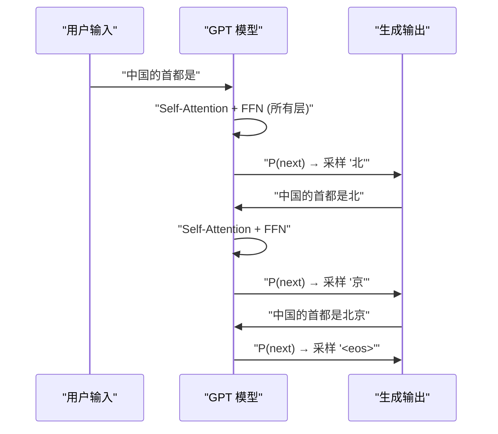
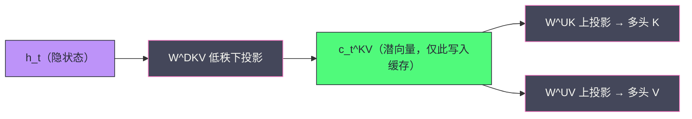

# 02 GPT 架构——Decoder-Only 的自回归语言模型

**摘要：**

本文深入剖析 GPT 系列的 Decoder-Only 架构——截至 2026 年初，它依然是 GPT、Llama、DeepSeek、Qwen、Gemini 等几乎所有主流大语言模型的共同底座。我们从"为什么 Decoder-Only 最终胜出"这一关键问题出发，逐层拆解自回归生成的因果注意力掩码、Tokenizer 的 BPE 分词机制、Embedding 层的维度设计、位置编码从绝对到旋转（RoPE）的演进，以及 GPT-1 到 GPT-5 系列的架构变化；并顺着这条主线，把 GLM 的 prefix-decoder 变体、encoder-decoder 的退场与再考察、DeepSeek 的 MLA（Multi-head Latent Attention）与 DeepSeekMoE、推理模型（Reasoning Model）的思维链 token 与推理时计算（Test-time Compute）这些 2024-2026 年的新进展一并纳入分析框架。核心目标是回答两个问题：一个只做 next token prediction 的模型，为什么能展现出推理、翻译、编程乃至"先思考再回答"的能力；以及当大家都在同一个架构上堆规模时，分歧究竟发生在哪里。顺着这两个问题，本文会给出一个略带反差的结论：Decoder-Only 的胜利源于它把理解与生成折叠进同一个循环，让规模成为唯一的增长引擎；而 2024 年之后的分歧，恰恰发生在这个不变骨架上的三个旋钮——上下文压缩（GQA/MLA）、稀疏激活（MoE）与推理预算的分配。

---

## 第 1 章 为什么是 Decoder-Only

### 1.1 三种 Transformer 变体的回顾

2025 年 8 月，OpenAI 发布 GPT-5，把它描述成一个"知道什么时候该快速回答、什么时候该多想一会儿"的统一系统；几乎同一时期，Meta 推出了第一款采用 MoE 的 Llama 4，DeepSeek 则在推理时长上把选择权交到了每个用户手里。这些产品新闻看起来热闹，但如果笔者把注意力从发布会和价格表上移开，去翻各自的模型卡与论文，会发现一个近乎单调的事实：它们底层的引擎，依然是 2018 年 GPT-1 就确立的那套东西——一个通过掩码保证因果性的 Decoder-Only Transformer，训练目标是 next token prediction。十年过去，OpenAI 连 GPT-5 的参数规模都不再公布，但"下一词预测 + 因果自注意力"这个公式却没有变过。

在 [[01 从 RNN 到 Transformer——注意力机制的革命]] 中我们介绍过，Transformer 衍生出了三种主要架构：Encoder-Only（BERT）、Decoder-Only（GPT）、Encoder-Decoder（T5）。2018-2020 年间，这三种架构各有拥趸：BERT 用双向编码器横扫了 GLUE 排行榜，在自然语言理解任务上一度占据统治地位；T5 把一切任务统一成"文本到文本"，Google 一度视之为通向通用模型的正道；GPT 则在默默验证"单向语言模型也能迁移"这个当时并不时髦的假设。三足鼎立的局面维持了大约两年，到 2023 年，GPT-3.5 引爆的大模型产品化浪潮，几乎一夜间把前两种架构挤出了聚光灯。这一结果并非偶然，而是由多个深层原因共同决定的。

如果非要打个比方，BERT 像一个只能阅读、不能开口的图书馆常客，T5 像流水线上分工明确的两班工人，而 GPT 更像一个把理解与生成压进同一个循环的独行工匠——它不刻意区分"读"和"写"，因为对它来说，读好下一段文字本身就是一种写。

### 1.2 Decoder-Only 胜出的根本原因

**原因一：训练目标的统一性与通用性**

BERT 的预训练目标是掩码语言模型（MLM）——随机遮住 15% 的 token，让模型预测被遮住的部分。这是一个"填空"任务，模型学到的是双向上下文表示，擅长理解但不擅长生成；而且 15% 的掩码比例本身是一个需要人工调的超参数，遮少了模型没得学，遮多了上下文又被破坏得不像话。GPT 的预训练目标是自回归语言模型——给定前文，预测下一个 token，这个目标没有任何类似的旋钮，天然包含了"理解"和"生成"两种能力：要正确预测下一个词，模型必须理解前文的语义；而预测过程本身就是生成。更重要的是，几乎所有 NLP 任务都可以统一为"给定输入文本，生成输出文本"的格式——翻译、摘要、问答、代码生成、数学推理，都不过是不同形式的 next token prediction。

**原因二：与 Scaling Law 的契合**

2020 年，Kaplan 等人（OpenAI）发现了一个重要的经验规律——**Scaling Law**：在固定的计算预算下，模型性能（以交叉熵损失衡量）与模型参数量、数据量和计算量之间存在幂律关系。更大的模型 + 更多的数据 = 更好的性能，且这种提升是平滑可预测的。

Decoder-Only 架构与 Scaling Law 的契合度最高，原因在于：

- **训练效率**：自回归目标让每个 token 都作为一个训练样本（预测自己之后的 token），一段长度为 $T$ 的序列一次前向反向就贡献 $T-1$ 个预测样本，数据利用率极高。BERT 的 MLM 只有被遮住的那 15% token 参与预测，数据效率低得多
- **架构简洁**：只有一个解码器栈，没有编码器-解码器之间的 Cross-Attention，超参数更少，大规模分布式训练时更容易调优；到了 2022 年之后还多了一层生态原因——vLLM、TensorRT-LLM 等推理框架几乎全部围绕因果注意力的 KV Cache 优化，Decoder-Only 成了部署生态的默认形态，反过来又加固了它的优势
- **涌现能力**：实验表明，只有 Decoder-Only 架构在参数量超过一定阈值后才会出现显著的涌现能力（如 few-shot learning、chain-of-thought reasoning）

**原因三：In-Context Learning 的天然支持**

GPT-3 最令人震惊的发现是 **In-Context Learning**——不需要梯度更新（微调），只需要在 prompt 中给出几个示例（few-shot），模型就能学会新任务。这种能力在 Encoder-Only 和 Encoder-Decoder 架构中很难自然出现，因为它们的训练目标（MLM/Span Corruption）与"根据前文示例进行推理"的范式不匹配。自回归语言模型天然适合 In-Context Learning：prompt 中的示例就是"前文"，模型基于这些"前文"来预测后续的输出——这与预训练目标完全同构。而 MLM 训练出来的 BERT 理解的是"填空"，span corruption 训练出来的 T5 理解的是"改写"，面对"照着示例干"的请求时，它们的训练目标与推理范式之间存在结构性错位，即便强行拼接示例也常常事倍功半。

> [!note] 设计哲学
> Decoder-Only 的胜出体现了一个深刻的工程哲学：**简单统一的目标，配合足够大的规模，往往胜过精心设计的复杂目标**。next token prediction 看似简单，但它隐含了对语言的全面理解——因为要预测下一个词，你必须理解语法、语义、逻辑、常识乃至世界知识。

### 1.3 自回归生成的基本流程

GPT 的推理过程是一个迭代的自回归生成循环：

1. 输入 prompt（如"中国的首都是"）
2. 模型计算所有 token 的表示，输出最后一个位置的概率分布
3. 从概率分布中采样一个 token（如"北"）
4. 将新 token 追加到输入序列，重复步骤 2-3
5. 直到生成结束符 `<eos>` 或达到最大长度



严格来说，第 2-3 步在工程实现上并非"重算全序列"——推理框架会缓存历史 token 的 Key 与 Value（KV Cache），只对新 token 做增量计算，这部分细节留待 [[06 推理优化——KV Cache、量化与投机解码]] 展开。这里笔者想强调的架构事实是：无论缓存与否，自回归都迫使 Decode 阶段逐 token 串行，每一步生成只产出一个 token，这就是自回归模型推理速度相对较慢的根本原因。

### 1.4 prefix-decoder 变体：GLM 的第三条路

主流叙事把 Transformer 的后继者简化为三条分支，但 2021-2022 年间还有一条值得单独记录的路：**前缀解码器（Prefix Decoder）**。这条路线最有代表性的实践者是清华与智谱 AI 的 GLM 系列——GLM-130B（2022）让前缀（prompt）部分享受双向注意力，对被挖空的空白片段（Span）做自回归填空，一个模型同时拿到了 BERT 的理解力和 GPT 的生成力。它的训练目标叫 **自回归空白填充（Autoregressive Blank Infilling）**：把一段文本中连续的若干片段用 mask token 替换，再让模型从左到右逐个恢复；为了让多个被挖空的片段之间也能互相借鉴信息，GLM 还引入了一个随机排列来决定各片段的可见顺序。

从结果看，GLM-130B 在 400B token 上训练后，综合能力与 GPT-3 相当；2023 年 3 月开源 ChatGLM-6B 之后，这一系一度是国内最流行的可本地部署模型。但有意思的是，ChatGLM 的后继版本（2/3/4）陆续回归了标准的因果解码器——前缀解码要保留双向信息，损失计算却只能算在生成片段上，训练吞吐天生吃亏；在"通用 + 可扩展"的竞赛里，这个代价被证明不划算。GLM 的这段弯路恰好印证了 Decoder-Only 胜出的另一面：不是它最优雅，而是它把每一个训练 token 都变成了有效的监督信号。

### 1.5 Encoder-Decoder 的退场与再考察

T5 与 BART 曾经是翻译、摘要等"输入输出长度不对称"任务的首选，但 2023 年之后，Encoder-Decoder 在大模型阵营里迅速退场。原因并不难理解：它要在编码器与解码器之间维护 Cross-Attention，参数量和计算开销都更高，而 Decoder-Only 用更简单的结构获得了相近甚至更好的能力——既然一个模型能同时把"读"和"写"干好，为什么要两个栈？

不过，退场不等于死刑，2025 年的一系列工作开始重新审视这个问题。Google 的 Encoder-Decoder Gemma（2025 年 4 月）把预训练好的 Decoder-Only 权重改造成编码器-解码器结构，在相近推理预算下，指令微调后的性能反而更好；"Return of the Encoder"（2025 年 1 月）指出，在 1B 参数以下的小模型与边缘设备场景里，Encoder-Decoder 的首 token 延迟可以降低约 47%、吞吐量可提高 4.7 倍；到了 2025 年 10 月，RedLLM 用前缀语言模型与因果解码器正面对比，结论是 Decoder-Only 在预训练阶段更省算力，但 Encoder-Decoder 在指令微调之后未必逊色。这些声音不会动摇 Decoder-Only 的主流地位，但至少说明：所谓"架构之争已经终结"的判断，下得还是太早了一点——架构的选择始终是**算力约束、任务形态与生态成熟度三方权衡**的结果，没有放之四海而皆准的答案。

---

## 第 2 章 Tokenizer——从文本到数字

### 2.1 为什么需要 Tokenizer

神经网络只能处理数字，不能直接处理文本。Tokenizer 的职责是将原始文本切分为离散的"token"序列，每个 token 对应词汇表（Vocabulary）中的一个整数 ID。这件事看似只是数据预处理，实际却深刻影响着模型的成本、多语言能力与推理质量——同样一句话，按字切与按词切，token 数可以差出好几倍，而 Attention 的计算量随序列长度平方增长，token 数直接决定了算力账单。

最朴素的方案是按字符（character）或按词（word）切分：

- **字符级**：词汇表小（几百个字符），但序列极长（一个词可能被切成 5-10 个字符），Self-Attention 的 $O(n^2)$ 复杂度不可接受
- **词级**：序列短，但词汇表巨大（英语几十万词），且无法处理未见过的词（OOV 问题）

实践中需要的是一个折中方案：词汇表大小适中（32K-128K），能覆盖绝大部分文本，对罕见词也能合理处理。以中文为例，"机器学习"四个字在英文为主的词表里可能被切成十几个子词，而在一个把四字词收入词表的模型里只是一个 token；同样是 4096 的上下文窗口，前者能装下的中文还不到后者的一半。这就像词典之于作家——词典收什么词、词条怎么切，决定了作家遣词造句的颗粒度，**Tokenizer 正是第一个决定模型"世界观粒度"的组件**，其重要性常被低估。

### 2.2 BPE（Byte Pair Encoding）

BPE 最初由 Sennrich 等人（2016）引入 NLP，后来成为 GPT 系列的标准分词算法。它的核心思想是：**从字符级开始，反复合并出现频率最高的相邻 token 对，直到达到目标词汇表大小**。

**训练过程**（在语料库上离线进行）：

1. 将所有文本拆分为字符（或字节），作为初始词汇表
2. 统计所有相邻 token 对的出现频率
3. 将频率最高的 token 对合并为一个新 token，加入词汇表
4. 重复步骤 2-3，直到词汇表达到预设大小（如 50257 for GPT-2）

譬如，假设语料中 "th" 出现频率最高，先合并为 "th"；然后 "th" 和 "e" 的组合频率最高，合并为 "the"；如此反复。

**编码过程**（推理时对新文本使用）：按照训练得到的合并规则，贪心地对文本进行分词。常见词会被编码为一个 token（如 "the" → 一个 token），罕见词会被拆分为多个子词（如 "unconstitutional" → "un" + "constit" + "utional"）。

BPE 的优势在于：
- **自适应粒度**：高频词保持完整，低频词自动拆分为有意义的子词
- **无 OOV 问题**：任何文本都可以被编码（最坏情况退化为字节级）
- **可控词汇表大小**：通过合并次数精确控制

需要指出的是，BPE 的每一次合并都是贪心的——只挑当前频率最高的一对，不会回头重新评估全局最优。这个朴素策略的优点是可控、可复现，缺点是分词结果并不保证任何意义上的全局最优。但对语言模型来说，分词的"最优"本来就难以定义，因为 tokenizer 的好坏最终要由下游的困惑度与推理成本来裁决，而不是由分词理论来裁决。

### 2.3 Byte-level BPE 与 SentencePiece

GPT-2 使用了 **Byte-level BPE**——以字节（256 个基础 token）而非 Unicode 字符作为起点。这确保了任何 UTF-8 文本（包括中文、日文、Emoji）都能被编码，不需要预处理或特殊字符集。

LLaMA 和 Mistral 等模型使用 **SentencePiece**——一个 Google 开发的分词库，支持 BPE 和 Unigram 两种算法。SentencePiece 的特点是直接在原始文本上操作（不需要预分词），对中文等没有空格分隔的语言更友好。

各家词表的具体数字值得精确一些（下表数据来自各模型卡与配置文件）：

| 模型 | Tokenizer | 词汇表大小 | 特点 |
| :--- | :--- | :--- | :--- |
| GPT-2 | Byte-level BPE | 50,257 | 以字节为基础单元 |
| GPT-3 | Byte-level BPE（沿袭 GPT-2） | 50,257 | 论文未更换分词器 |
| GPT-3.5 / GPT-4 | cl100k_base | 100,256 | 2022 年随 embedding 模型引入，多语言更好 |
| LLaMA 1 / 2 | SentencePiece (BPE) | 32,000 | 较小词汇表，中文分词效率低 |
| Llama 3 | tiktoken 风格 BPE | 128,256 | 中文、代码效率显著提升 |
| Qwen 2.5 | Byte-level BPE | 152,064 | 大词汇表，中文优化 |
| DeepSeek-V2 | 自有 BPE | 102,400 | 平衡中英文 |
| DeepSeek-V3 | 自有 BPE | 129,280 | 128K 可合并 token + 特殊 token |

> [!warning] 生产避坑
> Tokenizer 的选择直接影响模型的推理成本和多语言能力。词汇表中如果缺少中文常见字/词，同样一段中文文本会被切成更多的 token，导致推理时间和成本成倍增加。这就是为什么 LLaMA 1（32K 词汇表，中文 token 少）处理中文时效率远低于 Qwen（152K 词汇表，大量中文 token）。Llama 3 把词表从 32K 涨到 128K，Meta 官方测算中文与代码场景的 token 开销因此下降了 10%-15%。

### 2.4 特殊 Token

除了普通文本 token，词汇表中还包含若干**特殊 token**，用于控制模型行为：

- **`<bos>`**（Beginning of Sequence）：序列开始标记
- **`<eos>`**（End of Sequence）：序列结束标记，模型生成此 token 时停止
- **`<pad>`**：填充 token，用于将不同长度的序列对齐到相同长度（batch 训练时需要）
- **`<|im_start|>` / `<|im_end|>`**：Chat 模型中用于标记对话角色（system/user/assistant）的边界

这些特殊 token 在预训练和微调中被赋予特定的语义，是模型理解输入结构的关键。2023 年之后，特殊 token 的家族还在持续扩张：函数调用场景需要 `tool_call` / `tool_result` 之类的边界标记，推理模型需要区分"思考段"与"回答段"——Qwen3 这类双模式模型甚至用专门的 token 在"思考"与"非思考"状态之间切换——**对话模板（Chat Template）本质上就是一张特殊 token 的编排表**，同一个基座模型配上不同的模板，就变成了行为迥异的产品。

### 2.5 Tokenizer 的边界与反例

Tokenizer 并非"分词分得越细越好"或"词表越大越好"，它的边界体现在几个反例上。

第一个反例是**数字切分**。BPE 对数字的处理是出了名的翻车现场："3.14159" 与 "314159" 可能被切成完全不同的 token，同一个数字在模型眼里可以是好几个互不相干的东西，这直接拖累了早期 GPT 的算术能力——模型不是不会算，而是它的"十进制数感"被分词器切碎了。

第二个反例是**词表膨胀的代价**。词表每增加一个 token，Embedding 矩阵和输出层（LM Head）就各多一行/列参数。对 152K 词表的 Qwen 来说，Embedding 与输出层合计占用的参数量以十亿计；词表越大，固定开销越高，小模型尤其吃不消，这也是为什么小模型往往选用更小的词表。

第三个反例是**安全与对抗**。Token 是模型的输入接口，也就成了攻击面：研究者发现可以把有害内容编码成词表中恰好存在的罕见 token 序列（token smuggling），绕过内容过滤；反过来，词表覆盖不足的多语言文本也可能被模型当成乱码处理，产生莫名其妙的输出。

由此可见，Tokenizer 是一个"谁都想优化、谁都无法全局最优"的组件，它的每次设计取舍都在压缩率、参数量、多语言覆盖与安全性之间重新划界。

---

## 第 3 章 Embedding 层——从离散 ID 到稠密向量

### 3.1 Token Embedding

Tokenizer 将文本转换为整数 ID 序列后，模型需要将每个 ID 映射为一个稠密的浮点向量——这就是 **Token Embedding** 的作用。

Token Embedding 本质上是一个**可学习的查找表**（Look-up Table）：一个形状为 $V \times d$ 的矩阵 $W_E$，其中 $V$ 是词汇表大小，$d$ 是模型维度（hidden size）。给定 token ID $i$，其 embedding 就是 $W_E$ 的第 $i$ 行。

| 模型 | 词汇表大小 $V$ | 模型维度 $d$ | Embedding 参数量 |
| :--- | :--- | :--- | :--- |
| GPT-2 Small | 50,257 | 768 | ~38M |
| GPT-2 XL | 50,257 | 1,600 | ~80M |
| LLaMA-7B | 32,000 | 4,096 | ~131M |
| LLaMA-70B | 32,000 | 8,192 | ~262M |

预训练开始时，Embedding 矩阵用均值为 0、方差很小的随机分布初始化，相当于把每个 token 丢到向量空间的原点附近，任其在训练中自由漂移。这套映射就像一个城市的坐标网格：token ID 是门牌号，向量是经纬度，语义相近的词自然落进相邻街区。随着训练的进行，语义相似的 token 会被映射到向量空间中相近的位置——"king" 和 "queen" 的 embedding 距离会比 "king" 和 "apple" 的距离更近，甚至会呈现出 `king − man + woman ≈ queen` 这样粗糙的线性关系。这些向量没有人为设计的语义标签，纯粹是 next token prediction 这个目标挤压出来的副产品。

### 3.2 权重共享（Weight Tying）

许多模型（GPT-2、LLaMA 等）在 Embedding 层和最终的输出层（Language Model Head）之间共享权重：输出层的任务是将模型最后一层的隐状态 $h \in \mathbb{R}^d$ 映射回词汇表大小的概率分布 $\mathbb{R}^V$，即 $\text{logits} = h \cdot W_E^T$。

权重共享的好处是：
- **减少参数量**：Embedding 矩阵通常占总参数量的 5-10%，共享后减半
- **语义一致性**：输入 embedding 空间和输出预测空间共享同一套语义表示

但也有模型不共享权重（如 GPT-3、DeepSeek、Qwen 的大多数版本），允许输入和输出使用不同的表示空间，这在大模型上可能带来微弱的性能提升。这个决策本质上是一个参数量与表达力的交换：共享权重省下的显存，可以拿去换更宽的模型维度；不共享则多一份自由度，代价是多占一份参数。

### 3.3 一切皆 Token：多模态输入的接口统一

Decoder-Only 的"一切皆 token"哲学在 2023 年后被推到了文本之外。图像先被切成固定大小的 patch，经过一个视觉编码器（Vision Encoder）映射成若干 patch embedding，再以 token 的形式拼进序列参与后续的注意力计算；Llama 4 更进一步，把视觉 token 直接混入文本序列一起预训练（early fusion），成为"原生多模态"模型。音频、视频乃至强化学习环境里的动作，也可以照此办理。

Token 由此成了一个通用接口，但代价也随之而来：图像的一个 patch 承载的信息量与一个字词并不对等，模型很难对它们一视同仁；多模态输入的 token 数量膨胀极快，上下文窗口很快就会被图像打满。这提醒我们，Embedding 层的设计不只是"查表"这么简单，它决定了模型以什么粒度、什么代价去感知世界——这一话题我们在 [[08 长上下文与多模态——技术前沿]] 中还会继续展开。

---

## 第 4 章 因果注意力掩码——自回归的核心保证

### 4.1 为什么需要 Causal Mask

在 [[01 从 RNN 到 Transformer——注意力机制的革命]] 中我们提到，Self-Attention 允许每个位置关注序列中的所有位置。但在自回归生成中，这是不允许的——**位置 $i$ 只能关注位置 $1, 2, \ldots, i$，不能"偷看"位置 $i+1$ 及之后的内容**。

原因很直观：在训练时，我们用 teacher forcing——将真实序列作为输入，让位置 $i$ 预测位置 $i+1$ 的 token。如果位置 $i$ 能看到位置 $i+1$，那预测就变成了"抄答案"，模型什么都学不到。反过来说，假如把掩码拿掉会发生什么？训练时位置 $i$ 能直接看到位置 $i+1$ 的真实 token，"预测下一个词"就退化成"复读下一个词"——模型只需要学会把注意力集中在紧邻的下一个位置、把看到的原样抄进输出即可，任何真正的语言理解都无从谈起。**因果掩码（Causal Mask）不是锦上添花，而是自回归目标成立的前提**。

**Causal Mask** 的实现是一个下三角矩阵，将注意力分数矩阵中"未来"位置（上三角）的值设为 $-\infty$，经过 Softmax 后变为 0：

$$\text{Mask}_{i,j} = \begin{cases} 0 & \text{if } j \leq i \\ -\infty & \text{if } j > i \end{cases}$$

$$\text{Attention}(Q, K, V) = \text{softmax}\left(\frac{QK^T}{\sqrt{d_k}} + \text{Mask}\right) V$$

### 4.2 训练时的并行化技巧

一个关键的工程细节：虽然推理时模型是逐 token 生成的（串行），**训练时可以完全并行**。

因为训练时我们已经知道完整的目标序列 $[x_1, x_2, \ldots, x_T]$，可以一次性将整个序列输入模型。Causal Mask 确保位置 $i$ 只关注 $\leq i$ 的位置，所以每个位置的预测仍然是"正确的"——不会泄露未来信息。模型同时为所有 $T$ 个位置输出预测，同时计算 $T$ 个损失（交叉熵），一次反向传播更新权重。这就好比考场里所有考生可以同时拿到同一张卷子作答，只是每个人都被禁止偷看旁边人的答案。

这就是为什么 Decoder-Only 模型的训练效率很高——一个长度为 $T$ 的序列可以同时产生 $T$ 个训练样本（每个位置预测下一个 token）。

### 4.3 与 BERT 双向注意力的对比

BERT 的 Self-Attention 没有 Causal Mask，每个位置可以关注序列中的所有位置（双向注意力）。这使 BERT 能够同时利用左右两边的上下文来理解一个词，在自然语言理解任务上有优势。

但双向注意力的代价是：**无法进行自回归生成**。因为在生成第 $i$ 个 token 时，位置 $i+1, i+2, \ldots$ 还不存在，模型没有"右侧上下文"可以关注。这就是 BERT 不适合生成任务的根本原因。

| 特性 | Causal Attention（GPT） | Bidirectional Attention（BERT） |
| :--- | :--- | :--- |
| 注意力范围 | 只看左侧（$j \leq i$） | 看所有位置 |
| 生成能力 | 天然支持自回归生成 | 不支持 |
| 理解能力 | 只用单向上下文 | 利用双向上下文 |
| 训练样本效率 | 每个 token 都是预测目标 | 只有 15% 的 masked token 是目标 |
| 主流应用 | 大语言模型（GPT-4/LLaMA/…） | 特定 NLU 任务（分类/NER/…） |

### 4.4 因果约束的边界：推理时其实没有"未来"

一个常被误解的点是：推理时的 Decoder-Only 其实并不需要掩码——每一步面前只有左侧的 KV Cache，"未来"根本不存在，因果性是自动满足的。掩码约束的是训练时的概率语义，而不是工程上的每一步计算。

认识到这一点，才能理解推理优化里那些看似"违反因果"的技巧。投机解码（Speculative Decoding）让小模型先草拟出 $K$ 个候选位置，再让大模型一次性并行验证——这等于把"未来的几个 token"当作假设试探了一把，但每个位置的接受与否最终仍由大模型自身的因果分布裁决，输出分布与逐 token 生成严格一致。**因果性限制的是信息流的方向，而不是计算的组织方式**；只要不把未来的信息"写回"过去，并行化与投机在数学上都是安全的。KV Cache、GQA、投机解码这些加速手段，我们在 [[06 推理优化——KV Cache、量化与投机解码]] 里还会详细展开。

---

## 第 5 章 位置编码的演进——从绝对到旋转

### 5.1 可学习的绝对位置编码（GPT-1/2）

原始 Transformer 使用正弦-余弦位置编码（固定的、不可学习的）。GPT-1 和 GPT-2 改用**可学习的绝对位置编码**：为每个位置 $pos \in \{0, 1, \ldots, L-1\}$ 分配一个可学习的 $d$ 维向量，$L$ 是最大序列长度。

这些位置向量与 Token Embedding 相加后输入模型：

$$\text{input}_i = \text{TokenEmb}(x_i) + \text{PosEmb}(i)$$

可学习位置编码的优势是灵活性高——模型可以自由学习最适合任务的位置表示。但它有一个严重的局限：**最大长度在训练时确定，无法泛化到更长的序列**。GPT-2 的最大长度是 1024，如果输入超过 1024 个 token，位置编码就没有对应的值了。位置编码之于 Transformer，就像演员的台位标记——没有它，注意力机制只知道谁在场，不知道谁站在哪一边。

### 5.2 RoPE（Rotary Position Embedding）

**RoPE**（Rotary Position Embedding，Su et al., 2021）是当前最主流的位置编码方案，被 LLaMA、Mistral、Qwen、DeepSeek 等几乎所有现代开源 LLM 采用。

RoPE 的核心思想是：**不是将位置信息加到 embedding 上，而是将位置信息注入到 Self-Attention 的 Q 和 K 中，通过旋转变换编码相对位置**。

具体来说，对于 Query 向量 $q$ 和 Key 向量 $k$（取其中两个相邻维度 $(q_{2i}, q_{2i+1})$），RoPE 对它们施加一个角度为 $m\theta_i$ 的二维旋转：

$$\begin{pmatrix} q_{2i}' \\ q_{2i+1}' \end{pmatrix} = \begin{pmatrix} \cos(m\theta_i) & -\sin(m\theta_i) \\ \sin(m\theta_i) & \cos(m\theta_i) \end{pmatrix} \begin{pmatrix} q_{2i} \\ q_{2i+1} \end{pmatrix}$$

其中 $m$ 是位置索引，$\theta_i = 10000^{-2i/d}$（与原始 Transformer 的正弦编码类似）。

RoPE 的精妙之处在于：经过旋转后，$q_m$ 和 $k_n$ 的点积只依赖于**相对位置** $m - n$：

$$q_m^T k_n = \text{Re}\left[(q_m \odot e^{im\theta})(k_n \odot e^{in\theta})^*\right] = f(q, k, m - n)$$

这意味着：
- **位置信息被编码为相对位置**：模型天然学到的是"两个 token 之间的距离"而非"绝对位置"
- **长度外推潜力**：由于编码的是相对位置，理论上可以泛化到训练时未见过的更长序列（配合 NTK-aware Scaling 或 YaRN 等技术）
- **与注意力机制深度融合**：位置信息直接作用于 Q/K 的点积计算，而非作为额外信号叠加

那个 $10000$ 的底数大有讲究：它控制不同维度上旋转的角速度，维度越低转得越快、维度越高转得越慢，让模型能以多分辨率感知距离。把底数调大——譬如 Llama 3 用到 500,000、Qwen 2.5 用到 1,000,000——低频维度的旋转会变得平缓，模型对长距离的相对位置更敏感，这是各家提升长度外推能力的常用旋钮。

### 5.3 ALiBi（Attention with Linear Biases）

ALiBi（Press et al., 2022）采用了一种更激进的方案：完全不使用位置编码 embedding，而是直接在注意力分数上加一个**与距离成正比的负偏置**：

$$\text{Attention}_{i,j} = \text{softmax}\left(\frac{q_i^T k_j}{\sqrt{d_k}} - m \cdot |i - j|\right)$$

其中 $m$ 是一个与注意力头相关的固定斜率（不同的头有不同的 $m$，几何级数分布）。距离越远，惩罚越大——这给模型一个"近处更重要"的归纳偏置。

ALiBi 的优势是实现极其简单且无需额外参数，但它的长度外推能力不如配合 Scaling 技术的 RoPE。

| 方案 | 代表模型 | 位置信息类型 | 长度外推 | 额外参数 |
| :--- | :--- | :--- | :--- | :--- |
| 可学习绝对 | GPT-1/2/3 | 绝对位置 | 差（固定最大长度） | $L \times d$ |
| RoPE | LLaMA/Mistral/Qwen | 相对位置（旋转） | 好（配合 Scaling） | 无 |
| ALiBi | BLOOM/MPT | 相对位置（线性偏置） | 中等 | 无 |

### 5.4 长度外推的工程现实

"相对位置天然可外推"在理论上成立，在工程上却要打折扣：RoPE 训练的模型直接推理超长序列时，注意力分数会因为未见过的位置分布而失真。业界于是发展出 NTK-aware Scaling、YaRN、Dynamic NTK 等事后缩放手段，把训练时的旋转频率线性或非线性地搬移到新长度上。DeepSeek-V3 的配置文件里就同时写着 YaRN 缩放参数与 4096 的原始训练长度，最终对外宣称 128K 上下文；Gemini 2.5 的 1M 上下文、Llama 4 Scout 的 10M 上下文更是把"宣称长度"与"有效长度"之间的距离拉到了公众面前。

这提醒我们一个容易被营销话术掩盖的事实：**"支持多长上下文"是训练数据、位置编码与事后缩放三方合力的结果，不是 RoPE 一家的功劳**。上下文长度的每一次跃迁，背后都有一套组合拳。

---

## 第 6 章 GPT 模型层的完整结构

### 6.1 单层 Decoder Block

一个 GPT 的 Decoder Block（以 LLaMA 架构为例，当前最主流的实现）包含以下组件：

```
Input
  │
  ├─→ RMSNorm
  │     │
  │     └─→ Multi-Head Causal Self-Attention (with RoPE)
  │           │
  └───────────┼─→ Residual Add ──→ Output₁
              │
              ├─→ RMSNorm
              │     │
              │     └─→ SwiGLU Feed-Forward Network
              │           │
              └───────────┼─→ Residual Add ──→ Output₂
```

关键设计选择（以 LLaMA-7B 为例）：

| 组件 | 设计选择 | 说明 |
| :--- | :--- | :--- |
| 归一化 | RMSNorm（Pre-Norm） | 比 LayerNorm 更快（去掉均值偏移），Pre-Norm 训练更稳定 |
| 注意力 | Multi-Head with RoPE | 32 个头，$d_k = d_v = 128$ |
| 激活函数 | SwiGLU | $\text{SiLU}(xW_1) \odot xW_3$，比 ReLU 表达能力更强 |
| FFN 中间维度 | $\frac{8}{3} d$（约 11,008） | SwiGLU 需要三个投影矩阵，调整中间维度以保持总参数量与 ReLU FFN 相当 |

这套组合——Pre-Norm + RMSNorm + RoPE + SwiGLU——在 2023 年之后几乎成了开源模型的默认配方，Llama、Mistral、Qwen、DeepSeek 的差别主要落在注意力压缩方式与 FFN 是否稀疏这两处。

### 6.2 Grouped-Query Attention（GQA）

标准 Multi-Head Attention（MHA）中，每个注意力头有独立的 Q、K、V 投影。LLaMA 2（70B）引入了 **Grouped-Query Attention**（GQA）——多个 Query 头共享同一组 Key 和 Value 头。

| 方案 | Q 头数 | K/V 头数 | KV Cache 大小 | 代表模型 |
| :--- | :--- | :--- | :--- | :--- |
| MHA | $h$ | $h$ | $h \times d_k$ per token | GPT-3, LLaMA-7B |
| MQA | $h$ | 1 | $1 \times d_k$ per token | PaLM |
| GQA | $h$ | $g$（$1 < g < h$） | $g \times d_k$ per token | LLaMA 2-70B, Mistral |

GQA 的设计动机是**推理效率**。在自回归生成中，每一步都需要访问之前所有 token 的 K 和 V（KV Cache），这是显存和带宽的主要瓶颈。将 K/V 头数从 $h$ 减少到 $g$，KV Cache 的大小也相应减少 $h/g$ 倍，推理速度显著提升，而质量损失很小。GQA 的思想很朴素：让几个 Query 头共用同一本笔记，因为不同 Query 头对 Key 的区分需求并没有想象中那么高；Llama 3 全系、Mistral、Qwen2 都把 KV 头压到了 8 个，已经成了新一代的事实标准。

### 6.3 MLA：把 KV Cache 压缩进潜向量

GQA 之后的下一个跃迁来自 DeepSeek。2024 年 5 月，DeepSeek-V2 提出了**多头潜在注意力（Multi-head Latent Attention, MLA）**：与其把 K、V 完整地缓存起来，不如先用一个低秩投影把它们压进一个维数很小的"潜向量"（Latent Vector），只在每次计算时临时展开：



用公式表述就是：每个 token 的 KV 先被压缩成低维潜向量 $c_t^{KV}$，需要时再通过上投影矩阵展开成多头的 K、V。于是 KV Cache 里存的从一套大矩阵变成一个小向量——DeepSeek-V2 因此把 KV Cache 缩减了 93.3%，最大生成吞吐提升了 5.76 倍。这个思路与 LoRA 的低秩分解异曲同工，区别在于 LoRA 偷懒的是权重更新，MLA 偷懒的是注意力上下文本身。**GQA 是让几个头共用一本笔记，MLA 则更进一步——把整本笔记压缩成一张索引卡，需要时再展开**。DeepSeek-V3（2024 年底）沿用了 MLA，并把它与 DeepSeekMoE 结合，成为开源阵营里推理成本最具竞争力的架构之一。MLA 与 KV Cache 的定量关系，我们会在 [[06 推理优化——KV Cache、量化与投机解码]] 里接着算账。

### 6.4 MoE：稀疏激活的第二次架构分化

如果说 MLA 是在注意力一侧做文章，那么**混合专家（Mixture of Experts, MoE）**则是在前馈网络一侧换赛道。DeepSeekMoE 的要点有二：一是把专家切得更细（细粒度专家），让每个 token 只激活其中少数几个路由专家（DeepSeek-V2 为 6 个，V3 为 8 个）；二是单独隔离 1 个共享专家，负责所有 token 都需要的通用知识，路由专家则各司其职。到了 V3，DeepSeekMoE 还取消了辅助负载均衡损失，改用无辅助损失的动态调整，训练更加稳定。

这个"总参数大、激活参数小"的形态成了 2025 年的主流：Llama 4 Scout（17B 激活 / 109B 总参数、16 个专家）与 Maverick（17B 激活 / 400B 总参数、128 个专家）、Gemini 2.5 Pro 的稀疏 MoE、Qwen3-235B-A22B（128 个专家、每 token 激活 8 个）皆是如此。MoE 本质上是在"容量"与"算力"之间做交易：模型能记住更多专家知识，但每个 token 只花一份激活算力。它的问题也很直白——专家间负载不均衡、分布式训练通信量大、显存要容纳全部专家权重。MoE 的稀疏激活与部署细节，属于 [[08 长上下文与多模态——技术前沿]] 的范畴，这里先立起框架。

### 6.5 完整的模型组装

一个完整的 GPT/LLaMA 模型的组装如下：

1. **Token Embedding**：$\text{token\_id} \rightarrow \mathbb{R}^d$
2. **Decoder Blocks × $L$**：$L$ 层相同的 Block 堆叠
3. **Final RMSNorm**：对最后一层的输出做归一化
4. **Language Model Head**：线性层 $\mathbb{R}^d \rightarrow \mathbb{R}^V$，输出词汇表上的 logits
5. **Softmax + Sampling**：将 logits 转为概率分布，采样生成下一个 token

| 模型 | 参数量 | 层数 $L$ | 维度 $d$ | 注意力头 $h$ | FFN 中间维度 |
| :--- | :--- | :--- | :--- | :--- | :--- |
| GPT-2 Small | 124M | 12 | 768 | 12 | 3,072 |
| GPT-2 XL | 1.5B | 48 | 1,600 | 25 | 6,400 |
| LLaMA-7B | 6.7B | 32 | 4,096 | 32 | 11,008 |
| LLaMA-13B | 13B | 40 | 5,120 | 40 | 13,824 |
| LLaMA-70B | 65B | 80 | 8,192 | 64 (GQA: 8 KV) | 28,672 |
| Mistral-7B | 7.3B | 32 | 4,096 | 32 (GQA: 8 KV) | 14,336 |

---

## 第 7 章 GPT 系列的架构演进

### 7.1 GPT-1（2018）——预训练 + 微调范式的确立

GPT-1 是第一个将 Transformer Decoder 应用于大规模无监督预训练的工作。核心贡献：

- **预训练-微调范式**：先在大规模无标注文本上做语言模型预训练，再在特定任务上微调
- **规模**：12 层，768 维，12 头，117M 参数
- **训练数据**：BooksCorpus（约 7,000 本书）
- **上下文长度**：512 token

GPT-1 的影响在于证明了：**无监督预训练学到的语言表示可以有效迁移到多种下游任务**。但此时的范式仍然是"预训练 + 针对每个任务微调"，与后来的 In-Context Learning 不同。

### 7.2 GPT-2（2019）——Zero-Shot 的初步探索

GPT-2 将模型规模扩大到 1.5B 参数（GPT-1 的 10 倍以上），并提出了一个重要的理念：**语言模型本身就是一个多任务学习器**。

核心变化：
- **不再微调**：GPT-2 论文的实验全部是 zero-shot（不在目标任务上微调），直接用语言模型做各种任务
- **规模**：48 层，1600 维，25 头，1.5B 参数
- **训练数据**：WebText（约 40GB 的高质量网页文本，Reddit 高票链接的页面）
- **上下文长度**：1,024 token

GPT-2 在部分任务上的 zero-shot 性能已经接近甚至超过了专门训练的模型，暗示了规模扩大带来的能力提升。它同时确立了字节级 BPE 与可学习绝对位置编码这两个沿用到 GPT-3 的组件。

### 7.3 GPT-3（2020）——Few-Shot 与涌现能力

GPT-3 是 Scaling Law 的里程碑验证。核心变化：

- **参数量飞跃**：175B 参数（GPT-2 的 100 倍以上）
- **In-Context Learning**：发现了 few-shot 学习能力——在 prompt 中给几个示例，模型就能学会新任务，无需梯度更新
- **训练数据**：约 300B token（Common Crawl + WebText2 + Books + Wikipedia）
- **上下文长度**：2,048 token
- **架构细节**：96 层，12288 维，96 头，采用交替的稀疏注意力层（局部带状稀疏注意力与全注意力交替）

GPT-3 最震撼的发现是**涌现能力**：随着模型规模增大，模型突然展现出在小模型中完全不具备的能力——如三位数加法、简单的逻辑推理、翻译。这些能力不是通过专门训练获得的，而是从大规模语言模型中"涌现"出来的。GPT-3 沿用了 GPT-2 的 50,257 词表，没有更换分词器，这在当时是务实的取舍，也说明 tokenizer 的升级常常滞后于模型规模。

### 7.4 InstructGPT 与 GPT-3.5（2022）——从基座模型到对话助手

2022 年 3 月，OpenAI 发布 InstructGPT 论文，首次系统展示了"人类反馈 + 监督微调"能把语言模型掰成指令跟随者；同年 11 月，ChatGPT 上线，把 GPT-3.5 包装成对话产品，成为大模型走进大众的引爆点。从架构上看，GPT-3.5 并没有动 Decoder-Only 的骨架——真正的变化发生在训练目标与对齐策略，即我们在 [[04 指令微调与 RLHF——从基座模型到对话助手]] 中要展开的 SFT 与 RLHF。但它的产品化意义怎么强调都不过分：它让"一个模型打天下"从学术口号变成了商业现实，也顺带宣布了"预训练-微调-对齐"三段式流水线的成型。

### 7.5 GPT-4（2023）——多模态与推理能力

GPT-4 的技术细节 OpenAI 没有公开，但已知的关键信息包括：

- **多模态**：支持图像输入（Vision），能理解和描述图片内容
- **推理能力显著提升**：在各种基准测试（如法律考试、医学考试、编程竞赛）上大幅超越 GPT-3.5
- **更长的上下文**：支持 8K 和 32K 上下文窗口，2023 年 11 月的 GPT-4 Turbo 进一步扩展到 128K
- **推测架构**：据社区分析和泄漏信息，GPT-4 可能使用了 **Mixture of Experts（MoE）** 架构——多个专家网络并行，每个 token 只激活其中一部分专家，在保持性能的同时降低推理计算量

GPT-4 之后，OpenAI 不再公布任何架构细节，公开信息只能依赖模型卡与使用行为——这本身就成了一种信号：当架构趋同时，"保密"反而成了产品差异化的手段。

### 7.6 o1、o3 与推理模型——把"思考"变成一串 token

2024 年 9 月，OpenAI 发布 o1，官方口径是"用强化学习训练模型执行复杂推理"，模型在作答前会生成一段内部思维链（Chain of Thought）。这里的关键不是训练方法——RLHF、GRPO 的细节在 04 篇——而是它对**推理时计算（Test-time Compute）**的重新定价：o1 的推理表现会随着思考时间的增长而提升，OpenAI 明确表示性能同时受训练时计算与推理时计算支配。

落到架构层面，o1 依然是 Decoder-Only + 自回归——**思维链不过是模型自己生成、被当作上下文继续续写的一串 token**，这就是"思维链 token（reasoning tokens）"这个说法的由来。但这串 token 改变了产品形态：模型开始输出"思考过程"，API 提供 reasoning_effort 参数控制思考预算，推理消耗直接反映在账单上。DeepSeek-R1（2025 年 1 月）用 GRPO 复现了类似效果并开源了蒸馏版本，Qwen3 把"思考/不思考"两种模式塞进同一个模型、用对话模板切换。到 2026 年初，"给模型更多时间想"已经成为与"给模型更多参数"并行的第二增长曲线——这是 2017 年以来，Transformer 架构之外第一次出现可规模化的能力红利转移，而它恰恰发生在架构没有变化的地方。

### 7.7 GPT-4o 到 GPT-5 系列——自适应推理的收敛

2024 年 5 月的 GPT-4o 把多模态拉进默认体验；2025 年的节奏明显加快：2 月 GPT-4.5 研究预览主打"不靠推理的直觉智能"，4 月 GPT-4.1 把 API 上下文推到 1M，8 月 GPT-5 取代上述所有模型，成为一个"快速模型 + 深度推理模型 + 实时路由"的统一系统；11 月的 GPT-5.1 引入自适应推理（Adaptive Reasoning）——简单问题少想、难题多想，官方称在典型任务分布上最快任务提速约一倍；12 月的 GPT-5.2 把推理预算下限调到 none、新增 xhigh 档，并开始用压缩（Compaction）管理上下文。一路看下来，OpenAI 从未公布过这些模型的参数量或层数，但架构演进的脉络是清晰的：**Decoder-Only 的骨架没变，变化的全部发生在"推理预算如何分配"这一层**。o 系列与 GPT 系列最终在 GPT-5 上合流，也宣告了"专用推理模型"与"通用模型"的分裂只是过渡形态。

### 7.8 开源模型的追赶

GPT-3/4 是闭源的，但开源社区快速追赶，2024-2025 年的表格已经换了一批名字：

| 模型 | 组织 | 参数量（激活） | 关键创新 |
| :--- | :--- | :--- | :--- |
| **LLaMA** | Meta | 7B-65B | 高质量训练数据（1.4T token），证明小模型充分训练可匹敌大模型 |
| **Llama 2** | Meta | 7B-70B | GQA（70B）、更长上下文（4K）、RLHF 对齐 |
| **Llama 3.1** | Meta | 8B/70B/405B | 405B 稠密、128K 上下文、128K 词表、RoPE base 提升到 500K |
| **Llama 4 Scout / Maverick** | Meta | 17B 激活（109B / 400B 总参） | 首个 MoE Llama、原生多模态 early fusion、10M / 1M 上下文 |
| **Mistral-7B** | Mistral AI | 7.3B | Sliding Window Attention、GQA、超越 LLaMA-13B |
| **Mixtral-8x7B** | Mistral AI | 46.7B（激活 12.9B） | 开源 MoE 架构 |
| **DeepSeek-V2** | DeepSeek | 236B（激活 21B） | MLA、DeepSeekMoE，KV Cache 缩减 93.3% |
| **DeepSeek-V3** | DeepSeek | 671B（激活 37B） | MLA + DeepSeekMoE、多 token 预测、14.8T token、2.788M H800 GPU 小时 |
| **DeepSeek-R1** | DeepSeek | 同上 | GRPO 强化推理，数学/编程达到 o1 水平 |
| **Qwen 2.5** | 阿里 | 0.5B-72B | 152K 词表、优秀的中文能力 |
| **Qwen3-235B-A22B** | 阿里 | 235B（激活 22B） | 思考/非思考双模式、128 专家、128K 上下文 |
| **Gemini 2.5 Pro** | Google | 未公开（稀疏 MoE） | 原生多模态、1M 上下文、可配置思考预算 |

这些开源模型的意义不止于"追赶"：DeepSeek 的 MLA 与 MoE、Qwen 的双模式思考、Llama 4 的原生多模态，各自都贡献了可复制的架构经验。更重要的是，它们把"架构实验"的成本降到了普通实验室也能承受的范围，客观上加速了整个行业的趋同。

### 7.9 架构的趋同与分歧

把 2026 年初的主流模型卡摊开，会看到一套惊人的标准化：Decoder-Only、RoPE、RMSNorm + Pre-Norm、SwiGLU、GQA 或 MLA、Sparse MoE 可选，训练目标都是 next token prediction，对齐路径都是 SFT + RL。分歧集中在三个旋钮上：

- **注意力上下文怎么压缩**：MHA → GQA → MLA，从"多存"到"少存"再到"压缩"
- **前馈网络稠密还是稀疏**：dense 的 Llama 3.1-405B 与 MoE 的 DeepSeek-V3 各执一端
- **推理预算如何分配**：即时回答、思考模式、自适应推理

这或许就是大模型时代的架构哲学——真正拉开差距的不再是"用不用 Transformer"，而是**同一个骨架上每一个旋钮的取舍**。如果把模型比作一座建筑，2026 年的行业风向已经从"该盖什么样的楼"的争论，转向"同一栋楼里每个房间怎么装修"的取舍：架构没有消失，只是从"选择"变成了"调参"。

---

## 第 8 章 采样策略——从 Logits 到文本

### 8.1 Temperature Scaling

模型输出的 logits 经过 Softmax 转为概率分布。**Temperature**（$T$）参数控制分布的"尖锐程度"：

$$P(x_i) = \frac{\exp(z_i / T)}{\sum_j \exp(z_j / T)}$$

- $T = 1$：标准 Softmax，保持原始分布
- $T < 1$（如 0.1）：分布更尖锐，高概率 token 被放大，生成更确定性（但可能重复单调）
- $T > 1$（如 1.5）：分布更平坦，低概率 token 获得更多机会，生成更多样（但可能不连贯）

### 8.2 Top-k Sampling

只从概率最高的 $k$ 个 token 中采样，其余 token 的概率设为 0。这避免了从极低概率的 token 中采样导致的离谱输出。

问题在于：固定的 $k$ 不够灵活。当概率分布很集中时（如"巴黎是法国的___"，只有"首都"合理），$k$ 个候选中可能包含不合理的选项；当分布很分散时（如故事续写），$k$ 个候选可能不够。

### 8.3 Top-p（Nucleus）Sampling

**Top-p 采样**（也叫 Nucleus Sampling）动态地选择概率之和达到 $p$（如 0.9）的最小 token 集合。

具体做法：将所有 token 按概率从高到低排序，累加概率直到超过 $p$，只从这些 token 中采样。

Top-p 的优势是**自适应**：当模型很确定时，候选集可能只有 1-2 个 token；当模型不确定时，候选集自动扩大。这比固定的 Top-k 更合理。

### 8.4 Repetition Penalty

自回归模型容易陷入重复——一旦生成了某个短语，模型可能持续重复它（因为该短语的上下文"强化"了它出现的概率）。**Repetition Penalty** 对已经出现过的 token 降低其 logit 值：

$$z_i' = \begin{cases} z_i / \alpha & \text{if } x_i \text{ 已出现且 } z_i > 0 \\ z_i \times \alpha & \text{if } x_i \text{ 已出现且 } z_i < 0 \end{cases}$$

其中 $\alpha > 1$ 是惩罚系数。

在实际应用中，这些采样策略通常组合使用：`temperature=0.7, top_p=0.9, repetition_penalty=1.1` 是一组常见的配置。

### 8.5 采样与推理模型的协同

推理模型的流行把采样问题推向了一个新维度：思考阶段的温度与最终回答阶段的温度往往要分开设置。`reasoning_effort` 或思考预算控制的是"生成多少思维链 token"，temperature 控制的是这些 token 的多样性——对代码与数学这类可验证任务，低温度减少无效试错；对开放式写作，高温度保留惊喜。GPT-5 系列的 `verbosity` 参数（控制篇幅）与 `reasoning_effort`（控制思考深度）彼此正交，这两个旋钮的出现，说明采样策略已经从"挑词"升级为**调度认知资源**。这也带来一个工程提醒：调一个推理模型的服务，光调 temperature 已经不够，思考预算、思维链可见性、回答篇幅是要一起权衡的三件事。

---

## 第 9 章 训练目标——交叉熵损失

### 9.1 Next Token Prediction 的损失函数

GPT 的训练目标极其简洁：**对于序列中的每个位置 $t$，最大化正确 next token 的对数概率**。

$$\mathcal{L} = -\frac{1}{T} \sum_{t=1}^{T} \log P(x_t | x_1, \ldots, x_{t-1}; \theta)$$

其中 $P(x_t | x_1, \ldots, x_{t-1}; \theta)$ 是模型在位置 $t$ 对正确 token $x_t$ 的预测概率。这本质上就是**交叉熵损失**——真实分布（one-hot）与模型预测分布之间的交叉熵。

这个损失函数有一个极其重要的性质：**它的最优解就是真实的语言分布**。当 $\mathcal{L}$ 达到最小值时，$P(x_t | x_1, \ldots, x_{t-1}; \theta) = P_{\text{true}}(x_t | x_1, \ldots, x_{t-1})$——模型完美地学会了语言的概率分布，语言建模由此不只是"会接话"，而是在用参数逼近一个关于整个世界的条件概率分布。

### 9.2 为什么 Next Token Prediction 如此强大

表面上看，"预测下一个词"似乎是一个非常简单的任务。但实际上，要在一个包含万亿 token 的语料库上将这个损失降到很低，模型必须学会：

- **语法**：正确预测词形变化和句法结构
- **语义**：理解词义和句意
- **常识**：知道"水是湿的""太阳从东方升起"
- **世界知识**：知道"法国的首都是巴黎"
- **逻辑推理**：能进行简单的因果推断
- **代码理解**：能续写代码（如果训练数据包含代码）

换言之，next token prediction 是一个**压缩信息**的过程——要在有限的参数中存储尽可能多的关于世界的知识，以便准确预测任何上下文中的下一个 token。这与信息论中的**最小描述长度**（Minimum Description Length）原理相呼应。

> [!info] 核心概念
> Ilya Sutskever 在一次演讲中的表述最为精辟："预测下一个 token 就是压缩，而充分的压缩等价于智能。" 当模型在足够大的数据集上将 next token prediction 做到足够好时，它必然掌握了数据中蕴含的各种模式、知识和推理能力。这就是为什么一个看似简单的训练目标能产生如此强大的模型。

### 9.3 从 Next Token 到多 Token 预测

2024 年以来，"只预测一个 token"这个最朴素的设定也出现了松动。DeepSeek-V3 引入了**多 token 预测（Multi-Token Prediction, MTP）**：在主干之外加一个浅层模块，同时预测后续多个位置的 token，训练时把它当作辅助目标，推理时只保留主干。论文报告 MTP 在同样算力下带来了稳定的小幅收益，其直觉是"预测得更远"会迫使模型提前构建更强的规划能力，而不是满足于短视的局部匹配。

不过要注意，MTP 改变的是训练目标与模块布局，最终推理依然是逐 token 自回归——骨架没有动摇。另一个值得留意的事实是，GPT-5 系列的思维链 token 本质上还是 next token prediction 生成的，推理模型的"长思考"没有引入任何新的损失函数。**训练目标越简单，越能经得起规模的放大**——这个规律至今没有被突破。

---

## 第 10 章 总结与展望

### 10.1 GPT 架构的核心要素

| 要素 | 设计选择 | 作用 |
| :--- | :--- | :--- |
| **Tokenizer** | BPE / SentencePiece | 将文本切分为子词 token |
| **Embedding** | Token Embedding + Position Encoding | 将离散 token 映射为稠密向量 |
| **注意力** | Multi-Head Causal Self-Attention | 捕捉 token 间依赖（只看左侧） |
| **位置编码** | RoPE（主流） | 编码相对位置信息 |
| **FFN** | SwiGLU | 逐位置的非线性特征变换 |
| **归一化** | RMSNorm（Pre-Norm） | 稳定训练 |
| **输出** | LM Head（线性 + Softmax） | 预测下一个 token 的概率分布 |
| **训练目标** | 交叉熵（Next Token Prediction） | 学习语言分布 |

### 10.2 2026 年的架构现状

把时间线拉长看，Decoder-Only 的胜利并不是因为它"更聪明"，而是因为它把理解、生成、推理、工具调用全部折叠进同一个循环，让规模（Scaling）成为唯一的增长引擎。而当所有人都在同一骨架上堆规模时，新的分歧点转移到了三个地方：上下文压缩的效率（MHA → GQA → MLA）、稀疏化的代价（MoE 的容量与路由）、以及推理预算的分配（即时 vs 思考 vs 自适应）。encoder-decoder 的退场并没有终结架构讨论，GLM 的前缀解码、2025 年对小模型场景的再考察都提醒我们，**架构选择永远是算力约束、任务形态与生态成熟度的函数，没有放之四海而皆准的最优解**——对一个 7B 的边缘部署模型成立的结论，未必能搬到 400B 的云端模型上。

### 10.3 下一步

架构定义了模型的"骨架"，但一个强大的 LLM 还需要：

- [[03 预训练——数据、算力与 Scaling Law]]：如何在万亿 token 上训练千亿参数的模型？Scaling Law 如何指导资源分配？
- [[04 指令微调与 RLHF——从基座模型到对话助手]]：预训练出的模型只会"续写"，如何让它学会"听指令"？推理模型的思维链又是如何通过强化学习涌现的？
- [[06 推理优化——KV Cache、量化与投机解码]]：自回归生成的 $O(n)$ 串行步骤如何加速？MLA 的 KV Cache 账到底怎么算？
- [[08 长上下文与多模态——技术前沿]]：注意力复杂度、位置编码外推与 MoE 稀疏激活的边界在哪里？

架构本身的故事讲到这一步，接下来真正有意思的问题——数据从哪来、算力怎么花、模型怎么被掰成助手——已经在后面的章节等着了。

---

## 参考文献

1. Radford et al., "Improving Language Understanding by Generative Pre-Training", 2018 (GPT-1)
2. Radford et al., "Language Models are Unsupervised Multitask Learners", 2019 (GPT-2)
3. Brown et al., "Language Models are Few-Shot Learners", NeurIPS 2020 (GPT-3)
4. Ouyang et al., "Training Language Models to Follow Instructions with Human Feedback", NeurIPS 2022 (InstructGPT)
5. OpenAI, "GPT-4 Technical Report", arXiv 2023
6. OpenAI, "Learning to Reason with LLMs", 2024-09-12 (o1)
7. OpenAI, "Introducing OpenAI o3 and o4-mini", 2025-04-16
8. OpenAI, "Introducing GPT-4.5", 2025-02-27
9. OpenAI, "Introducing GPT-4.1 in the API", 2025-04-14
10. OpenAI, "Introducing GPT-5", 2025-08-07
11. OpenAI, "Introducing GPT-5.1 for developers", 2025-11-13
12. OpenAI, "Introducing GPT-5.2", 2025-12-11
13. Touvron et al., "LLaMA: Open and Efficient Foundation Language Models", arXiv 2023
14. Touvron et al., "Llama 2: Open Foundation and Fine-Tuned Chat Models", arXiv 2023
15. Grattafiori et al., "The Llama 3 Herd of Models", arXiv 2407.21783, 2024
16. Meta AI, "The Llama 4 herd", 2025-04-05
17. Jiang et al., "Mistral 7B", arXiv 2023
18. Su et al., "RoFormer: Enhanced Transformer with Rotary Position Embedding", arXiv 2021
19. Sennrich et al., "Neural Machine Translation of Rare Words with Subword Units", ACL 2016
20. Kaplan et al., "Scaling Laws for Neural Language Models", arXiv 2020
21. Holtzman et al., "The Curious Case of Neural Text Degeneration", ICLR 2020 (Nucleus Sampling)
22. DeepSeek-AI, "DeepSeek-V2: A Strong, Economical, and Efficient Mixture-of-Experts Language Model", arXiv 2405.04434, 2024
23. DeepSeek-AI, "DeepSeek-V3 Technical Report", arXiv 2412.19437, 2024
24. DeepSeek-AI, "DeepSeek-R1: Incentivizing Reasoning Capability in LLMs via Reinforcement Learning", arXiv 2501.12948, 2025
25. Zeng et al., "GLM-130B: An Open Bilingual Pre-Trained Model", arXiv 2210.02414, 2022
26. Qwen Team, "Qwen3 Technical Report", arXiv 2505.09388, 2025
27. Google DeepMind, "Gemini 2.5: Pushing the Frontier with Advanced Reasoning, Multimodality, Long Context, and Next Generation Agentic Capabilities", arXiv 2507.06261, 2025
28. Li et al., "Encoder-Decoder Gemma: Improving the Quality-Efficiency Trade-Off via Adaptation", arXiv 2504.06225, 2025
29. "Return of the Encoder: Maximizing Parameter Efficiency for SLMs", arXiv 2501.16273, 2025
30. "Encoder-Decoder or Decoder-Only? Revisiting Encoder-Decoder Large Language Model" (RedLLM), arXiv 2510.26622, 2025

---

> [!note] 思考题
> 1. Transformer 有三种架构变体：Encoder-Only（BERT）、Encoder-Decoder（T5）和 Decoder-Only（GPT）。为什么 GPT 系列和几乎所有大型语言模型都选择了 Decoder-Only 架构？Decoder-Only 在生成任务上有什么结构性优势？BERT 的 Encoder-Only 架构为什么不适合文本生成？
> 2. GPT 使用 Causal Attention Mask（因果注意力掩码）——每个 token 只能关注它之前的 token，不能'偷看'未来。这种约束在训练时通过一个下三角矩阵实现。但在推理时，生成第 N 个 token 需要重新计算前 N-1 个 token 的 KV（除非使用 KV Cache）。KV Cache 的显存占用与什么因素成正比？在长对话场景中 KV Cache 会成为显存瓶颈吗？
> 3. GPT 的预训练目标是'预测下一个 token'（Next Token Prediction）。这个看似简单的目标如何使模型学会了推理、翻译、编程等复杂能力？有观点认为'预测下一个 token 的过程中模型内部建立了世界模型'——你如何评价这个观点？有什么实验证据支持或反驳它？
> 4. DeepSeek-V2 的 MLA 通过低秩压缩把 KV Cache 缩小了 93.3%——GQA 与 MLA 都在'少存 KV'上做文章，两者的思路有什么本质区别？如果把 MLA 的低秩维度（KV 潜向量维数）一路压缩到 64，你预期模型会发生什么变化？压缩的极限由什么决定？
> 5. o1、GPT-5 这类推理模型把'思考'变成了生成思维链 token 的过程。既然 Decoder-Only 的骨架没变，'推理时计算'（test-time compute）到底改变了架构的哪个环节？如果'给更多时间想'的收益持续存在，预训练规模与推理预算之间会发生怎样的再平衡？