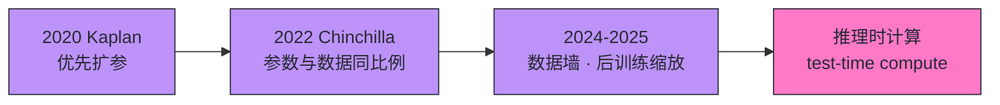
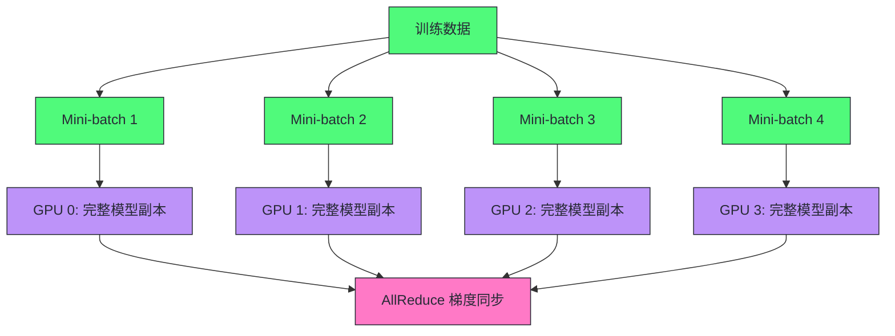

# 03 预训练——数据、算力与 Scaling Law

**摘要：**

本文深入剖析大语言模型预训练的三大核心要素：**数据**（从哪里来、如何清洗、如何配比）、**算力**（分布式训练的并行策略）和 **Scaling Law**（参数量、数据量、计算量之间的幂律关系）。预训练是 LLM 的"基础教育"——模型在数万亿 token 的文本上学习语言的统计规律、世界知识和推理模式。这个阶段消耗了整个 LLM 生命周期中绝大部分的计算资源（通常占 90% 以上），其质量直接决定了模型的能力上限。文章先回答预训练为什么本质上是"压缩世界知识"，再沿数据工程、Scaling Law、分布式训练、混合精度与训练稳定性、评估、工程全景的顺序展开，并在各章补上 2024-2025 年的格局变化：数据墙（Data Wall）与合成数据的兴起、Chinchilla 之后关于 token 与参数最优比例的争议、推理时计算（Test-time Compute）对预训练 scaling 地位的冲击、MoE 训练与十万卡集群的工程现实。全篇遵循"是什么、为什么出现、不这样会怎样、如何落地、边界与反例"的论述主线，每一章都会给出工程反例与适用边界，而不是罗列知识点。理解预训练的工程实践和理论指导，是理解 LLM 为什么有效、以及如何高效训练的关键。

---

## 第 1 章 预训练的本质：压缩世界知识

### 1.1 从 Next Token Prediction 到世界模型

在 [[02 GPT 架构——Decoder-Only 的自回归语言模型]] 中，我们分析了 GPT 的训练目标——next token prediction。表面上看，这只是一个统计任务：根据前文预测下一个词。但当训练数据足够大、模型参数足够多时，这个"简单"的任务要求模型学会远比统计共现更深层的知识。

考虑一个例子：模型要正确预测"将 100 摄氏度的水倒入冰块中，最终温度会___"中的下一个词（"降低"或一个具体温度），它必须理解：热力学平衡的概念、水的比热容、冰的融化过程。这些物理知识并没有以显式的规则形式存在于训练数据中——模型必须从大量描述类似现象的文本中**隐式地推断**出这些规律。

从信息论的角度看，预训练的本质是**压缩**——将训练数据中的信息压缩到模型参数中。一个在 2 万亿 token 上训练的 70B 参数模型，实际上是将数 TB 的文本信息压缩到了约 140GB（FP16）的参数中。压缩越好（训练损失越低），模型对数据中蕴含的模式和知识的提取就越充分。

这个压缩的比喻值得再往前走一步。传统的数据压缩譬如 ZIP，追求的是逐字节还原原始文件；神经网络式的压缩则完全不同，它不要求"还原原文"，只要求"还原原文背后的生成规律"。这更像是学生把整本教科书读完后做了一份详略得当的笔记——笔记当然无法逐字复现课本，但掌握了课本的论证逻辑与知识结构，遇到没见过的题目也能推演作答。**预训练压缩的是"语言的生成过程"而非"文本本身"**，这正是它能在训练数据之外泛化的根源，也是它偶尔"记错细节"（幻觉）的代价：笔记毕竟不是原文。

### 1.2 预训练的三大支柱

预训练的成功取决于三个相互关联的要素：

1. **数据（Data）**：训练数据的规模、质量和多样性决定了模型能学到什么
2. **算力（Compute）**：分布式训练的工程能力决定了能训练多大的模型、用多少数据
3. **Scaling Law**：理论指导，在给定计算预算下，如何最优地分配参数量和数据量

这三者的关系可以类比为教育：数据是教材，算力是学习时间，Scaling Law 是"如何高效学习"的方法论。

不过，教育类比到此为止，工程现实要残酷得多。教材（数据）不是免费印刷的——高质量文本是稀缺资源；学习时间（算力）要花钱租 GPU；更麻烦的是，三者互为约束：Scaling Law 告诉你该用多少数据配多少参数，但当你发现数据不够时，既不能临时"加印"教材，也不能指望模型把同一本教材读一万遍就自动变聪明（我们在 2.4 节会看到，重复读是有上限的）。这套约束关系正是后面所有章节展开的线索。

### 1.3 压缩视角的边界：损失不是一切

压缩视角有一个必须声明的边界：**预训练损失低，不等于下游能力强**。交叉熵损失衡量的只是模型对"下一个 token 分布"的预测质量，而人类关心的问答、推理、代码生成，都是对这条分布的特定投影。2025 年的一篇理论工作（The Coverage Principle）把这种关系说得更清楚：预训练的成功应当用"覆盖"（coverage）而非交叉熵来刻画——交叉熵是全体文本上的平均表现，覆盖则衡量预训练模型给高质量回答留下的概率质量有多大，后者才是后续对齐与推理时计算能够奏效的必要条件。一个在平均损失上表现极佳的模型，完全可能在某个关键能力子集上留下空洞。

这一边界引出一个工程上的经典反例：Overtrained Language Models Are Harder to Fine-Tune（Springer 等人，2025）。研究者对比了 OLMo-1B 在 2.3T 与 3T token 上的两个版本，多训练了 30% 数据的那一个，在指令微调后反而比少训练版本的基准成绩低了 2% 以上。损失一直下降，可迁移性却变差了——这提醒我们，预训练损失曲线只是模型能力的一面镜子，不是全部真相，第 7 章评估部分还会回到这个话题。

---

## 第 2 章 训练数据：LLM 的"教材"

### 2.1 数据来源

大语言模型的训练数据来源主要包括以下几类：

| 数据源 | 典型规模 | 质量 | 特点 |
| :--- | :--- | :--- | :--- |
| **Common Crawl** | 数百 TB 原始 HTML | 低（大量垃圾/重复） | 覆盖面最广，需要大量清洗 |
| **维基百科** | ~20GB | 高 | 结构化知识，多语言 |
| **书籍** | ~100GB（Books3/PG-19） | 高 | 长文本，连贯的叙事和推理 |
| **学术论文** | ~100GB（arXiv/S2ORC） | 高 | 数学/科学/工程知识 |
| **代码** | ~500GB（GitHub/The Stack） | 中 | 编程能力，结构化推理 |
| **社交媒体/论坛** | 数百 GB（Reddit/StackOverflow） | 中 | 对话/问答模式 |
| **新闻** | ~100GB | 中 | 时事知识，写作风格 |

不同模型对数据的配比有不同的策略：

- **LLaMA 1**：1.4T token，以英文为主。数据配比：Common Crawl (67%) + C4 (15%) + GitHub (4.5%) + Wikipedia (4.5%) + Books (4.5%) + arXiv (2.5%) + StackExchange (2%)
- **DeepSeek**：增加了中文数据比例和数学/代码数据
- **Qwen**：大幅增加中文网页和书籍的比例，提升中文能力

值得说明的是，上表的"典型规模"以 2022-2023 年的开源模型为参照，而 2024-2025 年的数据格局已经整体上移了一个数量级。Meta 的 LLaMA 3 系列公开信息显示其预训练语料达到约 **15T token**；Hugging Face 在 2024 年开源了 FineWeb（15T token、源自 96 个 Common Crawl 快照，NeurIPS 2024）及其教育过滤子集 FineWeb-Edu（1.3T token）；NVIDIA 则在 2025 年初发布了 Nemotron-CC，一个 6.3T token 的英文 Common Crawl 数据集，其中包含约 1.9T 由 LLM 生成的合成 token。规模上移的同时，数据配比的语义也在变化——当语料足够大时，"配比"的重点从"各来源占比多少"转向"如何从同一个 Common Crawl 里筛出并改写出高质量子集"，这直接引出下一节的清洗与 2.5 节的合成数据。

### 2.2 数据清洗：质量胜过数量

原始网页数据充斥着垃圾内容（广告、导航栏、模板文本、色情/暴力内容、重复文本），直接用于训练会严重降低模型质量。数据清洗是预训练 pipeline 中最耗费人力的环节之一。

**典型的清洗流程**：

1. **语言识别与过滤**：使用 fastText 等工具识别文本语言，过滤非目标语言
2. **去重**（Deduplication）：
   - **精确去重**：基于文档哈希去除完全相同的文档
   - **模糊去重**：使用 MinHash + LSH（Locality-Sensitive Hashing）去除高度相似的文档。研究表明，Common Crawl 中可能有 30-50% 的近重复内容
3. **质量过滤**：
   - **启发式规则**：过滤过短/过长的文档、特殊字符比例过高的文档、包含黑名单关键词的文档
   - **分类器过滤**：训练一个小型分类器（如基于 fastText），以高质量文本（维基百科/书籍）为正例、低质量网页为负例，对所有文档打分并过滤低分文档。这正是 GPT-3 论文中描述的 WebText-like 过滤策略
4. **隐私过滤**：去除个人身份信息（PII）——邮箱、电话、身份证号等
5. **安全过滤**：使用分类器或关键词列表过滤有害内容（仇恨言论/暴力/色情）

清洗的粒度在过去两年里也在变细。早期方案以文档为单位打分，如今的做法越来越倾向 token 级：先用语言模型给整篇文档打质量分，再在文档内部把低质量的片段（模板、导航、机器翻译残留）单独抠掉，只保留高质量段落。FineWeb-Edu 的思路更进一步——它用一个由 Llama-3-70B-Instruct 生成的合成标注训练出的教育质量分类器，从 FineWeb 的 15T token 中筛出 1.3T 教育内容，训练出的模型在 MMLU、ARC 等知识密集型基准上显著超过原始版本。这里出现了一个有意思的回环：**用模型造数据来训练模型筛数据**。合成数据不仅直接进入训练语料（2.5 节），也成了清洗流水线里的质检工具，NVIDIA 的 Nemotron-CC 管线同样采用三个分类器集成打分加 LLM 改写的组合。

> [!warning] 生产避坑
> 数据清洗中最容易被忽视的问题是**基准测试数据泄漏**（Benchmark Contamination）。如果训练数据中包含了评测基准的测试集（如 MMLU、GSM8K 的问题和答案），模型的"好成绩"就只是"背答案"而非真正的能力。LLaMA 论文中专门做了去污染（decontamination）处理：检测训练数据中是否包含与测试集高度相似的文本，并将其移除。数据墙时代这个问题只会更尖锐——当合成数据可以无限生成时，评测集往往以"问题-答案"的形态散落在各种公开语料里，一步疏忽就会污染整条流水线，且因为合成数据是"看起来像训练样本"的，模糊去重未必能拦住它。

### 2.3 数据配比的艺术

不同类型的数据对模型的不同能力有贡献：

- **网页文本**：通用语言能力、世界知识
- **书籍**：长文本理解、连贯推理
- **代码**：逻辑推理、结构化思维（研究表明，在训练数据中加入代码可以提升模型在非代码任务上的推理能力）
- **学术论文**：数学和科学知识
- **多语言数据**：跨语言能力（中文数据的比例直接决定模型的中文能力）

数据配比没有统一的最优解——它取决于模型的目标用途。一个面向中文市场的模型（如 Qwen）会大幅增加中文数据比例；一个面向编程的模型（如 Code Llama）会增加代码数据比例。

一个关键的经验发现是：**数据的多样性往往比单一来源的数量更重要**。在 Common Crawl 上从 1T token 增加到 2T token 带来的收益，可能不如增加 100B token 的高质量书籍或代码数据。

配比在实现上也不是简单的"按比例拼接"，而是带权重的采样问题。实际操作中，常见做法是给每个数据源设定一个采样权重，再乘以"来源内去重后的 token 数"来分配每步的采样量；权重通常经过两三轮小规模消融实验才定下来，而不是一次成型。有些团队还会在训练过程中动态调整权重——所谓课程式训练（Curriculum Learning）：早期多放代码与数学这类"高信息密度"数据，后期多放百科与对话数据来"打磨"输出风格。这种编排没有放之四海皆准的配方，各家的细节都是商业机密，能确认的只有一点：配比权重对最终能力分布的影响，常常比模型架构的选择还要大。

### 2.4 数据的重复与多 Epoch 训练

LLaMA 的一个重要发现是：**在高质量数据上多次训练（多 epoch）的效果好于在低质量数据上单次训练**。

传统观点认为每个 token 只应使用一次（1 epoch），重复使用会导致过拟合。但 LLaMA-7B 在 1T token 上训练了约 1 epoch，而 LLaMA-65B 在同样的 1.4T token 上实际训练了约 1.4T token（部分数据重复使用了 2-4 次），仍然获得了性能提升。

这个发现对资源有限的团队非常重要——如果无法获取更多高质量数据，对现有数据进行多次训练仍然是有效的策略，前提是数据质量足够高。

不过，"重复多少次"是有明确上限的。Muennighoff 等人在 NeurIPS 2023 的论文《Scaling Data-Constrained Language Models》里系统做了数据受限（data-constrained）条件下的实验：固定计算预算时，对同一批数据重复训练最多约 4 个 epoch，损失与使用不重复数据相比几乎没有差别；但超过这个阈值后，**重复 token 的边际价值迅速衰减到零**——继续加算力，损失几乎不再下降。这个 4-epoch 的经验边界，比 LLaMA 报告里的"2-4 次重复有效"更精确地划出了红线。由此还得到一个与直觉相悖的推论：数据受限时，最优策略不是维持 Chinchilla 的参数-数据比例，而是**训练更小的模型、跑更多的 epoch**——把有限的独特数据榨干，比硬撑一个大模型更划算。

### 2.5 数据墙与合成数据

把 2.4 节的结论推到极端，就撞上了 2024 年以来整个行业最焦虑的问题——**数据墙（Data Wall）**。公开互联网上的高质量文本是有限的，业界对"可用公共文本总量"的估计普遍落在 10-20T token 的量级（一篇 2025 年的经济分析给出的参照是约 15T token），而 LLaMA 3 已经用掉了 15T，FineWeb 恰好也是 15T。主流模型正在把整座公开互联网"抄"进参数里，再往上走，重复率的惩罚会越来越重。

出路之一是**合成数据（Synthetic Data）**——用已有模型生成新文本加入训练。这条路线最有名的实践是微软的 Phi 系列：Phi-3-mini 只有 3.8B 参数，靠"重度过滤的网页 + 合成数据"在 3.3T token 上训练，性能逼近 Mixtral 8x7B 与 GPT-3.5；Phi-4（14B，2024 年 12 月）干脆把合成数据贯穿整个训练流程，在 STEM 问答上超过了它的"老师"GPT-4——这证明合成数据已经不只是"蒸馏教师模型"，而是能产出教师没见过的新知识组合。NVIDIA 的 Nemotron-CC 则是把合成数据用在"数据修补"上：对质量分类器判为低分的文档，不直接丢弃，而是让 LLM 改写（rephrase）成更清晰、更有教育价值的文本，1.9T 合成 token 就这样被"救"了回来，其高质子集在 8B/1T token 的对比训练中比 DCLM 语料高出 5.6 个 MMLU 点。

上图为 2024-2025 年主流数据管线的通用形态：清洗与合成不再是两个阶段，而是同一个流水线里互相咬合的齿轮。

但合成数据不是银弹，它有自己的边界。其一，**比例过高会损害多样性**——合成文本在句式和分布上高度同质，堆太多会让模型退化成"自我复读"。Microsoft Research 2025 年 7 月的 SynthLLM 研究给出了一条"修正后的缩放律"（rectified scaling law）：基于预训练语料生成的合成数据，收益在大约 300B token 处饱和，之后继续加量几乎无益。其二，**合成数据会继承并放大教师模型的错误**，错上加错的风险随迭代轮数累积。其三，BeyondWeb 等 2025 年的研究进一步发现，合成数据与真实数据的最优配比随任务而异，不存在一个通用答案。把数据墙、合成数据饱和与 2.4 节的重复训练上限放在一起看，结论很清楚：**单纯堆数据这条路，无论堆的是真实数据还是合成数据，都正在逼近收益边界**。这正是 3.5 节要讲的、Scaling Law 从"预训练内部"走向"预训练之外"的现实背景。

---

## 第 3 章 Scaling Law——预训练的理论指导

### 3.1 Kaplan Scaling Law（OpenAI, 2020）

2020 年，Kaplan 等人（OpenAI）发表了开创性的 Scaling Law 研究，发现模型的测试损失 $L$ 与三个变量之间存在**幂律关系**：

$$L(N) \approx \left(\frac{N_c}{N}\right)^{\alpha_N}, \quad L(D) \approx \left(\frac{D_c}{D}\right)^{\alpha_D}, \quad L(C) \approx \left(\frac{C_c}{C}\right)^{\alpha_C}$$

其中：
- $N$ = 模型参数量（不含 Embedding）
- $D$ = 训练数据量（token 数）
- $C$ = 计算量（FLOPs）
- $\alpha_N \approx 0.076$, $\alpha_D \approx 0.095$, $\alpha_C \approx 0.050$

这意味着：

1. **性能提升是平滑可预测的**：在双对数坐标下，损失与参数量/数据量/计算量呈线性关系。不存在突然的"性能跳跃"——只要增加规模，性能就会持续提升
2. **参数量比数据量更重要**：$\alpha_N < \alpha_D$，即同等增加倍数下，增加参数量带来的损失下降更多。因此 Kaplan 的建议是：**在给定计算预算下，应该优先增大模型**

注意这里的第二个结论只在对数坐标下成立——它比较的是"同比例增加"时的弹性，不是绝对值。Kaplan 等人在拟合时主要观察了模型规模从 7 千万到 15 亿参数的区间，数据量相对充足，这为结论 2 埋下了后来被 Chinchilla 推翻的伏笔。

### 3.2 Chinchilla Scaling Law（DeepMind, 2022）

2022 年，Hoffmann 等人（DeepMind）发表了 Chinchilla 论文，修正了 Kaplan 的结论。他们训练了超过 400 个不同规模的模型，发现：

$$L(N, D) = E + \frac{A}{N^{\alpha}} + \frac{B}{D^{\beta}}$$

其中 $\alpha \approx 0.34$, $\beta \approx 0.28$, $E$ 是不可约损失（数据本身的熵）。

关键发现：**在给定计算预算下，模型参数量和训练数据量应该以大致相等的比例增长**。具体来说，最优配比大约是：

$$D_{\text{opt}} \approx 20 \times N$$

即训练 token 数应该约为参数量的 20 倍。

这与 Kaplan 的建议截然不同。Kaplan 建议优先增大模型，而 Chinchilla 建议**平衡增大模型和数据**。Chinchilla 用 70B 参数 + 1.4T token 训练出的模型，性能超越了 Gopher（280B 参数 + 300B token）——一个参数量是它 4 倍但数据量不到它 1/4 的模型。

| 模型 | 参数量 | 训练 Token | Token/参数比 | 是否"Chinchilla 最优" |
| :--- | :--- | :--- | :--- | :--- |
| GPT-3 | 175B | 300B | 1.7 | 严重欠训练 |
| Gopher | 280B | 300B | 1.1 | 严重欠训练 |
| **Chinchilla** | **70B** | **1.4T** | **20** | **是** |
| LLaMA-7B | 7B | 1T | 143 | 过度训练（但性能好） |
| LLaMA-65B | 65B | 1.4T | 21.5 | 接近最优 |

> [!info] 核心概念
> Chinchilla Scaling Law 的核心洞察是：GPT-3 等早期大模型其实是"大而欠训练"的——它们的参数量很大，但训练数据量相对不足。如果将同样的计算预算分配给一个更小但训练更充分的模型，可以获得相同甚至更好的性能。这个发现深刻影响了后续模型的设计——LLaMA 系列就是按照 Chinchilla 最优比例训练的。

### 3.3 超越 Chinchilla：推理最优的训练策略

Chinchilla 的 20 倍比例是"训练计算最优"的——在固定的训练 FLOPs 下最小化损失。但在实际部署中，还需要考虑**推理成本**。

一个更小但训练更多数据的模型（如 LLaMA-7B 用 1T token，Token/参数比 = 143），虽然在训练上"浪费"了计算（超出 Chinchilla 最优比例），但推理时更快更省。如果模型将被大规模部署（数百万用户），推理成本远超训练成本，那么"过度训练一个小模型"反而是经济上最优的选择。

LLaMA 论文明确指出了这一点：他们的目标不是训练计算最优的模型，而是**推理最优**的模型——在给定推理预算下性能最好的模型。这解释了为什么 LLaMA-7B 用了远超 Chinchilla 建议的训练数据量。

这条思路在 2024 年得到了定量化。Sardana 等人（MosaicML，2024 年 1 月）在《Beyond Chinchilla-Optimal》中把推理请求量作为变量直接写进缩放律：当预期推理请求规模达到约 10 亿次量级时，最优策略是"训练更小、更久"的模型；他们还观察到，把 token/参数比推到 10,000:1 的极端区间，模型质量仍然在缓慢上升。不过论文同时提醒，如果只用常见 token/参数比（20:1 附近）的数据去拟合缩放律，会高估极端区间继续加 token 的收益——拟合域外推要谨慎，这一点在 3.4 节的争论里还会出现。

### 3.4 Chinchilla 的争议：20 倍比例可信吗

Chinchilla 的"20 token/参数"被当成行业默认值用了好几年，但它并非没有争议。Epoch AI 的 Besiroglu 等人 2024 年 4 月发表了一篇复现论文（Chinchilla Scaling: A Replication Attempt），从 Chinchilla 论文的图表里重建数据、重新拟合参数化模型，发现 Hoffmann 等人报告的 Approach 3 拟合结果与数据本身并不吻合，置信区间也窄得可疑。按照他们的重建估计，token/参数的最优比例可能落在 20:1 附近，但置信区间宽达两个数量级；如果采用 Hoffmann 论文里参数化模型的原始估计，甚至会得到约 70:1 的建议——这与论文自己训练 Chinchilla 时用的 20:1 自相矛盾。

这场争议的工程含义比数学细节重要得多：**Scaling Law 的参数是用具体实验条件拟合出来的，跨出拟合域就不可靠**。同样是"最优比例"，Kaplan 时代训练数据廉价、模型尺寸小，拟合出"优先扩参"；Chinchilla 时代数据仍算充裕，拟合出 20:1；到了 2024-2025 年，数据墙逼近、推理需求爆炸，"最优"的定义本身分裂成了训练计算最优、推理成本最优、数据受限最优三种互不相同的口径。与其说 Scaling Law 在 2025 年"失效"了，不如说它从"一个数字"变成了"一组带约束的曲线"——每条曲线都只在它自己的前提条件下成立。

### 3.5 预训练之外：数据墙、后训练与推理时计算

2024 年下半年开始，行业的注意力明显从"把预训练做得更大"转向"在预训练之外找增量"。两个标志性事件是 OpenAI 于 2024 年 9 月发布 o1 系列（首次把推理时计算作为一等公民），以及 2025 年 1 月 DeepSeek-R1 的开源（证明纯强化学习即可激发出可媲美 o1 的推理能力）。与此同时，2025 年的 ACL 综述（A Survey of Post-Training Scaling）把"后训练缩放"（post-training scaling）归纳为三条路径：监督微调（SFT）、基于反馈的强化学习（RLxF）与推理时计算（TTC），并指出高质量互联网语料见顶后，预训练缩放的主导地位正在被这三者蚕食。

上图画出了缩放这条主线的三次转向。关于推理时计算的机制细节（思维链、best-of-n、搜索式验证等），我们留给 [[04 指令微调与 RLHF——从基座模型到对话助手]] 展开，这里只点出它对预训练的两个冲击。

第一个冲击是**算力预算的再分配**。Snell 等人 2024 年的经典实验（Scaling LLM Test-Time Compute Optimally）表明：对中等难度问题，把同样的推理算力花在"计算最优的测试时缩放"上，比盲目扩大模型参数划算得多——在 FLOPs 匹配的对比中，一个更小的基座模型加上推理时计算，可以追平 14 倍于它的模型。OpenAI 官方对 o1 的描述同样确认：性能随训练时 RL 计算与推理时计算同时平滑提升。**2025 年之后，"多买一张卡"的第一去向未必是预训练集群，而可能是推理集群**。

第二个冲击是**合成数据与后训练改变了"最优配比"的语义**。Chinchilla 的 20:1 假设数据总量无上限；当合成数据成为数据源的一部分、后训练承担起相当一部分能力塑造时，预训练阶段"参数配多少、真实数据配多少、合成数据配多少"变成了三个变量的联合优化问题，单靠一张双对数图已经装不下了。我们将在第 9 章总结时回到这个权衡，届时你会看到，预训练 scaling 没有死，它只是从唯一的主角变成了合奏中的第一小提琴。

---

## 第 4 章 分布式训练：工程的极致

### 4.1 为什么需要分布式训练

训练一个 70B 参数的模型（如 LLaMA-65B），仅模型参数就占约 130GB（FP16），加上优化器状态（Adam 的动量和方差，约 260GB）和梯度（130GB），总共需要约 520GB 显存。目前最高端的单块 GPU（NVIDIA H100）只有 80GB 显存——**单卡根本放不下**。

即使显存够用，训练速度也是瓶颈。LLaMA-65B 的训练使用了 2048 块 A100 GPU，训练约 21 天。如果用单卡训练，需要约 120 年。

分布式训练不是可选项，而是训练大模型的**必要条件**。

分布式训练的组织形态，很像把一支交响乐团拆到几个排练厅合练：每间排练厅各有分工（并行切分），但总谱的行进必须靠统一的节拍（同步与通信）来对齐——乐器再多，节奏对不上，演出照样砸锅。本章接下来讲的每一种并行策略，本质上都是在"切分"与"同步"这一对矛盾之间找平衡点。

### 4.2 数据并行（Data Parallelism）

**数据并行**是最简单的分布式策略：每块 GPU 持有模型的完整副本，但处理不同的 mini-batch 数据。前向和反向传播在各 GPU 上独立进行，然后通过 AllReduce 操作同步梯度，确保所有副本的参数保持一致。

上图省略了 AllReduce 的实现细节，而这恰恰是数据并行性能的分水岭。朴素实现是"每块卡把自己的梯度广播给所有人"（AllGather 两两互传），通信量随卡数平方增长；主流框架用的是 **Ring AllReduce**——把 N 块卡排成环，梯度按环切块依次传递累加，通信总量与卡数无关，只是传输两轮（reduce-scatter 一轮、all-gather 一轮）。因此，数据并行的扩展瓶颈不在网络带宽的绝对值，而在同步粒度：每一步都要等最慢的那块卡（同步屏障），跨机延迟一旦波动，整个集群的效率就被拉低。这也解释了为什么数据并行通常搭配"大批量 + 少同步点"使用，我们在 6.5 节会看到批量大小如何被梯度噪声尺度所约束。

数据并行的**局限**：每块 GPU 都要存储完整的模型参数和优化器状态。对于 70B 的模型，单卡放不下——数据并行失效。

### 4.3 ZeRO（Zero Redundancy Optimizer）

**ZeRO**（Rajbhandari et al., 2020, DeepSpeed）是数据并行的优化版本，核心思想是：**既然每块 GPU 都持有模型的完整副本是冗余的，为什么不将参数、梯度和优化器状态分片存储到不同的 GPU 上？**

ZeRO 分三个阶段逐步减少冗余：

| 阶段 | 分片内容 | 每 GPU 显存节省 | 通信量 |
| :--- | :--- | :--- | :--- |
| **ZeRO-1** | 优化器状态 | ~4x（Adam 的动量+方差） | 与数据并行相同 |
| **ZeRO-2** | 优化器状态 + 梯度 | ~8x | 与数据并行相同 |
| **ZeRO-3** | 优化器状态 + 梯度 + 参数 | ~$N_d$ 倍（$N_d$ = GPU 数） | 增加 1.5x |

ZeRO-3 下，每块 GPU 只存储 $1/N_d$ 的参数。当需要某个参数进行前向/反向计算时，通过 AllGather 从其他 GPU 临时收集。计算完成后，非本地参数可以立即释放。

ZeRO 的优势是**概念简单、实现成熟**（DeepSpeed/FSDP），且与现有的数据并行代码兼容——几乎不需要修改模型代码。这使它成为中小规模训练（几十到几百块 GPU）的首选方案。

ZeRO 的代价藏在通信里：参数分片得越彻底，每个训练步里 AllGather/ReduceScatter 的次数越多，通信与计算的交叠（overlap）就越难做满。2023 年 DeepSpeed 团队推出 **ZeRO++**，针对三处通信逐一开刀：参数 AllGather 前先用块状量化把 FP16 压成 INT8（通信量减半，qwZ）；反向传播的跨机参数 AllGather 改成节点内持有一份完整副本、只在机内做高速 AllGather（hpZ，用显存换通信）；梯度 ReduceScatter 换用基于 all-to-all 的量化梯度聚合（qgZ）。三者合起来把通信量降到 ZeRO-3 的约 1/4。PyTorch 侧同样在演进：2.4 版本引入的 **FSDP2** 改成了基于 DTensor 的逐参数分片，去掉了 FSDP1 里"整层扁平化后统一切分"的粗粒度，让混合并行（与张量并行、流水线并行组合）时的不均衡切分问题大大缓解。可以说，2024-2025 年 ZeRO 家族的主题词是"分片之后的通信税"，谁把税降下来，谁就能在中大规模训练里保持竞争力。

### 4.4 张量并行（Tensor Parallelism）

**张量并行**（Megatron-LM, NVIDIA）将模型的**单个层内的矩阵运算**切分到多块 GPU 上。

以 FFN 的第一个线性层为例：$Y = XA$，其中 $A \in \mathbb{R}^{d \times 4d}$。将 $A$ 沿列方向切分为两半 $A = [A_1, A_2]$，分别放在两块 GPU 上：

- GPU 0 计算 $Y_1 = X A_1$
- GPU 1 计算 $Y_2 = X A_2$

第二个线性层 $Z = \text{GeLU}(Y) B$ 中，将 $B$ 沿行方向切分，然后通过 AllReduce 合并结果。

张量并行的优势是**通信开销小**（在层内进行，可利用 NVLink 的高带宽）和**负载均衡好**（每块 GPU 计算量相同）。但它的扩展性受限于单节点内的 GPU 数量（通常 4-8 块），跨节点的张量并行因网络延迟过高而不实际。

这里值得补一句切分方向的讲究。Megatron 把第一层按列切、第二层按行切，是为了让中间激活 $Y$ 保持完整、只需要在层与层之间做一次 AllReduce，而不是每个算子之间都同步一次——一个 GEMM 的 AllReduce 换掉两个 GEMM 的全量通信，省下的正是 4.2 节说的通信税。张量并行度（TP size）一般等于节点内 GPU 数，再往上加，收益会被 AllReduce 的带宽占用抵消，这也是 3D 并行里张量并行总在最内层的原因。

### 4.5 流水线并行（Pipeline Parallelism）

**流水线并行**将模型的**不同层**分配到不同的 GPU 上。譬如 32 层的模型用 4 块 GPU，每块 GPU 负责 8 层。

最大的问题是**流水线气泡**（Pipeline Bubble）——前面的 GPU 在等后面的 GPU 完成计算，后面的 GPU 在等前面的 GPU 传递中间结果。解决方案是 **Micro-batching**：将一个 mini-batch 切分为多个 micro-batch，让多个 micro-batch 交替在流水线中流动，减少空闲时间。

GPipe 和 PipeDream 是两种主流的流水线调度策略，后者通过"1F1B"（1 forward 1 backward）调度进一步减少了内存占用。

气泡的比例可以定量算出来。设流水线有 $P$ 个阶段、每个 mini-batch 切成 $M$ 个 micro-batch，稳态下的气泡占比约为 $\frac{P-1}{P+M-1}$。这意味着两个硬约束：**阶段数 P 越大，气泡越严重**（这就是为什么流水线并行一般控制在几路到十几路）；**micro-batch 数 M 越大，气泡越小**（但 M 受显存约束，因为每个 micro-batch 的激活都要驻留）。DeepSeek-V3 的 **DualPipe** 在这条路上又进了一步——它把前向与反向的 micro-batch 交叉编排，让一个阶段的通信与另一个阶段的计算重叠，几乎消除了跨节点流水线通信的等待；配合"每个 token 最多路由到 4 个节点"的限制，把 MoE 模型跨节点通信的瓶颈也压了下去。DeepSeek-V3 的全部预训练只用了 266.4 万 H800 GPU 小时（2.664M），这个数字比同等规模模型的一般水平低一个量级，正是算法、框架与硬件三层共同优化的结果。

### 4.6 3D 并行：实际训练的组合策略

实际训练大模型时，通常组合使用多种并行策略——这就是 **3D 并行**：

- **最内层（节点内）**：张量并行（利用 NVLink 高带宽）
- **中间层**：流水线并行（跨少量节点，将模型层分段）
- **最外层**：数据并行 / ZeRO（扩展到大量节点）

譬如 LLaMA-65B 的训练可能使用：8 路张量并行（8 块 GPU / 节点内）× 4 路流水线并行 × 64 路数据并行 = 2048 块 GPU。

| 并行策略 | 切分维度 | 适用范围 | 通信模式 | 典型工具 |
| :--- | :--- | :--- | :--- | :--- |
| 数据并行 | mini-batch | 扩展训练吞吐 | AllReduce（梯度） | PyTorch DDP |
| ZeRO | 参数/梯度/优化器 | 降低单卡显存 | AllGather + ReduceScatter | DeepSpeed / FSDP |
| 张量并行 | 层内矩阵 | 节点内（NVLink） | AllReduce（激活值） | Megatron-LM |
| 流水线并行 | 模型层 | 跨节点 | P2P（层间激活值） | Megatron-LM / DeepSpeed |

### 4.7 4D 与 5D 并行：序列、上下文与专家

3D 并行覆盖了 batch、层、隐层三个维度，但长上下文时代的训练提出了第四个维度：**序列长度**。当序列从 2K 涨到 32K、128K 乃至百万量级时，单个 token 的激活和注意力矩阵会塞满整块 GPU，此时需要在序列维度上再做切分——这就是**序列并行（Sequence Parallelism）**。Li 等人（NUS）2023 年在 ACL 上的工作把序列并行做成可与 3D 并行叠加的第四维（4D 并行），并配了环式自注意力（Ring Self-Attention）；UC Berkeley 的 **Ring Attention**（Liu、Zaharia、Abbeel，2023）则用分块注意力 + 环状 KV 传递，把训练序列长度推到了百万 token 级。Megatron Core 里的**上下文并行（Context Parallelism，CP）**走的是同一思路，但对 KV 的 AllGather/ReduceScatter 做了环拓扑的点对点实现，并能复用 Flash Attention 内核。DeepSpeed Ulysses 则是另一种风格——用一次 all-to-all 集体通信把注意力计算彻底打散，在序列长度与设备数同比例增长时通信量保持恒定。两条路线（环式 vs all-to-all）在 2024-2025 年并存，各有拥趸，这又是一个"只有选择问题，没有高下之分"的典型场景。

上图把五个并行维度按"切分对象"排成一线：batch、层、隐层、序列、专家——每加一个维度，就是一次对"哪里还有冗余/哪里放不下"的回应。

第五个维度来自 MoE（Mixture of Experts）架构的普及（架构细节见 [[08 长上下文与多模态——技术前沿]] 第 8 章）：当 FFN 被替换成几百个专家时，**专家并行（Expert Parallelism，EP）**成为必备手段——每个专家被放到一块或几块 GPU 上，token 由路由（Router）决定去访问哪些专家。DeepSeek-V3 是最极端的公开案例：671B 总参数、256 个专家、每个 token 只激活 37B，训练时采用"张量并行为 1、专家并行 256、数据并行 8"的布置，跨节点的 token 分派（dispatch）与结果聚合（combine）通过定制 PTX 指令与计算重叠，几乎做到了通信零开销。但 MoE 训练有一个稠密模型没有的麻烦：**负载均衡**——如果路由把大多数 token 都送到某几个"热门专家"，那几个专家所在的 GPU 就会成为瓶颈。传统的做法是加辅助负载均衡损失（auxiliary loss）惩罚失衡，但 DeepSeek-V3 发现这种损失会干扰模型质量，改用了无辅助损失的偏置调整方案。平衡质量与均衡，是 MoE 训练里每天都要面对的一对矛盾。

### 4.8 十万卡集群：超大规模训练的现状

2024 年下半年，训练集群的规模跳过了"万卡"直奔"十万卡"。xAI 的 Colossus 在 122 天内建成 10 万块 H100 的集群（2024 年 9 月上线），随后在 2025 年 2 月前翻倍到 20 万块；Meta 在 2024 年 10 月的财报电话会上确认，用于训练 LLaMA 4 的集群超过 10 万块 H100。SemiAnalysis 对这类集群的账目给出了直观参照：一个 10 万卡集群仅服务器资本开支就超过 40 亿美元，需要 150MW 以上的数据中心容量，一年耗电约 1.59 TWh；而作为对比，GPT-4 的训练据估算用了约 2 万块 A100、90-100 天，总计约 $2.15 \times 10^{25}$ FLOP。

十万卡规模下，4.2 节讨论的同步屏障问题被放大成了系统工程问题。单卡的故障率虽然低，但 10 万卡的集群里"每天都有卡坏"是常态，于是 checkpoint 的频率、异步保存与故障检测就成了训练框架的核心能力；网络拓扑（InfiniBand 还是以太网）、电源、散热、机柜布局每一层都可能成为瓶颈。笔者想强调的工程结论是：**预训练工程的天花板早已不是单卡性能，而是把 10 万张卡当作一台机器来编排的可靠性**。这也解释了为什么大厂的训练框架（Megatron-Core、DeepSpeed、Colossal-AI 等）都在往"容错、可观测、自动化恢复"的方向使劲——算力买得到，稳定地用完它才是本事。

---

## 第 5 章 混合精度训练与显存优化

### 5.1 混合精度训练（Mixed Precision Training）

标准的浮点运算使用 FP32（32 位），但训练大模型时 FP32 的显存和计算开销太高。**混合精度训练**使用较低精度的浮点格式来加速计算和节省显存。

核心思路：
- **前向和反向传播**使用低精度（FP16 或 BF16），加速矩阵运算（GPU 的 Tensor Core 对低精度运算有硬件加速，速度约为 FP32 的 2-4 倍）
- **参数更新（优化器步骤）**仍使用 FP32，保持数值精度

**BF16（Brain Float 16）** 是当前 LLM 训练的首选格式。它与 FP32 有相同的指数位宽度（8 bit），因此数值范围与 FP32 相同，不容易溢出；但尾数只有 7 bit（FP32 有 23 bit），精度较低。相比 FP16（5 bit 指数，10 bit 尾数），BF16 的数值范围更大，训练更稳定——FP16 容易因数值溢出导致 loss spike 甚至 NaN。

| 格式 | 总位数 | 指数位 | 尾数位 | 数值范围 | 精度 | 适用场景 |
| :--- | :--- | :--- | :--- | :--- | :--- | :--- |
| FP32 | 32 | 8 | 23 | 大 | 高 | 优化器状态 |
| FP16 | 16 | 5 | 10 | 小（易溢出） | 中 | 推理（量化后） |
| **BF16** | 16 | 8 | 7 | **大（与 FP32 相同）** | 低 | **训练首选** |

混合精度最容易被忽略的细节是**主权重（master weights）**：低精度下做梯度更新，浮点误差会在上万步里累积漂移，所以参数更新必须维护一份 FP32 副本（即优化器状态里的那部分），低精度只承担前向/反向的矩阵乘法。换个说法，混合精度不是"全程用低精度"，而是"计算用低精度、账目用高精度"——这跟财务上的总账/明细账分工是一个道理。FP16 还有个专属配套——**动态损失缩放（dynamic loss scaling）**：因为 FP16 数值范围小，梯度太小会下溢成零，太大又会溢出成 inf，于是训练器会在反向传播前把损失乘上一个缩放因子（如 1024），更新参数时再除回去，缩放因子按"是否出现 inf"自动调整。

2024-2025 年，FP8 训练从论文走向了生产。DeepSeek-V3 首次在十万亿 token 级别的真实训练中验证了 FP8：权重用块状缩放（每 128×128 一个缩放系数）的 FP8 存储、矩阵乘在 FP8 下计算、累加器仍用 FP32/BF16、优化器状态与主权重保持高精度。结果是在几乎不损失质量的前提下，显存与训练时长双双下降。不过要注意，FP8 比 BF16 更敏感，块缩放粒度、哪些算子回落 BF16，都是需要逐层实验的工程决定，不能照抄。

### 5.2 梯度累积（Gradient Accumulation）

当单块 GPU 的显存不足以容纳目标 batch size 时，可以使用梯度累积：将一个大 batch 分成多个小 micro-batch，逐个前向-反向计算并累积梯度，最后统一更新参数。

这在数学上与使用大 batch 完全等价，但不需要额外的 GPU。代价是训练速度与 micro-batch 数成正比地变慢。

"完全等价"这个说法有一个边界条件：它要求模型里没有依赖 batch 统计量的算子。现代 Transformer 用的是 Pre-Norm + LayerNorm（对单个 token 归一化，与 batch 无关），所以梯度累积对它是精确等价的；但如果你在训练里混入了 BatchNorm、或者依赖"梯度裁剪时的全局范数"做判断，累积梯度的行为就会与一次性大 batch 出现细微差别——梯度的范数在累积后与直接大 batch 并不逐位一致。另一个工程细节是通信：梯度累积时每 N 个 micro-batch 才做一次 AllReduce（或每次做但推迟参数更新），前者能大幅降低同步频率，这也是大 batch 训练下"通信摊销"收益的主要来源。

### 5.3 激活重计算（Activation Checkpointing）

训练时，前向传播的中间激活值需要保存用于反向传播。对于深层模型，激活值的显存占用可能超过参数本身。

**激活重计算**（也叫 Gradient Checkpointing）的策略是：只保存少量层（checkpoint 层）的激活值，其他层的激活值在反向传播时重新前向计算。这以约 33% 的额外计算换取约 50-70% 的激活显存节省。

实际工程里很少做"全重算"，更常用的是**选择性重计算（selective recomputation）**：注意力层与 Dropout 的输出保留（重算它们太贵），其余线性层的激活丢弃重算。显存与算力的这笔交易没有标准答案，取决于你的瓶颈在哪一端——集群网络吃紧时宁可多花算力换显存，把 batch 撑大一点来摊薄通信。

### 5.4 Flash Attention

标准 Self-Attention 需要在 GPU 的高速显存（HBM）中存储完整的 $n \times n$ 注意力矩阵（$n$ 为序列长度），显存占用 $O(n^2)$。对于 8K 上下文的模型，这个矩阵可达数 GB。

**Flash Attention**（Dao et al., 2022）是一个 IO 感知的注意力实现优化：通过分块（tiling）计算和在 SRAM（片上高速缓存）中完成 softmax 的在线归一化，**避免将完整的注意力矩阵写入 HBM**。

Flash Attention 不改变注意力的数学结果（是精确计算，非近似），但：
- 显存从 $O(n^2)$ 降低到 $O(n)$
- 由于减少了 HBM 读写次数，实际速度提升 2-4 倍

Flash Attention 已经成为所有主流 LLM 训练框架的标配。Flash Attention 2 和 Flash Attention 3 进一步优化了 GPU 的 warp 调度和异步加载。

把 Flash Attention 与 4.7 节放在一起看，能发现一个共同规律：**这两类优化都是在"尽量减少数据在存储层级之间的搬运"**。Flash Attention 把注意力矩阵留在 SRAM，序列并行把 KV 块在卡间环形流动而不再整份复制——IO 与通信，才是大模型训练真正的暗成本。

---

## 第 6 章 训练稳定性与超参数

### 6.1 优化器：AdamW

几乎所有 LLM 的训练都使用 **AdamW** 优化器——Adam 的变体，将权重衰减（weight decay）与梯度更新解耦。

Adam 维护两个指数移动平均：
- **一阶动量** $m_t = \beta_1 m_{t-1} + (1-\beta_1) g_t$：梯度的滑动平均
- **二阶动量** $v_t = \beta_2 v_{t-1} + (1-\beta_2) g_t^2$：梯度平方的滑动平均

参数更新：$\theta_{t+1} = \theta_t - \eta \cdot \frac{m_t}{\sqrt{v_t} + \epsilon} - \lambda \theta_t$

常用超参数：$\beta_1 = 0.9$, $\beta_2 = 0.95$, $\epsilon = 10^{-8}$, weight decay $\lambda = 0.1$。

Adam 的优势是**自适应学习率**——对不同参数根据其历史梯度自动调整步长，对 LLM 训练中参数量级差异大的场景非常重要。但 Adam 的代价是**每个参数需要额外存储两个状态**（$m$ 和 $v$），使优化器状态的显存占用是参数本身的 2 倍。

这两个指数平均的系数不是随手定的。$\beta_2$ 取 0.95 而非 PyTorch 默认的 0.999，是 LLM 训练的社区经验：二阶矩估计需要更"近"的历史窗口，才能及时反映大梯度批次的到来；$\epsilon = 10^{-8}$ 则是数值安全的底线——它防止除零，但也不能再大，否则会压缩自适应步长的动态范围。还要注意，Adam 的更新公式里 $\sqrt{v_t}$ 充当了"按参数尺度归一化"的角色，这让它对初始化尺度的变化很敏感——正是这个特性，引出了下面 6.2 节的 muP。

### 6.2 学习率调度

LLM 训练通常使用**预热 + 余弦衰减**的学习率调度：

1. **线性预热**（Warmup）：在前 1000-2000 步内，学习率从 0 线性增长到峰值（如 $3 \times 10^{-4}$）。预热的作用是避免训练初期参数还很随机时用过大的学习率导致不稳定
2. **余弦衰减**（Cosine Decay）：从峰值按余弦函数平滑衰减到最小值（通常为峰值的 1/10）

$$\eta_t = \eta_{\min} + \frac{1}{2}(\eta_{\max} - \eta_{\min})\left(1 + \cos\left(\frac{t - T_w}{T - T_w}\pi\right)\right)$$

为什么预热是必需的，可以这样理解：Adam 的 $v_t$ 从零起步，最初的几步里 $\sqrt{v_t}$ 很小，若直接用峰值学习率，第一步的更新步长会被放得极大——相当于新车刚出库就踩满油门。预热本质上是在"让二阶矩估计先跑起来"。

预热的步数（几千步）与总步数（几十万步）相比微不足道，但它的调法直接影响收敛质量：峰值学习率定高一点、预热短一点，损失下降快但容易爆；定低一点则要多烧几天的算力。2021 年微软研究院的 **muP（Maximal Update Parametrization，最大更新参数化）** 与 μTransfer 给了这个古老调参问题一个漂亮的解：只要把模型按 muP 规则重新参数化（学习率等超参数随宽度按特定幂次缩放），**小模型上调好的超参数可以直接零样本迁移到大模型**。论文里用 4000 万参数的模型调参，迁移到 6.7B 的 GPT-3 规模，效果超过原论文公开数字，总调参成本只有预训练的 7%。大模型调参动辄烧掉上百万美元，muP 的价值在十万卡时代只会更大——虽然它的适配要求（初始化、学习率缩放规则）并不总是兼容现成框架，落地的团队仍然不多。

### 6.3 训练中的不稳定性：Loss Spike

大模型训练中常遇到 **Loss Spike**——训练损失突然飙升，有时甚至变成 NaN。常见原因包括：

- **数值溢出**：FP16 训练中梯度过大导致溢出。解决方案：使用 BF16 或动态 loss scaling
- **数据异常**：某些 batch 包含极端样本。解决方案：数据清洗时移除异常文本
- **学习率过大**：尤其是预热阶段之后。解决方案：降低峰值学习率

应对 loss spike 的标准操作是：从最近的正常 checkpoint 恢复，跳过导致 spike 的数据 batch，继续训练。LLaMA 论文中提到他们遇到了少量 loss spike，通过这种方式处理。

把 loss spike 的机制说得再透一些。多数 spike 的直接推手是**梯度范数的骤然飙升**：某一步里个别参数收到异常大的梯度，Adam 的二阶矩还没跟上，参数被猛地推离原地，损失随之跳变。SPAM 等 2025 年的研究工作测量到，这种尖峰梯度的量级可以是正常梯度的 1000 倍以上。PaLM（2022）团队的工程对策是"检测到 spike 后回滚到约 100 步前的 checkpoint 重来"；而《Spike No More》从理论侧给出了两个预防条件：子层（sub-layer）用小值初始化，embedding 的方差归一化到接近 1——满足这两条，梯度范数的上界被压住，spike 的发生率大幅下降。DeepSeek-V3 则是"预防成功"的公开样本：官方报告称整个训练过程没有出现一次不可恢复的 loss spike，也没有做任何 rollback——这是从初始化、精度、数据到调度的全链路稳定的结果，也是第 5 章所有工程手段的综合验收。

### 6.4 梯度裁剪与损失缩放

与 loss spike 直接对抗的常规武器是**梯度裁剪（Gradient Clipping）**：在更新参数前，先计算全量梯度的全局范数，若超过阈值 $c$，就把所有梯度按比例缩小到范数恰为 $c$。它相当于给参数更新装了一个限速器——方向不变，只是把过大的"油门"压回来。裁剪阈值通常取 0.5-1.0（按范数计），设得太小会扭曲正常学习，太大又挡不住 spike。配合 5.1 节的动态损失缩放（那是对抗 FP16 上溢/下溢的），这两个机制构成了混合精度训练稳定性的左右护法。前者管"梯度太大"，后者管"数值太小"。

需要特别提醒的是裁剪对 Adam 的语义影响：Adam 的每参数步长已经按 $\sqrt{v_t}$ 归一化了，全局裁剪改变的是所有参数的"共同尺度"，方向不受影响——这是它能在不改收敛方向的前提下抑制 spike 的原因。但也正因如此，裁剪不能替代对学习率、预热、数据质量的排查，它只是兜底。

### 6.5 批量大小（Batch Size）

LLM 训练通常使用非常大的 batch size——几百万甚至几千万 token 每个 batch。这是因为：

- **GPU 利用率**：大 batch 能充分利用 GPU 的并行计算能力
- **梯度估计稳定**：大 batch 的梯度是更精确的损失函数梯度估计，更新方向更准确
- **通信摊销**：数据并行的 AllReduce 通信开销是固定的，大 batch 摊薄了这个开销

LLaMA-65B 使用 4M token/batch（约 2000 个长度为 2048 的序列）。

批量大小有一个理论上限。OpenAI 在《How AI training scales》里提出用**梯度噪声尺度（Gradient Noise Scale）**来预测临界批量大小：它度量的是"单个 batch 梯度与真实期望梯度的信噪比"，噪声尺度小说明数据冗余高，继续加大 batch 只是重复劳动；噪声尺度大则说明还可以从更多并行数据里学到东西。OpenAI 的报告显示，这个指标解释了跨度六个数量级的任务中约 80% 的临界批量差异。对 LLM 训练而言，batch 的上限在实践中由"显存 × 并行度"决定，但梯度噪声尺度解释了另一个现象：**为什么训练后期加大 batch 的收益会下降**——模型接近收敛时噪声尺度下降，冗余的数据比例上升。调 batch 与调学习率一样，都不是"越大越好"。

---

## 第 7 章 评估：如何衡量预训练的质量

### 7.1 训练损失（Training Loss）

最直接的指标是**交叉熵损失**——数值越低，模型对训练数据的拟合越好。Scaling Law 的核心预测就是损失与规模的关系。

但训练损失只能反映模型对训练数据的建模能力，不能直接反映下游任务的性能。

更准确地说，训练损失连"对训练数据的建模能力"都只反映了一半：它可能因为数据重复（2.4 节）而虚低，也可能因为基准泄漏（2.2 节 warning）而虚高。1.3 节引的 Coverage Principle 进一步指出，交叉熵损失与下游能力之间隔着一条"覆盖"的鸿沟——实践中常见两个模型训练损失几乎相同，下游表现却天差地别。所以预训练团队真正盯着的，往往是验证集上的损失曲线与其斜率：斜率不再下降，意味着继续烧算力的边际收益开始变差，这比单点的损失值更有决策价值。

### 7.2 困惑度（Perplexity）

困惑度是交叉熵损失的指数形式：$\text{PPL} = e^L$。它的直观含义是：模型在预测下一个 token 时的"平均困惑程度"——困惑度越低，模型越"确定"，预测越准确。

在**验证集**上计算的困惑度可以反映模型的泛化能力。

困惑度的特点是它对"高频低风险"的预测很敏感，对"低频高风险"的预测几乎无感：一个总是把"and"和"the"预测错、但在关键事实性词上稳定输出的模型，PPL 可能很好看；反之亦然。所以在长上下文、数学、代码这类对局部精确性要求高的场景里，PPL 常常被"按 token 类别分层的困惑度"或直接的下游基准取代。它是一支好用的体温计，但不是全科体检。

### 7.3 基准测试（Benchmarks）

预训练完成后，通常在一系列标准基准上评估模型：

| 基准 | 评估内容 | 形式 |
| :--- | :--- | :--- |
| **MMLU** | 多学科知识（57 个科目） | 多选题 |
| **HellaSwag** | 常识推理 | 选择最合理的续写 |
| **ARC** | 科学推理 | 多选题 |
| **GSM8K** | 数学推理（小学数学应用题） | 开放式生成 |
| **HumanEval** | 代码生成 | Python 函数补全 |
| **TruthfulQA** | 事实性 | 判断回答是否真实 |
| **WinoGrande** | 指代消解 | 选择正确的指代对象 |

这些基准覆盖了知识、推理、代码、事实性等多个维度，综合评估模型的预训练质量。

2024 年之后，评估表的难度整体上调了一个台阶：OpenAI 在 o1 发布时即以 AIME（美国数学奥林匹克资格赛）与 GPQA（博士级科学问答）作为能力标尺，DeepSeek 系列与各开源模型也纷纷把 MATH、代码竞赛类基准纳入标配。对预训练质量的判断随之出现一个微妙变化：**单一基准的分数越来越不可靠**——基准确有泄漏风险（2.2 节），模型又越来越擅长"应试"。业界开始流行用一批互不相关的基准取平均、配合人工抽查来对冲单点过拟合，但任何基准集都只是代理指标，这一点在超大规模训练里需要反复提醒自己。

### 7.4 从损失到能力：评估的鸿沟

把 7.1-7.3 节的三个层次放在一起，能看出评估体系的完整链条：训练损失 → 验证集困惑度 → 下游基准，一层比一层接近真实用途，也一层比一层更贵、更不可复现。中间任何一环的跳跃都可能带来误判——训练损失低但基准差，可能是重复数据虚低（2.4 节）；基准好但实际体验差，可能是基准泄漏（2.2 节）。对预训练团队而言，评估不是"训练完之后的打分会话"，而是训练期间就要持续运行的仪表盘：损失曲线、验证困惑度、抽样基准与人工抽读，缺一不可。

---

## 第 8 章 预训练的工程全景

### 8.1 一次完整预训练的资源需求

以训练一个 LLaMA-70B 级别的模型为例：

| 资源 | 规模 |
| :--- | :--- |
| GPU | 2048 × A100 80GB（约 256 台 8-GPU 服务器） |
| 训练数据 | ~2T token（约 8TB 原始文本） |
| 训练时间 | ~21 天 |
| 总计算量 | ~$1.0 \times 10^{24}$ FLOPs |
| 电力消耗 | ~1 GWh（约 100 万度电） |
| 成本估算 | 约 200-500 万美元（按云 GPU 价格） |

这张表反映的是 2023 年的量级，到了 2025 年，顶配训练的数字已经翻了不止一个数量级，下表列出可核实的公开参照：

| 项目 | 规模（公开/估算） |
| :--- | :--- |
| LLaMA 3 语料 | ~15T token |
| DeepSeek-V3（671B MoE）预训练 | 14.8T token，约 266.4 万 H800 GPU 小时 |
| GPT-4 训练 | 据估算 ~2 万块 A100、90-100 天、约 $2.15 \times 10^{25}$ FLOP |
| xAI Colossus 集群 | 10 万块 H100（2024 年 9 月），后翻倍至 20 万块 |
| 十万卡集群的代价 | 服务器资本开支 >40 亿美元，功耗 >150MW（SemiAnalysis 估算） |

两张表并置的意义在于：**资源需求的增长不是线性的，而是每一步都在挑战物理与工程的下限**——电力、散热、网络拓扑、可靠性，每一层都可能先于算法成为瓶颈。

### 8.2 训练 Pipeline 全景

一次完整的预训练涉及以下环节：

1. **数据准备**：爬取 → 清洗 → 去重 → 质量过滤 → 安全过滤 → Tokenization → 预分片
2. **模型初始化**：参数随机初始化（通常正态分布，标准差与层数相关）
3. **分布式训练**：3D 并行配置、混合精度、Flash Attention、梯度累积
4. **监控与恢复**：Loss 监控、Checkpoint 定期保存（每隔几百/几千步）、Loss Spike 恢复
5. **评估**：定期在验证集和基准上评估

其中的第 4 步在十万卡时代从"例行公事"变成了"生死线"。Checkpoint 的保存频率需要在"保存太频繁拖慢训练"与"保存太稀疏丢失太多进度"之间取平衡；异步保存、增量 checkpoint（只写变化的分片）、按专家分片存储（MoE 模型）是 2024-2025 年框架文档里反复出现的三个关键词。故障恢复的另一个细节是**数据切分与断点的一致性**：恢复训练时不仅模型参数要回到 checkpoint，数据流也要精确接在断点处，否则同样的 token 被算了两遍，损失曲线会出现一次无法解释的"跳变"——这类隐蔽问题往往比显式的硬件故障更难排查。

### 8.3 训练框架生态

| 框架 | 组织 | 核心能力 |
| :--- | :--- | :--- |
| **Megatron-LM** | NVIDIA | 张量并行 + 流水线并行 + 数据并行 |
| **DeepSpeed** | Microsoft | ZeRO + 流水线并行 + 混合精度 |
| **FSDP** | Meta / PyTorch | ZeRO-3 的 PyTorch 原生实现 |
| **Megatron-DeepSpeed** | 社区 | Megatron 张量并行 + DeepSpeed ZeRO |
| **Colossal-AI** | HPC-AI Tech | 多维并行 + 自动并行策略 |

2024-2025 年，这个生态出现三个新动向：其一，NVIDIA 把 Megatron-LM 演进为 **Megatron-Core**，并把上下文并行（CP）、异步 checkpoint、容错调度纳入官方能力，成为十亿级到万亿级模型训练的公共底座；其二，**FSDP2**（PyTorch 2.4）以 DTensor 逐参数分片补齐了原生框架在混合并行上的短板；其三，各家框架都在为 MoE 模型提供"专家并行 + 负载均衡 + 通信重叠"的一体化支持——DeepSeek-V3 展示的 DualPipe 与 FP8 组合，反过来成为框架们竞相追赶的基准。选择框架的考量也从"谁的支持多"变成了"谁能在你的集群规模上把故障率压住"——能力再全的框架，在十万卡上三天两头中断训练，也等于零。

---

## 第 9 章 总结与展望

### 9.1 核心要点回顾

1. **数据是基础**：质量 > 数量。数据清洗、去重、配比直接决定模型能力。代码和多语言数据对提升推理和跨语言能力至关重要；2025 年的新议题是数据墙与合成数据——真实数据逼近 15T token 的天花板，合成数据能续命但有饱和点（约 300B token 量级收益递减）与多样性损耗的风险
2. **Scaling Law 是指导**：Chinchilla 法则建议参数量和数据量同比例扩大（Token ≈ 20×参数），但 20 倍比例本身处于争议之中（复现工作给出宽得多的置信区间），且推理成本考量可能导致"过度训练小模型"成为更经济的选择；2024 年后的现实是"最优配比"裂解为训练计算最优、推理成本最优、数据受限最优三种口径
3. **分布式训练是工程核心**：3D 并行（数据 + 张量 + 流水线）+ ZeRO + Flash Attention + 混合精度构成了大模型训练的标准工程栈；长上下文与 MoE 时代又叠加了序列/上下文并行与专家并行两个维度，十万卡集群把可靠性推到了与算法同等重要的地位
4. **训练稳定性不可忽视**：AdamW + 余弦学习率调度 + BF16 + Checkpoint 恢复是保障长时间训练稳定性的关键手段；梯度裁剪、动态损失缩放、muP 超参迁移是 2024-2025 年继续深化的方向
5. **评估是仪表盘而非成绩单**：训练损失、验证困惑度、下游基准各有盲区，基准泄漏与"过度训练导致微调变难"都是真实存在的反例

### 9.2 边界与权衡

把五问中的"边界与反例"集中收束一下。预训练不是万能的：**它给的是"世界模型"，不是"听话的助手"**——一个在 15T token 上训练出来的基座模型，可能博学多识却答非所问（第 4 篇会详述）；**它给的是"平均能力"，不是"关键能力保证"**——覆盖原则告诉我们，平均损失与重要能力子集之间可能存在空洞；**它给的是"当下语料的快照"，不是"持续更新的知识"**——数据墙与版权诉讼都在压缩这个快照的刷新率。工程上同样没有银弹：并行策略的选择是"通信税 vs 显存 vs 气泡"的三方权衡，混合精度是"速度 vs 稳定性"的权衡，训练稳定性是"效率 vs 保险"的权衡。理解了这些权衡，才算真正理解预训练。

### 9.3 下一步

预训练产出的是一个**基座模型**（Base Model）——它擅长续写文本，但不会"听从指令"。要让模型变成一个有用的 AI 助手，还需要：

- [[04 指令微调与 RLHF——从基座模型到对话助手]]：通过指令数据和人类反馈对齐模型行为；这一篇也将承接 3.5 节埋下的推理时计算与后训练缩放的话题
- [[05 参数高效微调——LoRA、QLoRA 与 Adapter]]：在资源有限时如何高效微调
- [[06 推理优化——KV Cache、量化与投机解码]]：预训练成果如何高效地服务；[[08 长上下文与多模态——技术前沿]] 中的 MoE 与长上下文训练细节，则与本文第 4 章的并行扩展直接呼应

回到本文开头的问题：预训练为什么有效？因为它把互联网的生成规律压缩进了参数。而 2025 年的行业正在回答下一个问题：当压缩的素材见顶时，增量从哪里来？从目前的公开证据看，答案是三路并行——更聪明的数据（清洗与合成）、更极致的算力利用（MoE 与十万卡可靠性）、以及把预算移向预训练之外的推理时计算。三路之间如何分配，没有标准答案，只有因地制宜的权衡；预训练 Scaling Law 作为"唯一主角"的时代结束了，但它作为"第一小提琴"的地位，在可见的未来仍然稳固。

---

## 参考资料

1. Kaplan et al., "Scaling Laws for Neural Language Models", arXiv 2020
2. Hoffmann et al., "Training Compute-Optimal Large Language Models", NeurIPS 2022 (Chinchilla)
3. Touvron et al., "LLaMA: Open and Efficient Foundation Language Models", arXiv 2023
4. Rajbhandari et al., "ZeRO: Memory Optimizations Toward Training Trillion Parameter Models", SC 2020
5. Shoeybi et al., "Megatron-LM: Training Multi-Billion Parameter Language Models Using Model Parallelism", arXiv 2020
6. Dao et al., "FlashAttention: Fast and Memory-Efficient Exact Attention with IO-Awareness", NeurIPS 2022
7. Micikevicius et al., "Mixed Precision Training", ICLR 2018
8. Loshchilov & Hutter, "Decoupled Weight Decay Regularization", ICLR 2019 (AdamW)
9. Penedo et al., "The RefinedWeb Dataset for Falcon LLM", NeurIPS 2023
10. Brown et al., "Language Models are Few-Shot Learners", NeurIPS 2020 (GPT-3)
11. Muennighoff et al., "Scaling Data-Constrained Language Models", NeurIPS 2023（重复数据训练的 4-epoch 边界）
12. Besiroglu et al., "Chinchilla Scaling: A Replication Attempt", Epoch AI / arXiv 2024（20:1 比例的复现争议）
13. Sardana et al., "Beyond Chinchilla-Optimal: Accounting for Inference in Language Model Scaling Laws", 2024（推理成本与 10,000:1 极端比例）
14. Snell et al., "Scaling LLM Test-Time Compute Optimally can be More Effective than Scaling Model Parameters", arXiv 2024 / ICLR 2025（推理时计算的 compute-optimal 缩放）
15. OpenAI, "Learning to Reason with LLMs"（o1 发布，2024-09）；OpenAI, "GPT-4.5 System Card"（2025-02）
16. DeepSeek-AI, "DeepSeek-V3 Technical Report", arXiv 2412.19437（671B MoE、14.8T token、FP8、DualPipe、零 loss spike）；"DeepSeek-R1", arXiv 2501.12948（2025-01）
17. Lai et al., "A Survey of Post-Training Scaling in Large Language Models", ACL 2025（SFT/RLxF/TTC 三分法）
18. Microsoft Research, "SynthLLM: Breaking the AI 'data wall' with scalable synthetic data", 2025-07（合成数据饱和与修正缩放律）
19. NVIDIA, "Announcing Nemotron-CC: A Trillion-Token English Language Dataset for LLM Pretraining", 2025-01（6.3T token、1.9T 合成、+5.6 MMLU）；NeMo Curator 管线文档 2025-05
20. Microsoft, "Phi-3 Technical Report", arXiv 2404.14219；"Phi-4 Technical Report", arXiv 2412.08905
21. Penedo et al., "The FineWeb Datasets: Decanting the Web for the Finest Text Data at Scale", NeurIPS 2024（FineWeb 15T / FineWeb-Edu 1.3T）
22. Rajbhandari et al., "ZeRO++: Extremely Efficient Collective Communication for Giant Model Training", arXiv 2023；PyTorch 2.4 Release Blog（FSDP2）
23. Li et al., "Sequence Parallelism: Long Sequence Training from System Perspective", ACL 2023；Liu, Zaharia & Abbeel, "Ring Attention with Blockwise Transformers for Near-Infinite Context", arXiv 2023；DeepSpeed-Ulysses, arXiv 2309.14509；NVIDIA Megatron Core Context Parallelism 文档
24. NVIDIA Newsroom, "NVIDIA Ethernet Networking Accelerates World's Largest AI Supercomputer（xAI Colossus）", 2024-10；SemiAnalysis, "100,000 H100 Clusters", 2024；Tom's Hardware 关于 Meta 10 万卡集群训练 LLaMA 4 的报道, 2024-10
25. Yang et al., "Tensor Programs V: Tuning Large Neural Networks via Zero-Shot Hyperparameter Transfer", NeurIPS 2021（muP/μTransfer）
26. Takase et al., "Spike No More: Stabilizing the Pre-training of Large Language Models", arXiv 2023；"SPAM: Spike-Aware Adam with Momentum Reset", arXiv 2025；Chowdhery et al., "PaLM: Scaling Language Modeling with Pathways", 2022（spike 回滚策略）
27. OpenAI, "How AI training scales"（梯度噪声尺度与临界批量）
28. Springer et al., "Overtrained Language Models Are Harder to Fine-Tune", arXiv 2025（过度训练降低可微调性）；Chen et al., "The Coverage Principle: How Pre-Training Enables Post-Training", arXiv 2025

---

> [!note] 思考题
> 1. Scaling Law（Chinchilla 论文）指出：对于给定的计算预算，模型参数量和训练数据量应该等比例扩展。但在实践中，LLaMA 系列选择了'小模型 + 大数据'的路线（7B 模型用 1T+ token 训练），偏离了 Chinchilla 的最优比例。这种策略的工程动机是什么？推理成本（与参数量成正比）和训练成本（一次性）的权衡如何影响这个决策？2024 年之后，推理时计算的兴起又是如何进一步改变这个权衡的？
> 2. 预训练数据的质量直接决定模型能力。Common Crawl 等网络抓取数据包含大量低质量内容（广告、重复文本、有害内容）。数据清洗（去重、过滤、质量评分）的工程挑战有哪些？如果训练数据中包含版权内容（如书籍、论文），模型可能'记住'并逐字输出——这在法律和伦理上有什么风险？数据墙时代，合成数据既能补充语料，也可能放大教师的错误，这条红线划在哪里？
> 3. 预训练的计算成本极其高昂——GPT-4 的训练估计花费了 1 亿美元以上。如果训练到一半发现数据中有严重问题（如数据泄漏或偏见），是否需要从头开始？'继续训练'（从 checkpoint 恢复但用修正后的数据）是否能有效修复问题？十万卡集群上每天都有硬件故障，checkpoint 频率与训练效率如何取舍？
> 4. Muennighoff 等人的实验表明，重复数据训练超过 4 个 epoch 后边际收益趋近于零。但 DeepSeek-V3 又靠合成数据把训练语料堆到了 14.8T。请思考：'重复'与'合成'在信息论上的区别是什么？为什么前者收益衰减而后者仍能提供新信号？
> 5. 2025 年的行业共识是'推理时计算的算力增长快于预训练'。如果给你一笔固定的年度算力预算，你会如何在预训练、后训练（RL）与推理时计算三者之间分配？你的分配方案在什么前提下会失效？