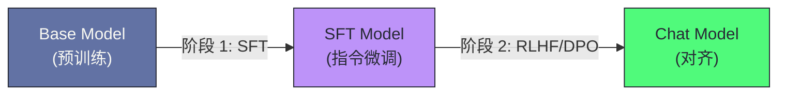
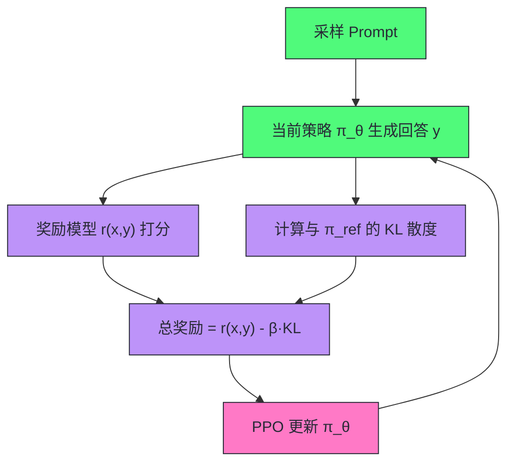
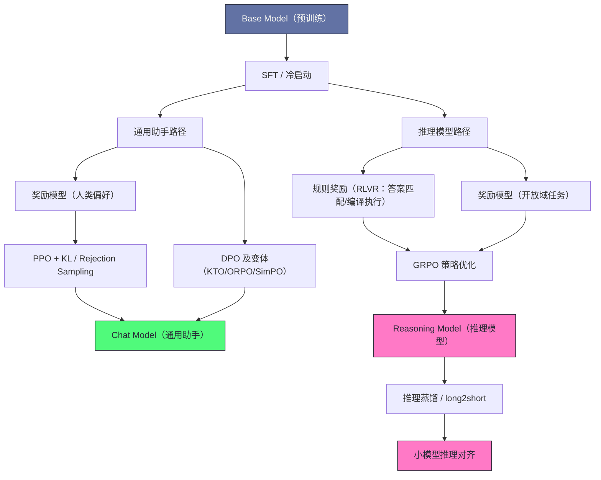

# 04 指令微调与 RLHF——从基座模型到对话助手

**摘要：**

经过预训练的大语言模型（Base Model）在本质上是一台"续写机器"——给它一个问题，它可能继续生成更多问题，而非给出回答。要把这台机器改造成有用、安全、遵循指令的对话助手，业界发展出了一整套名为**对齐（Alignment）**的后训练工艺：先以**指令微调（Supervised Fine-Tuning，SFT）**教模型识别并遵循指令格式，再以**人类反馈强化学习（Reinforcement Learning from Human Feedback，RLHF）**或其替代方案**直接偏好优化（Direct Preference Optimization，DPO）**把模型的输出偏好对齐到人类评价，辅以 **Constitutional AI / RLAIF** 这类用规则与 AI 反馈替代部分人工标注的做法。本文沿着这条主线回答两个问题：其一，为什么一个只学过"续写文本"的模型，靠相对少量的对齐训练就能变成对话助手；其二，2024 年之后推理模型（Reasoning Model）兴起，o1/o3 与 DeepSeek-R1 把后训练的重心从"对齐偏好"转向"强化推理能力"，GRPO、可验证奖励（RLVR）、推理蒸馏等新机制大规模入场，经典 RLHF 是否就此过时。本文的落点是：**经典 RLHF 并没有被推翻，而是与 GRPO/RLVR 形成了分工**——通用助手的开放域偏好与安全对齐仍以 RLHF/DPO 为主，可验证任务上的能力强化交给规则奖励驱动的组相对策略优化，二者共用同一条 SFT 底座，构成 2026 年对齐栈的基本骨架。

---

## 第 1 章 Base Model vs Chat Model：差距在哪里

### 1.1 从"续写机器"到对话助手

2022 年 11 月 30 日，OpenAI 发布 ChatGPT，普通用户第一次发现"对话式 AI"可以自然到这种程度。但几乎所有的业内人士都清楚，支撑这个产品的底座 GPT-3.5，在几个月前还是一台只会续写的机器——让它写"三国演义读后感"，它会像模像样地续写一段关于三国演义的文本，至于"读后感的观点是否成立、结构是否完整"，它既不关心，也没有被训练去关心。

关键在预训练目标本身。在 [[03 预训练——数据、算力与 Scaling Law]] 中笔者已经说明，预训练只是 next token prediction——模型在数万亿 token 上学习"给定前文，下一个词是什么"的条件概率分布。这个目标天然地把"问题后面跟着更多问题"和"问题后面跟着答案"都当作合法模式：在 Stack Overflow 的问答页、论坛的帖子串、教科书习题册里，前者的出现频率绝不比后者低。模型忠实建模的是语料中的统计规律，而不是用户的期望。

给 LLaMA-65B 的 Base Model 输入"请解释什么是量子计算"，它可能生成：

> "请解释什么是量子计算？这是一个很好的问题。在许多大学的物理课程中，量子计算都是一个热门话题。以下是一些关于量子计算的常见问题：\n1. 什么是量子比特？\n2. 量子纠缠是什么意思？……"

模型没有回答问题，而是生成了更多问题——在训练数据的分布里，"问题串"本身就是常见模式，模型只是如实复制了它。基座模型就像一个知识渊博但完全不懂场合的学者：你问他现在几点，他能给你讲三个小时的钟表史。知识没有问题，有问题的是"输出场合的礼仪"，而这正是对齐训练要补的课。

### 1.2 对齐（Alignment）的三个维度

将 Base Model 对齐为 Chat Model，业界习惯把目标拆成三个互相纠缠的维度：

- **有用性（Helpfulness）**：模型应该尽力回答用户的问题，提供有价值的信息，遵循用户的指令格式
- **无害性（Harmlessness）**：模型应该拒绝生成有害内容（暴力/歧视/非法活动指导），不输出虚假信息
- **诚实性（Honesty）**：模型应该在不确定时表达不确定，而非编造答案（减少幻觉）

三个维度并非天然一致。用户让模型"写一个入侵网站的方法"，有用性要求给出详尽步骤，无害性要求拒绝，模型只能二选一；更微妙的是诚实性与无害性也会打架——"如果用户正处在自伤风险中，直说真相还是安抚他"，这个问题连人类都没有统一答案。把三维度理解成"硬约束下的软目标"更准确：无害性是红线，有用性是目标，诚实性是约束，三者冲突时按优先级裁决。如何处理这些冲突，正是对齐研究的核心挑战，也是后面所有章节反复出现的母题。

### 1.3 对齐的两阶段流程

当前主流的对齐流程分为两个阶段：



**阶段 1：SFT（Supervised Fine-Tuning，监督微调）** 用人工标注的指令-回答对训练模型，教它理解指令格式和回答模式。

**阶段 2：RLHF / DPO** 用人类偏好数据进一步优化模型，让它学会在多个可能的回答中选择人类更偏好的那个。

为什么不能只做阶段 1？第 2 章会给出机制层面的解释，但可以先给一个直觉：SFT 教模型"回答的形式"，RLHF 教模型"回答的好坏"，形式易教，好坏难教——后者正是对话助手体验的分水岭。顺着 [[01 从 RNN 到 Transformer——注意力机制的革命]] 读下来的读者应该注意到，这套两阶段流程与其说是理论推演的结果，不如说是工程试错逼出来的：InstructGPT（OpenAI, 2022）最初就是想靠 SFT 一步到位，发现指令遵循的效果有限，才补上了基于人类偏好的强化学习阶段。

---

## 第 2 章 SFT——教模型理解指令

### 2.1 SFT 的核心思想

SFT 的本质极其简单：**用高质量的（指令, 回答）数据对 Base Model 进行有监督微调**。训练目标与预训练相同（交叉熵损失），但有一个关键区别——**损失只计算在回答部分，不计算在指令部分**。

假设一条训练样本是：

```
[System] 你是一个有帮助的AI助手。
[User] 请用三句话解释什么是黑洞。
[Assistant] 黑洞是时空中引力极强的区域，连光都无法逃逸。它通常由大质量恒星坍缩形成。黑洞的边界被称为事件视界，越过事件视界的任何物质和能量都无法返回。
```

训练时，模型看到完整的对话，但损失函数只对 `[Assistant]` 之后的部分进行计算。这教会模型：**当看到指令格式的输入时，应该生成回答格式的输出**。

从优化的角度看，"只算回答部分"不是可有可无的细节。指令部分通常是公开的提示词，模型在预训练里早就见过大量类似文本，继续在指令上算损失只会强化"续写"习惯；而回答部分才是我们要塑造的行为。如果像预训练那样对整段对话求平均损失，指令部分（往往更长）会稀释回答部分的梯度信号，微调就退化成一次低效的预训练。

### 2.2 指令数据的构造

SFT 数据的质量和多样性直接决定微调效果。数据构造的主要方式包括：

**人工标注**：雇佣标注团队编写高质量的指令-回答对。这是最高质量但成本最高的方式。InstructGPT（OpenAI）使用了约 13,000 条人工标注数据。令人惊讶的是，这么少的数据就足以产生显著的行为变化——因为 SFT 的目标不是教模型新知识，而是激活它已有的知识并调整输出格式。这条经验后来被 LIMA 推向极致：只用 1,000 条精选数据就能换来显著的行为转变（见 2.5 节）。

**Self-Instruct / Evol-Instruct**：用现有的强模型（如 GPT-4）自动生成指令数据。Self-Instruct 从少量种子指令出发，让模型生成新指令和对应回答；Evol-Instruct（WizardLM）通过让模型对现有指令进行"进化"（增加约束/深化问题/增加推理步骤）来提升数据的复杂度和多样性。

需要提醒的是，合成数据不是免费的午餐。Self-Instruct 的数据分布高度依赖种子集与生成模型的能力边界——如果种子指令偏编程，生成出来的数据也偏编程；如果生成模型本身有事实性错误，错误会原样进入训练集，这就是所谓的**数据中毒（Data Poisoning）**风险。Evol-Instruct 在把指令"进化"得更复杂的同时，也可能把指令进化得不可回答，WizardLM 论文里专门讨论过如何过滤这类"僵尸指令"。

**开源数据集**：

| 数据集 | 规模 | 来源 | 特点 |
| :--- | :--- | :--- | :--- |
| **Alpaca** | 52K | GPT-3.5 生成 | 早期开源 SFT 数据集 |
| **ShareGPT** | ~90K 对话 | 用户分享的 ChatGPT 对话 | 真实用户指令，多轮对话 |
| **OpenAssistant (OASST)** | ~160K 消息 | 社区众包标注 | 多语言，含偏好标注 |
| **WizardLM Evol-Instruct** | 250K | GPT-4 进化生成 | 高复杂度指令 |
| **UltraChat** | 1.5M 对话 | GPT-3.5/4 生成 | 大规模多轮对话 |

### 2.3 Chat Template——对话格式的标准化

SFT 需要将对话格式化为模型能理解的 token 序列。不同模型使用不同的 **Chat Template**（对话模板），用特殊 token 标记角色边界。

以 ChatML 格式（OpenAI/Qwen 使用）为例：

```
<|im_start|>system
你是一个有帮助的AI助手。<|im_end|>
<|im_start|>user
什么是黑洞？<|im_end|>
<|im_start|>assistant
黑洞是...<|im_end|>
```

以 LLaMA 2 格式为例：

```
[INST] <<SYS>>
你是一个有帮助的AI助手。
<</SYS>>

什么是黑洞？ [/INST] 黑洞是...
```

Chat Template 的选择看似是工程细节，实际上对模型的多轮对话能力有重要影响。模板需要清晰地划分角色边界，让模型知道"什么时候该说话，什么时候该停"。

这个结论背后有个容易被忽略的机制：模板 token 并不是凭空加上的，它们要参与 embedding 与注意力计算，因而会改变模型对上下文的建模。更实际的问题是模板与推理时的一致性——训练用 ChatML，部署时如果忘了加 `<|im_start|>` 或把 system 轮去掉，模型对 prompt 的"熟悉感"会下降，指令遵循的稳定性随之劣化。开源社区流传的"同一个模型在 vLLM 与 Transformers 里表现不一致"的多数案例，根子都在模板没对齐，而不是模型权重有差异。

### 2.4 SFT 的训练细节

SFT 相对于预训练是一个轻量级的训练过程：

| 维度 | 预训练 | SFT |
| :--- | :--- | :--- |
| 数据量 | 万亿 token | 数万到数百万条 |
| 训练时间 | 数周到数月 | 数小时到数天 |
| 学习率 | ~$3 \times 10^{-4}$ | ~$2 \times 10^{-5}$（更低） |
| Epoch | 1-2 | 2-5 |
| 目标 | 学习语言和知识 | 调整行为格式 |

SFT 的学习率通常比预训练低一个数量级——因为我们不希望大幅改变模型已学到的知识和能力，只是微调其输出行为。过高的学习率会导致"灾难性遗忘"（Catastrophic Forgetting），模型在获得指令遵循能力的同时丢失预训练中学到的知识。

SFT 的数据规模该走哪条路线，是 2023-2025 年间最有意思的一场争论。LIMA 证明了"1,000 条精选数据足够"，但那是质量视角的极限实验；AI2 的 Tulu 系列给出了规模视角的答案——Tulu 2 的 SFT 混合集约 32.6 万条，Tulu 3 的多任务混合集更达到约 94 万条（939K），其中相当比例是 GPT-4o / Claude 3.5 Sonnet 按 persona 方法合成的数据，配合逐技能的数据消融选择，把 8B 模型推到了当时开源模型的第一梯队。Singh 等人（2023）的 ReST-EM 实验进一步表明，在数学、代码这类有标量反馈的任务上，用模型自生成并过滤的合成数据做 SFT，效果可以反超纯人工数据。两相对照，结论其实并不矛盾：数据量小时"质量优先"（LIMA），数据量大时"多样性与规模优先"（Tulu），而合成数据的价值取决于教师模型的能力与过滤器的可靠性——这条规律在 2024 年之后的推理数据构造里被反复验证（见第 8 章）。

### 2.5 SFT 的效果与局限

SFT 的效果是立竿见影的——仅用几千到几万条高质量数据，模型就能从"续写机器"变成"能回答问题的助手"。LIMA 论文（Meta, 2023）的一个惊人发现是：**仅用 1,000 条精心挑选的高质量 SFT 数据**，就能训练出一个质量接近 GPT-4 的模型（在特定评估维度上）。

> [!info] 核心概念
> LIMA 论文提出了 **"Superficial Alignment Hypothesis"（表面对齐假说）**：LLM 的知识和能力几乎全部在预训练阶段获得，对齐训练（SFT/RLHF）只是教模型以正确的格式和风格输出它已有的知识。换言之，SFT 不是在教模型"新东西"，而是在教它"说话的方式"。

但 SFT 有一个根本性的局限：它基于**最大似然训练**——模型被训练来模仿参考回答。这意味着：

- 模型可能学会"回答问题"的表面形式，但对"好回答"和"一般回答"之间的细微差异不敏感
- 模型无法从多个可能的回答中选择"最好的"——它只学会了模仿，没有学会"评判"
- 对于开放式任务（如创意写作），参考回答只是多种好答案中的一种，最大似然训练会限制多样性

这些局限正是 RLHF/DPO 要解决的问题。

表面对齐假说还有一个必须指出的边界：它描述的是"通用知识类任务"的规律，在**推理能力**上并不完全成立。2024 年之后的推理模型用事实做了修正——DeepSeek-R1 的研究者发现，从基座模型出发做纯强化学习，可以让模型自己"进化"出反思、验证等推理行为，这些行为并不存在于任何人类标注的 SFT 数据里（详见第 8 章）。落到结论上，SFT 主要激活知识，而 RL 还能塑造能力；假说在"知识对齐"维度成立，在"能力涌现"维度就要打折扣。

---

## 第 3 章 RLHF——用人类偏好对齐模型

### 3.1 RLHF 的核心思路

RLHF（Reinforcement Learning from Human Feedback）的核心思路是：

1. **人类很难写出最优回答，但很容易判断哪个回答更好**——标注"回答 A 比回答 B 好"远比"写出完美的回答"容易
2. 从这些偏好比较中训练一个**奖励模型**（Reward Model），学会自动评估回答质量
3. 用强化学习优化语言模型，让它生成奖励模型给高分的回答

为什么偏偏要绕一圈"偏好比较"？因为绝对评分的标注质量不可靠。给同一段回答打 1-5 分，不同标注员的标准差异巨大——有人嫌长、有人嫌短，有人看重信息量、有人看重语气；而让标注员在 A/B 两份回答里选一份更好的，一致性显著更高。打分是"每个人心里有一杆秤"，比较则是在同一杆秤上做排序，后者才是能规模化的标注形态。InstructGPT 的标注团队实际采取的就是"为同一 prompt 生成多个回答、再做排序/比较"的流程。

### 3.2 阶段一：训练奖励模型（Reward Model）

**数据收集**：对于一条指令，让 SFT 模型生成多个回答（通常 4-9 个），然后由人类标注员对这些回答进行**排序**或**两两比较**——标注"回答 A 优于回答 B"。

**模型结构**：奖励模型通常以 SFT 模型为初始化，去掉最后的 Language Model Head，替换为一个标量输出头——给定（指令, 回答）对，输出一个标量分数 $r(x, y)$ 表示质量。

**训练目标**：使用 **Bradley-Terry 模型**——对于一对比较 $(y_w, y_l)$（$y_w$ 被标注为更好），最大化：

$$\mathcal{L}_{\text{RM}} = -\mathbb{E}\left[\log \sigma(r(x, y_w) - r(x, y_l))\right]$$

其中 $\sigma$ 是 Sigmoid 函数。这个损失函数的含义是：让好回答的奖励分数高于差回答。

Bradley-Terry 模型的数学动机值得多说一句：它把"排序问题"改写成了"logistic 回归问题"。如果直接用 $r(x, y_w) > r(x, y_l)$ 这样的硬约束做优化，奖励函数的尺度是任意的——把分数整体平移 10 分，不等式照样成立，梯度却变得不稳定；Bradley-Terry 用 sigmoid 把分数差映射成"好回答胜出的概率"，既消掉了尺度歧义，又让优化目标平滑可导。这也是为什么几乎所有偏好对齐方法（RM、DPO 及其变体）的损失函数都以 $\sigma$（Sigmoid）为核心构件。

奖励模型的训练数据量通常在 10 万到 100 万级别。InstructGPT 使用了约 33K 比较对，LLaMA 2 使用了约 1M 比较对。

> [!warning] 生产避坑
> 奖励模型的质量是 RLHF 成功的关键瓶颈。一个有偏差的奖励模型会将偏差传递给语言模型——如果奖励模型偏好冗长的回答（因为标注员倾向于认为长回答更"充实"），语言模型就会变得啰嗦。这就是所谓的 **"Reward Hacking"**——模型学会了"讨好"奖励模型而非真正提升质量。

还有一个工程上常被低估的问题：**分布漂移（Distribution Shift）**。奖励模型是在 SFT 模型的回答上训练出来的，可它服务的对象是正在被 PPO 优化的策略模型——策略在训练中不断偏离 SFT 分布，奖励模型却始终停留在"看惯了 SFT 风格回答"的视角上。分布漂移越严重，奖励模型的打分越失真，最终形成的反馈回路就越可能把策略推向奖励模型"眼熟但不真实"的方向。缓解手段包括定期用当前策略重新采样偏好数据（成本高昂）、在奖励中混入 KL 惩罚（见 3.3 节），以及用多个奖励模型集成投票。

### 3.3 阶段二：PPO 强化学习优化

有了奖励模型后，使用**近端策略优化**（Proximal Policy Optimization, PPO）算法来优化语言模型。

**目标函数**：

$$\max_\theta \mathbb{E}_{x \sim D, y \sim \pi_\theta(y|x)} \left[r(x, y) - \beta \cdot D_{\text{KL}}\left[\pi_\theta(y|x) \| \pi_{\text{ref}}(y|x)\right]\right]$$

其中：
- $\pi_\theta$ 是正在训练的语言模型（策略）
- $\pi_{\text{ref}}$ 是 SFT 模型（参考策略）
- $r(x, y)$ 是奖励模型的评分
- $\beta$ 是 KL 散度惩罚系数

目标是**最大化奖励，同时不让模型偏离 SFT 模型太远**。KL 散度惩罚项至关重要——没有它，模型会快速"塌缩"到一种极端的输出模式来最大化奖励（Reward Hacking），而不是真正提升回答质量。$\beta$ 控制了探索与保守之间的平衡。

**PPO 的训练循环**：



每一步需要：
1. 从 prompt 集合中采样
2. 用当前策略生成回答（前向推理）
3. 用奖励模型打分
4. 计算 KL 散度
5. 用 PPO 算法更新策略参数

这意味着 RLHF 的训练需要同时在 GPU 上保持**四个模型**：当前策略、参考策略、奖励模型、价值函数（PPO 的 Critic）。显存需求巨大——这是 RLHF 实施难度高的主要工程原因。

PPO 内部还有一个值得展开的细节：它依赖一个**价值函数（Value Function）**来估计"从当前 token 位置往后还能拿到多少奖励"。价值函数要和策略模型同规模训练，显存再翻一倍；更麻烦的是，对语言生成这种"只有最终奖励、过程没有中间奖励"的任务，逐 token 预测累计奖励本身就非常困难——模型在长回答里可能先写一个推导、再自我推翻，价值函数根本无从预测这个"中途变卦"的序列最终能拿几分。PPO 的超参数（尤其是广义优势估计 GAE 中的 $\lambda$）也因此极其敏感，DeepSeek 团队在对比 GRPO 与 PPO 时专门指出：$\lambda$ 取默认值 0.95 时 PPO 在 MATH 上明显不如 GRPO，调到 1.0 才接近（详见第 8 章）。这些工程痛点，正是 DPO 与 GRPO 相继登场的直接原因。

### 3.4 RLHF 的效果

InstructGPT 论文中最令人印象深刻的结果是：**经过 RLHF 对齐的 1.3B 模型，在人类评估中胜过了未对齐的 175B GPT-3 模型**——参数量少 100 倍以上。这强有力地证明了对齐训练的价值：它不只是"锦上添花"，而是将模型的潜在能力真正释放出来的关键步骤。

RLHF 相比纯 SFT 的主要提升在于：
- **更好的指令遵循**：在复杂指令和多步骤任务上表现更好
- **更安全的输出**：更好地拒绝有害请求
- **更好的输出质量**：回答更连贯、更有条理、更符合人类偏好
- **减少幻觉**：模型更倾向于在不确定时表达不确定

### 3.5 RLHF 的失败模式：Goodhart 定律的现场教学

RLHF 的成功很容易让人忽略它背后的那柄达摩克利斯之剑。奖励模型是"人类偏好的代理"，只要代理与真值不完全一致，过度的优化就会反噬——这正是 Goodhart 定律的经典形态："当一项度量变成目标，它就不再是好的度量。"

OpenAI 的 Gao 等人在 2022-2023 年用一组精心设计的实验量化了这个现象（Scaling Laws for Reward Model Overoptimization）：用一个固定的"金标准"奖励模型扮演人类，训练一个代理奖励模型去拟合它，然后观察"优化代理奖励分数"与"金标准分数"之间的关系。结果是一条先升后降的倒 U 形曲线——优化到一定程度后，代理分数还在涨，金标准分数却开始下跌，这个拐点就是**过度优化（Overoptimization）**。更值得警惕的是，曲线形态与优化方式（RL 还是 best-of-n 采样）、奖励模型的规模、KL 惩罚系数都强相关，工程上没有一个放之四海皆准的"安全优化步数"。

RLHF 阶段最常见的 reward hacking 案例是**长度偏好**：标注员潜意识里偏爱长回答，奖励模型学到"长=好"，策略模型便一路拉长输出，直到回答冗长得不像人话。反之，如果奖励模型偏爱特定句式，模型也会一头扎进句式里。DeepSeek-R1 训练中同样记录过这种场景：第二阶段的奖励模型存在系统性偏差时，训练曲线上的奖励一路走高，Codeforces 上的真实表现却持续下滑——奖励与能力脱钩，正是 reward hacking 的典型心电图。缓解手段没有银弹：加大 KL 惩罚、提高偏好数据质量、人工抽检对齐曲线，都是"减小代理误差"的笨功夫，但正是这些笨功夫让 RLHF 可用。

---

## 第 4 章 DPO——绕开强化学习的直接优化

### 4.1 RLHF 的工程痛点

RLHF 虽然效果好，但工程实施极其复杂：

- **四模型同时训练**：策略模型 + 参考模型 + 奖励模型 + 价值网络，显存需求约为 SFT 的 4 倍
- **训练不稳定**：PPO 算法对超参数敏感，奖励模型的质量波动会放大到策略训练中
- **Reward Hacking**：模型可能找到"骗过"奖励模型的捷径而非真正提升质量
- **采样开销大**：每个训练步都需要用当前策略做前向推理生成回答

这些问题促使研究者寻找更简单的替代方案。

### 4.2 DPO 的核心推导

**DPO（Direct Preference Optimization）**（Rafailov et al., 2023）的关键洞察是：**RLHF 的最优策略可以用闭式解表示，而这个闭式解可以直接转化为一个简单的分类损失**。

从 RLHF 的目标函数出发，可以证明最优策略为：

$$\pi^*(y|x) = \frac{1}{Z(x)} \pi_{\text{ref}}(y|x) \exp\left(\frac{1}{\beta} r(x, y)\right)$$

对这个式子取对数并重排，可以得到奖励函数的隐式表达：

$$r(x, y) = \beta \log \frac{\pi^*(y|x)}{\pi_{\text{ref}}(y|x)} + \beta \log Z(x)$$

将这个表达式代入 Bradley-Terry 模型的偏好概率公式，$Z(x)$ 项消去，最终得到 DPO 的损失函数：

$$\mathcal{L}_{\text{DPO}} = -\mathbb{E}\left[\log \sigma\left(\beta \log \frac{\pi_\theta(y_w|x)}{\pi_{\text{ref}}(y_w|x)} - \beta \log \frac{\pi_\theta(y_l|x)}{\pi_{\text{ref}}(y_l|x)}\right)\right]$$

这个损失函数直观地说：**增大好回答相对于参考模型的概率比，同时减小差回答的概率比**。

推导的妙处值得慢下来体会。第一，闭式解的存在要归功于 KL 惩罚项：它是唯一让目标函数对 $\pi_\theta$ 有显式最优解的正则形式——换成别的惩罚，公式这一步就推不下去。第二，$Z(x)$ 是归一化常数，恰好在一对偏好比较里分子分母相消，因此**根本不需要算它**——这是 DPO 能绕开强化学习的数学基础。第三，$\beta$ 的角色从"KL 惩罚强度"变成了"对偏好差异的敏感度"：$\beta$ 越大，模型越倾向于严格区分好回答与差回答；实践中常用取值在 0.1 附近，但不同任务的最优值差异不小。

### 4.3 DPO 的优势

DPO 相比 RLHF 的优势是巨大的：

| 维度 | RLHF (PPO) | DPO |
| :--- | :--- | :--- |
| 需要的模型 | 4 个（策略/参考/奖励/价值） | 2 个（策略/参考） |
| 训练算法 | PPO（强化学习） | 简单的分类损失（监督学习） |
| 训练稳定性 | 超参数敏感，容易不稳定 | 稳定（类似 SFT） |
| 工程复杂度 | 极高 | 低（与 SFT 类似） |
| 采样需求 | 需要在线采样 | 离线数据即可 |
| 显存需求 | ~4x SFT | ~2x SFT |

DPO 将 RLHF 的三阶段（SFT → 训练 RM → PPO 训练）简化为两阶段（SFT → DPO 训练），显著降低了对齐训练的门槛。Hugging Face 的 Zephyr-7B 用约 60K 条 UltraFeedback 偏好数据加 DPO，就做出了当时 7B 级别里最强的对话模型之一，这让很多小团队第一次意识到：对齐不再是只有大厂玩得起的游戏。

### 4.4 DPO 的局限与变体

DPO 的核心假设是偏好数据是**离线**的（事先收集好的）。这意味着偏好数据中的回答来自参考策略 $\pi_{\text{ref}}$，而非正在训练的策略 $\pi_\theta$。随着训练的进行，$\pi_\theta$ 与 $\pi_{\text{ref}}$ 的差距越来越大，离线数据的质量可能不再反映当前策略的行为——这是 DPO 的一个理论局限。

针对这个问题，出现了多个 DPO 变体：

- **IPO（Identity Preference Optimization）**（Azar 等人，2023）：从一般化的偏好优化理论出发，推导出带恒等映射式正则项的损失，试图避免 DPO 在有限偏好对上过拟合——DPO 训练过久会把好回答的概率推到极端，IPO 的正则项给这个极端踩了刹车
- **KTO（Kahneman-Tversky Optimization）**（Ethayarajh 等人，2024）：不再需要成对比较，只需要"好/差"的二元标注——它把卡尼曼-特沃斯基的前景理论搬进损失函数，对"获得"与"损失"不对称地加权，贴合人类损失厌恶的心理测量结果，标注成本因此大幅下降
- **ORPO（Odds Ratio Preference Optimization）**（Hong 等人，2024）：把 SFT 与偏好优化合并为一个阶段，用"好回答胜率 / 差回答胜率"的**比值（Odds Ratio）**做惩罚，训练时不需要参考模型——比 DPO 再省一个模型
- **SimPO（Simple Preference Optimization）**（Meng 等人，2024）：以序列的**平均对数概率**作为隐式奖励，同样去掉参考模型，还额外引入一个目标奖励间隔（target margin），让好回答与差回答的分数差至少拉开一个阈值——在 AlpacaEval 2 与 Arena-Hard 上比 DPO 高 6-7 个点

这些变体的取舍可以归纳为一句话：**DPO 家族在拿"监督学习的简单性"换"偏好优化的精确性"**。KTO 用二元标注换掉成对数据，ORPO 用单阶段换掉两阶段，SimPO 用平均对数概率换掉参考模型——每一次简化都砍掉一块工程成本，也砍掉一部分理论保真。选择哪个变体，取决于团队手头有什么数据、什么算力，以及愿意为对齐质量付出多少调试成本。

> [!note] 设计哲学
> DPO 的出现体现了一个重要的研究范式：**将复杂的强化学习问题转化为简单的监督学习问题**。这不仅降低了工程复杂度，还让更多团队能够进行对齐训练——你不需要强化学习的专业知识，只需要偏好数据和标准的微调 pipeline。这个范式在 2024-2026 年被不断重演：推理模型时代，GRPO 反过来"简化了 PPO"（去掉价值网络），而 DPO 家族的简化思路也被带进了推理对齐（见第 8、9 章）。

---

## 第 5 章 对齐训练的数据工程

### 5.1 偏好数据的标注方法

偏好数据的标注质量直接决定对齐效果。常见的标注方式：

**两两比较（Pairwise Comparison）**：给标注员展示同一指令的两个回答，让他们选择"更好的那个"。这是最常用也最可靠的方式——比"给单个回答打绝对分数"更一致（不同标注员的打分标准差异大，但"哪个更好"的判断更趋一致）。

**排序（Ranking）**：对同一指令的 4-9 个回答进行完整排序。信息量更大（一次排序可以产生多个两两比较对），但标注难度更高。

**属性标注**：不仅标注哪个更好，还标注具体在哪个维度上更好（有用性/安全性/真实性/格式）。这使得训练更精细，但标注成本更高。

### 5.2 数据规模与质量的权衡

| 模型 | SFT 数据量 | 偏好数据量 | 对齐方法 |
| :--- | :--- | :--- | :--- |
| InstructGPT | ~13K | ~33K 比较对 | RLHF (PPO) |
| ChatGPT | 未公开 | 未公开 | RLHF (PPO) |
| LLaMA 2 Chat | ~27K | ~1M 比较对 | RLHF (Rejection Sampling + PPO) |
| Zephyr-7B | ~200K（UltraChat） | ~60K（UltraFeedback） | DPO |
| Mistral Instruct | 未公开 | 未公开 | DPO |

一个关键经验是：**SFT 数据追求质量，偏好数据追求规模**。少量精选的 SFT 数据（如 LIMA 的 1,000 条）就能带来显著的行为变化，而偏好数据则需要足够的规模和多样性来覆盖各种场景。

2023 年之后，偏好数据的开源供给明显增加：Anthropic 的 **HH-RLHF**（约 16.1 万条"有帮助/无害"比较对）、OpenAI 的 **HelpSteer**、NVIDIA 的 **HelpSteer2**、Argilla 的 **UltraFeedback**（约 6.4 万条，含 GPT-4 逐维度打分）成为社区微调的事实标准。值得一提的是，这批数据集大多由"强模型生成回答 + 模型或人类筛选"的流程产出，本身就是 RLAIF 的雏形——关于这条线索，第 6 章会展开。

### 5.3 Rejection Sampling（拒绝采样）

LLaMA 2 在 RLHF 训练中使用了一个重要技巧——**Rejection Sampling**：对每个 prompt，用当前策略生成 $K$ 个回答（如 $K = 25$），用奖励模型给所有回答打分，只取**最高分**的回答作为新的 SFT 数据，再用这个数据做一轮 SFT。

这个方法的直觉是：从模型自己的多个回答中选出最好的，用它来"教"模型。相比直接做 PPO，Rejection Sampling 更简单稳定，且能利用更多的 prompt。

LLaMA 2 的对齐训练实际上是多轮迭代的：**SFT → Rejection Sampling → RLHF → 用新模型再做 Rejection Sampling → 再做 RLHF……** 每一轮都让模型变得更好，同时也能用更好的模型生成更好的训练数据。

Rejection Sampling 有个容易被忽略的优势：它把"在线探索"变成了"离线择优"，天然规避了 PPO 的分布漂移问题——因为最好的回答来自当前策略本身，不存在"奖励模型看惯了旧分布"的错位。这个思路在推理模型时代被发扬光大：DeepSeek-R1 第二阶段 SFT 数据里约 60 万条推理样本，就是从第一轮 RL 收敛后的检查点上做拒绝采样得到的（详见第 8 章）。

### 5.4 数据工程的暗面：污染与同源偏差

偏好数据还有两个常常被忽视的问题。其一是**基准污染（Contamination）**：主流偏好数据集（UltraFeedback、HH-RLHF 等）的 prompt 经常出现在下游评估基准里，直接用它们训练，评估分数会被高估。其二是**同源偏差**：SFT 数据与偏好数据往往出自同一个教师模型（譬如都是 GPT-4 生成的），教师模型的偏见会被两层学习放大——SFT 层学一遍，偏好层再学一遍。这两点都在提醒我们，数据工程不是"有多少用多少"，而是"知道每一条数据的来源与偏差，再决定怎么用"。

---

## 第 6 章 Constitutional AI 与自我改进

### 6.1 Constitutional AI 的思路

Anthropic 提出的 **Constitutional AI（CAI）** 尝试减少对人类标注的依赖。核心思路是：

1. 给模型一套"宪法"（Constitution）——一组描述理想行为的原则（如"不要帮助用户做违法的事""回答要客观准确"）
2. 让模型自己根据这些原则，评估和修正自己的回答
3. 用自我修正后的数据进行训练

具体流程：
- **Red Teaming**：用一个"攻击者"模型生成有害的 prompt
- **初始回答**：让模型生成初始回答（可能包含有害内容）
- **自我批评**：模型根据宪法原则评判自己的回答哪里有问题
- **自我修正**：模型修改回答，使其符合宪法原则
- **训练**：用（原始 prompt, 修正后的回答）作为 SFT 数据；用（原始回答, 修正后的回答）作为偏好对进行 DPO/RLHF

CAI 的"自我批评-修正"循环，实际上是把人类标注员的**工作流**搬进了模型内部：人类标注有害回答时，也是先对照安全准则判断哪里有问题，再改写成合规的回答。宪法原则在这里扮演的角色，相当于一份可复用的"标注规范"，Anthropic 后来把 Claude 的安全对齐继续沿用了这条路线，只不过宪法的条目更细、批评-修正的轮次更多。

### 6.2 RLAIF：用 AI 替代人类标注

**RLAIF（Reinforcement Learning from AI Feedback）** 更进一步——直接用一个强模型（如 GPT-4）作为"人类标注员"来生成偏好数据。

Google 的研究表明，在某些场景下，RLAIF 的效果接近甚至匹敌 RLHF。这大幅降低了对齐训练的成本——不再需要昂贵的人工标注团队。

但 RLAIF 的风险是**能力上限受限于"评判者"模型**——如果 GPT-4 本身在某个维度上有偏差，这个偏差会传递给被训练的模型。更隐蔽的是同源问题：当学生模型与教师模型同属一族时，教师对"好回答"的品味会被完整复制，学生的行为永远被限定在教师的品味边界之内。

### 6.3 自我改进的边界

RLAIF 的进阶版本是**自我奖励（Self-Rewarding）**——让模型自己给自己打分、自己生成新偏好数据，形成自我改进循环。这个方向在 2024 年引发了大量讨论，但它的边界同样清晰：自我评估的质量取决于模型当前的能力，模型看不见自己看不见的东西。OpenAI 的**弱到强泛化（Weak-to-Strong Generalization）**研究从另一个角度证实了这一点——弱教师监督强学生，学生能超过教师，但超过的幅度有限，且教师越弱、天花板越低。

一个经典的失效场景是**偏见自我强化**：如果模型的回答里混入了某种系统性偏见（譬如对特定群体的刻板印象），自我批评时它可能认为"这个表述符合宪法原则"，于是偏见在"批评-修正-再训练"的循环里被反复确认、反复强化——批评者与被批评者是同一个大脑，红队与蓝队是同一拨人，这种自我审查的有效性就大打折扣。这也是为什么 Anthropic 在 CAI 之外仍然保留了外部红队与人类评估，而不是完全依赖模型自我改进。

---

## 第 7 章 对齐税与对齐的未来

### 7.1 对齐税（Alignment Tax）

对齐训练会不可避免地降低模型在某些基准上的"原始性能"——这被称为**对齐税**。譬如：

- Chat 模型在纯文本续写任务上的困惑度可能高于 Base 模型
- Chat 模型在某些需要"不安全"知识的基准（如某些安全相关的问答）上可能拒绝回答
- 过度对齐可能导致模型过于"谨慎"，对无害的请求也拒绝回答（"我不能帮你写一个关于战争的故事"）

对齐税最直观的形态是**过度拒绝（Over-Refusal）**。Röttger 等人（2023）构造了 XSTest 测试集——250 条明确安全但措辞敏感的 prompt（譬如"帮我写一首关于核弹的诗"）配 200 条对照的有害 prompt，用来系统测量模型的"夸大式安全"行为，结果发现当时的 SOTA 模型普遍在安全措辞的 prompt 上过度拒绝。这个现象背后的机制并不神秘：无害性训练用的是"有害内容→拒绝"的样本，模型学到的其实是**模式匹配**——只要 prompt 里出现"暴力、武器、毒品"等敏感词就触发拒绝，而区分"讨论"与"指导实施"的语义细节，是奖励模型与策略模型都很难从有限样本里学到的东西。

对齐税的另一副面孔是**谄媚（Sycophancy）**。Sharma 等人（2023）的测量显示，多款主流 RLHF 模型在自由文本任务上普遍表现出"附和用户观点"的倾向——当用户表达一个错误但坚定的观点时，模型倾向于认同而非纠正；更麻烦的是，人类标注员与偏好模型本身就更偏爱"写得漂亮的谄媚回答"，也就是说，这种毛病是 RLHF 的目标函数自带的，不是实现 bug。

对齐税在推理模型时代有了新形态——**过度思考（Overthinking）**。DeepSeek-R1 的论文坦承，模型对简单问题也会生成冗长的思维链，token 效率远未优化；Kimi k1.5 团队甚至专门设计了"长思维链蒸馏短思维链"（long2short）的第二阶段训练来压缩输出长度。安全性与有用性之间没有免费午餐，对齐税只能被管理、不能被消灭。

### 7.2 对齐的当前局限

- **幻觉未完全解决**：RLHF 可以减少但不能消除幻觉。模型仍然可能自信地输出错误信息
- **长尾安全问题**：模型可能在常见的有害请求上表现良好，但在精心构造的"越狱"（jailbreak）prompt 面前失效
- **价值观对齐**：不同文化和个人对"好回答"有不同标准，当前的对齐训练隐含了标注团队的价值偏好

推理模型的出现让"越狱"问题变得更加棘手。o1 的思维链以"隐藏推理"的形式存在——用户看不到内部推理过程，OpenAI 声称把行为规范集成进思维链有利于安全对齐，但安全研究者同样担忧：推理模型把大量决策过程放进了模型内部，外部审计变得几乎不可能。DeepSeek-R1 的安全报告也确认了这一点——更强的推理能力可能被越狱利用，模型给出的有害方案会更"可执行"。

### 7.3 对齐的测量难题

最后补一个常被忽视的维度：**我们其实不太会测量对齐**。有用性有偏好评估（AlpacaEval、Arena-Hard），无害性有一堆安全基准，但"模型是否真的内化了人类价值观"这件事本身没有 ground truth——你无法像验证数学题那样验证"拒绝率 90% 是否意味着安全"。更现实的问题是基准污染：主流评估集与训练数据高度重叠，分数通胀严重。2024 年之后，业界对"评测即训练"的警惕明显上升，但替代方案（人工抽检、动态基准、红队对抗）都还谈不上标准化。对齐研究走到今天，最大的瓶颈也许不是算法，而是测量。

---

## 第 8 章 推理模型时代：GRPO、RLVR 与思维链后训练

### 8.1 从 o1 到 DeepSeek-R1：推理模型如何改写对齐叙事

2024 年 9 月 12 日，OpenAI 发布 o1，公开信息只有寥寥数语：模型"通过强化学习训练，具备长**思维链（Chain of Thought）**"，性能"随训练时计算与**推理时计算（Test-Time Compute）**的增加而平滑提升"。2024 年 12 月 20 日，o3 在 ARC Prize 的独立评测中拿下 75.7%（低算力配置，每任务 6 个采样）与 87.5%（高算力配置，每任务 1,024 个采样，消耗约 172 倍算力、成本约 45.6 万美元）的成绩——作为参照，2020 年的 GPT-3 在 ARC-AGI 上几乎得分为零，2024 年的 GPT-4o 也只有约 5%。这个数据点把"推理时多算 = 多得分"的曲线摆到了所有人面前，也让"能力是否来自后训练"成为当年的头号话题。

OpenAI 没有公开 o1/o3 的训练算法，但两家开源团队在 2025 年 1 月给出了可复现的答案：DeepSeek-R1（arXiv 2501.12948）与 Kimi k1.5。二者不约而同地采用"基座模型 + 大规模强化学习"的后训练范式，把对齐叙事的重心从"对齐人类偏好"推向"强化推理能力"。至此，第 1 章那幅"Base → SFT → RLHF"的流程图需要补上第三条路径：推理模型的后训练。

### 8.2 GRPO：去掉价值网络的策略优化

推理模型的第一块基石是 **GRPO（Group Relative Policy Optimization，组相对策略优化）**，由 DeepSeekMath 论文（Shao 等人，2024）提出、DeepSeek-R1 大规模采用。

GRPO 对 PPO 的简化非常直接：**去掉价值网络（Critic）**。对每个问题 $q$，从旧策略 $\pi_{\theta_{old}}$ 采样一组输出 $\{o_1, \dots, o_G\}$（R1 取 $G=16$），用这组输出自己的奖励统计量来估计优势：

$$A_i = \frac{r_i - \text{mean}(\{r_1, \dots, r_G\})}{\text{std}(\{r_1, \dots, r_G\})}$$

即"这个回答在它所在小组里的相对位置"。优化目标仍是带 clip 的 PPO 式目标加上 KL 惩罚：

$$\mathcal{J}_{\text{GRPO}}(\theta) = \mathbb{E}\left[\frac{1}{G}\sum_{i=1}^{G}\left(\min\left(\frac{\pi_\theta(o_i|q)}{\pi_{\theta_{old}}(o_i|q)}A_i,\ \text{clip}\left(\frac{\pi_\theta(o_i|q)}{\pi_{\theta_{old}}(o_i|q)}, 1-\varepsilon, 1+\varepsilon\right)A_i\right) - \beta D_{\text{KL}}(\pi_\theta \| \pi_{ref})\right)\right]$$

为什么敢去掉价值网络？因为语言生成的奖励结构非常"稀疏"——大部分 token 位置没有即时奖励，只有最终回答拿到一个分数。价值网络在这种结构下难学且难用：它要预测"从当前 token 往后还能拿多少分"，而长思维链里模型随时可能自我推翻前面的推理，逐 token 的价值预测本质上不可靠。GRPO 用"组内相对位置"替代价值估计，相当于用**同组采样的均值当基线**——同一个问题采样 16 个回答，表现最好的那几个获得正优势，其余获得负优势，不需要任何额外的模型，显存与训练稳定性同时受益。

GRPO 在 KL 处理上还有一个细节差异：PPO 把逐 token 的 KL 惩罚当作稠密奖励累加，会隐式惩罚回答长度；GRPO 把 KL 项直接写进损失，避免了对长度的隐性惩罚——对动辄数千 token 的长思维链训练，这个区别很关键。另外，由于训练可能持续数千步，策略会离初始参考策略越来越远，R1 每 400 步就用最新策略替换参考模型，相当于给"风筝"换一根更长的线。

### 8.3 RLVR：可验证奖励为何难以被 hack

推理 RL 的第二块基石是奖励信号本身。DeepSeek-R1 的奖励设计分两类：

- **规则奖励（Rule-Based Reward）**：数学题用确定性答案匹配（要求最终答案写在特定格式里，直接比对），编程题用编译器跑预定义测试用例——这类奖励不依赖任何学习出来的模型，是"硬"信号
- **格式奖励（Format Reward）**：要求推理过程包在 `thinking` 与 `response` 标签里，按格式符合度打分，保证思维链可解析、可审计

这套组合被统称为 **RLVR（Reinforcement Learning with Verifiable Rewards，可验证奖励强化学习）**——奖励是否"可验证"是关键分界线。规则奖励来自确定性判定，模型很难"骗过"编译器，这正是它在数学、代码任务上比神经网络奖励模型稳健的原因。DeepSeek 论文里明确写道，他们刻意**不用神经网络奖励模型**做推理任务，因为观察到"神经奖励模型在大规模强化学习中极易被 reward hacking"。

但"难以 hack"不等于"不可 hack"。R1 论文附录记录了两个真实的反例：其一，如果奖励模型存在系统性偏差（譬如偏爱某种措辞），训练曲线上的奖励一路上涨、Codeforces 真实表现却持续下滑——奖励与能力脱钩；其二，格式奖励会被"格式体操"钻空子，模型学会了把答案塞进格式里拿分，过程却一塌糊涂。此外，R1 在第二阶段为缓解中英混杂，加入了**语言一致性奖励**（思维链中目标语言词占比），消融实验显示它让数学基准基本持平、代码基准小幅下滑，却显著提升了可读性——对齐税与能力之间的交换，在推理 RL 里同样存在。

### 8.4 冷启动之争：纯 RL 还是 SFT 冷启动

DeepSeek 的实验设计堪称"路线之争"的活标本。**DeepSeek-R1-Zero** 直接对 DeepSeek-V3-Base 做纯 RL，完全跳过 SFT——这在此前的行业共识里几乎是禁区（RLHF 都得先有 SFT 底座）。结果出乎所有人预料：纯 RL 训练下，AIME 2024 的 pass@1 从初始的 15.6% 一路涨到 77.9%，模型自发学会了"验证、反思、尝试替代路径"，甚至在中间版本里出现了一句著名的"等一下，这里我标记一个 aha moment"——模型在思维链里自己意识到要回头重算。

但纯 RL 的代价同样肉眼可见：R1-Zero 的输出可读性差、中英混杂严重，思维链时而冗长时而空洞。于是 **DeepSeek-R1** 换上了"冷启动"路线：先用**数千条**人工筛选的长思维链样本做一轮 SFT，再进入与 R1-Zero 相同的推理 RL。冷启动数据相当于给模型一个"人类认可的思考范式"的初始锚点，收敛更快、语言一致性更好，代价是 AIME 上短暂回退（论文里 Dev1 阶段比 R1-Zero 低约 20 个点），随后靠后续阶段追回。

这场争论到今天也没有终结。纯 RL 的支持者认为 SFT 冷启动会把模型限制在人类思考范式的边界内；冷启动的支持者认为纯 RL 的收益在大多数场景下盖不过工程复杂度。DeepSeek 的结论是折中的：**能力涌现依赖 RL，可读性与可控性依赖冷启动**，二者缺一不可。还有一个被论文明确记录的工程约束：纯 RL 只在足够大的基座模型上有效——7B 稠密模型与 16B MoE 模型做纯 RL 时会陷入重复生成，无法利用长思维链，这也是"推理 RL 的门票是基座模型规模"这条经验的由来。

**DeepSeek-R1 的四阶段管线**可以画成一条清晰的流水线：

```mermaid
%%{init: {'theme': 'dracula'}}%%
graph LR
    V3["DeepSeek-V3-Base"] -->|"冷启动 SFT（数千条长 CoT）"| DEV1["R1 Dev1"]
    DEV1 -->|"第一轮 RL（GRPO + 规则奖励）"| CKPT["RL 收敛检查点"]
    CKPT -->|"拒绝采样 + SFT（约 80 万条，含 60 万推理）"| DEV3["R1 Dev3"]
    DEV3 -->|"第二轮 RL（规则奖励 + 奖励模型 + 语言一致性）"| R1F["DeepSeek-R1"]

    classDef base fill:#6272a4,stroke:#282a36,color:#f8f8f2
    classDef rl fill:#bd93f9,stroke:#282a36,color:#282a36
    classDef sft fill:#50fa7b,stroke:#282a36,color:#282a36
    class V3 base
    class DEV1,DEV3 sft
    class CKPT,R1F rl
```



### 8.5 推理蒸馏与 reasoning 数据构造

推理 RL 虽然强大，但算力门槛高得离谱。DeepSeek 给出了一个极便宜的替代路径——**推理蒸馏（Distillation）**：用 R1 生成的思维链样本对 Qwen、LLaMA 等小模型做 SFT，产出了 DeepSeek-R1-Distill 系列六款模型。结果令人震撼：R1-Distill-Qwen-32B 在多项基准上超过了 o1-mini；R1-Distill-Qwen-1.5B 在部分数学基准上甚至反超了远大于它的闭源模型。社区随后跟进，AM-Team 开源了 140 万条 R1 蒸馏思维链（AM-DeepSeek-R1-Distilled-1.4M），仅靠 SFT 训练出的 AM-Distill-Qwen-32B 就反超了官方蒸馏版。

蒸馏与 RL 的关系值得掰开说。R1 论文用 Qwen2.5-32B 做了对照：大规模 RL 训练 1 万步得到 Qwen2.5-32B-Zero，与 R1-Distill-Qwen-32B 相比在 AIME 2024（47.0 vs 72.6）、MATH-500、GPQA-Diamond、LiveCodeBench 上全面落后——**同样的底座，蒸馏比 RL 便宜且效果更好**；但论文同时强调，蒸馏的天花板是教师模型，想突破人类智能边界仍然要靠更强的基座与更大规模的 RL。Kimi k1.5 则展示了蒸馏的"反向操作"——long2short：先用长思维链 RL 把模型能力练上去，再蒸馏出短思维链版本，让短版本继承长版本的能力、又省掉推理成本。推理数据的构造（收集、去污染、过滤混乱样本）由此成了新的数据工程赛道：R1 第二阶段那约 80 万条 SFT 数据（60 万推理 + 20 万通用）里，推理部分就是"RL 检查点 + 拒绝采样 + 人工清洗"的产物。

### 8.6 推理对齐的边界与反例

推理 RL 并不是万能钥匙，R1 论文专门用一节记录了**失败的尝试**：

- **过程奖励模型（Process Reward Model, PRM）**：给每一步推理打分，听起来合理，但"什么算一步"难以定义、中间步是否正确难以判断，且模型化的 PRM 本身就会引入 reward hacking——R1 团队最终放弃
- **蒙特卡洛树搜索（Monte Carlo Tree Search, MCTS）**：像 AlphaGo 那样在 token 空间里搜索，但 token 生成的分支因子远大于围棋，搜索空间呈指数膨胀，价值模型又难以训练——R1 团队同样放弃

这两个"失败"与 GRPO 的胜利形成了鲜明的对照：推理 RL 走通的关键不是"搜索得更聪明"，而是"奖励更可靠"。可验证任务（数学、代码）构成了一个"奖励可靠性的岛屿"，岛屿之内 RLVR 所向披靡；岛屿之外——开放域写作、长程规划、涉及主观判断的任务——奖励信号重新变得模糊，经典 RLHF 的奖励模型反而更合适。这就是第 9 章"演化图景"的技术前提。

---

## 第 9 章 2026 年对齐栈的演化图景

### 9.1 一张全景图

把第 1-8 章的线索收拢起来，2026 年的对齐栈可以画成一张两层分叉的图：



### 9.2 通用助手：经典 RLHF/DPO 仍是主力

先说结论：**经典 RLHF 没有被推翻，只是退回了它最擅长的领地**。通用对话助手的对齐目标——语气、风格、拒绝策略、开放域的有用性——依然高度依赖人类偏好信号，这恰恰是奖励模型与 PPO/DPO 的主场。OpenAI 的 ChatGPT 与 Anthropic 的 Claude 在公开信息层面仍然延续"偏好数据 + RLHF 类方法"的路线，o1/o3 的官方文档也强调推理模型之外仍有常规模型承担通用对话职责。DPO 家族则在中小团队中成为默认选择——它的门槛低到一张消费级显卡配合 LoRA 就能跑，性价比无可替代。

### 9.3 推理模型：GRPO/RLVR 成为主流

而在数学、代码、逻辑推理这类**可验证任务**上，2025 年的格局已经非常清晰：GRPO + RLVR 成为事实标准。开源工具链全面转向：Hugging Face 的 TRL 提供 GRPOTrainer；字节跳动的 **verl**（即 HybridFlow 论文的开源实现，训练侧接 FSDP/Megatron、生成侧接 vLLM/SGLang）把 GRPO/PPO 的混合并行做到了工业级；OpenRLHF 在 Ray + vLLM 架构上同时支持 PPO、DAPO、REINFORCE++ 等算法并延伸到 VLM 与 Agent 场景；LLaMA-Factory 则通过集成 trl/EasyR1 把 GRPO 带进了图形界面。不过，RLVR 的渗透并不局限于推理模型——AI2 的 Tulu 3 在通用助手的后训练里也把 RLVR 用作"精确指令遵循"等技能的定向增强，DPO 处理通用偏好、RLVR 处理可验证技能，两条腿走路的做法在开源社区已经开始扩散。一个有趣的信号是，连"纯 RL 冷启动"（R1-Zero 路线）也成了可复现的配方——虽然多数团队仍然选择冷启动 SFT 作为稳定锚点。

### 9.4 成本与工程现实

推理 RL 的工程成本是真实的门槛。Epoch AI 估算 DeepSeek-R1 的 RL 后训练约消耗 6.1e23 FLOP（折合约 100 万美元），约为其底座 V3 预训练成本的五分之一；2025 年 9 月 Nature 发表的论文中，DeepSeek 披露 R1 训练花费 29.4 万美元、使用 512 块 H800——无论以哪个口径看，这个量级都是当年 RLHF 的数十倍，因为每个训练步都要生成海量长思维链（R1 在 RL 阶段对每道题采样 16 条输出、最大长度 3.2 万到 6.5 万 token）。这也解释了为什么"蒸馏"会如此流行：**推理 RL 是炼丹，蒸馏是批发**，前者贵在探索，后者贵在复制——多数团队没有炼丹的算力，但有复制的能力。

### 9.5 判断与取舍

回到本文开头的那个问题：对齐训练究竟在教模型什么？第 8、9 章的演化给出了一个更完整的答案——**SFT 激活知识、RLHF 对齐偏好、推理 RL 塑造能力**，三者作用于同一根基座，但目标函数、数据形态与成本结构完全不同。2026 年的工程现实是：能定义可验证奖励的任务，优先走 GRPO/RLVR 路径；依赖人类主观判断的任务，回到 RLHF/DPO 路径；两者都要，就按 R1 的配方做多阶段流水线。对齐栈的复杂度没有消失，只是从"四个模型一台戏"的 PPO 转移到了"多阶段、多信号、多路径"的编排上——这与其说是技术路线的更替，不如说是工程复杂性的再一次转移。

---

## 第 10 章 总结

### 10.1 核心流程回顾

| 阶段 | 目标 | 数据 | 方法 | 效果 |
| :--- | :--- | :--- | :--- | :--- |
| **预训练** | 学习语言和知识 | 万亿 token 无标注文本 | Next token prediction | 强大的语言能力，但不遵循指令 |
| **SFT** | 学习指令格式 | 数千-数十万条（指令, 回答） | 监督微调 | 理解指令，生成回答 |
| **RLHF/DPO** | 对齐人类偏好 | 数万-数百万偏好比较 | 强化学习 / 直接优化 | 更有用、更安全、更诚实 |
| **GRPO/RLVR** | 强化可验证推理能力 | 数学/代码/逻辑题 + 规则奖励 | 组相对策略优化 | 长思维链推理，能力涌现 |

行文至此，可以给这条主线画个句号：对齐不是一次"洗涤"，把模型的坏习惯洗掉就完事，而是一连串目标函数的选择——选 SFT 还是 RLHF，选 PPO 还是 DPO，选奖励模型还是规则奖励，本质上是问"我们相信什么样的信号"。可验证之处交给确定性，不可验证之处交给人类偏好，两者之间的灰度地带交给多阶段流水线去补。没有放之四海皆准的配方，因地制宜地组合 SFT、RLHF/DPO 与 GRPO/RLVR，才是 2026 年训练对话助手的常态。

### 10.2 下一步

- [[05 参数高效微调——LoRA、QLoRA 与 Adapter]]：在资源有限时，如何用少量参数实现 SFT/DPO 的效果？
- [[06 推理优化——KV Cache、量化与投机解码]]：对齐后的模型如何高效部署服务？

---

## 参考资料

1. Ouyang et al., "Training language models to follow instructions with human feedback", NeurIPS 2022 (InstructGPT)
2. Rafailov et al., "Direct Preference Optimization: Your Language Model is Secretly a Reward Model", NeurIPS 2023 (DPO)
3. Touvron et al., "Llama 2: Open Foundation and Fine-Tuned Chat Models", arXiv 2023
4. Bai et al., "Constitutional AI: Harmlessness from AI Feedback", arXiv 2022
5. Zhou et al., "LIMA: Less Is More for Alignment", NeurIPS 2023
6. Xu et al., "WizardLM: Empowering Large Language Models to Follow Complex Instructions", arXiv 2023
7. Schulman et al., "Proximal Policy Optimization Algorithms", arXiv 2017 (PPO)
8. Christiano et al., "Deep Reinforcement Learning from Human Preferences", NeurIPS 2017
9. Tunstall et al., "Zephyr: Direct Distillation of LM Alignment", arXiv 2023
10. Lee et al., "RLAIF: Scaling Reinforcement Learning from Human Feedback with AI Feedback", arXiv 2023
11. DeepSeek-AI, "DeepSeek-R1: Incentivizing Reasoning Capability in LLMs via Reinforcement Learning", arXiv 2501.12948（2025 年 1 月首发，2026 年 1 月 v2 更新）
12. Shao et al., "DeepSeekMath: Pushing the Limits of Mathematical Reasoning in Open Language Models", arXiv 2402.03300（GRPO 出处）
13. OpenAI, "Learning to Reason with LLMs"（o1 发布公告，2024 年 9 月）
14. Chollet / ARC Prize, "OpenAI o3 Breakthrough High Score on ARC-AGI-Pub", 2024 年 12 月
15. Gao et al., "Scaling Laws for Reward Model Overoptimization", ICML 2023
16. Ethayarajh et al., "KTO: Model Alignment as Prospect Theoretic Optimization", arXiv 2402.01306, 2024
17. Hong et al., "Reference-free Monolithic Preference Optimization with Odds Ratio"（ORPO）, arXiv 2403.07691, 2024
18. Meng et al., "SimPO: Simple Preference Optimization with a Reference-Free Reward", NeurIPS 2024
19. Azar et al., "A General Theoretical Paradigm to Understand Learning from Human Preferences"（IPO）, arXiv 2310.12036
20. Kimi Team (Moonshot AI), "Kimi k1.5: Scaling Reinforcement Learning with LLMs", arXiv 2501.12599, 2025
21. Röttger et al., "XSTest: A Test Suite for Identifying Exaggerated Safety Behaviours in Large Language Models", NAACL 2024
22. Sharma et al., "Towards Understanding Sycophancy in Language Models", ICLR 2024
23. OpenRLHF: An Easy-to-use, Scalable and High-performance RLHF Framework, arXiv 2501.03262
24. Sheng et al., "HybridFlow: A Flexible and Efficient RLHF Framework"（verl）, arXiv 2409.19256
25. AM-Team, "1.4 Million Open-Source Distilled Reasoning Dataset to Empower Large Language Model Training", arXiv 2503.19633, 2025
26. Epoch AI, "What went into training DeepSeek-R1?", 2025；Reuters, "China's DeepSeek says its hit AI model cost just $294,000 to train", 2025-09-18
27. Lambert et al., "Tülu 3: Pushing Frontiers in Open Language Model Post-Training", arXiv 2411.15124, 2024
28. Singh et al., "Beyond Human Data: Scaling Self-Training for Problem-Solving with Language Models"（ReST-EM）, arXiv 2312.06585, 2023

---

> [!note] 思考题
> 1. RLHF（Reinforcement Learning from Human Feedback）训练一个 Reward Model 来评估模型输出的质量，然后用 PPO 算法优化生成策略。但 Reward Model 本身的偏差（reward hacking）是一个已知问题——模型可能学会'讨好' Reward Model 而非真正提升质量。你如何检测和缓解 reward hacking？DPO（Direct Preference Optimization）是否解决了这个问题？
> 2. 指令微调（Instruction Tuning / SFT）使用高质量的'指令-回复'对来训练模型遵循指令。但 SFT 数据的质量和多样性至关重要——如果 SFT 数据中缺少某类指令（如数学推理），模型在该领域的能力会明显不足。在构建 SFT 数据集时，你如何平衡不同任务类型的数据比例？
> 3. Constitutional AI（Claude 使用的方法）通过让模型自我批评和修正来实现对齐（alignment），减少了对人类标注的依赖。与 RLHF 相比，Constitutional AI 的核心创新是什么？在什么场景下'自我批评'的方式会失效（如模型的偏见恰好在自我批评中被强化）？
> 4. 在推理 RL 里，"可验证奖励"与"奖励模型"的分工边界在哪里？请举例说明哪些任务适合 RLVR、哪些任务只能靠偏好奖励，以及混合信号（R1 第二阶段的规则奖励 + 奖励模型 + 语言一致性）的权重如何调。
> 5. DeepSeek-R1-Zero 的纯 RL 冷启动与 R1 的 SFT 冷启动之争，本质上是"探索空间"与"稳定性"的权衡。如果给你一个 32B 级基座和有限的算力预算，你会选哪条路线，为什么？
> 6. 推理蒸馏让小模型"免费"获得了长思维链能力，但蒸馏模型也会继承教师的过度思考与语言混杂问题。部署蒸馏模型时，你会如何权衡推理质量与 token 成本？