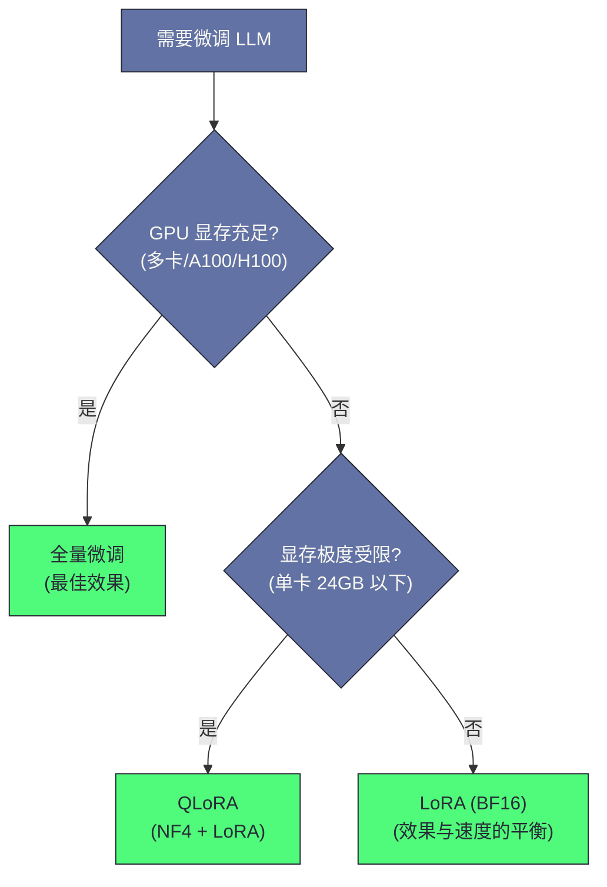
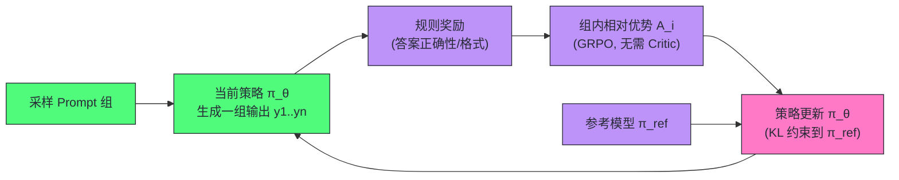

# 05 参数高效微调——LoRA、QLoRA 与 Adapter

**摘要：**

2019 年 Adapter 刚刚诞生时，微调还是一项只有坐拥大型 GPU 集群的机构才负担得起的工程；到 2023 年 QLoRA 出现，单块消费级显卡已经能微调十亿级参数模型，参数高效微调（Parameter-Efficient Fine-Tuning, PEFT）用不到十年时间把"微调"从数据中心搬回了普通工程师的桌面。PEFT 的核心命题是：只更新占总量极小比例（通常不到 1%）的参数，逼近全量微调的效果。本文围绕这条主线回答两个问题：其一，PEFT 家族里 **LoRA** 的低秩分解、**QLoRA** 的 4-bit 量化训练、**Adapter** 的瓶颈层插入与 **P-Tuning/Prefix-Tuning** 的软提示方法，各自的机制、代价与失效边界是什么；其二，2024-2026 年 PEFT 领域出现的新变化——DoRA、PiSSA、rsLoRA 等变体，推理模型微调与 RL 微调（GRPO + LoRA）成为主流实践——之后，工程师应当如何在基座模型微调、指令微调与强化学习微调三种场景之间做选型。结论先行：PEFT 没有取代全量微调，它只是把"更新多少参数"这个问题变成了一个与数据量、任务类型和显存预算相关的权衡，而 LoRA 之所以成为事实标准，靠的是它在绝大多数场景下把这一权衡摆到了最有利的位置。

---

## 第 1 章 全量微调的显存瓶颈

如果给大模型训练这十年的硬件账本画一条曲线，全量微调（Full Fine-Tuning）大概是其中最陡峭的一段。预训练已经耗尽了绝大多数团队的全部算力预算，微调却又要求在预训练的基础上再做一次完整的反向传播，等于把预训练最昂贵的部分再付一遍。笔者见过不少团队第一次跑通 LLaMA-7B 的 SFT 脚本时的反应：不是惊喜于效果，而是惊讶于显存管理器里的红色告警——全量微调在显存上的胃口，与其说像一顿正餐，不如说像一场豪宴，动辄把整块 A100 吃得干干净净。要理解 PEFT 为什么存在，先得看清这顿豪宴的账单。

### 1.1 显存消耗的构成

在 [[04 指令微调与 RLHF——从基座模型到对话助手]] 中，我们介绍了 SFT 和 RLHF 的训练流程。全量微调需要更新模型的所有参数，其显存消耗主要来自四个部分：

| 组成部分 | BF16 下的显存 | 7B 模型估算 | 70B 模型估算 |
| :--- | :--- | :--- | :--- |
| 模型参数 | $2N$ 字节 | 14 GB | 140 GB |
| 梯度 | $2N$ 字节 | 14 GB | 140 GB |
| Adam 优化器状态（$m$ + $v$） | $2 \times 4N = 8N$ 字节（FP32） | 56 GB | 560 GB |
| 激活值 | 取决于 batch size 和序列长度 | ~10-30 GB | ~100-300 GB |
| **总计** | **~$12N$ + 激活** | **~100 GB** | **~1 TB** |

$N$ 为参数量。Adam 的两个状态（动量和方差）必须用 FP32 存储以保证数值精度，这使得优化器状态的显存占用是模型参数的 4 倍。这也是为什么"模型 14 GB、显存 24 GB 应该够"的直觉在微调这里几乎总是破产——参数只是账单的第一行，梯度与优化器状态才是真正的大头。$12N$ 这个系数背后还有一个微妙的事实：它默认了优化器状态驻留在 GPU 显存里。Adam 的 $m$、$v$ 两个一阶矩、二阶矩估计如果不保持 FP32 精度，训练后期的更新步长就会失真，业界普遍把这 8 倍于参数量的开销视为不可压缩的硬成本。

一块 A100 80GB GPU 连全量微调 7B 模型都很勉强，70B 模型更是需要 16+ 块 GPU。这就是 PEFT 技术的核心动机——**如何在极低的显存预算下完成有效的微调？**

### 1.2 PEFT 的核心思想

PEFT 的基本假设是：**微调不需要更新所有参数**。预训练模型已经学到了丰富的语言知识和表示能力，微调只需要在这个基础上做"微小的调整"来适配特定任务。

从数学角度看，全量微调将参数从 $W_0$（预训练权重）更新到 $W_0 + \Delta W$。PEFT 的核心假设是：**$\Delta W$ 具有某种低维结构**——它可以用远少于 $N$ 个参数来表示。不同的 PEFT 方法，本质上是对 $\Delta W$ 的结构做了不同的假设：LoRA 假设 $\Delta W$ 是低秩的，Adapter 假设适配逻辑可以装进一个小的旁路网络，软提示方法则干脆假设连权重都不必改，只在输入侧附加可学习的向量。整章后续的讨论，都是围绕"哪种结构假设更贴近真实情况"展开的。

### 1.3 绕过账单的另外两条近路

在 PEFT 之前，工程上已经有两条缓解显存压力的近路，值得先交代清楚，否则容易把 PEFT 的贡献误读成"唯一的解法"。其一是**梯度检查点（Gradient Checkpointing）**：训练时丢弃前向传播的中间激活，反向传播时再重新计算一遍，以约 1.5 倍的计算时间换取激活值显存的大幅下降，相当于把"存储"换成"重算"；其二是**ZeRO/CPU Offload 式的分布式切分**，把优化器状态、梯度乃至参数分片到多卡或换出到 CPU 内存，显存需求随之摊薄。这两条近路的共同问题是它们只挪动账单而不削减账单——检查点省的是激活，offload 省的是驻留，模型参数和优化器状态的总量一分不少。PEFT 走的是另一条路：直接把需要更新和驻留的参数规模砍掉两三个数量级，让账单本身变短。三种手段并不互斥，现实中 QLoRA 与梯度检查点、甚至与多卡分片叠加使用的情形相当普遍，但"参数总量"这一根本约束，只有 PEFT 这类方法能真正撼动。

| 手段 | 削减的显存来源 | 付出的代价 | 与 PEFT 的关系 |
| :--- | :--- | :--- | :--- |
| **梯度检查点** | 激活值 | 约 1.5 倍训练时间 | 可叠加，常用于 QLoRA |
| **ZeRO/Offload** | 优化器状态、梯度、参数 | 通信开销或 CPU 内存带宽 | 可叠加，70B 级 QLoRA 常用 |
| **PEFT（LoRA 等）** | 可训练参数总量 | 容量上限、效果边界 | 根本性削减，常与上两者联用 |

---

## 第 2 章 LoRA——低秩适配的优雅方案

### 2.1 LoRA 的核心直觉

**LoRA（Low-Rank Adaptation）**（Hu et al., 2021）是当前最主流的 PEFT 方法，被 Hugging Face PEFT 库、LLaMA-Factory 等主流工具深度集成。

LoRA 的核心假设极为简洁：**微调带来的权重变化 $\Delta W$ 具有低秩（Low-Rank）结构**。也就是说，$\Delta W \in \mathbb{R}^{d \times k}$ 虽然是一个大矩阵，但它可以分解为两个小矩阵的乘积：

$$\Delta W = B \cdot A$$

其中 $B \in \mathbb{R}^{d \times r}$，$A \in \mathbb{R}^{r \times k}$，$r \ll \min(d, k)$ 是秩（rank）。

这个假设有理论和实证支持。Aghajanyan et al.（2020）的研究发现：预训练模型在微调时，权重变化的内在维度（Intrinsic Dimensionality）远低于参数空间的实际维度。一个有数百万参数的模型，其微调的有效自由度可能只有几千——这意味着 $\Delta W$ 确实集中在一个低维子空间中。

为什么 $\Delta W$ 偏偏是低秩的？笔者的理解是，这几乎是微调任务性质的必然结果。预训练在数万亿 token 上学到的能力是"通用"的，而一次微调往往只服务于一个领域或一种行为，任务信号相对集中；再加上微调数据量（数万到数百万条）远小于预训练语料，可容纳的信息量本身就有限，权重变化自然聚拢在少数几个主导方向上。把 $\Delta W$ 写成 $BA$，好比一支交响乐团真正决定曲目风格的往往只是几个反复出现的动机，而不是每个乐手即兴演奏的全部音符——LoRA 赌的就是"任务适配"这件事只需要抓住主旋律就够了。但请注意，这个假设是有代价的：如果任务需要的权重变化并不低秩（譬如下一章会讲的领域知识注入），低秩约束就会变成瓶颈，这正是后来一系列研究反复确认的边界。

### 2.2 LoRA 的实现细节

在训练时，原始的预训练权重 $W_0$ 被**冻结**（不更新），只训练 $A$ 和 $B$ 两个低秩矩阵。前向传播时，输出为：

$$h = W_0 x + \Delta W x = W_0 x + B A x$$

**初始化**：$A$ 用随机高斯初始化，$B$ 初始化为零矩阵。这确保训练开始时 $\Delta W = BA = 0$，模型行为与预训练模型完全一致——"从零开始"地学习适配，不会在初始阶段因随机扰动破坏预训练能力。

**缩放因子**：实际实现中，$\Delta W$ 会乘以一个缩放系数 $\alpha / r$：

$$h = W_0 x + \frac{\alpha}{r} B A x$$

$\alpha$ 是一个超参数（通常等于 $r$ 或 $2r$），用于控制 LoRA 更新的幅度。当 $\alpha = r$ 时，缩放因子为 1；增大 $\alpha$ 可以增强 LoRA 的影响力。这里的 $\alpha / r$ 不是无关紧要的工程细节：它决定了 LoRA 的学习动态。若只看 $B$ 的初始化是零矩阵，会以为 $\alpha$ 只是给 $BA$ 乘了个常数，但 LoRA 训练中 $A$、$B$ 的梯度会随 $r$ 一起缩放，$\alpha / r$ 恰好把不同秩下的更新幅度拉到同一量级。2026 年有一项专门针对缩放因子的研究（LoRA-$\alpha$）进一步指出，$\alpha$ 与学习率对优化的作用并不等价，$\alpha$ 对任务信号的放大能力无法被单纯调大学习率复制，且最优 $\alpha$ 与秩之间呈亚线性（平方根律）关系——这解释了为什么"$\alpha$ 恒等于 $r$ 或 $2r$"的经验配方在秩较大时会偏保守。这个细节为后文的 rsLoRA 埋下了伏笔。

**参数量对比**：以一个 $d = 4096$ 的线性层为例：

| 方法 | 可训练参数量 | 占比 |
| :--- | :--- | :--- |
| 全量微调 | $d \times d = 16.7M$ | 100% |
| LoRA (r=8) | $d \times r \times 2 = 65K$ | **0.39%** |
| LoRA (r=16) | $d \times r \times 2 = 131K$ | 0.78% |
| LoRA (r=64) | $d \times r \times 2 = 524K$ | 3.1% |

### 2.3 LoRA 应用到哪些层

Transformer 中有多种线性层可以应用 LoRA：

- **Self-Attention 的 Q/K/V/O 投影**：$W_Q, W_K, W_V, W_O$
- **FFN 的线性层**：$W_{\text{gate}}, W_{\text{up}}, W_{\text{down}}$（SwiGLU FFN 的三个投影）

原始 LoRA 论文只在 Q 和 V 上应用（$W_Q, W_V$），因为实验发现这已经足够。但后续实践表明，在所有线性层上都应用 LoRA（"full LoRA"），通常能获得更好的效果，尤其是在更复杂的任务上。LLaMA-Factory 等工具默认对所有线性层应用 LoRA。2025 年 Thinking Machines 的实验（LoRA Without Regret）把这个结论推得更远：即便在同等参数量下，只适配注意力层的 LoRA 也明显不如同时适配 MLP 层的 LoRA，因为前馈网络与 MoE 的专家层承载了大部分可学习容量——换言之，把 LoRA 挂在哪，比挂多少更影响上限。这与直觉相反（注意力层听起来更像"智力中枢"），但实证结果相当一致，笔者建议工程上优先保证 MLP 层被覆盖，再谈是否扩大到全部线性层。

### 2.4 LoRA 的推理时合并

LoRA 的一个重要工程优势是：**推理时可以将 LoRA 权重合并到原始权重中，不增加任何推理延迟**。

$$W = W_0 + \frac{\alpha}{r} B A$$

合并后的模型与全量微调的模型在推理时完全等价——相同的架构、相同的计算量、相同的推理速度。这意味着 LoRA 是一个"免费"的微调方案——训练时省显存，推理时零额外开销。

而且，可以为不同的任务训练不同的 LoRA 适配器（adapter），在推理时按需加载和切换——只需存储几十 MB 的 LoRA 权重文件，而非整个模型的副本。这个"一个基座 + 多份 LoRA"的形态后来直接催生了 S-LoRA、vLLM 多 LoRA 服务等一整条工程支线，我们将在第 9 章展开。

> [!info] 核心概念
> LoRA 的本质是对"微调所需的参数变化"做了一个**结构化的约束**（低秩）。这个约束不仅大幅减少了可训练参数量，还起到了**正则化**的作用——低秩约束限制了模型的更新自由度，减少了在小数据集上的过拟合风险。这也是为什么 LoRA 在数据量较少时往往比全量微调效果更好的原因之一。

### 2.5 秩 r 的选择

$r$ 是 LoRA 最关键的超参数。它控制了适配能力和参数效率之间的权衡：

- **$r$ 太小**（如 1-4）：适配能力不足，对复杂任务效果差
- **$r$ 太大**（如 256+）：参数量增大，逼近全量微调，PEFT 的优势减弱
- **常用范围**：$r = 8$ 到 $r = 64$，根据任务复杂度调整

经验法则：
- 简单任务（如情感分类、格式调整）：$r = 8$ 通常足够
- 中等任务（如指令微调、对话）：$r = 16$ 到 $r = 32$
- 复杂任务（如数学推理、代码生成）：$r = 64$ 或更高

### 2.6 LoRA 的边界与反例

LoRA 在 2021 年之后近乎一统天下，很容易让人误以为它是"安全的默认项"。但 2024-2025 年的两项系统性研究把它的边界划得很清楚。其一是 Biderman et al.（2024）的 **"LoRA Learns Less and Forgets Less"**：在指令微调（约 10 万条数据）场景下，提高秩可以让 LoRA 追上全量微调；但在**继续预训练（continued pretraining）**场景下——模型要在 20B 量级的无标注领域语料上持续学习——LoRA 与全量微调的差距即使在很高秩下也无法弥合。论文还测出全量微调学到的最小扰动秩通常是典型 LoRA 配置的 10-100 倍，这从反面证实了低秩假设的适用范围。其二是 Thinking Machines（2025）的实验：在小到中等规模的指令与推理数据集上，LoRA 与全量微调相当；但一旦数据集超过 LoRA 的容量上限，LoRA 的训练效率就会系统性变差，且这个差距表现为"同样的数据量下 loss 更高"而不是"卡在某条不可逾越的地板线上"。他们还发现 LoRA 对**大 batch** 更敏感——batch 增大到一定程度后 LoRA 的 loss 惩罚比全量微调更重，而且这个惩罚不能靠加大秩来抵消，因为它是 $BA$ 这种乘积参数化本身训练动态的固有属性。

把这些反例翻译成工程判断，就是三句话：**数据量小、任务是"改行为"（指令遵循、风格、对话）时，LoRA 是首选；数据量大、任务是"注入新知识"（领域继续预训练、新语言、垂直语料）时，全量微调或高秩 LoRA 才是稳妥选择；需要持续调优行为偏好时（RL），LoRA 的低秩反而成了优点**。第三点我们到第 8 章再展开。

还有一个介于两者之间的务实选项值得单独说明：如果任务介于"改行为"与"写知识"之间、又确实没有全量微调的算力，那么把秩拉到 128-256 并配合 rsLoRA 的 $\alpha/\sqrt{r}$ 缩放（详见第 7 章），往往能在 PEFT 的显存框架内显著拉近与全量微调的距离。Biderman 的论文对此给出过一个耐人寻味的旁证：指令微调场景下高秩 LoRA 可以追上全量微调，差距主要出在"数据量大到超出低秩容量"的继续预训练场景——换言之，秩的本质是"给 LoRA 发多少预算"，预算的合理值应当由任务数据量来反推，而不是沿袭 8/16 的默认值。

---

## 第 3 章 QLoRA——4-bit 量化下的 LoRA

### 3.1 QLoRA 的动机

LoRA 虽然只训练少量参数，但**前向传播仍然需要完整模型**——冻结的 $W_0$ 仍然占用大量显存。一个 70B 模型的 $W_0$ 在 BF16 下仍需 140 GB。

**QLoRA（Quantized LoRA）**（Dettmers et al., 2023）的核心思想是：**将冻结的预训练权重 $W_0$ 量化到 4-bit，大幅减少显存占用，同时在 4-bit 模型上训练 LoRA 适配器**。

### 3.2 QLoRA 的三个关键创新

**创新一：NF4（NormalFloat 4-bit）量化**

传统的 4-bit 量化均匀地将值域分为 16 个区间。但预训练模型的权重通常近似正态分布——大部分值集中在零附近，极端值很少。NF4 根据正态分布的分位数来确定量化区间，使得每个区间包含大致相同数量的权重值，最小化量化误差。具体做法是：按块（block）对权重做 absmax 归一化，再用一组信息论上对正态分布最优的 4-bit 量化级别（16 个对称分布在零附近的档位）完成编码。这个"按人口分布划分选区"的思路——而不是按面积均匀切分——让宝贵的量化档位花在权重最密集的地方，是 NF4 比朴素 INT4 精度更高的根源。

**创新二：双重量化（Double Quantization）**

量化需要为每个量化块存储一个缩放因子（FP32，4 字节）。当块大小为 64 时，每个参数的缩放因子开销为 $4/64 = 0.0625$ 字节——看似不多，但对 70B 模型来说是 4.4 GB。双重量化将这些缩放因子本身也量化到 8-bit，将开销从 0.0625 字节/参数降低到 0.0156 字节/参数。若换算成比特，这一项把每参数约 0.5 bit 的额外负担压到约 0.127 bit，相当于为 70B 模型再省出 3 GB 量级的显存——量化常数被再次量化，听起来像套娃，但每一层都省得实打实。

**创新三：分页优化器（Paged Optimizer）**

在训练中，GPU 显存可能因 batch 大小或序列长度的波动而偶尔不足。QLoRA 利用 NVIDIA 的 Unified Memory 特性，将优化器状态在 GPU 显存和 CPU 内存之间自动分页——当 GPU 显存不足时，部分优化器状态会被自动"换出"到 CPU 内存，需要时再"换入"。

### 3.3 QLoRA 的显存对比

| 配置 | 7B 模型 | 70B 模型 |
| :--- | :--- | :--- |
| 全量微调（BF16） | ~100 GB | ~1 TB |
| LoRA（BF16 模型） | ~15 GB | ~145 GB |
| **QLoRA（NF4 模型 + LoRA）** | **~6 GB** | **~48 GB** |

QLoRA 让在单块 24GB 的消费级 GPU（如 RTX 4090）上微调 7B 模型成为可能，在单块 A100 80GB 上微调 70B 模型成为可能。这极大地降低了 LLM 微调的门槛。

### 3.4 QLoRA 的效果

QLoRA 论文的一个重要结论是：**4-bit QLoRA 微调的效果与 16-bit 全量微调接近**。论文作者在单块 48GB GPU 上用 24 小时微调出 65B 的 LLaMA（模型家族命名为 Guanaco），在 Vicuna 基准上达到 ChatGPT 性能的 99.3%。

这个结论的意义在于：量化带来的精度损失被 LoRA 的适配能力所补偿——LoRA 训练的参数是 BF16 精度的，它们可以"修正"4-bit 量化引入的误差。由此看来，4-bit 基座模型扮演的更像是一个"冻结的知识仓库"，只要它检索知识的能力没有崩坏，精确到小数点后几位的权重值对下游任务的贡献远没有直觉上那么大。

> [!warning] 生产避坑
> QLoRA 训练速度比 BF16 LoRA 慢约 30-50%，因为 4-bit 量化的权重需要在每次前向传播时反量化到 BF16——这是 QLoRA 省显存的代价。如果显存足够（如多卡训练），BF16 LoRA 是更快的选择。QLoRA 的核心价值是**在显存极其有限时仍能训练**。

### 3.5 量化微调工具链的现状

QLoRA 的论文发表于 2023 年，其后三年工具链发生了两件对工程影响深远的事。其一是 **bitsandbytes**（QLoRA 的 NF4 实现所在）的维护权更迭：原先是 Dettmers 的个人仓库，2024 年前后一度因更新缓慢而让社区担忧，如今在 bitsandbytes-foundation 名下恢复活跃发布——0.43.2 修复了一个 QLoRA 显存 bug（此前冻结参数的激活显存被错误分配，修复后对 70B 模型、1024 序列长度每样本可省约 10 GB），0.43.0 起正式支持 QLoRA + FSDP 的 70B 级多卡训练，0.46.0（2025 年 5 月）完成对 `torch.compile` 的支持与自定义算子重构，0.49.x 一路发布到 2026 年。NF4 量化从此不再是"学术 demo"，而是有持续维护的工程底座。其二是 **Unsloth** 的出现：它以自研 Triton kernel 重写了 LoRA/QLoRA 的前向反向，2023 年 12 月发布时宣称训练快 2 倍、显存省 50%，2024 年 4 月的自定义梯度检查点进一步支持 4 倍长上下文；2024 年 12 月又推出"动态 4-bit 量化"——在 bitsandbytes 4-bit 的基础上动态跳过某些参数层的量化，仅多用不到 10% 的显存就把精度拉回接近 16-bit 水平（其在 Phi-4 上的评测与官方 16-bit 几乎持平）。到 2025 年，Unsloth 已是 GitHub 趋势榜第一的微调工具，甚至为 DeepSeek-R1 这类 MoE 模型发布了 1.58-bit 动态量化版本。这些进展说明一件事：**4-bit 已从"能不能训"的生存问题，变成了"多快、多准、多省"的优化问题**。

### 3.6 QLoRA 之后的量化微调路线

QLoRA 验证了"量化基座 + 高精度适配器"的可行性，随后出现了三条实质性的演进路线。

**路线一：把量化本身做得更细——LQ-LoRA**（Guo et al., 2023）。它把每个预训练矩阵分解为"高精度低秩分量 + 量化残差分量"，用整数线性规划为不同矩阵按敏感度动态分配位宽（2-4 bit 不等）与块大小，使整体显存预算可精确受控。结果是令人惊讶的激进：2.5-bit 的 LLaMA-2 在 OpenAssistant 上与 4-bit QLoRA 竞争，2.75-bit 的 LLaMA-2-70B 只需约 27 GB 显存即可微调，效果仍优于 QLoRA 与 GPTQ-LoRA 两个基线。

**路线二：把初始化做得更好——QPiSSA**。PiSSA（下一章详述）用预训练权重的 SVD 主分量初始化适配器，与量化结合后，初始阶段就比 QLoRA 保留更小的量化误差；在 LLaMA-3-70B 的 GSM8K 评测上，QPiSSA 以 86.05% 超过 QLoRA 的 81.73%。这个差距说明：QLoRA 的"误差补偿"假设（LoRA 后期修正量化误差）是有效的，但若在起步时就把主导分量放进可训练参数里，补偿会更早发生。

**路线三：把适配器结构换掉——QDoRA**。2024 年 Answer.AI 与 NVIDIA 合作，把 QLoRA 中的 LoRA 换成 DoRA 并接入 FSDP，在 Orca-Math 100K 样本上 QDoRA 比 QLoRA 高出 0.19 分，甚至比全量微调还高 0.05 分，且显存占用远低于全量微调。DoRA 对幅度与方向的分解在量化基座上反而更贴合"以少量精确参数修正大量近似参数"的需求。

这三条路线共享同一个方向：**QLoRA 只是证明了 4-bit 可行，而 2024 年之后的工作在回答"如何在 4-bit 甚至更低位宽下让效果逼近全量微调"**。对于工程师而言，除非显存预算被压到极限，否则不必追新——NF4 + LoRA 的组合到今天仍是性价比最稳的默认配置，LQ-LoRA/QPiSSA/QDoRA 是在"预算极紧"或"效果差一点就不可接受"时才值得投入的选项。

至于 2-bit 乃至 1.58-bit 的极端低位宽，2025 年的进展主要在**推理侧**（Unsloth 为 DeepSeek-R1 这类 MoE 模型发布的 1.58-bit 动态量化 GGUF 即是一例），用 2-bit 基座直接做**训练**仍是非常规操作——2-bit 的量化误差过大，对依赖反向传播求导的微调而言噪声会污染梯度。笔者的建议是：训练仍以 4-bit 为下限，2-bit 以下留给推理侧的内存压缩场景，两者不要混为一谈。

---

## 第 4 章 Adapter——瓶颈层插入

### 4.1 Adapter 的设计

**Adapter**（Houlsby et al., 2019）是 PEFT 领域最早的工作之一。它在 Transformer 的每个子层（Self-Attention 和 FFN）之后插入一个小型的"瓶颈"网络：

$$\text{Adapter}(h) = h + f(h W_{\text{down}}) W_{\text{up}}$$

其中 $W_{\text{down}} \in \mathbb{R}^{d \times r}$ 将 $d$ 维降到 $r$ 维（瓶颈），$f$ 是非线性激活（如 ReLU），$W_{\text{up}} \in \mathbb{R}^{r \times d}$ 再升回 $d$ 维。残差连接确保 Adapter 不破坏原始信息流。

把 Adapter 想象成给一栋大楼**外挂一部小电梯**：不动楼内结构，只在每层出口接一条低速便道，任务负载从主通道分流。这个设计的好处是主模型完全冻结，多任务之间互不干扰；代价是电梯本身就占地方、要通电——推理时每过一个 Adapter 都要多算一遍降维升维，延迟就堆在那里。

### 4.2 Adapter vs LoRA

| 维度 | Adapter | LoRA |
| :--- | :--- | :--- |
| 修改位置 | 子层之后插入新模块 | 修改现有线性层的权重 |
| 推理开销 | **有额外延迟**（新增计算） | **零额外延迟**（可合并权重） |
| 参数量 | 与 LoRA 相当 | 与 Adapter 相当 |
| 实现复杂度 | 需要修改模型结构 | 不修改模型结构 |
| 多任务切换 | 需要加载 Adapter 模块 | 只需替换 LoRA 权重矩阵 |

LoRA 的核心优势在于**推理时零开销**——合并权重后完全等价于原始模型。这是 Adapter 无法匹敌的——Adapter 的额外模块在推理时仍然需要计算，增加了延迟。这正是 LoRA 在工业界几乎完全取代 Adapter 的主要原因。

### 4.3 Adapter 家族与它留下的遗产

说 Adapter 被"取代"，其实并不公平——它更像一个率先探路、随后把位置让给后来者的家族。Houlsby 2019 的原始配置（DoubleSeqBn）在注意力和 FFN 之后各插一个瓶颈层；Pfeiffer et al.（2020）的 AdapterHub 发现只插在 FFN 之后（SeqBn）往往更省且效果不差；He et al.（2021）提出**并行 Adapter（Parallel Adapter）**，让 Adapter 与子层并行计算再相加，部分绕开了串行深度增加带来的延迟；Pfeiffer et al.（2021）的 **AdapterFusion** 则把多个任务 Adapter 的输出交给一个可学习的融合层，实现无损的多任务组合；Rücklé et al.（2020）的 AdapterDrop 研究了在推理时丢弃低层 Adapter 以提速的折中。这一整套"模块化旁路"的思想——包括 LayerNorm Tuning、BitFit（只训练 bias）这类极简变体——构成了 PEFT 的早期坐标系。

Adapter 家族最终让位于 LoRA，与其说是效果差距（并行 Adapter 在 16B 规模的指令微调上其实与 LoRA 相当，见 Astraios 2024 的跨规模评测），不如说是工程账算不过来：串行 Adapter 增加推理延迟，并行 Adapter 虽不增深度但也不像 LoRA 那样可以合并进原权重、仍要常驻额外参数与额外 kernel。但 Adapter 留下的两样遗产今天依然活跃：一是"一个冻结基座 + 一组可插拔模块"的**模块化多任务形态**，LoRA 的多适配器服务正是继承自它；二是 AdapterFusion 所开创的**组合式知识融合**，与后来 LoRA 的线性插值、算术合并一脉相承。所以在 PEFT 的族谱里，Adapter 是名副其实的"祖父辈"——今天几乎所有方法的血缘都可以追溯到它。

---

## 第 5 章 Prompt-based 方法——软提示

### 5.1 Prefix-Tuning

**Prefix-Tuning**（Li & Liang, 2021）不修改模型参数，而是在每一层的 Self-Attention 中**前置一组可学习的"虚拟 token"**（称为 prefix）。

具体来说，在每个 Transformer 层中，Key 和 Value 矩阵被扩展：

$$K' = [K_{\text{prefix}}; K], \quad V' = [V_{\text{prefix}}; V]$$

$K_{\text{prefix}}$ 和 $V_{\text{prefix}}$ 是可学习的参数。模型的所有真实 token 在计算注意力时，都可以"关注"这些虚拟前缀——前缀充当了"任务指示"的角色。这相当于舞台侧边始终站着一位**举提词板的场务**：演员（模型）的台词一个字不改，但每场戏的提示板内容不同，演出风格就跟着变。好处是模型权重完全不动、内存占用极小；坏处是提词板的信息容量有限，且它占着舞台空间——虚拟 token 要挤占上下文窗口。

### 5.2 P-Tuning v2

**P-Tuning v2**（Liu et al., 2022）是 Prefix-Tuning 的实用改进版，在每一层都添加可学习的 prefix（而非只在输入层），且在更多类型的任务上进行了验证。它把"只在输入层加提示"扩展为"每层都加提示"，让提示信息能更直接地影响深层表示，在小模型与序列标注等任务上大幅改善了此前的表现。

### 5.3 Prompt-based 方法的局限

Prompt-based 方法在 BERT 时代的小模型上表现不错，但在大语言模型时代逐渐式微，原因是：

- **有效容量有限**：prefix 的长度通常只有 10-100 个 token，能编码的"任务信息"有限
- **推理时增加序列长度**：prefix token 占用上下文窗口，减少了可用的输入长度
- **效果不及 LoRA**：在大模型上，LoRA 几乎在所有任务上都优于 Prompt-based 方法

当前主流的 PEFT 实践中，LoRA/QLoRA 已经占据绝对主导地位。

### 5.4 软提示的规模依赖与残余价值

软提示的"式微"同样需要限定条件，否则会误导选型。Lester et al.（2021）的 Prompt Tuning 论文有一个反直觉的结论：在足够大的模型上，只在输入层加软提示（且不逐层加 prefix）就能逼近全量微调——软提示的效果**随模型规模单调上升**，小模型吃不下软提示，大模型反而消化得很好。Astraios 的跨规模评测也佐证了这一点：在 1B 模型上 P-Tuning 与 (IA)$^3$ 能小幅胜过 LoRA，到 16B 规模则是 LoRA 与并行 Adapter 领先。把这两个证据拼起来，软提示的适用画像其实很清楚：模型足够大（数十亿参数以上）且任务相对简单时，**软提示的性价比极高**——参数更新量为零、多个任务互不污染、天然适合隐私敏感场景（权重从不落地）。它至今仍活跃在持续学习（sequential learning 免遗忘）、上下文蒸馏（context distillation）等研究型场景，以及在"完全不允许改动模型权重"的合规约束下作为唯一的 PEFT 选项。不过就绝大多数生产微调任务而言，LoRA 在容量、效果与工程生态上的综合优势已经难以撼动。

---

## 第 6 章 PEFT 方法的综合对比

### 6.1 全面对比

| 方法 | 可训练参数比例 | 推理额外开销 | 显存需求 | 效果 | 主流度 |
| :--- | :--- | :--- | :--- | :--- | :--- |
| **全量微调** | 100% | 无 | 极高 | 最好（上限） | 有资源时首选 |
| **LoRA** | 0.1-3% | **零**（合并权重） | 中 | 接近全量微调 | **当前主流** |
| **QLoRA** | 0.1-3% | 零（合并后） | **极低** | 接近 LoRA | **显存受限时首选** |
| **Adapter** | 0.5-5% | 有（额外层） | 中 | 接近全量微调 | 已逐渐被 LoRA 取代 |
| **Prefix-Tuning** | <0.1% | 有（增加序列长度） | 低 | 低于 LoRA | 已较少使用 |
| **DoRA** | 0.1-3% | 零（合并后） | 中 | 优于 LoRA | 增长中 |
| **PiSSA** | 0.1-3% | 零（合并后） | 中（初始化需一次 SVD） | 优于 LoRA（低秩时更明显） | 增长中 |

### 6.2 选型决策树

### 6.3 显存之外：数据量与任务类型的坐标

上面的决策树只回答了"显存够不够"，这其实是 2023 年以前的视角。2024-2026 年的研究把另一个坐标轴摆上了台面：**数据量与任务类型决定了 LoRA 与全量微调是否等价**。综合第 2 章引用的两篇研究，可以画出一张更完整的决策坐标：任务若属于"行为调整"（指令遵循、对话风格、格式对齐），数据量在小到中等规模，LoRA 与全量微调等价，优先 LoRA；任务若属于"知识注入"（领域继续预训练、新语言、垂直语料），数据量大到超出 LoRA 容量，全量微调或极高秩 LoRA 才可靠；任务若属于"偏好/推理强化"（RL 微调），LoRA 的低秩不但不是短板，反而与 RL 的低信息密度天然匹配。第三个分支在 2025 年推理模型浪潮中成为热点，我们放到第 8 章专门展开。

把选型比作买车，显存是预算，数据量是用途，任务类型是路况：预算不足只能买 QLoRA 这辆小排量车，但若天天跑长途（知识注入型任务），小排量就会在数据量面前力不从心，这时宁可加钱换全量微调；反过来只在市区代步（行为调整），小排量不但够用，还更省油、更好停（推理零开销）。为什么"容量"这一项如此关键？Thinking Machines 给出了一个直观的换算：LoRA 的可训练参数量大致对应它能写进权重的比特数，训练数据本身携带的信息量一旦超过这个预算，LoRA 就进入"信息超载"状态——不是学不会，而是每单位信息能分到的参数太少，学习效率随之劣化。这也解释了为什么同一个 $r=16$ 在 10 万条指令上够用、在 20B token 的继续预训练上却杯水车薪：不是 LoRA 变笨了，是账单变大了。

---

## 第 7 章 LoRA 的变体家族——2024 年以来的演进

LoRA 论文发表之后的头两年，社区的主要工作是把"在哪几层挂 LoRA、秩取多大"这些旋钮调到顺手。2024 年起，一批研究者开始正面回答一个更根本的问题：**LoRA 与全量微调之间那道始终存在的精度差距，究竟差在哪里，能否从结构上补上？** 于是出现了几个性格迥异的变体。它们不完全是竞争关系——有的补学习容量，有的补收敛速度，有的补数值稳定性，恰好对应第 2 章里 LoRA 被反复指出的三块短板。

### 7.1 DoRA——把幅度与方向分开来调

**DoRA（Weight-Decomposed Low-Rank Adaptation）**（Liu et al., 2024）的出发点是 Weight Normalization 的一个观察：全量微调对权重的修改可以分解为"幅度（magnitude）"和"方向（direction）"两个分量，而 LoRA 与全量微调在这两个分量上的变化模式显著不同——LoRA 对方向的调整明显受限。于是 DoRA 把预训练权重显式拆成两半：

$$W' = m \odot \frac{W_0 + BA}{\|W_0 + BA\|_c}$$

其中 $\odot$ 是逐元素乘，$\|\cdot\|_c$ 是逐列归一化，$m$ 是一个可学习的幅度向量，方向部分则用 LoRA 的低秩更新来表达。在 LLaMA-7B/13B、LLaMA2-7B、LLaMA3-8B 的常识推理评测上，DoRA 比同秩 LoRA 分别高 3.7/1.0/2.9/4.4 个点，且推理时仍可把 $m$ 与合并后的权重合成回单个矩阵，零推理开销。用一句话概括它的直觉：**LoRA 一直在"同时调音量和音色"，DoRA 则是先把音量旋钮单独拧出来**，让低秩更新专心负责音色——学习容量与训练稳定性同时受益。DoRA 与量化的结合（QDoRA）已在上一章提过，此处不赘。

### 7.2 PiSSA——让适配器从主分量起步

**PiSSA（Principal Singular values and Singular vectors Adaptation）**（Meng et al., 2024）回答的是另一个问题：LoRA 用"随机高斯 $A$ + 全零 $B$"起步，等于把 $\Delta W$ 从零开始学；PiSSA 则先对预训练权重做 SVD，把**前 $r$ 个主奇异值对应的主奇异向量**直接当作 $A$、$B$ 的初始值，让可训练参数一开始就落在权重最重要的方向上，剩余部分作为冻结的残差矩阵 $W_{\text{res}}$。形象地说，LoRA 是"一张白纸起稿"，PiSSA 是"先在复印纸上描出主轮廓再上色"——后者自然收敛更快、终局更好。论文在 11 个模型、13 项任务上与同配置 LoRA 对比全面胜出，GSM8K 上 Gemma-7B 的 PiSSA（77.7%）比 LoRA（74.53%）高 3.25 个点；配合快速 SVD 技术，7B 模型初始化只需几秒钟，代价可以忽略。与量化结合得到 QPiSSA，其优势已在第 3 章介绍。PiSSA 的适用场景很明确：**低秩（$r$ 较小）或数据量有限时收益最大**，因为此时"初始方向选得对不对"直接决定低秩子空间能否覆盖任务需要的方向。

### 7.3 rsLoRA——为高秩正名的缩放修正

**rsLoRA（Rank-Stabilized LoRA）**（Kalajdzievski, 2023）针对的是缩放因子 $\alpha/r$ 在秩增大时带来的不稳定。第 2 章提到 $\alpha/r$ 让不同秩下的更新幅度对齐，rsLoRA 的作者从 $r \to \infty$ 的极限分析证明：唯一能让适配器在各秩下都保持前向矩与反向梯度尺度稳定（rank-stabilized）的缩放是 $\gamma_r = \alpha/\sqrt{r}$。改用 $\sqrt{r}$ 缩放后，LoRA 在高秩下不再出现训练崩塌或失效，于是"用更大秩换更好效果"才真正可行——此前用 $\alpha/r$ 时，秩翻倍往往看不到收益，正是缩放失当掩盖了秩本身的价值。rsLoRA 的实践意义是：当你的任务需要逼近全量微调的容量、但又要保留 LoRA 的模块化与零推理开销时，**大秩 + rsLoRA 是比堆更多层更优雅的出路**。

### 7.4 AdaLoRA——把预算按重要性分配

**AdaLoRA**（Zhang et al., 2023）把秩从"全局统一"改成"逐层自适应"。它用 SVD 形式参数化每个适配器（$W = P\Sigma Q$），在训练中按各奇异值对应的重要性分数做剪枝与重分配：重要的层拿到更高的有效秩，不重要的层降秩甚至清零，总参数预算固定。这等于把"给每层多少适配容量"从人的经验判断交给训练过程本身。对层间重要性差异大的模型（往往是深层更重要），AdaLoRA 能在相同预算下获得优于等秩 LoRA 的效果，代价是实现与调参复杂度更高。

### 7.5 LoRA+——学习率也要区别对待

**LoRA+**（Hayou et al., 2024）基于对 LoRA 训练动态的理论分析提出：$A$、$B$ 两个矩阵对损失的影响不对称，为 $B$（输出侧）设置高于 $A$ 的学习率能加速收敛，论文声称在部分任务上可提升 1-2% 的性能。这个发现与"$\alpha$ 才是主导旋钮"的 LoRA-$\alpha$ 研究遥相呼应：LoRA 的优化景观比全量微调平滑，默认超参数往往偏保守，把学习率或缩放因子单独放大是有理论依据的。

### 7.6 变体选型

| 变体 | 机制 | 收益 | 代价 |
| :--- | :--- | :--- | :--- |
| **DoRA** | 幅度/方向分解，低秩只改方向 | 逼近全量微调，训练稳定 | 略微增加训练计算 |
| **PiSSA** | SVD 主分量初始化 $A$、$B$ | 收敛快、低秩效果更好 | 初始化需一次 SVD |
| **rsLoRA** | 缩放改为 $\alpha/\sqrt{r}$ | 大秩稳定，高秩可用 | 需调整 $\alpha$ 习惯 |
| **AdaLoRA** | SVD 参数化 + 重要性剪枝 | 预算自动分配 | 实现与调参复杂 |
| **LoRA+** | $A$、$B$ 不同学习率 | 收敛略快 | 多一个超参数 |

变体家族的地图，可以用一句话串起来：DoRA 补"结构"，PiSSA 补"起点"，rsLoRA 补"高秩"，AdaLoRA 补"分配"，LoRA+ 补"节奏"——它们各自修补 LoRA 的一个侧面，而没有一个能同时在所有维度上取代 LoRA。工程上的合理姿态是：**默认仍用 LoRA，遇到"效果差一点、显存还够"的情况先试 DoRA，遇到"低秩且数据少"的情况试 PiSSA，需要大秩时切 rsLoRA 缩放**。这些变体如今在 LLaMA-Factory 等工具里都已是开箱即用的选项。

---

## 第 8 章 推理模型微调与 RL 微调——PEFT 的新战场

### 8.1 推理模型的范式变化

2025 年 1 月 DeepSeek-R1 发布，大模型微调的话题重心从"怎么让模型听话"转向"怎么让模型会推理"。R1 的训练路线（DeepSeek-R1-Zero）有两个在 PEFT 语境下意味深长的特点：其一，它**跳过了 SFT 阶段**，直接在基座模型上做强化学习；其二，它使用的强化学习算法是 **GRPO（Group Relative Policy Optimization）**（Shao et al., 2024，源自 DeepSeekMath），奖励信号只来自答案正确性这类**可自动判定的规则**，不依赖人工偏好。这条"纯 RL 激励推理"的路线后来被 Nature 刊发，也把"RL 微调"从学术象牙塔推成了 2025 年的主流工程实践。

对 PEFT 来说，这里有一个此前几乎没人认真对待的新问题：**RL 微调的内存模型和 SFT 完全不同**。SFT 只需要一份模型的前向反向；RLHF/PPO 需要在显存里同时驻留策略模型、参考模型、奖励模型与价值网络四个模型（详见第 04 篇），显存约为 SFT 的 4 倍。GRPO 的价值正在于它把奖励模型与价值网络一并去掉——对一组采样输出按组内相对优劣计算优势，训练时只需策略模型与参考模型两份，显存压力砍掉一半。而 QLoRA 可以把策略模型的基座压到 4-bit，LoRA 则让参考模型之外几乎不需要额外的可训练状态。三件事叠在一起，结果是：2024 年还被认为是"大厂专利"的 RL 微调，**2025 年起在消费级显卡上就能跑通**——社区里用 QLoRA + GRPO 在单张 H100 上 24 小时内训出 GSM8K 推理模型的例子比比皆是，甚至有工作用 Qwen2.5-0.5B + SFT(LoRA) + GRPO 在 AWS 上以不到 100 美元的成本复现了 R1 式推理对齐流水线。

### 8.2 为什么 RL 微调恰好"吃"低秩

第 2 章讲过 LoRA 的边界是"容量不足时追不上全量微调"，但 Thinking Machines（2025）的实验给出了一个方向相反的惊喜：**在 RL 场景下，很小的秩就能让 LoRA 与全量微调持平**。他们的解释是信息论层面的——RL 阶段每个样本（一次生成 + 一次奖励）能提供的可学习信息量极少，大约只有 1 bit 量级，微调几百步能写进权重的信息总量天然就低，模型的容量需求根本到不了"需要高秩"的程度。换言之，RL 微调的不是知识而是"行为偏好"，而偏好是一种极稀疏的信号，低秩表示绰绰有余。这个结论与 R1 的实践互相印证：DeepSeek 官方在后续开源模型（以及社区的大量复现）中普遍使用 LoRA 做推理强化，正是因为它在不牺牲效果的前提下把 RL 的门槛拉低了一个量级。

### 8.3 三个场景的适用边界

把前文证据收拢，2026 年的 PEFT 选型已经不再是"LoRA 还是全量微调"的二选一，而是按场景各归其位：

| 场景 | 典型任务 | 数据与信号 | 推荐方法 | 秩的选择 | 备注 |
| :--- | :--- | :--- | :--- | :--- | :--- |
| **基座模型微调** | 领域继续预训练、新语言、垂直语料注入 | 数十亿 token，知识密度高 | 全量微调 > 高秩 LoRA | 64+ 或极高位宽 | LoRA 差距难弥合（Biderman 2024） |
| **指令微调（SFT/DPO）** | 指令遵循、对话风格、行为对齐 | 数万-数百万条，行为信号 | **LoRA（BF16 优先，QLoRA 兜底）** | 16-32，随数据量上调 | 小中数据集上 LoRA ≈ 全量微调 |
| **推理/偏好 RL 微调** | GRPO/PPO 强化、推理能力激励 | 每组采样的稀疏奖励 | **QLoRA + GRPO（LoRA 低秩足够）** | 8-32 即可 | RL 信号低密度，低秩反而稳健 |

这张表是本文给出的核心选型结论，也是 2023 年文章几乎不可能写出的内容——"推理模型微调"这个场景本身是 2025 年才成形的。三个场景对秩的态度也截然不同：基座微调需要"秩越大越好"（因为知识密度高），指令微调需要"秩匹配数据量"（容量由可训练参数量与数据量的关系决定），RL 微调则是"低秩就够"（信号稀疏）。这也正面回答了"LoRA 的秩与模型规模/任务复杂度关系"的最新经验：秩不是越大越好，也不是固定 8/16/32 的拍脑袋值，而是应随任务所需写入的信息量缩放——**写行为用小秩，写知识用大秩，练偏好用小秩**。

### 8.4 推理模型微调的现实约束

当然，R1 式流水线的平民化不等于没有坑。其一，GRPO 对**奖励设计**极其敏感，规则奖励里"格式必须匹配"这类约束若写得过紧，模型会学到先输出一段固定模板再答题，推理深度反而被压制；其二，推理模型微调后**输出长度暴涨**（R1 的思考链动辄数千 token），训练与推理的 KV Cache 显存、部署延迟都要按这个新现实重新预算，这部分我们在 [[06 推理优化——KV Cache、量化与投机解码]] 和 [[07 模型部署与 Serving——vLLM、TensorRT-LLM 与 Triton]] 中展开；其三，**蒸馏与 RL 的边界**——用 R1 类模型生成的高质量思维链数据做 SFT（distill）与直接做 RL 是两条不同的路线，前者便宜但上限受限于教师模型，后者贵但能激发模型超出教师的自发行为，选哪条取决于团队对"效果天花板"还是"成本可控"更敏感。这些都是工程决策，不是技术对错。

### 8.5 MoE 推理模型上的 LoRA 挂载

推理模型浪潮还顺带把一个此前被忽视的问题推到了台前：在 MoE（Mixture-of-Experts）架构上，LoRA 该挂在哪。R1 的基座 DeepSeek-V3 是典型的稀疏模型——总参数 671B、每个 token 只激活 37B，FFN 被替换成 256 个路由专家、每 token 选取 top-8 参与计算；Qwen 等开源推理模型同样大量采用 MoE 或 MoE+密集混合结构。对这类模型，注意力层的 Q/K/V/O 依然可以挂 LoRA，但真正决定推理行为（思考链格式、长程推演习惯）的容量集中在专家层的 up/gate/down 投影上。第 2 章引用的 Thinking Machines 结论在这里加倍成立：只挂注意力层、或只挂共享专家而漏掉路由专家，都会明显损失 RL 阶段本可写入的行为模式。实操上，主流工具对 MoE 模型默认覆盖 `q_proj/k_proj/v_proj/o_proj/gate_proj/up_proj/down_proj` 全套线性层，正是为了不让路由专家成为 LoRA 盲区。另一个细节是 DeepSeek 的 MLA 注意力本身就用低秩投影压缩 KV（这是它 128K 上下文还能省显存的机制之一），训练这类模型时注意力侧的 LoRA 可以与 MLA 的低秩结构叠加，参数量与收益的换算不能照搬密集模型的经验——**MoE 模型上"秩的成本"要按被激活的专家数折算，而不是按总参数量**。

> [!note] 设计哲学
> 2025 年的推理模型微调给 PEFT 画下了一条分界线：过去我们追问"LoRA 能不能追上全量微调"，如今在 RL 场景下答案反转为"LoRA 的低秩恰好匹配 RL 的低信息密度"。这再次印证了本文开头那条主线——PEFT 的价值从来不是"以少胜多的奇迹"，而是把"更新多少参数"与"任务需要写多少信息"精确对齐的权衡艺术。没有放之四海皆准的秩，只有与任务匹配的秩。

---

## 第 9 章 LoRA 的实践指南

### 9.1 常用超参数配置

| 参数 | 推荐范围 | 说明 |
| :--- | :--- | :--- |
| `lora_rank` ($r$) | 8-64 | 简单任务用小值，复杂任务用大值；RL 用小值即可 |
| `lora_alpha` ($\alpha$) | 通常 = $2r$ 或 $r$ | 控制 LoRA 更新的缩放；大秩时可用 rsLoRA 的 $\sqrt{r}$ 缩放 |
| `lora_dropout` | 0.05-0.1 | 正则化，防止过拟合 |
| `target_modules` | 所有线性层 | `q_proj, k_proj, v_proj, o_proj, gate_proj, up_proj, down_proj`；至少保证 MLP 层被覆盖 |
| `learning_rate` | $1 \times 10^{-4}$ 到 $5 \times 10^{-4}$ | 比全量微调高一个量级（LoRA 最优学习率约为全量微调的 10 倍） |
| `epochs` | 2-5 | 数据量小时可以多几个 epoch |

两个来自 2025 年研究的补充：其一，**学习率与秩近似解耦**——由于 $\alpha/r$ 参数化的存在，最优学习率对秩不敏感，换秩时通常不必重调学习率；其二，**注意 batch 敏感度**——LoRA 在大 batch 下 loss 惩罚比全量微调重，若数据量大且 batch 必须开大，要么给 LoRA 更多训练步数，要么考虑全量微调。

### 9.2 变体选择：回到地图

上一章已经画过变体家族的地图，这里只给出工程入口：**默认 LoRA；效果差一点且显存允许，试 DoRA；低秩 + 数据少，试 PiSSA；需要大秩逼近全量微调，切 rsLoRA 缩放**。这些选项在 LLaMA-Factory、PEFT 库中均已内置，切换成本通常只是一行配置，值得在正式训练前做一次小规模的对比实验，而不是凭论文标题选型。

### 9.3 LoRA 的多任务与组合

一个基础模型可以训练多个 LoRA 适配器，用于不同的任务：

- **中文对话 LoRA**：在中文 SFT 数据上训练
- **代码生成 LoRA**：在代码数据上训练
- **医疗问答 LoRA**：在医疗领域数据上训练

推理时按需加载对应的 LoRA 权重——基础模型只需存储一份，每个 LoRA 只有几十到几百 MB。这对于需要服务多个领域/租户的场景非常实用。

更进一步，研究表明多个 LoRA 可以通过**线性组合**来融合：

$$W = W_0 + w_1 \cdot \Delta W_1 + w_2 \cdot \Delta W_2$$

其中 $w_1, w_2$ 是融合权重。这使得不需要重新训练就能组合多个能力。这个方向在 2023 年之后演出了两条分支：一条是**训练期组合**——LoRAHub 这类工作用零样本评估引导搜索最优融合系数，LoRA Soup 则干脆把多个适配器参数做简单平均；另一条是**服务期组合**——S-LoRA（Sheng et al., 2023）提出 Unified Paging，把不同秩的适配器权重与 KV Cache 放进同一个内存池统一管理，配合定制 kernel 在单卡上服务上千个并发 LoRA 适配器，吞吐比朴素方案高数倍；vLLM 从 2024 年 1 月起也合入了多 LoRA 批量推理支持。对一个"基础模型 + 上百个租户适配器"的 SaaS 形态来说，这套"一份基座、按请求换适配器、同 batch 混跑"的架构，正是 LoRA 可合并特性在服务端最值钱的兑现。

### 9.4 工具生态

| 工具 | 功能 | 特点 |
| :--- | :--- | :--- |
| **PEFT (Hugging Face)** | LoRA/QLoRA/DoRA/PiSSA/rsLoRA 等 | 与 Transformers 深度集成，事实上的标准层 |
| **LLaMA-Factory** | 全流程微调工具 | SFT/RLHF/DPO/GRPO 一站式，Web UI |
| **Unsloth** | 高速 LoRA/QLoRA 训练 | 自研 Triton kernel，速度提升 2x+，动态 4-bit/1.58-bit 量化 |
| **Axolotl** | 灵活的微调配置 | YAML 配置驱动，支持多种数据格式 |
| **TRL (Hugging Face)** | RLHF/DPO/GRPO 训练 | 与 PEFT 结合使用，2025 年起 GRPO 成为主力 |
| **bitsandbytes** | 4-bit NF4 量化底座 | bitsandbytes-foundation 维护，支持 torch.compile 与 FSDP |

值得提醒的是工具层的两个 2025 年现实：一是 **TRL 的 GRPO 支持**让"RL 微调"第一次进入了普通工程师的默认工具链，与 QLoRA 组合后可以直接消费级显卡起步；二是 **Unsloth 与 bitsandbytes 的分工**——前者提供训练速度与动态量化精度，后者是 NF4 的实现底座，两者不是替代而是上下层关系，选型时不必二选一。工具的最终选择仍应服从 6.3 节的场景坐标：先定"写行为、写知识、练偏好"中的哪一类，再谈用哪个工具。

### 9.5 合并、解合并与任务算术

LoRA 的线性可加性还派生出一个实用技巧：**任务算术（task arithmetic）**。既然 $W = W_0 + \Delta W$，那么理论上可以做加法合成能力（$W_0 + \Delta W_A + \Delta W_B$）、做减法消解能力（$W_0 + \Delta W_{写代码} - \Delta W_{啰嗦}$），甚至用缩放系数控制每个方向的贡献强度。这类操作在"从合集中抽取/屏蔽某个行为"的场景下比重新训练便宜得多，但笔者必须提醒其边界：任务算术只在两个适配器的更新子空间大致不冲突时可靠，若任务 A 与任务 B 改动的是同一批权重的主方向，线性叠加会互相抵消，效果并不保证——所以它更适合当作"低成本试错手段"，而非替代正式训练。

顺带回答一个初学者常问的问题：QLoRA 训练完之后，推理时**必须**继续用 4-bit 基座吗？答案是分层的——LoRA 适配器本身可以合并回任何精度的基座权重：若你有全精度（BF16）基座，把 $\Delta W$ 加回去即可得到与 LoRA 合并后等价的全精度模型，推理精度完全不受训练时 4-bit 的影响；但若你手上只有 NF4 基座，合并后仍是 4-bit 推理。**训练用 4-bit 省的是训练显存**，推理精度取决于部署时选用的基座——这正是"QLoRA 训练 + 全精度部署"这一标准流水线的底层逻辑，它把显存成本与精度成本分别放在了训练和部署两个阶段，各取所需。

---

## 第 10 章 总结

### 10.1 核心要点

1. **LoRA 是当前 PEFT 的绝对主流**：低秩分解 $\Delta W = BA$ 实现了参数效率和效果的最佳平衡，且推理时零额外开销
2. **QLoRA 将门槛降到消费级 GPU**：4-bit NF4 量化 + LoRA 让单卡 24GB 就能微调 7B 模型，且 2024 年后的工具链（bitsandbytes/Unsloth）把"能训"升级成了"训得快、训得准"
3. **秩 $r$ 是最关键的超参数**：经验范围 8-64，但更本质的规则是——秩应随任务所需写入的信息量缩放，写行为用小秩、写知识用大秩、练偏好用小秩
4. **PEFT 的本质是正则化**：低秩约束不仅省参数，还防止小数据集上的过拟合；但也因此存在边界——知识注入型任务（继续预训练）需要全量微调或极高秩
5. **多 LoRA 适配器机制**使得一个基础模型可以服务多个任务/领域，S-LoRA/vLLM 把它变成了可水平扩展的 SaaS 形态
6. **2024 年以来的变体补全了 LoRA 的短板**：DoRA 补结构、PiSSA 补起点、rsLoRA 补高秩、AdaLoRA 补分配、LoRA+ 补节奏——默认 LoRA，按痛点试变体
7. **2025 年起 PEFT 的主战场转向推理模型微调**：QLoRA + GRPO 让 RL 微调进入消费级显卡，LoRA 的低秩特性在 RL 场景从短板变成了优势

### 10.2 下一步

微调完成后的模型需要高效部署：

- [[06 推理优化——KV Cache、量化与投机解码]]：如何让模型在推理时更快更省？
- [[07 模型部署与 Serving——vLLM、TensorRT-LLM 与 Triton]]：如何构建生产级的推理服务？

---

## 参考资料

1. Hu et al., "LoRA: Low-Rank Adaptation of Large Language Models", ICLR 2022
2. Dettmers et al., "QLoRA: Efficient Finetuning of Quantized Language Models", NeurIPS 2023
3. Houlsby et al., "Parameter-Efficient Transfer Learning for NLP", ICML 2019 (Adapter)
4. Li & Liang, "Prefix-Tuning: Optimizing Continuous Prompts for Generation", ACL 2021
5. Liu et al., "P-Tuning v2: Prompt Tuning Can Be Comparable to Fine-tuning Universally Across Scales and Tasks", ACL 2022
6. Aghajanyan et al., "Intrinsic Dimensionality Explains the Effectiveness of Language Model Fine-Tuning", ICLR 2021
7. Liu et al., "DoRA: Weight-Decomposed Low-Rank Adaptation", ICML 2024（arXiv 2402.09353）
8. Hayou et al., "LoRA+: Efficient Low Rank Adaptation of Large Models", arXiv 2024
9. Meng et al., "PiSSA: Principal Singular Values and Singular Vectors Adaptation of Large Language Models", NeurIPS 2024（arXiv 2404.02948）
10. Kalajdzievski, "A Rank Stabilization Scaling Factor for Fine-Tuning with LoRA (rsLoRA)", arXiv 2023（arXiv 2312.03732）
11. Zhang et al., "AdaLoRA: Adaptive Budget Allocation for Parameter-Efficient Fine-Tuning", ICLR 2024
12. Biderman et al., "LoRA Learns Less and Forgets Less", TMLR 2024（arXiv 2405.09673）
13. Schulman et al. (Thinking Machines Lab), "LoRA Without Regret", TMLR 2025（thinkingmachines.ai/blog/lora/）
14. Guo et al., "LQ-LoRA: Low-rank Plus Quantized Matrix Decomposition for Efficient Language Model Finetuning", ICLR 2024
15. Shao et al., "DeepSeekMath: Pushing the Limits of Mathematical Reasoning in Open Language Models (GRPO)", arXiv 2024（arXiv 2402.03300）
16. DeepSeek-AI, "DeepSeek-R1: Incentivizing Reasoning Capability in LLMs via Reinforcement Learning", arXiv 2025（arXiv 2501.12948）
17. Sheng et al., "S-LoRA: Serving Thousands of Concurrent LoRA Adapters", arXiv 2023（arXiv 2311.03285）
18. Lester et al., "The Power of Scale for Parameter-Efficient Prompt Tuning", EMNLP 2021
19. Pfeiffer et al., "AdapterFusion: Non-Destructive Task Composition for Transfer Learning", EACL 2021
20. Unsloth 官方博客，Dynamic 4-bit Quantization（2024-12）与 Dynamic 2.0（2025），https://www.unsloth.ai/blog
21. bitsandbytes GitHub Releases，v0.43.0/0.43.2/0.46.0/0.49.x（2024-2026），https://github.com/bitsandbytes-foundation/bitsandbytes
22. Astraios：Parameter-Efficient Instruction Tuning Code Large Language Models, arXiv 2401.00788（2024）

---

> [!note] 思考题
> 1. LoRA 通过在 Transformer 的注意力矩阵中添加低秩分解 `ΔW = AB`（A 和 B 是小矩阵）来实现参数高效微调。LoRA 的 rank `r` 决定了可训练参数的数量。`r` 太小会限制模型的适应能力，太大会接近全参数微调。在实践中如何选择合适的 `r`？不同任务类型（分类 vs 生成 vs 推理）对 `r` 的敏感度是否不同？
> 2. QLoRA 在 LoRA 的基础上使用 4-bit 量化基座模型，大幅降低了微调所需的显存。4-bit 量化使用 NF4（Normal Float 4）数据类型——它比普通 INT4 精度更高。在 QLoRA 微调后，推理时是否必须使用 4-bit 模型？能否将 LoRA 权重合并回全精度基座模型？
> 3. 多个 LoRA 适配器可以用于不同任务——'代码生成 LoRA'、'中文对话 LoRA'、'医疗问答 LoRA'。在推理时动态加载不同的 LoRA 适配器（LoRA Serving）的工程挑战是什么？多个 LoRA 适配器能否同时激活（LoRA 合并）？合并后的效果与分别推理相比会有损失吗？