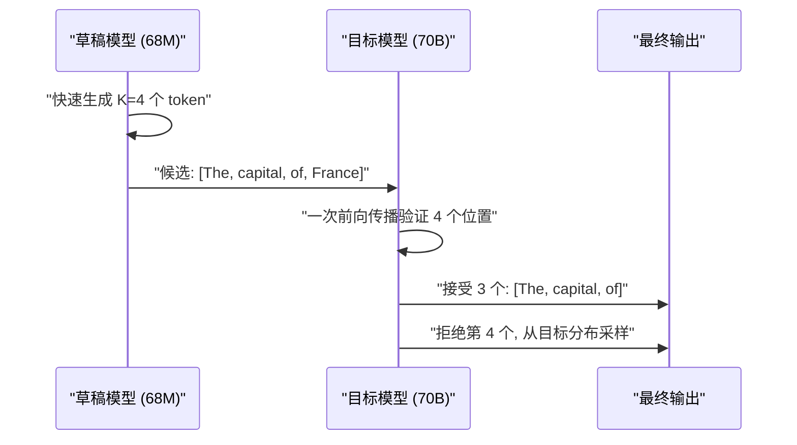
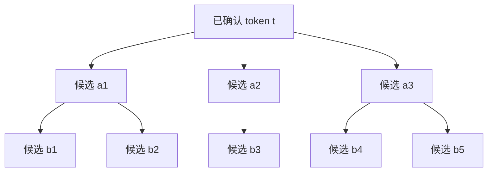
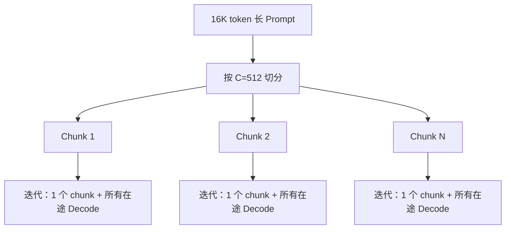
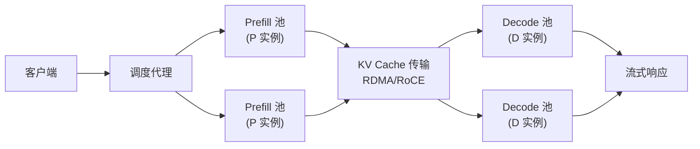

# 06 推理优化——KV Cache、量化与投机解码

**摘要：**

训练一个大语言模型需要数百万美元，但真正的成本大头在推理——一个被数百万用户使用的模型，每天要处理数十亿 token，推理成本远超一次性的训练成本。本文站在机制层剖析 LLM 推理优化的四条主线：**KV Cache** 消除自回归生成中的重复计算，从 GQA 的架构级压缩、H2O/SnapKV/PyramidKV 的驱逐式压缩，到 KIVI 与 FP8 的量化式压缩；**权重量化** 把模型压到 4-bit 乃至更低，从 GPTQ/AWQ/GGUF 走到 2025 年之后的 FP8 生产基线，以及 Blackwell 时代 NVFP4/FP4 的新硬件语境；**投机解码** 用小模型、解码头或特征级草稿为大模型换来一次多步验证，EAGLE、Medusa、MTP 各自取什么舍什么；以及 **Continuous Batching、PagedAttention、Chunked Prefill、PD Disaggregation** 等系统级优化如何把 GPU 从"等数据"的闲置里解放出来。全文的核心判断是：LLM 推理优化的本质，是把 Decode 阶段那个访存密集的"薄活"从显存带宽的约束里一寸一寸抠出来；而所有方案的取舍都落在显存、算力、网络带宽与工程质量这四者之间——没有放之四海而皆准的银弹，只有因地制宜的组合。

---

## 第 1 章 LLM 推理的两个阶段

训练模型是一锤子买卖，服务模型却是日复一日的流水账。2023 年之后，几乎所有把大模型搬上生产线的团队都会在某个复盘会上得到同一个令人不安的结论：单次训练再昂贵，也扛不住"每天几十亿 token"的长期放血——推理成本最终会以数量级的差距超过训练成本。要理解这笔账为什么算不平，笔者建议先把目光从发布会上的性能数字移开，落回到一次推理请求在 GPU 内部实际经历的两个阶段上。

### 1.1 Prefill 与 Decode

LLM 的推理过程分为两个截然不同的阶段，两者的计算特征几乎互为镜像：

**Prefill（预填充）阶段**：模型一次性处理整个输入 prompt。所有 token 同时参与 Self-Attention 计算，充分利用 GPU 的并行能力。这个阶段是**计算密集型**的——GPU 的算力是瓶颈。

**Decode（解码）阶段**：模型逐个 token 生成输出。每一步只生成一个 token，需要与之前所有 token 的 Key/Value 做注意力计算。这个阶段是**访存密集型**的——每一步的计算量很小（只处理一个 token），但需要从显存中读取大量的 KV Cache 数据，GPU 的显存带宽是瓶颈。

| 阶段 | 处理 token 数 | 瓶颈 | GPU 利用率 | 占总推理时间 |
| :--- | :--- | :--- | :--- | :--- |
| **Prefill** | 所有输入 token（并行） | 计算（FLOPs） | 高 | ~10-30% |
| **Decode** | 每步 1 个 token（串行） | 显存带宽（Memory Bandwidth） | 低 | ~70-90% |

这里有一个反直觉的事实值得停下来想一分钟：Decode 阶段明明每一步只产生一个 token，工作量看起来小得可怜，却占据了绝大部分推理时间。原因在于自回归的结构性约束——第 $t$ 个 token 的生成必须等到第 $t-1$ 个 token 完成之后才能开始，这是一条无法并行的因果链。如果把整段生成过程比作一家后厨，GPU 的算力就是灶台的火力，显存带宽则是往灶台送食材的传送带；Prefill 好比一次性端进一整车食材，后厨火力全开；Decode 却变成了一片一片地送，灶台的火再旺，也只能干等着传送带一片一片把食材送到。**Decode 阶段占据了绝大部分推理时间，且 GPU 利用率极低——这就是 LLM 推理优化的核心目标：提升 Decode 阶段的效率。**

### 1.2 推理的核心指标

- **TTFT（Time To First Token）**：从输入到生成第一个 token 的延迟，主要由 Prefill 阶段决定
- **TPOT（Time Per Output Token）**：每个输出 token 的生成时间，由 Decode 阶段决定
- **吞吐量（Throughput）**：每秒处理的总 token 数（输入 + 输出），通常以 tokens/s 衡量
- **总延迟（Latency）**：$\text{TTFT} + \text{TPOT} \times \text{output\_length}$

不同应用场景对指标的优先级不同：聊天应用优先 TTFT（用户期望快速看到首字）；批量处理优先吞吐量（总处理速度）。但请注意，这四个指标并非彼此独立——TTFT 与 TPOT 的共同分母是 GPU 资源，抢占了 Prefill 的计算就会推迟 Decode 的步进，这层相互牵制的关系，正是后文 Chunked Prefill 与 PD Disaggregation 这两套系统级方案要解决的矛盾。

### 1.3 内存墙：Decode 的真实瓶颈

把 Decode 阶段每步的账算细，会看到一个惊人的不平衡。以 A100 为例，其 BF16 峰值算力约 312 TFLOPS，显存带宽约 2 TB/s。一个 7B 参数的模型以 BF16 存储约为 14 GB，自回归的每一步，模型都必须把全部权重从显存读到计算单元——这一步的访存量是 14 GB，耗时约 $14\text{ GB} / 2\text{ TB/s} = 7$ 毫秒；而这一步真正要做的矩阵运算，也就是一个 token 的线性投影与注意力，大约只有几十 GFLOPs，按 312 TFLOPS 折算，纯计算时间在 0.1 毫秒量级。两相对照，算力利用率不足百分之几，几乎全部时间都花在"等数据从显存搬过来"上。

这个现象在系统结构术语里叫**内存墙（Memory Wall）**：GPU 的计算能力增长远快于显存带宽的增长，于是访存密集型的负载被带宽卡死，算力成了摆设。它给出的推论非常直接——推理优化的三大杠杆，一是**减少每步需要搬运的数据量**（把权重压小、把 KV Cache 压小，这就是量化与 KV 压缩的动机），二是**减少需要搬运的次数**（让一次搬运多验证几个 token，这就是投机解码的动机），三是**让搬运与计算都尽量不空转**（这就是连续批处理、分页缓存、PD 分离等系统级优化的动机）。后文各章，便是沿着这三条杠杆逐一展开。

---

## 第 2 章 KV Cache——消除重复计算

自回归模型每步只产出一个 token，显存却会以 GB 为单位膨胀——这中间的差额，全部被 KV Cache 吃掉了。KV Cache 不是 Transformer 论文里预先设计好的概念，而是推理引擎在工程实践中慢慢长出来的器官，它解决的是一个朴素到几乎不值得辩护的问题：**不要重复计算已经算过的东西**。

### 2.1 KV Cache 的动机

在 [[02 GPT 架构——Decoder-Only 的自回归语言模型]] 中我们知道，Decode 阶段每一步生成一个 token，该 token 需要与之前所有 token 做 Self-Attention 计算。

如果没有 KV Cache，每生成一个新 token，模型都需要重新计算整个序列（包括所有已生成的 token）的 Key 和 Value——这意味着第 $t$ 步需要处理 $t$ 个 token，总计算量为 $O(T^2)$（$T$ 为总序列长度）。这显然是极度浪费的——前 $t-1$ 个 token 的 Key 和 Value 在第 $t-1$ 步已经计算过了，完全相同。

**KV Cache 的核心思想**：将每一步计算出的 Key 和 Value 缓存在 GPU 显存中，后续步骤直接复用，无需重复计算。

这里不妨做一个反事实推演：假如没有 KV Cache，一个生成 4096 个 token 的请求，序列长度从 1 涨到 4096，每一步都要把前面所有 token 的注意力重新算一遍，总计算量从 $O(T)$ 膨胀到 $O(T^2)$——在 4096 的序列上就是约 840 万次 token 级注意力（$\frac{4096 \times 4097}{2} \approx 8.4 \times 10^6$），而 KV Cache 把这笔账直接归零。这正是"以空间换时间"的经典交易：付出的是显存，换来的是计算量与延迟的同步收缩。

### 2.2 KV Cache 的工作机制

在 Prefill 阶段，模型处理完整个输入序列后，将所有层的 Key 和 Value 矩阵缓存起来。

在 Decode 阶段的第 $t$ 步：

1. 只对新生成的 token $x_t$ 计算 $Q_t, K_t, V_t$（通过一次线性投影）
2. 将 $K_t, V_t$ 追加到缓存中：$K_{\text{cache}} = [K_{\text{cache}}; K_t]$，$V_{\text{cache}} = [V_{\text{cache}}; V_t]$
3. 计算 $Q_t$ 与整个 $K_{\text{cache}}$ 的注意力：$\text{Attention}(Q_t, K_{\text{cache}}, V_{\text{cache}})$

这样每步只需计算一个 token 的 Q/K/V 投影（而非整个序列），将 Decode 的计算量从 $O(T^2)$ 降低到 $O(T)$。

### 2.3 KV Cache 的显存消耗

KV Cache 的代价是显存——需要为每个请求的每个 token 存储所有层的 Key 和 Value。

对于一个 LLaMA-7B 模型（32 层，32 头，$d_k = 128$，BF16）：

$$\text{KV Cache per token} = 2 \times L \times h \times d_k \times 2\text{B} = 2 \times 32 \times 32 \times 128 \times 2 = 512\text{KB}$$

其中 $2$ 代表 K 和 V 两个矩阵，最后的 $2\text{B}$ 代表 BF16 的 2 字节。

一个 4096 token 长度的序列的 KV Cache 约为 $512\text{KB} \times 4096 = 2\text{GB}$。如果同时服务 32 个并发请求，KV Cache 就需要 64 GB——超过了单块 A100 的显存。更麻烦的是，KV Cache 的大小随序列长度线性增长、随并发数线性增长，两条线相乘，就构成了在线服务最陡峭的显存曲线。这也是为什么 KV Cache 往往比模型权重更快地成为显存的头号占用量：权重是固定的"房租"，KV Cache 却是随客流量波动的"水电费"。

| 模型 | KV Cache / token | 4K 上下文 | 32K 上下文 | 128K 上下文 |
| :--- | :--- | :--- | :--- | :--- |
| LLaMA-7B | 512 KB | 2 GB | 16 GB | 64 GB |
| LLaMA-70B (GQA, 8 KV头) | 320 KB | 1.25 GB | 10 GB | 40 GB |
| Mistral-7B (GQA, 8 KV头) | 128 KB | 0.5 GB | 4 GB | 16 GB |

> [!info] 核心概念
> KV Cache 是 LLM 推理中"以空间换时间"的经典策略。它将 Decode 阶段从"计算密集型"转变为"访存密集型"——瓶颈从 GPU 算力转移到了显存带宽和显存容量。后续的大量优化技术（PagedAttention、量化 KV Cache、GQA、KV 驱逐与卸载）都是围绕 KV Cache 的显存压力展开的。

### 2.4 GQA 与 MQA：从架构源头压缩

面对 KV Cache 的显存膨胀，最省事的方案其实是"让模型本来就少存一点"。KV Cache 的体积公式里有四个乘数——层数、头数、维度、位宽，层数和维度由模型能力决定，很难轻动；头数却是可以讨价还价的。

早期的多查询注意力（Multi-Query Attention, MQA，Shazeer, 2019）走得最激进：所有 query 头共享同一组 Key/Value 头，KV Cache 直接缩小到原来的 $1/h$。但 MQA 的代价是质量损失——共享的 K/V 限制了注意力表达的多样性，业界用了一段时间后发现，对质量敏感的场景它并不划算。2023 年，Google 的 Ainslie 等人在 **GQA（Grouped-Query Attention）** 论文里给出了折中方案：把 query 头分成若干组，组内共享 K/V 头。GQA 的 KV 头数可以是 MHA 的 $1/4$ 或 $1/8$，质量却几乎不掉——论文的实验显示，GQA 在绝大多数任务上都能逼近 MHA 的水平，而 KV Cache 的削减是实实在在的。

这组关系用公式看最清楚。设总层数 $L$、query 头数 $h_q$、KV 头数 $h_{kv}$、头维度 $d_k$、位宽 $b$ 字节，则

$$\text{KV per token} = 2 \times L \times h_{kv} \times d_k \times b$$

对同一模型，$h_{kv}$ 从 32（MHA）降到 8（GQA），KV Cache 直接除以 4。上表里 LLaMA-70B 与 Mistral-7B 之所以能以远小于 LLaMA-7B 的每 token 开销跑更长上下文，靠的就是 GQA。打个比方：MHA 像合唱团里每个声部都各自举着一份乐谱，GQA 则是让几个相近声部共用一份——少印了谱子，合唱的质量却几乎没有折损。至于 DeepSeek 的 **MLA（Multi-head Latent Attention）**，则把"少存"推向了"压缩存储"，其定量账本我们在 [[02 GPT 架构——Decoder-Only 的自回归语言模型]] 里已经算过（KV Cache 缩减 93.3%），本章不再重复，只提醒一句：GQA 与 MLA 的路线分歧在于，前者靠减少头数、后者靠低秩压缩，两者并不互斥，DeepSeek-V2 之后的主流开源模型已经普遍把 GQA 或 MLA 当作默认配置。

### 2.5 KV 驱逐：Attention Sink、H2O 与 SnapKV

GQA 压缩的是"每个 token 要存多少"，还有另一条路线压缩的是"要存哪些 token"。KV Cache 驱逐（KV Eviction）的思路很直接：上下文里并非每个 token 都同样重要，既然显存放不下全部，那就把不重要的丢掉。

2023 年，MIT 的 Xiao 等人在 StreamingLLM 里观察到 **注意力汇（Attention Sink）** 现象：Softmax 之后的注意力权重，会不成比例地聚集在序列最开头的几个 token 上——哪怕这些 token 只是无关紧要的句首词，模型也会把大量注意力"倾倒"进去，仿佛它们是一个吸收多余能量的汇。于是 StreamingLLM 的缓存策略非常简单：永远保留开头的几个 token（充当 Attention Sink），再保留一个滑动窗口里的最近 token，中间的全部丢弃。这个看似粗糙的方案，让模型在长达 400 万 token 的流式输入上保持了稳定生成，相比"每次重算滑动窗口"的基线快出最多 22.2 倍。

同年，Zhang 等人的 H2O（Heavy-Hitter Oracle）把驱逐从"按位置"推进到"按重要性"：他们发现一小部分 token 贡献了绝大部分注意力分数，这些"高频 token"被称作重击者（Heavy Hitter）；H2O 用一个累积注意力分数的策略，动态决定留下哪些 token、驱逐哪些 token，在保留 20% 重击者的配置下，把吞吐量提升了最多 29 倍。

2024 年的 SnapKV 又往前走了一步，提出了一个更聪明的观察窗口：模型在生成时，每个注意力头其实始终盯着 prompt 里的某些特定位置；而这个"盯哪里"的模式，可以用 prompt 末尾一小段 token 作为"观察窗口"，一次性探测出来。据此，SnapKV 在 Prefill 阶段就为每个头挑选出它真正关心的 token 并保留其 KV，其余直接丢弃——在 16K 输入的基准上，生成速度提升 3.6 倍、显存效率提升 8.2 倍，质量几乎无损。同年提出的 PyramidKV 则观察到注意力随层数加深而收敛（论文称之为"金字塔式信息汇聚"），因而把缓存预算按层分配：浅层多存、深层少存，用全量 12% 的缓存就追平了完整 KV Cache 的质量。

| 方法 | 保留策略 | 依据 | 特点 | 局限 |
| :--- | :--- | :--- | :--- | :--- |
| **StreamingLLM** | 首几个 token + 最近窗口 | Attention Sink 现象 | 零训练，支持无限长流式 | 中间信息全丢，不适用于需要全文回忆的任务 |
| **H2O** | 高频重击者 + 最近 token | 累积注意力分数 | 动态驱逐，有理论保证 | 阈值依赖，驱逐不可逆 |
| **SnapKV** | 每头挑选重要 token | 最近窗口 Query 对 prompt 的注意力 | Prefill 阶段一次完成，无需训练 | 多一轮"观察"计算 |
| **PyramidKV** | 浅层多存、深层少存 | 金字塔式信息汇聚 | 小预算下质量最佳 | 分层预算需针对模型校准 |

> [!warning] 生产避坑
> KV 驱逐是不可逆的。被丢掉的 token 无法恢复，如果后续生成恰恰需要某个被驱逐的 token（譬如 RAG 场景里，用户的问题恰好引用了被丢掉的检索段落），模型就会"失忆"并开始胡编。因此驱逐类方案更适合"对话流式"这类对近期信息敏感、对远端细节不敏感的场景；而对"长文档问答、事实抽取"这类依赖全文回忆的任务，保留完整 KV Cache（配合量化与分页管理来省显存）往往比驱逐更稳妥。

### 2.6 KV 卸载与分层缓存

驱逐是"删"，卸载（Offload）则是"搬"——把暂时不用的 KV Cache 从显存搬到 CPU 的 DRAM，甚至搬到 SSD，要用时再搬回来。这是显存层次结构的自然延伸：GPU HBM 贵且少，CPU DRAM 便宜量大，SSD 更便宜但慢。Mooncake 系统（后文 5.5 节还会展开）正是把 CPU/DRAM/SSD 组织成 KV Cache 的二级、三级缓存，配合预取与淘汰策略，让单块 GPU 能撑起远超其显存容量的长上下文请求。不过卸载的代价同样清楚：从 DRAM 读取的延迟比 HBM 高一个数量级，从 SSD 读取又要再高一个数量级，一旦读取路径落在慢速介质上，TPOT 会明显恶化——所以卸载方案的核心矛盾，始终是"命中率与延迟"之间的权衡，命中率高则近乎无损，命中率低则得不偿失。

---

## 第 3 章 权重量化——模型压缩

模型压缩这个话题，在 2022 年之前几乎只属于边缘设备和手机端的专利；但当 70B 的权重以 140 GB 的体积摆在只有 24 GB 显存的显卡面前时，"放不放得下"就成了比"精不精确"更紧迫的问题。权重量化（Weight Quantization）把 FP16 的权重换成更窄的数值格式，一举同时解决两件事：模型体积缩小，以及每步 Decode 从显存搬运的字节数减少——后者在访存密集的 Decode 阶段会直接转化为速度提升。

### 3.1 量化的基本原理

**量化**（Quantization）是将模型权重从高精度浮点数（如 FP16/BF16，16 bit）转换为低精度整数（如 INT8 或 INT4），从而减小模型体积和加速推理。把 16 位浮点数换成 4 位整数，就像把一张 4000 万像素的 RAW 照片压成 JPEG 预览图——人眼在屏幕上几乎看不出差别，文件体积却缩到原来的四分之一；但压得太狠，天空会出现色带，文字的边缘会起毛刺。量化与之同理：位宽决定"信息带宽"，而保留多少信息取决于数值分布本身。

最简单的量化方式是**线性量化**：将 FP16 值映射到 INT8 区间 $[-128, 127]$：

$$x_{\text{quant}} = \text{round}\left(\frac{x}{\text{scale}}\right) + \text{zero\_point}$$

$$\text{scale} = \frac{x_{\max} - x_{\min}}{2^b - 1}$$

其中 $b$ 是量化位数。反量化时：$x_{\text{dequant}} = (x_{\text{quant}} - \text{zero\_point}) \times \text{scale}$。

量化误差的来源需要说透：均匀网格假设数值在 $[x_{\min}, x_{\max}]$ 内均匀分布，但真实权重并非如此——权重里既有大量接近零的小值，也有一小撮幅度特别大的离群值（Outlier）。若 scale 被离群值撑大，小值的相对误差就会急剧恶化；若忽略离群值，它们又会被截断。三种对策由此展开：**per-tensor**（整层一个 scale，最省但误差最大）、**per-channel**（每个输出通道一个 scale，是权重量化的主流粒度）、**per-group**（通道内再分块，如 GPTQ 的 128 元素一组），粒度越细，误差越小，但存储 scale 的开销也越大——这是量化里第一对绕不开的权衡。

量化带来的好处是双重的：
- **模型体积减半到四分之一**：FP16 → INT8 减半，FP16 → INT4 减到四分之一
- **推理加速**：更小的模型意味着更少的显存读取，在访存密集的 Decode 阶段直接转化为速度提升

### 3.2 训练后量化（Post-Training Quantization）

训练后量化不需要重新训练模型，只需要一小批校准数据来确定量化参数（scale 和 zero_point）。

**GPTQ（Generative Pre-trained Transformer Quantization）**

GPTQ（Frantar et al., 2023）是最早在 LLM 上成功实现高质量 4-bit 量化的方法。核心思想是**逐层量化**：一次处理一个线性层，利用**最优脑损伤**（Optimal Brain Damage）的思想，按照每个参数对输出误差的影响大小，选择最优的量化顺序和补偿方式。

GPTQ 使用少量校准数据（通常 128 条文本）计算每一层的 Hessian 矩阵（衡量参数重要性），然后按照重要性从低到高量化参数，每量化一个参数就调整其他未量化参数来补偿误差。这个"边量化边补偿"的过程，让 GPTQ 在 4-bit 位宽下依然保持了令人意外的质量，也是它成为 2023-2024 年开源 4-bit 事实标准的原因。

**AWQ（Activation-aware Weight Quantization）**

AWQ（Lin et al., 2024）观察到一个关键现象：**不是所有权重同等重要——少数"关键权重"对应着激活值中的少数"关键通道"**。这些关键通道的激活值幅度特别大，对应权重的量化误差会被放大。

AWQ 的策略是：对关键权重（对应高激活值通道）乘以一个大于 1 的缩放因子，使其值范围更大、量化精度更高；对不关键的权重缩小，牺牲其精度换取整体更好的量化效果。注意 AWQ 与 GPTQ 的分野：GPTQ 在"事后补偿"上做文章，AWQ 则在"事前保护"上做文章——前者按误差影响排序逐步量化，后者按激活值幅度识别要害通道并放大保护。两种思路殊途同归，都绕开了"均匀量化会被离群值击穿"的根本缺陷。

**GGUF（GPT-Generated Unified Format）**

GGUF 是 llama.cpp 生态使用的量化格式，支持 CPU 推理。它使用**混合精度量化**——不同层可以使用不同的量化位数（如注意力层用 8-bit，FFN 用 4-bit），在精度和体积之间灵活权衡。

GGUF 的命名约定如 `Q4_K_M` 表示：4-bit 量化 + K-quants 分组方法 + Medium 精度配置。它之所以在本地部署场景大行其道，是因为 llama.cpp 把"同一份模型、多种量化档位"做成了开箱即用的体验——下载一个 GGUF 文件，就能在 CPU、Apple Silicon 或消费级 GPU 上按显存余量选择档位，这是闭源格式难以复制的生态优势。

| 量化方法 | 量化位数 | 校准数据需求 | 推理框架 | 速度 | 质量 |
| :--- | :--- | :--- | :--- | :--- | :--- |
| **GPTQ** | 4-bit / 8-bit | 少量（128 条） | ExLlama, vLLM | 快（GPU） | 好 |
| **AWQ** | 4-bit | 少量 | vLLM, TensorRT-LLM | 快（GPU） | 略优于 GPTQ |
| **GGUF** | 2-8 bit 混合 | 无 | llama.cpp | 中（CPU/GPU） | 灵活 |
| **FP8 (W8A8)** | 8-bit | 少量/无需 | vLLM, TensorRT-LLM, SGLang | 快（GPU） | 接近无损 |
| **BitsAndBytes** | 4-bit (NF4) / 8-bit | 无 | Transformers | 中（GPU） | 好（QLoRA 使用） |

### 3.3 量化对质量的影响

量化不可避免地引入精度损失，但不同位数的影响差异巨大：

- **8-bit 量化**：几乎无损——在大多数基准上与 FP16 的差异小于 1%
- **4-bit 量化**：轻微损失——在知识密集型任务（如 MMLU）上可能下降 1-3%，在推理任务上影响更小
- **3-bit 量化**：明显损失——质量开始显著下降，仅适用于对精度要求不高的场景
- **2-bit 量化**：严重损失——当前技术下质量不可接受

> [!warning] 生产避坑
> 量化对不同能力的影响不均匀。经验表明，量化对"事实性知识"的损伤大于对"推理能力"的损伤——因为事实知识依赖于权重中存储的精确信息，而推理能力更多依赖于模型的结构性模式。因此，如果你的应用场景对事实准确性要求极高（如医疗、法律），建议使用 8-bit 量化而非 4-bit。

2025 年的一项系统评测（IJCAI 2025）给这个经验贴补上了更精确的画像：其一，FP8 在跨任务、跨模型规模上始终是最稳健的选项，AWQ 在仅权重量化（weight-only）场景下整体优于 GPTQ；其二，模型规模是 4-bit 掉点的关键调节变量——小模型（1B-7B 量级）在 4-bit 下可能遭遇严重掉点，而 70B 量级的模型反而稳如泰山；其三，量化并不总是"任务越难损伤越大"，它更像一面放大镜，放大的其实是模型自身已有的弱点——一个在长尾语言上本来就弱的模型，量化后先崩的往往是它最薄弱的地方。这三点对工程选型的指导意义很直接：小模型慎用 4-bit，大模型放心压；要稳妥就上 FP8；量化后必须针对自己的核心任务做回归测试，而不是只看困惑度。

### 3.4 KV Cache 量化

除了权重量化，KV Cache 也可以被量化以节省显存。KV Cache 量化通常使用 8-bit（FP8 或 INT8），对质量的影响很小，但可以将 KV Cache 的显存占用减半。

vLLM 和 TensorRT-LLM 都支持 KV Cache 的 FP8 量化。vLLM 的 FP8 KV Cache 还允许选择 per-tensor 或 per-attention-head 两种 scale 粒度，前者实现简单，后者在 FlashAttention-3 后端上可以把注意力计算也搬进 FP8 域，进一步省带宽。

KV Cache 量化并不止于 8-bit。2024 年 ICML 上的 KIVI 先做了细致的分布分析，发现 K 与 V 的性格截然不同：Key 的数值沿**通道维**规整，应该按通道分组量化；Value 的数值沿 **token 维**更稳定，应该按 token 分组量化——"床单要横着叠、毛巾要竖着卷"，两种维度的分组方式不可互换。基于这个不对称设计，KIVI 把 KV Cache 压到 2-bit，峰值显存下降 2.6 倍，同等显存下 batch size 可以扩大 4 倍，实测吞吐提升 2.35-3.47 倍，而困惑度几乎不变。KIVI 的启示是：KV Cache 量化比权重量化更"好欺负"——它只参与一次注意力内积，误差的传播路径短，因而在更低位数上仍能保持质量，这让 4-bit、甚至 2-bit 的 KV Cache 成为长上下文部署的实用选项。

### 3.5 FP8 与 FP4：新位宽与硬件演进

如果以 2026 年年初的时间点回看，量化生态最大的变化是 **FP8 从备选变成了基线**。FP8 有两个子格式——E4M3（4 位指数、3 位尾数，动态范围宽、精度低）与 E5M2（5 位指数、2 位尾数，动态范围更宽但精度更低），推理常用 E4M3，训练则常把 E4M3 与 E5M2 混用。FP8 之所以能上位，硬件是根本推手：从 H100（Hopper）起，NVIDIA Tensor Core 原生支持 FP8 矩阵乘，**W8A8**（权重 8-bit、激活 8-bit）的部署成本几乎与 FP16 持平，质量却接近无损；到 2024 年底，DeepSeek-V3 更进一步，把 FP8 用进了**预训练**——这是首个公开的"原生 FP8 训练"的大模型，训练内存与算力双双受益，而模型质量没有明显回落。2025 年，Llama 3.1/3.3 与 Qwen3 等主流模型纷纷发布官方 FP8 权重，vLLM、TensorRT-LLM、SGLang 全线支持，FP8（W8A8）事实上成了生产环境量化的默认选项。

FP4 则站在更前沿的位置。Blackwell 架构（B200/GB200）的第五代 Tensor Core 原生支持 FP4 计算，NVIDIA 为此设计了 **NVFP4** 格式——4 位数值（1 符号位、2 指数位、1 尾数位）外加每 16 个值共享一个 FP8 scale，相比 OCP 的 MXFP4（每 32 个值共享一个 2 的幂 scale），NVFP4 的块缩放粒度更细、精度更高。在 SemiAnalysis 的 InferenceMAX v1 基准里，GB200 NVL72 在 DeepSeek-R1 推理负载上比 H200 快约 15 倍，Llama 3.3 70B 在 50 TPS/user 的负载下达到每 GPU 约 10000 tokens/s；成本账同样夸张——同一负载下每百万 token 成本从 H200 的约 $1.56 降到 GB200 的约 $0.10。消费级市场也没闲着：RTX 50 系（SM120）同样支持原生 FP4，llama.cpp 在 2026 年 4 月的 b8967 版本起把 NVFP4 权重直接调度到 Blackwell 的 FP4 Tensor Core，RTX 5090 上 Llama 3.1 70B 的生成速度比 Q4_K_M 快约 1.7-1.9 倍，Prefill 快约 2.0-2.4 倍。

| 指标 | A100 | H100 SXM | H200 | B200 |
| :--- | :--- | :--- | :--- | :--- |
| 架构 | Ampere | Hopper | Hopper | Blackwell |
| 显存 | 80GB HBM2e | 80GB HBM3 | 141GB HBM3e | 192GB HBM3e |
| 带宽 | 2.0 TB/s | 3.35 TB/s | 4.8 TB/s | 8 TB/s |
| BF16（稠密） | 312 TFLOPS | ~989 TFLOPS | ~989 TFLOPS | ~2250 TFLOPS |
| FP8（稠密） | — | ~1979 TFLOPS | ~1979 TFLOPS | ~4500 TFLOPS |
| FP4 | — | — | — | 原生 NVFP4 |

> [!note] 生态观察
> 2025 年的一个标志性事件是 AutoAWQ 与 AutoGPTQ 两个仓库相继进入归档状态，社区重心迁移到 GPTQModel 与 llm-compressor 等新工具链；与此同时，本地推理的重心明显倒向 GGUF 与 MLX，生产推理则倒向 FP8（W8A8）。这个分野说明：**量化生态已经按场景分层**——追求极致压缩与便携性选 GGUF，追求工程质量与硬件算力选 FP8，而 AWQ/GPTQ 的 4-bit 地位被两头夹击，逐渐退居"需要 4-bit 又不愿用 GGUF"的中间地带。技术选型没有永恒的最优解，只有随时间迁移的均衡点。

---

## 第 4 章 投机解码——用小模型加速大模型

第 3 章的量化在"每次搬运的字节数"上做文章，本章换一个维度：**让一次搬运干更多的活**。既然 Decode 每一步都要把整份权重搬一遍、却只产出一个 token，那么最理想的局面是——搬一次，产出好几个 token。

### 4.1 自回归生成的根本瓶颈

LLM 推理的根本瓶颈在于自回归生成的串行性——每一步只生成一个 token，但每步都需要从显存读取完整的模型权重。对于大模型，每步的计算量很小（处理一个 token），但显存读取量很大（读取整个模型），GPU 的算力严重闲置。

从硬件指标看，A100 GPU 的峰值算力为 312 TFLOPS（BF16），但显存带宽只有 2 TB/s。一个 7B 模型（14 GB，BF16）每步需要读取全部参数，耗时约 $14/2000 = 7$ms。但这一步的实际计算量极小——大量时间花在"等数据从显存传到计算单元"上。

这个瓶颈被称为**内存墙**（Memory Wall）：GPU 的计算能力远超数据供给能力。把同样的账算到 70B 模型上会更触目惊心：BF16 的 140 GB 权重，在 A100 上每步要读 70 毫秒，换算下来生成速度只有每秒 14 个 token——一个 500 token 的回答要等 35 秒。这就是 2023 年之前大模型在线服务成本居高不下的直接原因。

### 4.2 投机解码的核心思想

**投机解码**（Speculative Decoding，Leviathan et al., 2023; Chen et al., 2023）的核心思想来自一个观察：**大模型生成的很多 token 其实是"简单"的——小模型也能正确预测**。

譬如"The capital of France is Paris"这个输出，前几个词（"The capital of"）几乎任何语言模型都能正确生成。只有关键信息词（"France"、"Paris"）可能需要大模型的能力。

投机解码的策略是：

1. 用一个**小型草稿模型**（Draft Model，如 68M 参数）快速生成 $K$ 个候选 token（$K$ 通常为 4-8）
2. 将这 $K$ 个候选 token 一次性送入**大型目标模型**（Target Model）进行验证——大模型在一次前向传播中同时处理 $K$ 个位置
3. 从左到右检查：如果草稿 token 与大模型的预测一致（或满足某个接受准则），就接受；遇到第一个不一致的位置就拒绝，从大模型的分布中重新采样



把投机解码比作"实习生先起草、主管最后审阅"，最贴切不过：实习生（草稿模型）便宜且快，把大段初稿一挥而就；主管（目标模型）只审不改——凡是能通过的段落直接放行，碰到不合格的当场重写。整个流程的效率取决于两点：初稿的通过率，以及实习生写得有多快。**关键性质：投机解码的输出分布与直接用大模型生成完全相同——它不是近似，而是精确的。**接受-拒绝机制保证了这一点：被接受的 token 与目标模型的分布一致，被拒绝的位置重新从目标分布采样，因此生成文本的分布严格不变。这是投机解码区别于其他"近似加速"方案的护城河——线上模型的行为不会因为加速而悄悄漂移。

### 4.3 加速比分析

投机解码的加速比取决于两个因素：

- **接受率** $\gamma$：草稿 token 被大模型接受的概率。越高越好——$\gamma = 0.8$ 意味着平均每 5 个草稿 token 有 4 个被接受
- **草稿模型速度与大模型速度的比值**：草稿模型越快越好

理论加速比约为：

$$\text{Speedup} \approx \frac{K \cdot \gamma + 1}{K \cdot t_{\text{draft}} / t_{\text{target}} + 1}$$

这个公式可以读出三层含义。分子是"一次大模型前向平均多产出几个 token"——$K\gamma + 1$：被接受的 $K\gamma$ 个加上必须重新采样那一个；分母是"一次循环的代价"——草稿阶段耗时 $K \cdot t_{\text{draft}}$ 加上一次目标前向 $t_{\text{target}}$。当 $\gamma$ 趋近 1 且草稿几乎免费时，加速比趋近 $K$；当 $\gamma$ 很低时，加速比趋近 1——草稿不但没帮上忙，反而白付了它的运行时间。这个临界关系提醒我们，投机解码不是无脑加速：**接受率上不去，K 越大越吃亏**。

在实践中，投机解码通常能获得 **2-3 倍**的加速。接受率高度依赖于任务类型——模板化的输出（如代码、格式化文本）接受率高，创意性输出（如故事续写）接受率低。其背后的机制是语言的熵：模板化文本的下一 token 几乎可预测，草稿模型的命中率自然高；创意文本的下一 token 高度不确定，草稿模型与大模型的预测分歧就会频繁发生，接受率随之崩塌。

### 4.4 Medusa——无需草稿模型的投机解码

**Medusa**（Cai et al., 2024）避免了使用独立的草稿模型——它在大模型本身上添加多个轻量级的"Medusa Head"（额外的 FFN 层），每个 Head 负责预测不同未来位置的 token。

Medusa 的优势是不需要独立的草稿模型（避免了草稿模型与目标模型之间的分布差异问题），但需要额外的训练来学习 Medusa Head。它用**树形注意力**（Tree-based Attention）组织候选：不只预测一条链，而是让多个 Head 各自提出分支，再把这些分支拼成一棵树，由大模型一次性验证整棵树的节点——一次前向里同时检查多个"如果"。论文给出的两档训练方案也很有意思：Medusa-1 冻结主干只训 Head，加速约 2.2 倍；Medusa-2 把 Head 与主干联合微调，加速进一步提升到 2.3-2.8 倍，代价是需要一套不损伤原有能力的训练配方。

### 4.5 EAGLE——从 token 级到特征级

如果说 Medusa 的思路是"多头并进"，那么 EAGLE（Extrapolation Algorithm for Greater Language-model Efficiency）则换了一个更微妙的战场：**在特征空间里做自回归**。EAGLE 的草稿模型不直接预测 token，而是预测目标模型倒数第二层（second-to-top layer）的特征向量——论文的观察是，特征层的自回归比 token 层的自回归"更顺滑"，因为特征层已经吸收了大部分语义结构，剩下的不确定性远比 token 层的少。为了消解特征预测里残余的不确定性，EAGLE 把"前一个 token"的信息也拼进来一起预测，用这一点额外输入换来了极高的草稿命中率。

效果相当可观：在 LLaMA2-Chat 70B 上，EAGLE 达到 2.7-3.5 倍的延迟加速、吞吐翻倍，且同样严格保持生成分布不变；用 gpt-fast 在单块 RTX 3090 上跑 13B 模型时，达到约 160 tokens/s。随后的 EAGLE-2 引入**动态草稿树**——利用草稿模型的置信度近似接受率，每步都动态调整树的分支结构，把加速比推到 3.05-4.26 倍；EAGLE-3 又放弃了特征预测，改用多层特征融合 + 训练期测试（training-time test），最高加速比来到 6.5 倍，并在 SGLang 框架里以 batch 64 实测带来 1.38 倍吞吐提升。EAGLE 系列目前已是 vLLM 与 SGLang 内置的投机解码方案，草稿模型可以在两三天内用少量数据训练出来，属于"小成本、大收益"的工程红利。



上图中的全部节点构成一棵**候选树**，大模型的一次前向传播同时验证树上的每一条分支——无论草稿在哪个位置"想岔了"，只要某条分支命中，这次搬运就不算白费。分支越多、命中率越高，加速效果越好，但验证的计算量也随节点数线性上升，所以树的形状与宽度本身就是需要权衡的设计参数。

### 4.6 MTP：把草稿能力装进训练目标

投机解码家族的另一个分支，干脆放弃"事后配一个草稿模型"，而是把多 token 预测直接写进训练目标。DeepSeek-V3 的多 token 预测（Multi-Token Prediction, MTP）就是代表：主模型之外挂一个极轻量的 MTP 模块，训练时每个位置不只预测下一个 token，还要顺序预测下下一个——于是模型在训练阶段就被迫学会"为更远的未来做准备"。到了推理阶段，这个 MTP 模块天然可以作为草稿模型使用：实测它对第二个后续 token 的接受率高达 80-90%，把生成吞吐提升了约 1.8 倍。这条路线与 [[03 预训练——数据、算力与 Scaling Law]] 里讨论的训练目标设计直接相关，它的工程启示是：**有些推理优化，最便宜的入手点是训练阶段**——推理时的草稿能力，不过是训练时埋下的伏笔。

| 方法 | 草稿来源 | 机制 | 实测加速 | 是否需要额外训练 |
| :--- | :--- | :--- | :--- | :--- |
| **经典投机解码** | 独立小模型 | token 级草稿 + 批量验证 | 2-3 倍（依赖接受率） | 仅需现成小模型 |
| **Medusa** | 模型自带多解码头 | 树形候选 + 一次验证 | Medusa-1 2.2x / Medusa-2 2.3-2.8x | 需训练 Head |
| **EAGLE** | 特征级草稿模块 | 第二顶层特征外推 | EAGLE-1 2.7-3.5x（70B），EAGLE-3 最高 6.5x | 需训练草稿（1-2 天） |
| **MTP（DeepSeek-V3）** | 训练目标自带模块 | 顺序多 token 预测 | 接受率 80-90%，TPS 约 1.8x | 训练期已内建 |

### 4.7 工程化现状与适用边界

投机解码的工程化在 2024-2026 年迅速成熟：vLLM 原生支持经典投机解码、Medusa 与 EAGLE 草稿模型，SGLang 集成了 EAGLE-3，DeepSeek-V3 的 MTP 模块则随官方权重一并发布。但要提醒的是，投机解码的收益边界非常清晰：其一，**它主要改善单请求延迟（TPOT），对已打满 batch 的高吞吐场景增益有限**——batch 足够大时，GPU 本来就被塞满了，投机解码反而要额外付草稿模型的开销；其二，接受率随任务类型波动，创意生成、多轮对话等低熵任务上收益明显缩水；其三，草稿模型与目标模型之间始终存在分布差异，若草稿训练数据偏离线上任务，命中率会悄悄下滑——所以生产环境要用**接受率监控**来度量草稿质量，而不是假设它永远有效。一句话总结：投机解码是把"多余算力"换成"更少步数"的杠杆，杠杆的前提是算力确实有富余。

---

## 第 5 章 系统级优化

前面几章的战场在模型内部——换个缓存策略、换种数值精度、换套生成方式。本章把镜头拉远，看看模型之外、引擎之内的调度器、显存管理器与网络层，它们决定的是另一件事：**GPU 到底有多少时间在真正干活**。一个 GPU 就算算力再强、带宽再宽，如果调度器让它有一半时间空转，一切都白搭。

### 5.1 Continuous Batching

传统的批处理（Static Batching）将多个请求打包成一个 batch 同时处理。问题是：不同请求的输出长度不同，短请求生成完毕后必须等长请求完成，GPU 在等待期间空闲。

**Continuous Batching**（也叫 Iteration-level Scheduling，其思想由 2022 年的 ORCA 系统系统化）改变了这种模式：在每个 Decode 步之后，如果某个请求已完成（生成了 `<eos>`），立即将其替换为队列中的新请求。这样 GPU 始终在处理满载的 batch，不存在等待浪费。它像餐厅的翻台逻辑——不等到整桌客人走光才收拾，而是哪桌空了立刻安排下一桌坐下，餐桌（GPU 计算槽位）的使用率自然就上去了。

Continuous Batching 可以将吞吐量提升 **2-5 倍**，是 vLLM、TensorRT-LLM 等推理框架的标配功能。

### 5.2 PagedAttention

**PagedAttention**（Kwon et al., 2023，vLLM 的核心技术）借鉴了操作系统的**虚拟内存分页**机制来管理 KV Cache。

传统方式为每个请求预分配一整块连续的 KV Cache 显存——按最大可能长度分配。如果请求的实际输出长度远小于最大长度，就会造成严重的**显存碎片化和浪费**。实测表明，传统方式的 KV Cache 显存浪费率高达 60-80%。

PagedAttention 的做法：

1. 将 KV Cache 分割为固定大小的**页**（Block，如每页 16 个 token 的 K/V）
2. 每个请求维护一个**页表**（Page Table），记录逻辑页到物理页的映射
3. 物理页在显存中不需要连续——就像操作系统的虚拟内存一样
4. 新 token 的 K/V 写入当前页，页满后分配新页

这消除了显存碎片和预分配浪费，实际上可以将同时服务的请求数提升 **2-4 倍**（因为同样的显存可以容纳更多的 KV Cache）。

> [!note] 设计哲学
> PagedAttention 的设计精妙地展示了**操作系统原理在 AI 系统中的应用**。虚拟内存分页是操作系统解决物理内存碎片化的经典方案，PagedAttention 将同样的思想应用于 GPU 显存中的 KV Cache 管理。这提醒我们：AI 系统工程不仅需要机器学习知识，还需要扎实的系统设计功底。

### 5.3 Prefix Caching 与 RadixAttention

在很多应用场景中，不同请求共享相同的前缀——譬如所有请求都有相同的 System Prompt，或者 RAG 场景中多个请求检索到了相同的文档片段。

**Prefix Caching**（前缀缓存）将共享前缀的 KV Cache 缓存并在请求之间复用，避免重复计算。vLLM 的 Automatic Prefix Caching（APC）功能可以自动检测和复用共享前缀。对于有长 System Prompt 的聊天应用，Prefix Caching 可以将 TTFT 降低数倍——一次 Prefill 的计算成果，被成百上千个后续请求白捡。

SGLang 的 RadixAttention 把这条思路推向了更通用的形态：它把前缀组织成一棵基数树（Radix Tree），多个请求的公共前缀与私有后缀共享树的节点，缓存粒度和复用效率都优于简单的"整串匹配"。这棵树还支持把缓存"借用"出去——多个请求在共享节点上继续分叉，互不干扰。这里还有一层不易察觉的联动：Prefix Caching 与后文的 Chunked Prefill 是天然搭档——命中的前缀不需要重新计算，只有未命中的部分才进入切块流水线，两层叠加能把重复计算压到最低。

### 5.4 Chunked Prefill——把大货车拆成小件过隧道

Prefill 与 Decode 的负载形态截然相反：Prefill 计算密集且单次耗时巨大（一个 16K 的 prompt 可能占住 GPU 几百毫秒），Decode 访存密集且单步很轻。若让一个巨大的 Prefill 请求独占 GPU，正在生成的其他请求全部被"堵死"，P99 延迟瞬间爆炸；若反过来优先保证 Decode，大 prompt 的 TTFT 又慢得没法忍。2023 年的 Sarathi 系统给出了一个优雅的折中——**Chunked Prefill（切块预填充）**：把长 prompt 切成固定大小的块（如每块 512 token），每次调度迭代只处理一块 Prefill，其余计算槽位全部让给在途的 Decode。每个 Decode 步只被"多付"一小块 Prefill 的时间，而不是整个 prompt 的时间——突发的长尾延迟被摊平成了平滑的、有界的小锯齿。



Sarathi-Serve（OSDI 2024）在此基础上提出"stall-free"调度并做了系统实现：Mistral-7B 在单块 A100 上服务容量提升 2.6 倍，Yi-34B 在两块 A100 上提升 3.7 倍，配合流水线并行时 Falcon 180B 的端到端容量提升可达 5.6 倍。Chunked Prefill 的工程细节也值得留意：处理第 $k$ 块时，注意力必须正确地与第 $0$ 到 $k-1$ 块的 KV Cache 拼接，掩码处理与"部分 prefill"的注意力语义都比教科书里的完整 Prefill 复杂——它把 GPU 的空闲磨平了，却把实现的复杂度转移给了注意力算子与调度器。这正是"复杂性不会消失，只会转移"的又一次现身说法。

### 5.5 Prefill/Decode 分离（PD Disaggregation）

Chunked Prefill 是在"同一块 GPU 上"调和两类负载，而 **PD Disaggregation（Prefill/Decode 分离）** 走得更远：干脆把 Prefill 与 Decode 拆到**两拨不同的 GPU 集群**上——P 池负责计算密集的 Prefill，D 池负责访存密集的 Decode，两类实例可以各自独立调优规模与并行策略，互不拖累。代价是 Prefill 算完的 KV Cache 必须跨节点送给 D 池，多了一笔网络传输。

Mooncake（2024，Moonshot AI 的 Kimi 服务底层平台）是这条路线最完整的公开案例。它的核心设计是**以 KV Cache 为中心的调度**：P/D 池分离之外，还把集群里闲置的 CPU/DRAM/SSD 组织成 KV Cache 的分布式缓存层，命中则省去重新计算；在长上下文重载场景下，Mooncake 相对基线把吞吐提升了最高 525%，线上真实负载下让 Kimi 多处理了 75% 的请求。KV 跨节点传输则依赖 RDMA/RoCE 高速网——MooncakeConnector 在 vLLM 里的集成实测峰值带宽约 142 GB/s。DeepSeek 的推理集群同样采用了 P/D 分离架构，vLLM 官方也提供了 2P1D 之类的 XpYd 部署示例。



PD 分离并不是免费午餐，它的适用边界需要冷静评估。其一，**KV 传输本身要时间**：一个 128K 上下文的 KV Cache 可能高达几十 GB，跨节点传完的延迟会直接叠加进 TTFT，上下文越长、网络越慢，收益越薄；其二，运维复杂度显著上升——两套池子、两套扩缩容、外加 KV 传输链路的监控，对小规模部署是沉重的负担；其三，多轮对话的 KV 复用路径变得曲折（D 池算完的缓存还要再传回 P 池）。所以实践中 PD 分离通常只在"长上下文 + 高并发 + 大集群"的组合里才真正划算，这正是 DeepSeek、Kimi 这类产品的画像。

### 5.6 系统级方案全景

把本章的五件武器放在一起看，它们的分工恰好覆盖了 GPU 空闲的几种来源：

| 技术 | 解决的问题 | 机制 | 收益 | 代价与边界 |
| :--- | :--- | :--- | :--- | :--- |
| **Continuous Batching** | 静态 batch 的空等 | 迭代级调度，完成即替换 | 吞吐 2-5 倍 | 调度器复杂度上升 |
| **PagedAttention** | KV Cache 碎片与预分配浪费 | 虚拟内存式分页 | 并发请求数 2-4 倍 | 页表寻址开销 |
| **Prefix Caching** | 重复 Prefill 计算 | 共享前缀 KV 复用 | TTFT 降低数倍 | 依赖前缀一致性，命中率波动 |
| **Chunked Prefill** | Prefill 阻塞 Decode | 切块交错调度 | 服务容量 2.6-3.7 倍 | 注意力掩码与调度实现复杂 |
| **PD Disaggregation** | 两类负载相互拖累 | P/D 分池 + KV 跨节点传输 | 长上下文吞吐数倍（Mooncake 实测最高 525%） | 网络传输延迟与运维成本 |

这张表也在提醒读者：系统级优化的每一条都同时占用"算法设计"与"系统实现"两块阵地，方案之间并不互斥——vLLM 就把 Continuous Batching、PagedAttention、Prefix Caching、Chunked Prefill 全部塞进了同一个引擎，再通过可插拔的 KV 传输层对接 PD 分离。真正的问题从来不是"选哪个"，而是"在你的负载画像下，哪些组合值得付出多少实现复杂度"。

---

## 第 6 章 推理框架生态

前五章讨论的都是机制，本章把机制映射回产品。如果把机制比作积木，推理框架就是各自拼出的成品——vLLM 拼的是五脏俱全的标准房型，TensorRT-LLM 拼的是为特定户型量身的精装房，llama.cpp 则是能随身带走的露营帐篷。推理框架的差别，本质上是**同一批机制的不同组合方式与实现深度**。至于各框架的架构细节、部署方式与集群调度，属于 [[07 模型部署与 Serving——vLLM、TensorRT-LLM 与 Triton]] 的主场，这里只做机制层面的对照，不再展开。

### 6.1 主流推理框架对比

| 框架 | 核心特性 | 硬件支持 | 适用场景 |
| :--- | :--- | :--- | :--- |
| **vLLM** | PagedAttention, Continuous Batching, Prefix Caching | NVIDIA/AMD GPU | 通用在线服务 |
| **TensorRT-LLM** | NVIDIA 官方优化, 高度定制的 CUDA kernel | NVIDIA GPU | 追求极致性能 |
| **llama.cpp** | CPU + Metal/CUDA, GGUF 量化 | CPU/Apple Silicon/GPU | 本地部署, 边缘设备 |
| **SGLang** | RadixAttention (高级前缀缓存), 结构化生成 | NVIDIA GPU | 复杂 prompt 工程 |
| **ExLlamaV2** | GPTQ 量化优化, 高效的 4-bit kernel | NVIDIA GPU | 量化模型推理 |
| **Ollama** | llama.cpp 封装, 一键部署 | CPU/GPU | 本地快速体验 |

### 6.2 机制到框架的映射

如果把 vLLM 拆开看，它的每个组件都对应着前文的一件武器：

- **Scheduler**：请求调度器，实现 Continuous Batching（5.1）和优先级管理
- **BlockManager**：基于 PagedAttention 的 KV Cache 显存管理（5.2）
- **Prefix Cache**：自动前缀缓存（APC），复用共享前缀的 KV Cache（5.3）
- **Worker**：GPU 上的模型执行引擎，支持张量并行
- **Tokenizer**：高效的分词和解码
- **OpenAI-compatible API**：提供与 OpenAI API 兼容的 HTTP 接口

同样地，TensorRT-LLM 的算子融合与 FP8/FP4 kernel 对应第 3 章的量化机制，SGLang 的 RadixAttention 对应 5.3 的前缀缓存强化版，llama.cpp 的 GGUF 则承载了 3.2 节的混合精度量化。一个很有用的判断框架是：**当你评估一个推理框架时，先问它把 5.1-5.5 的哪些机制做到了生产级，再问它的 kernel 把第 3 章的哪种位宽跑到了接近理论峰值**——其余的宣传话术，都可以暂时搁置。vLLM 的部署只需一行命令，但生产级架构（负载均衡、弹性伸缩、多实例）的细节，请读者移步 07 篇：

```bash
vllm serve meta-llama/Llama-2-7b-chat-hf --tensor-parallel-size 2
```

---

## 第 7 章 实际部署的性能考量

### 7.1 显存预算分配

部署 LLM 时，GPU 显存需要在以下几部分之间分配：

| 组成部分 | 7B (BF16) | 7B (INT4) | 70B (BF16) | 70B (INT4) |
| :--- | :--- | :--- | :--- | :--- |
| 模型权重 | 14 GB | 3.5 GB | 140 GB | 35 GB |
| KV Cache（每请求 4K） | 2 GB | 2 GB | 1.25 GB | 1.25 GB |
| 其他开销 | ~2 GB | ~2 GB | ~5 GB | ~5 GB |
| **单请求总计** | ~18 GB | ~7.5 GB | ~146.25 GB | ~41.25 GB |

模型权重是固定开销（所有请求共享），KV Cache 是按请求分配的。因此，最大化并发请求数的关键是**减少模型权重占用**（量化）和**高效管理 KV Cache**（PagedAttention + GQA）。把这张表当"房租"来读会更好理解：权重是月租，KV Cache 是按房间计费的钟点房——想让一层楼住进更多客人，要么压缩房型（量化），要么让钟点房转得更快（分页与驱逐），要么干脆少住人（限制并发）。

### 7.2 延迟与吞吐量的权衡

增大 batch size 可以提升吞吐量（GPU 利用率更高），但会增加单个请求的延迟（等待 batch 凑齐的时间，以及 batch 内的请求相互影响）。

实际部署中需要根据 SLA（Service Level Agreement）来平衡：
- 交互式聊天（低延迟优先）：batch size 较小，TTFT < 500ms
- 批量处理（高吞吐优先）：batch size 尽量大，最大化 tokens/s

这里的取舍还需要补充一个细节：SLA 通常看的是 P99 而非平均值。Chunked Prefill 与 PD 分离之所以在 2024 年之后大行其道，正是因为它们能把 P99 的长尾钉在一个可预测的边界内——对在线服务而言，"最坏情况有多坏"往往比"平均情况有多好"更决定用户体感。反过来，投机解码与量化这类机制级手段则主要改善 TPOT 的平均值与成本结构。一个完整的容量规划，通常是把这两类手段叠加起来算总账的。

### 7.3 硬件代际与推理成本

第 3.5 节的硬件表已经给出四代 GPU 的算力与带宽，这里补上成本视角。推理成本的最小单元是"每百万 token 多少钱"，它由 GPU 价格、利用率、吞吐与量化位宽共同决定。NVIDIA 公布的第三方基准（SemiAnalysis InferenceMAX v1）显示，Blackwell 世代在这张账上拉开了代差：GB200 NVL72 处理 DeepSeek-R1 推理负载比 H200 快约 15 倍，每百万 token 成本从 H200 的约 $1.56 降至约 $0.10。数字本身会随负载与定价波动，但趋势是确定的：**每一代硬件的 FP8/FP4 原生算力与带宽都在把推理成本往下砸，同时把"要不要投机解码、要不要 4-bit"这类问题的答案推向"默认要"**。反过来说，硬件升级也并非万能——带宽的增速始终慢于算力的增速，内存墙的结构性矛盾在 Blackwell 上依然成立，机制层的优化（KV 压缩、投机解码、PD 分离）在每一代硬件上都仍然有意义。

---

## 第 8 章 总结

### 8.1 优化技术分层

| 层次 | 优化技术 | 效果 |
| :--- | :--- | :--- |
| **算法层** | KV Cache, 投机解码, GQA/MLA, KV 驱逐与卸载 | 消除冗余计算，压缩上下文存储 |
| **模型层** | 量化 (GPTQ/AWQ/GGUF/FP8/NVFP4) | 减小模型体积, 加速访存 |
| **系统层** | Continuous Batching, PagedAttention, Prefix Caching, Chunked Prefill, PD Disaggregation | 提升 GPU 利用率和并发 |
| **硬件层** | Flash Attention, Tensor Core, NVLink, FP8/FP4 原生算力 | 底层计算加速 |

### 8.2 一条主线：把访存密集的薄活挤干

如果把四张层次表纵向串起来，会浮现出一条贯穿全文的主线。LLM 推理的所有痛点都起源于同一件事：自回归 Decode 是一个**访存密集的薄活**——每步只产出一个 token，却要搬动整份权重与不断膨胀的 KV Cache。于是所有优化都在做三件事之一：**少搬**（量化、GQA、KV 驱逐与量化压缩），**搬一次多干点**（投机解码、MTP），以及**别让 GPU 闲着**（Continuous Batching、PagedAttention、Chunked Prefill、PD 分离）。每一类手段都有明确的边界：量化会损伤对精度敏感的能力，驱逐不可逆、会失忆，投机解码依赖接受率与算力富余，PD 分离要把延迟与运维成本算进总账。这正是架构权衡的常态——**有利有弊才需要决策，有取有舍才需要权衡**，没有任何一个方案能同时把显存、延迟、吞吐与工程质量四项全部拉满，因地制宜的组合才是唯一有效的做法。

### 8.3 下一步

- [[07 模型部署与 Serving——vLLM、TensorRT-LLM 与 Triton]]：本文的机制如何组装成生产级的推理服务？调度器、弹性伸缩与集群监控的细节在哪里落地？
- [[08 长上下文与多模态——技术前沿]]：$O(n^2)$ 注意力复杂度如何在长上下文场景下优化？128K+ 上下文对 KV Cache 的极限压力如何化解？

---

## 参考资料

1. Kwon et al., "Efficient Memory Management for Large Language Model Serving with PagedAttention", SOSP 2023
2. Leviathan et al., "Fast Inference from Transformers via Speculative Decoding", ICML 2023
3. Chen et al., "Accelerating Large Language Model Decoding with Speculative Sampling", arXiv 2023 (2302.01318)
4. Frantar et al., "GPTQ: Accurate Post-Training Quantization for Generative Pre-trained Transformers", ICLR 2023 (arXiv 2210.17323)
5. Lin et al., "AWQ: Activation-aware Weight Quantization for LLM Compression and Acceleration", MLSys 2024 (arXiv 2306.00978)
6. Cai et al., "Medusa: Simple LLM Inference Acceleration Framework with Multiple Decoding Heads", ICML 2024 (arXiv 2401.10774)
7. Dao et al., "FlashAttention-2: Faster Attention with Better Parallelism and Work Partitioning", ICLR 2024
8. Ainslie et al., "GQA: Training Generalized Multi-Query Transformer Models from Multi-Head Checkpoints", EMNLP 2023
9. Shazeer, "Fast Transformer Decoding: One Write-Head is All You Need"（MQA）, arXiv 2019 (1911.02150)
10. Yu et al., "ORCA: A Distributed Serving System for Transformer-Based Generative Models", OSDI 2022
11. Xiao et al., "Efficient Streaming Language Models with Attention Sinks"（StreamingLLM）, ICLR 2024（arXiv 2309.17453）
12. Zhang et al., "H2O: Heavy-Hitter Oracle for Efficient Generative Inference of Large Language Models", NeurIPS 2023（arXiv 2306.14048）
13. Li et al., "SnapKV: LLM Knows What You are Looking for Before Generation", arXiv 2024（2404.14469）
14. Zhang et al., "PyramidKV: Dynamic KV Cache Compression based on Pyramidal Information Funneling", arXiv 2024（2406.02069）
15. Liu et al., "KIVI: A Tuning-Free Asymmetric 2bit Quantization for KV Cache", ICML 2024（arXiv 2402.02750）
16. Li et al., "EAGLE: Speculative Sampling Requires Rethinking Feature Uncertainty", arXiv 2024（2401.15077）
17. Li et al., "EAGLE-2: Faster Inference of Language Models with Dynamic Draft Trees", arXiv 2024（2406.16858）
18. Li et al., "EAGLE-3: Scaling up Inference Acceleration of Large Language Models via Training-Time Test", arXiv 2025（2503.01840）
19. Agrawal et al., "Sarathi: Efficient LLM Inference by Piggybacking Decodes with Chunked Prefills", arXiv 2023（2308.16369）；"Taming Throughput-Latency Tradeoff in LLM Inference with Sarathi-Serve", OSDI 2024
20. Qin et al., "Mooncake: A KVCache-centric Disaggregated Architecture for LLM Serving", arXiv 2024（2407.00079）
21. DeepSeek-AI, "DeepSeek-V3 Technical Report", arXiv 2024（2412.19437）
22. NVIDIA, "Introducing NVFP4 for Efficient and Accurate Low-Precision Inference", NVIDIA Technical Blog, 2025
23. NVIDIA, "NVIDIA Blackwell Leads on New SemiAnalysis InferenceMAX v1 Benchmarks", NVIDIA Technical Blog, 2025
24. ggml-org/llama.cpp, NVFP4（SM120）原生 FP4 Tensor Core 支持讨论与 PR（b8967, 2026-04）
25. Cao et al., "Exploring the Trade-Offs: Quantization Methods, Task Difficulty, and Model Size in Large Language Models", IJCAI 2025
26. vLLM Documentation, "Quantization" 与 "Quantized KV Cache"（FP8 KV Cache, 2025-2026）

---

> [!note] 思考题
> 1. KV Cache 将已生成 token 的 Key 和 Value 缓存起来，避免重复计算。对于一个 70B 参数的模型，生成 4096 个 token 时 KV Cache 占用多少显存？PagedAttention（vLLM 使用）通过'分页'管理 KV Cache——它解决了什么问题？与传统的连续内存 KV Cache 相比，PagedAttention 如何提升显存利用率？
> 2. 模型量化（INT8/INT4/GPTQ/AWQ）将 FP16 权重压缩为低精度——减少显存和加速推理。但量化不可避免地带来精度损失。在什么任务类型上量化的精度损失最明显（如数学推理 vs 文本摘要）？GPTQ（逐层量化 + 校准集）和 AWQ（激活感知量化）的量化策略有什么本质区别？
> 3. 投机解码（Speculative Decoding）使用一个小模型快速生成候选 token 序列，然后用大模型一次性验证。如果小模型的预测准确率为 80%，投机解码的加速比大约是多少？小模型和大模型的'对齐度'如何影响加速效果？在什么场景下投机解码的收益最大？
> 4. KV 驱逐与 KV 卸载都是"显存放不下"时的应对手段，但一个删、一个搬。SnapKV 用最近窗口的 query 在 Prefill 阶段一次性挑出每个头真正关心的 token——这种"先观察再淘汰"的机制，在什么负载下会失效？如果被驱逐的 token 恰好是 RAG 里被用户追问的关键段落，会发生什么？
> 5. PD Disaggregation 把 Prefill 与 Decode 拆到两拨 GPU 上，代价是 KV Cache 要跨节点传输。一个 128K 上下文的 KV Cache 可能高达几十 GB——在什么上下文长度与网络带宽的组合下，传输时间会超过它省下的时间，让 PD 分离变得得不偿失？Mooncake 的 CPU/DRAM/SSD 分层缓存又是如何缓解这个矛盾的？