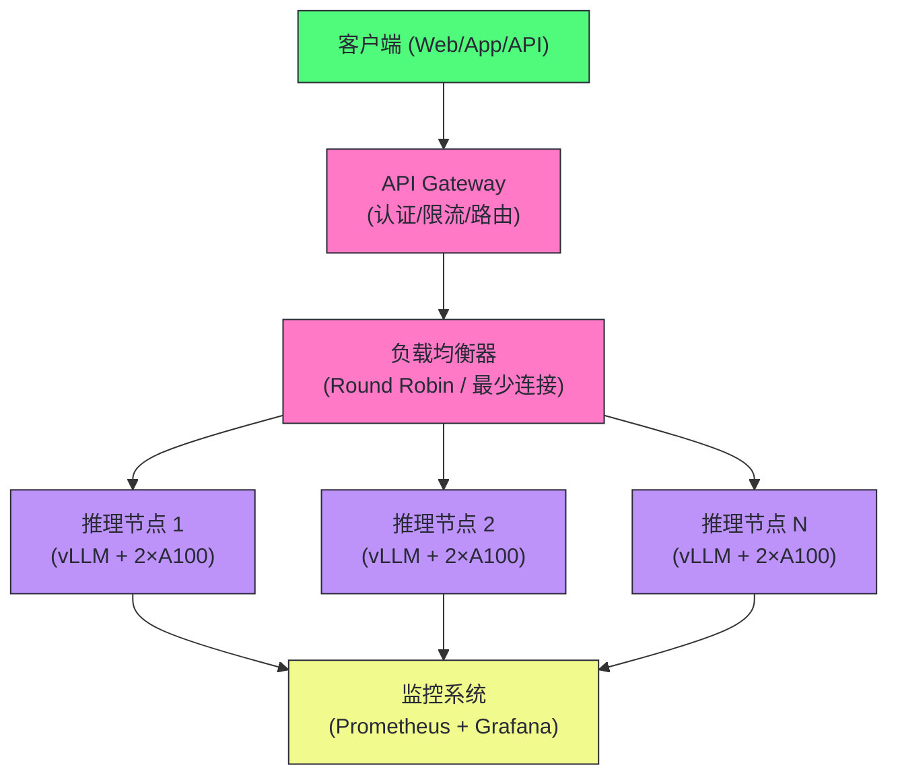
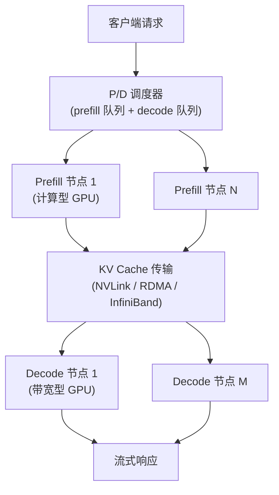
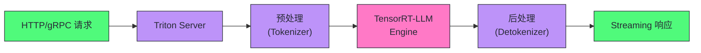
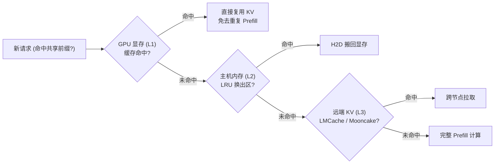

# 07 模型部署与 Serving——vLLM、TensorRT-LLM 与 Triton

**摘要：**

一个训练好的大语言模型要真正服务用户，必须经历从"实验室模型文件"到"生产级在线服务"的工程落地过程，而这条路上的每一个环节——请求调度、显存管理、批处理粒度、集群编排——都藏着与训练完全不同的取舍。本文围绕这一过程展开：先剖析 LLM Serving 的核心挑战（自回归长请求、KV Cache 动态显存、请求长度异质、流式输出），厘清"低延迟、高吞吐、低成本"三个彼此拉扯的目标；随后深入主流推理引擎的机制层，拆解 vLLM 的 PagedAttention 分页与迭代级调度语义、2025 年重写内核的 V1 引擎、SGLang 的 RadixAttention 前缀复用与 DeepSeek MLA 优化、TensorRT-LLM 的图优化与 Kernel Fusion，并给出选型矩阵；再向上走到集群层，讨论生产部署架构、弹性伸缩，以及以 PD 分离（Prefill-Decode Disaggregation）为代表的架构演进与 DeepSeek 的规模化实践、NVIDIA 从 Triton 到 Dynamo 的平台化布局；最后落到监控运维、KV 显存管理、长上下文服务化与 FP8 推理等部署新维度。全文试图回答两个问题：其一，一次推理请求从进入队列到流式返回，中间每一环的工程决策是什么、为什么长成现在这样；其二，在 2025-2026 年的时间点上，自建推理集群应在哪些环节投入、哪些环节目前仍然言之尚早。

---

## 第 1 章 LLM Serving 的核心挑战

### 1.1 与传统模型 Serving 的本质区别

传统机器学习模型的服务模式，譬如推荐排序、图像分类，其推理过程是"一次性"的——输入一张图片，输出一个分类结果，请求在几十毫秒内结束，GPU 如同快餐店的取餐窗口，一份订单出餐即走，柜台前永远不会积压长队。LLM Serving 与它有着根本性的不同，笔者以为，把两者放进同一套运维心智里管理，是多数推理集群踩坑的起点。

**自回归生成导致长请求**：一次 LLM 请求可能持续数秒到数十秒（生成数百个 token），在此期间 GPU 资源被该请求持续占用，这相当于客人入席后占住整张桌子直到宴席散场——传统 Web 服务最忌讳的"长连接占资源"，恰恰是 LLM 服务的常态，也意味着"并发数"这个指标在 LLM 语境里首先要换成"同时在生成中的请求数"来理解。

**显存消耗随请求动态增长**：每个请求的 KV Cache 随着生成过程不断增长，显存占用是动态变化的。传统模型的显存占用在推理时是固定的，可以按峰值一次性预留；而 LLM 的显存预算必须在一个请求的整个生命周期里动态平衡，预分配多了浪费、少了则直接 OOM。这条"动态"属性是后面一切分页、换出、量化手段的总根源。

**请求长度高度异质**：不同请求的输入长度和输出长度差异巨大——有的请求输入 10 个 token 输出 500 个，有的输入 2000 个 token 输出 20 个。这种异质性使批处理调度变得复杂：若按最长请求预留资源，绝大多数请求都会空耗显存；若按最短请求预留，又会在长请求到来时捉襟见肘，而 batch 内一个长请求的完成时间又会拖住整批其他请求的释放节奏。

**流式输出需求**：用户期望看到逐字生成的效果（Streaming），而非等待整个回答生成完毕。这要求 Serving 系统支持 Server-Sent Events（SSE）或 WebSocket，也意味着"响应完成"的语义从一次返回变成一段持续数秒到数十秒的字节流，网关的超时配置、限流判定、日志采样都要随之改写——一个 30 秒的流式响应在传统网关里几乎注定被当成"悬挂连接"处理。

### 1.2 三个核心矛盾

LLM Serving 需要同时平衡三个相互矛盾的目标：

| 目标 | 度量指标 | 优化方向 |
| :--- | :--- | :--- |
| **低延迟** | TTFT（首 token 延迟）、TPOT（每 token 延迟） | 小 batch size、高优先级调度 |
| **高吞吐** | tokens/s、requests/s | 大 batch size、充分利用 GPU |
| **低成本** | $/million tokens、GPU 利用率 | 量化、更小的模型、更高的并发 |

增大 batch size 可以提升吞吐量（GPU 算力利用率更高），但会增加排队延迟（请求需要等待 batch 凑齐）和单请求延迟（batch 内请求共享带宽）。降低延迟需要小 batch 和快速响应，但牺牲了吞吐量。使用更小或量化的模型可以降低成本，但可能影响质量。

不过这里有一个反直觉的工程事实值得强调：在访存密集的解码阶段，batch 内所有请求共享同一份权重读取，batch 越大，单位 token 摊薄的显存带宽成本越低——这与传统 Web 服务"并发越高资源竞争越烈"恰好相反，**LLM Serving 的规模化收益来自把并发请求塞进同一批计算，而不是像 Web 服务那样把请求打散到更多实例**。因此"低延迟"与"高吞吐"在 LLM 语境下并非简单的此消彼长，而是可以通过调度手段（下文将展开的连续批处理、chunked prefill、PD 分离）在相当程度上同时逼近。三个矛盾的真正约束其实是两块显存——模型权重显存与 KV Cache 显存，后者才是决定并发上限的那个。

### 1.3 关键性能指标

| 指标 | 定义 | 典型 SLA |
| :--- | :--- | :--- |
| **TTFT** | 从收到请求到返回第一个 token 的时间 | < 500ms（交互式聊天） |
| **TPOT** | 每个输出 token 的生成间隔 | < 50ms（约 20 tokens/s） |
| **端到端延迟** | TTFT + TPOT × output_length | 取决于输出长度 |
| **吞吐量** | 系统每秒处理的总 token 数 | 根据 GPU 数量和模型规模确定 |
| **并发数** | 系统同时处理的请求数量 | 受限于 KV Cache 显存 |
| **GPU 利用率** | GPU 算力的有效使用比例 | 目标 > 70% |

两个延迟指标各自对应推理的不同阶段：TTFT 由预填充阶段决定，TPOT 由解码阶段决定，这意味着对两者的优化路径完全分离——TTFT 靠更好的 prefill 调度与前缀缓存，TPOT 靠更大的 batch 与更高的显存带宽利用率。此外，指标的**分位数**比均值重要得多，P99 TTFT 才是用户体感的上限，均值骗人，尤其是在长尾请求（超长 prompt、超长输出）把尾延迟拉高的场景。再补一个经常被忽略的耦合关系：并发数与端到端延迟互为代价——并发越高，单请求分到的显存带宽越小，TPOT 越长，SLA 的取值必须把三者放在一起定，单独定任何一个都会在线上打架。

---

## 第 2 章 推理引擎深度对比

### 2.1 vLLM——开源生态的事实标准

vLLM 由 UC Berkeley 的 Sky Computing Lab 开发，2023 年凭 PagedAttention 论文（Kwon et al., SOSP 2023）与开箱即用的 OpenAI 兼容接口迅速成为开源 LLM Serving 的事实标准。它的核心思路是把操作系统里的"虚拟内存分页"搬进 GPU 显存：KV Cache 不再为每个请求预分配一整块连续空间，而是切成固定大小的页（Block，vLLM 默认 16 个 token 一页），请求按需取页、物理页不必连续。传统做法的显存浪费率实测高达 60-80%——按最大可能长度给每个请求预分配，实际输出往往远短于上限，碎片与空置并存；PagedAttention 把这块浪费几乎全部榨出来，同等显存能容纳的并发请求数因此提升数倍。关于分页机制本身与它在系统层的意义，上一章（[[06 推理优化——KV Cache、量化与投机解码]]）已经拆过，这里不重复，我们聚焦它在 Serving 里的调度语义。

**核心技术栈**：
- **PagedAttention**：虚拟内存分页式 KV Cache 管理，消除显存碎片
- **Continuous Batching**：迭代级调度，请求完成后立即替换
- **Prefix Caching（APC）**：自动检测和复用共享前缀的 KV Cache
- **张量并行**：支持跨多块 GPU 分片模型
- **量化支持**：GPTQ、AWQ、FP8、BitsAndBytes
- **LoRA 热加载**：运行时动态加载/切换 LoRA 适配器

**2025 年的引擎重写：V1**。2025 年 1 月 27 日，v0.7.0 随 V1 引擎的 alpha 版本发布（以环境变量 `VLLM_USE_V1=1` 开启），v0.7.1 便加入针对 DeepSeek 家族的 MLA kernel 与 FP8 kernel，官方给出的数字是相对 v0.7.0 约 3 倍的生成吞吐与约 10 倍的 token 显存容量，chunked prefill 也自 v0.7 起默认开启；到 2025 年 10 月的 v0.11.0，V0 引擎（LLMEngine、AsyncLLMEngine、MQLLMEngine 等）被整体移除，V1 成为代码库中唯一的引擎。在笔者看来，这场重写背后的动机尤其值得玩味：GPU 越来越快，一次前向执行在 H100 上跑 Llama-8B 可能只要数毫秒，CPU 侧的调度、tokenize、detokenize、流式响应反而成为瓶颈，V1 的目标就是把 CPU 开销压到"近零"，官方博客给出的对比是相对 V0 最高约 1.7 倍吞吐提升。这好比把一栋被历代改造得千疮百孔的老楼推倒重盖，为的是不再为每一个新功能打补丁。

**迭代级调度语义**。V1 的调度器把 prompt 与输出 token 一视同仁，用一个简单的字典按请求记录 token 预算并动态分配，这使 chunked prefill、前缀缓存、投机解码不再需要严格的 prefill/decode 阶段划分。每个迭代（iteration），调度器执行四件事：其一，从等待队列中挑选请求进入 running 集合，策略可选先到先服务（First-Come-First-Served，FCFS）或优先级调度——2025 年 6 月合入的 priority scheduling 用最小堆实现，priority 值小者优先、同值按到达时间排队；其二，为进入的请求分配 KV block；其三，对已完成的请求（命中 EOS 或达到 max_tokens）回收其全部 block，并立刻把等待队列里的新请求补进空位——这就是连续批处理（Continuous Batching）的调度语义，**GPU 上永远运行着一个"满编"的 batch，空位出现即被填补，而不是像静态 batching 那样等整批结束**；其四，当 KV 显存不足时触发抢占（Preemption），把优先级最低的 running 请求的 KV Cache 换出到 CPU 内存（swap），或标记稍后重算（recompute）。理解这四件事，也就理解了为什么"排队长度"与"KV 可用 block 数"是比 QPS 更本质的容量信号。

**Ray 的去留**。早期 vLLM 的多节点分布式执行依赖 Ray，单节点多卡则在 2024 年引入原生 multiprocessing 执行器；到 2026 年（v0.19.0 起），Ray 从默认依赖与官方镜像中移除，成为可选的 `--distributed-executor-backend ray`，多节点推理改由 `--nnodes/--node-rank/--master-addr` 直连。对只想把 vLLM 当作引擎嵌进自有集群的团队，这卸掉了一个版本耦合极重的依赖；但对本就用 Ray 做编排的组织，两条路仍然都走得通。

**KV 显存管理的新动作**。V1 的 KV cache manager 维护一个空闲 block 队列（free block queue），空闲块动辄数十万，取决于显存与 block size；v0.11.0 起支持把 KV 换出到 CPU 内存，按 LRU 策略管理，这等于给"显存不够"多了一级缓冲。再叠加上文提到的 KV Cache FP8 量化，单卡能容纳的并发 token 数可以在不换硬件的前提下再翻一倍——这几招在长上下文场景的威力，第 8 章会专门展开。

**部署方式**：vLLM 提供 OpenAI 兼容的 HTTP API，可以直接替换 OpenAI SDK 的 `base_url`：

```python
# 客户端代码无需修改，只改 base_url
from openai import OpenAI
client = OpenAI(base_url="http://localhost:8000/v1", api_key="none")
response = client.chat.completions.create(
    model="meta-llama/Llama-2-7b-chat-hf",
    messages=[{"role": "user", "content": "Hello!"}],
    stream=True
)
```

**适用场景**：通用在线服务、快速原型、对灵活性要求高的场景。它是"模型支持最广、迭代最快"的那一个，但代价是性能上限不如针对单一硬件深度定制的引擎，且在超大规模（数百卡以上）的集群编排上仍需外部组件补齐。

### 2.2 TensorRT-LLM——NVIDIA 的极致性能

TensorRT-LLM 是 NVIDIA 官方的 LLM 推理引擎，通过深度定制的 CUDA Kernel 和图优化来榨取 NVIDIA GPU 的极致性能。

**核心优势**：
- **定制 CUDA Kernel**：针对特定 GPU 架构（Ampere/Hopper/Blackwell）的手写 Kernel，比通用实现快 20-50%
- **图优化**：算子融合（将多个小操作合并为一个大 Kernel，减少 Kernel Launch 开销和中间数据读写）
- **FP8 支持**：在 Hopper（H100）及以上 GPU 上充分利用 FP8 Tensor Core
- **In-Flight Batching**：NVIDIA 版本的 Continuous Batching

**劣势**：
- **构建复杂**：需要先将模型编译为 TensorRT 引擎文件，编译过程耗时（数十分钟到数小时）且对环境依赖严格
- **灵活性低**：新模型支持速度慢于 vLLM
- **绑定 NVIDIA**：只支持 NVIDIA GPU

2025-2026 年，TensorRT-LLM 的演进围绕 Blackwell 与分布式展开。其一，FP8 是 Hopper 与 Blackwell 两代架构的默认甜点位，TensorRT-LLM 对 FP8 Tensor Core 的 kernel 级调优（权重 FP8、KV Cache FP8、activation FP8）是它与通用引擎拉开差距的护城河，DeepL 在生产中正是用它把 FP8 训练出的新一代翻译模型跑进原有延迟窗口。其二，TensorRT 11.0 起支持多设备推理（multi-device inference），单个 engine 可通过 NCCL 跨多块 GPU 执行，配合下文将讲的 Dynamo-Triton，一个模型入口即可占有多个 GPU 而不必在应用层协调 rank。其三，它被整体嵌入 NVIDIA Dynamo 的分布式运行时，支持 PD 分离、KV-aware 路由与多节点部署。不过，**"编译后绑定 GPU 型号与 batch shape"的局限依旧**——在频繁扩缩容的云环境中，每换一种机型都要重新编译引擎，编译缓存的复制与复用（vLLM 的做法）在 TensorRT-LLM 侧要粗糙得多，这仍是它与 vLLM 式"动态引擎"最本质的分野，也是选择它之前必须算清的账。

**适用场景**：对性能要求极致、使用 NVIDIA GPU、模型固定不频繁变更的生产环境。

### 2.3 SGLang——结构化生成的新星

SGLang（Structured Generation Language）与 vLLM 同出 LMSYS/UC Berkeley 一脉，2024 年 1 月发布，在设计上把"前缀复用"推到了极致。

**RadixAttention 的机制**：它把过往所有请求的 KV Cache 按共享前缀组织成一棵基数树（Radix Tree，压缩前缀树），新请求的 prompt 与树中节点做最长前缀匹配，命中的部分直接复用缓存，只对未命中的尾巴做预填充。与 vLLM 的 Automatic Prefix Caching（APC）按哈希精确匹配整段前缀不同，RadixAttention 把"可复用的边界"拆到了任意粒度——多轮对话的历史、并行分支、RAG 场景多个请求引用同一文档片段，这类模式都能吃满前缀复用；再配合 cache-aware scheduling（按匹配前缀长度排序等待请求，让缓存命中率优先），官方数据是前缀复用与并行采样最多带来约 5 倍吞吐提升。这好比印刷厂的活字排印——相同的字块反复使用，而不是每印一页都重新铸一遍字。到 2025 年，SGLang 进一步推出 Unified Radix Cache，把混合注意力模型（FULL/SWA/MAMBA 三类组件）的前缀缓存统一到一棵树上，多轮命中率在接入远端缓存（Mooncake L3）后接近 98%。

**结构化生成**：原生支持 JSON Schema、正则表达式等约束输出格式（guided decoding），服务端在采样阶段就把输出约束进合法结构，而非生成后再解析纠错。这里的机制值得点一句：guided decoding 并不是"先生成再校验"，而是把 JSON Schema 或正则表达式编译成有限状态自动机（Finite State Automaton，FSA），在每一步采样时把"当前状态不允许的 token"直接屏蔽掉——生成过程天然合法，代价只是采样阶段多了一次掩码计算。对需要严格 JSON 输出的 Agent 场景，这比"生成后解析失败再重试"省掉一整轮推理，直接消除一层"重试循环"。

**MLA 优化**：2025 年 2 月，SGLang 成为首个在引擎中接入 FlashInfer MLA Attention kernel 的开源框架，对使用多潜层注意力（Multi-head Latent Attention，MLA）的 DeepSeek 系列模型，长上下文场景吞吐提升约 4 倍。MLA 把 K/V 压缩进一个低秩潜向量再缓存，KV Cache 体积比标准多头注意力小一个数量级（DeepSeek-V2 论文给出的数字是 KV Cache 减少 93.3%）——这本来是架构层的红利，但缓存的是压缩态，解压必须依赖专门 kernel，FlashMLA 与 FlashInfer 这类 kernel 正是把"架构红利"兑现成"serving 红利"的那最后一公里。

**并行采样**：同一 prompt 高效生成多个候选回答，配合 RadixAttention 的共享前缀，天然适合"采样多次再投票"的 Agent 工作流。

**PD 分离与专家并行的规模实践**：2025 年 5 月，LMSYS 团队用 SGLang 在 12 节点 96 块 H100 上部署 DeepSeek-R1，采用 prefill 与 decode 分离加大规模专家并行（EP），达到每节点 52.3k input tokens/s 与 22.3k output tokens/s，是首个在开源栈上追平 DeepSeek 官方博客数字的实现，折算成本约 $0.20/1M output tokens，约为官方 API 的五分之一。这一案例的工程细节见第 4 章。

**适用场景**：Agent 应用（需要结构化输出）、复杂 prompt 工程、多次采样+投票的场景，以及 DeepSeek 这类 MLA/MoE 模型的高吞吐服务。

### 2.4 llama.cpp——本地部署的王者

llama.cpp 是一个纯 C/C++ 实现的 LLM 推理引擎，专注于在消费级硬件上高效运行 LLM。

**核心特性**：
- **CPU 推理**：充分优化 x86（AVX2/AVX-512）和 ARM（NEON）指令集
- **Apple Silicon 优化**：通过 Metal 框架利用 Mac 的统一内存和 GPU
- **GGUF 量化**：灵活的混合精度量化（2-bit 到 8-bit）
- **跨平台**：Windows/macOS/Linux/Android/iOS
- **零依赖**：不依赖 Python、CUDA Runtime 等重量级环境

**适用场景**：本地部署、隐私敏感场景、嵌入式设备、Mac 用户。它几乎不参与在线服务的军备竞赛，却在"边缘"这条赛道上没有对手——但也要看到它的边界：CPU 推理的吞吐远低于数据中心 GPU，GGUF 的混合精度量化对事实性知识的损伤在 4-bit 以下会变得不可忽略，这些问题上一章（[[06 推理优化——KV Cache、量化与投机解码]]）已有数据。

### 2.5 框架选型矩阵

| 维度 | vLLM | TensorRT-LLM | SGLang | llama.cpp |
| :--- | :--- | :--- | :--- | :--- |
| 性能 | 高 | **极高** | 高 | 中 |
| 易用性 | **高** | 低 | 高 | 高 |
| 模型支持 | 广 | 中 | 广 | 广 |
| 硬件要求 | NVIDIA/AMD GPU | NVIDIA GPU | NVIDIA GPU | **CPU/任意 GPU** |
| 量化支持 | GPTQ/AWQ/FP8 | FP8/INT8/INT4 | GPTQ/AWQ | **GGUF (2-8bit)** |
| 生态成熟度 | **最成熟** | 成熟 | 发展中 | 成熟 |
| 适用场景 | 通用在线服务 | 极致性能 | 结构化生成 | 本地/边缘 |

选型的关键不在"谁更快"，而在**你的负载画像更靠近哪一端**：模型换来换去、生态要跟上最新发布，选 vLLM；模型固定、硬件单一、SLA 苛刻，选 TensorRT-LLM；Agent/结构化输出占比高或要压 DeepSeek 这类模型的成本，SGLang 值得单独评估。而"先选 vLLM 起步、瓶颈明确后再为特定模型引入第二个引擎"是绝大多数团队的现实路径——推理引擎不是信仰，是成本函数。

---

## 第 3 章 生产级部署架构

### 3.1 典型架构设计

一个生产级的 LLM 服务通常包含以下层次：



**API Gateway 层**：负责认证（API Key 验证）、限流（Rate Limiting，防止单用户过度使用）、请求路由（根据模型名称路由到对应的推理集群）、请求/响应日志记录。流式场景下，Gateway 还需正确处理 SSE 的连接生命周期——超时要从"空闲超时"改判为"总时长 + 心跳"双重标准。

**负载均衡层**：将请求分发到多个推理节点。LLM Serving 的负载均衡比传统 Web 服务更复杂，因为请求的处理时间差异巨大——"最少连接"策略比"轮询"更适合，它类似于医院分诊台按当前队列长度而非挂号顺序放号。更进一步的做法是按 KV Cache 占用率路由：GKE Inference Gateway 的实践表明，把"当前实例剩余 KV 容量"作为路由信号，可以避免把新请求发给一个显存即将见底的副本——这比看 CPU 或 QPS 精准得多，因为 LLM 的容量瓶颈几乎总是 KV 显存而非算力。

**推理节点层**：每个节点运行一个推理引擎实例（如 vLLM），管理一块或多块 GPU。节点内可以使用张量并行将模型分片到多块 GPU；节点间则是多实例 + 负载均衡。这一层是容量规划的核心对象——单实例的并发上限由 KV 显存决定，节点数由峰值流量决定，两者必须一起算。

**监控层**：收集性能指标（TTFT/TPOT/吞吐量/GPU 利用率/队列深度），设置告警（延迟超过 SLA、GPU 利用率异常等）。第 7 章展开。

### 3.2 模型路由策略

在多模型服务场景下（如同时提供 7B 和 70B 模型），需要智能的路由策略：

- **按模型名称路由**：最简单，客户端在请求中指定模型名称
- **按复杂度路由**：简单请求路由到小模型（快速低成本），复杂请求路由到大模型。可以用一个轻量级分类器判断请求复杂度
- **级联路由**：先用小模型尝试回答，如果置信度低，再转发给大模型。类似投机解码的思想，但在服务级别实现

在实践中，路由的价值不只是省钱——它同时是**延迟治理**的手段：把超长 prompt 的请求导向 prefill 能力更强的池子，把流式交互请求导向低延迟的小 batch 池子，等于在集群层面做了第二层"连续批处理"。不过路由器的分类器本身有误判成本，级联路由会把 P99 延迟拖长一个来回，这些都要用线上数据（而不是直觉）来校准阈值。

### 3.3 弹性伸缩

LLM 服务的负载通常有明显的波动——工作日白天高峰、夜间低谷。弹性伸缩可以在高峰期自动增加 GPU 实例，低谷期释放资源降低成本。在笔者看来，它更像公交车队调度——早高峰加车、平峰减车，而"车队"是几十万元一张的 GPU，调度的收益直接进成本线。KEDA 相比裸 HPA 的一个实用点，是它可以直接消费请求队列深度这类外部指标，而不必把队列长度翻译成 CPU 用量；更激进的做法是"缩到零"——无请求时把整个推理 Pod 组停掉，用 Serverless 冷启动兜底，但这只适合对延迟不敏感的场景，因为冷启动的分钟级代价会原样转嫁给第一个请求。

在 Kubernetes 环境下，可以使用 **KEDA**（Kubernetes Event-Driven Autoscaling）根据请求队列长度或 GPU 利用率自动扩缩推理 Pod。但指标选型有坑：DCGM 暴露的 GPU 利用率（`DCGM_FI_DEV_GPU_UTIL`）衡量的是 duty cycle——GPU 活跃的时间占比，并不反映活跃期间做了多少有效计算；而对 vLLM/TGI 这类启动即预分配显存的工作负载，显存用量指标只能触发扩容、几乎不会触发缩容（显存一旦分配就不释放）。更实用的信号组合是：**请求队列深度 + KV Cache 占用率 + P99 TTFT 偏离度**。Kubernetes HPA 的缩容稳定窗口默认约 5 分钟，避免指标抖动引发反复横跳。

关键挑战是**冷启动**：一个新的推理实例需要加载模型到 GPU 显存，这通常需要 30 秒到数分钟。对于 70B 模型（140 GB），加载时间可能超过 2 分钟。缓解方案包括：
- 预热池（保持少量空闲实例随时可用）
- 模型缓存（将模型文件缓存在本地 NVMe SSD 上，而非每次从对象存储下载）
- 模型分片预加载（利用张量并行，多块 GPU 同时加载）

2025-2026 年，扩缩容的难点进一步与 PD 分离叠加：长输入序列（ISL）压的是 prefill GPU，长输出序列（OSL）压的是 decode GPU，负载会在这两类池子之间瞬时漂移，单纯按 QPS 扩缩必然错位。NVIDIA Dynamo Planner（v0.2）就是为此而生的"推理感知"扩缩器——它理解 prefill/decode 分离架构与各自的资源语义，决定何时扩、扩哪类 GPU。这提示一个趋势：**弹性伸缩正在从"通用容器编排问题"变成"推理语义问题"**，通用 K8s 组件负责 Pod 生命周期，推理语义（KV 容量、阶段配比）由专门的控制器负责。

---

## 第 4 章 PD 分离——把 Prefill 与 Decode 拆开

### 4.1 为什么要拆

行文至此，我们必须正视一个被连续批处理掩盖了的事实：prefill 与 decode 是两种硬件画像完全不同的计算。预填充一次性处理整个输入序列，是计算密集的——大矩阵乘，算力利用率高，像复印整本书；解码逐 token 生成，是访存密集的——每步只算一个 token，却要从显存读完整模型权重与全部 KV，显存带宽是瓶颈，像翻书逐页朗读。把两者混在同一个引擎、同一批计算里，会产生两类问题。

其一，**互相干扰**：一个长 prompt 的 prefill（RAG 场景塞入数万 token 很常见）会瞬间占满 GPU 数秒，同批正在 decode 的所有请求的 token 间隔被集体拉长，用户端表现为"打字突然变慢"，TPOT 的方差被 prefill 流量牵着走。其二，**资源配比错配**：prefill 需要更多算力，decode 需要更多显存带宽与更大的 batch，两种需求对 GPU 数量、并行策略的要求不同，耦合部署只能取一个两头不讨好的折中。DistServe（Zhong et al., OSDI 2024，arXiv 2401.09670）第一个系统论证了这一点：在 TTFT 与 TPOT 双约束下，共置方案要么牺牲其一、要么过度供给，把两阶段拆到不同 GPU 并各自独立调资源与并行度后，同样延迟约束下可服务 7.4 倍请求或收紧 12.6 倍 SLO。

反事实地想：不分离会怎样？长 prefill 成为 decode 的"路过的大象"，每一次长文档分析请求都会制造一次全集群 TPOT 抖动，SLA 里的 P99 TPOT 因此被少数大请求永久性地抬高。分离的本质，是把两类请求的调度域拆开，让互相干扰从"同一块 GPU 上的调度问题"降级为"两个池子之间的容量配比问题"。

### 4.2 架构与 KV 传输的代价

PD 分离的架构并不复杂：



prefill 节点完成预填充后，把 KV Cache 通过网络传给 decode 节点，后者接管后续逐 token 生成。代价是明显的：Perplexity 的实践文章给出的数字是，KV Cache 传输要花数十到数百毫秒，TTFT 相应增加——**PD 分离的收益买的是 TPOT 稳定性与两端吞吐，付的账单是 TTFT**。为压缩这笔账单，工程上有三条路：其一，架构层面的 KV 压缩——譬如 MLA 把缓存压小一个数量级，传输量随之缩小，这是 DeepSeek 敢做大规模分离的底气之一；其二，分片传输（sharded KV transfers），把大块 KV 拆成多片并行搬移；其三，KV 的远端层级——LMCache、Mooncake 这类组件把 KV 落到主机内存甚至远端存储，decode 节点按需拉取，让"传输"变成"缓存命中的旁路"。

### 4.3 DeepSeek 的规模实践与开源跟进

DeepSeek 在 2025 年 2 月开源周发布的推理系统概述，是 PD 分离在十亿级日活规模上的公开样本。V3/R1 采用 prefill 与 decode 分离 + 大规模跨节点专家并行（EP）：prefill 阶段每个部署单元 4 个节点，路由专家 EP32、MLA 与共享专家 DP32，每块 GPU 持有 9 个路由专家与 1 个共享专家；decode 阶段扩大到 18 个节点，路由专家 EP144、MLA 与共享专家 DP144，每块 GPU 只持 2 个路由专家与 1 个共享专家——两阶段的并行度配置刻意不同，正是"分离后各自独立优化"的例证。EP 需要跨节点 all-to-all 通信，官方用双批重叠（两个 micro-batch 交替，一个计算时另一个的通信在途）把它藏进计算；decode 侧把注意力层拆成两段、凑成 5 级流水线做同样的掩盖；另设三个负载均衡器分别平衡 prefill 的注意力负载与 token 分发、decode 的 KV 占用与请求数、以及专家之间的天然倾斜（热门专家总是更忙）。官方披露的规模数字是 prefill 阶段每 H800 节点约 7.4 万 input tokens/s。

开源侧在同一时间点追了上来：LMSYS 团队用 SGLang 在 96 块 H100 上复现同一套思路（prefill 24 卡 / decode 72 卡），达到每节点 52.3k input tokens/s 与 22.3k output tokens/s，成为首个在开源栈上接近官方数字的实现；vLLM 通过 llm-d 支持宽 EP 的分离部署，TensorRT-LLM 侧则由 NVIDIA Dynamo 提供原生 PD 分离。到 2025 年 11 月，UC San Diego 的 Hao AI Lab 在回顾文章里给出一个值得记录的判断：DistServe 提出分离架构 18 个月后，几乎所有生产级 serving 框架——Dynamo、llm-d、Ray Serve LLM、SGLang、vLLM、LMCache、Mooncake——都已跑在分离架构之上。PD 分离从论文到行业默认，只用了不到两年。

### 4.4 边界与反例

分离架构不是免费的，它的适用前提恰恰是它想解决的问题不存在时的反例：

- **小规模集群**：单节点或两三块 GPU 的场景，KV 传输的网络成本会吞掉全部收益，分离后甚至更慢。PD 分离的盈亏平衡点大致在"prefill 与 decode 各自都养得起独立池子"的规模，业界经验普遍认为十块 GPU 以内不必考虑。
- **短 prompt 交互**：聊天场景的 prompt 往往只有几十到几百 token，prefill 本就在毫秒级，拆出去徒增 TTFT，没有任何回报。
- **网络前提**：KV 传输吃带宽与低延迟，机房没有 RDMA/InfiniBand 时，传输本身成为新瓶颈——这一点在选型前必须用真实流量做一次压测，而不是看论文数字。
- **运维复杂度**：一套集群变成两套，监控、容量规划、故障域都翻倍，KV 传输链路本身又多了一个故障点。
- **条件性分离**：理想形态是"按流量动态决定拆不拆"——低峰合并、高峰分离。NVIDIA Dynamo 的文档把 conditional disaggregation 标记为规划中，说明这一形态目前仍是前沿而非成熟能力。

由此可见，PD 分离是"规模化之后的正确选择"，而不是"部署的第一选择"。它的判断标准很简单：当 TPOT 抖动开始伤害 SLA、当两个阶段都大到养得起独立池子时，就该拆。

---

## 第 5 章 NVIDIA Triton 与 Dynamo

### 5.1 Triton 的定位

NVIDIA Triton Inference Server 是一个通用的模型服务框架，不仅支持 LLM，还支持传统 ML 模型、CV 模型等。它的核心价值在于**统一的服务接口和模型管理**——好比机场航站楼为多家航空公司提供统一的登机口、行李带与广播系统，各航司（引擎）只负责自己的飞机（推理），Triton 负责接待、排队与转机衔接。

在 LLM 场景下，Triton 通常作为 TensorRT-LLM 的前端——TensorRT-LLM 负责高效的模型推理，Triton 负责请求管理、模型版本控制、多模型服务等上层逻辑。

### 5.2 Triton 的核心特性

- **多后端支持**：TensorRT、ONNX Runtime、PyTorch、TensorFlow、vLLM、Python 自定义后端
- **动态 Batching**：自动将多个请求合并为 batch
- **模型仓库（Model Repository）**：基于文件系统的模型版本管理，支持热更新
- **模型集成（Ensemble）**：将多个模型串联为流水线（如 Tokenizer → LLM → Detokenizer）
- **指标暴露**：原生 Prometheus 指标，便于监控

动态 batching 值得多说一句：它对"到达时间接近"的请求做窗口内合并（collection window 通常 5-200ms），窗口越长、batch 越大、吞吐越高，但排队延迟越明显——这与第 1 章的三矛盾完全同构。Triton 的动态 batching 针对的是传统模型的短请求，LLM 场景下它把调度权交给了后端引擎的连续批处理，自己专注于版本管理与多模型共存。

### 5.3 Triton + TensorRT-LLM 部署架构



### 5.4 从 Triton 到 Dynamo——推理"操作系统"的野心

如果说 Triton 解决的是"一台服务器上的多模型服务"，2025 年发布的 NVIDIA Dynamo 则把问题抬升到"一整个 AI 工厂的编排"。NVIDIA 官方的定位是推理的分布式"操作系统"：把 GPU 与显存资源在集群范围协调起来，为 vLLM、SGLang、TensorRT-LLM 这些引擎提供统一的 PD 分离、KV-aware 路由、KV 块管理（KVBM）与多节点部署能力。2026 年 3 月 Dynamo 1.0 正式 GA 并开源，官方宣称在 Blackwell 上可带来最高 7 倍推理性能提升，AWS、Azure、Google Cloud、OCI 与多家云厂商接入，Cursor、Perplexity、Baseten、Deep Infra 等厂商在其上运行。同一条产品线上，原 Triton Inference Server 演化为 Dynamo-Triton，26.07 版本解锁了 TensorRT multi-device——单个模型实例跨多 GPU 执行，应用通过一个 gRPC 入口调用，rank 协调由框架代劳。

在笔者看来，Dynamo 的价值不在单个 kernel 有多快，而在**把集群级能力从"每个引擎自研"变成"公共组件"**——这正应了第 4 章描述的趋势：PD 分离从论文到行业默认只用了不到两年，而 Dynamo 要把这条路上的集群能力再标准化一层。但它的代价同样清晰：能力越深，绑定越深，Dynamo 的组件与 NVIDIA 硬件和引擎版本强耦合（其兼容矩阵精确到 vLLM/SGLang/TRT-LLM 的具体版本），选了它几乎等于选定 NVIDIA 全栈。对 GPU 集群已达百卡规模的团队，这笔账值得细算；对混合硬件或偏开源路线的团队，Dynamo 提供的是一份"参照系"而非必选项。

---

## 第 6 章 多 GPU 与多节点部署

### 6.1 张量并行部署

对于单块 GPU 放不下的大模型（如 70B），需要使用张量并行将模型分片到多块 GPU。vLLM 的张量并行部署非常简单：

```bash
# 使用 4 块 GPU 进行张量并行
vllm serve meta-llama/Llama-2-70b-chat-hf \
    --tensor-parallel-size 4 \
    --max-model-len 4096 \
    --gpu-memory-utilization 0.9
```

张量并行的 GPU 数量通常是 2 的幂（2/4/8），且应在同一节点内（利用 NVLink 高带宽互联）。张量并行把一层的大矩阵拆给多卡并行算，每步前向都有一次全归约通信，因此对互联带宽极其敏感——这也是"张量并行不出节点"这条铁律的由来。

### 6.2 多实例部署

如果有多台 GPU 服务器，通常每台服务器运行一个独立的推理实例（各自处理不同的请求），通过负载均衡器分发请求。这比跨节点的模型并行更简单高效——跨节点通信的延迟（InfiniBand 也需要微秒级）远高于节点内 NVLink（纳秒级）。

| 部署模式 | GPU 配置 | 适用模型 | 并发能力 |
| :--- | :--- | :--- | :--- |
| 单 GPU | 1× A100/H100 | 7B (BF16) 或 70B (INT4) | 低 |
| 节点内张量并行 | 2-8× GPU (NVLink) | 13B-70B (BF16) | 中 |
| 多实例 + 负载均衡 | N 台服务器 × M GPU | 任意 | 高（线性扩展） |

### 6.3 混合部署：不同模型共享 GPU

在实际生产中，可能需要在同一 GPU 集群上同时服务多个不同的模型。vLLM 支持在同一实例中加载多个 LoRA 适配器（共享基座模型），在不同请求间动态切换 LoRA——这比为每个任务部署独立的模型实例高效得多。

对于完全不同的模型（如 7B 和 70B），可以使用 Kubernetes 的 GPU 调度（如 NVIDIA GPU Operator + Time-Slicing 或 MIG）来在物理 GPU 上分配虚拟 GPU 给不同的模型实例。不过要提醒一句：时间切片（Time-Slicing）共享的是算力而不是显存，两个模型同时塞进一张卡时，显存总量仍按两者之和算，切片只解决"算力空闲浪费"这一半问题。

### 6.4 并行度全景：TP、PP、DP 与 MoE 的 EP

把视角拉到集群，LLM 推理的并行维度其实有四条，选型时容易混淆：

| 并行方式 | 切分对象 | 通信范围 | 典型用途 |
| :--- | :--- | :--- | :--- |
| **张量并行（TP）** | 层内矩阵按行/列切分 | 节点内 NVLink，每步全归约 | 单层放不下的超大模型 |
| **流水线并行（PP）** | 按层切分，前层算完传后层 | 跨节点，低频传输 | 超深模型、多节点部署 |
| **数据并行（DP）** | 整模型多副本，各处理不同请求 | 无模型通信 | 水平扩展、batch 聚合 |
| **专家并行（EP）** | MoE 的专家按 GPU 分布 | 跨节点 all-to-all | 稀疏 MoE 模型（DeepSeek 等） |

DP 是"复制"，TP/PP/EP 是"切分"，其中 EP 是 2024 年后被 MoE 模型带火的新维度：DeepSeek-V3 每层 256 个专家只激活 8 个，把专家铺到 18 个节点上，每卡只持 2 个专家，配合 EP 的 all-to-all 通信与双批重叠，单卡的计算与访存压力都大幅下降——这好比把一部百科全书的词条分给不同专家审校，每条只翻自己那一卷。EP 的引入让"张量并行"不再是大模型的唯一解法，也让 2025 年后 vLLM、SGLang、TensorRT-LLM 三家都把 wide EP（数百专家跨数十节点）列为头号优化方向。但 EP 对网络的要求比 TP 更苛刻（all-to-all 是每步都发生的全局通信），这也是为什么 DeepSeek 这类实践几乎只出现在 InfiniBand 机房里。

---

## 第 7 章 监控与运维

### 7.1 关键监控指标

| 指标类别 | 具体指标 | 告警阈值示例 |
| :--- | :--- | :--- |
| **延迟** | P50/P95/P99 TTFT, TPOT | P99 TTFT > 2s |
| **吞吐** | tokens/s (input + output), requests/s | 吞吐量下降 > 30% |
| **队列** | 等待队列深度、排队时间 | 队列深度 > 100 |
| **GPU** | 利用率、显存使用、温度 | 利用率 < 30% 或 > 95% |
| **错误** | 超时率、OOM 率、500 错误率 | 错误率 > 1% |

在 PD 分离架构下，这些指标要按 prefill 池与 decode 池分开采集——prefill 的 TTFT 与 decode 的 TPOT 是两个池子的不同健康信号，混在一起看会互相掩盖。vLLM V1 自带 Prometheus 指标导出，KV 可用 block 数、排队等待时长、preemption 次数这类引擎级指标，比 DCGM 的 GPU 利用率更能定位瓶颈。

### 7.2 常见生产问题与排查

**问题一：TTFT 突然增大**
- 可能原因：输入 prompt 过长（Prefill 阶段计算量大）、请求排队（并发过高）、Prefix Cache 未命中
- 排查方向：检查输入长度分布、队列深度、Cache 命中率

**问题二：GPU 利用率持续偏低**
- 可能原因：batch size 太小（请求不够多）、Decode 阶段占主导（访存密集，算力闲置）
- 优化方向：增大最大 batch size、启用 Continuous Batching、增加并发请求
- 一个常被忽略的补充：GPU 利用率低不一定意味着"流量不够"，也可能意味着**请求的输出长度过短**——每个请求只生成几十个 token 就结束，decode 阶段的访存密集特性根本没机会摊薄权重读取，此时该优化的是请求形态（合并短请求）而非加流量

**问题三：OOM（Out of Memory）**
- 可能原因：KV Cache 超出预分配显存、同时处理的请求过多、模型+KV Cache+激活值总和超出 GPU 显存
- 解决方案：限制最大并发数、缩短最大序列长度、启用 KV Cache 量化（FP8）、开启 KV 换出到 CPU（vLLM V1 的 LRU offload）

**问题四：P99 延迟被抢占与重算拉高**
- 可能原因：KV 显存不足触发抢占（Preemption），被抢占的请求要么换出到 CPU 再换回（swap，引入换页延迟），要么丢弃重算（recompute，把已生成的 token 作废重来）
- 排查方向：检查 preemption 计数与 recompute 次数、KV 可用 block 数的下降曲线、并发峰值与 max-model-len 的关系
- 优化方向：把 gpu-memory-utilization 调低留出余量、缩短最大序列长度、对长输出请求单独建池、启用 KV 换出让 swap 路径变快

### 7.3 成本优化策略

| 策略 | 预期节省 | 适用场景 |
| :--- | :--- | :--- |
| **4-bit 量化** | 模型显存减 75%，同等 GPU 可服务更多请求 | 对质量要求不极致的场景 |
| **GQA/MQA 模型** | KV Cache 减 4-8 倍 | 选择支持 GQA 的模型（Mistral/LLaMA2-70B） |
| **Prefix Caching** | 减少重复 Prefill 计算 | 固定 System Prompt 场景 |
| **模型路由** | 简单请求用小模型，省 GPU | 请求复杂度差异大的场景 |
| **弹性伸缩** | 低谷期释放 GPU | 负载波动明显的场景 |
| **Spot/竞价实例** | GPU 成本降 50-70% | 对中断有容错能力的批量任务 |

### 7.4 KV 显存管理：从分页到分级

KV 显存是推理集群真正的"库存"，管理它如同管理仓库货架——货架（block）按固定尺寸上架，请求按需取用，满了就换仓（offload），核心指标是"每块显存承载了多少并发 token"。工程实践里需要注意的几件事：

其一，**显存预算分配**。部署时模型权重、KV Cache、激活值三者瓜分显存，`--gpu-memory-utilization 0.9` 这类参数就是给 KV Cache 圈地。设得太满，一次长请求就把池子打穿触发 OOM；设得太保守，并发上限被白白浪费。vLLM V1 支持跳过启动时的显存探查（`--kv-cache-memory` 直接指定），把 KV 池的大小从"每次启动测量"变成"显式声明"，便于容量规划，但取值必须保守，否则启动即 OOM。

其二，**block 尺寸**。vLLM 默认每页 16 个 token，页越小显存利用率越高但页表开销越大，页越大则相反。对长上下文负载，这个参数的调优效果可以量化到百分位延迟上。

其三，**分级缓存**。GPU 显存不够时，KV 可以按 LRU 换出到 CPU 内存（vLLM V1 已支持），再进一步落到远端 KV 存储（LMCache、Mooncake）——这就是"从分页到分级"的含义，第 8 章会结合长上下文展开。这一层能力正在成为推理框架的标配，也意味着显存管理的边界正在从"一张卡"延伸到"一个机房"。

---

## 第 8 章 长上下文推理的服务化挑战

### 8.1 1M 上下文的四重压力

上下文窗口冲向 128K、1M 之后，服务化的压力不是线性的——在笔者看来，这正如把整座图书馆搬进考场：进门（prefill）变慢、找书（decode 读 KV）变慢、座位（显存）被书占满。arXiv 2405.08944 把这四重压力拆得很清楚：

1. **Prefill 变慢**：长输入的预填充本身耗时随长度线性甚至超线性增长，1M token 的一次 prefill 在单卡上要跑很久，TTFT 失去意义
2. **并发容量坍缩**：KV Cache 随上下文线性膨胀，单请求的 KV 就能吃掉整块 H100 的显存，并发数塌缩到 1-2
3. **Decode 访存恶化**：每生成一个 token 都要把越来越长的 KV 从 HBM 读一遍，TPOT 随上下文长度拉长，长上下文请求越写越慢
4. **换出惩罚**：KV 溢出到 CPU/DDR 后，切回 GPU 的换页延迟造成明显的停顿

反事实地看：如果不做任何服务化改造，1M 上下文请求的单次成本将高到只有极少数场景（离线批处理）负担得起，在线长文档分析、代码库级 Agent 这类应用将无法商业化。这正是服务层优化的空间所在。

### 8.2 上下文并行与分级缓存

应对长上下文，2025 年的服务化实践主要走两条路。

第一条是**上下文并行（Context Parallelism）**：把长序列按 token 切到多卡，各卡算自己那段的注意力（ring attention 的 pass-KV/pass-Q 两种变体），再用跨卡通信把部分结果合并。MLSys 2025 的工作在 16 节点 128 块 H100 上把 Llama-3.1-405B 的 1M token prefill 压到 77 秒（并行效率 93%），128K 的 prefill 只要 3.8 秒。对 decode 阶段，上下文并行的收益有限，主战场在 prefill——这与第 4 章的结论一脉相承：长上下文的 prefill 是集群里最"重"的计算，值得为它单独调度。

第二条是**分级缓存（Hierarchical KV Caching）**：把 KV 按热度分布到 GPU 显存（L1）、主机内存（L2）与远端存储（L3），前缀命中时从最近的层级加载，避免整段重算：



Strata（arXiv 2508.18572）用 GPU 辅助 I/O 解决分页布局下的碎片化读盘，配合缓存感知调度，长上下文基准上相对 vLLM+LMCache 最多降低 5 倍 TTFT、相对 TensorRT-LLM 快 3.75 倍；ShadowKV 则把低秩 key 留在显存、value 换到 CPU，A100 上把 batch 放大 6 倍、吞吐提升 3 倍。这些数字印证了一个判断：**长上下文的成本大头已经从"算"转移到"存与取"**，服务层的缓存工程正在吃掉原本属于架构层的红利。

还有一条互动值得单独挑出来说：长上下文与 PD 分离是一对天然的搭档。长请求的 prefill 极重，把它赶进独立的 prefill 池，decode 池就能保住 TPOT 的确定性；而 decode 侧拿到的是已经完整计算好的 KV，长上下文的 decode 虽然访存压力大，但至少不再被新来的长 prefill 打断。反过来，长上下文也让 KV 传输的体积变大，PD 分离原本"数十到数百毫秒"的传输账单被同步放大——这就是为什么长上下文服务化与 PD 分离通常要一起规划：分离解决阶段干扰，分级缓存解决传输与容量，上下文并行解决单次 prefill 的墙钟时间，三者缺一不可。这条线的机制细节（稀疏注意力、RoPE 外推等）与 [[08 长上下文与多模态——技术前沿]] 分工，本篇只讲服务化这一半。

### 8.3 FP8：新一代默认精度

2025 年前后，FP8 事实上成为新一代推理的默认精度，这既是硬件驱动的，也是服务化的需求。Hopper 一代在 H100 上提供约 2 PFLOP/s 的 FP8 算力，Blackwell 的 B200 提升到约 5 PFLOP/s，同时权重与 KV Cache 各省一半显存——对访存密集的 decode 与显存紧张的 KV 池，这是双重利好。DeepSeek 官方推理系统即采用 FP8 权重部署，DeepL 也把 FP8 训练出的模型直接用 TensorRT-LLM 跑进生产，vLLM 从 v0.7.1 起为 DeepSeek 提供 FP8 kernel 与 KV Cache FP8 量化。

但 FP8 有一个容易被忽视的工程性质：**它更像一种量化格式，而非标准的数值表示**。FP8 需要共享缩放因子（shared scale），E4M3 与 E5M2 两种子格式在不同硬件上的缩放与累加方式并不一致，跨硬件、跨框架的"FP8"可能不是同一个东西——这给可移植性埋了坑。实践上的建议是：先在真实负载上做质量回归（FP8 对事实性知识的损伤通常大于对推理能力的损伤，这在前一章已讨论），再决定是否全线切 FP8；而 KV Cache 的 FP8 量化因为只影响注意力数值精度，一般比权重的 FP8 量化更安全，可以先行。FP8 的收益上限由"访存密集程度"决定——decode 阶段收益最大、prefill 次之，而真正吃掉 FP8 红利的，是那些能把 batch 拉满的高并发服务。

---

## 第 9 章 本地部署与隐私场景

### 9.1 为什么需要本地部署

部分场景不允许将数据发送到外部 API：

- **数据安全**：企业内部的敏感文档、代码、客户数据
- **合规要求**：GDPR、等保等法规要求数据不出境
- **离线环境**：无网络或网络受限的环境（如军事、工厂）
- **成本控制**：大量请求下，自建推理服务比调用 API 更经济

### 9.2 本地部署方案

**方案一：llama.cpp + Ollama**

最轻量级的本地部署方案。Ollama 封装了 llama.cpp，提供一键安装和 OpenAI 兼容 API：

```bash
# 一行命令启动模型
ollama run llama3:8b
```

适合个人使用和小团队快速体验。

**方案二：vLLM 容器化部署**

在企业内部的 GPU 服务器上，使用 Docker 部署 vLLM：

```bash
docker run --gpus all \
    -v ~/.cache/huggingface:/root/.cache/huggingface \
    -p 8000:8000 \
    vllm/vllm-openai:latest \
    --model meta-llama/Llama-2-7b-chat-hf
```

适合有 GPU 服务器的企业内部服务。

**方案三：Kubernetes + GPU Operator**

在 Kubernetes 集群中使用 NVIDIA GPU Operator 调度 GPU 资源，部署多实例 vLLM/TensorRT-LLM 服务。这是生产级本地部署的标准方案，支持弹性伸缩、滚动更新、健康检查等企业级特性。

### 9.3 Apple Silicon 部署

对于 Mac 用户，Apple Silicon（M1/M2/M3/M4）的统一内存架构是一个独特的优势——CPU 和 GPU 共享同一块内存，好比一家人合租一间大客厅，客厅（内存）够大就能容下更多的"家具"（模型参数）。64GB M3 Max 可以运行 70B 量化模型（GGUF Q4），这在 NVIDIA GPU 上需要至少一块 A100。

llama.cpp 的 Metal 后端充分利用了 Apple Silicon 的 GPU 和神经引擎，在 M3 Max 上可以达到约 15-30 tokens/s 的生成速度（7B Q4 模型）。不过要泼一盆冷水：统一内存的带宽（M3 Max 约 400GB/s 量级）与 H100 的 3.35TB/s 相差一个数量级，**统一内存解决的是"容量问题"，解决不了"带宽问题"**——长上下文的 decode 在 Apple Silicon 上依旧会慢得明显。

---

## 第 10 章 总结

### 10.1 部署决策总结

| 场景 | 推荐方案 | 关键考量 |
| :--- | :--- | :--- |
| **快速原型/实验** | Ollama 或 vLLM 单机 | 部署速度 |
| **中小规模在线服务** | vLLM + 负载均衡 | 灵活性、社区生态 |
| **极致性能生产服务** | TensorRT-LLM + Triton | 性能、NVIDIA 绑定 |
| **本地隐私部署** | vLLM 容器 或 llama.cpp | 数据安全、硬件限制 |
| **个人 Mac 使用** | Ollama (llama.cpp) | 简单、统一内存优势 |
| **Agent/结构化生成** | SGLang | 前缀缓存、JSON 约束 |
| **百卡级规模化服务** | PD 分离 + EP + 分级 KV 缓存 | 网络带宽、运维复杂度 |

### 10.2 部署是一条权衡曲线

把全篇的线索收拢起来，可以看到 LLM Serving 的演进其实是一条清晰的权衡曲线：连续批处理解决了"静态 batching 的空转"，PagedAttention 解决了"预分配显存的浪费"，PD 分离解决了"prefill 与 decode 的相互干扰"，分级缓存解决的是"KV 显存的天花板"，而每一次解决都以引入一层新的复杂度为代价——调度语义更复杂、网络更依赖、运维翻倍。这正是分布式系统里"复杂性不会消失只会转移"的又一注脚：**没有放之四海皆准的部署方案，只有与你的负载画像、硬件禀赋、团队能力对齐的方案**。笔者的建议是把第 2 章的选型矩阵当作起点而非终点，把第 4 章的规模判断当作扩集群的闸门，再让第 7 章的指标持续校准每一次投入——架构是演进出来的，不是选出来的。

### 10.3 下一步

- [[08 长上下文与多模态——技术前沿]]：128K+ 上下文窗口和图像/音频输入如何改变 LLM 的能力边界？长上下文的注意力机制与多模态架构细节在那里展开
- [[06 推理优化——KV Cache、量化与投机解码]]：本篇反复引用的 PagedAttention、前缀缓存、量化的机制层原理，回溯阅读可获得完整的推理优化拼图

---

## 参考文献

1. Kwon et al., "Efficient Memory Management for Large Language Model Serving with PagedAttention", SOSP 2023
2. NVIDIA, "TensorRT-LLM Documentation", 2024-2026
3. NVIDIA, "Triton Inference Server Architecture", 2024
4. Zheng et al., "SGLang: Efficient Execution of Structured Language Model Programs", arXiv 2024
5. Georgi Gerganov et al., "llama.cpp", GitHub 2023-2026
6. Yu et al., "ORCA: A Distributed Serving System for Transformer-Based Generative Models", OSDI 2022
7. Agrawal et al., "Sarathi: Efficient LLM Inference by Piggybacking Decodes with Chunked Prefills", arXiv 2024
8. Zhong et al., "DistServe: Disaggregating Prefill and Decoding for Goodput-optimized Large Language Model Serving", OSDI 2024 (arXiv 2401.09670)
9. DeepSeek-AI, "DeepSeek-V3/R1 Inference System Overview", 2025-02（开源周 Day 6，open-infra-index）
10. DeepSeek-AI, "DeepSeek-V2: A Strong, Economical, and Efficient Mixture-of-Experts Language Model", arXiv 2405.04434
11. SGLang Team (LMSYS), "Deploying DeepSeek with PD Disaggregation and Large-Scale Expert Parallelism on 96 H100 GPUs", 2025-05-05
12. vLLM, "vLLM V1: A Major Upgrade to vLLM's Core Architecture", vllm.ai/blog, 2025-01-27
13. vLLM, "v0.7.0 / v0.7.1 / v0.11.0 Release Notes", GitHub, 2025
14. vLLM, "Inside vLLM: Anatomy of a High-Throughput LLM Inference System", vllm.ai/blog, 2025-09-05
15. Perplexity AI, "Disaggregated Prefill and Decode", perplexity.ai/hub, 2025-08-01
16. Hao AI Lab (UCSD), "Disaggregated Inference: 18 Months Later", 2025-11-03
17. NVIDIA, "NVIDIA Enters Production With Dynamo, the Broadly Adopted Inference Operating System for AI Factories", NVIDIA Newsroom, 2026-03-16
18. NVIDIA, "NVIDIA Dynamo Adds GPU Autoscaling, Kubernetes Automation, and Networking Optimizations", Developer Blog, 2025
19. NVIDIA, "Simplifying Model Serving Across Multiple GPUs with NVIDIA TensorRT Multi-Device Integration in NVIDIA Dynamo-Triton", Developer Blog, 2026
20. Google Cloud, "Best practices for autoscaling large language model (LLM) inference workloads with GPUs on GKE", 2025
21. MLSys 2025, "Context Parallelism for Scalable Million-Token Inference"
22. arXiv 2405.08944, "Challenges in Deploying Long-Context Transformers: A Theoretical Peak Performance Analysis"
23. arXiv 2508.18572, "Strata: Hierarchical Context Caching for Long Context Language Model Serving"
24. arXiv 2502.01070, "An Investigation of FP8 Across Accelerators for LLM Inference"
25. DeepL, "How we built DeepL's next-generation LLMs with FP8 for training and inference", 2025
26. Modal, "Introducing B200s and H200s", 2025-05-30
27. SGLang, "Unified Radix Cache in SGLang: one tree for hybrid model prefix caching", sglang.io/blog, 2025

---

> [!note] 思考题
> 1. vLLM 通过 PagedAttention 和连续批处理（Continuous Batching）实现高吞吐量推理。连续批处理允许新请求在已有请求正在生成时加入 batch——与传统的'等所有请求完成再处理下一批'相比，延迟如何改善？在什么负载模式（稳态 vs 突发）下连续批处理的优势最明显？
> 2. TensorRT-LLM 通过算子融合、量化和自定义 CUDA Kernel 实现低延迟推理。但 TensorRT-LLM 需要在部署前进行模型编译——编译过程针对特定 GPU 型号和 batch size 优化。这是否意味着编译后的模型不能在不同型号的 GPU 上运行？在需要弹性扩缩容的云环境中，这种限制如何应对？
> 3. 多模型 Serving 场景中（如同时服务 7B 和 70B 模型），GPU 资源如何分配？在同一张 GPU 上同时加载两个模型是否可行（显存允许的情况下）？推理请求的路由策略（大模型处理复杂请求、小模型处理简单请求）如何设计？如何自动判断请求的'复杂度'？
> 4. PD 分离把 prefill 与 decode 拆到不同的 GPU 集群，靠网络传输 KV Cache，代价是 TTFT 增加数十到数百毫秒。为什么短 prompt 的交互式聊天场景不适合 PD 分离？在网络带宽受限的机房，PD 分离会遇到什么问题？什么规模下拆的收益才能覆盖传输成本？
> 5. FP8 正在成为下一代推理的默认精度，但 FP8 需要共享缩放因子，不同硬件对缩放与累加的实现并不一致。在什么场景下 FP8 推理的收益会大打折扣？KV Cache 的 FP8 量化与权重的 FP8 量化，哪一个对生成质量的影响更大，为什么？