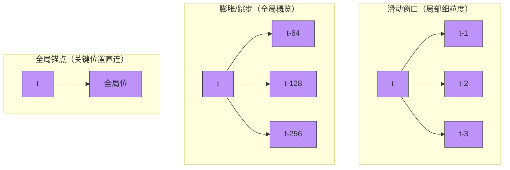
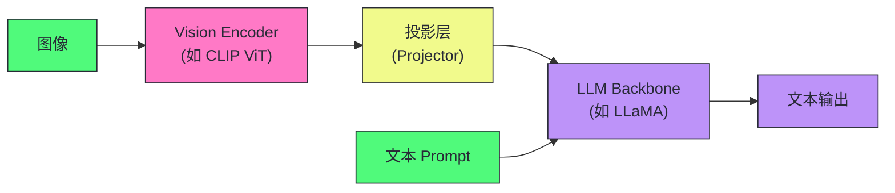
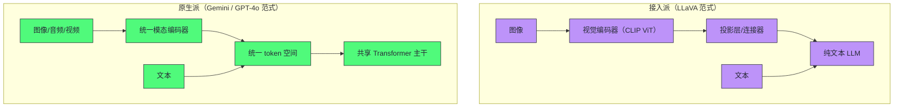

# 08 长上下文与多模态——技术前沿

**摘要：**

本文收束 LLM 原理系列，聚焦 2023-2026 年间最活跃的两条前沿主线：**长上下文**与**多模态**，以及把它们串起来的效率引擎 **MoE**。长上下文一侧，Self-Attention 的 $O(n^2)$ 复杂度和位置编码的泛化边界，逼出了 RoPE 外推（PI/NTK/YaRN）、稀疏注意力、线性注意力与 Ring Attention 一整套组合拳；与此同时，评估体系从"大海捞针"走向 LongBench v2、∞Bench 与 RULER，把"宣称长度"与"有效长度"之间的距离摆到台面上。多模态一侧，从 CLIP 对比对齐、LLaVA 连接器，到 Gemini 与 GPT-4o 的原生统一 token 空间，架构之争的本质是"接入"与"共训"之争，2025 年之后连图像生成也被并进同一个自回归模型。本文要回答三个问题：百万乃至千万级上下文究竟靠什么撑起来、又要付出什么代价；多模态从"外挂编码器"到"原生多模态"的跃迁，为什么被称作质变而非量变；MoE 的专家路由与负载均衡，又是如何在容量与算力之间讨价还价的。收官处，笔者把原理 → 工程 → 前沿这条主线收束成一条贯穿始终的权衡律：没有一条前沿是免费的，因地制宜才是唯一有效的做法。

---

## 第 1 章 长上下文：为什么需要更长的窗口

### 1.1 上下文窗口的意义

2019 年，当 OpenAI 发布 GPT-2 时，它的上下文窗口是 1024 个 token，大约刚够读完一页半纸。五年之后的 2024 年，Gemini 1.5 Pro 把这一数字推到 100 万；再过一年，Llama 4 Scout 公开宣称 1000 万。这个从四位数到七位数的跨越，速度之快，甚至让"上下文窗口"这个词本身从模型参数表里的一个冷冰冰的数字，变成了产品发布会上的头号卖点。

上下文窗口（Context Window）是 LLM 一次能处理的最大 token 数量。它决定了模型能"看到"多少信息来生成回答。这个窗口之于模型，好比剧场舞台的大小——舞台越大，能同时上台的演员就越多，一幕戏能讲的故事就越完整；但换场的时间也随之拉长，舞台管理（显存与算力）的成本水涨船高。窗口与成本是同一个硬币的两面，这正是本章反复要算的账。

| 上下文长度 | 能容纳的内容 | 典型应用 |
| :--- | :--- | :--- |
| 4K token | ~3,000 字 / ~6 页 | 简单问答、短对话 |
| 32K token | ~24,000 字 / ~50 页 | 长文档摘要、多轮对话 |
| 128K token | ~96,000 字 / ~200 页 | 整本书分析、代码库理解 |
| 1M token | ~750,000 字 / ~1500 页 | 多文档综合、长视频理解 |

在 Agent 和 RAG 场景中，长上下文尤为重要：Agent 需要在对话历史、工具调用结果、检索文档等大量上下文中进行推理；RAG 系统检索到的多个文档片段可能总计数万 token。上下文窗口的限制直接约束了这些应用的能力。GPT-4.1 发布时，OpenAI 给出的卖点之一就是"1M token 足够装下八份 React 代码库"，其目标用户清单里排在前面的是法律、代码、客服这三个靠长文档吃饭的行业——长上下文首先是一个**工程需求**，然后才是一个研究课题。

### 1.2 $O(n^2)$ 的根本挑战

在 [[01 从 RNN 到 Transformer——注意力机制的革命]] 中我们分析过，Self-Attention 的核心计算 $QK^T$ 产生一个 $n \times n$ 的注意力矩阵（$n$ 为序列长度），计算复杂度为 $O(n^2 d)$，显存复杂度为 $O(n^2)$。

当 $n$ 从 4K 增长到 128K（32 倍），注意力矩阵从 $4K \times 4K = 16M$ 个元素增长到 $128K \times 128K = 16.4B$ 个元素——**膨胀了 1024 倍**。BF16 下，128K 序列的注意力矩阵单层就需要约 32 GB 显存——这还只是一层的一个注意力头。

因此，长上下文技术的核心目标是：**在不显著牺牲模型质量的前提下，降低长序列下的计算和显存需求**。

这笔账还要算上推理侧的 KV Cache。[[06 推理优化——KV Cache、量化与投机解码]] 已经算过：KV Cache 随序列长度线性增长，128K 上下文在 7B 模型上就要吃掉 64 GB 显存。把两者合起来看，长序列的成本其实来自三处——Prefill 阶段 $O(n^2)$ 的注意力矩阵、Decode 阶段线性膨胀的 KV Cache、以及位置编码超过训练长度后的质量塌方。三处各自的解法并不相同：前两处靠 Flash Attention 与 KV 压缩（GQA/MLA）这类工程手段，第三处靠位置编码外推这类架构手段。市面上讨论"长上下文"时常常把三者混为一谈，但它们的病灶、手术刀和恢复期完全不同——这正是笔者希望读者建立的第一层辨析。

### 1.3 长上下文与 RAG：两条并行的路

长上下文的价值有多大，还需要与它的老对手对照着看。在 2023 年之前，"给模型喂更多信息"的标准答案是**检索增强生成**（Retrieval-Augmented Generation, RAG）：先从一个向量库里检索出与问题最相关的几段文本，再把这几段塞进上下文。RAG 的假设是"上下文窗口很小，所以只能带最相关的部分进场"。

长上下文模型出现后，这个前提松动了。一个自然的问题是：既然窗口能装下整个语料库，还要检索做什么？实践中答案是两者互补，而非互相取代。RAG 的优势在于**成本与可控性**——它把"读全文"换成"读摘要"，token 费用、首 token 延迟都低一个量级，还可以对检索结果做权限控制；长上下文的优势在于**不丢失上下文**——检索是"猜测什么相关"，一旦猜错（召回率不足、top-k 截断把关键段落挡在门外），信息就永久丢失，而全量灌入没有这个风险。2024 年后业界逐渐形成的共识是：长上下文更适合"信息密度高、相关性难预判"的场景（整份代码库、数十份合同对读），RAG 更适合"语料海量、多数内容确实无关"的场景（企业知识库、全网搜索）。用 GPT-4.1 团队的措辞说，他们训练的模型"擅长在 1M 长度上忽略干扰项"，但官方文档也承认：当任务需要跨全文的状态追踪（譬如做一次图搜索）时，长上下文性能仍会下降——这句话等于自己承认了长上下文的边界，第 4 章还会回到这里。

还有一个常被忽略的方向：长上下文不只意味着**读得长**，还意味着**写得长**。清华与智谱的 LongWriter（2024）发现，当时的长上下文模型能读 10 万 token，却普遍写不出超过 2000 字的连贯长文——原因出人意料：模型的有效生成长度，被**监督微调数据里最长的输出样本**锁死了。训练数据里没有长输出，模型就学不会长输出，这与架构无关，纯是数据的边界。他们用 AgentWrite 流水线构造了输出长度 2K-32K 词的微调数据，把 9B 模型的长文能力推到 1 万字以上。这个案例提醒我们：**上下文窗口是"容器"，数据是"内容"，容器做大不等于内容自动变多**。

---

## 第 2 章 位置编码外推——让模型"看到"更远

### 2.1 问题定义

大多数模型在预训练时使用固定长度的上下文（如 LLaMA 预训练上下文 4096 token）。当推理时输入长度超过预训练长度时，位置编码面临**外推**（Extrapolation）问题——模型从未见过的位置编码会导致注意力计算失常，输出质量急剧下降。

外推失败的机理值得说透。以 RoPE 为例，它的核心假设是"注意力分数只依赖相对位置 $m-n$"，训练时模型见过的相对距离最大不超过 $L-1$；推理时突然出现 $m-n > L$ 的相对距离，注意力分数就落进了模型从未见过的输入分布里。更麻烦的是，RoPE 按维度设置了不同的旋转角速度（$10000^{-2i/d}$），不同维度对"超范围"的敏感度完全不同——高频维度旋转得快，相邻 token 的相对距离全靠它编码，一旦被压缩或外推过度，局部位置关系立刻乱套；低频维度旋转得慢，负责长距离的全局位置感，对缩放的容忍度却高得多。所以外推问题的本质不是"位置编码不会算更大的数"，而是"一组原本按比例分布的特征，被强行拉伸后不再符合模型学到的分布"。这就好比给一个只在市内开车的人一张全国地图——道路画得再标准，他也没有任何一条出城路线的驾驶经验。

### 2.2 RoPE 的长度外推技术

RoPE（Rotary Position Embedding）是当前主流 LLM 的位置编码方案。它通过旋转角度 $\theta_i = 10000^{-2i/d}$ 对 Q 和 K 施加位置相关的旋转。外推的关键在于：当位置 $m$ 超过训练时的最大位置 $L$ 时，旋转角度 $m \cdot \theta_i$ 变得非常大，可能超出模型训练时见过的范围。RoPE 本身的数学细节在 [[02 GPT 架构——Decoder-Only 的自回归语言模型]] 中已展开，这里直接进入外推方法。

**Position Interpolation（PI，Meta 2023）**：最简单的外推方案——将位置索引**线性缩放**到训练范围内。如果训练上下文是 4K，推理时要用 32K，就将所有位置除以 8（$32K / 4K$）：

$$m' = m \cdot \frac{L_{\text{train}}}{L_{\text{target}}}$$

这样所有位置编码都落在训练范围内。PI 需要少量的微调数据（约 1000 步）来适应缩放后的位置分布。但 PI 有一个被后续工作反复指出的隐患：它**均匀**压缩了所有频率维度，高频维度（编码相邻位置的精细关系）被一起压扁，导致局部位置分辨率下降——好比把整张地图等比缩小，远处的山川河流都看见了，近处街道的细节却糊成一团。位置分辨率下降的直接后果是：模型对相邻位置谁是谁变得迟钝，而相邻位置恰恰承载着语法与语义的最细粒度。

**NTK-aware Scaling**：PI 均匀缩放所有频率维度，但高频维度（$\theta_i$ 大的维度，编码局部位置关系）和低频维度（$\theta_i$ 小的维度，编码全局位置关系）对缩放的敏感度不同。NTK-aware Scaling 通过调整基础频率 $b$（将 $10000$ 替换为更大的值）来非均匀地缩放不同频率，保护高频维度不被过度压缩。它最初是社区在 Reddit 上以"神经正切核（Neural Tangent Kernel, NTK）"为名提出的经验配方——把基数按 $b \cdot s^{d/(d-2)}$ 放大（$s$ 为缩放因子，$d$ 为维度），高频维度的旋转频率基本不动、低频维度整体放慢，于是"近处细节"原样保留，"远处视野"被平滑扩展。NTK-aware 的直觉很像给望远镜换镜片：不改变看到的视野里细节的清晰度，而是改变视野本身的大小。

**YaRN（Yet another RoPE extensioN）**：结合了 NTK-aware Scaling 和注意力分布的温度调整，是当前效果最好的 RoPE 外推方案之一。YaRN（Peng et al., ICLR 2024）的关键贡献是把"波长"（Wavelength）这个概念正式引入：对第 $d$ 个维度，波长 $\lambda_d = 2\pi / \theta_d = 2\pi \cdot b^{2d/|D|}$，含义是该维度的旋转向量转满一整圈 $2\pi$ 所需的 token 数。波长比上下文窗口还长的维度旋转平缓、压缩它不损失局部信息；波长远短于窗口的维度旋转剧烈，绝不能动。于是 YaRN 提出 **NTK-by-parts**：按波长与目标窗口长度的相对关系，把维度分成"必须插值"与"必须外推"两类，再用一个 ramp 函数平滑过渡，避免两类之间的生硬切换。在此基础上，YaRN 还观察到缩放后注意力分数的熵会变化，于是引入**温度缩放**（把注意力 logits 除以一个与缩放因子 $s$ 相关的温度 $t = 0.1\ln(s) + 1$），在不改代码的前提下把注意力分布重新摊匀。论文报告，YaRN 只需前人约 **1/10 的训练 token、1/2.5 的训练步数**即可达到同等外推效果；配合推理期的动态缩放，Dynamic-YaRN 甚至可以在零微调下外推超过 2 倍。对比之下，PI 像"把地图等比缩小"，NTK-aware 像"换镜片调视野"，YaRN 则是"按街道级别重新规划比例尺，还顺手调亮了路灯"——三层操作叠加，才把外推这件事做到可用。

**Dynamic NTK**：推理时根据实际输入长度动态选择缩放因子——短输入不缩放，长输入按需缩放。这避免了短输入被不必要的缩放干扰。它的动机来自一个朴素的观察：自回归生成时序列长度是逐 token 增长的，如果一开始就按最终长度缩放，短序列阶段的位置编码就被白白拉伸了。动态缩放把"缩放因子"从静态常数变成输入长度的函数，每一步都恰好落在"够用"的刻度上。

| 方法 | 外推能力 | 是否需要微调 | 质量损失 |
| :--- | :--- | :--- | :--- |
| 无处理（直接外推） | 差 | 否 | 严重 |
| **PI** | 中（~8x） | 少量微调 | 轻微 |
| **NTK-aware** | 好（~16x） | 可选 | 轻微 |
| **YaRN** | 好（~32x+） | 少量微调 | 极小 |
| **Dynamic NTK** | 好 | 否 | 轻微 |

这些方法在 2024-2026 年的生产环境里早已不是论文概念。DeepSeek-V3 的配置文件里同时写着 YaRN 缩放参数与最初的短序列训练长度，对外宣称 128K 上下文；Qwen 2.5 把 RoPE 基数调到 1,000,000，从源头上放慢低频旋转，让"外推"变成"本来就没到极限"；Mistral 7B v0.2 则用 1e6 的基数把上下文从 8K 抬到 32K。但请注意一个反直觉的事实：**基数调大不是免费的**。基数越大，低频维度旋转越慢，模型对绝对位置的分辨就越钝——好比把钟表指针调慢，能看更长的刻度，但短时间内的读数精度下降了。所以"基数多大"与"训练长度多长"必须配套设计，这又回到[[02 GPT 架构——Decoder-Only 的自回归语言模型]]里那句结论：上下文长度是训练数据、位置编码与事后缩放三方合力的结果，没有一方可以单独邀功。

### 2.3 长上下文预训练

更彻底的方案是直接在长上下文数据上进行预训练或继续预训练。LLaMA 2 支持 4K 上下文，LLaMA 3 通过在长文本上继续训练扩展到 128K。

长上下文预训练的关键挑战是**训练数据**——互联网上的大部分文本不到 4K token，真正的长文本（完整书籍、长代码文件、长对话记录）相对稀缺。需要精心收集和构造长上下文的训练数据。这条路上有两个工程细节值得单独记录。其一是**课程式延展**：不一开始就上最长序列，而是从短序列起步、训练中逐步拉长，让模型先在短序列上稳定再渐进适应长序列的位置分布——Llama 3 的 128K、Llama 4 的 256K 预训练长度都是这样"走台阶"上去的。其二是**长度与质量的对立**：直接拼接多个短文档凑成长序列并不解决问题，因为拼接处的语义断裂会让模型学会"忽略中间"；理想的训练样本是天然连续的整本书、完整代码仓库、长对话，这类数据稀缺且清洗成本高。数据稀缺的另一个侧面是"长输出数据"更稀缺——上一章 LongWriter 的发现（微调数据缺长输出，模型就写不长）在这里以更极端的形式复现。

2025 年的生产现实是：预训练长度与宣称长度已经分层。Llama 4 Scout 以 256K 预训练、指令微调后宣称 10M；GPT-4.1 按 1M 全长度训练，官方 needle 评测在全长保持高检索率；DeepSeek-V3 靠 YaRN 把 128K 落地为开源事实标准。这些案例给出一个判断：**预训练直接拉长是"治本"，事后缩放是"性价比"**——前者质量上限高但烧钱，后者省钱但依赖"模型本来就会"的泛化，两条路在 2026 年依然并行，没有一方吞掉另一方。

---

## 第 3 章 高效注意力——降低 $O(n^2)$ 的复杂度

### 3.1 Flash Attention：硬件感知的精确注意力

在 [[06 推理优化——KV Cache、量化与投机解码]] 中我们提到了 Flash Attention。它不改变注意力的数学结果，而是通过**分块（Tiling）计算**和 **IO 感知的内存管理**来避免在 HBM 中存储完整的 $n \times n$ 注意力矩阵。

Flash Attention 的核心思想是：将 Q/K/V 分块后在 SRAM（片上高速缓存，约 20MB）中完成注意力计算，只将最终结果写回 HBM。通过在线 Softmax 归一化技巧（逐块计算并增量更新归一化因子），无需先计算完整的注意力矩阵再做 Softmax。

Flash Attention 将显存从 $O(n^2)$ 降到 $O(n)$，实际速度提升 2-4 倍。Flash Attention 2 进一步优化了 GPU 的 warp 级调度和 Q/K 分块策略，Flash Attention 3 利用了 Hopper GPU 的异步 TMA（Tensor Memory Access）指令。Flash Attention 是长上下文实用化的关键基础——没有它，128K 上下文在显存上就不可行。用 [[01 从 RNN 到 Transformer——注意力机制的革命]] 里的说法，Flash Attention 系列回答的是"怎么算得快"，它改变的不是复杂度公式，而是每一单位复杂度的实际价格——好比同一段路，步行与骑车的距离一样，单位里程的代价却完全不同。

### 3.2 稀疏注意力（Sparse Attention）

$O(n^2)$ 的完整注意力矩阵中，很多位置的注意力权重实际上接近零——一个 token 通常只与序列中少数相关位置有显著交互。稀疏注意力的思想是：**只计算可能有显著权重的位置对，跳过其余位置**。

稀疏注意力并非 2023 年的新发明，它的谱系可以追溯到 2019 年的 Sparse Transformer（Child et al.）——当时作者已经观察到"注意力权重集中在少数位置"，并提出了局部（local）与跨步（strided）两种固定模式；2020 年的 Longformer 与 BigBird 把模式扩展为"滑动窗口 + 全局锚点 token"（Longformer 的全局 token 像会议室里那个总能被所有人听见的发言人），BigBird 再加入随机连接。这些早期工作的共性是**稀疏模式是预训练后硬套上去的**，模型从未见过这种形态，质量损失明显，所以长期只活在长文档 NLP 任务里，没有进入主流 LLM。2024 年之后的"原生稀疏注意力"改变了这一点——把稀疏模式作为架构的一部分参与端到端训练，模型从第一行代码起就适应"只算这些位置"（DeepSeek 的 NSA 与 DSA 是这条路线最坚决的实践者，详见 [[01 从 RNN 到 Transformer——注意力机制的革命]] 第 8 章）。

先看工程上最成熟的几种固定模式：

**Sliding Window Attention**（Mistral 使用）：每个 token 只关注其周围固定窗口内的 token。Mistral 7B 的窗口大小为 4096（每个 token 只关注它前面最近的 4096 个 token）。计算复杂度从 $O(n^2)$ 降低到 $O(n \cdot w)$（$w$ 为窗口大小）。

Sliding Window 的一个关键洞察是：虽然每层只看窗口内的 token，但通过多层堆叠，信息可以逐层传播到更远的位置——$L$ 层模型的有效感受野为 $L \times w$。Mistral 7B 有 32 层、窗口 4096，理论注意力跨度约为 $32 \times 4096 \approx 131K$。这好比信息在一条多级流水线上接力：每一级只能看到前一级传下来的窗口，但窗口里的内容已经包含了更早层传上来的信息。Sliding Window 的另一个工程红利是**滚动缓存**（Rolling Buffer Cache）——缓存只需保留窗口大小的 KV，旧 token 的位置被循环复用，Mistral 官方报告在 8192 序列上缓存节省一半。不过它的代价同样清楚：窗口外信息的传递必须逐层"接力"，深层才能到达，相当于长距离依赖被强制走了楼梯而不是电梯——这也是 Mistral 7B v0.2 干脆放弃 SWA、改用大基数 RoPE 的直接原因，取舍的标准依然是任务形态。

**Dilated/Strided Attention**：在窗口基础上加入"跳步"关注——除了关注近邻，还以固定间隔关注远处的 token（如每隔 128 个 token 采样一个）。这让模型既有局部细节，又有全局概览。

**Mixture of Sparse Attention**：不同的注意力头使用不同的稀疏模式——有的头用小窗口关注局部，有的头用大窗口或全局注意力关注远处。这类似于 CNN 中的多尺度感受野。Llama 4 的实现是一个值得记录的工程样本：它把全局注意力（不带 RoPE）与分块局部注意力（带 RoPE）按 1:3 的比例交错堆叠，全局层负责跨块的信息汇总，局部层负责块内细节，两者叠加既压缩了复杂度又保住了远距离能力。

> [!note] 设计哲学
> 三种模式画在同一张图上，取舍就一目了然：滑动窗口保证局部精度但牺牲远距离，跳步保证远距离但牺牲连续性，全局锚点保证关键位置但需要事先知道"关键在哪"。稀疏注意力的设计空间，本质上是在这三角之间找平衡点。也正因如此，2025 年的主流方案（NSA/DSA、Llama 4）都不再用单一模式，而是把"局部细粒度 + 全局粗粒度"组合进一个可训练的结构里——粗粒度压缩摘要兜底全局感知，细粒度选择关键 token 保住局部精度。

### 3.3 线性注意力与 Mamba

更激进的方案是将注意力的 $O(n^2)$ 复杂度降低到 $O(n)$——**线性复杂度**。

**线性注意力**的核心思路是用核函数近似 Softmax：

$$\text{Attention}(Q, K, V) = \text{softmax}(QK^T)V \approx \phi(Q)(\phi(K)^T V)$$

通过先计算 $\phi(K)^T V$（$d \times d$ 矩阵），再左乘 $\phi(Q)$，计算顺序的改变使复杂度从 $O(n^2 d)$ 降低到 $O(nd^2)$——当 $d \ll n$ 时，这是线性的。

**Mamba / State Space Models（SSM）** 提供了另一种线性复杂度的序列建模方案——基于状态空间模型而非注意力。Mamba（Gu & Dao, 2023）通过选择性的状态空间机制（根据输入动态调整状态转移矩阵），在长序列任务上接近甚至匹配 Transformer 的性能，且推理时间与序列长度成线性关系。

然而，纯 Mamba/线性注意力在大规模预训练中还未能完全替代标准 Transformer——**Hybrid 架构**（混合 Attention 和 Mamba 层）是当前的折中方案。Jamba（AI21 Labs）和 Zamba（Zyphra）就是这种混合架构的代表。这条线在 [[01 从 RNN 到 Transformer——注意力机制的革命]] 第 8 章已铺开得很完整，本文不再重复，只提醒一句：线性方案的核心缺陷是**状态容量固定导致精确召回弱**——它能记住"大概"，记不住"具体某个位置发生过什么"，而这恰恰是长文档问答与 agent 状态追踪最看重的。

> [!note] 设计哲学
> 长上下文技术的演进体现了一个权衡：**全局注意力质量最好但 $O(n^2)$ 不可扩展，稀疏/线性注意力可扩展但可能牺牲长距离依赖的建模质量**。Flash Attention 通过硬件优化将全局注意力的实际代价降到可接受的范围，使得 128K 上下文在工程上可行。更长的上下文（百万级）可能需要稀疏或混合方案。

### 3.4 Ring Attention：跨设备的长序列处理

当序列长度超过单块 GPU 的显存容量时（如 1M token 的 KV Cache 可达数百 GB），需要将序列分片到多块 GPU 上。

**Ring Attention**（Liu et al., 2023）将输入序列分成块，分布到环形排列的多块 GPU 上。每块 GPU 只持有一个块的 Q 和本地 K/V。通过在环上"传递" K/V 块（每一步将 K/V 发送给下一块 GPU），每块 GPU 逐步与所有 K/V 块完成注意力计算。总显存分摊到所有 GPU 上，单卡只需 $O(n/P)$ 的显存（$P$ 为 GPU 数量）。

Ring Attention 使得百万级上下文在工程上成为可能——Google 的 Gemini 1.5 正式支持 1M、研究预览中演示过 10M token 的上下文。把 Ring Attention 想成一圈工人在流水线上分拣包裹：每个工人只守着一段传送带（自己的序列分块），但包裹会在整条环形传送带上转圈，每个人最终都见过所有包裹。它的关键工程点有二：一是**负载均衡**——序列分块要大致均匀，否则最慢的卡拖慢全体；二是**通信与计算重叠**——K/V 块在环上传递的同时就完成注意力计算，不能白等数据搬运。Ring Attention 与张量并行（TP）并不互斥，实践中往往叠加使用：TP 切模型、Ring 切序列，两条轴一起扩。

---

## 第 4 章 长上下文的评估：Needle in a Haystack

### 4.1 评估挑战

长上下文模型的评估比短上下文模型更困难——传统的 NLP 基准（如 MMLU、ARC）使用的输入长度很短，无法反映模型在长序列上的表现。更深一层的问题是：**我们究竟要评估长上下文的什么？**是"从长文本里捞出一条信息"的检索能力，还是"对长文本做全局推理"的理解能力？前者容易测，后者难测；2024-2026 年的评估演进史，本质上就是评测界从前者走向后者的过程。

### 4.2 Needle in a Haystack 测试

最流行的长上下文评估方法是 **"大海捞针"（Needle in a Haystack）** 测试。它最早由独立研究者 Greg Kamradt 在 2023 年普及开来，方法简单到令人意外：

1. 在一段很长的无关文本（"干草堆"）中，在某个特定位置插入一条关键信息（"针"）
2. 在文本末尾提问关于这条关键信息的问题
3. 测试模型能否正确检索到这条信息

通过在不同的序列长度（4K 到 128K）和不同的插入位置（开头/中间/末尾）进行系统测试，可以绘制一个**热力图**——横轴是序列长度，纵轴是插入位置，颜色表示检索成功率。理想的长上下文模型应该在所有长度和位置上都保持高检索率。NIAH 之所以迅速成为行业标准，是因为它把"长上下文能力"压缩成一个可读性极强的二维热力图，产品发布时放一张全绿的热力图，比任何论文指标都更有说服力——GPT-4.1 发布时官方就展示了在全 1M 长度、所有插入位置上接近满分的检索热力图。

但 NIAH 的局限同样明显。实际测试发现，许多模型存在 **"Lost in the Middle"** 问题——对插入在序列中间位置的信息检索率明显低于开头和末尾。这个现象由斯坦福的 Liu 等人系统化（2023，TACL 2024）：在多文档问答与键值检索两类任务上，模型对开头与结尾位置的信息利用最好、对中间位置明显变差，"即使是被明确宣称支持长上下文的模型也不例外"。Lost in the Middle 的成因目前并无定论，主流解释集中在两点：一是训练数据的**位置偏差**——预训练与微调语料里，摘要、标题、开头段落等重要信息天然倾向出现在文档开头，模型在统计上学会了"开头更重要"；二是注意力分数分布随位置偏移，中间位置的 token 更容易被两头"抢走"注意力权重。无论哪种解释，结论都指向同一个工程含义：**把关键信息放在 prompt 的开头或结尾，是成本为零的 prompt 优化**——RAG 场景里把最相关的检索段落排在首位，往往比调模型更有效。

### 4.3 其他长上下文基准

| 基准 | 评估内容 | 序列长度范围 |
| :--- | :--- | :--- |
| **RULER** | 多种检索和推理任务 | 4K-128K |
| **LongBench** | 中英文长文档理解 | 2K-32K |
| **InfiniteBench** | 超长上下文理解 | 100K+ |
| **SCROLLS** | 多种长文档任务 | 数千到数万 |

NIAH 的单一检索本质促使评测界推出更全面的基准，2024 年的三份工作是这条线的里程碑：

**RULER**（NVIDIA，2024）：由 Cheng-Ping Hsieh 等人提出，把 NIAH 从"单针"扩展到"多针、多类型、多跳追踪与聚合"（譬如"从多份文档里分别提取信息再汇总"这类需要跨文档推理的任务）。它的结论颇为扎心：**几乎所有模型都在 NIAH 单针检索上接近满分，但上下文一拉长，多跳追踪与聚合任务的成绩普遍大幅下滑**——17 个宣称 32K 以上上下文的模型里，只有约一半能在 32K 长度上维持"尚可"的成绩。RULER 用一句话戳破了行业里最流行的营销话术：能捞针，不等于能读长文。

**∞Bench（InfiniteBench）**（2024）：第一个把平均数据长度推到 10 万 token 以上的基准，覆盖检索、代码、数学、小说、对话五个领域共 12 类任务、3946 条样本，平均长度约 20 万 token。为了防止"模型在预训练里见过这些书"，小说类任务特意做了**关键实体替换**，生成"伪小说"。评估结论同样不乐观：即便是专为长上下文训练的最强模型，在 100K+ 长度上的各项任务仍大幅落后于短上下文表现，"长上下文能力仍然道阻且长"是论文的原话。

**LongBench v2**（清华，2024）：503 道多选题，上下文从 8K 词延伸到 2M 词，覆盖单文档问答、多文档问答、长上下文内学习、长对话历史、代码仓库理解、长结构化数据六类任务，数据由近 100 位高学历专业人士构造——**人类专家在 15 分钟时限内也只有 53.7% 的正确率**，而当时最强的直答模型仅 50.1%，反而是加了长推理的 o1-preview 以 57.7% 反超人类。这个数字组合说明了两件事：其一，长上下文理解已经难到"人类也答不好"，评测天花板极高；其二，**推理时计算（多思考几步）对长上下文任务的效果，不亚于把上下文本身做大**——这是 [[04 指令微调与 RLHF——从基座模型到对话助手]] 里推理模型话题在长上下文维度的延伸。

### 4.4 宣称长度与有效长度

把 NIAH、RULER、∞Bench、LongBench v2 放在一起，可以提炼出本章最重要的一个结论：**"支持多长上下文"与"有效利用多长上下文"是两回事**。宣称长度（Claimed Context Length）由位置编码、训练配置与显存预算共同决定，是"容器有多大"；有效长度（Effective Context Length）则由评测决定，是"内容能用多少"。两者之间的落差，在 RULER 的评测里表现为"32K 宣称、16K 勉强及格"，在 LongBench v2 里表现为"2M 词输入、人类都答不对"。

这个落差的来源不止一处。位置偏差让中间信息失宠（Lost in the Middle）；检索类任务好测、推理类任务难测，导致厂商更愿意优化前者；稀疏与驱逐类方案（[[06 推理优化——KV Cache、量化与投机解码]] 里的 H2O、SnapKV）在省显存的同时可能悄悄丢掉被驱逐 token 的信息——而评测不会告诉你丢了什么。对工程选型，这条落差曲线的指导意义很直接：**选型时不要看热力图，要看与你任务同构的评测**——你的任务是跨文档对读，就测 LongBench v2 式多文档任务；你的任务是代码库理解，就找代码仓库类任务；你的任务依赖全文状态追踪，就必须警惕任何"驱逐式"优化。评测与任务的同构性，比评测的权威性更重要。

---

## 第 5 章 多模态 LLM——从文本到万物

### 5.1 多模态的动机

人类的世界不是纯文本的——我们通过视觉、听觉、触觉等多种感官理解世界。纯文本 LLM 无法处理图表、照片、视频、音频等丰富的信息形式，这严重限制了它的应用场景。读一份带公式的论文、看一张示意图、听一段语音指令，这些对纯文本模型而言都是信息黑箱。

多模态 LLM 的目标是：**让 LLM 能够理解和生成多种模态的信息**，最常见的是 Vision-Language 模型（理解图像 + 文本）。动机层面还有一个常被低估的论点：多模态数据本身就是一座训练金矿。互联网上图文并茂的网页、带字幕的视频、配讲解的幻灯片，都是天然的跨模态监督信号；GPT-4o 图像生成发布时，OpenAI 特别强调他们"在图片与文本的联合分布上训练"，学到的不仅是"图片与语言的关系"，还有"图片与图片的关系"——这意味着多模态不只是多了一个输入口，还多了一整个数据来源的维度。

### 5.2 多模态 LLM 的通用架构

几乎所有多模态 LLM 共享一个通用的架构模式：

三大核心组件：

1. **Vision Encoder**：将图像编码为一组"视觉 token"（向量序列）。通常使用预训练的 CLIP ViT（Vision Transformer）或 SigLIP
2. **Projector（投影/对齐层）**：将视觉 token 映射到 LLM 的 embedding 空间。可以是简单的线性层或一个小型 MLP
3. **LLM Backbone**：接收文本 token 和视觉 token 的混合序列，按标准的自回归方式生成文本输出

这个架构的优雅之处在于：**对 LLM 来说，视觉 token 和文本 token 没有本质区别**——它们都是 embedding 空间中的向量，LLM 的注意力机制同等对待它们。模型需要学习的只是"如何将视觉信息有效地编码为 LLM 能理解的 token"。

连接器（Connector）的形态演进值得单独梳理，它是"接入派"架构里技术含量最高的部分：LLaVA-1 用最简单的线性投影；LLaVA-1.5 升级为两层 MLP；Flamingo 用 Perceiver Resampler（一组固定数量的可学习查询 token 通过 Cross-Attention 从视觉 token 中提取信息）；BLIP-2 用结构更复杂的 Q-Former。这条演进线的方向非常一致：**用越来越"聪明"的连接器，弥补"预训练视觉编码器 + 冻结 LLM"之间的语义鸿沟**。[[02 GPT 架构——Decoder-Only 的自回归语言模型]] 里讲过"一切皆 token"的接口统一，这里补充其代价的另一面：图像的一个 patch 承载的信息量与一个字词并不对等，token 数暴涨会迅速打满上下文窗口——这正是第 6 章要展开的问题。

### 5.3 CLIP——跨模态对齐的基石

CLIP（Contrastive Language-Image Pre-training，OpenAI 2021）是大多数多模态 LLM 使用的 Vision Encoder 的基础。

**训练方式**：CLIP 使用**对比学习**——给定一批（图像, 文本描述）对，训练模型使匹配的图文对在嵌入空间中距离近，不匹配的距离远。

$$\mathcal{L} = -\frac{1}{N}\sum_{i=1}^{N}\left[\log\frac{\exp(\text{sim}(v_i, t_i)/\tau)}{\sum_{j=1}^{N}\exp(\text{sim}(v_i, t_j)/\tau)}\right]$$

其中 $v_i$ 是图像 $i$ 的嵌入，$t_i$ 是对应文本的嵌入，$\text{sim}$ 是余弦相似度，$\tau$ 是温度参数。

CLIP 在 4 亿个（图像, 文本）对上训练，学到了强大的跨模态对齐能力。它的 ViT（Vision Transformer）将图像切分为 $14 \times 14$ 或 $16 \times 16$ 的 patch，每个 patch 对应一个视觉 token，最终输出一组视觉 token 序列。

对比学习的机制值得再挖一层。公式里分母的求和遍历整个 batch 的文本（$N$ 个），也就是说**正样本只有一对，其余 $N-1$ 对全是负样本**——batch 越大，对比信号越强，这也是为什么 CLIP 这类模型对 batch size 极其敏感，训练时动辄用到上万规模的 batch。温度 $\tau$ 控制分布的尖锐程度：$\tau$ 小，softmax 分布更尖锐，模型被迫把正样本与负样本分得更开，但训练也更容易不稳定。更重要的是 CLIP 学到了什么：它没有显式地学"图像里有什么"，而是学到了"图像与语言在语义空间里的对齐"——同一个概念（一只猫）在两种模态里的表征被拉到相近的位置。这正是"接入派"多模态模型敢冻结它的原因：CLIP 的视觉表征天然落在与文本语义对齐的空间里，后面的连接器只是再做一次"翻译"。

### 5.4 LLaVA——开源多模态 LLM 的标杆

**LLaVA（Large Language and Vision Assistant）**（Liu et al., 2023）是开源多模态 LLM 的代表性工作，架构简洁高效：

- Vision Encoder：CLIP ViT-L/14（预训练冻结）
- Projector：两层 MLP
- LLM：LLaMA/Vicuna

**两阶段训练**：

**阶段 1：视觉-语言对齐预训练**。使用 595K 的图文对数据，只训练 Projector（冻结 Vision Encoder 和 LLM）。目标是让 Projector 学会将视觉 token 映射到 LLM 能理解的空间。

**阶段 2：端到端指令微调**。使用 150K 的多模态指令数据（如"描述这张图片""图中有几个人"），训练 Projector 和 LLM（或只训练 LoRA）。让模型学会根据图像和文本指令生成回答。

LLaVA 的成功证明了多模态 LLM 的关键在于**对齐**而非**从头训练**——利用已有的强大 Vision Encoder（CLIP）和 LLM（LLaMA），只需训练一个轻量级的对齐层就能获得优秀的多模态能力。LLaVA 的两阶段设计还有一个常被忽视的好处：阶段 1 只训一个极小的投影层，训练成本几乎可以忽略；阶段 2 用 LoRA 的话，整个适配过程在单张消费级 GPU 上就能完成——它把"做多模态模型"的门槛从实验室级降到了个人开发者级。这也是 LLaVA 之后开源社区一夜之间冒出大量多模态变体的根本原因。后续的 LLaVA-1.5 把视觉编码器从 CLIP ViT-L/14 升级为分辨率更高的 ViT-L/336px，LLaVA-1.6 引入动态分辨率切图，每一步都是在"看得更清"与"token 更少"之间往细节方向挪一步——这条演进线第 6 章接着讲。

### 5.5 GPT-4V/o 与 Gemini——闭源多模态前沿

**GPT-4V（Vision）**：OpenAI 的多模态 LLM，支持图像输入。技术细节未公开，但已知支持高分辨率图像、图表理解、文字识别（OCR）、复杂的视觉推理。

**GPT-4o**：进一步统一了文本、图像和音频的理解与生成，实现了端到端的多模态对话——可以直接"听"用户说话并用语音回复，而非传统的 ASR → LLM → TTS 流水线。

**Gemini（Google）**：原生多模态设计——从预训练阶段就同时处理文本、图像、音频、视频数据，而非先训练纯文本 LLM 再接入视觉模块。Gemini 1.5 Pro 支持 1M token 的上下文，可以处理长达一小时的视频。

| 模型 | 视觉输入 | 音频输入 | 上下文长度 | 特色 |
| :--- | :--- | :--- | :--- | :--- |
| GPT-4V | 图像 | 否 | 128K | 强大的视觉推理 |
| GPT-4o | 图像 | 音频 | 128K | 端到端多模态，实时语音 |
| Gemini 1.5 Pro | 图像/视频 | 音频 | 1M | 原生多模态，超长上下文 |
| Claude 3.5 Sonnet | 图像 | 否 | 200K | 视觉理解 + 长上下文 |
| LLaVA-1.6 | 图像 | 否 | 32K | 开源标杆 |
| Qwen2-VL | 图像/视频 | 否 | 32K | 开源，中文优化 |

闭源前沿在 2024-2025 年的演进，把"接入派"与"原生派"的分野推到了聚光灯下。2024 年 5 月发布的 GPT-4o 是 OpenAI 对"统一模型"押下的重注：**单个模型端到端地在文本、视觉、音频上联合训练**，接受文本/图像/音频/视频的任意组合输入，生成文本/音频/图像的任意组合输出——语音对话的平均响应延迟 320 毫秒、最低 232 毫秒，接近人类对话节奏，此前 ChatGPT 的语音模式靠 ASR→LLM→TTS 三段流水线，平均延迟是 2.8 到 5.4 秒。流水线方案的痛处在于：转写丢掉了语调、停顿、多说话人、背景音这些副语言信息，模型"听"到的只是文字的影子。Gemini 则是原生派的更早旗手：从 Gemini 1.0 起就声明"从一开始就是多模态模型"，视觉、音频、视频与文本在同一个序列里交错输入——图像作为 patch 序列、视频作为逐帧编码、音频以 16kHz 的 USM（Universal Speech Model）特征直接进入序列，而非先转写成文本。把两条路线放在一起对照：

如果说接入派像给外宾配一位翻译官——外宾（图像）把自己的语言说给翻译（连接器），翻译再转述给主人（LLM），那原生派就像双语家庭长大的孩子——各模态从第一句学说话起就在同一个语言环境里互相校准。原生派的账面优势有三：其一，**模态间的对齐发生在预训练内部**，而非靠轻量投影层事后弥补，跨模态理解更深；其二，**多模态数据直接参与预训练**，数据来源维度变宽；其三，**端到端可生成**——GPT-4o 与 Gemini 2.x 都能直接输出音频乃至图像，这在接入架构里根本不可能，因为接入派只解决了输入侧。但原生派也有实打实的代价：训练成本与工程复杂度高一个量级，模态间可能互相干扰（图像 token 的梯度淹没文本 token），且每一代都要重新解决"如何把视觉/音频 token 组织进序列"这个接入派早已解决的问题。

2025 年的几个标志性事件进一步巩固了原生派的位置。Meta 在 2025 年 4 月发布的 Llama 4 是**开源阵营第一次全面转向原生多模态 + MoE**：Scout（17B 激活/109B 总参数/16 专家）与 Maverick（17B 激活/400B 总参数/128 专家）都采用早期融合（Early Fusion），视觉 token 从预训练起就混在文本序列里一起训练。Google 的 Gemini 2.5 Flash Image（代号 nano-banana）与 OpenAI 的 4o 图像生成则把图像生成并入同一个自回归模型——前者一张图约 1290 个输出 token、单价约 $0.039，还能做多图融合与自然语言指令编辑；后者依托联合分布训练实现精准的文字渲染与上下文一致的图像编辑。到 2026 年初，多模态的共识已经从"怎么接"转向"怎么共训"——接入派解决的是存量问题，原生派押注的是增量问题。

补充一张 2025-2026 年公开规格对照表（数字来自各家官方文档与模型卡）：

| 模型 | 输入模态 | 输出模态 | 上下文 | 特色 |
| :--- | :--- | :--- | :--- | :--- |
| Gemini 2.5 Pro | 文本/图像/音频/视频/PDF | 文本/原生音频 | 1M（输出 64K） | 原生多模态 + 思考（Thinking） |
| GPT-4.1 | 文本/图像 | 文本 | 1M | 全长度 needle 检索，低延迟 |
| Claude Sonnet 4 | 文本/图像 | 文本 | 200K→1M | 视觉 + 扩展思考 + 计算机使用 |
| Llama 4 Scout | 文本/图像 | 文本 | 10M（指令版） | 开源原生多模态 MoE |
| Llama 4 Maverick | 文本/图像 | 文本 | 1M（指令版） | 128 专家，17B 激活 |
| Qwen2.5-VL-72B | 文本/图像/视频 | 文本 | 大窗口 | 开源，小时级视频定位 |

---

## 第 6 章 视觉理解的关键技术问题

### 6.1 分辨率与 token 数量

标准 CLIP ViT 将图像切分为固定大小的 patch（如 $14 \times 14$ 像素），$224 \times 224$ 的图像产生 $16 \times 16 = 256$ 个视觉 token。

但实际应用中的图像分辨率远高于 $224 \times 224$——一张手机照片可能是 $4000 \times 3000$。直接将高分辨率图像缩放到 $224 \times 224$ 会丢失大量细节（如图中的小字、远处的人脸）。这就好比拿一份整版缩印的报纸给读者看——版面结构能看出来，正文的小字一个也读不清。

**Dynamic Resolution**（LLaVA-1.6, Qwen-VL 等采用）：将高分辨率图像切分为多个 $224 \times 224$ 的 tile，每个 tile 独立编码，再加上一个缩略图（全局信息）。一张 $896 \times 896$ 的图像会被切成 $4 \times 4 = 16$ 个 tile，产生 $16 \times 256 = 4096$ 个视觉 token。

更多视觉 token 意味着更好的细节理解，但也消耗更多的上下文窗口和计算资源——这是一个精度与效率的权衡。2025 年的开源实现把这条路线推到极致：Qwen2.5-VL 从零训练了一个**原生动态分辨率**的 ViT（不再把分辨率当作需要事后适配的变量），配合 ViT 内部的窗口注意力来压缩计算量；它同时引入**多模态旋转位置编码**（Multimodal RoPE, MRoPE）——把位置编码分解成时间、高度、宽度三个分量，图像 token 的高度/宽度分量各按空间位置编号、时间分量恒定，这样同一套 RoPE 就能同时承载"图像在哪里"与"文本在哪里"。这个设计把第 2 章的位置编码问题从"序列更长"推进到"位置维度更多"——在笔者看来，RoPE 把位置信息注入 Q/K 而非 embedding 的选择，在这里显得愈发关键：MRoPE 能在同一个旋转框架里同时编排图像的空间位置与文本的顺序位置，正是依托这一设计。

### 6.2 视觉 Token 压缩

4096 个视觉 token 可能占据了大部分上下文窗口，留给文本的空间不足。**视觉 Token 压缩**技术试图用更少的 token 表示图像：

- **Perceiver Resampler**（Flamingo 使用）：用一组固定数量（如 64 个）的可学习查询 token，通过 Cross-Attention 从视觉 token 中提取信息。输出固定长度的视觉 token，不受图像分辨率影响
- **Q-Former**（BLIP-2 使用）：类似 Perceiver，但使用了更复杂的 Querying Transformer 架构

这两者的共同思想是**软压缩**：不是从 4096 个视觉 token 里硬挑 64 个丢掉，而是让 64 个可学习查询向量"读"完所有视觉 token 后，各自输出一个综合了全局信息的表示——好比派 64 位速记员同时进场，每人负责把整场会议的某个侧面记下来，出场时只交一页摘要。软压缩的代价是信息有损：压缩比越高，细节越模糊，OCR 类细粒度任务首当其冲。与之相对的硬路线是**token 剪枝**（Token Pruning）——直接用注意力分数等信号判定哪些视觉 token 是冗余的，把它们从序列里删掉。剪枝保住了保留 token 的完整信息，但删错了就永久丢失。视觉 token 压缩与第 3 章的稀疏注意力、[[06 推理优化——KV Cache、量化与投机解码]] 的 KV 驱逐由此形成同一条技术谱系：它们都在回答同一个问题——**给定有限的显存与算力，哪些 token 值得被记住**。

### 6.3 视觉定位与理解

除了整体理解（"图中有什么？"），更高级的视觉能力包括：

- **视觉定位（Grounding）**：将自然语言描述映射到图像中的具体区域（Bounding Box）
- **OCR/文字识别**：识别图像中的文字（如文档、路标、表格）
- **图表理解**：解读柱状图、折线图、表格中的数据和趋势
- **空间推理**：理解物体之间的空间关系（"苹果在桌子上"）

这些能力需要更精细的训练数据和更高的图像分辨率支持。定位能力在 2025 年有了一次质变：Qwen2.5-VL 不仅能输出边界框，还能输出**点坐标**定位（"门把手在图上哪个点"），并把手势、指针等交互信号纳入理解，从而支持"看屏幕操作软件"这类 agent 场景——视觉定位从"学术指标"变成了"交互接口"。但定位能力的边界也要说清楚：它对坐标的精确度仍然受限于 patch 粒度（$14 \times 14$ 像素的 token 决定了最小可分辨单元），物体边缘遮挡时边界框会漂移，密集小目标场景下框与框之间互相打架。视觉理解的上限，始终被"token 粒度 × 分辨率"这对组合压着。

---

## 第 7 章 音频与视频模态

### 7.1 语音理解

将语音集成到 LLM 中的主流方式是：

**流水线方式**：ASR（语音识别，如 Whisper）→ 文本 → LLM → 文本 → TTS（语音合成）。简单但延迟高（需要等 ASR 完成），且丢失了语音中的副语言信息（语调、情感、停顿）。

**端到端方式**（GPT-4o）：直接将音频波形编码为 token，与文本 token 一起输入 LLM。模型可以同时理解语义和副语言信息，实现更自然的对话。延迟更低，因为无需等待完整的 ASR 转录。

端到端方式在 2024-2025 年完成了从"演示"到"产品"的跨越。GPT-4o 把语音对话的平均延迟压到 320 毫秒（最低 232 毫秒），与人类对话的响应节奏相当；Gemini 2.5 Pro 更进一步支持**原生音频输出**——模型直接生成带情感、带停顿、带口音的语音波形 token，而不是先写一段文字再交给 TTS 朗读，切换 24 种语言都保持同一个声音。流水线方案的延迟病根在于"串行等待"：ASR 必须等整句说完才能转写，转写完 LLM 才能开始想，想完 TTS 才能开口——三段流水线每一段都要攒够"一口"才动。端到端方案把三段合成一段，还多赚了一份信息：语调、情感、停顿这些副语言信号不再被转写环节丢弃。但端到端并非没有代价——它需要海量语音-文本配对数据与巨大的训练成本，且"直接生成语音"也意味着错误更难被检索与修正（文本中间产物至少还可以人工校对）；2026 年的工程现实是，语音交互产品里流水线与端到端依然并存，端到端主打低延迟高自然的实时对话，流水线则在需要转写记录、质检、检索的场景里依然不可替代。

### 7.2 视频理解

视频理解面临的核心挑战是**信息量巨大**——一分钟 30fps 的视频有 1800 帧，即使每帧只提取 256 个视觉 token，总计也有 46 万 token。

主流方案是**关键帧采样**：从视频中均匀或智能地采样少量帧（如每秒 1-2 帧），对每帧进行视觉编码后拼接为 token 序列。配合长上下文能力，可以处理数分钟到数十分钟的视频。

Gemini 1.5 的 1M token 上下文使其能处理长达一小时的视频——按每秒 1 帧、每帧 256 个 token 计算，一小时视频约 $3600 \times 256 = 921K$ token。Gemini 的视频理解方式值得注意：它把视频当成**一长串按时间排序的帧**直接放进上下文，不做"抽帧摘要"，这只有靠百万级上下文才能撑起来——长上下文与视频理解在这里互相成就，这也是 Google 同步押注这两条线的直接原因。

2025 年的开源进展把视频理解往"时间精确"方向又推了一步。Qwen2.5-VL 在 MRoPE 的时间分量上做了关键改进：不再按"帧序号"编号，而是按**绝对时间**编号，并支持动态帧率采样——视频里动作快的段落多抽帧、动作慢的段落少抽帧。这样模型学到的不再是"第几帧发生了什么"，而是"视频的第几秒发生了什么"，从而实现了**秒级事件定位**（"这个镜头在第 42 秒"）。把时间信息注入位置编码，是第 2 章 RoPE 思想在视频维度的又一次延伸。视频理解在 2026 年仍是高成本任务：即便按 1fps 采样，小时级视频也要近百万 token，推理成本与延迟都远超文本，这决定了视频理解的实际落地更多集中在"离线分析"而非"实时交互"。

---

## 第 8 章 Mixture of Experts——多模态的效率之道

### 8.1 MoE 的基本原理

**Mixture of Experts（MoE）** 是支撑大规模多模态模型的关键架构技术。MoE 将 FFN 层替换为多个"专家"网络，每个 token 只激活其中少数几个专家（通常 2 个），其余专家不参与计算。

$$\text{MoE}(x) = \sum_{i=1}^{E} g_i(x) \cdot \text{Expert}_i(x)$$

其中 $g_i(x)$ 是门控网络（Router）输出的权重，对于不被选中的专家，$g_i = 0$。

MoE 的优势在于：**模型总参数量可以很大（存储丰富的知识），但每个 token 的实际计算量与小模型相当**。譬如 Mixtral-8x7B 有 46.7B 总参数，但每个 token 只激活 12.9B——计算量与 13B 密集模型相当，但性能接近 70B 模型。

路由机制值得再拆一层。Router 通常是一个极小的线性层，输入 token 的隐状态、输出每个专家的分数，然后取 top-k（Mixtral 取 2，Llama 4 取 1，DeepSeek-V3 取 8 个路由专家）。top-k 取多少是个微妙的工程决策：k 越大，每个 token 看到的专家越多、表达越丰富，但计算量也线性上涨；k 越小，模型越稀疏、越省算力，但对路由质量的要求越高——Llama 4 的 top-1 相当于把宝全押在路由的准确性上，路由错了就没有第二专家兜底。MoE 还有一层分布式训练的账：专家是分布在多块 GPU 上的，token 被路由到不同卡上的专家，就产生跨卡通信（All-to-All），通信量与"token 分布得有多散"成正比——这也是 MoE 模型训练时比稠密模型更难扩展的原因之一。

### 8.2 负载均衡与路由

MoE 有一个与生俱来的顽疾：**路由坍缩（Routing Collapse）**。如果路由网络自由发展，绝大多数 token 会涌向少数几个专家，其他专家得不到训练梯度、沦为摆设，模型容量被白白浪费——这好比一家综合医院只有内科专家接诊，外科、骨科全部空转。路由坍缩还会让训练不稳：被冷落的专家梯度长期为零，一旦有 token 偶尔被路由过去，就会产生不连续的梯度冲击。

经典对策是**负载均衡辅助损失**（Load Balancing Auxiliary Loss）。Switch Transformer（2021）在训练目标里加入一项惩罚——统计每个专家被选中的比例，若分布偏离均匀则施加惩罚，强迫路由"均贫富"。GShard（2021）则用**容量因子**（Capacity Factor）做硬约束：每个专家每批次最多处理固定比例的 token，超出部分直接丢弃（dropped tokens 的损失被跳过）。这些方法把负载压稳了，但代价也明确：辅助损失与容量截断都**扭曲了路由的原始判断**——一个 token 明明最适合专家 A，却因为"均衡"被挤到专家 B，模型质量为此付出了隐性损失。2022 年的 Expert Choice 走的是另一条路：反过来让**专家选 token**——每个专家从全局 token 里选自己最匹配的，天然保证负载均衡，但会让不同专家处理的 token 集合不一致，工程实现复杂。

DeepSeek 在 2024-2025 年的实践把这条线的矛盾推到了新平衡点。DeepSeekMoE（2024）提出两个关键设计：其一是**细粒度专家**——把专家切得更小更多（V2 为 160 个路由专家，V3 达到 256 个），让每个 token 组合出更精细的"专家分工"，类比把大内科拆成心血管、呼吸、消化各专科；其二是**共享专家**——保留 1 个始终激活的专家，负责所有 token 都需要的通用知识（句法、常识），路由专家只负责个性化知识，避免通用知识挤占路由通道。到了 V3，DeepSeek 更进一步**取消了辅助负载均衡损失**，改用一种无辅助损失的动态调整：在路由打分上加入一个可学习的偏置项，训练中根据专家实际负载动态增减该偏置、只影响路由不直接进梯度，从而既稳住负载、又避免辅助损失对路由判断的扭曲。DeepSeek-V3 的最终规格是 671B 总参数 / 37B 激活，训练只花了 278.8 万 H800 GPU 小时，每 token 激活 9 个专家（8 路由 + 1 共享）。

| 方案 | 路由方式 | 负载均衡手段 | 代表工作 |
| :--- | :--- | :--- | :--- |
| **Switch Transformer** | Top-1 | 辅助损失 | Fedus et al., 2021 |
| **GShard** | Top-2 | 容量因子 + 辅助损失 | Lepikhin et al., 2021 |
| **Mixtral** | Top-2 | 标准辅助损失 | Jiang et al., 2023 |
| **Expert Choice** | 专家选 token | 天然均衡 | Zhou et al., 2022 |
| **DeepSeekMoE** | Top-8 路由 + 共享专家 | 无辅助损失，偏置动态调整 | DeepSeek, 2024-2025 |
| **Llama 4** | Top-1 | 官方未完全公开 | Meta, 2025 |

MoE 与稠密模型的权衡，最终落在三笔账上：**容量账**——总参数大意味着知识容量大（事实性知识更多），但显存必须装得下全部专家权重，70B 稠密换成 8×7B MoE 后显存占用反而上升；**算力账**——激活参数少意味着每 token 计算量低、推理吞吐高，这是 MoE 最诱人的一笔账；**工程账**——路由、负载均衡、跨卡通信、专家并行的复杂度全部转嫁给训练与部署系统。三笔账叠加的结论是：**MoE 不是免费的午餐，而是把"算力成本"换成了"容量与工程成本"**。2025 年之后的主流判断是：在追求性价比的大规模场景（总参数 200B 以上）MoE 已是事实标准，而在小模型与显存受限场景，稠密模型依然更划算——这又回到了 [[02 GPT 架构——Decoder-Only 的自回归语言模型]] 里对 MoE 的定性：总参数大、激活参数小的形态成为主流，本质是在容量与算力之间做交易。

### 8.3 MoE 与多模态

在多模态 LLM 中，MoE 可以让不同的专家"专注"于不同的模态——有的专家擅长处理视觉 token，有的擅长文本 token。这种自动的"分工"使模型在处理多模态输入时更高效。

Llama 4 是这个判断最直接的生产验证：Scout 与 Maverick 都是"原生多模态 + MoE"的组合，视觉 token 与文本 token 在同一个稀疏模型里处理，17B 激活参数同时覆盖语言与视觉任务，Meta 在基准上拿它去对标了 GPT-4o 与 Gemini 2.0 Flash。组合逻辑并不神秘：**多模态输入天然适合稀疏路由**——图像 patch 与文本 token 的特征分布差异巨大，让同一个 Router 去分流，专家会自发地按模态分化（统计上，视觉 token 与文本 token 被路由到的专家集合显著不同），模型等于免费获得了一组"模态专用"的计算通路，却不需要显式地设计模态门控。但代价同样清晰：token 越长、模态越多，路由的跨卡通信越频繁，长上下文 × 多模态 × MoE 三者叠加时，通信与显存压力会同时到达峰值——这也解释了为什么 Llama 4 Scout 的 10M 上下文需要 5 维并行（数据、张量、流水线、专家、序列）在 512 块 GPU 上才能跑通。多模态的每一条前沿，最终都会撞上算力与工程这两堵墙。

---

## 第 9 章 总结与展望

### 9.1 长上下文技术路线总结

| 层次 | 技术 | 效果 |
| :--- | :--- | :--- |
| **位置编码** | PI / NTK / YaRN | 扩展位置外推能力 |
| **硬件优化** | Flash Attention 2/3 | 降低实际显存和延迟 |
| **稀疏注意力** | Sliding Window / Dilated | 降低理论复杂度 |
| **线性模型** | Mamba / Linear Attention | $O(n)$ 复杂度 |
| **分布式** | Ring Attention / TP | 跨设备分摊显存 |
| **KV Cache 优化** | GQA / KV 量化 / PagedAttention | 减少 KV 缓存开销 |

把这张表按"治标还是治本"再切一刀，会看得更清楚：位置编码外推、稀疏注意力、线性模型改的是**模型本身的泛化与复杂度**，属治本；Flash Attention、KV 优化、Ring Attention 改的是**工程执行效率**，属治标。治标的意义不容低估——Flash Attention 没让 $O(n^2)$ 变成 $O(n)$，却让 128K 在工程上可负担。不过治标也有天花板：2026 年的现实是，百万级上下文的产品（Gemini 2.5、GPT-4.1、Claude Sonnet 4）几乎清一色走"全注意力 + 位置编码外推 + 海量工程优化"的路线，稀疏与线性方案在生产模型里仍是配角——不是它们不够快，而是**全注意力的质量收益在长上下文推理与 agent 场景里被看得太重**，这与 [[01 从 RNN 到 Transformer——注意力机制的革命]] 第 8 章 MiniMax-M2 回退、Kimi Linear 回归所揭示的拉锯完全一致：注意力与次二次方方案的竞争，本质是"质量 vs 成本"的连续权衡，目前仍然言之尚早。

### 9.2 多模态发展趋势

1. **端到端原生多模态**：从"LLM + 外接 Encoder"走向预训练阶段就融合多模态数据的原生架构
2. **多模态生成**：不仅理解图像/音频，还能生成图像/音频/视频（如 GPT-4o 的语音生成、DALL-E 的图像生成）
3. **统一模态表示**：所有模态（文本/图像/音频/视频/3D）用统一的 token 表示，由同一个 Transformer 处理
4. **具身智能（Embodied AI）**：将多模态 LLM 与物理世界连接——机器人通过视觉和语言理解执行任务

2025 年的进展让这几条趋势从愿景变成了产品：原生派阵营（Gemini、GPT-4o、Llama 4）全面坐实了趋势 1 与趋势 2——图像生成（GPT-4o 图像、Gemini 2.5 Flash Image）、原生音频输出（Gemini 2.5）都长在了同一个自回归模型里；趋势 3 的"统一 token 空间"在 Gemini 的架构里已经是既成事实；趋势 4 则从"机器人研究"扩展到了"计算机使用"（Computer Use）——Claude 4 与 Qwen2.5-VL 都能"看屏幕、点按钮"，多模态从感知走向了行动。但请注意，这些趋势并非同步成熟：**理解快于生成，生成快于具身**。统一 token 空间解决了"表示"，没解决"生成质量"；生成解决了"造出内容"，没解决"与世界交互的物理闭环"。多模态的下一场仗，大概率打在与动作和环境的连接上。

### 9.3 LLM 原理专栏回顾

至此，本专栏 8 篇文章完成了从 LLM 基础到前沿的完整知识链路：

| 篇章 | 主题 | 核心知识点 |
| :--- | :--- | :--- |
| [[01 从 RNN 到 Transformer——注意力机制的革命]] | 架构基础 | RNN/LSTM → Attention → Self-Attention |
| [[02 GPT 架构——Decoder-Only 的自回归语言模型]] | 模型设计 | Causal Mask, Tokenizer, RoPE, GPT 演进 |
| [[03 预训练——数据、算力与 Scaling Law]] | 训练基础 | 数据清洗, 分布式训练, Chinchilla Law |
| [[04 指令微调与 RLHF——从基座模型到对话助手]] | 对齐技术 | SFT, RLHF (PPO), DPO |
| [[05 参数高效微调——LoRA、QLoRA 与 Adapter]] | 高效训练 | LoRA 低秩分解, QLoRA 4-bit 训练 |
| [[06 推理优化——KV Cache、量化与投机解码]] | 推理加速 | KV Cache, GPTQ/AWQ, 投机解码 |
| [[07 模型部署与 Serving——vLLM、TensorRT-LLM 与 Triton]] | 工程部署 | vLLM, PagedAttention, 生产架构 |
| [[08 长上下文与多模态——技术前沿]] | 技术前沿 | RoPE 外推, Flash Attention, CLIP, LLaVA |

读者现在可以转入 [[LLM/Agent技术/00 专栏导览|Agent 技术]] 专栏，学习如何基于 LLM 构建具有工具调用、推理规划和自主决策能力的智能 Agent 系统。

### 9.4 收官：把主线收束成一条权衡律

如果把本专栏八篇文章连起来看，会浮现一条贯穿始终的主线：**从原理到工程再到前沿，每一次能力跃迁都伴随着一次代价迁移**。01 章告诉我们注意力用 $O(n^2)$ 换来了 $O(1)$ 的信息路径；02 章告诉我们 Decoder-Only 用"统一的 next token prediction"换来了规模化的简洁；03 章告诉我们 Chinchilla 定律把"多大算够"变成了一道计算题；04、05 章告诉我们对齐与微调是用数据与算力换取行为控制；06、07 章告诉我们推理优化是用显存、带宽与工程复杂度换取延迟与吞吐；本文则把最后一组交换摆上台面——长上下文用位置编码外推、稀疏注意力与百万级显存换取"看得远"，多模态用连接器或共训换取"看得懂"，MoE 用容量与工程复杂度换取"算得省"。

这条权衡律给出一个清醒的预言：**没有一条前沿是免费的，也没有一个方案能同时在质量、成本、复杂度三个维度上占优**。2026 年的长上下文选择，落在"全注意力 + 外推 + 工程优化"与"稀疏/线性 + 便宜但召回弱"之间；2026 年的多模态选择，落在"接入派的低成本存量适配"与"原生派的高成本增量红利"之间；MoE 的选择，落在"容量"与"算力账 + 工程账"之间。选型的唯一正确姿势，是先想清楚自己的任务站在权衡曲线的哪个位置，再动手——因地制宜地选用合适的组合，才是唯一有效的做法。

---

## 参考文献

1. Chen et al., "Extending Context Window of Large Language Models via Positional Interpolation", arXiv 2306.15595, 2023
2. bloc97, "NTK-Aware Scaled RoPE", 2023（社区博客）
3. Peng et al., "YaRN: Efficient Context Window Extension of Large Language Models", ICLR 2024（arXiv 2309.00071）
4. Dao, "FlashAttention-2: Faster Attention with Better Parallelism and Work Partitioning", ICLR 2024
5. Gu & Dao, "Mamba: Linear-Time Sequence Modeling with Selective State Spaces", arXiv 2312.00752, 2023
6. Liu et al., "Ring Attention with Blockwise Transformers for Near-Infinite Context", ICLR 2024
7. Jiang et al., "Mistral 7B", arXiv 2310.06825, 2023（滑动窗口注意力）
8. Child et al., "Generating Long Sequences with Sparse Transformers", arXiv 1904.10509, 2019
9. Beltagy et al., "Longformer: The Long-Document Transformer", arXiv 2004.05150, 2020
10. Zaheer et al., "Big Bird: Transformers for Longer Sequences", NeurIPS 2020
11. Yuan et al., "Native Sparse Attention: Hardware-Aligned and Natively Trainable Sparse Attention", ACL 2025（arXiv 2502.11089）
12. Liu et al., "Lost in the Middle: How Language Models Use Long Contexts", TACL 2024（arXiv 2307.03172）
13. Hsieh et al., "RULER: What's the Real Context Size of Your Long-Context Language Models?", COLM 2024
14. Zhang et al., "∞Bench: Extending Long Context Evaluation Beyond 100K Tokens", ACL 2024（arXiv 2402.13718）
15. Bai et al., "LongBench v2: Towards Deeper Understanding and Reasoning on Realistic Long-context Multitasks", arXiv 2412.15204, 2024
16. Bai et al., "LongWriter: Unleashing 10,000+ Word Generation from Long Context LLMs", ICLR 2025（arXiv 2408.07055）
17. Kamradt, "Needle In A Haystack – pressure testing LLMs", 2023（独立基准）
18. Radford et al., "Learning Transferable Visual Models From Natural Language Supervision", ICML 2021（CLIP）
19. Liu et al., "Visual Instruction Tuning", NeurIPS 2023（LLaVA）
20. Alayrac et al., "Flamingo: a Visual Language Model for Few-Shot Learning", NeurIPS 2022
21. Li et al., "BLIP-2: Bootstrapping Language-Image Pre-training with Frozen Image Encoders and Large Language Models", ICML 2023
22. OpenAI, "Hello GPT-4o", 2024；"Introducing 4o Image Generation", 2025
23. Gemini Team, "Gemini: A Family of Highly Capable Multimodal Models", arXiv 2312.11805, 2023
24. Gemini Team, "Gemini 1.5: Unlocking multimodal understanding across millions of tokens of context", arXiv 2403.05530, 2024
25. Gemini Team, "Gemini 2.5: Pushing the Frontier with Advanced Reasoning, Multimodality, Long Context, and Next Generation Agentic Capabilities", arXiv 2507.06261, 2025
26. OpenAI, "Introducing GPT-4.1 in the API", 2025（1M token 上下文）
27. Anthropic, "Claude Sonnet 4 now supports 1M tokens of context", 2025
28. Meta, "The Llama 4 herd: The beginning of a new era of natively multimodal AI innovation", 2025
29. Qwen Team, "Qwen2.5-VL Technical Report", arXiv 2502.13923, 2025
30. Jiang et al., "Mixtral of Experts", arXiv 2401.04088, 2024
31. DeepSeek-AI, "DeepSeek-V3 Technical Report", arXiv 2412.19437, 2024
32. Fedus et al., "Switch Transformers: Scaling to Trillion Parameter Models with Simple and Efficient Sparsity", JMLR 2022
33. Lepikhin et al., "GShard: Scaling Giant Models with Conditional Computation and Automatic Sharding", arXiv 2006.16668, 2021
34. Zhou et al., "Mixture-of-Experts with Expert Choice Routing", NeurIPS 2022
35. Dai et al., "DeepSeekMoE: Towards Ultimate Expert Specialization in Mixture-of-Experts Language Models", arXiv 2401.06066, 2024

---

> [!note] 思考题
> 1. 长上下文模型（如 Gemini 1.5 的 1M token 窗口）通过改进位置编码（RoPE NTK-aware 外推）和注意力机制（Ring Attention、Sparse Attention）实现。但'支持长上下文'不等于'有效利用长上下文'——在 128K+ token 的输入中，模型对中间部分的信息检索能力（'Lost in the Middle'问题）明显下降。这个问题的根本原因是什么？RAG 是否比长上下文更适合处理大规模知识检索？
> 2. 多模态模型（如 GPT-4V、LLaVA）将视觉和语言能力统一到一个模型中。图像通过 Vision Encoder（如 ViT）编码为 token 序列，与文本 token 一起输入 LLM。图像 token 的数量（一张图可能占 576 个 token）显著增加了上下文长度。在一个需要同时分析多张高分辨率图片的场景中，上下文窗口和推理成本如何管控？
> 3. 视频理解、语音理解和实时多模态交互（如 GPT-4o 的语音对话）是多模态的前沿方向。实时语音对话要求端到端延迟低于 300ms——传统的'语音转文本 → LLM 生成 → 文本转语音'管道延迟通常在 1-3 秒。端到端多模态模型如何将延迟压缩到可接受的范围？
> 4. RoPE 外推的三种方案（PI 均匀压缩、NTK-aware 调基数、YaRN 波长分级）分别对应"地图等比缩小""换镜片调视野""按街道级重新规划比例尺"。如果让你为一个新预训练的模型设计外推方案，你会如何用"波长"这个指标决定哪些维度该插值、哪些该外推？
> 5. MoE 的负载均衡有辅助损失（扭曲路由判断）与无辅助损失（DeepSeek 的偏置动态调整）两条路线。假设你要训练一个 200B 参数的 MoE 模型，你如何权衡"路由质量"与"负载均衡"？在推理侧，top-1（Llama 4）与 top-8（DeepSeek-V3）的路由粒度差异会如何影响长上下文 × 多模态场景下的工程表现？