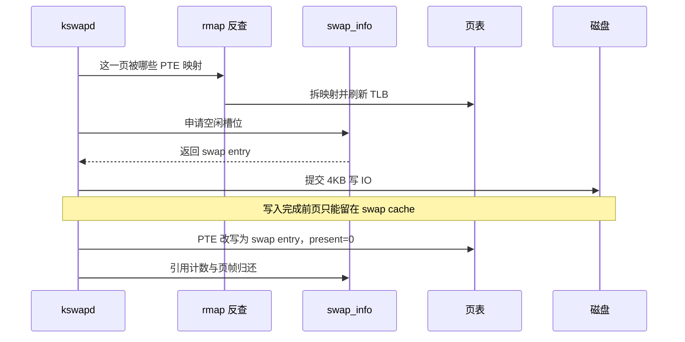
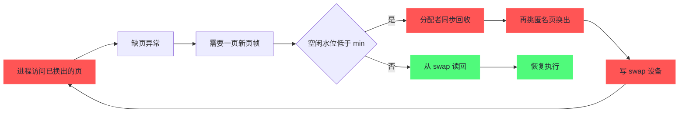
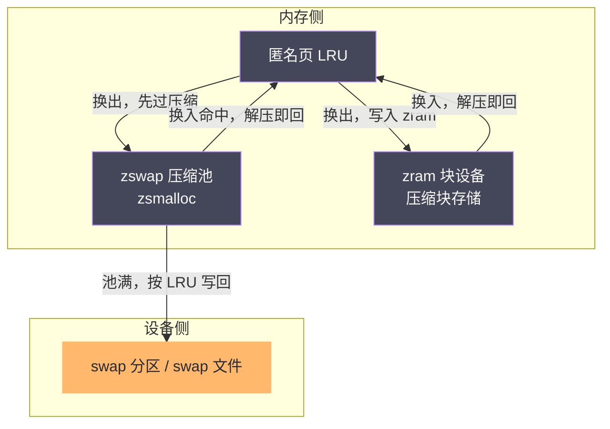

# Swap机制：磁盘充当内存的代价与边界

**摘要：**

Swap 大概是 Linux 里被误解最深的机制。一种流行说法把它当作内存不足时的后备仓库，于是"swap 有占用"被当成故障征兆；另一种说法把它当作廉价的扩容手段，于是配一块大 swap 就以为能顶住压力。两种说法错在同一处：swap 真正扩张的是内存回收的候选集，它把**匿名页**也纳入可回收的范围，让内核在压力下不必只从 page cache 里抢页帧，因此一台有 swap 的机器，文件缓存的稳态水位往往比禁用它更高。本文围绕三个问题展开：swap 到底在替谁腾地方；`vm.swappiness` 这个 0 到 200 的旋钮精确控制什么，为什么把它设成 0 不等于关闭 swap；换出与换入的成本为什么不对称，为什么伤害几乎总是来自换入这一侧。在此之上给出可操作的判据——用 `pswpin` 的速率与 PSI 区分"在用 swap"和"在抖动"，再算清 zram 与 zswap 用 CPU 换 IO 的那笔账、SSD 上的写入放大量级、容器里 cgroup v2 的三道闸门，最后以四则反例收束。读完之后，你应当能独立回答两个问题：眼前这台机器的 swap 是在正常打工，还是在拖垮系统；长期巡检该拿哪三个指标当判据。

---

## 第 1 章 被问反了的问题：swap 在替谁腾地方

### 1.1 一个不算故障的现场

先把画面摆出来。一台 64GB 内存的机器，跑了几天之后 `free -h` 显示 `available` 还有 30GB，`buff/cache` 占了 28GB，而 `Swap:` 一行写着 used 3.2GB；`/proc/pressure/memory` 的 `some avg10` 是 0.00，`/proc/vmstat` 里 `pswpin` 在过去一小时只涨了 17 页。值班的人看到 swap 里躺了 3GB，第一反应往往是"内存不够了，赶紧扩容"，但上面这组数字说的是另一件事：这台机器一直在把冷的匿名页搬到磁盘上，把腾出来的页帧交给文件缓存，而搬运过程没有让任何任务等过一秒。

反过来也有一种现场：`Swap: used 512MB`，看起来毫无问题，但 `pswpin` 每秒涨几百页、PSI 的 `full avg10` 到了 25%、`sar -W` 显示每秒换入换出各上百页——这台机器正在抖动（thrashing），业务延迟早已失控。两个现场里，swap 用量大的那台是健康的，用量小的那台是病危的。

要理解这种反差，得先放弃"swap 是内存的后备容量"这个直觉，换成另一个问法：当物理内存不够分的时候，内核手上到底有哪些页可以收回去？这个问题的答案决定了 swap 的地位。

### 1.2 匿名页：没有磁盘后端的那一半内存

内存里的页大致分两类。文件页（file page）背后有磁盘上的文件，内存里的这份是副本，干净的时候直接丢掉、脏的时候回写后丢掉，代价可控；这类页构成了第 [[04 Page Cache：Linux 为什么要用内存来缓存磁盘|4 篇]]里那套贪婪的缓存体系。匿名页（anonymous page）不同，它是 `malloc` 出来的堆、线程栈、共享内存，背后没有文件，内存里那一份就是唯一副本，丢掉就等于数据丢失。

第 [[03 缺页异常：一次内存访问的完整旅程|3 篇]]已经讲过匿名页的来历：写时复制分出来的页、`brk` 扩展出来的页、`mmap(MAP_ANONYMOUS)` 映射的页，都属于"生来就是脏页"的那一类。没有 swap 的时候，这半边内存对回收机制来说是只读的——内核只能看着它增长，一点也拿不回来。于是所有回收压力都压到文件页头上：内存紧张时 page cache 被反复抽干，下一次访问又要从磁盘重读，命中率一路下滑，而进程堆里的冷数据稳稳占着页帧不动。

这就是没有 swap 的机器在持续压力下的典型曲线：可用内存看起来还行，但缓存几乎留不住，磁盘读带宽被反复的冷读吃满，尾延迟一路抬高，直到某个进程再要一块内存，直接撞上 OOM。第 [[05 内存回收：kswapd、LRU与直接回收的博弈|5 篇]]说过回收的核心决策是"永远优先挑成本最低的那类页"，而 swap 做的事，是把匿名页从"不可回收"挪进了"成本较高但可回收"这一档——回收池的边界被 swap 向外推了一格。

### 1.3 swap 的真实作用：给 page cache 让路

把上面这条推到底，就得到本篇最反直觉的结论：swap 的第一受益人通常不是"缺内存的进程"，而是文件缓存。

设想一台 64GB 的机器，负载里 24GB 是进程堆、其余是反复访问的数据文件。禁掉 swap 之后，内核维护水位只能靠回收文件页，长跑一段时间 page cache 会被压到一个很低的稳态；而一旦配了 swap，冷的那部分堆（可能占一半以上，因为多数服务的堆里长期不被触碰的部分远多于热部分）可以换出去，页帧转手给缓存用。缓存变大，命中率变高，磁盘读变少，延迟下降——这条因果链里，进程自己几乎什么都没感觉到，唯一变化的是它脚下的资源分配比例。

> [!info] 一个可以自查的对照
> 同一套负载，禁 swap 与开 swap 各跑一天，比对 `/proc/vmstat` 的 `workingset_refault_file`（文件页被回收后又被重新读入的次数）与磁盘读带宽。前者的数值大概率明显更高——那不是负载变了，而是缓存被挤掉后又在原地补读。

代价当然也有。匿名页换出去之后，进程如果哪天回头访问，就要在访问路径上等一次磁盘读，而这个延迟比页缓存缺失高得多。所以 swap 改变的不是"够不够"，而是"够的时候把余量给谁、不够的时候让谁承担延迟"。这也解释了为什么容量规划里 swap 从来不是内存的替代品：它不能让你跑更多的热数据，只能让你在同样的物理内存里装下更多的冷数据加更多的缓存。

再补一层不常被提起的作用：swap 参与 overcommit 的记账。内核文档写明，`vm.overcommit_memory=2` 时，允许提交的地址空间上限是"swap 加物理内存的一个比例"，也就是说 swap 大小直接影响内核愿意批准多少 `malloc`。这既是价值（一些只能靠预留地址空间启动的程序因此能起来），也是风险——虚拟额度被撑大之后，OOM 的发生时点被推迟，而推迟的那段时间里系统往往已经在抖动。容量算得不够准的机器上，"多给点 swap 更安全"这个直觉会以另一种方式反噬：不是更早 OOM，而是更久地卡在泥里。

### 1.4 一段被继承的历史

swap 这个名字来自更早的年代。1962 年曼彻斯特的 Atlas 与几乎同时期的 CTSS，已经把主存装不下的程序段搬到磁鼓上；早期 Unix 的 swap 更干脆——整个进程映像换进换出，一次搬一个进程，简单粗暴但语义清晰。Linux 沿用了这个名字，实现上却是按页的按需换出（demand paging）：哪一页冷了换哪一页，进程不需要整体搬家。

这段历史留下的痕迹值得留意：凡是以"整个进程"为单位换出的系统，swap 使用的确是"内存不够"的强信号，因为换出意味着整个进程停摆；而按页换出的系统里，换出一页和换出一万页是两种完全不同的处境，前者是日常，后者才是灾难。很多流传下来的经验——"swap 一用就该紧张"——属于前一个时代的直觉，套在今天的按页交换上，误判率极高。

---

## 第 2 章 一条不对称的代价链

### 2.1 换出：把一页送出内存

换出一页匿名页要经过四步。第一步是选人：回收器从匿名页的 Inactive 链表尾部取候选，这一步是纯内存操作，便宜。第二步是拆映射：一页匿名内存可能被多个页表项（PTE, Page Table Entry）指着——`fork` 之后父子进程共享的那些页就是典型——内核必须通过反向映射（rmap, Reverse Mapping）顺着 `anon_vma` 找到所有引用者，逐个把 PTE 拆掉，并让相关 CPU 刷新 TLB。第三步是找位置：从 swap 空间里分配一个槽位，内核用 `swap_info_struct` 描述每个 swap 设备，用 `swap_map` 数组给每个槽位记引用计数，计数为零才可分配。第四步才是真正的 IO：把页内容写到槽位对应的磁盘位置，同时把 PTE 改写成 swap entry——present 位清零，其余位域编码"哪个 swap 设备、哪个偏移"。写入完成，物理页帧归还伙伴系统。



四步里只有第一步是免费的，后面三步都可能很贵：拆映射要拿锁、要跨 CPU 刷 TLB；写 IO 要等设备。但请注意一个关键性质——换出发生在 kswapd 或者别的进程的回收路径上，是**异步**的、可以批量的，慢一点通常只表现为"回收效率低"，不直接表现为某个业务线程卡住。

### 2.2 swap cache：写出去但还没确认的那段时间

换出过程中有一个容易被忽略的中间态。页已经决定要换出、IO 也提交了，但还没落盘，这时内核不能把内容丢掉，于是把它挂在 swap cache 上，PTE 已经指向 swap entry，页本身还留在内存里。这个缓冲解决两类问题：并发换出同一页时避免重复 IO（多个 PTE 共享一页时可能同时触发），以及换出后进程立刻回访时可以不走磁盘直接把页拿回来（内容还在，只是"名义上"已换出）。

`/proc/meminfo` 的 `SwapCached` 就是这个池子的大小。它在两处同时被记账：既算在内存用量里，又占着 swap 槽位，所以 cgroup 里观察时会看到 `memory.current` 与 swap 用量同时上涨，不必当成泄漏。`SwapCached` 长期偏高说明有页在"换出去又马上用回来"之间来回，这已经是抖动的早期形态。

### 2.3 换入：落在访问路径上的同步等待

换入的路径短得多，但每一步都压在执行者身上。进程访问一个 present 位为 0、值却非零的 PTE，触发缺页异常，`do_swap_page()` 接手：先解出 swap entry 里的设备与偏移，查 swap cache；命中则直接建映射返回，等于什么也没发生；未命中才分配新页帧、发起磁盘读，然后**阻塞等待 IO 完成**，再把 PTE 改成指向新页帧、把页挂回匿名 LRU。这是 major fault，计入 `pgmajfault`，它的成本直接叠加在访问那条指令的延迟上。

换入也不是完全的单兵作战。swap 侧有预读，旋钮是 `vm.page-cluster`：它是对数值，含义是一次换入顺带读入的页的 2 的幂，默认 3 也就是一次读 8 页。问题在于，文件页的预读靠"顺序访问"这个假设吃饭，而匿名页在 swap 空间里的排列取决于当初换出的顺序，跟进程之后的访问顺序没有必然关系——一堆变量分散在堆的各个角落，换出时按 LRU 选中、按批写入，换回时却是随机命中。预读命中率因此远低于文件页，读回来的多数页根本不会被用到，等于把一次随机读放大成一次更贵的随机读。

### 2.4 为什么伤害总是来自换入

把两侧的成本逐项摆开，不对称就很清楚了。

| 维度 | 换出 | 换入 |
|------|------|------|
| 执行者 | kswapd 或别的进程的回收路径 | 访问该页的进程自己 |
| 同步性 | 异步，可批量提交 | 同步，必须等 IO 完成 |
| IO 模式 | 批量写，邻近槽位有一定连续性 | 单页随机读，预读命中率低 |
| 谁来承受延迟 | 系统的回收进度 | 正在干活的那个线程 |
| 频率特征 | 随内存压力缓慢上升 | 与工作集超出物理内存的程度强相关 |
| 可观测痕迹 | `pswpout`、`pgscan_*` | `pswpin`、`pgmajfault`、PSI |

延迟量级上，NVMe 上一次 4KB 随机读在几十微秒量级，SATA SSD 在数百微秒量级，机械盘则在毫秒到十几毫秒量级——都是量级判断，具体数字随设备与队列深度变化。一次换入对业务来说就是几条这样的延迟叠加（缺页处理、锁、可能的分配），而一次 gc 暂停或一个 RPC 超时阈值通常就在几毫秒到几十毫秒之间，所以换入一旦密集，症状必然是超时与尾延迟，而不是平均延迟的变化。

这也解释了运维现场的一个常见错位：告警按 swap 使用率配，故障按尾延迟出现。使用率是换出的累积结果，尾延迟是换入的瞬时速率，两者之间没有稳定映射。

### 2.5 抖动的自激循环

更麻烦的是换入与换出会互相喂养。



循环的入口是"工作集大于物理内存"。换入需要空闲页帧，若此时水位已经跌破 min，分配页帧这件事本身又要触发同步回收，回收再挑一页换出，进程回访又换入——系统把 CPU 时间与 IO 全花在搬运上，真正干活的指令占比掉到个位数，`si`/`so` 飙升、`wa` 高企、`r` 队列变长而吞吐反而下降。

这里有一个必须点明的推论：swap 大小只决定系统能在这个循环里撑多久，**不决定它会不会掉进去**。工作集超过物理内存，抖动迟早发生；swap 再大，也只是把"OOM 立即死"换成"抖动很久之后死"，而且后者的现场更难收拾。真正决定是否抖动的，是热数据的规模与内存是否匹配——这条判断决定了后面所有配置讨论的走向。

---

## 第 3 章 vm.swappiness 的精确语义

### 3.1 三个流传最广的误解

关于这个旋钮，中文技术圈至少有三种说法在流通。说法一是"swappiness 是内存使用率阈值，60 表示用到 60% 就开始 swap"；说法二是"它是 swap 使用的百分比，100 表示尽量用 swap"；说法三是"设成 0 就关掉了 swap，Kubernetes 节点就该这么配"。第三种说法影响最大，因为它在很多部署文档里以"官方建议"的口吻出现。

三种说法各错在不同的地方：第一种把回收的**比例权重**当成了触发**阈值**，而阈值是水位线的事，与 swappiness 无关；第二种把"扫描份额的配比"当成了"使用量的配比"，而两者之间没有换算关系；第三种错得最隐蔽——它把"推迟换出"当成了"禁止换出"，这个差别在内核文档里有一句话说得非常明白，可惜很少被引用。

### 3.2 内核文档的原话与一个算例

内核文档对 swappiness 的定义大意是：这个控制项定义"换出与文件系统换页之间的粗略相对 IO 成本"，取值 0 到 200；取 100 时虚拟内存假定两者的 IO 成本相等，因而对 page cache 和可换出的页施加同样的压力；取值更低意味着 swap 的 IO 更贵，更高意味着更便宜。文档还补了一句常被忽略的提醒：内存压力下文件系统的 IO 模式通常比 swap 的随机 IO 更高效。把这句话代进"成本越高、分到的扫描份额越少"的规则里，默认值 60 落在 100 以下就不再是随手取的数——它明说了 swap 更贵，所以少动匿名页。

这段定义里有两个信息量极大的细节。其一，它是**成本**参数，不是**倾向**参数；把 swap 放在比文件系统更快的设备上（内存里的 zram、前置压缩的 zswap、专用的 NVMe 分区），swap 的随机 IO 就更便宜，参数应当往上调。其二，文档给出的换算方式几乎是明文的：如果 swap 设备上的随机 IO 平均比文件系统快一倍（同等工作量下耗时只有一半），取值就应当是 133——把 200 份扫描预算按"谁更便宜谁多分"摊开，匿名页一侧拿 133 份、文件页一侧拿 67 份，比例恰好是 2 比 1。这个算例把旋钮的性质暴露得很彻底：它是在 **200 份预算**里给两类页分配份额，份额与两类页在设备上的相对 IO 成本成反比。

### 3.3 份额是怎么算出来的

分配发生在 `mm/vmscan.c` 的 `get_scan_count()` 里。每次回收都要回答"这一轮扫描多少文件页、多少匿名页"，答案由两个因子相乘得到：一类的权重，以及这一类在 LRU 上的规模。权重就是旋钮本身，文件页那一侧取 200 减去它。

```c
/*
 * get_scan_count() 的核心思路（示意，非逐行源码）
 * 扫描预算按「权重 × 该类 LRU 规模」分配，避免对小链表过度施压
 */
anon_prio = swappiness;          /* 匿名页权重 */
file_prio = 200 - swappiness;    /* 文件页权重，两者之和恒为 200 */

anon = inactive_anon + active_anon;
file = inactive_file + active_file;

/* 归一化后各自分到的扫描量 */
scan_anon = nr_to_scan * anon_prio * anon / (anon_prio * anon + file_prio * file);
scan_file = nr_to_scan * file_prio * file / (anon_prio * anon + file_prio * file);
```

乘上规模这一项极其重要，也是"swappiness 调了没反应"这类抱怨的主要来源。假设一台机器上匿名页只有 2GB、文件页有 40GB，即使把 swappiness 调到 200，能换出去的匿名页也就那么多——预算全给了链表很短的一侧，实际回收量仍然受供给侧限制。反过来，匿名页占绝大多数而文件页很少时，即使 swappiness 只有 10，文件页仍会被优先扫光，之后内核不得不回头处理匿名页。旋钮能调的是分配比例，调不了"有没有货"。

### 3.4 四种绕开比例计算的情形

比公式更重要的是公式之外的分支。内核在几种情况下会直接短路比例计算，每一种都对应一个现场教训。

第一，一类页为空时按单一类型扫。只剩匿名页就只扫匿名页，只剩文件页就只扫文件页，此时 swappiness 完全没有作用。

第二，不能换出时匿名页根本不在候选里。回收上下文如果没有可用的 swap 空间，或者所属 memcg 的 swap 额度已经用尽，匿名页连被扫描的资格都没有，扫描全部落在文件页上。这条分支解释了一个很常见的错觉："我明明把 swappiness 调高了，为什么还是在掉缓存"——因为那个 cgroup 的 swap 上限是 0。

第三，文件页接近枯竭时会强制扫匿名页。比例计算的前提是"两类都有货可出"，当文件页只剩薄薄一层时继续按比例分预算毫无意义，内核改为优先扫匿名页。较新的内核还给这条分支加了前提：匿名 LRU 上必须有足够多的候选页才这么做，否则一条很小的匿名链表会被反复扫穿，反而让系统更难恢复。

第四，临近 OOM 时放弃挑食。扫描优先级降到最低一级仍未回收够，内核倾向于对两类页等额施压，除非 swappiness 已经取 0。这是"最后关头公平对待所有页"的思路，也说明 swappiness 的优先级低于"别让系统真的挂掉"。

### 3.5 swappiness=0 到底做了什么

回到那句被低估的文档原话：取 0 时，内核不会发起 swap，直到空闲页与文件页的总量低于 zone 的 high 水位。这句话精确地把 0 的含义钉住了：它不是禁止，而是把触发条件推到最晚——晚到只剩"文件页已经没什么可回收"的境地。

从机制上看顺理成章。swappiness 为 0 意味着匿名页的权重为零，正常情况下扫描份额全给文件页；但当文件页被抽干、水位继续下探，"文件页枯竭"那条分支被触发，匿名页重新进入扫描视野；如果连这一步都不够，还有"临近 OOM 等额扫描"兜底（该分支在 swappiness 为 0 时不启用，但文件页枯竭那条仍然有效）。最终，只要 swap 空间存在且匿名页确实冷，内核仍会在内存濒临耗尽时把它换出去。

所以"关掉 swap"只有一种做法：`swapoff`。这一点在容器时代更微妙——Kubernetes 早年文档要求节点关闭 swap，实践中很多人把它简化为 `vm.swappiness=0`，效果上确实让节点在绝大多数时间不换出，但那只是"很少发生"，不是"不会发生"。真正的语义差别会在内存压力陡增时暴露：一个配了 `swappiness=0` 但保留 swap 分区的节点，压力下仍可能把容器页换出去，而运维以为它绝不会。

顺带说清新内核里的一处实现变化。6.1 起可选的多代 LRU（MGLRU, Multi-Generation LRU）重写了扫描决策，把"扫多少匿名页"变成"扫哪一代、按什么比例折算"。以 6.x 的实现为例，swappiness 取 0 或 1 会直接选中文件页那一类、取 200 直接选中匿名页，中间值才按比例折算；较新的版本还专门为 0 与 200 这两个极值加了宏定义，避免散落的魔数。语义没变，但极值从"接近不扫"变成了"明确不选"，于是 0 与 200 的边界在高版本上更硬一些。

### 3.6 取值与代价

| 取值 | 语义 | 适合的负载 | 调向这一侧的代价 |
|------|------|-----------|-----------------|
| 0 | 直到空闲加文件页低于 high 水位才发起 swap | 内存充裕的计算节点、希望文件缓存尽量留在内存 | 压力突发时匿名页最后才让路，容易直接滑进同步回收 |
| 1-10 | 文件页几乎包揽回收，匿名页极少动 | 数据库、Redis、延迟敏感服务 | 缓存被削得狠，文件读放大，命中率下降 |
| 30-60 | 默认档，两类按 IO 成本均分后按规模加权 | 通用 Web 服务、混合负载 | 中性，通常无需调整 |
| 100-150 | 认为 swap 的随机 IO 不比文件系统贵 | swap 在 NVMe、zram、zswap 上 | 匿名页被积极换出，换入延迟进入业务路径的概率上升 |
| 200 | 只扫匿名页，文件页几乎不动 | 以内存盘承载 swap 且文件系统极慢 | 缓存被保护但堆被频繁搬运，热堆大的服务会疼 |

需要提醒的是，上表是**方向性建议**，不是阈值表。调大调小的实际效果取决于两类页的规模比与访问模式，任何"标准值"都要在实际负载上验证；尤其不要指望调整它能救一台工作集已经超出物理内存的机器——那种情况下 swappiness 无论取多少，抖动都会来。

---

## 第 4 章 判据：区分"在用 swap"与"在抖动"

### 4.1 三个观测面

判断 swap 是否伤了系统，看三个面就够了：换入换出的**速率**、内存压力的**占比**、以及缺页的**类型**。

第一个面是 `/proc/vmstat` 的 `pswpin` 与 `pswpout`，单位是页。它们是累计计数器，单看绝对值没有意义，必须两次采样求差；换算成带宽要乘页大小，换算成 IOPS 要除以采样间隔。

```bash
$ awk '/^pswp/ {print $1, $2}' /proc/vmstat
pswpin 412
pswpout 187334
$ sleep 10
$ awk '/^pswp/ {print $1, $2}' /proc/vmstat
pswpin 412
pswpout 187930
# 10 秒换出 596 页 ≈ 60 页/s ≈ 240KB/s，换入为 0
# 判断：在安静地换出冷页，没有任何页被回头访问，健康
```

第二个面是 PSI（Pressure Stall Information），`/proc/pressure/memory` 里 `some` 表示"至少有一个任务因内存而停顿的时间占比"、`full` 表示"所有可运行任务同时停顿的时间占比"，`avg10/60/300` 是三个时间窗的均值。它衡量的是压力造成了多少实际等待，而不是用了多少资源——这正是"用得多"与"被拖慢"之间的那道分界。

```bash
$ cat /proc/pressure/memory
some avg10=0.42 avg60=0.18 avg300=0.05 total=18420031
full avg10=0.00 avg60=0.00 avg300=0.00 total=0
# some 低于 1%、full 为 0：回收在工作，但没有任务因它停顿
```

第三个面是缺页类型与回收代价。`pgmajfault` 是涉及磁盘的缺页次数，换入必然计入；`allocstall` 统计分配路径上的同步回收（第 5 篇的"无辜者"指标）；`workingset_refault_anon` 与 `workingset_refault_file` 分别记录"被回收之后又被重新访问"的页数，前者涨说明刚换出去的匿名页立刻又被用了，是抖动最直接的内核证据。

容器里的对应观测在 cgroup 中：`memory.stat` 同样有 `pswpin`/`pswpout`/`pgmajfault`，`memory.pressure` 给出该组的 PSI。宿主视角的 PSI 会被大组平均掉，定位责任要看组级数字，这一点在第 [[10 内存性能分析与调优：从 free 到 perf 的工具链|10 篇]]还会展开。

### 4.2 换算与量级

把计数换成物理意义，判断才有抓手。4KB 一页，100 页/s 是 400KB/s，1000 页/s 是 4MB/s。放到设备能力上看：机械盘的 4K 随机 IOPS 在数百量级，也就是说持续的 `pswpin` 只要到一百多页每秒，就已经把机械盘的随机读能力吃掉大半；NVMe 的随机读能力高两三个数量级，同样的计数对它只是轻负载。所以"多少算多"没有统一答案，只有"占设备能力的比例"这一个尺度——这也是为什么 swap 放在什么设备上，会直接改变抖动阈值。

### 4.3 四档判据

| 档位 | 观测特征 | 含义 | 该做什么 |
|------|---------|------|---------|
| 静置 | `pswpout` 偶发增长、`pswpin` 接近 0、PSI `full` 为 0 | swap 装着冷页，未被访问 | 无需动作，这是预算被正常使用 |
| 缓慢换出 | `pswpout` 持续有量、`pswpin` 远小于 `pswpout`、PSI `some` 低于 1% | 内存在逐步把冷数据外移 | 观察趋势，容量可能要加 |
| 抖动 | `pswpin` 持续与 `pswpout` 同量级、PSI `some` 高于数个百分点、`pgmajfault` 同步上涨 | 换出去的页被反复用回，工作集已超内存 | 立即扩容或降载，调 swappiness 只能缓解 |
| 濒死 | PSI `full` 到两位数百分比、`allocstall` 增长、`pswpin` 接近设备随机 IO 上限 | 回收与换入互相喂养，系统失去控制 | 减载、限流、必要时重启进程，OOM 已近 |

表中百分比是**经验阈值**，需要按设备与业务延迟目标重新标定，不要当成基准数据抄用。真正稳定的判据是结构性的：换入速率是否与换出速率同量级、PSI `full` 是否持续非零、`workingset_refault_anon` 是否单调上涨。这三条同时成立，就是抖动；缺一条，最多算压力。

### 4.4 只看使用率的三种误判

按 `Swap Used` 百分比配告警，会同时制造误报与漏报，原因是这个数字既不含速率也不含痛苦。

误判之一是低用量高危：`used` 只有几百 MB，但每秒换入上千页，说明这少量页恰好是热页，系统正在为它们反复付磁盘延迟。误判之二是高用量无害：`used` 到 60%，但 `pswpin` 一整天只涨了几十页，那些页是三天前就冷透的堆，占着槽位不影响任何人。误判之三是容器里根本看不见：宿主的 `Swap Used` 是全局聚合，某个租户把 swap 吃光导致邻居抖动时，只看这个数字无法定位，而组级 `memory.swap.current` 与 `memory.pressure` 才能指出是谁。

正确的告警组合因此是三条：`pswpin` 的速率（用增长率或滑动窗口）、PSI 的 `full` 占比、以及组级 swap 用量的变化率。使用率本身只适合做仪表盘的背景信息，不适合做翻页条件。

---

## 第 5 章 zram 与 zswap：用 CPU 换 IO

### 5.1 两者站在不同的位置

把压缩引入交换体系有两条路，它们的差别不在算法，而在**站在哪一层**。

zswap 是 swap 设备前面的一个压缩缓冲，它不改变设备形态：内核仍然认为自己在往某个 swap 分区写页，只是写之前先拦一道，把页压缩后放进内存里的压缩池（用 zsmalloc 分配器管理，池按需增长而非预分配），池满了以后按 LRU 把最冷的压缩页写回真正的 swap 设备。zram 则本身就是一个块设备，页写进去就被压缩存放在内存里，从内核的视角看它就是一块"很快、很小、无磨损"的磁盘。



位置不同，失效方式也不同：zswap 池满只是"退化成普通 swap"，代价是 IO 回来；zram 的容量上限就是它自己的内存占用，写不进去就是 swap 满，接下来只能 OOM 或者回收到极限。前者温和，后者干脆。

### 5.2 zswap 的池与阈值

zswap 在 3.11 引入，思路是"把换出的页先压进内存，只在必要时才落到设备"。它的行为由几个参数控制：`max_pool_percent` 限定压缩池最多能占物理内存的百分比（默认 20，意味着 64GB 机器最多用 12.8GB 存放压缩后的页）；`compressor` 选算法，lz4、lzo、zstd 等按编入情况可选，运行时可换但对已存页不追溯；`accept_threshold_percent` 是防抖的迟滞参数——池满之后如果压力仍在，内核会不断尝试"塞进去、挤出来"，这个阈值让它在腾出足够空间之前先拒收，避免无效的压缩与淘汰循环。

两个实现细节值得记住。第一，**同值填充页不占池**：内容全零或重复模式的页在压缩前就被识别出来，只记一个标记，多个这样的页共用零字节存储——进程刚申请但还没写的堆几乎全是这种页，这部分开销近乎为零。第二，较新的内核给 zswap 加了收缩器（shrinker），可以把池中长期不动的冷压缩页主动写回 swap 设备以回收内存，默认不开启，需要显式打开；在没有这个机制之前，zswap 池里的页只能靠池满淘汰，冷页会一直占着内存。

cgroup v2 还给 zswap 加了按组限额：`memory.zswap.max` 限制某组的压缩池占用，`memory.zswap.writeback` 取 0 时该组只允许存进 zswap 池、不允许写回 swap 设备——这个开关的意义是"宁可在内存里压缩，也别碰磁盘"，对 IO 极度敏感的场景有用，代价是池满之后这些页无处可去。

### 5.3 zram 的容量语义

zram 在 3.14 进入主线（更早以 compcache 之名在 staging 里待过），如今是 Android 与大量低内存 Linux 机器的默认方案。它最容易配错的地方是容量语义：`disksize` 写的是**未压缩容量**，也就是"对内核承诺的大小"，实际内存占用随写入数据动态分配。官方文档在这里有一句务实的建议：没有必要把 zram 建成内存的两倍以上，因为期望的压缩比就是 2:1；设备闲置时的固定开销约为 disksize 的 0.1%，建得过大既浪费又容易误判。

真正决定"会不会把自己撑死"的是 `mem_limit`，它限定 zram 可以用来存放压缩数据的内存量（含分配器碎片与元数据）。这个旋钮的作用是兜底：压缩比达不到预期时，zram 不会无限制地吃掉内存，而是在达到上限后拒绝写入，swap 满，然后由 OOM 或回收接管。看起来刺眼，但比"zram 悄悄吃掉半机内存"好得多——后者的现场是全局抖动，没人能立刻说清是谁吃的。

判断压缩效果要看 `/sys/block/zram0/mm_stat` 而不是盘占用：第一个字段 `orig_data_size` 是写入的原始字节数，第二个 `compr_data_size` 是压缩后字节数，第三个 `mem_used_total` 是真正分配的内存（含碎片与元数据）。压缩比按前两者算，空间效率要按 `orig_data_size / mem_used_total` 算——两者常常差出可观的一截，用错口径会高估收益。

### 5.4 压缩比与 CPU 账

压缩比高度依赖数据形态，下面是量级上的示例推算，不是基准测试结果：

| 数据形态 | LZ4 量级 | ZSTD 量级 | 备注 |
|---------|---------|----------|------|
| 全零页、同值填充页 | 不占空间 | 不占空间 | 走同值页捷径，不进入压缩路径 |
| 文本、JSON、日志类堆 | 2:1 到 3:1 | 3:1 到 4:1 | 结构重复度高，最划算的一类 |
| 对象图复杂的应用堆 | 1.3:1 到 1.8:1 | 1.5:1 到 2.5:1 | 指针与随机字段多，熵高 |
| 已压缩或加密的数据 | 约 1:1 | 约 1:1 | 压不动，按原页存放，只增加管理开销 |

CPU 一侧的账也能量级估算。单页压缩或解压在数微秒量级，按每秒一千页（约 4MB/s）的换入算，解压开销摊到每秒只有几毫秒 CPU，一个核的千分之几，可以忽略；但如果抖动把换入推到每秒十万页（约 400MB/s），解压加上换出侧的压缩，开销就要以「核」为单位来算了——此时压缩不但没省下什么，还给已经过载的系统再加一层 CPU 压力。所以 zram 与 zswap 的适用面有一条清晰边界：在"换出多、换入少"的负载上近乎免费，在"换入密集"的负载上等于**给抖动加税**。它们能让换出变得便宜，不能让超出物理内存的工作集变得不抖。

### 5.5 配置与代价

| 参数 | 作用 | 调大的代价 | 调小的代价 |
|------|------|-----------|-----------|
| `zswap.max_pool_percent` | 压缩池最多占物理内存的百分比 | 池能装更多页、命中率更高，但内存被压缩池占走，可用页帧减少 | 池很快满，退化成普通磁盘 swap，压缩白做 |
| `zswap.accept_threshold_percent` | 池满后重新接收页的水位 | 更早恢复接收，抖动期反复挤压，CPU 浪费 | 长期拒收，压缩池长期处于未用满状态，收益下降 |
| `zram.disksize` | 对内核承诺的未压缩容量 | 承诺过大而压缩比不足时，`mem_limit` 顶住、写入失败提前 OOM | 承诺过小，swap 很快满，压缩能力没用上 |
| `zram.mem_limit` | 压缩数据实际可占内存的上限 | 兜底变松，zram 可能吃掉过多内存 | 兜底变紧，压缩比不足时过早写失败 |

从工程选择上看，zswap 适合"已经有 swap 分区、想少碰磁盘"的场景，部署代价几乎为零，一个参数就能开；zram 适合"没有 Swap 分区、也不想给磁盘加写压力"的场景，但要算准容量与内存的置换关系。两者不建议叠在同一套页上折腾——它们各自都有一层 LRU 与淘汰逻辑，叠在一起只会让命中率与开销都不可解释。

---

## 第 6 章 把 swap 放在 SSD 上

### 6.1 一次换出在闪存上发生了什么

swap 写入的形态对闪存并不友好。kswapd 换出时虽然批量提交，但目标槽位取决于分配顺序，落在设备上近似 4KB 随机写；而闪存的编程单位通常是更大的一页（常见 4KB、8KB、16KB 不等），块擦除单位更大，主控的 FTL 面对不足一页的写入时往往要读-改-写，于是同样是"写 4KB"，实际造成的 NAND 写入量可能是数倍——这就是写入放大（WAF, Write Amplification Factor）。

WAF 的量级与主控、预留空间、IO 模式强相关：大块顺序写可以接近 1，4KB 随机写在消费级盘上达到 2 到 8 都属常见（量级判断，随主控与预留空间变动）。下面的账是示例推算，只用来建立量级感：

| 场景 | 每天换出量 | WAF 假设 | 每天 NAND 写入 | 折算 480GB 企业盘（1 DWPD）的寿命消耗 |
|------|-----------|---------|---------------|------------------------------------|
| 正常使用，冷数据外移 | 8GB | 3 | 24GB | 约 5% 每年 |
| 内存偏紧，周期性换出 | 40GB | 3 | 120GB | 约 25% 每年 |
| 持续抖动 | 200GB | 3 | 600GB | 超过每天预算，数月量级耗尽 |

企业盘常见的 1 DWPD 意味着每天可以写满整盘一次；480GB 的盘就是每天 480GB 的写入预算。从这个对照可以看出结论的方向：正常量级的 swap 不是 SSD 杀手，**持续抖动**才是；而持续抖动本身是一个必须先修的故障，因为它杀死 SLA 的速度远快于杀死闪存。

### 6.2 该配什么、不该配什么

先说该做的几件事。swap 分区或 swap 文件应做对齐，避免一个 4KB 页跨越两个擦除单元；`swapon` 支持 `--discard` 与 `--discard=once`，前者即时 TRIM、后者挂载时清一次，长期运行的机器用后者更稳，避免 TRIM 与业务 IO 抢队列；有条件时把 swap 放在独立设备上，不要与数据库的重写日志、消息队列的提交日志共用一块盘——那两类负载对写延迟最敏感，与 swap 抢同一队列时受害最明显。

再说一个容易被忽略的层面：IO 优先级。swap 的 IO 与业务 IO 走同一个块层队列，内存压力上来时 swap 会突然变成大客户，把业务 IO 挤到后面。cgroup v2 的 `io.latency` 可以给系统关键进程所在的组设延迟目标，Kubernetes 官方文档也建议用这个手段保护 system slice——否则一个租户吃光 swap，kubelet 自己都可能被 IO 拖慢到无法完成驱逐。

最后是安全。swap 会把页原样写到磁盘，包括密钥、令牌、会话数据；如果 swap 未加密，那么任何"内存里不留明文"的努力都可能在这一层漏出去。Kubernetes 的 Secret 与内存型 `emptyDir` 通过 tmpfs 实现，而 tmpfs 默认是可以被换出的，直到 6.3 内核提供 tmpfs 的 `noswap` 挂载选项、kubelet 才开始主动用它把这些卷钉在内存里。反过来说，只要节点开了 swap，加密就应该被当作前提条件，而不是可选项。

### 6.3 机械盘上的算术

机械盘的问题不需要复杂论证，只需要一次除法。4K 随机读的 IOPS 在数百量级（量级判断，视转速与缓存而定），乘上 4KB 得到的是每秒一兆字节上下的随机吞吐。也就是说，`pswpin` 到一两百页每秒，这块盘的随机能力就基本见底，队列开始堆积，每次换入的延迟从毫秒级往几十毫秒滑。对一个要求毫秒级尾延迟的数据库来说，这种设备上开 swap，与其说是"代价可接受"，不如说是把不确定性直接引进延迟分布。

判断标准因此可以写得很直白：swap 设备的随机读延迟，必须远低于业务能容忍的尾延迟指标。做不到这一点的设备，swap 的合理大小就是"够应急、永远不该被真正访问"，而不是"用来扛压力"。

---

## 第 7 章 容器里的 swap：cgroup v2 的三道闸

### 7.1 v1 与 v2 的记账差别

cgroup v1 把内存与 swap 合并成一个上限：`memory.memsw.limit_in_bytes` 约束的是"内存加 swap"的总和，想表达"内存 2GB、swap 1GB"这种意图并不自然，而且这个计量一旦启用过，回退与迁移都相当别扭。cgroup v2 把两者拆开：`memory.max` 约束常驻内存（匿名页加文件缓存），`memory.swap.max` 单独约束 swap 用量，一个组的资源上限大致就是两者之和。

拆开之后，表达力强了很多：可以让某组"内存给足、swap 一点不给"（缓存型服务），也可以让某组"内存收紧、swap 给宽"（批处理），而这两种诉求在 v1 的合计上限里是被揉在一起的。第 [[09 CGroups 内存子系统：容器内存隔离的底层实现|9 篇]]讲的是内存侧的隔离与水位，这里只关心 swap 侧的三个文件。

### 7.2 硬限、节流点与事件

`memory.swap.max` 是硬限：达到上限后，该组的匿名页不再被换出。理解这句话的后果很重要——匿名页换不出去，回收就只剩文件页；文件页也回收不动时，压力无处释放，最后在该组内触发 OOM，而不是把整台机器拖进抖动。用一句工程话讲：给 swap 设硬限等于**把抖动关进组内**，这是容器场景里最有价值的一条配置。

`memory.swap.high` 是节流点，不是限额。超过它之后该组的分配会被节流，给用户态留出干预窗口。内核文档特意说明这个点"是不归路"：它不适合用来管理日常工作负载的换出量，正常负载不该碰到它。把它当"软限"用是常见误用，结果是业务在没到硬限时就被莫名节流。

`memory.swap.events` 给三个计数：`high`、`max`、`fail`。前两个对应上面两个阈值被撞到的次数，第三个 `fail` 是 swap 分配失败的总次数——既包括系统级 swap 耗尽，也包括被本组上限挡住。排查时先看 `fail` 的增长速率：它涨，说明这个组已经在为 swap 额度打架。

还有一个容易被忽略的行为：把 `memory.swap.max` 调到低于当前用量，不会立刻把页换回来，内核只是让已有的 swap 项逐步回收，用量可能长期高于限额。这条设计是为了不制造突发 IO，但也意味着"改配置立即生效"在 swap 这一侧并不成立，容量调整要留出观察窗口。

### 7.3 主动回收时也能指定 swappiness

较新的 cgroup v2 支持通过 `memory.reclaim` 主动触发某个组的回收，并且允许带一个 `swappiness` 参数：取值 0 到 200，另有 `max` 表示只回收匿名页。这把第 3 章那个全局旋钮变成了可以按组、按次使用的策略参数——滚动发布前对一个组做定向排水时，可以要求它优先吐出匿名页，而不是把它的文件缓存抽干。

```bash
# 主动让某个组回收 1GB，并且优先动匿名页
echo "1G swappiness=max" > /sys/fs/cgroup/app.slice/memory.reclaim
```

这个能力在"多租户共享节点、需要在不重启的情况下腾内存"时很实用，但它同样受工作集约束：如果那个组的热数据确实占满了限额，回收只会把抖动搬进这个组内部。

### 7.4 Kubernetes 默认禁 swap 的四条理由

Kubernetes 对 swap 的默认态度是禁止：kubelet 在检测到 swap 开启的节点上默认不启动（除非显式配置 `failSwapOn: false`），配置项 `memorySwap.swapBehavior` 的可选值是 `NoSwap`（默认）与 `LimitedSwap`。这个选择常被当成保守，但它有相当具体的理由。

第一是调度器的记账假设。调度只看 Pod 的内存 request 与 limit，不感知 swap；一旦 swap 可用，节点的实际可承载量变成一个与访问模式相关的量，装箱就从"确定"变成"估计"，超卖比与容量规划全部失准。

第二是隔离性。swap 让"闲着不用内存"的进程与"频繁访问内存"的进程之间的边界变模糊：前者可以把冷页挪出去，把页帧让给后者，看似皆大欢喜，但在压力下又反过来——大量换入的任务会把设备队列占满，邻居的延迟跟着抖。Kubernetes 官方文档把这一条直接写在风险里：swap 增加噪声邻居的风险。

第三是驱逐阈值的配合。节点不开 swap 时，把 kubelet 的驱逐阈值设在略低于内存容量的位置是合理的；开了 swap 之后，阈值的含义变得含混——设得比内核开始回收的点早，工作负载永远没机会换出；设得晚，又可能先撞 OOM。官方给出的建议是把驱逐阈值设在略低于 `vm.min_free_kbytes` 的位置，让内核先换出、kubelet 再驱逐——这实际上要求运维同时理解两个子系统，门槛不低。

第四是安全与卷语义。内存型卷（Secret 挂载、`emptyDir.medium=Memory`）走 tmpfs，而 tmpfs 默认可被换出；6.3 起内核提供 `noswap` 挂载选项，kubelet 才会主动把这类卷钉在内存里，且需要做兼容性探测。节点一旦开 swap 而未加密，凭据落盘就成了既成事实。

### 7.5 LimitedSwap 的配额公式

`LimitedSwap` 的规则比很多人以为的更保守：只有 Burstable QoS 的 Pod 能用 swap，BestEffort 与 Guaranteed 都被排除，高优先级 Pod 同样不发放；容器可以通过把 request 设成等于 limit 来主动退出 swap。额度的算法是

    swap 上限 = (容器内存 request / 节点总内存) × 节点可供 Pod 使用的 swap 总量

也就是说，swap 额度与"这个容器占节点内存的比例"挂钩，而不是与它的 limit 挂钩。这个设计的用意很清楚：让 swap 跟着"预留量"走，避免一个 limit 很大的容器把 swap 吃光。副作用是，节点上总会有一段 swap 因为 Guaranteed Pod 不参与而闲置，等于给系统守护进程留了余量。

结合前面几节，可以给出三种节点策略的对照：

| 策略 | 配置要点 | 适用场景 | 代价与风险 |
|------|---------|---------|-----------|
| 彻底禁用 | `swapoff -a`，kubelet 默认即拒绝 swap 节点 | 延迟敏感、容量规划精确的集群 | 内存压力下无缓冲，OOM 来得更早更硬，缓存命中率偏低 |
| zram 加 LimitedSwap | zram 承载 swap，`swappiness` 调高，`memory.swap.max` 按组收紧 | 内存超卖、批处理混部、成本敏感集群 | 抖动被关进组内但仍在组内发生，压缩耗 CPU，容量与压缩比必须算准 |
| 磁盘 swap 加 NoSwap | 系统级 swap 仅供系统进程，工作负载 `memory.swap.max=0` | 只想给系统留缓冲、不想动工作负载 | 两套语义并存，排障时要先分清是谁在用 swap |

---

## 第 8 章 落地：配多少、配给谁、怎么关

### 8.1 容量的四种口径

"swap 配物理内存的两倍"这条老规则来自内存以 MB 计、进程以整体换出的年代，今天已无参考价值。更实用的做法是按角色定口径，并把代价写清楚。

| 角色 | 建议容量 | 依据 | 调大的代价 | 调小的代价 |
|------|---------|------|-----------|-----------|
| 延迟敏感服务（数据库、缓存） | 物理内存 0% 到 10% | 只作应急缓冲，正常不该被访问 | 换出后被回访的概率上升，尾延迟变得不可预测 | 内存突发时直接撞 OOM |
| 通用应用服务器 | 物理内存 10% 到 25% | 承接峰谷差与冷堆 | 抖动窗口变长，故障现场更难判读 | 高峰时缓存被压干，读放大 |
| 计算/批处理节点 | 物理内存 25% 到 50%，优先 zram | 冷热差异大，换出收益高 | zram 吃内存，算错会提前 OOM | 大任务并发时互相踩内存 |
| 容器节点 | 由 `memory.swap.max` 逐组分配，总量不超过物理内存 25% | 把抖动关进组内，避免全局传染 | 宿主 swap 被单组吃光，邻居一起抖 | 组内压力无处释放，组内 OOM 提前 |

在所有口径之上有一条共同前提：swap 设备的随机读延迟必须远低于业务的尾延迟目标。这条不满足时，容量取多少都是在给故障存弹药。

### 8.2 swappiness 的场景取值

| 场景 | 建议取值 | 理由 |
|------|---------|------|
| 数据库（MySQL、PostgreSQL） | 1 到 10 | 宁可削缓存也不要把缓冲池换出去，换入一次就是一次查询超时 |
| Redis 一类内存数据库 | 1 到 10 | 数据集就是热数据，换出等于把内存库降级成磁盘库 |
| JVM 应用 | 10 到 30 | 堆大且冷热分层明显，但要防止 GC 期间成片换入 |
| 通用 Web 服务 | 30 到 60 | 缓存与堆都要，默认值通常够用 |
| zram 或 zswap 承载 swap | 100 到 150 | swap 的随机 IO 比文件系统便宜，按成本比调高（文档的 133 算例） |
| 纯计算、内存充裕 | 0 到 10 | 优先保文件缓存，接受换出被推迟到最晚 |

取值之后要验证，验证方法就是第 4 章那三个面。调整 swappiness 后 `pswpin` 的速率明显下降、PSI 的 `full` 保持为零，才算调对了；如果两者都没动，说明瓶颈不在这个旋钮上。

### 8.3 保护关键进程的三条路

第一条是 mlock：进程自己调用 `mlockall(MCL_CURRENT | MCL_FUTURE)`，或者 `mmap` 时带 `MAP_LOCKED`，被锁住的页不参与换出。它有效但昂贵——锁住的页不计入可回收预算，容量规划时要单独扣除，而且受 `RLIMIT_MEMLOCK` 限制，容器里还要配套放开 ulimit。

第二条是 cgroup：直接给关键进程所在的组设 `memory.swap.max=0`，语义比 mlock 清晰得多——这一组不参与换出，压力由组内承担。容器化环境里这条通常比 mlock 更好用，因为它不需要改应用。

第三条是 OOM 分数：`oom_score_adj` 调低能让进程在 OOM 时更晚被杀，但它完全不防换出，两件事不要混为一谈。第 [[07 OOM Killer：内存耗尽时内核如何做出生死抉择|7 篇]]讲的是当回收与交换都失败之后的那一步。

### 8.4 关闭 swap 的正确顺序

先纠正一个流传甚广的做法：降低 swappiness 并不能把已经换出的页"自然排空"。这个旋钮只影响后续回收时扫描哪一类页，它不会主动触发换入；已经躺在 swap 里的页，只有在被访问、或者执行 `swapoff` 时才会回到内存。所以"先把 swappiness 调低，等它自己换回来"这个思路，在机制上不成立——它只会让新的换出变少，老的占用原地不动。

真正关闭 swap 是一次需要准备的批量换入。`swapoff` 会把所有 swap 页读回内存，这个过程是同步的：如果当前内存余量装不下这部分数据，换入本身就会触发回收，回收再制造压力，最坏的结果是在关闭 swap 的过程中触发 OOM。可操作的顺序大致如下。

```bash
# 1) 先确认要搬回来多少、手里有多少
$ grep -E 'SwapTotal|SwapFree|MemAvailable' /proc/meminfo
# 需要的余量 ≈ SwapTotal - SwapFree，并且要留出安全垫

# 2) 观察是否本来就处于抖动中，抖动时不要动
$ awk 'NR>1 {print $1, $2, $3}' /proc/pressure/memory

# 3) 容器场景先按组收口：把 memory.swap.max 逐步下调，
#    让内核在限额内慢慢回收，而不是一次 swapoff 全量换入
$ echo 512M > /sys/fs/cgroup/app.slice/memory.swap.max

# 4) 全局关闭放到低峰，并对进程 IO 限速，避免换入挤垮在线业务
$ ionice -c2 -n7 swapoff -a

# 5) 确认结果，并同步修改开机配置，避免重启后回来
$ swapon --show
$ free -h
```

这里的关键是第 3 步：容器化环境里按组收缩 swap 额度，比全局 `swapoff` 温和得多，因为限额下调后内核会"逐步回收已有的 swap 项"，天然带限流。只有需要彻底移除 swap 设备时，才值得走全局 `swapoff`，并且要准备好回滚方案。

### 8.5 上线前的一份检查清单

```bash
# 容量与形态
$ swapon --show                 # 有哪些 swap 设备、优先级、大小
$ cat /proc/sys/vm/swappiness    # 当前取值，是否与负载匹配
$ cat /proc/sys/vm/page-cluster # 换入预读倍数，默认 3 即 8 页

# 是否真的在用、伤不伤
$ grep -E 'pswpin|pswpout|pgmajfault|allocstall' /proc/vmstat
$ cat /proc/pressure/memory
$ sar -W 1 5                    # 换入换出速率，与 vmstat 的 si/so 对照

# 容器侧
$ cat /sys/fs/cgroup/<group>/memory.swap.max
$ cat /sys/fs/cgroup/<group>/memory.swap.current
$ grep -E 'pswpin|pswpout' /sys/fs/cgroup/<group>/memory.stat

# 压缩方案
$ cat /sys/module/zswap/parameters/enabled /sys/module/zswap/parameters/max_pool_percent
$ cat /sys/block/zram0/mm_stat 2>/dev/null   # 有 zram 时才存在
```

检查清单之外，还有一条判断顺序值得固定下来：先分清"在用 swap"还是"在抖动"，再决定是扩容、调参还是减载。顺序错了，动作就会错——把抖动当成"swap 用多了"，第一反应往往是去关 swap 或调低 swappiness，结果只是把换入变成 OOM，故障形态变了，根因没动。

---

## 第 9 章 四则反例

### 9.1 把 swappiness=0 当成关了 swap

某集群按一份老旧的调优清单执行"节点必须关闭 swap"，落地成 `vm.swappiness=0`，swap 分区留在原地。平时一切正常，`Swap Used` 常年为零，告警也从未响过。直到一次内存压力突增：文件缓存被抽干，内核触发了"文件页枯竭"那条分支，开始把容器页换出去，业务尾延迟在几分钟内翻了数倍，而监控面板上 swap 使用率仍是个位数——运维照着面板判断"swap 没问题"，把排查方向转去了别处。

问题在于配置的语义被误读了。`swappiness=0` 只是把换出的触发推迟到"空闲加文件页低于 high 水位"，它并不禁止换出；真要禁用只有 `swapoff`。这种做法在多数机器上"看起来有效"，恰恰是它危险的地方：它把故障从常态推迟到极端场景，而极端场景正是最需要行为可预测的时候。

### 9.2 swap 开在机械盘上跑数据库

一台自建数据库服务器，swap 配了 32GB 放在系统盘所在的机械盘上，理由是"内存 128GB，swap 只是保险，不会用到"。某次备份任务与查询高峰重叠，匿名页被换出十几个 GB，之后查询延迟从稳定的几毫秒变成偶发的几百毫秒。`iostat` 显示那块盘 4K 随机读的队列常年排队，`pswpin` 在高峰每秒上百页。

算术在前面已经给过：机械盘的随机 IOPS 在数百量级，`pswpin` 到一两百页每秒就吃掉了它的随机能力，而每次换入的延迟是毫秒到十几毫秒。对数据库来说，swap 设备的随机读延迟必须远低于查询尾延迟目标，这条不满足时，"保险"就变成了"埋在最深处的延迟炸弹"。正确的做法不是加大 swap，而是把它挪到 NVMe、缩到够应急的规模，或者干脆关掉并把内存留给缓冲池。

### 9.3 给了 swap 额度，却没给它设上限

一个 Kubernetes 集群为了提升装箱率，在节点上开了 swap 并启用 `LimitedSwap`，但没有为系统守护进程与基础设施组件单独收紧。`memory.swap.max` 的默认值是 `max`，意味着只要宿主有 swap，各组都能用到宿主耗尽为止。于是某个离线任务的容器在内存高峰把 swap 吃掉大半，紧接着 kubelet 自身的换入变得迟缓，驱逐与心跳都开始超时，节点被判 NotReady——一次租户级的内存问题，演变成节点级故障。

光调小 swap 总量不管用，得把额度分清楚：给系统 slice 设 `memory.swap.max=0`（Kubernetes 文档明确建议），给每个工作负载按 7.5 节的公式或更紧的口径设上限，再用 `io.latency` 保证系统组在 IO 竞争时不至于被饿死。默认值在这里是陷阱，因为它的语义是"不限制"，而不是"按比例分配"。

### 9.4 zram 容量按未压缩容量对等配置

一台 32GB 内存的机器为了"不用磁盘也能扛压力"，建了 32GB 的 zram 与 8GB 的磁盘 swap 兜底，`swappiness` 调到 150。上线后某个服务的内存缓慢增长，zram 里的数据量随之上升，但实际堆数据的压缩比只有 1.4 左右，远低于预期的 2:1；压缩数据很快把内存吃到警戒线，`mem_limit` 顶住后写入失败，swap 空间告急，OOM 比没有 zram 时来得更早、更突然。

这里有两处错。其一是容量口径：zram 的 `disksize` 是未压缩容量，真正决定风险的是 `mem_limit` 与实测压缩比，配置时必须按"最坏情况的压缩比"倒推，而不是按 2:1 的美好假设。其二是期望错位：zram 让换出变便宜，不会让超出物理内存的工作集变得不抖；它把一部分磁盘压力换成内存与 CPU 压力，配额算错时，它反而是最早倒下的那一环。

---

## 第 10 章 小结：swap 是预算，不是备胎

把全文收拢成一句：swap 扩张的是**回收预算**，不是内存容量。

它让内核在压力下多了一类可以下手的页，于是文件缓存不必总是第一个被牺牲，系统的稳态缓存水位因此更高；同一个机制在另一种负载下又表现为"把热页搬出去再搬回来"的抖动源头，区别只在于换出去的页会不会被立刻访问。换出是记账，换入是还款，而还款的利息是同步的磁盘延迟，直接记在业务线程身上——这条不对称性决定了排查时该看 `pswpin` 的速率而不是使用量。

`vm.swappiness` 在这套体系里只是一个成本换算系数：0 到 200 的取值空间按两类页的相对 IO 成本分配扫描预算，取 0 是把换出推迟到最晚而非禁止，取 200 是把文件页几乎排除在候选之外。它调不动"有没有货"，也救不了"工作集超了"；把它当成开关或阈值，是大多数误配的起点。

至于 zram、zswap 与 SSD 上的 swap，本质上都是同一笔账的不同付法：用 CPU 换 IO、用内存换 IO、用寿命换 IO。设备越快、压缩越有效，这笔兑换就越划算；负载越接近内存上限，兑换就越容易变成给抖动加税。容器时代额外多出的一层是记账边界——把 swap 硬限关进 cgroup，让一次抖动只影响一个组，比任何全局参数都更有价值。

由此可见，swap 的配置问题从来不是"开还是关"，而是"用什么设备、给多大额度、把风险关在哪个范围内"。这三问没有普适答案，只有与具体负载、设备能力和延迟目标相匹配的取舍。

---

## 参考资料

1. Linux Kernel Documentation, *Documentation for /proc/sys/vm/*（`swappiness`、`page-cluster`、`overcommit_memory` 各节）: <https://docs.kernel.org/admin-guide/sysctl/vm.html>
2. Linux Kernel Documentation, *Control Group v2*（`memory.swap.max`、`memory.swap.high`、`memory.swap.events`、`memory.reclaim`、`memory.zswap.*`）: <https://docs.kernel.org/admin-guide/cgroup-v2.html>
3. Linux Kernel Documentation, *zswap — a compressed cache for swap pages*: <https://docs.kernel.org/admin-guide/mm/zswap.html>
4. Linux Kernel Documentation, *zram: Compressed RAM-based block devices*: <https://docs.kernel.org/admin-guide/blockdev/zram.html>
5. Linux Kernel Documentation, *Pressure Stall Information*: <https://docs.kernel.org/accounting/psi.html>
6. Linux 内核源码：`mm/vmscan.c`（`get_scan_count()` 与 MGLRU 的 `get_type_to_scan()`）、`mm/swapfile.c`（slot 与引用计数）、`mm/swap_state.c`（`do_swap_page()` 与换入路径）
7. Mel Gorman, *Understanding the Linux Virtual Memory Manager*, Chapter 11 "Swap Management"
8. Brendan Gregg, *Systems Performance* 2nd Edition, Chapter 7 "Memory"（swap 与 PSI 的观测方法）
9. Kubernetes Documentation, *Swap memory management*（`memorySwap.swapBehavior`、`LimitedSwap` 配额公式、tmpfs 的 `noswap` 选项）: <https://kubernetes.io/docs/concepts/cluster-administration/swap-memory-management/>

---

> [!note] 思考题
> 1. 一台机器的 swap 常年占用 20%，但 `pswpin` 一天只涨几十页。你会把它当成容量问题、配置问题，还是什么问题都不是？如果要写进巡检报告，你会用哪两个指标替代"swap 使用率"？
> 2. 如果把 zram 的 `swappiness` 调到 150，而宿主上真正承载兜底的磁盘 swap 只在 zram 满了之后才被使用，这个取值对两段换出路径的代价假设是否还成立？请说明你的推理。
> 3. 关闭 swap 需要把已换出的页全部换回，这个操作在容器环境里为什么更适合通过下调 `memory.swap.max` 完成，而不是直接 `swapoff`？
> 4. Kubernetes 的调度器不感知 swap，`LimitedSwap` 的额度又只与 request 成正比。在什么样的负载组合下，这种设计会比彻底禁用 swap 更安全？
> 5. 如果观测到 `workingset_refault_anon` 持续上涨而 PSI 的 `full` 仍为零，你会判断系统处于哪个阶段，接下来优先采集什么证据？
