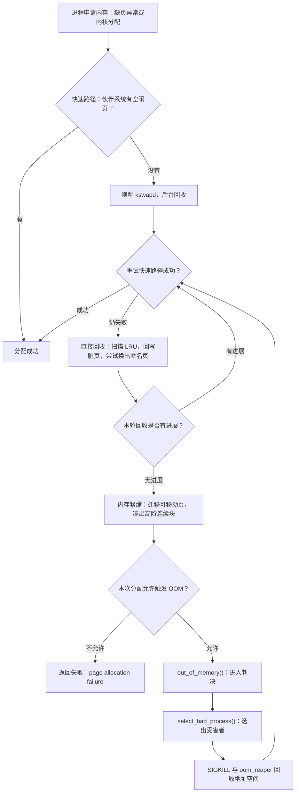
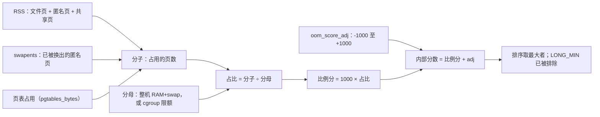
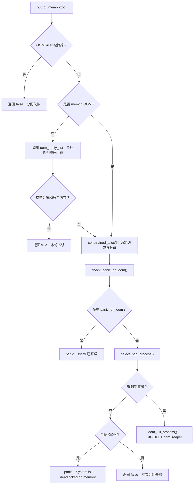
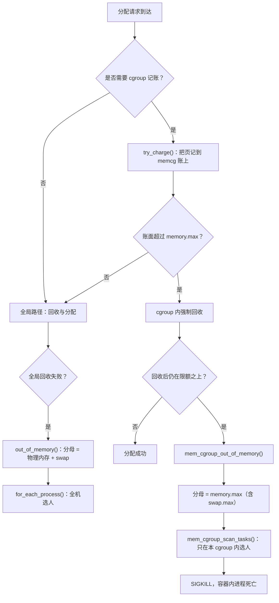
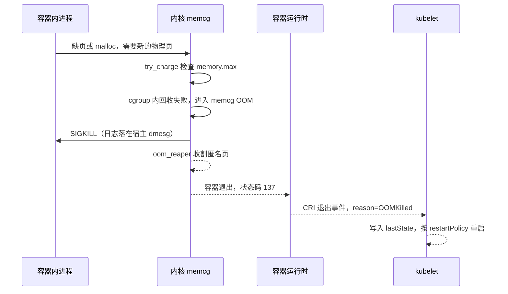

# OOM Killer：内存耗尽时内核如何做出生死抉择

**摘要：**

内存耗尽时，内核要在几十毫秒里决定让哪个进程去死。这个决定既不看谁跑得久，也不看谁优先级低，它只做一件事：把一个可量化的占用比值和一个可配置的偏置相加，然后在整机或者某个 cgroup 的范围内取最大值。本篇把这条链路拆成可验证的几段：`oom_badness()` 的分子是 RSS、swap 中的页与页表，分母在整机内存与 cgroup 限额之间切换，所以同一个进程在全局 OOM 与容器 OOM 里的名次并不相同；`oom_score_adj` 不是权重而是加法偏置，`-1000` 之所以"永不杀"，是因为它在进入比较之前就被排除出候选集，而不是因为它算出了一个极低的分；`/proc/<pid>/oom_score` 的读数还带着 1000 的偏置与 2/3 的缩放，看到 666 与看到 1000 所对应的含义完全不同。文章后半程处理两个高频现场问题：容器 OOM 为什么只杀容器内的进程，以及事故复盘时如何从 `dmesg` 的 `oom-kill:constraint=` 段落、`memory.events` 与退出码 137 里，把"谁吃掉了内存"和"谁被判了死刑"这两件事分开。最后给出四条常见误判与一套"先限制、后评分"的落地顺序。

---

## 第 1 章 判决从哪一刻开始

### 1.1 一次凌晨三点的 OOM

设想一台 64 GiB 物理内存、8 GiB swap 的节点，上面混着三种负载：systemd 托管的 `mysqld`，常驻使用约 12 GiB；Kubernetes 托管的一个 Java 业务 Pod，`limits.memory` 设为 8Gi、`requests.memory` 设为 2Gi；外加一个夜里运行的离线批处理任务，代码里自己往 `/proc/self/oom_score_adj` 写了 200，理由是"可以被牺牲"。凌晨三点，`dmesg` 里出现这样一段：

```text
[58291.412337] java invoked oom-killer: gfp_mask=0x140cca(GFP_HIGHUSER_MOVABLE|__GFP_COMP), order=0, oom_score_adj=0
[58291.412344] CPU: 7 PID: 28672 Comm: java Not tainted 6.6.32 #1
[58291.412350] Call Trace:
[58291.412352]  <TASK>
[58291.412356]  __alloc_pages_slowpath.constprop.0+0x8f1/0x9d0
[58291.412362]  __alloc_pages+0x1f2/0x240
[58291.412368]  handle_mm_fault+0xcb8/0x1220
[58291.412373]  exc_page_fault+0x7b/0x180
[58291.413201] oom-kill:constraint=CONSTRAINT_NONE,nodemask=(null),cpuset=/,mems_allowed=0,global_oom,task_memcg=/kubepods.slice/kubepods-burstable.slice/kubepods-burstable-pod8f1c.slice/cri-containerd-3a9e.scope,task=java,pid=28672,uid=1000
[58291.413210] Out of memory: Killed process 28672 (java) total-vm:25165824kB, anon-rss:18874368kB, file-rss:1048576kB, shmem-rss:0kB, UID:1000 pgtables:49152kB oom_score_adj:0
```

这段日志里藏着两个容易读错的点。第一行说 `java invoked oom-killer`，但主语只是"发起这次内存分配、发现拿不到页的那个进程"，它恰好触发了判决，未必是判决的承受者；本例中它两样都占，是因为它自己确实拿了最多的匿名页。真正的结论在第二行：`constraint=CONSTRAINT_NONE` 与 `global_oom` 说明这是**全局 OOM**，候选集是整机所有进程，分母是 64 GiB 加 8 GiB swap，那个 `limits.memory=8Gi` 的容器限额在这场判决里根本没有参与。

如果把同一个凌晨换成另一种情形：节点整体还剩几 GiB 可用，但 Java 容器自己越过了 8Gi 的 `memory.max`，日志会变成 `constraint=CONSTRAINT_MEMCG` 加 `oom_memcg=/kubepods.slice/...`，分母缩到 8 GiB，候选集缩到那个容器，死者的内存占用会以"占容器限额的比例"重新计分。同一个进程、同一份内存，在两种场景下的分数与名次可以完全不同，这正是本篇要讲透的第一件事。

### 1.2 内核面前的三条路

内存真的不够时，操作系统只有三种选择，而每一种都有人付代价。

第一种是**拒绝分配**，让 `malloc()` 返回 NULL、`mmap()` 返回 `ENOMEM`，把问题交回用户程序。这在语义上最干净，但现实里大多数程序的分配失败处理路径从未被认真测试过，一个没检查返回值的 `malloc` 后面紧跟着解引用，崩溃现场比 OOM 更难查；更麻烦的是内核内部有些分配根本不允许失败，中断上下文、持有自旋锁的路径、部分写回路径都要求"一定要给我页"，这类请求失败只能 panic。

第二种是**挂起等待**，停止新的分配，等某个进程自己退出、把内存还回来。内存回收这件事没有外部救援，等的人本身可能就是需要内存才能推进的人：一个持有关键锁的进程在等页，另一个持页的进程在等这把锁，系统就这么停在原地。挂起看上去温和，实际上是把自己锁死在了一个没有超时的等待里。

第三种是**主动杀死一个**，挑一个牺牲者，回收它的页，让其余进程继续跑。Linux 选的是这条，而且把它做成了一段嵌在分配路径里的代码，而不是一个常驻的守护进程——它没有调度实体，不占内存，只在所有回收手段都失败的那一刻被调用一次。

用一个不太严谨但足够直观的类比：一架超载的飞机必须减重，机长既不能请全体乘客"先在跑道上等一等"，也不能对后来的乘客说"舱门关了"，他只能按一份名册挑人下机。Linux 的名册不是"重要性排序表"，而是一行算术——谁占的页多、谁被谁配置了一个偏置，谁就先下机。

> [!note] 设计哲学
> OOM Killer 反映的是 Linux 的一条基本取向：系统整体的可用性优先于个别进程的生存。这个取向在服务器上通常成立，但它的代价被隐藏得很深——被杀的进程不会知道自己是替别人死的，运维看到的也往往只是一个服务重启的记录。

### 1.3 判决之前的降级阶梯

OOM 从来不是第一响应，它是最后一级台阶。一次页面分配在快速路径上拿不到页之后，会依次经历后台回收、直接回收、内存紧缩，每一级失败才下沉一级。



回收与水位线的细节在 [[05 内存回收：kswapd、LRU与直接回收的博弈|内存回收]] 一篇里展开，这里只关心最后那一步的分叉条件——不是所有失败都会走到杀人。`__GFP_NORETRY` 的分配（部分驱动、高阶大块分配）宁可返回失败也不杀进程；不含 `__GFP_FS` 的分配（文件系统内部路径）即便杀了进程也无法推进回收，内核干脆不试；`vm.oom_kill_allocating_task` 打开时，内核跳过挑选直接杀掉发起分配的当前进程；系统在休眠或内存热插拔流程里会临时把 OOM killer 摘掉。反过来说，用户态缺页异常用的标志是 `GFP_HIGHUSER_MOVABLE`，既允许回收也允许 OOM，所以"进程访问自己已经 `mmap` 过的地址时被杀"是常态——虚拟内存的承诺只保证地址可用，不保证页一定拿得到。

还有一类失败根本不进这道门：阶数大于 3 的连续页分配在没有 `__GFP_RETRY_MAYFAIL` 或 `__GFP_NOFAIL` 时会直接返回 NULL，日志里留下的是 `page allocation failure` 而不是 `Out of memory`。这类故障的根因在碎片，解决手段在紧缩与预留大页，与 OOM 是两条路。

### 1.4 判决书由四段组成

一段完整的 OOM 日志，结构是固定的，读的时候不妨按段拆。

第一段是**触发段**，即 `<comm> invoked oom-killer: gfp_mask=..., order=..., oom_score_adj=...`，它告诉你谁在做这次分配、分配的阶数与标志、以及发起者自己的偏置值。

第二段是**快照段**，包含当时的 `/proc/meminfo` 摘要、`Tasks state (memory values in pages):` 后面的进程表，以及 `oom-kill:constraint=...,oom_memcg=... 或 global_oom,task_memcg=...,task=...,pid=...,uid=...` 这一行。进程表只在 `vm.oom_dump_tasks` 为 1（默认）时打印，全局 OOM 打全机进程，memcg OOM 只打该 cgroup 内的进程。

第三段是**行刑段**，`Out of memory: Killed process ...` 或 `Memory cgroup out of memory: Killed process ...`，后面跟着 `total-vm`、`anon-rss`、`file-rss`、`shmem-rss`、`UID`、`pgtables`、`oom_score_adj` 七个字段。

第四段未必出现但很关键，是 `oom_reaper: reaped process ...` 或 `oom_reaper: unable to reap pid ...`，它说明受害者的地址空间是被异步收割的，还是内核等不到它自己退出。

把这四段读完，才能回答"谁死了、为什么是它、是谁的内存压垮了它"这三个不同的问题。后面所有章节，本质上都是在解释这张名册是怎么算出来的。

---

## 第 2 章 分数的本体：oom_badness() 在算什么

### 2.1 一个比值，加一个偏置

内核给每个候选进程算一个整数分数，比较结果记在 `oom_control.chosen_points` 里，取最大者。这个分数在内核里的原始单位是**页**，代码在算出页数之后再加上一项由 `oom_score_adj` 换算出来的页数，两者相加后一起参与比较。把它换算成人能读的形式，等价于：

```text
内部得分 = 1000 × ( 进程占用的页数 ÷ 分母页数 ) + oom_score_adj
```

分子是进程实际占用的页数，分母是本次 OOM 所面对的"总内存"，乘 1000 是为了把比例换成百分制，最后把偏置直接加上去。把这条式子里的成分画出来，各自的位置就清楚了。



这个式子有两处需要特别留意：偏置是加法而不是乘法，所以 +500 的含义是给它的账面占用额外记上半个分母的"罪名"，而不是"重要性乘 1.5"；内部得分可以为负数，`adj=-500` 的进程只用了 10% 内存时，内部得分是 `100 - 500 = -400`，它依然能被选中，只是排在所有正分进程的后面。

从代码实现看，这个"加法"是被藏起来的：`oom_badness()` 先把 `adj` 乘以 `totalpages / 1000` 变成页数，再加到页数形式的 `points` 上。数学上完全等价，但它提醒了一件事——偏置与内存占用共用同一个量纲，一分偏置就是分母的千分之一。

```c
/* mm/oom_kill.c，kernel 6.6，节选：oom_badness() */
long oom_badness(struct task_struct *p, unsigned long totalpages)
{
	long points;
	long adj;

	if (oom_unkillable_task(p))
		return LONG_MIN;

	p = find_lock_task_mm(p);
	if (!p)
		return LONG_MIN;

	adj = (long)p->signal->oom_score_adj;
	if (adj == OOM_SCORE_ADJ_MIN ||
			test_bit(MMF_OOM_SKIP, &p->mm->flags) ||
			in_vfork(p)) {
		task_unlock(p);
		return LONG_MIN;     /* 不是"分很高"，而是"根本不参与比较" */
	}

	/* 分子：RSS + swap 中的页 + 页表页 */
	points = get_mm_rss(p->mm) + get_mm_counter(p->mm, MM_SWAPENTS) +
		mm_pgtables_bytes(p->mm) / PAGE_SIZE;
	task_unlock(p);

	/* 把偏置换算成页数再加进去，归一化到同一个量纲 */
	adj *= totalpages / 1000;
	points += adj;

	return points;
}
```

`LONG_MIN` 这个返回值是理解 `-1000` 的关键：`-1000` 不是让分数变得极低，而是让这个任务在 `oom_evaluate_task()` 里被直接跳过；内核从头到尾没有为它算过分。两者的差别在极端情况下会显形——如果所有候选都返回 `LONG_MIN`，内核面对的不是"分数接近的候选集"，而是**空集**，后续处理完全走另一条分支。

### 2.2 分子：三种占用

分子的三项各有各的道理，也各有各的偏差。

**RSS** 是驻留集大小，取的是 `get_mm_rss()` 的返回值，它等于文件页、匿名页与共享内存页三者之和。把共享内存页（`MM_SHMEMPAGES`，譬如 tmpfs 与 `shmget` 的页）算进来是对的，因为 tmpfs 的页确实占着物理内存且无法回写到磁盘后端；但这也带来一个记账偏差：同一块 tmpfs 页被三个进程映射时，三个进程的 RSS 都会加上它，分子被重复计了三次，而回收时这块内存只会被释放一次。数据库的共享缓冲区、用 `/dev/shm` 做进程间队列的服务，都可能因此被算成"大胃王"。

**swap 中的页**（`MM_SWAPENTS`）被计入分子，理由是把内存换出去不等于不再占用资源——它占着 swap 空间，而 swap 空间也是这次 OOM 的分母的一部分（全局场景下 `totalpages` 含全部 swap）。这一项在 swap 用得多的机器上不可忽略：一个匿名页几乎全被换出的进程，RSS 很小，但 swapents 可以很大，它照样会被算成内存大户。

**页表**（`mm_pgtables_bytes / PAGE_SIZE`）被计入是一个相对晚近的改动。页表本身也是物理内存，一个使用大量分散匿名映射的进程，页表开销可以到几十 MiB；数据库或 JVM 这类"大堆加多线程"的进程，页表页数在千到万这个量级。把页表算进分子，意味着"靠大量小映射堆出来的虚拟占用"无法在账面上隐身。

| 分子成分 | 内核取值 | 计入的理由 | 已知偏差 |
|---|---|---|---|
| 匿名页 | `MM_ANONPAGES` | 堆与栈，无磁盘后端，最不可回收 | 含被 `mlock` 的部分，回收时其实动不了 |
| 文件页 | `MM_FILEPAGES` | 映射的文件页仍占物理内存 | 干净页可丢弃，账面占用偏高 |
| 共享内存页 | `MM_SHMEMPAGES` | tmpfs 页无处可回写 | 多进程映射同一页时重复记账 |
| swap 中的页 | `MM_SWAPENTS` | 换出不等于不占资源 | 已换出的页其实不占物理内存 |
| 页表 | `mm_pgtables_bytes` | 页表本身是物理内存 | 随映射数量增长，与 RSS 不成线性 |

反过来，虚拟内存大小（`total_vm`，也就是 `ps` 里的 VSZ）完全不在公式里。JVM 预留了 24 GiB 虚拟堆但只触碰了 18 GiB 时，账上只算 18 GiB；`mmap` 一块 `MAP_NORESERVE` 的大区域而从未写入，成本接近零。以 VSZ 排嫌疑犯是事后分析里最常见的错误之一。

### 2.3 分母：随场景切换的"总量"

公式里真正决定量级的是分母，而分母由本次 OOM 的约束类型决定。全局 OOM 时，`constrained_alloc()` 把 `totalpages` 设为 `totalram_pages() + total_swap_pages`，即物理内存加全部 swap；memcg OOM 时，它把 `totalpages` 设为 `mem_cgroup_get_max(memcg)`，也就是该 cgroup 的 `memory.max`，在 `memory.swappiness` 不为 0 时再加上 `memory.swap.max`（且不超过整机 swap）。cpuset 与 mempolicy 造成的 OOM 则把分母缩到对应节点的内存子集。

```c
/* mm/oom_kill.c，kernel 6.6，节选：constrained_alloc() */
if (is_memcg_oom(oc)) {
	oc->totalpages = mem_cgroup_get_max(oc->memcg) ?: 1;
	return CONSTRAINT_MEMCG;
}

/* 默认：整机可分配资源 */
oc->totalpages = totalram_pages() + total_swap_pages;
```

分母切换带来的后果值得用数字过一遍。一个占用 2 GiB 匿名页的进程，在 72 GiB 的全局分母下只拿到 2.8% 的比例分（约 28 分）；如果它跑在 `memory.max=8Gi` 的容器里并触发 memcg OOM，同样的 2 GiB 变成 25% 的比例分（约 250 分）。名次因此可能翻转：全局 OOM 里它是个小角色，容器 OOM 里它是最显眼的那个。

| 触发场景 | 分母 | 候选集 | 日志标志 |
|---|---|---|---|
| 整机内存耗尽 | 物理内存 + 全部 swap | 全机进程 | `constraint=CONSTRAINT_NONE`、`global_oom` |
| cgroup 限额耗尽 | `memory.max`（含 `swap.max`） | 该 cgroup 内进程 | `constraint=CONSTRAINT_MEMCG`、`oom_memcg=...` |
| cpuset 内存耗尽 | 该 cpuset 允许的节点内存 | 该 cpuset 内进程 | `constraint=CONSTRAINT_CPUSET` |
| mempolicy 节点耗尽 | mempolicy 指定的节点内存 | 满足该策略的进程 | `constraint=CONSTRAINT_MEMORY_POLICY` |

### 2.4 选择循环里的两个细节

候选的遍历本身很朴素，但有两处实现细节会改变结果。

第一处是**平局的处理**。循环条件是 `points < oc->chosen_points` 才跳过，也就是等号进入选择分支。进程表的遍历顺序是进程链表的顺序，于是分数相同时，链表中靠后的进程胜出。这个规则没有文档化，也不该被依赖，但在"两个几乎同分的进程"的复盘现场，它确实解释了为什么死的是 B 而不是 A。

第二处是**已有受害者时的中止**。如果遍历中发现某个任务已经是 OOM victim 且尚未被 `MMF_OOM_SKIP` 标记，循环直接中止，本次不再另选他人——内核有意避免"同一轮 OOM 连杀多人"，把希望押在第一个受害者尽快退出上。

```c
/* mm/oom_kill.c，kernel 6.6，节选：oom_evaluate_task() */
if (!is_sysrq_oom(oc) && tsk_is_oom_victim(task)) {
	if (test_bit(MMF_OOM_SKIP, &task->signal->oom_mm->flags))
		goto next;
	goto abort;          /* 已经有人在死，别再添一个 */
}

points = oom_badness(task, oc->totalpages);
if (points == LONG_MIN || points < oc->chosen_points)
	goto next;           /* 相等时进入下面的 select，后遍历者胜出 */
```

### 2.5 /proc/pid/oom_score 的读数不是内部分数

`/proc/<pid>/oom_score` 是最常被误读的一个文件。它读起来像是"这个进程的危险程度，0 到 1000"，实际导出的是经过平移与缩放后的值，`fs/proc/base.c` 里的算法是：

```c
/* fs/proc/base.c，kernel 6.6，节选：proc_oom_score() */
badness = oom_badness(task, totalpages);
/*
 * OOM_SCORE_ADJ_MIN 单独处理；其余情形把 badness 缩放到
 * [0, 2000] 区间，这个区间已经导出很久，不能被用户态随意改坏。
 */
if (badness != LONG_MIN)
	points = (1000 + badness * 1000 / (long)totalpages) * 2 / 3;
```

代入公式就能得到读数的真实含义。一个几乎不占内存、`oom_score_adj` 为 0 的进程，内部得分约为 0，读数是 `(1000 + 0) × 2 / 3 ≈ 666`；一个吃了半台机器内存、adj 为 0 的进程，读数是 `(1000 + 500) × 2 / 3 = 1000`；一个 adj 为 +1000 且几乎不占内存的进程，读数是 1333。也就是说：

- **666** 是"adj=0 且几乎不占内存"的基线，不代表它危险；
- **1000** 是"占了一半分母"的标记，与百分制里的 50% 不是一回事；
- **0** 通常意味着这个进程被 `LONG_MIN` 排除了（adj 为 -1000、PID 1、内核线程、正在 OOM 流程里），而不是"它的风险最低但仍有资格"；
- 读数永远不会为负，因为公式先加了 1000 的平移；内部分数为负的进程，读数落在 0 到 666 之间，看起来仍在"中游"。

| 进程情形 | 内部分数（等价形式） | `/proc/pid/oom_score` 读数 | 是否会进入候选集 |
|---|---|---|---|
| adj=0，几乎不占内存 | 0 | 666 | 会 |
| adj=0，占分母 50% | 500 | 1000 | 会 |
| adj=-300，占分母 10% | -200 | 533 | 会，排名靠后 |
| adj=+500，占分母 10% | 600 | 1066 | 会，排名靠前 |
| adj=-1000，任意占用 | `LONG_MIN` | 0 | 不会，直接被排除 |

这组数字还解释了一个现场常见的困惑：为什么"内存最大的进程"读数是 1000，"内存很小但被设了 +1000 的进程"读数能到 1333——后者在排序上确实更难被选中，因为比较时用的是内部分数，偏置与占用是同量纲相加的。

---

## 第 3 章 oom_score_adj：一个被误读的旋钮

### 3.1 文档说的是加法

内核文档对它的描述没有含糊之处：`/proc/<pid>/oom_score_adj` 的取值会被**加到 badness 分数上**，再用于决定杀谁；取值从 -1000 到 +1000，用来把偏好极化到"永远优先杀它"与"完全不当候选"两端。文档同时给了换算的直觉：设 +500 大致相当于允许同一资源范围内的其他进程多用 50% 的内存，设 -500 大致相当于把它自身的一半额度从账目上扣掉。

这段话常被转述成"权重"，但权重意味着乘性关系，会与"加法"产生实质差异。举一组能算出差异的数字：在 72 GiB 分母的节点上，进程 A 占 10%、adj 为 0，内部分数 100；进程 B 占 60%、adj 为 -500，内部分数 `600 - 500 = 100`。两者平局，胜负交给遍历顺序。如果换成乘法，B 的分数会是 `600 × 0.5 = 300`，远高于 A，结论就反过来了。真实内核里，-500 买到的不是"重要性减半"，而是"可以比别人多吃一半内存还不被判死"。

### 3.2 换算成内存额度

既然一分偏置等于分母的千分之一，不妨把它换成内存绝对量。这一步在工程上很有用，因为"我的 Pod 设了 -500"这种描述离开分母就没有信息量。

| 场景 | 分母 | 1 分偏置 | 100 分偏置 | -500 买到的额度 |
|---|---|---|---|---|
| 64 GiB + 8 GiB swap 的节点 | 72 GiB | 约 73.7 MiB | 约 7.2 GiB | 约 36 GiB |
| `memory.max=8Gi` 的容器 | 8 GiB | 约 8.2 MiB | 约 0.8 GiB | 约 4 GiB |
| `memory.max=512Mi` 的边车容器 | 512 MiB | 约 524 KiB | 约 51.2 MiB | 约 256 MiB |

以上数字按分母除以 1000 折算，属于示例推算，随实际 swap 配置与 `memory.swap.max` 变动。它们说明一件容易被忽略的事：同一份 `oom_score_adj` 配置，在整机与容器里代表的内存额度差了两个数量级。把线上节点验证过的 `-800` 直接抄进 512 MiB 的边车容器，它换来的保护只有 410 MiB 左右，聊胜于无。

也要注意偏置与真实占用的叠加方式。adj 为 -500 不是"内存占用打五折"，而是"先把占比算出来，再减 500 分"；一个占 40% 内存、adj 为 -500 的进程，内部分数是 -100，仍然是负分，但它离"被排除"还很远，只要同机其他进程的分数也不高，它一样会被选中。

### 3.3 -1000 的真实机制

把 `-1000` 理解成"豁免"是对的，但机制不是"分数极低"，而是"不进候选集"。`oom_badness()` 在读到 `adj == OOM_SCORE_ADJ_MIN` 时直接返回 `LONG_MIN`，`oom_evaluate_task()` 见到 `LONG_MIN` 就跳过；`/proc/<pid>/oom_score` 见到 `LONG_MIN` 就打印 0。三个函数在同一条规则上保持一致，只是表现不同。

写这个值有权限门槛。`__set_oom_adj()` 只检查一件事：新值是否低于该进程记录的 `oom_score_adj_min`，低于则要求 `CAP_SYS_RESOURCE`。这个下限由上一次带 `CAP_SYS_RESOURCE` 的写入决定，所以普通进程可以给自己"提分"（更容易被杀），也可以把分数调回自己的下限，但无法把下限再往下推。容器里的 root 能否写 -1000，取决于容器是否被授予该能力，这也是为什么有些容器里改 adj 会报 `Permission denied`。

还有一个常被引用的说法需要纠正：PID 1 之所以杀不掉，不是因为它被设了 -1000，而是因为 `oom_unkillable_task()` 里 `is_global_init(p)` 直接把它排除了，与 adj 无关；内核线程同理，靠的是 `PF_KTHREAD`。反过来看，即便你给某个普通进程写了 -1000，那也只是把它从"这次 OOM 的候选集"里删掉，它的 page cache 该回收还是会被回收，`-1000` 从不影响回收决策。

### 3.4 继承、传播与设置渠道

`oom_score_adj` 存在 `signal_struct` 上，属于线程组级别，`fork` 与 `exec` 都会保留，所以设置它的位置有讲究：必须在目标进程 `exec` 之前设置，服务自己启动时写 `/proc/self/oom_score_adj` 是有效的，因为随后 `exec` 会保留这个值；但如果一个 shell 脚本设置了它，又通过 `fork` 拉起一堆子进程，这堆子进程会全部继承，包括那些根本不需要保护的辅助进程。同一个 `mm` 被多个线程组共享时，写入会同步到其他共享者，这也是"我没改过它，它的值却变了"的来由。

生产上有三个设置渠道，越靠近进程启动的那一个越有最终决定权：

- **systemd 单元**的 `OOMScoreAdjust=`，在 `exec` 之前由 systemd 写入，重启后依旧生效；
- **容器运行时**按编排层给出的值写入，Kubernetes 的路径是 kubelet 计算、通过 OCI 运行时配置传给 runc，再由容器 init 进程与它的后代继承；
- **进程自己**在初始化阶段写 `/proc/self/oom_score_adj`，适合没有声明式配置的裸进程。

```bash
# 查看与临时调整（重启失效）
cat /proc/$(pgrep -x mysqld)/oom_score_adj
echo -800 > /proc/$(pgrep -x mysqld)/oom_score_adj

# systemd：持久生效，且写在 exec 之前
systemctl edit mysqld.service
# [Service]
# OOMScoreAdjust=-800

# 看容器 init 进程的偏置：进入容器 PID 命名空间后读 /proc/1
kubectl exec -it java-0 -- cat /proc/1/oom_score_adj
```

> [!warning] 生产避坑
> 把 `OOMScoreAdjust=-1000` 写给一个会派生大量子进程的服务，等价于给整棵进程树发免死金牌。当这台机器的内存真的不够时，内核会跳过整棵树，转头去杀别的服务，或者干脆杀不到人。豁免是一种稀缺资源，给的粒度应该与"你能承受它把系统拖到什么程度"挂钩。

### 3.5 关于 CAP_SYS_ADMIN 的旧账

很多资料里还留着一条规则：拥有 `CAP_SYS_ADMIN`（大体上就是 root）的进程在算分时有折扣，因此"root 的进程更安全"。这条规则的历史比 `oom_score_adj` 还长：2.6.x 时代它的形式是 `points /= 4`，等于给 root 类进程打七五折；2.6.36（2010）引入 `oom_score_adj` 并把 badness 归一化到百分制时，它被改写为 `points -= 30`，也就是减 3 分；到 v3.4（2012）被提交 `d46078b28889` 删除，理由是"用能力表达内存重要性"是一种误导，`oom_score_adj` 已经能更精确地表达同样的意图。同一时期被删掉的还有"优先杀受害者子进程"的偏好（提交 `bbbe48029720`），于是"OOM 会先杀子进程"这类说法也过期了。

在 6.x 上，结论很简单：没有任何基于身份或能力的自动保护。root 与否、`CAP_SYS_ADMIN` 与否，在 `oom_badness()` 里都是同一个待遇，差别只来自内存占用与 adj。想保护谁，只能用 adj 或者挪到更小的 cgroup 里去。

---

## 第 4 章 全局 OOM：从 out_of_memory() 到 select_bad_process()

### 4.1 决策主干

全局 OOM 的入口是 `out_of_memory()`，决策顺序固定：先看 OOM killer 是否被临时摘掉，再看是不是 memcg 触发（不是才去调用 `oom_notify_list` 上的通知链，给各子系统最后一次主动释放内存的机会），然后看当前进程自己是不是已经在死、`gfp_mask` 是否缺 `__GFP_FS`，接着确定约束类型与分母，检查 `panic_on_oom`，最后进入 `select_bad_process()` 选人。



这条链上有两个分支值得单独说：为什么会有"通知链"这一步，以及为什么全局 OOM 找不到人时必须 panic。前者是因为内核里存在一些"被通知就能释放大量可回收内存"的子系统（譬如部分缓存与驱动缓存），给它们一次机会比杀进程便宜；后者是因为分配器已经没有任何退路，返回失败会让调用者在"必须拿到页"的语义下原地打转，panic 反而是唯一有界的出路。

### 4.2 候选集怎么筛

`oom_evaluate_task()` 在进入 `oom_badness()` 之前有几道筛子，每一道都能让一个进程免于比较：

| 筛选条件 | 内核判据 | 典型对象 | 备注 |
|---|---|---|---|
| 全局 init | `is_global_init()` | PID 1 | 与 adj 无关，直接排除 |
| 内核线程 | `PF_KTHREAD` | kworker、kswapd | 没有用户地址空间，杀不掉 |
| 不在 cpuset 允许节点 | `oom_cpuset_eligible()` | 被绑到其他 NUMA 节点的进程 | 只在全局 OOM 判 |
| 已在 OOM 流程 | `MMF_OOM_SKIP`、`oom_mm` | 上一轮的受害者 | 避免重复计分 |
| vfork 进行中 | `in_vfork()` | 正在 `vfork` 的父进程 | 地址空间临时共享，结果不可信 |
| 显式豁免 | `oom_score_adj == -1000` | 手工保护的进程 | 返回 `LONG_MIN` |
| 已在死 | 受害者尚未退出 | 上一轮被判死的进程 | 直接中止本轮选择 |

这张表解释了为什么容器里那些被设成 `-1000` 的守护进程在宿主全局 OOM 时反而容易活下来：它们连候选集都进不去，内核只能转头去杀别人。豁免的代价从来不会消失，它只是被转移给了同机的其他进程。

### 4.3 击杀动作与 oom_reaper

选定之后，`oom_kill_process()` 做的事情比"发个信号"多。它先调用 `do_send_sig_info(SIGKILL, SEND_SIG_PRIV, victim, PIDTYPE_TGID)`，把信号发给整个线程组；再 `mark_oom_victim()` 给受害者打上 `TIF_MEMDIE` 标记，并让它获得一份内存保留额度，保证它在退出过程中申请内存不再被卡住；然后打印行刑日志，并杀掉同一 `mm` 的其他线程组（避免 `mmap_lock` 活锁）。

`TIF_MEMDIE` 只解决"能退出"，不解决"退出得慢"。用户态进程可能在不可中断睡眠里等 IO，也可能在拿锁时卡住，等它自己释放内存会把整机拖进长时间的无进展状态。为此内核从 4.7 起引入**oom_reaper**：被判死的进程会被排进收割队列，由一个内核线程异步遍历并释放它的匿名页，日志里表现为 `oom_reaper: reaped process 28672 (java), now anon-rss:...`；如果受害者地址空间无法被安全收割（譬如正在被 GUP 引用），日志会留下 `oom_reaper: unable to reap pid:...`，这时才真的只能干等。

```text
[58291.413210] Out of memory: Killed process 28672 (java) total-vm:25165824kB, anon-rss:18874368kB, file-rss:1048576kB, shmem-rss:0kB, UID:1000 pgtables:49152kB oom_score_adj:0
[58291.413890] oom_reaper: reaped process 28672 (java), now anon-rss:18432kB, file-rss:1048576kB, shmem-rss:0kB
```

行刑行里的字段值得逐个对照：`total-vm` 是虚拟内存，只作参考；`anon-rss` 是堆栈与匿名映射的驻留量，通常是大头；`file-rss` 是映射文件的驻留量，杀了它腾不出多少，因为这些页多半干净可丢弃；`shmem-rss` 是 tmpfs 类的共享内存；`pgtables` 是页表本身的开销；`oom_score_adj` 是被杀那一刻的偏置值。把 `anon-rss` 与 `total-vm` 放在一起看，就能大致判断这是"分配了但没怎么用"还是"真的把内存吃进去了"。

### 4.4 panic_on_oom 的三个取值

`vm.panic_on_oom` 是现场最容易被配错的一个开关，因为它的文档语义与直觉相反。

取 0（默认）时，内核正常挑选受害者并杀之。取 2 时，内核在打印日志后直接 `panic`，把选择权交给重启策略。取 1 时，情况复杂一些：它**只对 `CONSTRAINT_NONE` 生效**，也就是只有"整机内存耗尽"这种 OOM 才会 panic；由 cpuset、mempolicy 或 memcg 限额造成的 OOM，即便把值设为 1，内核也不会 panic，只会继续杀进程。

```c
/* mm/oom_kill.c，kernel 6.6，节选：check_panic_on_oom() */
if (likely(!sysctl_panic_on_oom))
	return;
if (sysctl_panic_on_oom != 2) {
	/*
	 * 值为 1 时只影响 CONSTRAINT_NONE：cpuset、mempolicy 与 memcg
	 * 造成的分配失败不 panic。
	 */
	if (oc->constraint != CONSTRAINT_NONE)
		return;
}
if (is_sysrq_oom(oc))     /* 手工触发的演练不 panic */
	return;
dump_header(oc, NULL);
panic("Out of memory: %s panic_on_oom is enabled\n",
      sysctl_panic_on_oom == 2 ? "compulsory" : "system-wide");
```

这条规则直接推翻了一个流传很广的配法：在容器宿主机上设 `panic_on_oom=1`，指望"容器内存超限就把节点重启"。真实行为是容器 OOM 走 `CONSTRAINT_MEMCG`，内核不 panic，照杀进程；只有当整机内存被吃穿时才 panic。想强制一切 OOM 都重启节点，只能配 2，而 2 的代价是任何一个容器的限额越界都能把整台机器带走。

| 取值 | 整机 OOM（CONSTRAINT_NONE） | cgroup/cpuset/mempolicy OOM | 适用场景 | 代价 |
|---|---|---|---|---|
| 0 | 杀进程 | 杀进程 | 绝大多数场景 | 带病运行，状态可能已不一致 |
| 1 | panic | 杀进程 | 单机数据库等"整机不可恢复"场景 | 容器的 OOM 仍然只杀进程，容易产生误解 |
| 2 | panic | panic | 无状态节点 + 自动重启 | 任何容器越界都可能重启整节点 |

---

## 第 5 章 cgroup OOM：容器为什么死在限额上

### 5.1 分叉点在记账

容器场景的 OOM 与整机场景共享同一套选人算法，分叉发生在更前面：内存记账。cgroup v2 里，一次匿名页分配在拿到页之后要调用 `try_charge()` 记到所属 memcg 的账上；账面超过 `memory.max` 时，内核先在该 cgroup 范围内强制回收（只回收这个 cgroup 的页），回收后仍然超限，才调用 `mem_cgroup_out_of_memory()`。



这条路径有个容易被忽略的性质：它从不会因为"宿主还有空闲内存"而放弃。记账是按 cgroup 记的，限额是相对这个 cgroup 的局部边界，哪怕整机还剩 40 GiB 空闲，一个 `memory.max=2Gi` 的容器把 2 GiB 吃满之后一样会触发 memcg OOM。反过来说，这也是容器里"被杀"与"节点内存告警"经常对不上的原因——两个指标度量的是两件事。

cgroup 的记账、层级与 `memory.stat` 细节在 [[09 CGroups 内存子系统：容器内存隔离的底层实现|cgroup 内存子系统]] 一篇里展开，这里只保留与判死相关的部分。

### 5.2 分母换成限额之后

memcg OOM 的分母来自 `mem_cgroup_get_max()`，其实现是 `memory.max` 加上 swap 额度，且只在 `memory.swappiness` 不为 0 时才计入 swap；v1 的对应物是 `memory.memsw.limit_in_bytes`，语义相近但接口不同。这个细节会影响名次：一个 swap 用量很大的容器，如果 swappiness 为 0，分母只算 `memory.max`，而它的 swapents 仍按页计入分子，比例被抬高，更容易成为首选；反过来，swappiness 大于 0 时 `memory.swap.max` 会计入分母，账面上的"额度"变大，同样的占用反而不那么刺眼。

把限额与真实需求对一次账，更能看清这套账本的脾气。一个 JVM 容器，堆 4 GiB、元空间 512 MiB、直接内存与 JIT 代码缓存合计约 700 MiB、两百个线程的栈约 200 MiB，再算上映射的 jar 与日志文件页，实际 RSS 常在 6 GiB 上下；给它 `requests=2Gi`、`limits=8Gi`，账面看起来还有 2 GiB 余量，但 page cache 与匿名页记在同一本账上，容器只要在做批量文件读写，cache 就能把账面顶到 7.8 GiB。此时触发 memcg OOM 被杀的是 RSS 最大的那个进程，而不是"正在写文件"的那段逻辑，归因时把"账本余额"当成"进程占用"就会找错对象。以上数字为示例推算，真实取值取决于堆外内存与缓存策略。

限额还有一个边界：`memory.max` 写成字符串 `max` 表示无限制，此时 `totalpages` 取的是一个极大的哨兵值，比例分被压到接近 0，排序几乎完全由 adj 决定。这种配置下 memcg OOM 本来就不该触发（没有限额就不会越限），但如果因为 swap 记账或层级继承把进程放进了错误的 cgroup，就会出现"分母形同虚设、adj 一人决定生死"的怪现象。

### 5.3 候选集只在 cgroup 内

两个入口的候选集来源不同，这是"容器 OOM 不杀宿主进程"的全部机制所在：全局 OOM 用 `for_each_process()` 遍历全机进程，memcg OOM 用 `mem_cgroup_scan_tasks(oc->memcg, oom_evaluate_task, oc)` 只遍历该 cgroup 的进程。内核没有做任何"跨 cgroup 借刀"的动作，被杀的一定在这个 cgroup 里。

| 维度 | 全局 OOM | memcg OOM |
|---|---|---|
| 入口 | 分配器慢速路径 → `out_of_memory()` | `try_charge()` → `mem_cgroup_out_of_memory()` |
| 分母 | 物理内存 + 全部 swap | `memory.max`，视 swappiness 加 `swap.max` |
| 候选集 | 全机进程 | 该 cgroup 内进程 |
| 触发条件 | 整机回收失败 | 本 cgroup 超限且回收失败 |
| 日志前缀 | `Out of memory:` | `Memory cgroup out of memory:` |
| 约束字段 | `constraint=CONSTRAINT_NONE` | `constraint=CONSTRAINT_MEMCG` |
| 无人生还时 | 全局 panic | 返回 false，分配失败 |
| 宿主内存占用 | 必须真的紧张 | 可以很空闲 |

同一张表还回答了"容器 OOM 被杀，宿主的告警为什么没响"：两者的触发条件根本不同，一个看整机水位，一个看账本余额。把它当成同一件事来监控，必然漏报。

### 5.4 v1 与 v2 的差异

两个版本的 memcg OOM 在"能不能不杀"这一点上分道扬镳。

cgroup v1 提供 `memory.oom_control`，把 `oom_kill_disable` 写成 1 之后，memcg 超限不再触发 OOM killer，而是让缺页的进程在缺页处理结束时睡在 memcg 的等待队列上，等人从外部把内存腾出来；配合 `cgroup.event_control` 的 eventfd，还能让用户态程序收到 `under_oom` 通知。问题在于这个等待没有超时：只要没人腾出内存，进程就一直停在缺页路径上，既不返回也不退出（`TASK_KILLABLE` 允许致命信号唤醒它，所以 `kill -9` 仍然有效，但它自己不会主动走），而它当时若握着锁，整个服务就跟着无响应。Docker 的 `--oom-kill-disable` 就是这条路径。

cgroup v2 删掉了这个开关。新体系里"不想被杀"只能靠两件事：用 `memory.high` 做软上限，超限时只触发回收与节流，不做 kill；或者引入用户态的监管者，把它作为"外部 OOM 处理者"。2020 年前后，Fedora 33 等发行版开始默认启用 systemd-oomd，就是这么做的：它按 cgroup 的 PSI 压力指标判断，在内存真正打满之前就杀掉整个 unit 或者某个 cgroup，属于用户态 OOM，而不是内核 OOM，日志在 journald 而不是 dmesg 里。

读 cgroup 事件时要注意层级差。`memory.events` 是**含后代**的累计计数，`memory.events.local` 只统计本层；在一个 Pod 级 cgroup 上读 `memory.events` 的 `oom_kill`，看到的是它所有容器之和；在容器级 cgroup 上读，才是这个容器自己的账。

```bash
# cgroup v2：容器/Pod 的 OOM 事件（6.x 的接口名）
cat /sys/fs/cgroup/kubepods.slice/kubepods-burstable.slice/.../memory.events
# low 0
# high 0
# max 1234
# oom 3
# oom_kill 3
# oom_group_kill 0

# 只看本层，不含子 cgroup
cat /sys/fs/cgroup/.../memory.events.local

# 容器退出后容器级 cgroup 会消失，Pod 级 cgroup 仍在
ls /sys/fs/cgroup/kubepods.slice/kubepods-burstable.slice/.../
```

### 5.5 memory.oom.group：整组一起死

默认行为是"杀一个"，这在单进程容器里没问题，在多进程协作的容器里可能更糟：主进程被杀，留下的工作进程还在写半成品，重启后要做一次艰难的状态修复。cgroup v2 因此提供了 `memory.oom.group`，把它设为 1 之后，内核在杀掉受害者的同时会把这个 cgroup 里的所有任务一起杀掉。

实现上有一个容易误判的细节：真正被整组杀掉的 cgroup 不一定是受害者所在的那一层。`mem_cgroup_get_oom_group()` 从受害者的 cgroup 向上走到本次 OOM 的域（memcg OOM 是这个 cgroup，全局 OOM 是 root），记录沿途最后一个设了 `oom_group=1` 的 cgroup，也就是"最高一层"的那个；随后 `oom_kill_process()` 对这整个组调用 `mem_cgroup_scan_tasks(..., oom_kill_memcg_member, ...)`，并打印 `Tasks in ... are going to be killed due to memory.oom.group set`。这个"向上找"的设计让 Pod 级配置可以覆盖容器级行为，也让"我在容器里设了 `oom.group=1`，为什么整台机器的一组进程都被杀了"这类现场有了答案。

```bash
# 在 Pod 级 cgroup 上设置：整组退出，避免留下半成品
echo 1 > /sys/fs/cgroup/kubepods.slice/.../memory.oom.group
cat /sys/fs/cgroup/kubepods.slice/.../memory.oom.group

# 事后从事件里确认确实发生了组杀
grep oom_group_kill /sys/fs/cgroup/kubepods.slice/.../memory.events
```

还要知道它在 v1 下不存在：`mem_cgroup_get_oom_group()` 的第一句就是"非 v2 直接返回 NULL"，所以老内核上讨论组杀没有意义。迁移到 v2 之后，这项配置才真正可用。

### 5.6 Kubernetes 算出的偏置是谁的偏置

kubelet 会根据 Pod 的 QoS 类别给容器算一个 `oom_score_adj`，算法写在 `pkg/kubelet/qos/policy.go` 里：Guaranteed 与"节点关键 Pod"取 -997，BestEffort 取 1000，Burstable 取 `1000 - 1000 × requests.memory / nodeCapacity`，并把下限压在 3（保证仍可被杀）、把恰好等于 1000 的值减 1（避免与 BestEffort 同分）。kubelet 自身与 kube-proxy 取 -999。

这里有两个必须纠正的常见理解。第一，Burstable 的公式用的是 **requests** 而不是 limits，语义是"申请得越少，在节点级 OOM 里越先死"，与"限额设得越小越容易被杀"不是一回事。第二，这套偏置只影响**节点级（全局）OOM 的排序**；容器自己越过 `memory.max` 触发的 memcg OOM 只在这个容器内选人，Guaranteed 的 -997 完全帮不上忙——这就是为什么一个 `requests=limits` 的 Guaranteed Pod 照样会 `OOMKilled`。

| QoS 类别 | kubelet 写入的 adj | 节点级 OOM 中的位置 | 容器内 memcg OOM 中的位置 |
|---|---|---|---|
| Guaranteed、节点关键 Pod | -997 | 最后才被考虑 | 与 adj 无关，只看容器内占比 |
| Burstable（requests 小） | 接近 1000 | 靠前 | 同上 |
| Burstable（requests 接近容量） | 接近 3 | 靠后 | 同上 |
| BestEffort | 1000 | 最先被考虑 | 同上 |

### 5.7 cgroup 内无人可杀会怎样

设想一个容器，里面所有进程都被设了 `-1000`，然后它把 `memory.max` 吃穿。内核在这个 cgroup 内遍历候选，全部返回 `LONG_MIN`，`oc->chosen` 为空；由于是 memcg OOM，`out_of_memory()` 不会 panic（那条 panic 只对全局 OOM 生效），只返回 false，`try_charge()` 于是返回 `-ENOMEM`，缺页处理以 `VM_FAULT_OOM` 收场。6.x 的缺页兜底不再尝试全局 OOM，它只是重试，日志里留下这么一行：

```text
[58295.117002] Huh VM_FAULT_OOM leaked out to the #PF handler. Retrying PF
```

结果是进程在缺页与重试之间反复，CPU 被烧掉，服务既不退出也不可用——比被杀更糟。这个反例说明 `-1000` 不是"关闭 OOM"的开关，它只是把"死一个进程"换成了"整组进程卡住"。真正想控制容器内的死亡时机，应当用 `memory.high` 提前节流、用 `memory.oom.group` 保证整组退出、或者把限额调到与业务匹配的水位。

---

## 第 6 章 事后取证：从 dmesg 到 memory.events

### 6.1 日志逐行读

第一步永远是确定"这是哪种 OOM"，判据只有两个字段：`constraint=` 与 `oom_memcg=`/`global_oom`。前者给出约束类型，后者给出 OOM 发生的 cgroup 路径。

```text
# 类型一：全局 OOM
oom-kill:constraint=CONSTRAINT_NONE,nodemask=(null),cpuset=/,mems_allowed=0,global_oom,task_memcg=/system.slice/mysqld.service,task=java,pid=28672,uid=1000
Out of memory: Killed process 28672 (java) total-vm:25165824kB, anon-rss:18874368kB, file-rss:1048576kB, shmem-rss:0kB, UID:1000 pgtables:49152kB oom_score_adj:0

# 类型二：memcg OOM（容器）
oom-kill:constraint=CONSTRAINT_MEMCG,nodemask=(null),cpuset=/,mems_allowed=0,oom_memcg=/kubepods.slice/kubepods-burstable.slice/kubepods-burstable-pod8f1c.slice/cri-containerd-3a9e.scope,task_memcg=/kubepods.slice/.../cri-containerd-3a9e.scope,task=java,pid=45678,uid=0
Memory cgroup out of memory: Killed process 45678 (java) total-vm:8388608kB, anon-rss:7864320kB, file-rss:524288kB, shmem-rss:0kB, UID:0 pgtables:16384kB oom_score_adj:-997
```

第二步读进程表。表头是 `[  pid  ] uid tgid total_vm rss pgtables_bytes swapents oom_score_adj name`，单位是页（`pgtables_bytes` 例外，单位是字节）。`rss` 是本轮计分的核心，`swapents` 解释"为什么一个 RSS 不大的进程分数不低"，`oom_score_adj` 那一列是排查"谁被保护、谁被惩罚"的直接证据。全局 OOM 时这张表是全机的，memcg OOM 时只有该 cgroup 的，两种情况下"该不该出现某个进程"本身就是线索。

第三步读行刑行的七个字段，回答"死者的内存成分"：`anon-rss` 高说明是堆或匿名映射，通常是泄漏或需求超估；`file-rss` 高说明映射了大量文件，杀了效果有限；`shmem-rss` 高说明是 tmpfs 或共享内存；`pgtables` 与进程的映射数量相关；`oom_score_adj` 留档偏置值。

日志有时会缺失，原因通常有三个。`dump_header()` 外面套着 `__ratelimit()`，短时间内反复 OOM 时，内存快照与进程表可能被限流抑制，只有 `Killed process` 那一行（`pr_err`，不走限流）还会出现，于是"有行刑记录、没有现场快照"是正常现象；`vm.oom_dump_tasks` 设成 0 会直接关掉进程表；`dmesg` 的环形缓冲在日志量大的机器上会覆盖旧内容，靠 `journalctl -k --since` 或者持久化的 `kern.log` 才可靠。第三种情况在容器密集的节点上尤其常见，一晚几百条驱动日志就足以把 OOM 段落冲掉。

### 6.2 证据清单

| 证据源 | 关键字段或命令 | 能回答的问题 | 陷阱 |
|---|---|---|---|
| `dmesg -T` 或 `journalctl -k` | `invoked oom-killer` 的主语 | 谁在申请内存 | 主语是触发者，不是判决对象 |
| 同上的 `oom-kill:` 行 | `constraint`、`oom_memcg`、`global_oom`、`task_memcg` | 这是哪种 OOM、发生在哪层 cgroup | `task_memcg` 是受害者所在 cgroup，可能与 `oom_memcg` 不同 |
| `Tasks state` 表 | `rss`、`swapents`、`oom_score_adj` | 当时谁在账上占得多、谁被保护 | 页为单位，别当 KiB 读 |
| 行刑行 | `anon-rss`、`file-rss`、`shmem-rss`、`pgtables` | 死者的内存构成 | `total-vm` 只作参考，别当占用 |
| `/proc/vmstat` | `grep oom_kill` | 这台机器历史上发生过多少次 OOM kill | 内核全局计数，容器内读到的也是全机值 |
| cgroup v2 | `memory.events`、`memory.events.local` | 该 cgroup 的 `oom`、`oom_kill`、`oom_group_kill` 次数 | 前者含后代，后者只算本层 |
| cgroup v2 | `memory.pressure` | 内存压力导致的停顿时间 | 压力高不等于被 OOM，可能只是节流 |
| cgroup v1 | `memory.oom_control` | `oom_kill_disable`、`under_oom`、`oom_kill` | v2 没有这个文件 |
| Kubernetes | `lastState.terminated.reason`、`exitCode` | 是否被判定为 `OOMKilled`、退出码 | `137` 不等于 OOM |

### 6.3 容器场景的证据链

容器里最常见的取证困境是"内核日志在宿主，容器内只能看到一个退出码"。可行的路径有三条。

一次容器 OOM 从分配到重启，经过的参与者不多，但每个阶段留下的证据不同，按阶段去取才不会漏。



第一条是读宿主日志，用 `oom_memcg` 里的 cgroup 路径反查 Pod。Pod 级 cgroup 路径里带着 pod UID（`pod8f1c...` 这样的片段），把它丢掉短横线之后到 `kubectl get pod -o wide` 里对 UID，就能定位到具体 Pod，这条路径比"按时间猜"可靠得多。

第二条是读 cgroup 事件。`memory.events` 的 `oom_kill` 是累计值，容器重启后如果 cgroup 没被销毁（Pod 还在、只是容器重启）会继续累加，适合判断"是不是反复被杀"；容器级 cgroup 会随容器退出而消失，所以要在重启之前抓，或者依赖 `kubelet` 与监控系统的采样。

第三条是 `/proc/vmstat` 的 `oom_kill`，它统计的是整机累计次数，适合"怀疑发生过 OOM 但没有日志"的场合。它的局限同样明显：只有总数，没有主语。

`exitCode=137` 需要单独澄清。它等于 `128 + 9`，含义是"被 SIGKILL 终止"，而 SIGKILL 的发起者可能是内核 OOM killer、可能是 `docker stop` 在宽限期后补的那一刀、也可能是任何有权限的进程。区分依据是 `reason` 字段：CRI 实现能识别出 cgroup 的 OOM 事件时，会把 `reason` 填成 `OOMKilled`；仅仅是被超时强杀或手工 `kill -9` 时，`reason` 会是 `Error`、`Completed` 之类，或者干脆为空，而 `exitCode` 依旧是 137。

```bash
# 判定容器是否死于 OOM：先看 reason，再看 cgroup 事件
kubectl get pod java-0 -o jsonpath='{.status.containerStatuses[0].lastState.terminated}'
# {"exitCode":137,"reason":"OOMKilled","startedAt":"...","finishedAt":"..."}

# 宿主侧核对：本次 OOM 的 cgroup 路径与 Pod UID 是否吻合
dmesg -T | grep -E 'oom_memcg=.*pod8f1c' | tail -3

# 累计次数（整机）
grep -w oom_kill /proc/vmstat
```

> [!info] 三种"因内存而死"要分清
> 内核 OOM 是最后一层：真正的内存耗尽，进程被 SIGKILL，日志在 dmesg。kubelet 驱逐是用户态决策：节点 `memory.available` 触发阈值，Pod 被标记 `Evicted` 并删除，日志在事件与 kubelet 日志里。systemd-oomd 一类用户态监管者介于两者之间：按 PSI 压力提前杀 cgroup，日志在 journald。三者混为一谈，就会得出"K8s 杀了我的容器"这类结论。

### 6.4 时间线的重建

OOM 日志只有一瞬间，肇事的过程往往持续了十几分钟。补齐时间线要靠三类数据：进程级 RSS 趋势（`container_memory_working_set_bytes` 或 `process_resident_memory_bytes`）、节点级可用内存与 PSI（`node_memory_MemAvailable_bytes`、`node_pressure_memory_stalled_seconds_total`）、以及 cgroup 的限额与峰值（`memory.peak`）。判据很简单：如果被杀进程的 RSS 在 OOM 前是平滑上升的，嫌疑在它自己；如果它的 RSS 平稳而别的进程或别的 Pod 在陡增，嫌疑在邻居。这套工具链的用法在 [[10 内存性能分析与调优：从 free 到 perf 的工具链|内存工具链]] 一篇里有逐项展开。

### 6.5 可复现的演练

把概念变成肌肉记忆的最快方式是造一次 OOM，并且限定爆炸半径。cgroup v2 下用临时 scope 最安全：给它一个很小的限额，在里面对内存施压，观察事件与日志。

```bash
# 造一个 512 MiB 限额的临时 scope，在里面吃内存
systemd-run --scope -p MemoryMax=512M -p MemorySwapMax=0 \
  bash -c 'exec python3 -c "a=[]
while True: a.append(bytearray(1024*1024))"'

# 另开一个终端观察
watch -n1 'cat /sys/fs/cgroup/system.slice/run-*.scope/memory.events 2>/dev/null'
dmesg -T | tail -20
```

想验证"选谁"的规则，可以在这个 scope 里起两个进程，一个占大头并把 adj 写成 -500，另一个占小头保持 0，看内核实际杀谁。想验证 `panic_on_oom` 的语义差异，务必在虚拟机里做：把 `panic_on_oom` 设为 1 之后制造一次 memcg OOM，会看到机器没有重启，只是容器里的进程被杀——这个反直觉的结果，比读十遍文档管用。用 `echo f > /proc/sysrq-trigger` 可以手工触发一次全局 OOM 判决，但它会真的杀进程，只适合在停机维护窗口里做演练。

---

## 第 7 章 四种常见误判

### 7.1 "被杀的是我的进程，所以是我的进程有 bug"

这是最常见的归因错误。OOM 的选择依据是"谁在账上占得多、谁的偏置高"，而不是"谁做错了什么"。一个内存平稳、只占 3% 的服务，完全可能因为同机另一个泄漏的进程把整机吃穿而被判死——它的分数不高，但它是候选集里唯一还有回收价值的对象。

判据是时间线与进程表。回看 `Tasks state` 里被杀进程的 `rss` 是否排在最前几位；如果排第一，它是"大户"；如果排在中间，去看排第一的那个是谁。还要区分两类完全不同的死法：进程因为自己泄漏而死（RSS 单调上升、`anon-rss` 远超业务预期），与进程因为邻居而死（自己的 RSS 平稳、邻居陡增）。前者要修代码，后者要修隔离。

### 7.2 "内存还有 free，就不该 OOM"

`free` 命令里的 `free` 列只表示"完全没有被使用的页"，Linux 的设计取向是"空闲内存就是浪费"，所以它常年很小；`available` 列才是内核估算的"还能拿出多少内存给新分配"，`MemAvailable` 会把可回收的 page cache 与可回收 slab 折算进去，再扣掉水位保留。判断"是否内存耗尽"应该看 `MemAvailable`，而不是 `free`；笔者见过的大部分争论，都起于把这两列当成同一件事。这部分的口径在 [[04 Page Cache：Linux 为什么要用内存来缓存磁盘|Page Cache]] 一篇里讲过。

不过这条纠正只解决了裸机的一半问题。容器场景里的 OOM 与宿主的 `MemAvailable` 基本无关：容器 OOM 的分母是限额，宿主可能还剩几十 GiB。另一半问题是"看起来还有可用内存却 OOM"的第三种可能——内存碎片。阶数大于 3 的连续分配失败时，日志是 `page allocation failure` 而不是 `Out of memory`，`/proc/buddyinfo` 里能看到高阶空闲块耗尽；这种情况下即便 `MemAvailable` 很高，大块分配依然会失败，它属于碎片问题，加内存或调大 `min_free_kbytes` 都不一定有效。

### 7.3 "容器 OOMKilled 是 K8s 杀的"

执行 SIGKILL 的是内核，不是 kubelet。这一点在机制上是明确的：容器 OOM 走 `mem_cgroup_out_of_memory()`，候选集是该容器 cgroup 内的进程，受害者的地址空间由 `oom_reaper` 收割，日志落在宿主 dmesg。kubelet 的角色是"记录者"与"重启者"：它从 CRI 拿到退出事件，把 `reason` 写成 `OOMKilled`，按 `restartPolicy` 决定是否重启，并在重启次数过多时进入 `CrashLoopBackOff`。

这个区别有实际后果。想限制容器的死亡边界，要调的是 `memory.max`、`memory.high` 与 `memory.oom.group`，不是 kubelet 的参数；想看到内核日志，要去宿主而不是容器；想提前介入，要看 PSI 与 `memory.high` 的节流，而不是等 `OOMKilled` 事件。把责任归给 kubelet，会导致排查方向整条跑偏。

### 7.4 "加了 oom_score_adj=-1000 就安全"

`-1000` 只是把某个进程从候选集里删掉，它既不增加物理内存，也不改变回收行为，更不保护这个进程所在的整台机器。三种情形会让它失效。

一是**范围错配**：在容器里给业务进程设 -1000，只能影响这个容器内部的 memcg OOM 选择；宿主级的全局 OOM 依然按整机分母选人，容器边界在全局 OOM 里不存在。二是**退化**：如果整个 cgroup 的进程都是 -1000，memcg OOM 找不到人，`out_of_memory()` 返回 false，缺页反复重试，容器僵死而不是退出；如果整机关键进程都是 -1000，全局 OOM 找不到人，内核只能 `panic("System is deadlocked on memory")`。三是**权限**：非特权容器里的进程无法把值降到 `oom_score_adj_min` 之下，写了也会被拒。

| 误判 | 现象 | 真实机制 | 正确处置 |
|---|---|---|---|
| 杀死我的进程说明我有 bug | 受害进程内存平稳、邻居陡增 | 分数取决于占比与偏置，与对错无关 | 看 `Tasks state` 排序与时间线，区分大户与邻居 |
| 还有 free 内存不该 OOM | `free` 很小但 `available` 不小，或容器限额越界 | `free` 不含可回收 cache；容器 OOM 看限额 | 用 `MemAvailable`、`memory.events`、`buddyinfo` 三个口径分别排查 |
| OOMKilled 是 K8s 杀的 | 事件里写着 `OOMKilled` | 内核 memcg OOM 执行 SIGKILL，kubelet 只记录 | 去宿主看 `oom-kill:` 行，按 cgroup 路径定位 |
| -1000 就安全 | 容器僵死，或整机 panic | 豁免只是移出候选集，范围与分母不随 adj 变大 | 用限额与 `memory.high` 控边界，豁免作为最后手段 |

---

## 第 8 章 落地：先限制，后评分

### 8.1 顺序比参数重要

这套机制的正确使用顺序是有依赖关系的：先用 cgroup 限额把"内存能长到多大"框住，再用 `memory.high` 与 PSI 把"逼近边界时的行为"定义清楚，然后才用 `oom_score_adj` 在不得不死一个的时候表达偏好，最后才考虑 `panic_on_oom` 这种全局兜底。顺序颠倒的典型症状是：限额没设、只给关键进程加了负分，于是 OOM 每来一次就杀一个无辜的邻居，加负分只是把死亡推给了别人。

| 参数 | 调大的代价 | 调小的代价 | 建议起点 |
|---|---|---|---|
| `memory.max`（cgroup v2 限额） | 单容器可吃更多内存，挤占邻居的空间 | 过早触发 memcg OOM，业务假死 | 按 P99 用量加 20% 至 30% 的余量 |
| `memory.high`（软上限） | 不节流，逼近硬限时才发现 | 长期在节流状态下运行，延迟变差 | 比 `memory.max` 低 10% 左右 |
| `oom_score_adj`（负数方向） | 保护范围过宽，整机无人可杀 | 关键进程先死，恢复成本高 | 只给极少数进程 -500 以上的值 |
| `oom_score_adj`（正数方向） | 批处理先死，可能中断长任务 | 批处理与在线业务争抢内存 | 离线任务 200 至 500 |
| `vm.panic_on_oom` | 任何越界都可能重启节点 | 带病运行，状态不一致 | 无状态节点可试 2，其余保持 0 |
| `vm.overcommit_memory` | 更激进地允许超额，OOM 风险上升 | 早期 `ENOMEM` 增多，程序需处理失败 | 一般保持 0，严格核算场景用 2 |

`vm.overcommit_memory` 值得单独说一句，因为它与 OOM 的关系常被误解。取 0 是启发式超额，`mmap` 阶段的明显不可能请求会被拒；取 1 是"永远答应"，把失败全部推后到缺页与 OOM；取 2 是严格核算，`CommitLimit` 之外直接返回 `ENOMEM`，把失败提前到分配虚拟地址的那一刻。第三种在金融与支付场景里常见，理由是"宁可让程序看到 `ENOMEM` 并降级，也不要被神秘地杀掉"，代价是必须精确规划容量，且 `fork` 大进程时会因为提交量瞬间翻倍而失败。

### 8.2 配置的落点

```ini
# systemd：把 OOM 偏好写在声明式配置里，而不是脚本里
[Service]
OOMScoreAdjust=-500
MemoryMax=6G
MemoryHigh=5G
ManagedOOMPreference=avoid
```

```yaml
# Kubernetes：requests 与 limits 拉开差距才有 QoS 层级
resources:
  requests:
    memory: "2Gi"     # 决定 Burstable 的 adj 基准
  limits:
    memory: "8Gi"     # 决定 memcg OOM 的边界
```

两条配置指向的是两个不同的层：systemd 的 `MemoryMax` 与 K8s 的 `limits.memory` 决定容器边界，`OOMScoreAdjust` 与 QoS 决定的只是"在各自分母里谁先死"。把 `requests` 与 `limits` 设成相等，确实能得到 Guaranteed 与 -997 的节点级保护，但它对容器内的 memcg OOM 毫无帮助，这个组合在"限额刚好等于真实需求"时最危险：业务稍微长一点就被杀，且没有任何缓冲。

### 8.3 反例清单

**只调 adj，不做限制**。给关键服务设 -800，却不限制邻居的用量，结果是把死亡推给了非关键服务，等非关键服务死光之后，分数最高的关键服务照样会死。adj 是排序工具，不是容量工具。

**`panic_on_oom=1` 语义误读**。以为能防容器 OOM，实际容器 OOM 根本不 panic；以为能保护数据一致性，结果只保护了"整机 OOM"这一种情况。

**忽略 `memory.oom.group`**。多进程容器里主进程被杀、工作进程继续写半成品，重启后做状态修复的成本远高于整组退出。业务如果是"要么全活、要么全死"的形状，就应当设组杀。

**给整棵树设 -1000**。容器里所有进程都豁免，容器内 OOM 变成僵死；整机关键进程都豁免，全局 OOM 变成 panic。豁免的粒度应该到"单个可重启的进程"，而不是"整棵进程树"。

**用 `mlock` 当保护伞**。`mlock` 让页不可换出、不可回收，看起来像保护，实际上是把这个进程的内存从"可调节"变成"硬占用"：它会让其他进程更早撞上 OOM，而它自己并不会因此不被 OOM 选中。`mlock` 的正确用途是降低延迟抖动，不是躲避 OOM。

### 8.4 监控什么

指标的口径要与三种死法对齐：容器限额相关的 OOM 看 `memory.events.oom_kill` 与 `memory.peak` 的比值；逼近边界的风险看 `memory.high` 的触发次数与 `memory.pressure` 的停顿时间；节点级的风险看 `MemAvailable` 与 PSI，而不是 `free`。告警阈值用比例而不是绝对值，因为分母在容器场景下是各不相同的。

日志侧至少要保证两件事：内核日志被采集到宿主侧的统一日志系统（容器内的应用日志看不到 `oom-kill:` 行）；Pod 的 `lastState.terminated.reason` 进入事件流，便于把"重启"与"OOMKilled 重启"分开统计。

---

## 第 9 章 结语

回到标题里那个问题：内存耗尽时，内核如何做出生死抉择。答案没有那么戏剧化，它既不做价值判断，也不理解业务语义，只是把一个占用比值与一个配置偏置相加，在某个范围内取最大值。整套机制的设计取舍有三个不变的地方。

其一，它保证的是**系统的连续性**，不是进程的连续性。杀掉一个进程、让其余进程继续跑，是两害相权的结果；被杀的进程没有任何申诉渠道，它的分数在判决那一刻就固定了。

其二，**分数是概率，不是判决书**。同样的配置下，占 30% 内存的进程可能活下来，占 12% 但 adj 被调高的进程可能先死，平局时甚至会由进程链表的顺序决定。工程上能做的是把概率调到"可以接受的方向"，而不是追求确定性。

其三，**范围决定一切**。同一个进程、同一份内存，在全局 OOM 与容器 OOM 里的分母、候选集与名次都不同；`-1000` 在容器里能救命，在宿主侧一文不值；`panic_on_oom=1` 能在整机 OOM 时重启，却在容器 OOM 时保持沉默。理解范围，比记住参数重要。

OOM 是内存管理这条链的最后一环，往前每一环的松懈都会在这里集中兑现：限额没设、超额分配开得太宽、`MemAvailable` 看着还够、PSI 没人看，最后都变成 dmesg 里的一行 `Killed process`。想让这行少出现，功夫要下在前面的章节，而不是在这里调参数。

---

## 参考资料

1. Linux 内核源码 `mm/oom_kill.c`（v6.6）：`oom_badness()`、`oom_evaluate_task()`、`select_bad_process()`、`out_of_memory()`、`check_panic_on_oom()`、`constrained_alloc()`、`oom_kill_process()`。
2. Linux 内核源码 `mm/memcontrol.c`（v6.6）：`mem_cgroup_get_max()`、`mem_cgroup_out_of_memory()`、`mem_cgroup_get_oom_group()`、`memory.events` 与 `memory.oom.group` 的实现。
3. Linux 内核源码 `fs/proc/base.c`（v6.6）：`proc_oom_score()`、`__set_oom_adj()`。
4. Linux 内核文档 `Documentation/filesystems/proc.rst` 第 3.1、3.2 节：`oom_score_adj` 与 `oom_score` 的语义、`[0, 2000]` 导出区间说明。
5. Linux 内核文档 `Documentation/admin-guide/sysctl/vm.rst`：`panic_on_oom`、`oom_dump_tasks`、`oom_kill_allocating_task`、`overcommit_memory`。
6. Kubernetes 源码 `pkg/kubelet/qos/policy.go`（v1.31）：`GetContainerOOMScoreAdjust()` 与各 QoS 类别的偏置常量。
7. Linux 内核提交 `d46078b28889`（移除 CAP_SYS_ADMIN 的 3% 折扣）与 `bbbe48029720`（移除"优先杀子进程"偏好）。
8. systemd 文档 `systemd-oomd.service` 与 `systemd.resource-control(5)`：`ManagedOOMPreference`、`ManagedOOMSwap`、`ManagedOOMMemoryPressure`。

---

> [!note] 思考题
> 1. 一台 64 GiB、8 GiB swap 的节点上，进程 A 占 20 GiB 匿名页、adj 为 0，进程 B 占 6 GiB、adj 为 +300。请用"1000 × 占比 + adj"算出两者的内部分数，并说明 B 需要再涨多少内存才会超过 A。如果换成 4 GiB 限额的容器内 OOM，结论会变吗？
> 2. `/proc/<pid>/oom_score` 显示 666 与显示 1000，分别对应什么状态？为什么 adj 为 -1000 的进程读数是 0，而不是一个很小的正数？
> 3. 一个 Pod 里主进程与两个工作进程协作，主进程被杀后工作进程会写出半成品。你会把 `memory.oom.group` 设在哪一层 cgroup，为什么内核要"向上找最高一层设了该标志的 cgroup"？
> 4. 线上配了 `panic_on_oom=1`，但容器反复 `OOMKilled` 而节点从未重启。请解释这一现象，并说明想让任何容器越界都重启节点需要改什么、代价是什么。
> 5. 某服务在容器里的 `oom_score_adj` 已经被设为 -997，仍然被 `OOMKilled`。请从分母与候选集两个角度解释原因，并给出两种避免方案及其代价。
> 6. 一个容器的所有进程都是 `oom_score_adj=-1000`，容器把限额吃穿之后既没退出也没被重启，`kubectl` 里显示容器还在 Running。请推断内核与容器内的状态，并说明为什么这比被杀更糟。
